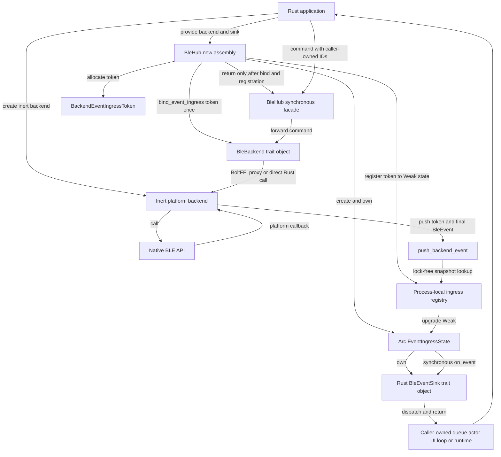
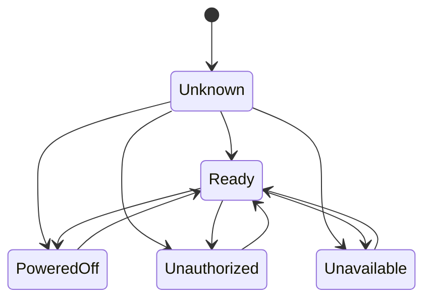
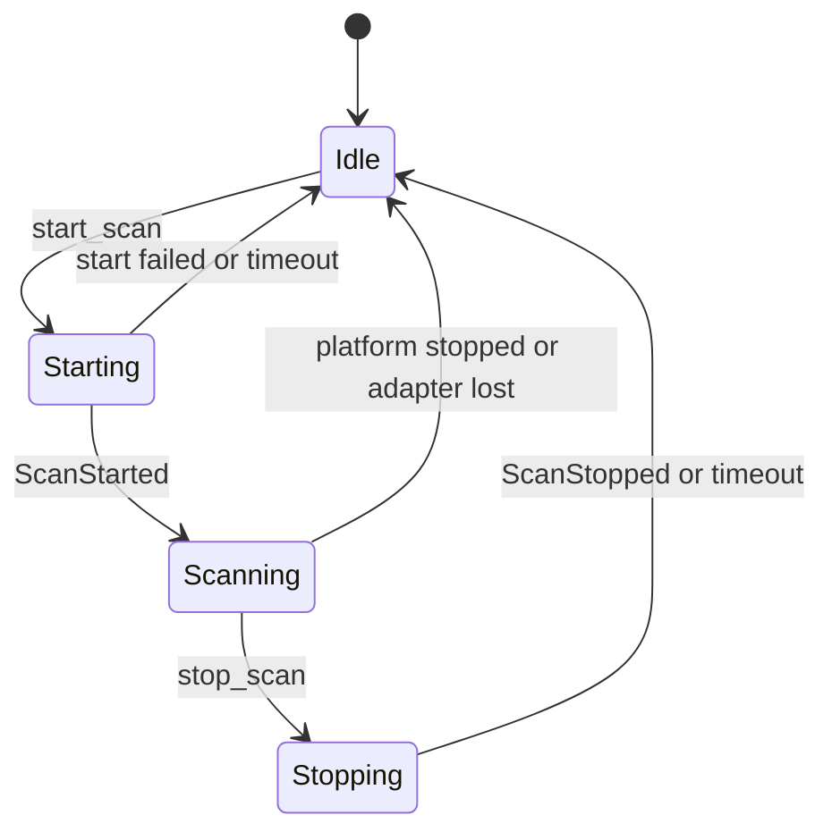
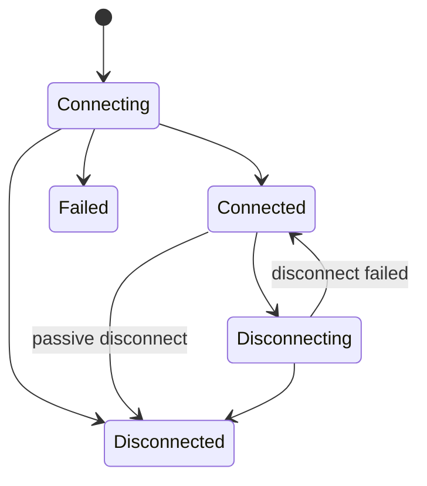
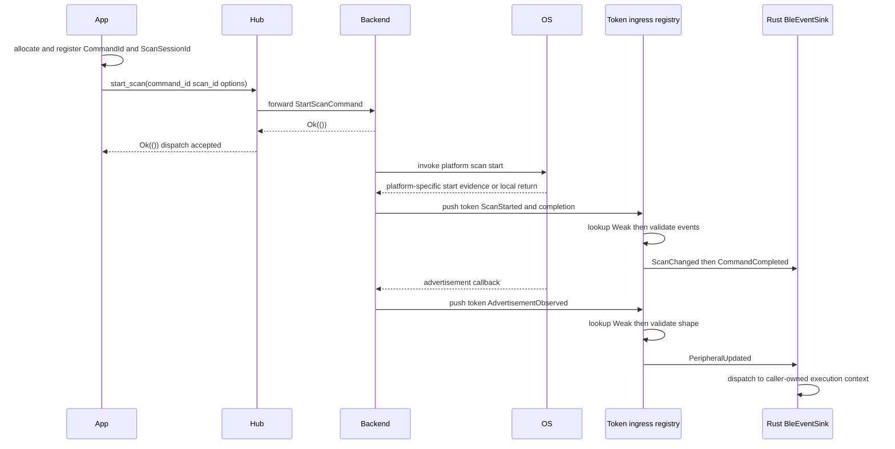
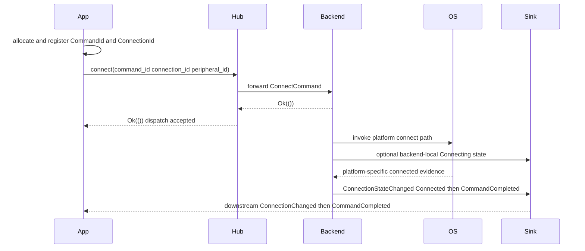
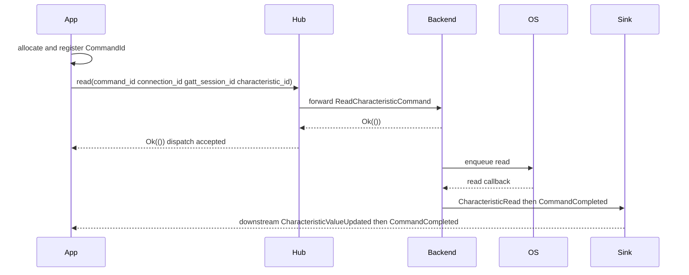
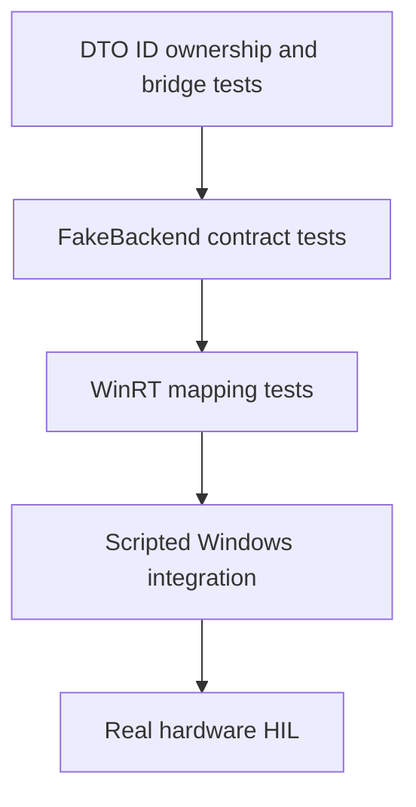
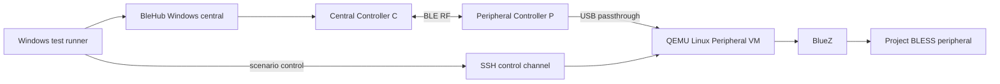
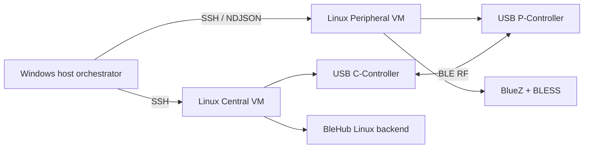

# BleHub 项目计划

**状态：待 Review**

**日期：2026-08-28**

**硬件状态：QEMU/BLESS HIL 等待 USB 蓝牙适配器到货，当前不执行。**

本文件是 BleHub 唯一规划来源。Review 通过前不创建脚手架或实现代码；通过后从 Phase 0 开始执行。本文同时作为未来架构文档、API 文档和平台接入文档的来源。

---

## 1. 项目目标

BleHub 是一个以 Rust 为核心、支持 Windows、Android、iOS、macOS 和 Linux 的 BLE Central 抽象层。

上层应用只使用统一的 adapter、扫描、peripheral handle、连接、GATT、命令和事件基础模型；平台差异通过 capability、optional 字段和结构化平台错误表达，不伪造完全一致的行为。BleHub 是轻量协议适配层，不是设备管理框架。

开发顺序：

1. **Windows**：第一开发平台、参考实现和主要测试宿主。
2. **Android**：验证 BoltFFI 跨语言 backend 抽象，与 Windows 一起组成 v0.1。
3. **iOS/macOS**：复用稳定契约接入 Swift CoreBluetooth。
4. **Linux**：复用稳定契约接入 BlueZ D-Bus。

### 1.1 v0.1 必须支持

- adapter 可用性、开关和权限/授权状态
- 开始扫描、停止扫描和持续 advertisement 更新
- service UUID、设备名、manufacturer data 等基础扫描条件
- 连接、主动断开和被动断连
- GATT service、characteristic、descriptor 基础发现
- characteristic read
- write with response / without response
- notification / indication 开启、数据和关闭
- RSSI 读取
- 命令成功、失败、平台确认的超时/取消、caller deadline、重复和过期/晚到事件的统一 contract 与下游 reference handling（BleHub core 不内建 command tracker）
- 平台 capability 查询
- 幂等且线程安全的资源关闭
- Windows 与 Android 共享行为测试和真实外设闭环

### 1.2 设计时预留，但不阻塞 v0.1

- Android MTU request / MTU changed
- Android PHY 和 connection priority
- service changed 与 GATT cache invalidation
- pairing / bonding
- background scan / background connection
- Linux 多 adapter
- 持久化设备身份恢复

### 1.3 明确不做

- BLE Peripheral / GATT Server
- Classic Bluetooth
- 用 MAC 地址承诺跨平台、跨安装或长期稳定的设备身份
- 把所有平台错误压扁成字符串
- 在公共 API 暴露 WinRT、Android、CoreBluetooth 或 D-Bus 对象
- 在 backend trait 中暴露 `Future`、Rust stream 或平台 async 类型
- BleHub core 自建 Tokio/async executor、后台线程池或事件循环
- 设备选择、排序、收藏、分组、持久化 inventory 和跨进程身份恢复
- 自动连接、自动重连、重试退避、连接保活和业务 session orchestration
- 固件升级、业务协议、产品设备模型、fleet management 和云端同步
- 多应用订阅合并、后台任务调度和复杂资源仲裁
- 通用异步 `ShutdownCommand`；四个平台都没有统一的整体 BLE shutdown completion，v0.1 只提供本地幂等 `dispose/close`
- 等所有平台完整后才发布第一个版本

---

## 2. 已确定技术方案

| 领域 | 决策 |
|---|---|
| 核心语言 | Rust 2024 edition |
| FFI | BoltFFI；版本由 `Cargo.lock` 固定，当前本地参考版本 `0.30.1` |
| backend | Rust 定义 `BleBackend: Send + Sync` trait object |
| backend 方法 | 普通同步 `fn`，不使用 `async fn` |
| 调用模型 | fire-and-forget：同步 `Result` 表示即时校验/投递是否成功；`Ok` 后的平台 operation 结果通过事件完成 |
| 事件上行 | 平台 callback 经 backend 映射为统一 `BleEvent`；v0.1 调用 Rust exported `push_backend_event(BackendEventIngressToken, BleEvent)`，由 registry 解析到 `Weak<EventIngressState>` 后进入 bridge，再调用 Rust downstream `BleEventSink` trait object；BoltFFI #869 修复后迁移为 exported class handle 直推 |
| 事件落点 | 下游 `BleEventSink` 自行投递到 channel、Handler、actor、UI loop 或自选 runtime |
| 执行模型 | BleHub core 无 mailbox、无 pump、无 executor、无线程、无自有事件循环 |
| 状态归属 | 调用方拥有业务/command/session 状态；backend 拥有 native handle 状态；BleHub 不维护 canonical BLE state |
| Windows | Rust + `windows-rs` |
| Android | Kotlin + Android BLE API + BoltFFI trait object |
| Apple | Swift + CoreBluetooth + BoltFFI trait object |
| Linux | Rust + `dbus-rs` + BlueZ D-Bus |
| Rust 依赖 | Cargo |
| 外部工具 | Pixi |
| 项目 recipes | 根 Justfile；Just 由 Pixi 提供 |
| 标准入口 | `pixi run just <recipe>` |

### 2.1 `btleplus` 选择性参考（非架构基线）

CodeGraph 检查当前 `espkit/crates/std/btleplus` 后，BleHub 只借鉴少量领域语义：

- `PeripheralSnapshot` 中 local name、advertised services、manufacturer data、service data、RSSI、connectable 等 advertisement 字段。
- scan-time observation 与较稳定 device identity 分离；同一 peripheral 可以持续产生新 observation。
- GAP / GATT 的术语边界，以及 duplicate UUID instance 不能被简单 UUID map 覆盖的教训。

BleHub 不依赖或照搬 `btleplus` 代码。当前 `btleplus` 没有适合直接复用的 backend trait/event bridge；其 `AdapterRuntime`、Tokio timeout、canonical state、device/connection registry、GATT cache、phase wrapper ownership 和 UUID-only characteristic lookup 都不适合本项目的无 runtime、FFI-first 薄桥。BleHub 的 opaque GATT instance ID、caller-owned session ID 和 fire-and-forget event contract 独立设计。

数据结构也不是逐字段复制：`btleplus` 的平台 `id: String` 在 BleHub 中改为 backend opaque `PeripheralId`；`service_data` 使用 FFI 友好的 record list 而不是 map；`connectable` 使用 `Option<bool>` 表达平台缺失。将来若 `btleplus` 变化，不驱动 BleHub 公共 ABI 自动变化。

### 2.2 术语

核心与事件术语：

- **Thin Bridge**：Rust 中无 executor、无线程、无领域状态机的同步桥；只持有 backend、`EventIngressState`、command/close synchronization gate 和最小 lifecycle state。
- **Backend**：实现 `BleBackend` 的平台适配对象，负责把同步 command 投递给 WinRT、Android BLE、CoreBluetooth 或 BlueZ。
- **Closed Flag**：`EventIngressState` 内部从 `false` 单向变为 `true` 的原子 lifecycle 标记；它不是 event tag，也不是锁。`push` 用它快速拒绝 close 后 callback。
- **Command/Close Gate**：保护 backend ownership 的读写同步边界；command 取得 shared/read guard，close 取得 exclusive/write guard，防止 backend method 执行期间释放 backend。
- **Event Tag**：`BleEvent` tagged union 中标识 payload variant 的判别值；结构校验检查 tag 与 payload 是否匹配，与 Hub 是否 closed 无关。
- **Command Dispatch / 命令投递**：public method 的短同步阶段。`Ok(())` 表示 backend 已接管 request/correlation IDs，并已排入自己的平台执行路径或开始 native call；backend 此后只能通过事件报告 operation 结果。它不表示 OS/BLE operation 已完成，更不表示成功。
- **Dispatch Rejection / 投递拒绝**：同步 `Err(CommandDispatchError)`；表示 command 未被 backend 接管到异步完成通道，因此该 `CommandId` 后续严格无事件。
- **Operation Completion / 操作完成**：accepted command 后由 backend 通过 domain event 与 terminal `CommandCompleted` 表达的最终结果。证据可能是平台 callback/async result，也可能是平台没有 completion 时定义明确的 backend-local acceptance；`Succeeded` 的强度按 command/platform 逐项定义，绝不统一解释为“外设已处理”。
- **Backend Event Ingress**：backend 把最终 `BleEvent` 送回 Rust 的受控入口。v0.1 是 opaque `BackendEventIngressToken` + exported `push_backend_event(token, event)` + process-local `token -> Weak<EventIngressState>` registry；BoltFFI #869 修复后迁移为 backend retain 的 exported `BackendEventIngressHandle`。两者都不是 downstream sink trait object。
- **Downstream Event Sink**：Rust application 实现并传给 BleHub 的 `BleEventSink: Send + Sync` trait object；它不是 BoltFFI foreign trait object。Rust bridge 完成最小结构校验后同步调用 `on_event(BleEvent) -> Result<(), EventSinkError>`。
- **Event Dispatch**：`BleEventSink` 的实现只负责按调用方策略接纳事件，例如放入 Rust channel、actor 或自选 runtime，并立即返回。`Ok(())` 表示 sink 已按自己的策略接纳事件，`Err(EventSinkError)` 表示未接纳。
- **Caller State**：command terminal、active scan/connection/GATT/subscription、timeout/retry 和业务状态均由调用方维护。
- **Backend State**：native adapter/device/GATT object、callback token、pending correlation 和 opaque public handle 映射由每个平台 backend 私有维护；只有 backend 的 command implementation 与 platform callback handler 访问，BleHub 不查询、不复制也不对外暴露这些状态。
- **Application Policy**：设备选择、排序、自动重连、retry、业务 session 等上层策略，不属于 BleHub。

BLE 与测试硬件术语：

- **Host**：运行 BLE host stack 的操作系统，例如 Windows Bluetooth stack 或 Linux BlueZ。
- **Controller**：真实蓝牙芯片/USB 蓝牙棒中的 HCI controller 和 radio。
- **Adapter**：操作系统/backend 对 controller 的软件表示，例如 BlueZ `Adapter1`；文档谈物理硬件时优先使用 controller。
- **Central**：扫描并发起连接的一侧，是 BleHub 支持的产品角色。
- **Peripheral**：广播并提供 GATT Server 的一侧；项目测试中由 Linux VM + BlueZ + BLESS 承担。
- **Central Controller（C-Controller）**：被测 Central 使用的物理蓝牙 controller。
- **Peripheral Controller（P-Controller）**：Linux Peripheral VM 独占的物理蓝牙 controller。
- **DUT（Device Under Test）**：当前被测的 BleHub Central 平台实现，例如 Windows 或 Android。
- **TPE（Test Peripheral Environment）**：Linux Peripheral VM、P-Controller、BlueZ、BLESS、scenario 和 telemetry 的整体。

文档不使用“主蓝牙棒/从蓝牙棒”作为正式术语。BLE 当前角色应写 Central/Peripheral；“主/从”还可能与 Host/Controller 层级混淆。

### 2.3 Rust 生态复用策略

原则是优先复用维护良好、语义匹配的 Rust 生态，依赖数量和 crate 数量本身不是优化目标。选择依据是维护质量、目标平台支持、FFI/ABI 影响、编译成本和能否减少自研错误；只有当依赖会把不属于 BleHub 的 runtime/state policy 强塞进 core 时才拒绝。

| 依赖/能力 | v0.1 决策 |
|---|---|
| `boltffi` | 必需；公共 DTO、foreign trait object 和 Rust class/handle 绑定 |
| `uuid` | 建议复用；Rust 内部解析、校验和规范化 BLE UUID；FFI wire 首版仍使用 canonical string |
| `windows` (`windows-rs`) | Windows backend 必需，不能泄漏到公共 DTO |
| `dbus` (`dbus-rs`) | Linux Phase 6 backend 使用，不进入 Windows/Android 首批依赖图 |
| `serde` / `serde_json` | test scenario、BLESS 控制面和日志 fixture 使用；不是 BleHub 事件运行时依赖 |
| `proptest` | dev-dependency 候选，用于 command outcome、duplicate/stale/orphan 和 close race 的状态序列测试 |
| `loom` | Phase 0 dev-dependency 候选，用于枚举纯 Rust closed flag、mutex、RwLock 与 Arc/Weak interleaving；不替代真实 JNI/Swift runtime stress，引入前按 local-first 规则固定版本并检查源码 |
| `thiserror` | Rust 内部和公开 Rust error 类型默认使用；跨 FFI `Result<T, E>` 的 `E` 还必须使用 BoltFFI `#[error]`，异步 event error 使用 BoltFFI data record |
| 同步与并发生态 | per-Hub gate/mutex 优先 `std`；v0.1 ingress registry 的 read-mostly 小表优先评估 `arc-swap` immutable snapshot/RCU，避免每个 event 获取全局锁；只有 entry/write 规模证明需要时才评估 `papaya`/`scc::HashIndex`，不默认使用仍有分片锁的 `dashmap`；core 不自建 channel，但 downstream adapter 可直接复用 `crossbeam`/`flume`/Tokio channel |
| `slotmap`/generational arena | Phase 1 评估 opaque handle 生命周期；若满足 BoltFFI `u64` wire 与不复用规则，优先复用而不是手写 generation/arena |
| Tokio/async runtime | 不进入 core/backend trait；具体 backend 可使用平台已有 callback context 或调用方注入执行器 |
| `bitflags` | 可用于 Rust/backend 内部 property flags；FFI public shape 首版使用生成语言更清晰的 bool record 或显式整数 mask |
| `tracing` | 建议用于 structured diagnostics、command/session correlation 和 HIL 日志；subscriber 由调用方安装 |
| `insta` | dev-dependency 候选，用于稳定 event scenario/FFI shape snapshot；若普通断言更清晰则不强制 |

FFI payload 首版仍使用 BoltFFI 支持最稳定的 `Vec<u8>`/record/enum；backend 或 downstream 内部可以使用 `bytes`、channel、actor 等成熟生态并在边界转换。原则不是“能手写就不依赖”，而是“不让依赖改变已确定的薄层职责”。

### 2.4 官方平台 API 证据库

公共 command/event contract 不只依赖经验判断。项目把与 BLE Central 语义直接相关的官方资料固定在 `docs/platform-api-reference/`，并通过以下唯一入口更新：

```text
pixi run just docs-update
```

当前来源与缓存策略：

- Windows：Microsoft `winrt-api` 固定 commit，包含 Bluetooth adapter/radio/access、advertisement watcher、device 和 GATT API。
- Android：Google 官方 Android 36 SDK Sources `source-36_r01.zip`，后端实现语言仍是 Kotlin；Java Framework source/Javadocs 是 Kotlin 所调用 API 的权威语义来源。
- Apple：Apple CoreBluetooth 官方 Markdown live snapshot。
- Linux：BlueZ 官方 D-Bus RST 固定 commit。
- Pooch 缓存 Android/Windows/BlueZ 的不可变 artifact 并校验已知 hash；Hishel 对 Apple live docs 使用 RFC HTTP cache、ETag/Last-Modified 条件重验证。
- `sources.lock.json` 记录 revision、URL、SHA-256、抓取时间和 upstream terms；更新过程使用临时目录并在全部成功后原子安装。

本 plan 的跨平台 operation matrix 以这些 snapshot 为设计证据。实现发现 API 语义变化时，先更新 snapshot/lock 和 matrix，再改变公共契约；生成文件不手工编辑。

---

## 3. 设计原则

1. **命令与事件分离**：命令方法立即返回，BLE 结果只能通过事件表达。
2. **BleHub 不做状态真源**：调用方维护 command/session/业务状态，backend 维护 native handle；BleHub 只转发 command，并对 backend 已构造的统一 `BleEvent` 做最小结构校验和直接交付。
3. **ID 所有权显式**：command/scan/connection/GATT session/subscription ID 由调用方提供；discovery handle 由 backend 生成且保持 opaque。
4. **扫描快照不等于设备身份**：同一设备可持续产生新的 observation。
5. **不伪造平台一致性**：用 capability、optional 字段和平台错误表达差异。
6. **允许 backend 同步 callback**：调用 backend 时不持有领域/protocol 状态锁；仅可持有 ingress 不会获取的 command/close lifecycle guard，因此 backend 可在 trait method 返回前调用 ingress sink。这不表示 downstream `on_event` 可以同步重入 BleHub。
7. **事件可关联**：命令结果原样回显调用方提供的 `CommandId`；平台主动变化可没有 command ID。
8. **显式 session 隔离**：所有 event 回显 caller-owned scan/connection/GATT/subscription ID；调用方据此忽略旧 session，不依赖 BleHub 隐式 generation。
9. **显式关闭**：不依赖 Rust Drop、JVM GC 或 Swift ARC 的精确时机。
10. **Windows-first，但不 Windows-shaped**：核心模型不得包含 WinRT 专属类型和假设。
11. **先 contract，再平台**：事件序列和异常组合先由纯 Rust FakeBackend/conformance harness 固定；状态机是契约参考，不是 BleHub 内部实现。
12. **调用方拥有运行时和事件队列**：BleHub core 不创建 mailbox、executor、线程池或事件循环；下游 sink 决定事件进入哪个线程、channel、Looper 或 DispatchQueue。
13. **成熟生态优先、按职责拆 crate**：优先复用经过验证的 Rust crate，不以最少依赖为目标；共享 contract/bridge、可复用 testkit 和各平台 backend 按依赖与发布边界拆分，但不把某个 async runtime 固化为公共 API。
14. **Ingress state 最小化**：`EventIngressState` 只保留 downstream ownership、closed flag 和用于 delivery/close-drain 的 mutex；Hub 另有 command/close gate。两者都不保留 command/device/connection/GATT registry。

---

## 4. 总体架构

事件路径有两个方向相反、所有者不同的端点，必须先区分：

| 端点 | 创建或实现方 | 持有并调用方 | 作用 |
|---|---|---|---|
| `BackendEventIngressToken` | BleHub/Rust 分配的 opaque FFI data token | platform backend | v0.1 backend 调用 `push_backend_event(token, event)` 时定位对应 Rust ingress state |
| `BleEventSink` Rust trait object | Rust application 实现并传给 BleHub | Rust bridge | bridge 把已校验的 `BleEvent` 交给调用方自己的队列或运行时 |

`BackendEventIngressToken` 不是 downstream trait object，也不是 Rust pointer。v0.1 因 BoltFFI #869 使用 process-local registry 将 token 解析为 `Weak<EventIngressState>`；backend 仍不能直接持有或调用应用 sink，否则会绕过 BleHub 的 close gate、结构校验和 delivery serialization。理想形态是 backend 直接持有 exported `BackendEventIngressHandle`，但当前 BoltFFI 不能把该 class handle 作为 foreign trait method 参数。两种形态共享相同的一次性 bind、Weak ownership 和 event delivery 语义。



Windows/Linux 的 `BackendApi` 与 `BackendImpl` 通常是同一个 Rust object；Android/Apple 则由 BoltFFI command proxy 把 `BackendApi` 调用转到 Kotlin/Swift `BackendImpl`。OS callback 只进入 backend implementation/delegate handler，再调用 exported `push_backend_event`；它不回调 `BleBackend` command trait 或其 vtable。
Windows/Linux 的 `BleBackend` 通常是 Rust object；Android/Apple 则是 Kotlin/Swift object 经 BoltFFI trait object 进入 Rust。BleHub downstream 固定为 Rust application 实现的普通 Rust trait object：Android/Apple 事件只在 backend 调用 `push_backend_event(token, event)` 时发生一次 native→Rust FFI crossing；registry lookup 只取得 `Weak` 并立即释放全局锁，随后 `EventIngressState::push -> BleEventSink::on_event` 都是 Rust 内部调用。

### 4.1 命令下行

1. 调用方先登记自己的 `CommandId`/session IDs，再把完整 FFI-safe request 交给 `BleHub`。
2. `BleHub` 只检查本地 lifecycle/wire 前置条件，并把 request 原样转发给 `BleBackend`；它不分配 ID、不查询 BLE protocol state。
3. backend 将命令投递到自己的平台执行位置：Android `Handler/Executor`、Apple serial queue、Windows/Linux OS callback context 或注入的 driver。thread-affine native object 不离开该位置。
4. method 立即返回 `Result<(), CommandDispatchError>`：
   - `Ok(())`：backend 已接受 command 并负责后续事件结果，不表示 OS/BLE operation 成功；
   - `Err(...)`：command 未进入事件生命周期，该 `CommandId` 后续必须零事件。
5. accepted command 的成功、失败、实际取消或平台 timeout 只通过 `BleEvent` 表达。

`BleBackend: Send + Sync` 允许 Hub ownership 跨线程移动并允许多个 caller thread 通过 `&self` 发令；它不允许任意线程直接操作 thread-affine native object，也不要求 BleHub 创建 worker 或串行执行器。

### 4.2 事件上行

装配时：

1. Rust application 实现 `BleEventSink: Send + Sync`。
2. platform factory 在 Kotlin/Swift/Rust 本地构造不含 ingress、尚未启动 BLE 工作且不会产生 callback 的 inert backend。
3. application 调用 `BleHub::new(backend, event_sink)`；constructor 创建并强持有 `Arc<EventIngressState>`，把 Rust sink 保存到 state，并分配非零、进程生命周期内永不复用的 `BackendEventIngressToken`。
4. constructor 调用一次 `backend.bind_event_ingress(token)`。bind 期间 token 尚未注册；backend 必须保持 inert、不得调用 `push_backend_event`，`Err` 必须表示未 retain token。
5. bind 成功后，constructor 才在 process-local registry 中注册 `token -> Weak<EventIngressState>`，保存该 entry 的 instance-owned registration guard，然后返回完整 Hub。registry 只负责 FFI ingress 路由，不是 BLE domain state。
6. bind 失败时，constructor 关闭 state、best-effort `dispose` backend 并返回 `BleHubError`；token 永不复用。bind 成功但 registry registration 失败时同样 rollback，backend 已 retain 的 token只能得到 `Closed`，随后由 dispose 释放。
7. close 先关闭并排空 state，再 dispose backend，最后注销 registry entry；因此 dispose 中或其后的迟到 callback 要么解析到 closed state，要么查不到 token，统一返回 `Closed`。

理想方案是 constructor 创建只含 `Weak<EventIngressState>` 的 `BackendEventIngressHandle` 并直接调用 `backend.bind_event_ingress(handle)`，从而删除 token registry。当前 BoltFFI `0.30.1` 无法生成 foreign trait method 的 exported Rust class-handle 参数，证据为 `spikes/boltffi-class-handle-callback-param/` 与上游 [issue #869](https://github.com/boltffi/boltffi/issues/869)。因此 v0.1 明确采用 token workaround；不使用 raw pointer、不会把 `Arc` 地址编码成整数，也不恢复 builder。

平台 callback 到达时：

1. backend 用自己的 native handle/correlation state 构造最终统一 `BleEvent`。event 由关联字段和 public FFI-safe payload 组成：既可携带 caller-owned IDs/backend opaque handles，也可携带 advertisement 数据、adapter/connection 状态、GATT hierarchy、characteristic/notification bytes、RSSI、统一错误和 diagnostic 等公共 DTO。禁止跨边界的是 WinRT/`BluetoothGatt`/`CBPeripheral`/D-Bus proxy 等 native object，以及只对 backend 有意义的 private key/token。
2. backend 调用 `push_backend_event(token, event)`。
3. exported function 从 `ArcSwap<HashMap<...>>` immutable snapshot 中 lock-free 查找 token并 clone 对应 `Weak<EventIngressState>`，在 upgrade 或调用 state 前释放 snapshot guard。token 不存在、已注销或 weak upgrade 失败时返回 `Closed`；成功后通过 state 的 downstream mutex 串行化同一 hub 的交付，并检查 event tag/payload shape。它不做 ID 映射、stale/duplicate 判断或状态归约。
4. state 在当前 callback 线程同步调用 `BleEventSink::on_event(event)`。
5. downstream sink 只按调用方策略把事件接纳到 Rust channel、actor 或 runtime，然后尽快返回 typed `Result`。

`Delivered` 只表示 `on_event` 返回 `Ok(())`，不表示 downstream 业务已处理。`DownstreamFailed { message }` 表示 sink 返回 `Err(EventSinkError)` 或 delivery mutex 已 poison；message 供调用 `push` 的 backend 记录诊断，但 backend 不得解析 message、据此自动重试或把它当 BLE operation failure。`BleEventSink` contract 要求实现不得 panic，所有预期失败都走 typed `Result`。Kotlin/Swift exception 的边界在 foreign backend method 与 exported ingress wrapper，`downstream.on_event` 本身不跨 FFI。

### 4.3 并发、同步 callback 与 close

BleHub 每实例只需要两个互不嵌套的 lifecycle/delivery 同步边界和一个原子标记。v0.1 token workaround 另有 process-local immutable registry snapshot：event lookup 通过 `ArcSwap` lock-free load，不增加 per-event 全局 mutex；极少发生的 insert/remove 使用 RCU 复制小表并原子替换：

| 机制 | 保护什么 | 不保护什么 |
|---|---|---|
| command/close gate | backend ownership；command 使用 shared guard，close 使用 exclusive guard | 不保存 command table，不参与 event ingress |
| `EventIngressState.downstream` mutex | `Option<Box<dyn BleEventSink>>` ownership、串行 `validation -> on_event`、close 排空 in-flight delivery | 不等待 downstream 业务处理，不保护 BLE protocol state，不拥有 downstream queue |
| closed flag | 单向标记 ingress lifecycle；供 `push` 在加锁前后检查 | 不是 mutex，不是 event tag，不单独提供 in-flight drain 保证 |
| process-local registry snapshot | v0.1 `token -> Weak` immutable map；lookup lock-free，insert/remove 用 RCU replacement | snapshot guard 不跨 `Weak` upgrade、validation、sink call 或 close；不保存 BLE state |

close 在持有 exclusive command/close gate 后，先把 closed flag 置为 `true`，再取得 downstream mutex。该锁会等待已经进入的 `on_event` 返回；随后 close `take()` 并释放 downstream sink，再 dispose backend，最后注销 token entry。新 `push` 要么查到 state 后看到 closed，要么在注销后查不到 token，因此不会在 close 排空后开始新的 delivery。snapshot lookup 与 RCU unregister 的竞争只决定 callback 从哪条路径返回 `Closed`。

由此得到以下约束：

- backend 可以在 command method 返回前同步 `push`；ingress 不获取 command/close gate，因此不会因这条路径自锁。
- event 可能先于公共 method 的 `Ok(())` 到达 downstream。request/event 必须自带完整关联 ID；backend 一旦为该 command 发出任何事件，就不得再返回 `Err`。
- downstream `on_event` 在 `EventIngressState.downstream` mutex 的 delivery 临界区内被调用，所以只能快速 dispatch，不能同步重入同一个 `BleHub`；后续命令必须在 downstream 自己的执行位置发出。
- close 先阻止新 command，将 ingress 标记为 closed，排空已经进入的 callback并释放 downstream sink，再 dispose/release backend、注销 token entry；`close()` 返回后没有活跃或可新开始的 downstream callback。晚到 callback 因 closed state、missing token 或 weak upgrade failure 返回 `Closed`。
- BleHub 没有 protocol state lock、线程、mailbox、pump 或 executor。callback 从哪个线程进入，`on_event` 就在哪个线程被同步调用；业务线程由 downstream 决定。

详细 ownership graph、linearization point、竞态矩阵、备选方案与 Phase 0 验证方法见 [`docs/research/ffi-lifecycle-concurrency.md`](../docs/research/ffi-lifecycle-concurrency.md)。该调研记录证据与推荐，不替代本 Plan 的已审决策。

---

## 5. 组件职责

### 5.1 `BleHub`

概念对象形状：

```rust
pub struct BleHub {
    // 同时是 backend ownership slot 和 command/close gate。
    backend: RwLock<Option<Box<dyn BleBackend>>>,
    ingress: Arc<EventIngressState>,
    // BoltFFI #869 修复并迁移到 direct handle 后删除。
    ingress_registration: BackendEventIngressRegistration,
}
```

`BleHub` 不再另设一份 closed flag：command path 在 backend slot 中观察 `None`，event path 观察 `EventIngressState.closed`。字段声明顺序不承担 lifecycle 协议；显式 `dispose/close` 和 Rust `Drop` fallback 必须走 8.12 的同一幂等关闭逻辑。

**拥有：**

- 一个 `Box<dyn BleBackend>`；
- 强引用 `Arc<EventIngressState>`；state 内含 closed flag 和 `Mutex<Option<Box<dyn BleEventSink>>>`；
- v0.1 ingress token 的私有 `BackendEventIngressRegistration` RAII guard；
- command/close gate 和 backend ownership。

**负责：**

- 在 `BleHub::new` 内创建 `EventIngressState`、分配 ingress token、一次性绑定 inert backend并注册 `token -> Weak<EventIngressState>`，只在 bind 和 registration 都成功后向 application 返回完整 Hub；
- 同步接收 command，执行本地前置检查并原样转发 caller-owned IDs；
- 按 4.2 将 ingress event 交给 downstream sink；
- 执行幂等 close，并切断后续 event delivery。

**不负责：**分配 ID、维护 command/device/connection/GATT 状态、timeout/retry、事件队列、线程、executor 或业务策略。

### 5.2 `BleBackend`

**输入：**`BleHub` 转发的 FFI-safe command，以及装配阶段交付的 opaque `BackendEventIngressToken`。

**负责：**

- 按平台线程模型投递 command，并准确返回即时 accepted/rejected；
- 管理 native BLE object、callback token、串行 GATT operation 和最小 callback correlation；
- 把平台 callback 转为最终 `BleEvent`，回显 caller-owned IDs，再通过 `push_backend_event(token, event)` 上送；
- 按 lifecycle/session 回收平台资源并通过共享 conformance contract。

**不得：**直接调用 downstream `BleEventSink`、让 native object 跨公共边界、把平台状态复制成 BleHub canonical registry，或依赖 BleHub 修正 backend 发出的跨事件语义。

backend-private 状态及释放边界：

| 状态 | 规模与释放 |
|---|---|
| native adapter/manager/dispatcher | 每 backend O(1)，`dispose/close` 释放 |
| `PeripheralId -> native object/reopen token` | O(本 lifecycle 发现的不同 peripheral)；优先只保留轻量 reopen key，native 重对象在平台允许时尽早释放 |
| `ConnectionId -> native connection` | O(active/closing connection)，disconnect 或 `dispose/close` 释放 |
| GATT opaque ID -> native service/characteristic/descriptor | O(active GATT session attributes)，rediscover/disconnect 时整 session 释放 |
| pending platform callback correlation | O(in-flight command)，只保存回显 caller IDs 所需的最小 operation metadata |
| callback registration token / Android GATT operation queue | O(active callback/in-flight operation)，平台完成、取消、断连或 `dispose/close` 时释放 |

这些状态是 backend-private routing/correlation state，不是供 BleHub 查询的 repository，也不是 BleHub domain state。下行时，BleHub 只把携带 public IDs 的 command 原样转发，backend 自己用 ID 查找 native object/reopen token 并调用平台 API；上行时，backend callback handler 自己把 native object/pending operation 反查为 public IDs 和 caller `CommandId`，构造完整 `BleEvent` 后 push。BleHub 不读取这些 map、不请求 snapshot，也不通过 facade 暴露查询接口；唯一例外是装配时固定的 `BackendCapabilities` metadata，它不包含动态 adapter/device/connection/GATT 状态。

Android callback 不直接携带 caller `CommandId`，WinRT/CoreBluetooth/BlueZ native object 也不能跨 FFI，因此上述映射只能由 backend 保存并按 session 回收。`PeripheralId` map 是唯一可能随长期扫描增长的部分；它用于后续 command 以 `PeripheralId` 路由到 native object/reopen token，不是供 Hub 枚举设备。v0.1 soak 记录 entry 数和内存，优先使用轻量 reopen token，只有真实数据证明必要时才另行设计 eviction。

### 5.3 `EventIngressState`、token 与 registry

v0.1 保留同一个最小私有 state，但因 BoltFFI #869 使用 opaque data token 和 process-local routing registry：

```rust
struct EventIngressState {
    closed: AtomicBool,
    downstream: Mutex<Option<Box<dyn BleEventSink>>>,
}

#[boltffi::data]
pub enum EventIngressStatus {
    Delivered,
    Closed,
    InvalidEvent { message: String },
    DownstreamFailed { message: String },
}

impl EventIngressState {
    fn push(&self, event: BleEvent) -> EventIngressStatus {
        if self.closed.load(Ordering::Acquire) {
            return EventIngressStatus::Closed;
        }

        let downstream = match self.downstream.lock() {
            Ok(downstream) => downstream,
            Err(error) => {
                return EventIngressStatus::DownstreamFailed {
                    message: error.to_string(),
                };
            }
        };

        // close may have started while this push was waiting for the mutex.
        if self.closed.load(Ordering::Acquire) {
            return EventIngressStatus::Closed;
        }

        let Some(downstream) = downstream.as_deref() else {
            return EventIngressStatus::Closed;
        };

        if let Err(error) = event.validate_shape() {
            return EventIngressStatus::InvalidEvent {
                message: error.to_string(),
            };
        }

        match downstream.on_event(event) {
            Ok(()) => EventIngressStatus::Delivered,
            Err(error) => EventIngressStatus::DownstreamFailed {
                message: error.to_string(),
            },
        }
    }
}

#[boltffi::data]
#[derive(Clone, Copy, Debug, PartialEq, Eq, Hash)]
pub struct BackendEventIngressToken {
    pub value: u64,
}

type EventIngressRegistrySnapshot =
    HashMap<u64, Weak<EventIngressState>>;

struct BackendEventIngressRegistry {
    next_token: AtomicU64,
    entries: ArcSwap<EventIngressRegistrySnapshot>,
}

impl BackendEventIngressRegistry {
    fn allocate_token(&self) -> Result<BackendEventIngressToken, BleHubError>;

    fn register(
        self: &Arc<Self>,
        token: BackendEventIngressToken,
        state: Weak<EventIngressState>,
    ) -> Result<BackendEventIngressRegistration, BleHubError>;

    fn lookup(
        &self,
        token: BackendEventIngressToken,
    ) -> Option<Weak<EventIngressState>> {
        self.entries.load().get(&token.value).cloned()
    }

    fn unregister(&self, token: BackendEventIngressToken);
}

// register/unregister use ArcSwap::rcu to clone the small immutable
// snapshot, insert/remove one entry, and atomically replace it.

struct BackendEventIngressRegistration {
    registry: Arc<BackendEventIngressRegistry>,
    token: BackendEventIngressToken,
    registered: AtomicBool,
}

impl BackendEventIngressRegistration {
    fn unregister(&self) {
        if self.registered.swap(false, Ordering::AcqRel) {
            self.registry.unregister(self.token);
        }
    }
}

impl Drop for BackendEventIngressRegistration {
    fn drop(&mut self) {
        self.unregister();
    }
}

static BACKEND_EVENT_INGRESS_REGISTRY: LazyLock<
    Arc<BackendEventIngressRegistry>,
> = LazyLock::new(|| Arc::new(BackendEventIngressRegistry::new()));

fn global_backend_event_ingress_registry() -> &'static Arc<BackendEventIngressRegistry> {
    &BACKEND_EVENT_INGRESS_REGISTRY
}

fn push_backend_event_with_registry(
    registry: &BackendEventIngressRegistry,
    token: BackendEventIngressToken,
    event: BleEvent,
) -> EventIngressStatus {
    let Some(state) = registry.lookup(token).and_then(|state| state.upgrade()) else {
        return EventIngressStatus::Closed;
    };
    state.push(event)
}

#[boltffi::export]
pub fn push_backend_event(
    token: BackendEventIngressToken,
    event: BleEvent,
) -> EventIngressStatus {
    push_backend_event_with_registry(
        global_backend_event_ingress_registry().as_ref(),
        token,
        event,
    )
}
```

ownership 链：

```text
downstream creates Box<dyn BleEventSink>
-> BleHub owns Arc<EventIngressState>
-> EventIngressState owns downstream sink
-> BleHub owns BackendEventIngressRegistration
-> process-local registry entry owns only Weak<EventIngressState>
-> backend owns only opaque BackendEventIngressToken
```

`Mutex<Option<Box<dyn BleEventSink>>>` 有三个明确用途：串行化同一 hub 的 `on_event`、让 close 等待 in-flight delivery 返回、让 close 通过 `take()` 确定性释放 downstream。它不是额外的 trait abstraction。`BleEvent::validate_shape` 是私有、无状态的纯结构校验。`downstream.on_event(event)` 是普通 Rust trait 调用，所有可预期失败都由 typed `Result` 表达；它不得 panic。通用的 Rust panic containment 属于最外层 generated/manual FFI trampoline，不属于 event delivery 算法，也不能把 panic 解释为普通 downstream rejection。

- `Delivered`：同步 `downstream.on_event` 返回 `Ok(())`；表示 sink 已按自己的策略接纳，不表示 downstream 业务已处理事件。
- `Closed`：token 未注册/已注销、weak upgrade 失败、closed flag 已置位或 downstream 已被 close 取走；未知或迟到 token 安全 no-op。
- `InvalidEvent { message }`：tag/payload/wire shape 不合法，属于 backend contract violation；message 是 validation diagnostic，不能用于 stale/duplicate 判断。
- `DownstreamFailed { message }`：downstream 返回 `Err(EventSinkError)` 或 mutex poison/failure；message 原样或等价地提供给调用 `push` 的 backend 记录诊断，但不得作为稳定机器协议、不得自动重试该 event。panic 是 contract violation，不是 `EventSinkError`。该 payload enum 经 exported `push` 返回 platform backend 的生成 shape，以及 BoltFFI 最外层 trampoline 的 panic 行为由 Phase 0 spike 固定。
- token 是 opaque routing capability，不是地址、Rust pointer、native object ID 或可由 backend 解析的业务字段；`0` 无效，分配器溢出时 constructor 失败而不是 wrap。token 在同一进程生命周期内永不复用，防止 stale callback 路由到后来创建的 Hub。
- `BackendEventIngressRegistry` 封装 token allocator、`ArcSwap` entries 和 `register/lookup/unregister`。private `LazyLock<Arc<...>>` 是 production FFI 唯一实例，`global_backend_event_ingress_registry()` 隔离 static access；不得在运行时替换该全局实例。
- exported `push_backend_event` 只把全局 registry 传给 private `push_backend_event_with_registry`。pure Rust tests 直接构造独立 registry并调用 helper；Hub assembly tests 调 private `BleHub::new_with_registry`，避免并行测试共享/替换全局状态。
- registry 是 crate/process 级 FFI 基础设施，但 entry 生命周期由对应 Hub 的私有 `BackendEventIngressRegistration` RAII guard 管理；它只保存 `Weak`，不会延长 Hub/downstream 生命周期。guard 由 `BackendEventIngressRegistry::register` 创建、存入 Hub，explicit close 调 `unregister()`，`Drop` 幂等兜底。
- `ArcSwap` lookup 只在 immutable snapshot guard 下 clone `Weak`；snapshot guard 不跨 upgrade、validation、sink call 或 close。register/unregister 是极低频 RCU write，复制 O(active Hub) 小表。
- bind 成功后先注册 entry 再返回 Hub；close 在 closed/drain 和 backend dispose 之后注销 entry。未注册、已注销和 stale token 都返回 `Closed`，backend 不得自动重试。
- 旧 Kotlin/JVM builder spike 只部分验证了 exported class wrapper 的 Weak ownership、Rust/JVM 跨线程调用、clone/free 和 close race；v0.1 token registry 对象图必须由新的 Kotlin/JVM 与 Swift spike 验证。
- `push_backend_event` 不调用 reducer，不判断 stale/duplicate，也不拥有 queue。

### 5.4 Thin bridge state

BleHub 仅保留：

- `Box<dyn BleBackend>` ownership。
- `Arc<EventIngressState>` ownership；state 内部持有 closed flag 和可在 close 时取走的 downstream sink。
- 一个私有 `BackendEventIngressRegistration` RAII guard，负责在 explicit close 或 Drop 时幂等注销本 Hub 的 `token -> Weak<EventIngressState>` entry。
- command/close synchronization gate，防止本地 `close()` 与正在下发的同步 backend method 发生资源释放竞争；它不序列化所有 BLE command，也不保存 command 数据。

backend 只持有 opaque token，registry entry 只持有 `Weak<EventIngressState>`；因此 backend、stale token 或晚到 callback 不会延长 Hub/downstream 生命周期。state 的 downstream mutex 同时负责串行 delivery 与 close drain，不再增加 bridge trait 或另一把 delivery lock。registry 使用 `ArcSwap` immutable snapshot；read path lock-free，snapshot guard 在进入 state 前释放，RCU write 只发生在 Hub 构造/关闭。

BleHub 明确不保留：

- command pending/terminal table。
- device/peripheral registry。
- connection registry。
- GATT database/cache/revision registry。
- notification subscription registry。
- canonical snapshot 或 state revision。
- timeout/deadline/clock。
- event sequence、duplicate set、stale/orphan filter 或 event history。

因此 BleHub 自身状态是固定 O(1)，不会随扫描设备数、连接数、GATT attribute 数或 command 数增长。跨事件正确性通过 caller-owned typed IDs、backend-private native handle map、下游状态机和共享 conformance tests 保证。

### 5.5 Downstream event sink

```rust
#[derive(Debug, thiserror::Error)]
#[error("event sink rejected delivery: {message}")]
pub struct EventSinkError {
    pub message: String,
}

pub trait BleEventSink: Send + Sync {
    fn on_event(&self, event: BleEvent) -> Result<(), EventSinkError>;
}
```

- sink trait object 由 Rust application 实现并传给 `BleHub::new`；它保留 `Send + Sync`，因为 callback 虽由 state 的 downstream mutex 串行，但调用线程可能来自 WinRT/JVM/Swift/BlueZ callback context。
- `BleEventSink` 是普通 Rust trait，不使用 `#[boltffi::export]`；v0.1 Kotlin/Swift backend 只能调用 exported `push_backend_event(token, event)`，未来 direct-handle backend 只能调用 exported `BackendEventIngressHandle`，两者都不能实现或持有 downstream sink。BleHub 不提供 native application consumer API 或 native sink adapter；若下游项目需要向 Kotlin/Swift 暴露事件，由该项目在 BleHub 之外自行使用 BoltFFI 或其他 FFI 包装其 Rust application/sink，额外边界不属于 BleHub contract。
- BleHub 不保存 public event queue，不提供 pump/stream，也不决定 backpressure policy。
- `on_event` 可从平台 callback thread 进入 Rust 后被同步调用；`EventIngressState.downstream` mutex 保证同一 hub 的 event callback 串行；下游可在自己的 queue 中编号。
- sink 实现必须快速 dispatch 并返回，不执行长业务逻辑，不同步重入 BleHub，并且不得 panic；所有可预期失败必须返回 `Err(EventSinkError)`。
- `Ok(())` 表示 sink 已按自身 queue/drop/coalesce 策略接纳该 delivery attempt；`Err(EventSinkError)` 表示未接纳。BleHub 将其 message 放入 `DownstreamFailed { message }` 返回 backend，但不解释具体 queue/backpressure policy，也不自动重试。
- `EventSinkError.message` 和 ingress status message 都只是简短 UTF-8 diagnostic，不是稳定错误码，不得包含 secret，也不得由 backend 解析成控制流；结构化分类由 `EventIngressStatus` variant 提供。

---

## 6. 公共契约数据结构

以下是领域草案，准确 derive、BoltFFI attribute 和字段类型在实现时按生成器限制调整。

### 6.1 ID 与作用域

```rust
pub struct CommandId(pub u64);
pub struct ScanSessionId(pub u64);
pub struct PeripheralId(pub u64);
pub struct ConnectionId(pub u64);
pub struct GattSessionId(pub u64);
pub struct GattServiceId(pub u64);
pub struct GattCharacteristicId(pub u64);
pub struct GattDescriptorId(pub u64);
pub struct SubscriptionId(pub u64);
```

ID 所有权：

| ID | 生成方 | 作用域 |
|---|---|---|
| `CommandId` | 调用方 | 同一 hub/backend lifecycle 内唯一且不得复用 |
| `ScanSessionId` | 调用方 | 一次 start -> stop/fail scan lifecycle |
| `ConnectionId` | 调用方 | 一次 connect -> disconnect lifecycle |
| `GattSessionId` | 调用方 | 一次 discover request 及其结果生命周期 |
| `SubscriptionId` | 调用方 | 一次 enable -> disable/disconnect lifecycle |
| `PeripheralId` | backend | backend instance/lifecycle 内的 opaque discovered peripheral handle |
| `GattServiceId` | backend | `ConnectionId + GattSessionId` 内有效 |
| `GattCharacteristicId` | backend | `ConnectionId + GattSessionId` 内有效 |
| `GattDescriptorId` | backend | `ConnectionId + GattSessionId` 内有效 |

规则：

- BleHub 不分配或登记 caller-owned ID，也不检查重复；调用方 allocator 是其 runtime/application 的一部分。
- caller-owned `CommandId` 和各类 session ID 必须在调用 BleHub 前分配；`0` 保留为 invalid/unset，不作为有效 ID。
- caller-owned ID 在同一 hub/backend lifecycle 内不得复用于另一个 command 或 session；最简单的实现是调用方维护单调递增 allocator。
- backend 提供的每个 `BleEvent` 必须原样回显相关 caller-owned ID。
- backend-generated `PeripheralId` 及 GATT ID 在同一 backend lifecycle 内不得复用于不同 native object；GATT ID 还必须遵守表中声明的 session 作用域。
- ID 不复用使晚到 callback 与新 command/session 始终可区分；调用方通过比较显式 ID 忽略 stale event，BleHub 不隐式判断“当前 session”。
- backend 生成的 discovery ID 是 FFI-safe opaque handle，不是 MAC、native pointer 或平台对象。
- `PeripheralId` 不承诺跨 backend restart、应用重启或重新安装稳定。
- backend 私有 map 负责 `PeripheralId/GATT ID -> native object`；WinRT device ID、Android address/object、CoreBluetooth UUID/object 和 BlueZ object path 不跨公共边界。
- typed `u64` 是首版 wire shape；如 BoltFFI 目标语言生成质量要求调整，可改为 data record/string token，但所有权语义不变。

### 6.2 Caller-owned command envelope

每个 command request 显式携带 caller-owned correlation IDs。v0.1 production command DTO 完整集合如下；后续章节只解释语义，不重复定义：

```rust
pub struct InitializeCommand {
    pub command_id: CommandId,
}

pub struct StartScanCommand {
    pub command_id: CommandId,
    pub scan_session_id: ScanSessionId,
    pub options: ScanOptions,
}

pub struct StopScanCommand {
    pub command_id: CommandId,
    pub scan_session_id: ScanSessionId,
}

pub struct ConnectCommand {
    pub command_id: CommandId,
    pub connection_id: ConnectionId,
    pub peripheral_id: PeripheralId,
}

pub struct DisconnectCommand {
    pub command_id: CommandId,
    pub connection_id: ConnectionId,
}

pub struct DiscoverGattCommand {
    pub command_id: CommandId,
    pub connection_id: ConnectionId,
    pub gatt_session_id: GattSessionId,
}

pub struct ReadCharacteristicCommand {
    pub command_id: CommandId,
    pub connection_id: ConnectionId,
    pub gatt_session_id: GattSessionId,
    pub characteristic_id: GattCharacteristicId,
}

pub struct WriteCharacteristicCommand {
    pub command_id: CommandId,
    pub connection_id: ConnectionId,
    pub gatt_session_id: GattSessionId,
    pub characteristic_id: GattCharacteristicId,
    pub value: Vec<u8>,
    pub write_type: WriteType,
}

pub enum NotificationMode {
    Notification,
    Indication,
}

pub struct SetNotificationsCommand {
    pub command_id: CommandId,
    pub connection_id: ConnectionId,
    pub gatt_session_id: GattSessionId,
    pub subscription_id: SubscriptionId,
    pub characteristic_id: GattCharacteristicId,
    pub mode: NotificationMode,
    pub enabled: bool,
}

pub struct ReadRssiCommand {
    pub command_id: CommandId,
    pub connection_id: ConnectionId,
}
```

`NotificationMode` 必须显式提供：Android CCCD notification/indication payload 不同，Windows CCCD value 不同，Apple/BlueZ 也可能按 characteristic capability 选择不同路径；当 characteristic 同时支持两者时，backend 不应暗中决定优先级。disable command 回显原 `SubscriptionId` 并携带该 subscription 的 mode。

概念上的 backend trait：

```rust
#[boltffi::export]
pub trait BleBackend: Send + Sync {
    fn bind_event_ingress(
        &self,
        token: BackendEventIngressToken,
    ) -> Result<(), BleHubError>;
    fn capabilities(&self) -> BackendCapabilities;
    fn initialize(&self, command: InitializeCommand) -> Result<(), CommandDispatchError>;
    fn start_scan(&self, command: StartScanCommand) -> Result<(), CommandDispatchError>;
    fn stop_scan(&self, command: StopScanCommand) -> Result<(), CommandDispatchError>;
    fn connect(&self, command: ConnectCommand) -> Result<(), CommandDispatchError>;
    fn disconnect(&self, command: DisconnectCommand) -> Result<(), CommandDispatchError>;
    fn discover_gatt(&self, command: DiscoverGattCommand) -> Result<(), CommandDispatchError>;
    fn read_characteristic(&self, command: ReadCharacteristicCommand) -> Result<(), CommandDispatchError>;
    fn write_characteristic(&self, command: WriteCharacteristicCommand) -> Result<(), CommandDispatchError>;
    fn set_notifications(&self, command: SetNotificationsCommand) -> Result<(), CommandDispatchError>;
    fn read_rssi(&self, command: ReadRssiCommand) -> Result<(), CommandDispatchError>;
    fn dispose(&self) -> Result<(), BleHubError>;
}
```

边界规则：

- backend 必须以 inert 状态构造：没有 ingress，不启动 BLE 工作，不注册会产生 domain event 的 callback，也不接受 command。
- `bind_event_ingress` 是 `BleHub::new` 内部调用的一次性 lifecycle assembly method，不是 BLE command：第一次成功后 backend 保存 opaque token，但仍保持无 callback source 的 inert 状态；重复 bind 必须返回 typed `BleHubError`；bind 期间不得执行 BLE operation、调用 `push_backend_event` 或 emit event。
- `bind_event_ingress` 返回 `Err` 时，backend 保证未保存传入 token；constructor 随后关闭 state、best-effort dispose backend 并返回错误。application 在 constructor 成功前拿不到 Hub，因此不存在公开的 unbound command 状态。
- v0.1 token 是对 BoltFFI [issue #869](https://github.com/boltffi/boltffi/issues/869) 的明确 workaround。它只通过受控 exported function 查找 `Weak`，绝不编码 raw pointer。理想 direct-handle 迁移保留相同 method 名、一次性 bind 和 rollback 语义，只把参数换成 `BackendEventIngressHandle` 并把 `push_backend_event(token, event)` 换成 `handle.push(event)`。
- BLE command method 返回 `Result<(), CommandDispatchError>`。`Ok(())` 只表示 backend 已接管 command 到自己的 completion channel，不表示 native API 或 BLE operation 成功；`Err` 表示 command 未被接管，该 `CommandId` 此后不得产生任何事件。
- native API 的 `false`、Android `BluetoothStatusCodes != SUCCESS`、HRESULT、D-Bus error 等如果发生在 backend 已 post/接管 command 之后，必须成为异步 terminal failure；不能因为它恰好很快发生就反悔返回 `Err`。
- 如果 backend 直接在当前栈调用 native API，且在 emit 任何 event 前就确定请求完全未进入平台 completion flow，可以返回 dispatch `Err`；各 backend conformance 必须固定这一分界，不能同时 emit event。
- 若 backend 在 trait method 返回前同步 emit 任一事件，command 已进入事件通道，method 必须返回 `Ok(())`。
- `dispose` 不是 BLE command：没有 `CommandId`、没有 `CommandCompleted`，只执行本 backend 的本地 best-effort quiesce/resource release 并返回同步 lifecycle result。即使返回 `Err`，对象也进入 closed 状态，不能继续发令。

### 6.3 Hub 装配接口

v0.1 不提供通用 `BleHubConfig`。唯一公开构造入口接收 inert backend 与 Rust downstream sink，并在内部完成一次性绑定：

```rust
impl BleHub {
    pub fn new(
        backend: Box<dyn BleBackend>,
        event_sink: Box<dyn BleEventSink>,
    ) -> Result<BleHub, BleHubError>;

    pub fn capabilities(&self) -> BackendCapabilities;

    pub fn start_scan(
        &self,
        command: StartScanCommand,
    ) -> Result<(), CommandDispatchError>;

    pub fn connect(
        &self,
        command: ConnectCommand,
    ) -> Result<(), CommandDispatchError>;

    // initialize/stop_scan/disconnect/GATT/read/write/notify/RSSI
    // 与 BleBackend command 一一对应，并返回相同的 dispatch Result。

    pub fn dispose(&self) -> Result<(), BleHubError>;
}
```

概念上的 constructor 实现如下；准确 error conversion、foreign ownership transfer 与 best-effort cleanup 次序必须由 Phase 0 固定：

```rust
impl BleHub {
    pub fn new(
        backend: Box<dyn BleBackend>,
        downstream: Box<dyn BleEventSink>,
    ) -> Result<Self, BleHubError> {
        Self::new_with_registry(
            backend,
            downstream,
            Arc::clone(global_backend_event_ingress_registry()),
        )
    }

    fn new_with_registry(
        backend: Box<dyn BleBackend>,
        downstream: Box<dyn BleEventSink>,
        registry: Arc<BackendEventIngressRegistry>,
    ) -> Result<Self, BleHubError> {
        let ingress = Arc::new(EventIngressState::new(downstream));
        let token = registry.allocate_token()?;

        if let Err(error) = backend.bind_event_ingress(token) {
            ingress.close_and_drain();
            let _ = backend.dispose();
            return Err(error);
        }

        let registration = match registry.register(
            token,
            Arc::downgrade(&ingress),
        ) {
            Ok(registration) => registration,
            Err(error) => {
                ingress.close_and_drain();
                let _ = backend.dispose();
                return Err(error);
            }
        };

        Ok(Self {
            backend: RwLock::new(Some(backend)),
            ingress,
            ingress_registration: registration,
        })
    }
}
```

这里依赖明确的 backend contract：`bind_event_ingress` 返回 `Err` 时没有 retain token；返回 `Ok` 时已保存唯一 token，但仍不启动 callback source，且 bind 过程中没有 event。registration 在 bind 成功后、Hub 返回前完成；若 registration 失败，constructor 关闭 state并 dispose 已绑定 backend。public facade 不重解释 backend 的 command 返回值：它只在本地 closed/wire validation 失败时直接返回 `CommandDispatchError`，否则原样返回 backend 的 dispatch `Result`。所有 command request 均按 value 传递并携带 caller-owned IDs。`dispose()` 是单独的本地 lifecycle API，不进入 command/event contract；准确导出名需在 Phase 0 避免与 BoltFFI Kotlin `AutoCloseable.close()` 生成方法冲突。

原则：

- 平台执行上下文、权限宿主和平台专属配置在创建 native backend 时提供，不塞入通用 Hub config。
- `BleBackend`/`BleEventSink` trait 自身已经声明 `Send + Sync`，所以 `Box<dyn Trait>` 自动保留这些约束，无需在每个使用点重复 `+ Send + Sync`。
- event queue、容量、drop/coalesce 和 backpressure 由下游 sink 配置。
- timeout scheduler 由下游拥有；BleHub 不维护 clock/timer。
- BleHub 没有 recent command retention、public ID allocator 或 BLE domain registry。v0.1 唯一的 process-local ingress registry 是 `ArcSwap<HashMap<u64, Weak<EventIngressState>>>` immutable snapshot，只保存 O(active Hub) 的 FFI routing entry，不需要用户配置。

### 6.4 Platform 与 capabilities

```rust
pub enum Platform {
    Windows,
    Android,
    Apple,
    Linux,
    Test,
}

pub struct BackendCapabilities {
    pub platform: Platform,
    pub supports_service_scan_filter: bool,
    pub supports_duplicate_scan_results: bool,
    pub supports_connectable_flag: bool,
    pub supports_read_rssi: bool,
    pub supports_request_mtu: bool,
    pub supports_connection_priority: bool,
    pub supports_phy_control: bool,
    pub supports_pairing_api: bool,
    pub supports_multiple_adapters: bool,
}
```

capability 表示 backend 能力，不表示 adapter 当前可用。`BleHub::capabilities()` 是同步、无 `CommandId`、无 event 的静态 backend metadata query；动态状态通过 adapter/permission event 表达。

v0.1 connected one-shot RSSI capability 固定为：Windows `false`、Android `true`、Apple `true`、BlueZ/Linux `false`。Windows `RawSignalStrengthInDBm` 与 BlueZ `Device1.RSSI` 都是 advertisement/inquiry observation，不满足 `ReadRssiCommand` 语义。

### 6.5 Adapter 与权限

```rust
pub enum AdapterPhase {
    Unknown,
    Unavailable,
    PoweredOff,
    Ready,
    Unauthorized,
}

pub enum PermissionState {
    Unknown,
    NotRequired,
    NotDetermined,
    Denied,
    Restricted,
    Granted,
}

pub struct AdapterSnapshot {
    pub phase: AdapterPhase,
    pub permission: PermissionState,
    pub name: Option<String>,
    pub platform: Platform,
}
```

adapter state 与 permission 分开，因为 Android/Apple 的授权变化和硬件开关不是同一状态维度。Windows v0.1 只枚举/read radio state，不控制系统 radio，因此不调用会弹 consent UI 的 `Radio.RequestAccessAsync()`，其 BLE read/scan lifecycle snapshot 通常使用 `PermissionState::NotRequired`；package capability/OS policy 导致的实际拒绝仍映射为 operation error。Android/Apple 按平台 authorization/permission API 填充动态状态。

### 6.6 扫描配置

```rust
pub struct ScanOptions {
    pub service_uuids: Vec<String>,
    pub name_prefix: Option<String>,
    pub manufacturer_id: Option<u16>,
    pub allow_duplicates: bool,
}
```

规则：

- backend 尽量把 service UUID 等条件下推给 OS，并在 native callback mapping 中补做 OS 未覆盖但可从 observation 判断的 name/manufacturer filter。
- BleHub bridge 不保存 active `ScanOptions`，因此不二次过滤，也不会把一次 backend input 变成零/多个 output。
- `allow_duplicates` 是请求平台报告重复/变化 observation 的 hint，不承诺跨平台完全相同；BleHub 和 backend 不为此维护长期 duplicate set。downstream 用 `PeripheralId + ScanSessionId` 决定是否合并。
- Rust 侧可提供无状态纯函数用于 UUID 规范化和单条 observation predicate；Windows/Linux backend 与 downstream 可复用，Kotlin/Swift 由共享 conformance fixtures 验证同一语义。
- 平台无法提供的字段使用 optional data/capability 表达，不为“统一”伪造值。

### 6.7 Advertisement 数据

```rust
pub struct ManufacturerData {
    pub company_id: u16,
    pub payload: Vec<u8>,
}

pub struct ServiceData {
    pub service_uuid: String,
    pub payload: Vec<u8>,
}

pub struct AdvertisementObservation {
    pub scan_session_id: ScanSessionId,
    pub peripheral_id: PeripheralId,
    pub local_name: Option<String>,
    pub advertised_services: Vec<String>,
    pub manufacturer_data: Vec<ManufacturerData>,
    pub service_data: Vec<ServiceData>,
    pub rssi: Option<i16>,
    pub connectable: Option<bool>,
    pub platform_timestamp_ms: Option<u64>,
}

```

`connectable` 是 `Option<bool>`，因为不是每个平台和每次 advertisement 都能可靠提供。`AdvertisementObservation` 就是 v0.1 对外的基础 peripheral scan-properties DTO；不再额外定义容易暗示“canonical/latest state”的 production `PeripheralProperties`。`PeripheralEntry`、merged latest properties、observation cache 和设备列表属于 downstream projection，不由 BleHub 定义或保存。

### 6.8 Scan session

```rust
pub enum ScanPhase {
    Starting,
    Scanning,
    Stopping,
    Stopped,
    Failed,
}

pub enum ScanStopReason {
    Requested,
    AdapterUnavailable,
    PermissionRevoked,
    PlatformError,
    SystemSuspended,
    Unknown,
}

pub struct ScanSession {
    pub id: ScanSessionId,
    pub options: ScanOptions,
    pub phase: ScanPhase,
    pub started_at_ms: Option<u64>,
    pub stopped_at_ms: Option<u64>,
    pub start_command: CommandId,
    pub stop_command: Option<CommandId>,
    pub observed_devices: u64,
}
```

`ScanSession` 是 conformance harness/downstream projection 示例，不是 BleHub runtime state，也不作为 v0.1 production API 导出，除非实现阶段证明它作为独立 DTO 有明确公共价值。

v0.1 conformance profile 规定每个 backend instance 同一时刻只执行一个 physical scan；BleHub 不保存 active scan，也不负责执行该限制。调用方负责串行化 scan session；backend 对冲突请求用相应 `CommandId/ScanSessionId` 发出明确 terminal failure。共享扫描、多逻辑订阅和订阅合并属于上层资源管理策略，不进入 BleHub v0.1。

`ScanStopped.command_id` 是 optional：主动 stop 成功时携带 stop command ID；WinRT error/suspend、adapter 状态变化或其他被动终止没有 stop command，必须为 `None`。被动 stop 不为已经 terminal succeeded 的 `StartScan` 再生成第二个 completion；`reason + error` 表达扫描 lifecycle 为什么结束。

### 6.9 连接模型

```rust
pub enum ConnectionPhase {
    Connecting,
    Connected,
    Disconnecting,
    Disconnected,
    Failed,
}

pub struct ConnectionRecord {
    pub id: ConnectionId,
    pub peripheral_id: PeripheralId,

    pub phase: ConnectionPhase,
    pub connect_command: CommandId,
    pub disconnect_command: Option<CommandId>,
    pub connected_at_ms: Option<u64>,
    pub disconnected_at_ms: Option<u64>,
    pub gatt_session_id: Option<GattSessionId>,
}
```

`ConnectionRecord` 是 conformance harness/downstream projection 示例，不是 BleHub runtime state，也不作为 v0.1 production API 导出，除非实现阶段证明它作为独立 DTO 有明确公共价值。connect timeout、自动重连、retry 和 backoff 完全由上层应用决定。

### 6.10 GATT database

```rust
pub struct CharacteristicProperties {
    pub readable: bool,
    pub writable_with_response: bool,
    pub writable_without_response: bool,
    pub notifiable: bool,
    pub indicatable: bool,
}
```

backend 发现 GATT database 时生成 opaque public GATT handle，并回显 caller-owned `GattSessionId`：

```rust
pub struct GattDatabase {
    pub connection_id: ConnectionId,
    pub gatt_session_id: GattSessionId,
    pub services: Vec<GattService>,
}

pub struct GattService {
    pub id: GattServiceId,
    pub uuid: String,
    pub primary: Option<bool>,
    pub characteristics: Vec<GattCharacteristic>,
}

pub struct GattCharacteristic {
    pub id: GattCharacteristicId,
    pub uuid: String,
    pub properties: CharacteristicProperties,
    pub descriptors: Vec<GattDescriptor>,
}

pub struct GattDescriptor {
    pub id: GattDescriptorId,
    pub uuid: String,
}
```

backend 自己维护上述 opaque ID 到 native object 的私有 map。BleHub 不接触 backend key，不保存 GATT database；调用方若需要 cache，消费 `GattDiscovered` 后自行保存。duplicate UUID instance 通过不同 GATT ID 保留。

### 6.11 GATT command

```rust
pub enum WriteType {
    WithResponse,
    WithoutResponse,
}
```

完整 read/write command DTO 已在 6.2 定义。调用方把 backend 先前返回的 public characteristic ID 与 caller-owned connection/GATT session ID 一起传回。BleHub 原样转发；backend 校验 handle 是否属于该 connection/GATT session，并解析 native object。`WithResponse` 的成功最多表示 ATT/GATT write response 或平台等价确认，不表示业务处理完成；`WithoutResponse` 的成功只表示平台接受/完成本地发送尝试，不存在跨平台 remote acknowledgement。

### 6.12 Notification

```rust
pub enum NotificationPhase {
    Enabling,
    Enabled,
    Disabling,
    Disabled,
    Failed,
}

pub struct NotificationRecord {
    pub id: SubscriptionId,
    pub connection_id: ConnectionId,
    pub gatt_session_id: GattSessionId,
    pub characteristic_id: GattCharacteristicId,
    pub phase: NotificationPhase,
    pub command_id: CommandId,
}
```

`NotificationRecord` 是 conformance harness/downstream projection 示例，不是 BleHub runtime state，也不作为 v0.1 production API 导出，除非实现阶段证明它作为独立 DTO 有明确公共价值。

notification callback 必须携带 caller-owned connection/GATT/subscription ID 和 backend 生成的 public characteristic ID。BleHub 不映射；下游按显式 ID 判断 subscription 是否仍属于当前 session。

### 6.13 命令模型

```rust
pub enum CommandKind {
    Initialize,
    StartScan,
    StopScan,
    Connect,
    Disconnect,
    DiscoverGatt,
    ReadCharacteristic,
    WriteCharacteristic,
    EnableNotifications,
    DisableNotifications,
    ReadRssi,
}

pub enum CommandOutcome {
    Succeeded,
    Failed,
    TimedOut,
    Cancelled,
}

pub enum ProjectedCommandPhase {
    Pending,
    Succeeded,
    Failed,
    TimedOut,
    Cancelled,
    Superseded,
}

pub enum CommandTarget {
    Hub,
    Scan(ScanSessionId),
    Peripheral(PeripheralId),
    Connection(ConnectionId),
    Characteristic(GattCharacteristicId),
    Subscription(SubscriptionId),
}

pub struct CommandRecord {
    pub id: CommandId,
    pub kind: CommandKind,
    pub target: CommandTarget,
    pub phase: ProjectedCommandPhase,
    pub created_at_ms: u64,

    pub completed_at_ms: Option<u64>,
    pub dispatch_error: Option<CommandDispatchError>,
    pub completion_error: Option<BleError>,
}
```

`CommandOutcome` 是 backend `CommandCompleted` 使用的 production DTO，只表示**已经被接受的 command** 最终按该 operation 的平台映射语义确认的成功、失败、平台超时或实际取消。`Succeeded` 的证据强度不是全局统一的：可能是 native callback/async result，也可能是没有 native completion 时 backend 完成了明确的本地提交动作；逐项定义见 7.9。`ProjectedCommandPhase`/`CommandRecord` 只是 downstream/conformance harness 参考，不由 BleHub 导出或保存；caller 在调用前先创建 `Pending` record，然后根据同步 `Err(CommandDispatchError)` 或异步 event 终结它。`dispatch_error` 与 `completion_error` 互斥：前者表示 command 从未进入事件生命周期，后者表示 command 已接受但异步执行失败。`Pending` 和 `Superseded` 是 caller-local 状态，backend 不伪造。

只有返回 `Ok(())` 的 command 才进入 backend event lifecycle。backend 对每个已接受 `CommandId` 至多 emit 一个 terminal `CommandCompleted`；平台已经给出最终结果的 accepted operation 必须 emit terminal event。同步 `Err` 不得伴随或跟随任何该 `CommandId` 的 event；一旦已 emit 任一 event，即使发生在 method 返回前，也必须返回 `Ok(())`。平台长期无回调时可由调用方 deadline 先终结自己的 projection，调用方负责检测 duplicate/orphan/late result。

### 6.14 错误模型

同步 FFI 调用错误与异步 BLE operation 错误分开：

```rust
#[boltffi::error]
#[derive(Clone, Debug, thiserror::Error)]
pub enum BleHubError {
    #[error("backend assembly failed: {message}")]
    BackendAssembly { message: String },
    #[error("invalid configuration `{field}`: {message}")]
    InvalidConfiguration { field: String, message: String },
    #[error("FFI contract error: {message}")]
    FfiContract { message: String },
}

#[boltffi::error]
#[derive(Clone, Debug, thiserror::Error)]
pub enum CommandDispatchError {
    #[error("BleHub is closed; cannot dispatch {operation:?}")]
    Closed { operation: CommandKind },

    #[error("invalid {operation:?} request: {message}")]
    InvalidRequest {
        operation: CommandKind,
        message: String,
    },

    #[error("backend unavailable for {operation:?} dispatch: {message}")]
    BackendUnavailable {
        operation: CommandKind,
        message: String,
        platform: Option<PlatformError>,
    },

    #[error("unexpected foreign backend exception: {message}")]
    FfiContract { message: String },
}

#[boltffi::data]
pub enum ErrorCategory {
    Permission,
    AdapterUnavailable,
    InvalidState,
    NotFound,
    Timeout,
    Cancelled,
    Connection,
    Gatt,
    Protocol,
    NotSupported,
    Backend,
    Internal,
}

#[boltffi::data]
pub struct PlatformError {
    pub platform: Platform,
    pub code: Option<String>,
    pub name: Option<String>,
    pub message: Option<String>,
}

#[boltffi::data]
#[derive(Clone, Debug, thiserror::Error)]
#[error("{operation:?}: {message}")]
pub struct BleError {
    pub category: ErrorCategory,
    pub operation: CommandKind,
    pub message: String,
    pub platform: Option<PlatformError>,
}
```

边界规则：

- 所有公开 Rust error 类型都实现 `std::error::Error`，优先由 `thiserror` 生成；这改善 Rust ergonomics，且 `thiserror` 不引入运行时。
- `thiserror` 只生成 Rust `Display/Error/source`，不定义 FFI wire format。用于 `Result<T, E>` 穿过 BoltFFI 的 `E` 还必须声明 BoltFFI `#[error]`；生成端再按 BoltFFI error style 映射成 Kotlin/Swift exception 或 result。
- `BleHubError` 只用于 constructor/bind assembly、config 和 FFI lifecycle 这类同步失败。
- `CommandDispatchError` 只用于 BLE command 的立即提交阶段：Hub 已关闭、request 无法通过基础 wire/shape 校验，或 backend/平台 dispatcher 无法接受该 command。它不表达扫描、连接、GATT 等 operation 的最终结果。
- permission denied、adapter off/unavailable、already scanning、unknown/stale BLE handle、connection/GATT status 等属于 operation/domain 结果；一旦 command 已被接受，就必须通过异步 `BleError`/event 表达，不能再降格为 dispatch `Err`。
- command method 返回 `Result<(), CommandDispatchError>`。`Ok(())` 是“已投递/已接受”的 acknowledgement，不是 operation completion；只有 accepted command 的异步结果才进入事件通道。
- `BleError` 是 accepted command 的异步 operation failure，承载于 `CommandCompleted` 等 `BleEvent` 中，同时可以为 Rust 调用方实现 `Error`；它跨 FFI 时是 data record，不会被自动 throw。
- `EventSinkError` 是 Rust-only downstream sink 对单次 delivery attempt 的拒绝，不使用 BoltFFI `#[error]`，不表达 BLE operation 结果，也不规定 queue/backpressure 策略。其 message 通过 `DownstreamFailed { message }` 供 backend 诊断，但不是稳定机器协议。
- 同一调用只能走一个边界：立即 `Err(CommandDispatchError)` 后不得有该 ID 的 event；一旦 backend emit 任一该 ID 的 event，就必须返回 `Ok(())`，后续最终失败使用 `BleError`。
- `#[boltffi::error] + #[derive(thiserror::Error)]` 以及 `#[boltffi::data] + thiserror` 的宏组合必须在 Phase 0 用当前 BoltFFI 版本实际编译 Kotlin/Swift bindings。若宏属性存在冲突，保留 BoltFFI wire 类型并为同一类型手写 `Display/Error`，或增加明确 conversion wrapper，不放弃 typed public error。
- BoltFFI foreign callback 若抛出声明类型之外的 Kotlin/Swift exception，会使用 `UnexpectedFfiCallbackError`；`BleHubError` 和 `CommandDispatchError` 必须实现对应 `From`，稳定映射到 `FfiContract`，不能让 exception 穿越 FFI 或随意映射成某个 BLE domain error。
- 平台错误映射必须保留原始 code/name，同时给出稳定 category，方便业务决策与诊断；native exception 不得直接穿过 Rust FFI 栈。
- capability 为 false 的可选 command（v0.1 主要是 Windows/BlueZ connected RSSI）若仍被调用，backend 接受后使用 `ErrorCategory::NotSupported` terminal failure；不得用 cached advertisement RSSI 伪装成功。
- 公共错误不提供 `retryable`、recommended backoff 或 user-facing action 等策略字段；retry、提示、降级和结果优先级由 downstream 根据 operation/category/platform context 决定。

### 6.15 Unified event payload

backend 直接构造最终统一事件。领域上建议使用 data enum；若 BoltFFI complex enum 生成结果不适合，再使用 tagged record，语义不变。

```rust
pub enum BleEventPayload {
    AdapterStateChanged { state: AdapterSnapshot },
    ScanStarted { command_id: CommandId, scan_id: ScanSessionId },
    AdvertisementObserved { advertisement: AdvertisementObservation },
    ScanStopped { command_id: Option<CommandId>, scan_id: ScanSessionId, reason: ScanStopReason, error: Option<BleError> },
    ConnectionStateChanged { command_id: Option<CommandId>, connection_id: ConnectionId, phase: ConnectionPhase, error: Option<BleError> },
    GattDiscovered { command_id: CommandId, connection_id: ConnectionId, gatt_session_id: GattSessionId, services: Vec<GattService> },
    CharacteristicRead { command_id: CommandId, connection_id: ConnectionId, gatt_session_id: GattSessionId, characteristic_id: GattCharacteristicId, value: Vec<u8> },
    CharacteristicWritten { command_id: CommandId, connection_id: ConnectionId, gatt_session_id: GattSessionId, characteristic_id: GattCharacteristicId },
    NotificationStateChanged { command_id: CommandId, connection_id: ConnectionId, gatt_session_id: GattSessionId, subscription_id: SubscriptionId, characteristic_id: GattCharacteristicId, enabled: bool },
    NotificationReceived { connection_id: ConnectionId, gatt_session_id: GattSessionId, subscription_id: SubscriptionId, characteristic_id: GattCharacteristicId, value: Vec<u8> },
    RssiRead { command_id: CommandId, connection_id: ConnectionId, rssi: i16 },
    CommandCompleted { command_id: CommandId, outcome: CommandOutcome, error: Option<BleError> },
    Diagnostic { level: DiagnosticLevel, message: String },
}
```

### 6.16 Public event

backend 填充完整 `BleEvent`；v0.1 调用 `push_backend_event(token, event)`，未来 direct-handle 路径调用 `BackendEventIngressHandle::push(event)`。两者进入同一个 Rust state；bridge 只校验 tagged payload shape，然后把同一个值传给 downstream sink：

```rust
pub enum BleEventKind {
    AdapterChanged,
    ScanChanged,
    PeripheralUpdated,
    ConnectionChanged,
    GattDatabaseChanged,
    CharacteristicValueUpdated,
    NotificationValue,
    RssiRead,
    CommandCompleted,
    Diagnostic,
}

pub struct BleEvent {
    pub kind: BleEventKind,
    pub command_id: Option<CommandId>,
    pub scan_id: Option<ScanSessionId>,
    pub peripheral_id: Option<PeripheralId>,
    pub connection_id: Option<ConnectionId>,
    pub gatt_session_id: Option<GattSessionId>,
    pub characteristic_id: Option<GattCharacteristicId>,
    pub subscription_id: Option<SubscriptionId>,
    pub payload: BleEventPayload,
}
```

一次 backend `push` 严格对应一次 downstream `on_event`，bridge 不推导、复制或合成额外事件。成功 command 需要表达 lifecycle/data update 时，backend 按顺序 emit 两个带同一 IDs 的事件：先发成功的 domain event，再发 `CommandCompleted(Succeeded)`；共享 conformance tests 固定顺序。失败 command 默认只发带 `BleError` 的 terminal `CommandCompleted`；只有失败本身同时造成可观察 domain state change 时，才先发对应 state event（例如 `ConnectionStateChanged(Failed)`），再发 terminal event。passive OS event 不对应 command，因此不发 `CommandCompleted`。`Succeeded` 不带 error；`Failed/TimedOut/Cancelled` 的 error/reason 规则在 contract tests 中固定。`Pending/Superseded` 不是 backend outcome。

### 6.17 Downstream projection（非 BleHub API）

需要 snapshot、设备列表或 command history 的应用，可以在自己的 runtime 中消费 `BleEvent` 并建立 projection。例如：

```rust
pub struct ExamplePeripheralProjection {
    pub peripheral_id: PeripheralId,
    pub latest: AdvertisementObservation,
    pub observation_count: u64,
}

pub struct ExampleApplicationBleState {
    pub adapter: Option<AdapterSnapshot>,
    pub active_scan: Option<ScanSessionId>,
    pub peripherals: Vec<ExamplePeripheralProjection>,
    pub active_connections: Vec<ConnectionId>,
    pub gatt_sessions: Vec<GattSessionId>,
    pub subscriptions: Vec<SubscriptionId>,
}
```

该结构只是文档示例，不由 BleHub 导出或保存。持久化、淘汰、排序、历史和并发模型全部由调用方决定。

---

## 7. Backend contract 与下游状态机参考

本章状态图用于共享 conformance tests 和下游 projection 设计，不是 BleHub 内部状态机。backend 必须正确标记 caller-owned IDs 并遵守平台事件契约；调用方决定当前 active session、terminal outcome、timeout 和 stale event policy。

### 7.1 Adapter



不变量：

- backend 在 adapter 非 `Ready` 时不得把 operation 伪装成已成功。若 request/dispatcher 本身可接受，应返回 `Ok(())` 并通过 `CommandCompleted(Failed)` 报告 adapter state；只有 command 确实无法进入异步完成通道时才返回 `Err(CommandDispatchError)`。BleHub 不预先维护 adapter state。
- adapter 离开 `Ready` 时，backend 应 emit scan/connection 终止相关事件。
- adapter 不可用导致的连接/GATT 失败必须回显对应 caller-owned `CommandId`。
- permission 与 adapter phase 分开表达；下游可投影为 `Unauthorized` UI 状态。

### 7.2 Scan



不变量：

- v0.1 backend contract 同一时间最多支持一个 active scan；调用方负责不并发启动第二个。backend 收到第二个 scan command 后若已接受处理，应返回 `Ok(())` 并异步报告 `InvalidState` failure；只有未接受/未投递时才返回 `Err(CommandDispatchError)`。
- `StartScan` command 在 `ScanStarted` 时 terminal succeeded；scan session 继续存在。
- `StopScan` 使用新的 caller-owned `CommandId` 并携带原 `ScanSessionId`。
- `AdvertisementObserved.scan_session_id` 必须回显 start request 的 scan ID。
- 主动 stop 的 `ScanStopped.command_id=Some(stop_command)`；平台被动 stop 使用 `None` 并提供 reason/error，不为已完成的 start command生成第二个 terminal。
- stop/failed 后晚到旧 session advertisement 仍携带旧 ID；调用方可直接忽略。
- 同一 backend lifecycle 中，同一平台 peripheral 的 duplicate advertisement 应复用 `PeripheralId`。

### 7.3 Connection



不变量：

- 调用方为每个新 connect intent 提供新的 `ConnectionId`。
- 一个 peripheral v0.1 最多一个 active connection；调用方遵守，backend 对违规请求返回失败。
- `Connected` terminal event 回显 connect `CommandId + ConnectionId`。
- 被动断连可以没有 command ID，但必须携带 `ConnectionId`。
- disconnect 后，下游将对应 GATT session 和 subscription 视为失效。
- 旧 `ConnectionId` callback 保留旧 ID；调用方不得将其应用到新连接。

### 7.4 GATT database

```text
Unknown -> Discovering -> Ready
                    \-> Invalidated/Failed
Ready -> Discovering    rediscover
Ready -> Invalidated    service changed or disconnect
```

不变量：

- discover request 携带 caller-owned `ConnectionId + GattSessionId`；backend 在非连接状态下返回失败。
- 每次 discover intent 由调用方提供新的 `GattSessionId`。
- 新 session 发布后，调用方不再使用旧 session 的 GATT ID。
- duplicate UUID 合法，backend 必须生成不同 GATT ID，不按 UUID 去重。
- backend 校验 read/write/notify 的 characteristic handle 属于 request 指定的 connection/GATT session。

### 7.5 Notification

```text
Disabled -> Enabling -> Enabled -> Disabling -> Disabled
                    \-> Failed          \-> Failed
Enabled -> Disabled on disconnect or GATT invalidation
```

不变量：

- enable 前校验 characteristic 支持 notify 或 indicate。
- enable command 与持续 notification data 分开。
- callback 必须回显 connection/GATT session/subscription/characteristic typed IDs。
- disconnect/rediscover 后调用方将旧 subscription ID 视为失效。
- disable 与本地 dispose/close 幂等。

### 7.6 Command lifecycle

```text
Pending -> Succeeded
Pending -> Failed
Pending -> TimedOut
Pending -> Cancelled
Pending -> Superseded
```

不变量：

- caller 在调用 public command method 前分配并登记 `CommandId`，使同步 callback 也能被正确关联。
- 立即返回 `Err(CommandDispatchError)` 表示 command 未被接受：caller 直接终结本地 record，backend 不得为该 ID emit domain event 或 `CommandCompleted`。
- 返回 `Ok(())` 后 command 进入事件生命周期。backend 对同一 accepted `CommandId` 至多 emit 一个 `CommandCompleted`；平台已经给出成功/失败等最终结果时，必须用同一 ID emit terminal event。
- backend 若在 method 返回前同步 emit 任一 event，必须返回 `Ok(())`；“先 emit、后 Err”是明确的 backend contract violation。
- 平台长期不回调时，BleHub 不代替 backend 启动 timer；caller deadline 可以先终结自己的 `CommandRecord`。backend 以后若给出唯一 completion，该 event 仍原样交付并由 caller 识别为 late。
- backend 不得为同一 `CommandId` emit 第二个 terminal result；调用方维护 terminal set，违规的第二个结果可记录 duplicate diagnostic。
- 成功且有 domain data/state 的 command 固定按 `domain event -> CommandCompleted(Succeeded)` 交付；失败默认只发 terminal event，可观察状态确有变化时才先发 failure state event。
- passive adapter/advertisement/notification/disconnect event 没有 command lifecycle，不合成 `CommandCompleted`。
- 调用方收到未知 command ID 时可记录 orphan diagnostic。
- command target 与 event IDs 不一致属于 backend contract violation。
- timeout 与 backend result 的竞争由调用方 runtime/state machine决定；先被调用方接受的 terminal outcome 获胜。
- timeout 后到达的 backend result 保留原 ID，由调用方识别并忽略。

### 7.7 Delivery order 与下游投影

- `EventIngressState.downstream` mutex 保证同一 BleHub 的 `on_event` 调用串行；BleHub 不分配全局事件编号。
- 下游把事件送入自己的 queue 时可自行编号和维护 state revision。
- platform timestamp 仅用于诊断，不用于跨线程排序。
- conformance harness 必须可确定性测试：同一 caller-owned ID 集合 + 同一 backend delivery order 得到同一 downstream projection。

### 7.8 v0.1 命令结果与异常事件处置矩阵

v0.1 能覆盖成功、失败、超时、取消、重复和过期/晚到事件，但“覆盖”不等于 BleHub 内建 command tracker。职责固定为：backend 只翻译平台事实、回显 ID 并清理自己拥有的 native resource；BleHub 只转发；downstream 决定 timeout/cancel/success race 的获胜结果、重试、去重、stale/orphan 处理和业务可见性。生产 bridge 对所有 wire-valid `BleEvent` 一视同仁：

| 情况 | backend 行为 | BleHub 行为 | downstream/caller 行为 |
|---|---|---|---|
| 立即提交拒绝 | method 返回 `Err(CommandDispatchError)`，且不得 emit 该 `CommandId` 的任何 event | 原样返回 `Err`，不合成 event | caller 已在调用前登记 ID；收到 `Err` 后立即终结本地 record |
| accepted command 成功 | method 返回 `Ok(())`；必要时先发 domain event，再发唯一 `CommandCompleted(Succeeded)` | 原值、原顺序转发 | 将 pending command 终结为 succeeded |
| accepted command 后续失败 | method 返回 `Ok(())`；发唯一 `CommandCompleted(Failed)`；真实 state 已变化时可先发 failure state event | 原值转发 | 保存异步 `BleError`，终结 command |
| 平台 timeout | method 已返回 `Ok(())`；平台/backend 确认 timeout 时可发唯一 `CommandCompleted(TimedOut)` | 原值转发，不启动 timer | 若 command 仍 pending 则接受，否则标记 late |
| caller deadline | backend 可以尚无 event | 无动作 | caller 自己转为 `TimedOut`，可发 stop/disconnect 等 cleanup command，之后忽略原 ID 的晚到 completion |
| 实际取消 | stop scan、disconnect、disable notification 等 operation-specific command 使用新 `CommandId`；原 operation 只有在平台/backend 确认取消时才可发 `Cancelled` | 不合成取消结果 | caller 可先本地标记 cancelled，并根据 session ID 忽略晚到数据 |
| duplicate observation | 可正常出现并携带相同 `ScanSessionId + PeripheralId` | 每次都转发 | caller 决定保留、合并、coalesce 或丢弃 |
| duplicate terminal | backend contract violation | wire-valid 时仍转发 | terminal set 识别 duplicate，保持第一次已接受 outcome |
| stale/expired event | 晚到 callback 保留旧 session/command IDs | 不过滤 | active ID 不匹配时忽略业务更新，可保留 telemetry |
| orphan event | event ID 在 caller table 中未知 | 不过滤 | 忽略或记录 backend/lifecycle diagnostic |

立即 `Err(CommandDispatchError)` 不是 `BleEvent`，也不产生 `BleError`。caller 必须先登记 ID 再调用，因为 accepted backend 可以在 public method 返回 `Ok(())` 之前同步 callback。测试和实现都必须把 `event -> Err`、`Err -> later event` 视为 backend contract violation，而不是尝试在 BleHub 内修复。

v0.1 不提供伪通用 `cancel(command_id)`：Windows、Android、CoreBluetooth 和 BlueZ 对 read/write/discover 的可取消能力不一致，通用 API 会暗示无法兑现的保证。可取消资源使用已有 operation-specific command；不可取消 operation 由 caller 本地终结并忽略 late result。`Superseded` 仅表示 caller 用新 intent 替代旧 intent，是 `ProjectedCommandPhase`，不会作为 backend `CommandOutcome` 发送。

测试支持代码可以定义 `ExampleEventDisposition::{Accepted, Duplicate, Stale, Orphan, ContractViolation}` 和 reference command tracker，用于 conformance/proptest；它们不是 BleHub production API 或运行时状态。

### 7.9 跨平台 operation completion matrix

本表是 v0.1 command/event 语义的核心依据。表中的“完成点”发生在 backend 已接受 command 之后；trait method 的同步 `Ok(())` 仍然只表示 backend 接管。平台 API 在 backend 执行上下文中返回 `false`、非 success status、HRESULT/exception 或 D-Bus error 时，backend 发送 terminal failure，不把它重新解释成先前 trait 调用的同步 `Err`。

| BleHub operation | Windows (`windows-rs` / WinRT) | Android（Kotlin / Framework API） | Apple（Swift / CoreBluetooth） | Linux（BlueZ D-Bus，后置） | v0.1 terminal success 语义 |
|---|---|---|---|---|---|
| `Initialize` | `GetDefaultAsync` -> capability getters -> `GetRadioAsync` -> subscribe `StateChanged` -> read `State` | 获取 `BluetoothManager.adapter`、读取 state、注册 state broadcast；scanner 可为空 | manager 构造后等待首次 `centralManagerDidUpdateState` | 解析 adapter/object manager 与初始 properties | 发布初始 `AdapterStateChanged` 后 terminal；snapshot 可以是 Off/Unavailable/Unauthorized，不要求 Ready |
| `StartScan` | watcher `Start()` 返回且 `Status == Started`；没有 Started callback，request 仍可能 pending | `startScan()` 返回 `Unit`，没有成功 callback；`onScanFailed` 报告部分失败，源码存在过频时静默分支 | `scanForPeripherals()` 返回 `Void`，没有 started/failure completion | `StartDiscovery()` D-Bus method reply/error | 平台有确认时使用确认；Android/Apple 是 backend-local “native start call 已执行并建立本 scan session” |
| `StopScan` | `Stop()` 后等待 `Stopped` event/状态；已 Stopped/Aborted 时幂等完成 | `stopScan(sameCallback)` 返回，未注册/重复 stop 是 no-op，无 completion | `stopScan()` 返回，无 completion | `StopDiscovery()` reply 只表示本 D-Bus client session 已释放 | 主动 stop command terminal；若平台被动停止，发 `ScanStopped(command_id=None)`，不改写已完成 start command |
| `Connect` | `FromIdAsync` 只打开 object，不保证连接；必须结合触发连接的 uncached GATT operation/`ConnectionStatus` 证据 | `connectGatt()` 返回 handle，可能为空且非空也不表示连接；终态来自 `onConnectionStateChange` | `connect()` 返回 Void；`didConnect` / `didFailToConnect` | `Device1.Connect()` reply 可延迟；`Connected` property 是状态事件 | 确认本 `ConnectionId` 进入 Connected；不顺带表示完整 GATT 已发现 |
| `Disconnect` | 关闭 BleHub-owned handlers/session/device 后逻辑完成；`Close()` 不保证系统物理链路断开 | `disconnect()` 请求后通常等待 Disconnected callback；`close()` 另行释放 handle且无 completion | nonblocking cancel 后 `didDisconnectPeripheral`；不保证物理链路立即消失 | `Disconnect()` reply；被动 `Disconnected` signal 无 command | 本 `ConnectionId` 的 BleHub logical lifecycle 已结束；不承诺系统级物理连接一定消失 |
| `DiscoverGatt` | services -> characteristics -> descriptors 的 `IAsyncOperation` 全部完成且 result status 成功；v0.1 使用/明确 uncached 语义 | `discoverServices() == true` 后等待 `onServicesDiscovered`；Framework 返回完整 cached object hierarchy | service -> characteristic -> descriptor delegate 全部完成 | 无 discover method；等待/读取 `ServicesResolved=true` 后枚举 object tree | 完整 `GattDatabase` 已构造；任一层失败不发布部分 database |
| `ReadCharacteristic` | `ReadValueAsync(Uncached)` result status Success 并取到 value | `readCharacteristic()==true` 后 `onCharacteristicRead(status,value)` | `readValue` 后 `didUpdateValueFor(error:)`，与 notification 共用 callback，backend 负责 correlation | `ReadValue()` D-Bus reply 直接携带 bytes | 发布 `CharacteristicRead(value)` 后 terminal |
| `WriteCharacteristic(WithResponse)` | async write result/status Success | immediate `BluetoothStatusCodes.SUCCESS` 后等待 `onCharacteristicWrite(GATT_SUCCESS)`，使用 `WRITE_TYPE_DEFAULT` | `.withResponse` 后等待 `didWriteValueFor(error:)` | `WriteValue(type="request")` reply | 平台/ATT 等价 write response 成功；仍不表示 peripheral 业务层处理完成 |
| `WriteCharacteristic(WithoutResponse)` | async operation/result 只确认 Windows stack 接受/完成本地发送 | immediate success 后仍有 framework `onCharacteristicWrite`，但 `WRITE_TYPE_NO_RESPONSE` 明确不要求 remote response | 实际调用 `.withoutResponse` 后本地完成；无逐 write callback/failure，需 readiness 背压 | `WriteValue(type="command")` reply，无 remote confirmation | 平台接受/完成本地发送尝试；**绝不表示 remote acknowledgement 或业务处理** |
| `SetNotifications(enable)` | 先注册 `ValueChanged` handler，再写 CCCD；CCCD `GattWriteResult` Success | `setCharacteristicNotification(true)` 建本地 routing，再按显式 mode 写 CCCD，等待 `onDescriptorWrite(GATT_SUCCESS)`；失败 best-effort 回滚 routing | `setNotifyValue(true)` 后 `didUpdateNotificationStateFor(error:)` | `StartNotify()` reply；`Notifying` 是聚合状态，不要求新边沿 | 本 subscription 的 local routing 与平台要求的远端配置均成功；后续 value 是 passive event |
| `SetNotifications(disable)` | CCCD disable 成功后撤销 handler | 先写 disable CCCD并等待 callback，再关闭 local routing；后者失败是 partial failure，不报告完整 Disabled | `setNotifyValue(false)` callback | `StopNotify()` reply只释放本 client session，聚合 `Notifying` 可仍为 true | 本 `SubscriptionId` 已关闭；不要求平台全局 notification 状态为 false |
| `ReadRssi` | 无 connected one-shot API；只有 advertisement RSSI，capability false | `readRemoteRssi()==true` 后 `onReadRemoteRssi` | connected `readRSSI()` 后 delegate callback | 只有 inquiry/advertising `Device1.RSSI` property，capability false | 仅 Android/Apple v0.1 成功；Windows/Linux 调用返回 accepted 后 `NotSupported` terminal failure |
| `dispose/close` | watcher/session/device/token 本地 best-effort release | `BluetoothGatt.close()`/scanner callback 清理，无 close callback | stop/cancel/release references，无整体 CoreBluetooth shutdown | 释放本 client discovery/notify/D-Bus ownership；无 daemon shutdown | **不是 command**；同步关闭本 backend lifecycle，不发 event，不保证等待所有无线操作完成 |

平台特例与实现约束：

1. Windows initialize 不调用 `Radio.RequestAccessAsync()`；该权限只用于改变 radio state，枚举和读取 state 不需要。v0.1 不提供打开/关闭系统 Bluetooth 的 command。
2. Windows `ScanStarted` 不是 OS started callback；它表示 watcher 已进入 `Started` 且 scan request pending。Windows 被动 `Stopped` 可来自 error/suspend。
3. Android scan callback 固定在 main Looper；GATT callback 使用调用方提供的 `Handler`，未提供时是 unspecified background thread。backend 应显式提供 Handler 以固定串行上下文。
4. Android API 33+ style characteristic/descriptor write 的 `Int SUCCESS` 是 immediate API acceptance；GATT completion status 是另一层，不能混用。
5. Android notification/indication 必须显式区分 mode；`setCharacteristicNotification` 不是 CCCD completion，`onCharacteristicChanged` 也不是 enable completion。
6. Apple connect 不自动 timeout；write without response 的 ready callback是背压解除，不是某个 write completion。
7. BlueZ method reply/error 是 D-Bus operation result，不是“先 accepted、稍后另有通用 completion”；Linux backend 把异步 D-Bus reply映射为 BleHub terminal event。
8. caller deadline 始终可先终结本地 projection。平台不保证 callback 的 operation 仍可能晚到；event 保留原 IDs。
9. `CommandCompleted(Succeeded)` 必须按本表对应行解释，不得在公共文档中笼统定义成 OS、controller、peripheral 和业务应用全部完成。

---

## 8. 详细协议流程

以下流程描述 caller/backend/event contract，不表示 BleHub 内部保存状态。所有 command/session ID 在调用前由 caller runtime 创建并登记；BleHub 方法同步转发并立即返回 `Result<(), CommandDispatchError>`。图中的正常路径使用 `Ok(())`：它仅确认 command 已被接受，不确认 BLE operation 完成。通用 `Err` 分支是“无 event，caller 立即终结本地 record”；accepted command 的最终结果才由事件表达。backend 允许在 `Ok` 返回前同步 emit，因此 caller 不能等 method 返回后才登记 ID。

### 8.1 构造与初始化

```mermaid
sequenceDiagram
    participant App
    participant Hub as Rust BleHub
    participant Backend as Inert backend
    participant Registry as Ingress registry
    participant Output as Rust BleEventSink
    participant OS

    App->>Output: create downstream dispatcher
    App->>Backend: construct inert backend
    App->>Hub: new(backend, output)
    Hub->>Hub: create state and allocate token
    Hub->>Backend: bind_event_ingress(token)
    alt bind rejected
        Backend-->>Hub: Err without retaining token
        Hub->>Hub: close state and best-effort dispose backend
        Hub-->>App: Err(BleHubError)
    else bind accepted
        Backend-->>Hub: Ok after retaining token
        Hub->>Registry: register token to Weak state
        Registry-->>Hub: registration guard
        Hub-->>App: Ok(BleHub)
        App->>App: allocate and register CommandId
        App->>Hub: initialize(command_id)
        Hub->>Backend: initialize(command with caller ID)
        Backend-->>Hub: Result<(), CommandDispatchError>
        alt dispatch rejected
            Hub-->>App: Err(CommandDispatchError)
            App->>App: terminate local command record; expect no event
        else command accepted
            Hub-->>App: Ok(())
            Backend->>OS: query adapter and permission
            OS-->>Backend: state callback
            Backend->>Registry: push_backend_event(token event)
            Registry->>Registry: lock-free snapshot lookup then clone Weak
            Registry->>Output: validate then on_event
            Output->>Output: dispatch to caller-owned execution context
        end
    end
```

初始化规则：

- platform factory 只构造 inert backend；backend 在 `bind_event_ingress` 成功前不启动 BLE 工作、不接受 command、不调用 `push_backend_event`。
- `BleHub::new` 在内部执行唯一一次 token bind，并在成功后注册 `token -> Weak<EventIngressState>`；两步都成功才返回完整 Hub。bind `Err` 必须表示 backend 未 retain token；任一步失败都关闭 state、best-effort dispose backend 并返回 typed `BleHubError`，不暴露半初始化 Hub。重复 bind 必须被 backend 拒绝。
- 应用提供的 `BleEventSink` 是 dispatch adapter，不应在 callback 栈中执行长业务逻辑。
- `on_event` 可能在公共 command method 返回前同步发生，因此 caller 必须在调用前分配并登记 ID，事件只依赖自身携带的 ID/payload。
- 下游负责把事件送到自己的 channel/Handler/actor，并在那里维护 UI 或业务状态。
- BleHub 不提供 snapshot/command history；下游若需要可观测状态，由其消费事件后自行建立。

### 8.2 扫描开始与结果



处理 advertisement：

1. backend 在 event 中回显 caller-owned `ScanSessionId`。
2. backend 为新发现的平台 peripheral 生成 opaque `PeripheralId`，duplicate observation 复用该 ID。
3. backend 执行平台支持的 scan filter；无法下推的平台无关 filter 可由 backend 在单条 callback mapping 中补做，或由下游事件消费者执行。Android/Apple 没有 scan-start success callback，其 `ScanStarted` 使用 7.9 定义的 backend-local completion；后续平台失败作为被动 `ScanStopped` 或仍 pending start 的 terminal failure。
4. bridge 只校验 payload shape，并把同一个 `BleEvent` 调用 downstream sink；不添加序号或其他字段。
5. 下游比较 active `ScanSessionId`，忽略旧 session event。
6. 下游决定是否缓存、合并、排序或丢弃 duplicate observation。

### 8.3 停止扫描

1. caller 分配新的 stop `CommandId`，调用 `stop_scan(command_id, scan_session_id)`。
2. BleHub 原样转发。
3. backend 停止 watcher 并解除 callback token。
4. 成功且 scan lifecycle 确实从 active 转为 stopped 时，`ScanStopped(command_id=Some(stop_command), reason=Requested)` 回显 scan session ID，随后 backend 发 `CommandCompleted(Succeeded)`。
5. 若 scan 已经 stopped/aborted，重复 stop 幂等 terminal succeeded，但不伪造第二个 `ScanStopped` 状态变化。
6. 平台因 error/suspend/adapter lost 被动停止时发 `ScanStopped(command_id=None, reason, error)`，不为已完成的 start command再发 completion。
7. 后续晚到 advertisement 仍携带旧 scan ID，由下游忽略。

### 8.4 建立连接



连接规则：

- caller 只能使用 backend 先前 advertisement event 给出的 `PeripheralId`。
- backend 使用自己的 private map 查找或创建 native device handle。
- backend 以 caller-provided `ConnectionId` 标记该 native connection lifecycle。
- `Connecting` 可以是 backend-local command lifecycle state；Windows 没有文档化的 connecting callback，不能声称每个平台都由 OS 产生该事件。
- connect 成功按 `ConnectionStateChanged(Connected) -> CommandCompleted(Succeeded)` 交付；Windows 不能把 `BluetoothLEDevice.FromIdAsync` object 创建当成 Connected。
- connect failure 必须回显同一 `CommandId + ConnectionId`；若连接 projection 确实进入 `Failed`，按 `ConnectionStateChanged(Failed) -> CommandCompleted(Failed)` 交付，否则只发 terminal failure。
- connect timeout、晚到 Connected 接受/忽略和是否主动 disconnect 都由 caller runtime/state policy 决定。

### 8.5 GATT discovery

1. caller 分配 `CommandId + GattSessionId`，调用 `discover_gatt(command_id, connection_id, gatt_session_id)`。
2. BleHub 原样转发。
3. backend 校验 native connection 状态并枚举 service、characteristic、descriptor。
4. backend 为每个实例生成 public opaque GATT ID，并保存到 native object 的 private map。
5. backend emit `GattDiscovered`，回显 command/connection/GATT session ID，随后 emit `CommandCompleted(Succeeded)`。
6. bridge 按输入顺序逐个直接交付。
7. caller 决定是否替换自己的 GATT cache，并使旧 GATT session/subscription projection 失效；失败时只消费 terminal failure，不替换 cache。

发现结果必须保留重复 UUID instance，不能使用 UUID map 覆盖。

### 8.6 Characteristic read



read 成功按 `CharacteristicRead -> CommandCompleted(Succeeded)` 交付；失败默认只发 `CommandCompleted(Failed)`。result 必须由 backend 回显 command/connection/GATT session/characteristic ID；BleHub 不保存 command record。

### 8.7 Characteristic write

1. caller 分配 command ID，并传 connection/GATT session/characteristic ID、bytes 和 `WriteType`。
2. BleHub 原样转发，不建立 command record，也不合成 validation event。
3. backend 校验 payload size、handle scope/properties；MTU 最终约束由 backend/OS 决定，失败通过 terminal event 表达。
4. backend 串行或按平台要求调度 write。
5. with response 在平台/ATT 等价确认后成功，但仍不等于业务层处理完成。
6. without response 的“成功”定义为平台接受或完成本地发送尝试，不是 peripheral acknowledgement/receipt/processing。
7. Apple without-response 在 `canSendWriteWithoutResponse == false` 时由 backend 私有队列等待 readiness；ready callback 只解除背压，不完成某个 write。
8. Android characteristic write 使用两阶段结果：`BluetoothStatusCodes.SUCCESS` 只接受请求，`onCharacteristicWrite` 才是 framework completion；两种 write mode 共用 GATT operation queue。
9. backend 上报 `CharacteristicWritten` 后显式上报 terminal `CommandCompleted`；失败时只上报带错误的 `CommandCompleted(Failed)`，均回显 caller-owned ID。

Windows 与 Android conformance 文档必须明确两种 write 的成功语义；Apple 和 BlueZ mapping tests 也必须验证 without-response 不被命名为 peer acknowledgement。

### 8.8 开启 notification

1. caller 分配 `CommandId + SubscriptionId`，并传 connection/GATT session/characteristic ID、显式 `NotificationMode`。
2. backend 校验 handle/property，执行平台 local routing 与远端 CCCD/notify session 配置。
3. Android enable 固定为：先 `setCharacteristicNotification(true)` 注册 local routing，再写与 mode 对应的 CCCD，等待 `onDescriptorWrite`；CCCD 失败时 best-effort 回滚 local routing。
4. Android disable 固定为：先写 disable CCCD并等待成功，再关闭 local routing；远端已 disabled 但 local unregister 失败时报告 partial failure，不能伪造完整成功。
5. Windows enable 先注册 `ValueChanged` handler 再写 CCCD，避免早到 value 丢失；disable 在 CCCD 成功后撤销 handler。
6. enable 成功按 `NotificationStateChanged(enabled=true) -> CommandCompleted(Succeeded)` 交付并回显 enable command 与 subscription ID；失败默认只发 terminal failure。
7. 后续 `NotificationReceived` 不需要原 enable command ID，但必须携带 connection/GATT session/subscription/characteristic ID，且不产生 command completion；启用/关闭进行中的 value 处理由 conformance scenario 固定，首个 value 绝不是 enable completion。
8. disable 使用新的 command ID 和原 subscription ID；成功按 `NotificationStateChanged(enabled=false) -> CommandCompleted(Succeeded)` 交付。
9. disconnect、GATT session replacement 或 dispose/close 后，caller 将相关 subscription 视为失效；backend 停止 native callback。

### 8.9 RSSI read

- RSSI read 是单次 command，不等于 advertisement RSSI。
- backend 不支持时 capability 为 false；若仍收到 command，backend emit 明确 `NotSupported` 类失败并回显 command ID。
- 成功按 `RssiRead(rssi: i16) -> CommandCompleted(Succeeded)` 交付；成功事件不使用 optional RSSI，无法得到值就是 failure。
- Android 与 Apple 支持 connected one-shot RSSI；Windows 与 BlueZ v0.1 capability 为 false。advertisement RSSI 始终只属于 `AdvertisementObservation.rssi`。

### 8.10 被动断连

1. 平台产生可无 command ID、但必须带 `ConnectionId` 的 Disconnected callback。
2. backend emit 统一 `ConnectionChanged(Disconnected)`。
3. bridge 直接交付。
4. caller 比较当前 connection ID；旧 session event 可忽略。
5. caller projection 使对应 GATT session/subscription 失效。
6. backend 负责释放该 connection 的 native GATT/subscription object，并按 contract 终结其已接受但未完成的 command。

### 8.11 Timeout

BleHub 不拥有 clock、timer、watchdog、deadline、线程或调度器，也不提供 `expire_command`。

- 平台 API 自己产生 timeout 时，backend 可以 emit `CommandCompleted(TimedOut)`。
- application-level deadline 由 caller runtime 维护；到期后 caller 在自己的 command table 中标记 terminal，并按 operation 选择 `stop_scan`、`disconnect` 或只忽略晚到结果。
- 晚到 `BleEvent` 仍携带原 `CommandId` 和 session IDs，caller 可确定性识别。
- v0.1 取消遵循 7.8：优先 operation-specific cleanup command；不可取消 operation 由 caller 本地标记 `Cancelled` 并忽略 late result，不在 BleHub 内启动 timer 或伪造 backend acknowledgement。

### 8.12 本地 dispose/close

四个平台都没有统一的“关闭整个 BLE Central backend并异步回调完成”API：Windows/Android 是同步 object close/release，CoreBluetooth 没有整体 shutdown，BlueZ 也没有关闭 daemon/client 的统一方法。因此 v0.1 不定义 `ShutdownCommand`，避免 backend 伪造不可比较的 terminal event。

```mermaid
sequenceDiagram
    participant App
    participant Hub
    participant State as EventIngressState
    participant Backend
    participant Registry as Token registry

    App->>App: locally settle or abandon pending command projections
    App->>Hub: dispose()
    Hub->>Hub: acquire exclusive command/close gate
    Hub->>State: set closed flag
    Hub->>State: acquire mutex and drain in-flight on_event
    Hub->>State: take and release downstream sink
    Hub->>Backend: dispose owned native resources
    Backend-->>Hub: Result<(), BleHubError>
    Hub->>Registry: unregister token entry
    Hub->>Hub: release backend ownership
    Hub-->>App: lifecycle Result; hub remains closed either way
```

生命周期不变量：

- `dispose/close` 是本地 lifecycle operation，不是 BLE command：不创建 `CommandId`、不产生 domain event 或 `CommandCompleted`。
- caller 在调用前自行终结、取消或标记 abandoned 的 pending command projection；BleHub 不替它批量生成 `Cancelled`。
- Hub 先阻止新 command，再置位 ingress closed flag；随后取得 downstream mutex，等待已经进入的 `on_event` 返回并 `take()`/释放 sink，再要求 backend best-effort stop scan、取消/断开本 backend 的连接、撤销 callback token 并释放 native handles，最后注销 ingress token entry。close 期间和之后的 callback因 closed state 或 missing token 返回 `Closed`。
- backend `dispose` 的同步 `Err(BleHubError)` 只报告清理异常；Hub 仍进入 closed 状态并释放可安全释放的 ownership，不能继续发令。
- `dispose/close` 幂等；重复调用返回 `Ok(())`。Rust `Drop`/BoltFFI wrapper release 只作为未显式 dispose 时的 best-effort fallback，文档仍要求显式调用。
- close 成功表示 BleHub/backend 持有的逻辑 lifecycle 和 native ownership 已结束，不保证 Windows/Apple 的系统物理链路立即断开，也不关闭 BlueZ daemon 或系统 Bluetooth radio。
- Kotlin 生成 class 自带 `AutoCloseable.close()`，Swift wrapper 使用 ARC/deinit；公开 lifecycle method 的最终命名与 wrapper release 顺序必须在 Phase 0 spike 固定，避免方法名冲突和 double release。

---

## 9. 事件契约、错误与背压

### 9.1 Bridge 结构校验与 conformance 校验

Rust bridge 对 backend 提供的每个统一 `BleEvent` 只检查：

1. bridge 是否 closing/closed。
2. tagged event kind 与 payload shape 是否匹配。
3. 必填 caller-owned ID/opaque handle 是否存在且 wire value 合法。
4. bytes/string/collection 是否满足 FFI 安全与基础 size guard。
5. 通过 `EventIngressState.downstream` mutex 直接串行交付。

Rust bridge不检查 command 是否 pending、哪个 scan/connection 是 current、state transition 是否允许，也不维护 backend key mapping。

共享 backend conformance tests 检查：

- accepted command 是否回显相同 caller-owned IDs。
- 每个 accepted command 是否至多一个 terminal result；对 scenario 中已由平台完成的 accepted operation，是否恰好发出一个 terminal result。
- immediate dispatch `Err` 是否严格不产生 event；已同步产生 event 的调用是否必定返回 `Ok(())`。
- advertisement/notification/passive disconnect 是否携带正确 session IDs。
- GATT opaque handle 是否只在声明的 connection/GATT session 中使用。
- close 后 backend 是否停止 emit，或其晚到 callback 是否因 weak upgrade/closed flag 被安全拒绝；`close()` 返回后是否不存在活跃 downstream callback。

运行时的 duplicate/orphan/stale/timeout 决策由 downstream state machine 使用显式 ID 完成。

### 9.2 Diagnostic 分类

```rust
pub enum DiagnosticKind {
    InvalidEventShape,
    InvalidWireValue,
    LateEventAfterClose,
    BackendContractViolation,
}
```

contract violation 在 debug/test 中应容易暴露；release 中不能因单个坏 callback 破坏进程安全。

### 9.3 背压

BleHub 没有 queue，因此不实现 backpressure。直接调用链是 `backend -> Rust bridge -> downstream sink`：

- downstream sink 必须快速 dispatch，不能阻塞 Android callback、WinRT watcher 或 CoreBluetooth delegate。
- critical event 是否使用可靠 queue、notification 是否允许 drop、advertisement 如何 coalesce，全由 downstream runtime 决定。
- downstream queue 应有明确容量/try-send/overflow telemetry；这些配置不是 BleHub API。
- 如果 sink 阻塞，平台 callback 会被阻塞；这是 contract violation，可由测试 sink 注入延迟检测。
- 如果未来需要标准 queue helper，作为独立 optional adapter/helper 提供，不进入 BleHub core。

### 9.4 Panic 与 native exception

- Rust FFI 导出边界不得让 panic 穿过 FFI；Kotlin/Swift exception/error 同样不得越过 BoltFFI boundary。
- Kotlin/Swift backend method 在 command 被接受/投递前抛出的 exception/error 转换为同步 `Err(CommandDispatchError)`，不得为该 `CommandId` emit event。
- command 已被接受后，平台调用或 callback completion 中发生的 exception/error 转换为异步 `CommandCompleted(Failed)`；若此前已经发出 domain event，也必须保持 method 返回 `Ok(())`。
- backend callback 数据转换失败时：若对应 accepted command，产生 terminal `CommandCompleted(Failed)`；若是 passive callback，可产生 backend `Diagnostic` event 或平台日志，但 bridge 不合成替代 event。
- downstream 返回 `Err(EventSinkError)` 或 mutex poison 映射为 `DownstreamFailed { message }`，供 backend 诊断但不得自动重试 event。Rust sink panic 是 contract violation，不映射成普通 dispatch failure；若 BoltFFI 同步 exported wrapper 未统一 containment，则只在最外层 FFI trampoline 增加 panic guard，防止 unwind 穿越 ABI。

---

## 10. Windows-first 开发与测试

Windows-first 的目标是快速验证 BLE 事件和状态机，不是把公共 API 设计成 Windows API 的翻版。



### 10.1 Contract 与 thin bridge tests

不依赖 Windows API 或硬件，验证：

- caller-owned command/session ID 原样下发并在 event 中回显。
- backend-generated peripheral/GATT handle 作为 opaque typed ID 往返。
- backend 构造的统一 `BleEvent` 经 bridge shape check 后原值转发。
- `EventIngressState.downstream` mutex 保证 callback 串行，downstream 可自行编号。
- downstream sink 不在任何 protocol state lock 内调用，因为 BleHub 没有该状态锁。
- caller 调用前已登记 ID；command 返回前同步 callback、跨线程 ingress、close 后晚到 callback。
- immediate `Err` 原样返回且无 event；accepted command 的异步 success/failure 原值转发。
- BleHub 不创建 public ID allocator、BLE domain registry、timer、queue 或 worker；v0.1 仅有 O(active Hub) 的 process-local ingress routing registry。

不在此层判断 duplicate/orphan/stale；这些由 backend conformance sequence 和测试用 downstream projection 验证。

### 10.2 FakeBackend contract tests

`FakeBackend` 是 v0.1 最重要的测试基础设施之一，位于 `blehub-testkit`，不是 production backend，也不试图模拟 WinRT/Android/CoreBluetooth/BlueZ 的全部内部行为。它模拟的是统一 backend contract：

- 记录 BleHub 下发的完整 command，供测试断言 typed ID、payload 和调用顺序。
- 保存真实 `BackendEventIngressToken`，测试通过 production `push_backend_event(token, event)` 主动注入任意 `BleEvent`，不绕过 registry/state/bridge。
- 提供 deterministic/manual 模式：测试明确推进下一步，不使用 sleep 或真实 timer。
- 提供同步 callback、指定线程 callback 和并发 callback 模式，覆盖 command 返回前事件、乱序、重复和 close 后晚到事件。
- command scenario 显式覆盖：立即 `Err` 且无 event；`Ok` 后延迟成功；`Ok` 后延迟失败；先同步 emit event 再返回 `Ok`；非法的“event 后返回 `Err`”；非法的“先返回 `Err` 后又 emit event”；caller 在调用前登记 ID。
- 支持脚本化平台 timeout、caller deadline、实际取消、duplicate terminal、duplicate observation、stale/orphan event 和 dispose/close race。
- 提供 recording downstream sink 和 reference projection，方便验证“bridge 原样转发”和“下游如何分类”是两件不同的事。
- scenario 不嵌入 Windows HRESULT 或 Android status code；平台 backend 测试在共享 scenario 上附加自己的 mapping assertion。

`EventScenario` 描述：

```text
caller-owned pre-registered IDs/state
-> public command request
-> expected backend request with identical IDs
-> expected immediate Result<(), CommandDispatchError>
-> backend-provided BleEvent sequence, empty after Err
-> expected downstream BleEvent sequence
-> optional test projection state/diagnostics
```

scenario 后续由所有 backend conformance tests 复用。

### 10.3 Windows platform seam

Windows backend 内部使用非 async、fire-and-forget 的薄接口，但同样显式返回立即投递结果：

```rust
#[derive(Debug, thiserror::Error)]
enum WindowsDispatchError {
    #[error("Windows BLE dispatcher is closed")]
    Closed,
    #[error("invalid Windows BLE request: {message}")]
    InvalidRequest { message: String },
    #[error("Windows BLE dispatcher unavailable: {message}")]
    DispatcherUnavailable { message: String },
    #[error("WinRT call failed before dispatch: HRESULT {hresult}: {message}")]
    WinRt {
        hresult: i32,
        message: String,
    },
}

trait WindowsPlatform: Send + Sync {
    fn attach(&self, sink: WindowsPlatformEventSink) -> Result<(), WindowsSetupError>;
    fn initialize(&self, request: WindowsInitialize) -> Result<(), WindowsDispatchError>;
    fn start_scan(&self, request: WindowsStartScan) -> Result<(), WindowsDispatchError>;
    fn stop_scan(&self, request: WindowsStopScan) -> Result<(), WindowsDispatchError>;
    fn connect(&self, request: WindowsConnect) -> Result<(), WindowsDispatchError>;
    fn disconnect(&self, request: WindowsDisconnect) -> Result<(), WindowsDispatchError>;
    fn discover_gatt(&self, request: WindowsDiscoverGatt) -> Result<(), WindowsDispatchError>;
    fn read(&self, request: WindowsRead) -> Result<(), WindowsDispatchError>;
    fn write(&self, request: WindowsWrite) -> Result<(), WindowsDispatchError>;
    fn set_notifications(&self, request: WindowsSetNotifications) -> Result<(), WindowsDispatchError>;
    fn read_rssi(&self, request: WindowsReadRssi) -> Result<(), WindowsDispatchError>;
    fn dispose(&self) -> Result<(), WindowsSetupError>;
}
```

production 实现包装 `windows-rs`；test 实现是 scripted driver。Windows backend 把 `WindowsDispatchError` 映射为公开 `CommandDispatchError`，不把未投递命令伪装成 completion event。调用已被 WinRT/dispatcher 接受后发生的 HRESULT、status 或 callback failure 则映射为异步 `BleError`/`CommandCompleted(Failed)`。两层都不使用 async return。

WinRT callback 尽早转换为普通 Rust DTO：

```text
WinRT object/callback
-> Windows DTO
-> Windows backend mapping
-> unified BleEvent
-> push_backend_event(token, event)
```

不直接 mock 复杂 WinRT COM object。

### 10.4 Windows event matrix

必须覆盖：

- adapter：Ready、PoweredOff、Unavailable、Unauthorized、恢复、初始化失败
- scan：start 成功/失败、重复结果、数据更新、watcher stopped/aborted
- scan：stop 后晚到 advertisement、错误 scan ID
- peripheral handle：同一 native device 多次 observation 复用 `PeripheralId`，不同 device 即使 payload 相似也使用不同 ID
- connect：成功、失败、主动断开、被动断开、重复 callback
- connect：timeout 后 Connected、旧 connection callback
- GATT：discover 成功/失败、空 database、重复 UUID、rediscover
- read：成功、平台错误、timeout、错误 command ID
- write：with/without response、平台错误、错序 callback
- notify：enable/disable、data before enabled、data after disabled、disconnect cleanup
- lifecycle：backend 在 command 返回前同步 callback、跨线程 callback、downstream 非重入、重复 close、close 后 callback
- downstream dispatch：慢 consumer、调用方 queue overflow、advertisement coalescing 和 notification burst policy 不阻塞 backend callback

### 10.5 Windows HIL

真实硬件验证：

- adapter 初始化与扫描
- 真实连接和被动断连
- GATT discover/read/write/notify
- 重复扫描/连接至少 100 次 soak
- watcher、Gatt object 和 event token 释放

HIL 不承担所有状态组合覆盖，不阻塞普通 PR；release candidate 必须运行并记录 Windows 版本、蓝牙芯片/驱动、外设实现和版本。

### 10.6 项目管理的 QEMU + BLESS 测试外设

该方案可行，并作为 Windows HIL 的首选可编程外设环境纳入项目。

固定决策：项目管理的可编程 BLE Peripheral 永远运行在 Linux VM，不在 Windows、Android、Apple 被测端或物理 Linux host 上直接运行另一套 BLESS harness。Windows、Android、Apple 和未来 Linux Central 都复用同一套 peripheral scenario、run ID、fixture 与 telemetry contract。必要时可以更换承载 QEMU VM 的 host OS/机器，但 Peripheral guest 形态保持不变。

当前状态：**等待 USB 蓝牙适配器到货**。到货前不实施 QEMU USB passthrough、guest BlueZ/BLESS、测试外设程序或相关 HIL；这不阻塞 Phase 0、Phase 1、Windows platform seam、FakeBackend、scripted driver 和不依赖硬件的 Windows backend 开发。硬件到货后从 guest doctor 和最小 BLESS advertisement smoke 开始恢复本节工作。

#### 10.6.1 拓扑



硬件要求：

- DUT Central 和 TPE Peripheral 必须使用两套独立 controller。
- C-Controller 由 Windows/Android/Apple/Linux DUT 使用；Windows 可使用内置蓝牙或外置 USB controller。
- P-Controller 是 Linux Peripheral VM 独占的 USB BLE controller。
- 同一个 controller 不能同时被 host 和 guest 使用。
- P-Controller 必须支持 Bluetooth LE、advertising 和 peripheral role；仅支持 scanning/central 的 dongle 不可用。
- QEMU 通过 XHCI + `usb-host` 按物理端口或 VID/PID 直通 P-Controller。
- Windows host 上的 QEMU USB passthrough 可用性依赖 QEMU/libusb/driver 组合，Phase 2 开始时必须先做实机 spike，不能只根据配置假定稳定。

这不是纯软件模拟器：GATT server 逻辑由 BLESS 模拟，但 RF、HCI、controller firmware、BlueZ、Windows Bluetooth stack 和 USB passthrough 都是真实链路。因此它适合端到端和 soak 测试，但不具备完全确定的射频时序。

#### 10.6.2 Guest 能力预检

启动测试前，guest doctor 必须确认：

- USB adapter 已出现在 Linux guest，而不是仍被 Windows 占用。
- `rfkill` 未阻塞 adapter。
- BlueZ daemon 正常运行。
- system D-Bus 可访问 BlueZ。
- adapter 暴露 GATT manager 和 LE advertising manager。
- adapter 支持 LE 与 advertising/peripheral 能力。
- BLESS 能注册 GATT application、启动 advertisement 并停止/注销。

预检失败时 HIL 标记为 environment failure，不误报为 BleHub regression。

#### 10.6.3 项目内外设程序

BLESS 外设程序归本项目管理，建议放在：

```text
tools/test-peripheral/
├── src/blehub_test_peripheral/
│   ├── main.py
│   ├── server.py
│   ├── protocol.py
│   ├── scenarios.py
│   └── telemetry.py
├── tests/
├── scenarios/
│   ├── basic.json
│   ├── notifications.json
│   ├── disconnect.json
│   └── stress.json
└── README.md

vm/linux-peripheral/
├── README.md
├── provision.sh
├── start.sh
├── stop.sh
└── qemu/ or cloud-init configuration
```

原则：

- BLESS/Python/QEMU 等外部依赖由 Pixi 环境固定。
- 外设程序、scenario、provision 和启动脚本入库。
- 大型 VM disk image 不入库；由脚本从固定基础镜像创建，或由开发者提供本地 image path。
- VM 配置和 BlueZ/BLESS 版本必须可查询并写入测试报告。
- 外设 UUID、manufacturer data 和 payload contract 归项目测试 fixture 管理。

#### 10.6.4 控制面

Windows test runner 通过 QEMU user networking + SSH 控制 guest。首版优先使用简单的 CLI/NDJSON 协议，不建立额外 Web 服务：

```text
load_scenario {name, run_id}
start_advertising
stop_advertising
set_value {characteristic, bytes}
emit_notification {characteristic, bytes}
emit_notification_burst {count, interval_ms, payload}
force_disconnect
reset
shutdown
```

外设返回结构化 telemetry：

```text
ready {run_id, adapter, service_uuids}
central_connected
read {characteristic}
write {characteristic, bytes}
subscribed {characteristic}
unsubscribed {characteristic}
notification_sent {sequence}
disconnected
error {category, message}
```

`run_id` 同时编码进 manufacturer data，Windows 测试按 service UUID + run ID 发现当前外设，不依赖固定 MAC 地址。

控制面与 BLE 数据面分离：

- SSH/NDJSON 只负责布置 scenario 和收集 ground truth。
- 所有被测 BLE command 仍必须通过 Windows BleHub 走真实 RF 链路。
- 测试不得从控制面直接伪造 `BleEvent` 或调用 event ingress；控制面只提供 scenario 和 ground truth。

#### 10.6.5 首批 GATT fixture

基础外设至少提供：

- Device Information 风格只读 characteristic。
- 可读写 byte characteristic。
- write without response characteristic。
- notify/indicate characteristic。
- 可变 RSSI 不能由 BLESS 精确控制，因此只验证值可读和范围，不断言固定 RSSI。
- deterministic counter/echo payload，便于验证 read/write/notify 数据一致性。
- scenario control characteristic 可选；首版以 SSH 控制面为准，避免测试控制协议污染被测业务 GATT。

首批 scenario：

1. `basic`：scan -> connect -> discover -> read -> write -> disconnect。
2. `notifications`：enable -> 单条通知 -> burst -> disable。
3. `passive_disconnect`：连接后由 guest 停止 server/断开 link。
4. `advertisement_update`：重启 advertisement 并改变 name/manufacturer payload。
5. `stress`：循环连接、读写、通知和断开。
6. `peripheral_restart`：保持 Windows test process，重启 BLESS server，验证恢复路径。

#### 10.6.6 能力边界

BLESS + BlueZ managed peripheral 可以可靠覆盖：

- 真实扫描与 advertisement payload。
- 真实连接与被动断连。
- GATT discover/read/write。
- subscribe/unsubscribe 和 notification burst。
- 外设进程重启、停止 advertising 和基础故障恢复。

它不能替代：

- FakeBackend + test downstream projection 对 duplicate、orphan、stale 和任意乱序 callback 的穷举。
- Windows scripted driver 对精确 HRESULT 和 WinRT callback 顺序的测试。
- 畸形 ATT PDU、controller firmware bug、精确 connection parameter/PHY/MTU 行为。
- 所有重复 UUID/GATT cache/service-changed 边界；BLESS/BlueZ API 可能限制某些数据库形状。
- 真实量产外设兼容性测试。

因此测试层级保持：contract/bridge -> FakeBackend + projection -> Windows scripted -> QEMU/BLESS managed peripheral -> 至少一个真实产品/参考硬件 smoke。

#### 10.6.7 VM provider 选择

QEMU 是项目默认基线，因为它开源、可由命令行和 Just 自动化、VM image/provision 可复现，并且在 Linux/KVM host 上成熟。但“默认”不等于它在 Windows host 上的 USB passthrough 一定最稳定：

- **QEMU**：项目 recipe 和 CI 的首选；先做 Windows `usb-host`/libusb 实机 spike。
- **VMware Workstation**：Windows USB capture 往往更易用，可作为本地 HIL fallback；是否用于 CI 还取决于许可、无头自动化和可复现性验证。
- **VirtualBox**：也可做 USB passthrough spike，但 USB 2/3 Extension Pack 的分发/许可和自动化需单独评估，不作为默认依赖。
- **Hyper-V**：不提供适合本方案的通用本地 USB controller passthrough，RDP device redirection 也不能替代 HCI controller 直通。
- **WSL2 + usbipd-win**：可作为实验，但它不是固定 Peripheral VM 基线；BlueZ、systemd、kernel、USB reset 和 peripheral advertising 能力必须实测。
- **QEMU/KVM on Linux host**：如果 Windows 上 QEMU USB 稳定性不足，这是优先 fallback；仍运行同一个 Linux Peripheral VM，不把 BLESS 直接搬到 host。

VM provider 不是 BleHub 产品 API 的一部分。`tools/test-peripheral` 的 control/telemetry contract 保持 provider-neutral；首版只实现并维护一个通过 spike 的 provider recipe，避免同时维护 QEMU/VMware/VirtualBox 三套自动化。

#### 10.6.8 稳定性与恢复

- USB passthrough 失败、guest reboot 或 BlueZ restart 后，测试 harness 先尝试重新绑定/重启。
- adapter firmware 挂死时可能需要物理拔插或 USB power-cycle；该情况记录为 infrastructure failure。
- VM snapshot 恢复后不得假定 USB/HCI 状态仍有效，必须重新运行 guest doctor 和 BLESS readiness handshake。
- scenario 结束必须 stop advertising、stop server 并清理连接，保证下一场测试独立。
- 并行 HIL 默认关闭；一套 adapter pair 同一时刻只运行一个 scenario。

core tests 虽优先在 Windows 运行，但后续仍应在普通 Linux CI runner 重跑一次，防止核心 Windows-shaped。该低成本 portability job 不要求 QEMU、BlueZ 或蓝牙硬件，也不代表提前启动 Linux backend。

### 10.7 后置的 Linux Central 开发与测试平台

Linux 可以在后续通过 QEMU VM 成为完整 Central 开发与测试平台，并复用项目内的 BlueZ/BLESS 测试外设。不过当前实施优先级固定为 **Windows -> Android**；Linux Central backend、Linux development VM、D-Bus mapping/scripted tests 和 Linux RF HIL 全部后置到 Phase 6，不与 Android 并行争抢主线资源。本节保留详细设计，作为未来实施依据，而不是当前待办。

当前硬件状态仍为：**等待 USB 蓝牙适配器到货**。硬件到货前不建立 Linux Central guest/backend 环境。硬件到货后，若 Windows 或 Android HIL 需要 managed peripheral，可只建设 Linux Peripheral VM；这与实现 Linux Central backend 是两项独立工作。一个 USB adapter 可配合 Windows 内置蓝牙或 Android/iOS 真机完成 Central -> Linux BLESS HIL；未来 Linux Central -> Linux BLESS 自包含 HIL 则需要两个独立 controller 和两个隔离 VM，或者另有一个外部 BLE peripheral。

#### 10.7.1 两个测试层级

层级 A：Linux core/backend 非 HIL 测试：

```text
Windows host
└── QEMU Linux VM
    ├── Rust x86_64-unknown-linux-gnu toolchain
    ├── BleHub core tests
    ├── FakeBackend / EventScenario tests
    ├── Linux D-Bus DTO/mapping tests
    └── scripted/fake BlueZ ObjectManager tests
```

该层级不要求 USB 蓝牙适配器，也不要求真实 BlueZ controller。它用于验证：

- core 在 Linux 编译和运行，避免公共模型被 Windows API 或 ABI 污染。
- fire-and-forget command/event contract 在 Linux backend 上保持一致。
- BlueZ object path、interface/property 和 D-Bus error 的转换逻辑。
- `InterfacesAdded`、`InterfacesRemoved`、`PropertiesChanged` 的正常、重复、乱序、晚到和缺字段场景。
- Linux backend 的 D-Bus driver/signal loop 集成、close、daemon restart 和 sink 生命周期；执行上下文由集成方选择，不由 BleHub core 创建。

层级 B：Linux Central -> BLESS Peripheral 真实 RF HIL：

```text
Windows host orchestrator
├── QEMU Linux Central VM
│   └── C-Controller: BleHub Linux Central
└── QEMU Linux Peripheral VM
    └── P-Controller: BlueZ/BLESS Peripheral

C-Controller <-- BLE RF --> P-Controller
```

该层级走真实 controller、HCI、BlueZ、D-Bus 和 RF，用于端到端 scan/connect/GATT/read/write/notify/disconnect。默认拓扑是双 VM、每个 VM 独占一个 controller；下一节的单 VM 双 controller 只作为资源节省备选。**一个 controller 不能被当作可靠的 Central 和它自己提供的 Peripheral 建立自连接**，也不能让两个测试进程在未隔离角色和 adapter 的情况下争抢同一 controller。

#### 10.7.2 资源节省备选：单 VM、双 controller

资源较紧张时，可以在一个 Linux VM 中直通两个 USB BLE adapter：

- `hci0` 专用于 BleHub Linux backend，角色为 Central。
- `hci1` 专用于 BlueZ/BLESS，角色为 Peripheral/Advertiser。
- 两个 adapter 都由 guest 独占，Windows host 不同时使用它们。
- test orchestrator 在每个 scenario 前确认 object path、controller 地址和职责没有交换。
- Central 和 Peripheral 必须显式选择 adapter，不能依赖“第一个 adapter”或 enumeration 顺序。
- 若 adapter reset、USB 重新枚举或 VM snapshot 导致 `hciN` 变化，应按 USB 拓扑、controller address 或 BlueZ object path 重新解析角色，而不是硬编码永久不变的 `hci0`/`hci1` 名称。

“`hci0` Central、`hci1` Peripheral”是一次测试运行内的逻辑角色约定，不是跨机器永久稳定标识。

Linux backend 的配置至少需要表达：

```rust
pub struct LinuxBackendConfig {
    /// BlueZ adapter object path or another unambiguous selector.
    pub adapter: LinuxAdapterSelector,
}

pub enum LinuxAdapterSelector {
    ObjectPath(String),
    ControllerName(String),
    Address(String),
    OnlyAvailable,
}
```

约束：

- production API 的最终 FFI 形状可根据 BoltFFI 支持范围收敛；这里表达的是必要语义。
- `OnlyAvailable` 仅在恰好一个可用 adapter 时成功；发现多个 adapter 时返回配置错误，不静默选择第一个。
- 测试必须记录最终解析到的 BlueZ adapter object path、controller name、address、driver 和 capability。
- BLESS runner 同样必须接受明确的 peripheral adapter selector。若所用 BLESS/BlueZ backend 无法可靠选择 adapter，则优先补一层项目内 adapter binding/启动封装；仍不可靠时使用双 VM 隔离。

单 VM 优点：

- provision、日志采集和时间同步简单。
- 不需要第二套 guest 网络和控制面。
- Linux Central 与 BLESS scenario 可由一个 Just recipe 编排。

单 VM 风险：

- BlueZ 是系统级 daemon；同一 daemon 管理两个 adapter，必须防止 discovery/advertising 选错 adapter。
- adapter 枚举顺序会变，不能只按 `hci0` 字符串长期绑定。
- 两个 controller 的 RF 距离很近，压力测试需要记录环境噪声，不能断言精确 RSSI/时序。

#### 10.7.3 推荐拓扑：双 VM、每 VM 一个 controller

未来实施 Linux 自包含 RF HIL 时，默认使用两个 Linux VM、每个 VM 独占一个 USB controller。它比单 VM 双 controller 更消耗资源，但 BlueZ、D-Bus、adapter role 和日志边界最清晰：



- Central VM 只看到 C-Controller；Peripheral VM 只看到 P-Controller。
- 每个 BlueZ 实例只有一个 adapter，降低误选和全局状态互相影响。
- 测试 orchestrator 仍由 Windows host 通过 SSH 启停两个 guest 并汇总日志。
- 代价是 VM provision、网络、启动时序和资源占用更复杂。

双 VM 是未来 Linux Central HIL 的默认方案；单 VM 双 controller 只作为资源节省或诊断备选。相同的 `tools/test-peripheral`、scenario 和 telemetry 协议必须在单 VM或双 VM 拓扑中复用，避免维护多套测试外设。Peripheral VM 始终只承担 Peripheral 角色，Central VM 始终只承担 Central 角色。

#### 10.7.4 只有一个 USB adapter 时

只有一个直通 guest 的 USB BLE adapter 时：

- 可以运行 Windows 内置/独立 controller Central -> Linux guest BLESS Peripheral。
- 可以运行 Linux backend 的全部非 HIL 测试。
- 可以让 Linux Central 连接一个独立的真实外设，例如 nRF52 开发板、手机外设应用或量产设备。
- **不能**在同一个 Linux guest 内用该 adapter 同时完成 BleHub Central -> BLESS Peripheral 的可靠自包含 RF HIL。

因此 Linux 自包含 HIL 的硬件门槛是“两套独立 controller”，不是“有一个支持 BLE 的 USB 棒”。在第二个 controller 到位前，相关 recipe 应明确 skip/报告 hardware unavailable，而不是把失败归因到 BleHub。

笔记本内置蓝牙直通 VM 只作为实验性选项，不作为默认拓扑：

- 只有当内置 Bluetooth controller 以可独立直通的 USB function 暴露时才可能使用；部分 Wi-Fi/Bluetooth combo card 的 Wi-Fi 走 PCIe、Bluetooth 走 USB，但不能据此假定所有机器都可直通。
- controller 一旦直通 guest，Windows host 就不能同时使用它；这会破坏 Windows Central HIL 的默认环境。
- Windows driver/libusb 重新绑定、休眠恢复、VM 重启和 combo device 固件状态可能比外置 USB 棒更难恢复。
- 如果确实验证可稳定直通，可以让 Central VM 使用内置 controller、Peripheral VM 使用外置 USB 棒；测试报告必须记录物理 USB topology 和绑定结果。
- 可复现的默认实验室配置仍是两个独立外置 USB BLE adapter，每个 VM 一个。

#### 10.7.5 Linux 构建与运行策略

首选在 Linux guest 内原生构建，而不是默认在 Windows 上执行 GNU Linux 交叉链接：

```text
Windows source/worktree
-> shared folder, source sync, or SSH checkout
-> QEMU Linux guest
-> pixi run just linux-build
-> cargo build --target x86_64-unknown-linux-gnu
-> run/test inside the same guest
```

选择 guest-native build 的原因：

- Rust target 是 `x86_64-unknown-linux-gnu`，但完整产物还依赖 Linux linker、glibc ABI 和系统库。
- `dbus-rs` 的具体 feature 选择可能涉及 `libdbus-1`、`pkg-config` 和开发头文件；即使改用纯 Rust transport，运行时仍依赖 system D-Bus/BlueZ 服务和权限。
- 在 Windows 上只执行 `rustup target add x86_64-unknown-linux-gnu` 并不自动提供 Linux linker、sysroot、glibc 和 D-Bus native dependencies。
- 在目标 guest 构建和运行可以直接验证实际 BlueZ/D-Bus 环境，最容易复现。

“换一个 Rust toolchain 编译出的产物直接运行”成立的前提是：

1. target architecture 与 guest 一致，例如 x86_64 guest 使用 `x86_64-unknown-linux-gnu`。
2. libc ABI 与目标环境兼容；不能把 Windows PE 产物复制到 Linux 直接运行。
3. 动态库、D-Bus/BlueZ runtime、权限和配置齐全。
4. BoltFFI 生成物与当前 crate/API 版本一致。

首版不把 Windows -> Linux cross compilation 作为必需能力。后续若 CI、发布或构建速度证明有价值，可增加 `cargo-zigbuild`、容器化 sysroot 或专用 cross image；届时必须固定 linker/sysroot，并验证 D-Bus dependency feature，不能只验证“编译成功”。

Linux backend 本身是 Rust + D-Bus。Linux 原生测试程序可直接实例化 Rust backend 和 BleHub，不需要 Kotlin/Swift 原生桥接；BoltFFI 仍需通过 binding generation/ABI smoke，确保公共边界未被 Linux-only 类型污染。

#### 10.7.6 Linux 测试分层

Linux 测试从快到慢分为：

1. **thin bridge tests**：DTO、caller-owned ID 透传、delivery order、direct sink、close；无 state/timeout/queue。
2. **FakeBackend contract tests**：共享 command/event conformance，不访问 D-Bus。
3. **D-Bus mapping unit tests**：BlueZ object/interface/property/error 与内部 DTO/event 的双向映射。
4. **scripted BlueZ tests**：fake transport 或受控 object-manager fixture 注入 signal、daemon disappearance、adapter state change 和错误回复。
5. **real BlueZ integration**：Linux VM 内连接 system/session test bus，验证调用方选择的 D-Bus driver/signal loop、ObjectManager 和权限/daemon 行为；没有 controller 时跳过明确标记的 controller case。
6. **two-controller RF HIL**：BleHub Linux Central 通过 `hci0` 连接 `hci1` 上的 BLESS peripheral，运行共享 basic/notification/disconnect/stress scenario。
7. **reference peripheral smoke**：至少一个非 BLESS 外设验证平台兼容性，避免只适配 BlueZ-to-BlueZ 链路。

前四层不依赖 USB adapter，普通开发和 CI 必须运行。第五层依赖 guest service 配置但不一定依赖真实 RF。第六、七层属于串行 HIL，硬件未就绪时不阻塞普通 PR。

#### 10.7.7 Linux VM 编排边界

- Windows host 只负责编排 QEMU、源码同步、SSH 命令和报告收集。
- Rust build、unit/integration test 和 Linux binary execution 都在 guest 内完成。
- Pixi 固定 guest user-space 工具；kernel、BlueZ daemon、D-Bus 和 USB driver 版本由 VM image/provision 固定并写入报告。
- 本节 recipes 到 Phase 6 才实现，不进入当前 Windows/Android 主线。
- `just linux-vm-start` 负责启动通用 Linux development/Central VM；Linux Peripheral VM 使用独立 peripheral recipe/profile，避免角色混淆。
- `just linux-test` 默认不要求硬件。
- `just linux-test-hil` 必须先运行 dual-controller doctor，并在 controller 不足时给出清晰 skip/environment failure。
- Linux HIL 与 Windows HIL 共用 scenario schema、run ID、BLE fixture 和 telemetry assertion，不复制业务 contract。

---

## 11. 平台实现约束

### 11.1 Windows / `windows-rs`

- initialize 使用 `BluetoothAdapter.GetDefaultAsync`、`IsLowEnergySupported`、`IsCentralRoleSupported`、`GetRadioAsync`、`Radio.StateChanged`；先订阅 state event 再读取当前 state，避免注册窗口丢变化。
- v0.1 不调用 `Radio.RequestAccessAsync()`，因为它只用于控制 radio state；BleHub 不替应用打开/关闭系统 Bluetooth。
- 使用 `BluetoothLEAdvertisementWatcher` 扫描；start completion 读取 watcher `Status`，stop completion 使用 `Stopped` event，并支持无 command 的 error/suspend 被动 stop。
- 使用 WinRT BLE device/GATT API 连接、发现和操作；`BluetoothLEDevice.FromIdAsync` 只创建 object，不单独构成 connect success。
- GATT discovery/read 使用明确的 uncached 语义，所有 `IAsyncOperation` 完成后还必须检查 `GattCommunicationStatus`/result status。
- notification enable 先注册 `ValueChanged` handler 再写 CCCD；disable 成功后撤销 token。
- Windows 没有 connected one-shot RSSI，`supports_read_rssi=false`；advertisement RSSI 只进入 observation。
- `BluetoothLEDevice.Close`/`GattSession.Close` 只关闭本 backend 的逻辑 ownership，不能承诺系统物理链路断开。
- WinRT async operation 只存在于 Windows platform/backend 内部。
- BleHub core 不创建 worker/runtime；Windows backend 可使用 WinRT completion callback、OS thread pool 或调用方注入的执行上下文，trait method 只投递任务。
- callback 注册 token 在 stop/dispose 路径解除。
- HRESULT 保留并映射为标准 error category。
- 明确 unpackaged desktop 与 packaged app 的 capability/permission 差异，并检查 native target architecture，避免 Win32 架构不匹配导致 `GetRadioAsync` 看不到 radio。
- 第一套完整 backend 和 conformance 参考实现。

### 11.2 Android / Kotlin

进入 production backend 前先做 BoltFFI/JVM spike：

- Kotlin trait object 传给 Rust 并被长期保存。
- Rust 在调用方进入 BleHub command 的同一线程同步调用 Kotlin trait object；BleHub core 不另起 Rust thread。
- 从不同 JVM caller thread 调用 BleHub command 时，trait object 调用仍安全且线程已 attach。
- Kotlin backend 通过一次性 `bind_event_ingress` 长期保存 opaque ingress token；backend 构造时保持 inert。BoltFFI #869 修复后再迁移为 Rust ingress handle。
- Kotlin 可从 Android callback/Handler 线程调用 `push_backend_event(token, event)`；Rust registry 解析到 ingress state 后同栈调用 Rust-only downstream sink，downstream sink 只 dispatch 到 application-owned queue。
- 验证 BoltFFI 对 caller thread、JVM attach 状态和 callback thread 的处理。
- 验证 exception、close、晚到 callback 和对象释放。

真实 backend：

- 只保存 `applicationContext`，不泄漏 Activity。
- 使用 `BluetoothLeScanner` 和 `BluetoothGatt`；Framework API 由 Kotlin 直接调用，Android 36 Java source/Javadocs 作为行为证据。
- 使用 application 提供的专用 `Handler/Looper` 固定 GATT callback 上下文；scan callback 由 Framework 投到 main Looper。若接入 coroutine dispatcher，它只属于 Android backend/application，不进入 BleHub core。
- 每个 connection 严格串行化 GATT read/write/descriptor operation，并保存最小 pending correlation；RSSI 至少限制同 connection 单 pending，避免 callback 无 request ID 无法关联。
- characteristic/descriptor write 优先使用返回 `BluetoothStatusCodes` 的新 API；旧 Android 版本使用 Boolean overload adapter，但统一成“immediate acceptance + callback completion”内部模型。
- notification enable/disable 按 7.9 的 local routing + CCCD 两阶段组合，显式区分 notification/indication。
- Android 12+ 与旧版本 location/scan/connect permission 分别映射；准确 minSdk 与 API 33 compatibility wrapper 在 Phase 3 固定。
- `BluetoothGattCallback` 只做 native object lookup、最小 correlation、DTO 转换和事件 push，不运行上层业务。
- dispose 调用 `BluetoothGatt.close()`、停止 scanner callback 并释放 Handler/执行 scope；Android 没有 close completion event。
- 复用 Windows 已固定的 command/event/conformance 语义。

Android 测试策略：

- JVM/Rust 单元测试覆盖 DTO mapping、command/event contract、queue、permission policy 和错误映射。
- 标准 Android Emulator 可用于 Kotlin/UI、JNI/BoltFFI 装载、生命周期和 fake backend instrumentation，但不作为真实 BLE controller、Android BLE stack 或 RF 行为的验收环境。
- Cuttlefish/RootCanal 等专用虚拟蓝牙方案可用于更深的 Android framework 测试，但环境复杂、与量产手机仍有差异，v0.1 不引入。
- scan/connect/GATT/read/write/notify/disconnect、permission prompt、后台行为和厂商差异必须在 Android 真机验证。
- Android 真机通过 RF 连接项目管理的 Linux VM + BLESS Peripheral；BLE 数据面不得通过 ADB 或测试控制面伪造。
- 至少覆盖两个有代表性的 Android API 档位；条件允许时增加不同厂商蓝牙栈。

### 11.3 iOS/macOS / Swift

进入 CoreBluetooth 前先做 Swift/BoltFFI spike：

- Swift object 实现生成 protocol 并传给 Rust。
- Rust 长期保存 Swift object。
- Swift backend 通过一次性 `bind_event_ingress` 长期保存 opaque ingress token；backend 构造时保持 inert。BoltFFI #869 修复后再迁移为 Rust ingress handle。
- 验证 bind success/failure/repeated bind、跨 serial queue 调用 exported free push、ARC、close 和晚到 callback。

真实 backend：

- `CBCentralManager` 和 delegate 使用 application 提供或 backend 配置选择的 serial `DispatchQueue`；BleHub core 不创建 queue。
- initialize 以首次 `centralManagerDidUpdateState` 作为初始 snapshot 证据；PoweredOff/Unauthorized 仍可完成 initialize，不等于 Ready。
- scan start/stop 没有 native completion，使用 7.9 定义的 backend-local completion；connect/cancel、GATT、with-response write、notification 和 RSSI 使用 delegate completion。
- without-response write 遵守 `canSendWriteWithoutResponse`/ready callback 背压，实际调用后只报告平台接受发送尝试。
- 使用 CoreBluetooth peripheral identity，不假设 MAC。
- authorization、state restoration 和 background mode 分阶段支持。
- CoreBluetooth 无整体 shutdown；dispose 组合 stop/cancel/reference release，不生成 command event。
- 输出 XCFramework + Swift Package。
- Apple 构建只在 macOS runner 完成。

Apple 测试策略：

- Swift unit test 和 fake backend 可在 macOS/simulator 环境运行。
- iOS Simulator 不作为真实 CoreBluetooth Central/RF 验收环境；iOS/iPadOS 的 scan/connect/GATT/background/permission 测试使用物理 iPhone/iPad。
- macOS backend 在真实 Mac 上运行，可使用 Mac 内置 controller 连接 Linux VM + BLESS Peripheral。
- iOS 真机通过 RF 连接相同的 Linux VM + BLESS Peripheral；Apple 平台不维护另一套测试外设。
- iOS 真机 build/sign 首选 macOS + Xcode 官方工具链，设备 HIL 独立串行运行。

Impactor 评估：

- `CLARATION/Impactor` 是跨平台 iOS 应用签名、provisioning 和侧载工具，可在已有 IPA 的前提下帮助 Windows/Linux 开发机把测试应用安装到物理 iPhone/iPad。
- 它不能替代 macOS/Xcode 编译 Swift、生成 XCFramework、运行 iOS Simulator，也不能模拟 CoreBluetooth/BLE RF。
- 它仍需要 Apple ID、certificate/provisioning profile、设备 trust/pairing；免费账户通常还有短周期签名和应用数量限制。
- 当前仓库主要定位是终端用户侧载应用，并含 GUI 与 signing 组件；尚不把其 CLI/API 稳定性视为 BleHub 自动化测试契约。
- v0.1 不把 Impactor 加入 Pixi 或 CI 必需依赖。Apple 阶段可以做独立 spike：若能够稳定、非交互地安装 macOS CI 产出的已签名 IPA，可作为 Windows/Linux 控制机到 iOS 真机的可选部署器；失败则回到 Xcode/devicectl 官方链路。
- 使用 Impactor 时必须单独评估 Apple 凭据存储、网络访问、证书生命周期、设备 pairing 文件和 CI secret 风险，不能把个人 Apple ID 明文放入仓库或 recipe。

### 11.4 Linux / `dbus-rs`

- 对接 BlueZ system bus。
- 使用 ObjectManager、Adapter1、Device1、GattService1、GattCharacteristic1。
- 扫描事件来自 `InterfacesAdded` / `PropertiesChanged`；`StartDiscovery/StopDiscovery` reply 只管理本 D-Bus client 的 discovery session，不要求全局 `Discovering` 必然出现边沿。
- `Connect` D-Bus reply 与 `ServicesResolved` 分层；GATT discovery 通过 `ServicesResolved=true` 后枚举 object tree，不虚构 BlueZ discover method。
- read/write/notify 以 D-Bus method reply/error 作为 operation result；`Value.PropertiesChanged` 只作为 notification/passive value，不用于 read/write command correlation。
- BlueZ 只有 inquiry/advertising RSSI，`supports_read_rssi=false`；没有全局 shutdown，不通过 `Powered=false` 关闭系统 adapter。
- Linux 集成方提供/选择 D-Bus connection driver、poll loop 或 worker；BleHub core 不创建线程。trait method 只投递任务并立即返回。
- 区分 BlueZ daemon、D-Bus permission、adapter capability、transport 和 BLE protocol error。
- adapter 必须可显式配置；只有恰好一个可用 adapter 时才允许 `OnlyAvailable` convenience selection。
- 不依赖 BlueZ enumeration order，也不把 `hci0` 当成跨重启稳定 identity。
- backend session 启动时解析 adapter selector 并固定本次 lifecycle 使用的 BlueZ object path。
- adapter 消失、BlueZ daemon restart 或 object path 失效时，发出标准 adapter/command failure event；不静默切换到另一 controller。
- Linux VM 原生构建 target 首选 `x86_64-unknown-linux-gnu`。
- Linux backend 必须依次通过 D-Bus mapping、scripted object-manager、real BlueZ integration 和双 controller HIL。

### 11.5 移动端模拟器结论

不存在一个通用模拟器，能够同时运行 Android/iOS 应用并可信覆盖真实 BLE controller、平台 BLE stack、权限、后台行为和 RF。项目采用两层共同测试策略：

1. **共同软件模拟层**：Rust `FakeBackend` + 共享 EventScenario/conformance contract；Windows、Android、Apple 都运行同一事件序列，覆盖成功、失败、重复、乱序、晚到和 overflow，不需要 BLE 硬件。
2. **平台真实 HIL 层**：Windows 主机、Android 真机、iPhone/iPad 或真实 Mac 作为 Central DUT，通过真实 RF 连接统一的 Linux VM TPE。

补充方案的定位：

- Android Studio Emulator：适合 app/JNI/BoltFFI/fake backend，不作为真实 BLE 验收。
- Cuttlefish + RootCanal：适合 Android/AOSP framework 专项测试，但不是 iOS 通用模拟器，也不能替代量产手机 controller/RF；v0.1 不引入。
- Android-x86/QEMU + USB Bluetooth passthrough：理论上可实验真实 HCI，但 BLE HAL、权限和厂商行为不代表 Android 手机，不作为 conformance/release gate。
- iOS Simulator：适合 Swift/UI/fake backend，不提供本项目所需的可信真实 CoreBluetooth RF HIL。
- 商业云真机/设备农场：只有明确提供物理 Bluetooth RF、可接近测试 peripheral 且允许相关权限时才有价值；普通远程设备农场通常无法连接本地 TPE。

所以“通用模拟机”由跨平台 FakeBackend contract tests 承担；“真实蓝牙”由各平台真机/真实 host + 同一个 Linux VM Peripheral 承担。

---

## 12. FFI 与生命周期

### 12.1 装配

不变的架构 contract 是单入口装配：backend 先以 inert 状态构造，application 调用 `BleHub::new(backend, rust_sink)`，constructor 内部执行一次性 ingress bind，只在完整可用后返回 Hub。BoltFFI 能力只影响 ingress capability 如何跨 FFI，不改变 application API、Rust-only downstream、Weak ownership、close drain 或 command/event 语义。

**理想方案（BoltFFI 支持 #869 后）：**

```text
BleHub::new
  -> create Arc<EventIngressState>
  -> create BackendEventIngressHandle with Weak<EventIngressState>
  -> backend.bind_event_ingress(handle) exactly once
  -> backend calls handle.push(event)
```

该方案没有全局 registry；backend 由 BoltFFI generated wrapper 安全 retain exported Rust class handle。

**v0.1 实施方案（当前 BoltFFI `0.30.1`）：**

```text
BleHub::new
  -> create Arc<EventIngressState>
  -> allocate nonzero never-reused BackendEventIngressToken
  -> backend.bind_event_ingress(token) exactly once
  -> register token -> Weak<EventIngressState>
  -> return usable BleHub

native callback
  -> push_backend_event(token, event)
  -> lock-free snapshot lookup and clone Weak
  -> upgrade Weak
  -> EventIngressState::push(event)
```

registry 属于 BleHub Rust crate 的 process-local FFI routing 基础设施；每个 Hub 私有持有对应 `BackendEventIngressRegistration`，entry 只持有 `Weak`。token 不是 raw pointer，不包含 `Arc` 地址，不复用，也不进入 `BleEvent`。bind 时尚未注册 token且 backend 必须保持 inert；bind 成功后注册、然后才返回 Hub。close 顺序是 closed/drain -> backend dispose -> unregister；无映射、已注销或 weak upgrade 失败统一返回 `Closed`。

本地 BoltFFI `0.30.1` 已编译复现 direct-handle 最小形状失败：generator 返回 `unsupported expansion: callback method parameter shape`。根因由上游 [issue #869](https://github.com/boltffi/boltffi/issues/869) 跟踪；expected-failure fixture `spikes/boltffi-class-handle-callback-param/` 保留为升级探针。临时最小 probe 已确认 data token parameter + exported free push function 可生成，但 Phase 0 仍须把该 shape 固化为可运行 Kotlin/JVM 与 Swift fixture。

**未来迁移边界：**

1. 升级到修复 #869 的 BoltFFI revision，使 expected-failure fixture 转为 pass。
2. 用 Kotlin/Swift spike 验证 class wrapper retain/release、跨线程 push、bind failure/repeated bind 和 close race。
3. 保持 `BleHub::new`、`bind_event_ingress` method 名、inert/bind/rollback 语义及所有 event DTO 不变；仅把参数从 `BackendEventIngressToken` 改为 `BackendEventIngressHandle`，backend 调用从 `push_backend_event(token, event)` 改为 `handle.push(event)`。
4. 协调升级所有 generated backend binding并提升 backend ABI version；迁移完成后删除 token allocator、registry、registration guard 和 free push function。
5. 不同时保留两套长期入口；需要过渡兼容期时必须单独评审，防止 event 重复上送。

`spikes/boltffi-lifecycle/` 的旧 builder runtime spike 只是 exported class wrapper retain/release、跨线程 push、Weak state、close race 的部分历史证据。它使用 foreign sink、由 application 先取 ingress 再构造 backend，既不证明 v0.1 token registry 对象图，也不证明未来 direct-handle assembly。v0.1 不恢复 builder，也不使用 raw pointer。

Kotlin wrapper 是 `AutoCloseable` 且没有 Cleaner/finalizer fallback；Swift wrapper 使用 ARC `deinit`。logical `dispose()` 与 wrapper `close()/deinit` 是两层 lifecycle，必须各自幂等且按顺序验证。领域 command/event 协议不受装配形状影响。

### 12.2 所有权

- `BleHub` 强持有 backend trait object 和唯一的 `Arc<EventIngressState>` owner。
- `EventIngressState` 强持有 downstream `BleEventSink`，直到 close 在 downstream mutex 下将其 `take()`。
- v0.1 backend 只持有 opaque `BackendEventIngressToken`；process-local registry entry 只持有 `Weak<EventIngressState>`，不反向延长 Hub/downstream 生命周期。未来 direct-handle 方案由 wrapper 直接持有同一个 `Weak`。
- application 强持有 BleHub，直到自行终结或主动放弃 pending command projection，再显式调用本地 `dispose/close`；Kotlin 使用生成 wrapper 的确定性 close/use，Swift 必须验证显式 dispose 后 ARC release 的顺序。
- `dispose/close` 通过 exclusive command/close gate 阻止新发令，置位 closed flag，在 downstream mutex 下排空 callback并释放 sink，然后调用 backend local dispose、注销 token entry并释放 backend ownership；不等待或生成 command completion。
- 由于 sink 禁止同步重入同一个 BleHub，close 等待 delivery mutex 不会形成合法路径上的自锁。
- close 后 platform callback 仍可能短暂到达；closed state、missing token 或 weak upgrade failure 必须使其返回 `Closed`，不访问已释放 sink。

### 12.3 线程安全

- BleHub exported class、foreign `BleBackend` trait object 与 Rust `BleEventSink` trait object 均以可跨线程使用为目标；Rust API 声明 `Send + Sync`。BoltFFI 只负责前两者的 Kotlin/Swift 生成与生命周期，Rust sink 的线程安全由 Rust 类型系统和 contract tests 验证。
- 导出方法使用 `&self + interior mutability`。
- 不采用 `single_threaded` 逃避线程安全，除非平台强约束且有验证。
- backend trait implementation 在调用方进入 BleHub command 的线程被同步调用；BleHub 不指定或创建调用线程。
- `push_backend_event(token, event)` 可以从 WinRT callback、JVM callback、DispatchQueue 和 D-Bus callback context 调用；ArcSwap snapshot guard 在进入 per-Hub state 前释放。
- downstream sink 接受同一 callback context 的同步调用，并负责立即 dispatch；同一 hub 的 delivery 由 backend/bridge contract 串行化。

### 12.4 FFI 数据约束

- 只跨 FFI 传 primitives、String、Vec、Option、data record 和受支持 enum。
- 不跨 FFI 传借用、native pointer、Mutex guard 或 Rust lifetime。
- UUID wire shape 初版使用规范字符串；BoltFFI type mapping 可映射到 Swift/Kotlin UUID。
- bytes 使用 `Vec<u8>`/native byte array。
- native pointer、WinRT object、Android object/address policy、CoreBluetooth object 和 BlueZ object path 留在 backend private map；公共边界只传 typed opaque ID。

### 12.5 需要 spike 验证

BoltFFI 本地源码与 expected-failure fixture 已证明 direct-handle 参数当前不受支持；[issue #869](https://github.com/boltffi/boltffi/issues/869) 阻塞的是删除 registry 的理想迁移，不再阻塞 v0.1 token 路径。旧 Kotlin/JVM builder spike 仅提供 class wrapper retain/release、跨线程 push 与 close race的部分证据，不覆盖 token assembly，也不证明 Rust-only downstream。

v0.1 必须验证：

- 精确的 `BleBackend::bind_event_ingress(BackendEventIngressToken) -> Result<(), BleHubError>` 和 `push_backend_event(token, event)` 能为 Kotlin 与 Swift 编译、生成并运行。
- token `0` 无效、进程生命周期内不复用、溢出不 wrap；stale token 永远不能命中新 Hub。
- registry entry 数在 assembly/close 后回到 baseline，只持有 `Weak`；lookup 使用 lock-free immutable snapshot，snapshot guard 不跨 weak upgrade、event validation、downstream call 或 close wait。
- Rust 长期保存 foreign `Box<dyn BleBackend>` 和普通 Rust `Box<dyn BleEventSink>`；backend 的 `Send + Sync` supertrait 在生成后的 Kotlin/Swift object 上按预期成立。
- Kotlin/Swift backend 在 bind 成功后长期保存 token，并验证 native callback -> exported free push -> registry -> Rust downstream 的对象生命周期。
- bind success、bind failure、repeated bind、registration failure 和 no-push-during-bind；`Err` 路径不得 retain token，所有 rollback/close 路径只释放一次。
- missing/unregistered token、push/unregister race、push/dispose race、late callback 均安全返回 `Closed`；10,000 次 lifecycle 后 registry、backend、state 和 sink 计数回到 baseline。
- Android caller thread 调用 Rust、Rust 同栈调用 JVM backend trait object，以及 Handler callback 调用 exported Rust push 时的 attach 状态。
- Swift object 跨 caller-provided queue 的 ARC 生命周期。
- command、bind、dispose 和 constructor 的 typed `Result` 生成行为。Kotlin 已验证旧 spike 的 declared typed error；generated JNI glue 清除未声明 backend exception 并伪装成功的问题仍是生产 blocker，不能仅依赖 `From<UnexpectedFfiCallbackError>`。
- `#[boltffi::error] + #[derive(thiserror::Error)]` 与 `#[boltffi::data] + thiserror` 在同一公开 crate 中的宏展开、Rust ergonomics 和生成绑定；若不兼容，验证手写 `Error` 或 wire-wrapper conversion 备选。
- `BleEventPayload` complex enum 与 tagged record 的生成质量。
- native backend callback -> Rust ingress -> Rust downstream sink 的同步调用、深度、性能、panic boundary 和关闭语义。
- public lifecycle method 最终命名，避免与 Kotlin generated `AutoCloseable.close()` 冲突；确认显式 dispose、wrapper release、Rust Drop fallback 都只执行一次 native cleanup。
- 下游 sink dispatch 后释放 event payload 的 ownership，特别是 `Vec<u8>` notification burst。

未来 direct-handle 迁移必须继续运行 expected-failure fixture；当升级 BoltFFI 后 fixture 能通过，再执行 12.1 的迁移测试。不得仅因 generator 开始接受语法就删除 registry。

---

## 13. 仓库与工具规划

建议初始结构：

```text
blehub/
├── Cargo.toml
├── Cargo.lock
├── pixi.toml
├── pixi.lock
├── justfile
├── boltffi.toml
├── docs/
│   └── platform-api-reference/  # 官方平台 API snapshot + sources.lock.json
├── tools/
│   ├── update_platform_docs.py  # Pooch/Hishel 缓存、hash、原子更新
│   └── test-peripheral/         # BLESS 可编程 BLE 外设与 scenario
├── crates/
│   ├── blehub/                 # 公共 contract、BoltFFI trait/class、O(1) thin bridge
│   ├── blehub-testkit/         # FakeBackend、EventScenario、reference projection、proptest support
│   ├── blehub-windows/         # windows-rs backend
│   └── blehub-linux/           # 后续创建
├── platforms/
│   ├── android/                # Gradle library、Kotlin backend、sample/tests
│   └── apple/                  # Swift Package、CoreBluetooth backend、tests
├── examples/
│   ├── windows-central/
│   └── android-central/
├── vm/
│   └── linux-peripheral/       # QEMU Linux lab：development/central/peripheral profiles
├── tests/
│   └── conformance/            # 可复用场景定义/fixture
└── .plan/
    └── PLAN.md
```

初期不机械拆 `blehub-core` 与 `blehub-ffi`，因为 contract 与生成 ABI 同步演进；但从 Phase 0 就独立 `blehub-testkit`，避免 FakeBackend/proptest/fixture 进入 production dependency，并让 Windows backend、Android/Apple binding tests 和下游应用复用同一 conformance harness。后续 crate 边界按依赖、复用和发布职责调整，不以 crate 数最少为目标。

### 13.1 工具职责

- Cargo：Rust dependencies 和 Rust build graph。
- Pixi：Rust、Just、JDK、LLVM 等外部工具和可复现环境。
- Justfile：所有开发、测试、生成、打包 recipe。
- Gradle Wrapper：Android build graph，由 Just 调用；Wrapper 版本和 distribution SHA-256 入库固定。
- Android Gradle 仓库策略：Gradle distribution、`pluginManagement` 插件仓库和 `dependencyResolutionManagement` 依赖仓库必须统一使用项目固定的国内镜像，不把 Gradle 官方源、Google Maven 或 Maven Central 的境外端点作为默认下载路径。准确镜像供应商、URL、凭据需求和可用性验证在 Phase 3 固定；仓库声明集中在根配置，禁止子项目临时追加来源，并启用 dependency verification/lock 约束供应链漂移。
- SwiftPM/Xcode：Apple build graph，由 Just 调用。
- OS BLE service/daemon：由目标系统提供，`just doctor` 检测。

标准命令：

```text
pixi install
pixi run just <recipe>
pixi run -e android just <android-recipe>
```

建议 recipes：

```text
just bootstrap
just doctor
just docs-update
just fmt
just fmt-check
just check
just check-all
just clippy
just test
just test-core
just test-events
just check-windows
just test-windows
just test-windows-contract
just peripheral-doctor
just peripheral-start
just peripheral-stop
just test-windows-hil
just test-windows-hil-basic
just test-windows-hil-stress
just generate-bindings
just android-bootstrap <sdk-root>
just android-doctor
just pack-android
just test-android
just pack-apple
just test-apple
just check-linux
just linux-vm-start
just linux-vm-stop
just linux-build
just linux-test
just linux-test-contract
just linux-test-bluez
just linux-test-hil
just clean-generated
```

### 13.2 Pixi 环境

- default/windows：Rust、Just、BoltFFI CLI、Windows 构建依赖；前置规划阶段已加入 Python、Ruff、tqdm、httpx、Pooch、Hishel 用于官方文档更新工具。
- android：Pixi 提供 Rust、Just、Python 和 JDK；Android SDK Command-line Tools、Platform Tools、固定 compile SDK/Build Tools 与 side-by-side NDK 由项目 bootstrap 脚本管理，准确版本和获取方式在 Phase 3 固定，不依赖开发者全局安装。
- `android-bootstrap <sdk-root>` 是显式、幂等的首次安装入口：校验目录中已安装 package 的准确版本，缺失时下载并校验固定 SHA-256，再调用 `sdkmanager --sdk_root=<sdk-root>` 安装锁定 package。它必须显式处理 Android SDK license，不得在普通 build/test 中静默接受许可或意外下载数 GB 工具链。
- 本地 bootstrap 成功后把规范化 SDK root 记录在不入库的 `.work/` 状态中；CI 使用显式环境变量覆盖。`android-doctor` 只读验证 JDK、Command-line Tools、SDK、Build Tools、Platform Tools、NDK、Gradle Wrapper、国内镜像配置和 Rust Android targets，并输出可执行的修复命令。
- Android build/test/package recipe 先执行 doctor 并复用同一工具链环境；缺失时 fail fast，提示运行显式 bootstrap，而不是各自实现下载逻辑。复杂检测、下载、hash、原子安装和跨平台环境设置放在 Python 脚本，Justfile 只保留薄 recipe。
- apple：macOS runner 的 Rust、Just、Swift/Xcode 检测。
- linux：guest 内的 Rust、Just、Python、BLESS、D-Bus/BlueZ build dependencies；Linux 产物默认在 guest 原生构建。
- hil-vm：Windows host 侧 QEMU、SSH client、VM provision、源码同步和 test orchestration dependencies。
- `pixi.lock` 入库。
- 不要求开发者全局安装 Just。

### 13.3 CI

| Job | Host | 内容 |
|---|---|---|
| core-primary | Windows | fmt、clippy、core/event tests、BoltFFI check |
| core-portability | Standard Linux runner | core/event/FakeBackend tests，防止 Windows-shaped；不建设 QEMU/BlueZ 环境 |
| windows | Windows | backend、scripted conformance、package |
| windows-hil | Windows + QEMU Linux Peripheral VM + 2 BLE controllers | Windows Central -> BLESS managed peripheral smoke/soak，独占 runner |
| android | Linux | JNI、Gradle unit test、AAR、Android Emulator fake-backend instrumentation |
| android-device-hil | Android 真机 + QEMU Linux Peripheral VM | 真机 Central -> BLESS RF contract/smoke/soak；至少两个 API 档位，独占 runner |
| apple | macOS | Swift tests、XCFramework、simulator fake-backend tests；Apple 阶段启用 |
| apple-device-hil | iPhone/iPad or real Mac + QEMU Linux Peripheral VM | CoreBluetooth real-device RF；Apple 阶段启用，独占 runner |
| linux-backend | 两台 QEMU Linux VM/runner | Phase 6 才启用：guest-native build、D-Bus mapping、scripted BlueZ、real BlueZ integration |
| linux-hil | 2 QEMU Linux VMs + 2 passed-through USB BLE controllers | Phase 6 才启用：Linux Central -> BLESS Peripheral RF smoke/soak；每 VM 一个 controller |

---

## 14. 实施路线图

### Phase 0：Windows-first 工具链与测试骨架

工作：

- 在现有 Pixi/Just/官方文档更新工具基础上创建 Cargo workspace 和 BoltFFI 配置。
- 建立最小 `BleBackend`、`BackendEventIngressToken`、process-local `token -> Weak<EventIngressState>` registry、exported `push_backend_event`、Rust downstream `BleEventSink` 与 `BleHub` 闭环。
- 保留 expected-failure fixture 固定 foreign trait class-handle parameter 的 BoltFFI 能力缺口，并持续跟踪上游 [issue #869](https://github.com/boltffi/boltffi/issues/869)；它阻塞未来删除 registry，不阻塞 v0.1 token 实施。不得使用 raw pointer 或把 `Arc` 地址编码为 token。
- 编译、生成并运行精确的 inert backend + `BleHub::new` + one-time `bind_event_ingress(BackendEventIngressToken)` + exported free push 对象图；覆盖 Kotlin/JVM 与 Swift host，Android Runtime、Handler/Looper 和 JNI 装载验证留到 Android lane。
- 测试 token 非零/永不复用/溢出、registry baseline、missing token、bind/registration rollback、push/unregister/close race，以及 stale token 不得命中新 Hub。
- 旧 builder lifecycle spike 只保留为 exported class wrapper retain/release、跨线程 push、Weak state 和 close race的部分历史证据，不作为 token assembly 或 Rust-only downstream 的验收。
- 建立独立 `blehub-testkit` crate，提供 FakeBackend、EventScenario builder、recording sink 和 reference projection。
- 完成 BoltFFI typed error spike：public `thiserror` + BoltFFI `#[error]`、event error data、foreign trait `Result<(), CommandDispatchError>`、`UnexpectedFfiCallbackError` conversion、dispose result 和 constructor `Result<BleHub, BleHubError>`。
- 测试 immediate `Err` 无 event、`Ok` 后异步成功/失败、event 在 `Ok` 前同步到达，以及非法 event/`Err` 组合。
- 测试跨线程 push、downstream dispatch、重复/乱序/晚到 event 和 close。
- 建立 Windows-first doctor、fmt、check、clippy、test recipes。

退出条件：

- Windows 上一条命令运行全部 contract/bridge 检查。
- 最小扫描和连接 scenario 可执行，FakeBackend 注入路径严格经过真实 ingress/bridge。
- 公开 Rust error 实现 `std::error::Error`，`BleHubError`、`CommandDispatchError` 与异步 event `BleError` 的 BoltFFI 生成 shape 已固定。
- conformance tests 证明 `Err` 后零 event、event 后只能 `Ok`、accepted command 的最终成功/失败只走 event。
- `BleBackend::bind_event_ingress(BackendEventIngressToken)` 与 `push_backend_event(token, event)` 能为 Kotlin 和 Swift 编译、生成并运行；backend 可 retain token 并从 callback thread push；bind failure、registration failure、repeated bind 和 exception 路径只释放一次，bind 期间零 event。
- token 在进程生命周期内不复用；10,000 次 lifecycle 后 registry entry 回到 baseline；stale/missing token、push/unregister 和 push/close race 不 crash、不泄漏且不误投到其他 Hub。
- backend 同步 callback/多线程 ingress 无死锁；registry lookup lock-free 且 snapshot guard 不进入 state/downstream；Rust-only downstream sink 只 dispatch 且不重入。
- dispose/close 排空 in-flight downstream callback；返回后无新 callback 可进入，晚到 event 安全返回 `Closed`，且 lifecycle method 与 BoltFFI Kotlin generated `close()` 不冲突、不 double release。
- 未声明 Kotlin/Swift callback exception 不得被清除后报告为 command success 或 `Delivered`；必须通过 BoltFFI generator/runtime 修复或生成端可强制的 catch-all typed mapping 关闭 blocker，并以 subprocess regression test 固定。

### Phase 1：平台无关薄契约与 FFI bridge

工作：

- 定义 caller-owned 与 backend-owned ID、6.2 完整 command、event、error 和 capability DTO，包括 optional-command passive `ScanStopped`、`NotificationMode` 与 `NotSupported`。
- 实现只持有 backend、`Arc<EventIngressState>` 和 command/close gate 的薄 `BleHub`；state 以 closed flag + `Mutex<Option<Box<dyn BleEventSink>>>` 统一承担 lifecycle、串行 delivery、close drain 和 sink release，backend handle 只持有 `Weak`。实现无 `CommandId`/无 event 的幂等 local dispose，不实现 `ShutdownCommand`。
- 所有 public command 同步接收完整 request、原样调用 backend 并返回 `Result<(), CommandDispatchError>`；`Ok` 仅表示 accepted，`Err` 表示未进入事件生命周期。
- backend 提供的统一 `BleEvent` 只做 tagged shape validation，然后原值直接交给 downstream sink；bridge 不合成、不包装额外 event，也不为 dispatch `Err` 生成事件。
- 建立测试用 downstream projection，验证 caller 调用前登记 ID、immediate rejection、backend at-most-one terminal、accepted-and-resolved scenario terminal、caller exactly-one outcome、stale、duplicate、orphan 和 timeout race；projection 不进入 BleHub crate 的 production state。
- 完成 adapter、scan、connection、GATT 和 notification conformance scenario。
- 固定共享 backend conformance 场景和 caller responsibility 文档。

退出条件：

- 无 Windows API 和硬件也能覆盖主要 BLE event contract 组合。
- BleHub production code 无 domain registry/reducer/snapshot/timer/queue/worker。
- caller-owned IDs 端到端原样回显，backend opaque handles 不泄露 native object。
- public API 无平台类型和 async trait；同步 dispatch acknowledgement 与异步 operation completion 的边界通过共享 tests 固定。

### Phase 2：Windows backend

工作：

- 建立 `WindowsPlatform` seam 和 scripted driver。
- 通过共享 conformance scenario。
- 接入 `windows-rs` adapter/radio、scan、logical connect/disconnect、GATT 和 notify；connected RSSI 明确 capability false 并通过 conformance 验证 `NotSupported`，不伪造实现。
- 完成 HRESULT/error mapping。
- 完成本地幂等 dispose、native handle 和 callback token 清理；不为 Windows 没有的整体 shutdown completion 伪造 command event。仅在 WinRT seam 证明必要时使用 OS callback/thread pool 或调用方注入的执行上下文，不让 BleHub core 创建 worker/runtime。
- 提供 Windows console example。
硬件到货前：

- 建立 `WindowsPlatform` seam、scripted driver 和不依赖硬件的 backend 功能。
- QEMU/BLESS managed peripheral 相关实现与测试暂缓。

USB 蓝牙适配器到货后：

- 将 QEMU Linux guest + USB adapter + BLESS 外设纳入项目管理。
- 实现 peripheral doctor、scenario control 和 telemetry。
- 完成 QEMU USB passthrough spike；Windows host 上不稳定时，将同一 Linux Peripheral VM 移到更适合 USB passthrough 的 Linux/KVM host，但不把 BLESS 直接运行在物理 host。
- 完成 BLESS managed peripheral HIL smoke 和至少 100 次扫描/连接 soak。
- 使用至少一个非 BLESS 的真实参考外设做兼容性 smoke。

退出条件：

- Windows 完成 v0.1 闭环。
- Windows 成为 conformance 参考实现。
- 无已知 callback token/native handle 泄漏。
- managed peripheral 环境可由 Just 启停并产生可追踪测试报告。

### Phase 3：Android backend

工作：

- 在 Phase 0 Kotlin/JVM 双向生命周期 spike 基础上，完成 Android Runtime、Handler/Looper、JNI 装载和 callback thread 生命周期验证。
- 建立 `android-bootstrap <sdk-root>` 与 `android-doctor`：接受调用方提供的 SDK 根目录，固定并验证 Android SDK Command-line Tools、Platform Tools、compile SDK、Build Tools、side-by-side NDK 和 Rust Android targets；缺失 package 只由显式 bootstrap 自动下载安装。
- 固定 Gradle Wrapper/Android Gradle Plugin/Kotlin 版本；Gradle distribution、plugin 和 dependency resolution 全部走经验证的国内镜像，集中配置仓库、checksum、dependency verification/lock 和缓存目录，并加入禁止默认境外官方源的 doctor/CI 检查。
- 创建 Android Gradle library 和 sample app。
- Kotlin 实现 `BleBackend` 并保存 Rust sink。
- 实现 permission、scan、connect、串行 GATT queue、read/write、local-routing+CCCD notification/indication 和 connected RSSI；固定 API 33+ status API 与旧版本 Boolean adapter。
- 运行共享 conformance scenario。
- 使用 BoltFFI 生成 binding/JNI。
- 组装干净 consumer 可用的 AAR。

退出条件：

- Android 不修改核心领域语义即可完成 v0.1 闭环。
- JVM thread/lifetime/close 验证通过。
- AAR 可被独立 sample 引用。

### Phase 4：Windows + Android v0.1

工作：

- 对齐 timeout、stop、disconnect、notification 和 close。
- 完善 capability matrix、structured tracing 和平台差异文档。
- 执行长扫描、高频 notification 和反复重连 stress。
- 审计 panic、native exception、队列溢出和内存所有权。
- 固定 semver/ABI 策略。
- 发布 Windows crate 和 Android AAR candidate。

### Phase 5：iOS + macOS

- Swift/BoltFFI 生命周期 spike。
- 实现 CoreBluetooth backend。
- 通过共享 conformance 和 HIL。
- 输出 XCFramework + Swift Package。

### Phase 6：Linux

Phase 6 是完整 Linux backend 的产品化阶段。为集中资源完成 v0.1，Linux Central/backend 工作不在 Windows 或 Android 阶段提前并行；Windows 契约稳定后直接进入 Android。普通 hosted Linux runner 上重跑 pure core tests 可以保留，因为它不要求 QEMU/BlueZ 环境，但不扩展为 Linux backend 工作。

Phase 6 开始前唯一允许建设的 Linux VM 是项目管理的 BLESS Peripheral VM，而且只在 Windows/Android HIL 硬件到位并确有需要时建设。它不包含 BleHub Linux Central backend。

Phase 6 正式工作：

- 实现 BlueZ system D-Bus backend，并接入集成方选择的 D-Bus driver/poll loop/worker，保持 fire-and-forget command dispatch；BleHub core 不创建运行时。
- 实现显式 adapter selection；仅单 adapter 环境允许 convenience default。
- 通过共享 conformance、D-Bus mapping、scripted object-manager 和 real BlueZ integration。
- 两个 controller 到位后完成双 VM HIL，每个 VM 独占一个 controller；单 VM 双 controller 仅作为资源节省备选。
- 复用项目内 BLESS scenario/telemetry，并用至少一个非 BLESS 外设补充 smoke。

退出条件：

- Linux backend 不修改核心领域语义即可完成 scan/connect/GATT/read/write/notify/disconnect 闭环。
- Linux 产物由 Pixi + Just 在目标 guest 可复现构建和运行。
- 多 adapter 环境不会因 enumeration order 误用 controller。
- hardware HIL 缺失时有明确 skip/environment report；硬件具备后双 controller HIL 通过。

---

## 15. v0.1 验收标准

Windows 和 Android 均需在真实 BLE 外设上完成：

1. 初始化并报告 adapter/permission 状态。
2. 扫描发现目标设备并持续收到更新。
3. 停止扫描后不接受旧 session 结果。
4. 连接并发现 GATT database。
5. 完成 read 和两种 write 中平台支持的行为验证。
6. 开启 notification、收到数据并关闭 notification。
7. 主动断开并处理被动断连；验证成功是 BleHub logical connection lifecycle 结束，不误承诺系统物理链路立即消失。
8. Android connected RSSI 成功；Windows `supports_read_rssi=false` 且调用得到 `NotSupported` terminal failure，advertisement RSSI 不被冒充。
9. public command 的同步 `Result` 只表达是否接受/投递：immediate `Err` 后零 event，任一同步 event 后只能返回 `Ok(())`。
10. 每个 accepted command 在 caller projection 中获得唯一 terminal outcome；已明确完成的 backend operation 至多 emit 一个对应 terminal event。
11. 晚到旧连接/GATT event 不污染新状态。
12. 主动与被动 scan stop 可区分；无 stop command 的 abort/suspend 不伪造 `CommandId`。
13. 重复 stop/disconnect/unsubscribe/dispose 不崩溃。
14. Windows 和 Android 通过同一批 conformance scenario，并按 7.9 验证不同 completion evidence。
15. 没有已知 use-after-free、double-free、引用环泄漏或锁死。
16. 至少一台 Windows 主机和两档 Android API 真机通过 HIL smoke。
17. Windows 使用项目内 QEMU/BLESS managed peripheral 完成至少 100 次扫描/连接 soak。
18. Windows 使用至少一个非 BLESS 的真实参考外设通过 smoke，避免只适配测试外设。

---

## 16. 主要风险

| 风险 | 处理方式 |
|---|---|
| 核心被设计成 Windows 专属模型 | pure Rust core + 低成本 hosted Linux portability CI + Android conformance；不提前建设 Linux backend |
| backend 在 command 返回前同步 callback 导致死锁 | ingress 不获取 command/close gate；state downstream mutex 串行 delivery，downstream sink 不同步重入 BleHub |
| 晚到 callback 污染调用方新状态 | event 回显 caller-owned scan/connection/GATT/subscription ID；调用方 projection 比较 ID 后忽略 |
| 高频事件或慢 downstream sink 阻塞平台 callback | sink contract 要求只做快速 dispatch；queue 容量、try-send、drop/coalesce 和 telemetry 由下游实现并测试 |
| Android GATT 并发不稳定 | 每 connection 严格串行 operation queue |
| 平台身份差异 | backend 生成 session-scoped opaque `PeripheralId`/GATT handle 并私有映射 native object，不承诺 MAC 或跨重启稳定 |
| BoltFFI 长期对象生命周期 | Android/Apple 接入前分别做 foreign backend + token ingress + Rust sink runtime spike；未声明 exception 不得伪装成功 |
| token collision、registry 泄漏或 stale callback 误投 | token 非零且进程生命周期内永不复用；entry 只持 `Weak`；close 注销；10,000 次 lifecycle 与 race tests |
| 引用环或延迟释放 | Hub 强持有 `Arc<EventIngressState>`，registry entry 仅持 `Weak`，backend 仅持 token；explicit close/drain/unregister + drop/deinit lifetime tests |
| 工具链不可复现 | Pixi lock + Just 单入口 + doctor + CI |
| Apple 只能在 macOS 构建 | 独立 macOS CI，不跨平台最终打包 |
| QEMU USB passthrough 在 Windows 不稳定 | Phase 2 先做 spike；按物理 USB 端口绑定；失败时把同一 Linux Peripheral VM 移到 Linux/KVM host，保持 guest/harness 不变 |
| USB BLE adapter 不支持 peripheral/advertising | guest doctor 检查 BlueZ GATT/advertising manager 和 controller capabilities |
| Linux Central 与 BLESS 误用同一 controller | 自包含 RF HIL 强制双 controller doctor；一个 controller 时明确 skip 或改用外部 peripheral |
| 多 adapter 枚举顺序变化导致角色交换 | 显式 selector + object path/address/USB topology 解析；每次 scenario 记录最终绑定 |
| Windows 交叉编译 Linux 缺 linker/sysroot/native dependency | 首版在 Linux guest 原生构建；cross compilation 作为后续独立能力验证 |
| 单 BlueZ daemon 管理双 adapter 不稳定 | 首选明确绑定；必要时切换双 VM、每 VM 单 controller 的隔离拓扑 |
| 只用 BLESS 造成兼容性盲区 | scripted tests 覆盖异常时序，release 再跑至少一个非 BLESS 参考外设 |

---

## 17. Review 清单

### 17.1 项目方向

- [x] Windows 是第一开发平台、参考实现和主要测试宿主。
- [x] Android 在 Windows 领域契约稳定后立即接入，是第二优先级。
- [x] Linux Central/backend 不与 Android 并行，完整工作后置到 Phase 6。
- [x] Apple 和 Linux 不阻塞 Windows/Android v0.1。
- [ ] v0.1 范围和明确不做项合理，包括不提供伪统一的 `ShutdownCommand`。
- [ ] 官方平台 API snapshot、缓存更新方式和 7.9 operation matrix 可作为实现证据基线。

### 17.2 架构

- [ ] BleHub 是无 domain state 的 O(1) 薄 bridge；caller 是 command/session/业务状态真源，backend 是 native handle/callback correlation 状态真源。
- [ ] 原生层实现并传入 BoltFFI `BleBackend` trait object。
- [ ] Rust 下游实现并传入普通 Rust `BleEventSink` trait object；该 trait 不由 BoltFFI 导出。
- [ ] `BleBackend`/`BleEventSink` 保留 `Send + Sync`；它约束线程安全 dispatcher/handle，不允许直接跨线程乱用 thread-affine native BLE object。
- [ ] `BleEventSink` 固定为 Rust-only downstream trait；BleHub 不导出 native consumer API，native application exposure 由下游项目自行在 BleHub 之外包装。
- [ ] backend trait 不使用 `async fn`。
- [ ] 所有 BLE command 使用同步发令、事件完成；同步 `Result` 只确认 command 是否被 backend 接受/接管，不表示 operation 已完成。无 native completion 的平台操作使用 7.9 明确定义的 backend-local terminal 语义。
- [ ] immediate `Err(CommandDispatchError)` 后该 ID 无 event；任一 event 已产生时 method 必须返回 `Ok(())`。
- [ ] platform factory 构造 inert backend；`BleHub::new(backend, rust_sink)` 内分配 token并调用一次 `bind_event_ingress`，成功后注册 `token -> Weak<EventIngressState>`，仅在两步都成功后暴露 Hub。bind 失败不得 retain token，重复 bind 必须拒绝，bind 期间不得 push。
- [ ] v0.1 token registry 是 BoltFFI [issue #869](https://github.com/boltffi/boltffi/issues/869) 的受控 workaround：token 非零、永不复用、不是 raw pointer；entry 只持有 `Weak`，lookup 通过 `ArcSwap` immutable snapshot且 guard 不跨 downstream call，close 后 RCU 注销。
- [ ] 理想 direct-handle 路径与迁移步骤已记录；#869 修复并通过 Kotlin/Swift retain/cross-thread/close spike 后，以协调 backend ABI 升级替换 token，不改变 `BleHub::new` 和 bind/lifecycle 语义。
- [ ] BleHub 没有领域状态锁；backend 可在 command 返回前同步 callback，downstream sink 不同步重入。

### 17.3 数据结构

- [ ] `CommandId/ScanSessionId/ConnectionId/GattSessionId/SubscriptionId` 由 caller 在调用前分配，`0` 无效，且在同一 hub/backend lifecycle 内不复用；6.2 已列全所有 command DTO。
- [ ] `PeripheralId` 和 GATT handle 由 backend 生成，不暴露 native object，在各自声明的 backend lifecycle/session 作用域内不得复用于不同 native object。
- [ ] caller 为每次连接 intent 使用新的 `ConnectionId`。
- [ ] GATT ID 受 `ConnectionId + GattSessionId` 约束。
- [ ] duplicate UUID instance 被不同 GATT ID 保留。
- [ ] `AdvertisementObservation` 是基础 scan-properties DTO；BleHub 不提供 canonical `PeripheralProperties`/snapshot，需要 latest projection 的下游自己维护。
- [ ] `CommandOutcome` 仅含 backend 按 operation-specific semantics 可确认的 success/failure/platform-timeout/cancel；`Pending/Superseded` 只在 downstream projection，`Succeeded` 不统一暗示 remote application 已处理。
- [ ] `ScanStopped.command_id` 可选并携带 reason/error；`NotificationMode` 显式区分 notify/indicate；connected RSSI 与 advertisement RSSI 分离。
- [ ] `ErrorCategory::NotSupported` 用于 capability false 的 accepted command，不用其他错误或 cached 数据伪装。
- [ ] 公开 Rust error 使用 `thiserror`/`std::error::Error`；`BleHubError` 用于装配，`CommandDispatchError` 用于立即提交，异步 `BleError` 作为 event data 而不是 exception；同步 FFI `Result` error 同时使用 BoltFFI `#[error]`。

### 17.4 事件语义

- [ ] caller 在调用 command 前登记 ID，以处理 `Ok` 返回前同步到达的 event。
- [ ] immediate dispatch rejection 返回 `Err` 且零 event；只对 accepted command 建立 backend event lifecycle。
- [ ] backend 对同一 accepted command 至多 emit 一个 terminal event；已由平台完成的 accepted scenario 必须有一个，caller deadline 可先形成自己的 terminal outcome，并检测 duplicate/late 结果。
- [ ] scan 使用 caller-owned 独立 `ScanSessionId`。
- [ ] duplicate、orphan、stale event 通过显式 ID 被 caller projection 识别，不由 BleHub 隐式过滤。
- [ ] v0.1 backend callback 调用 `push_backend_event(token, event)`；registry 仅解析 `Weak`，`EventIngressState` 只做 lifecycle/结构校验并通过 downstream mutex 同步送入下游 `BleEventSink`。
- [ ] `BleEventSink` 由下游提供并决定 channel/Handler/actor/DispatchQueue 与 backpressure。
- [ ] BleHub core 无 mailbox、pump、executor、线程、clock 或后台 watchdog。
- [ ] 下游 sink 快速 dispatch、不同步重入 BleHub；`EventIngressState.downstream` mutex 串行化每个 hub 的 event，并让 close 排空 in-flight callback。
- [ ] notification enable/disable 与持续 data event 分开；Android local routing + CCCD、Windows handler + CCCD 的组合完成点已明确。
- [ ] timeout/deadline 由 caller runtime 决定；晚到 result 携带原 IDs，由 caller 保持已选 terminal outcome。
- [ ] v0.1 不伪造通用 cancel；使用 stop/disconnect/disable 等 operation-specific command，不可取消 operation 由 caller 本地取消并忽略 late result。

### 17.5 Windows-first 测试

- [ ] contract/bridge、FakeBackend + projection、mapping、scripted integration、HIL 五层合理。
- [ ] `blehub-testkit` 独立复用 FakeBackend/EventScenario/reference projection，不进入 production dependency。
- [ ] 不直接 mock WinRT COM object。
- [ ] 使用薄 `WindowsPlatform` seam 和普通 Rust DTO。
- [ ] EventScenario 可注入 immediate `Err`、accepted 后成功/失败、`Ok` 前同步 event、非法 event/`Err` 组合，以及重复、乱序、晚到和并发 event。
- [ ] FakeBackend 明确测试 `Err` 后无 event、event 后只能 `Ok`，并通过真实 ingress/bridge 路径注入。
- [ ] HIL 只补充真实 OS/硬件验证。
- [ ] QEMU Linux + 独占 USB BLE adapter + BLESS 作为项目管理的唯一可编程测试外设平台。
- [ ] Windows/Android/Apple/Linux Central 均复用 Linux VM Peripheral scenario，不各建一套外设。
- [ ] Windows Central 与 Linux Peripheral 使用两套独立 Bluetooth controller。
- [ ] BLESS scenario/telemetry、VM provision 和 Just recipes 都归本项目管理。
- [ ] BLESS 不替代 FakeBackend/scripted driver，也不作为唯一兼容性外设。

### 17.6 后置 Linux 平台与移动端真机

- [ ] 当前主线不建设 Linux Central/backend/development VM；Windows 后优先 Android。
- [ ] Android Emulator 只承担 Kotlin/JNI/BoltFFI/fake-backend 测试，真实 BLE HIL 使用 Android 真机。
- [ ] iOS Simulator 只承担 Swift/fake-backend 测试，CoreBluetooth HIL 使用真实 iPhone/iPad/Mac。
- [ ] Impactor 只作为 Apple 阶段可选真机侧载 spike，不是构建、模拟器或 CI 必需依赖。
- [ ] Linux core/backend 非 HIL 测试与真实 RF HIL 已明确分层，均在 Phase 6 实施。
- [ ] Linux 自包含 Central -> BLESS HIL 明确要求两个独立 controller。
- [ ] 双 VM、每 VM 一个 controller 是首选；单 VM 双 controller 是资源节省备选。
- [ ] BleHub Linux backend 和 BLESS runner 都显式选择 adapter，不依赖 enumeration order。
- [ ] 只有一个 USB adapter 时不尝试可靠自连接，改用 Windows Central、外部 peripheral 或跳过 Linux RF HIL。
- [ ] Linux 产物首选在 guest 内以 `x86_64-unknown-linux-gnu` 原生构建。
- [ ] Windows -> Linux cross compilation 不是首版前提，后续需连同 linker/sysroot/D-Bus dependencies 单独验证。
- [ ] Linux HIL 复用同一套 BLESS scenario、run ID、fixture 和 telemetry contract。

### 17.7 生命周期与工具链

- [ ] backend ingress sink 与 downstream event sink 都满足线程/lifetime contract。
- [ ] 下游 sink 不同步重入 BleHub，只 dispatch 到调用方拥有的执行上下文。
- [ ] `BleHub -> Arc<EventIngressState> -> downstream sink` 是唯一 ingress 强 ownership；backend handle 只持有 `Weak`，closed flag + downstream mutex 拒绝晚到 callback，并保证 close 返回后无活跃 downstream callback。
- [ ] v0.1 不定义通用 `ShutdownCommand`；本地 `dispose/close` 无 `CommandId`、无 event、幂等，stop/disconnect/unsubscribe 也幂等。
- [ ] 成熟 Rust 生态优先，crate/依赖按复用、维护、平台和 ABI 职责选择，不以数量最少为目标。
- [ ] Cargo、Pixi、Just、Gradle、SwiftPM 职责边界合理；Justfile 保持薄，Android 工具链复杂 bootstrap/doctor 逻辑位于项目 Python 脚本。
- [ ] 标准入口使用 `pixi run just <recipe>`；Android 环境入口使用 `pixi run -e android just <android-recipe>`。
- [ ] Android SDK/NDK 使用显式 SDK root、锁定 package 版本、hash 校验和显式 license 流程；普通 build/test 不静默下载工具链。
- [ ] Gradle Wrapper distribution、插件和依赖解析默认且强制使用项目固定的国内镜像，根配置统一仓库并由 doctor/CI 阻止境外官方源或子项目临时仓库回流。
- [ ] Linux recipes 只在 Phase 6 实现；此前 Linux VM recipe 仅限硬件到位后需要的 managed Peripheral。

### 17.8 Review 结果

```text
结论：Approved / Changes requested

必须修改：
- （待填写）

可以后置：
- （待填写）

备注：
- （待填写）
```
