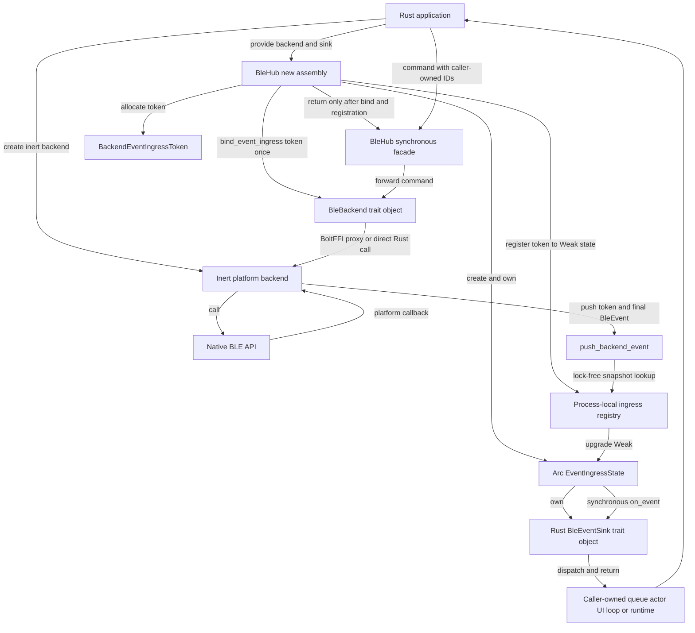
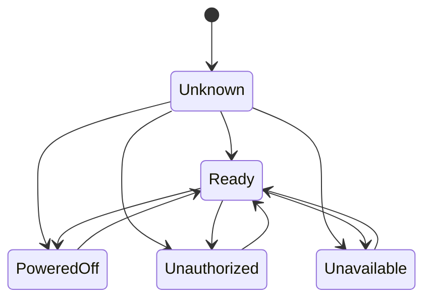
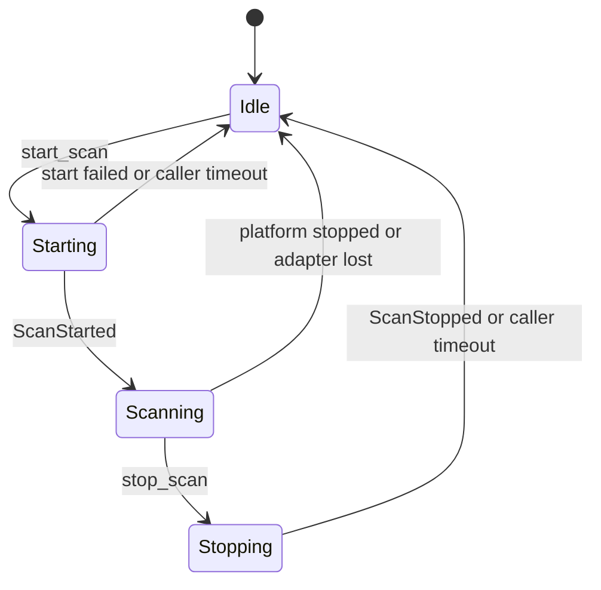
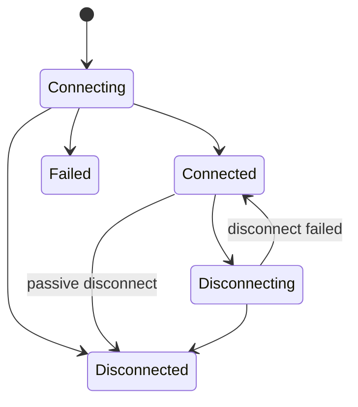
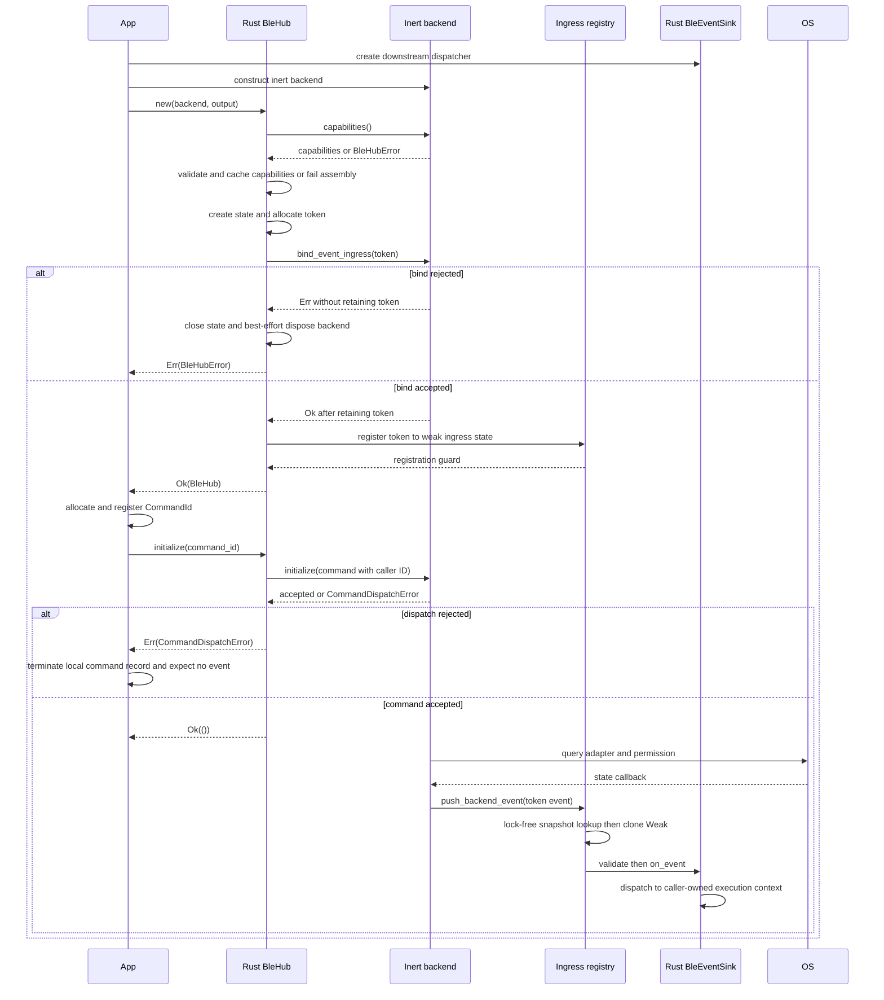
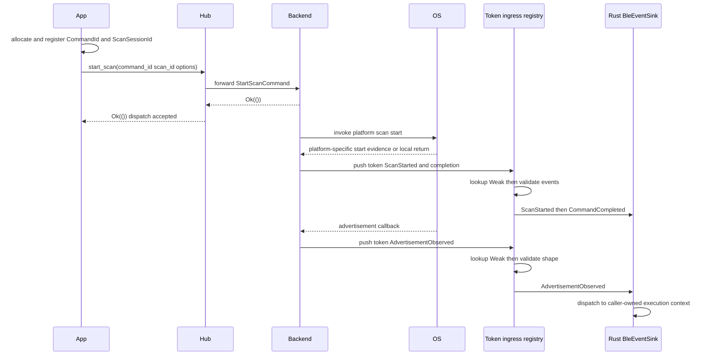
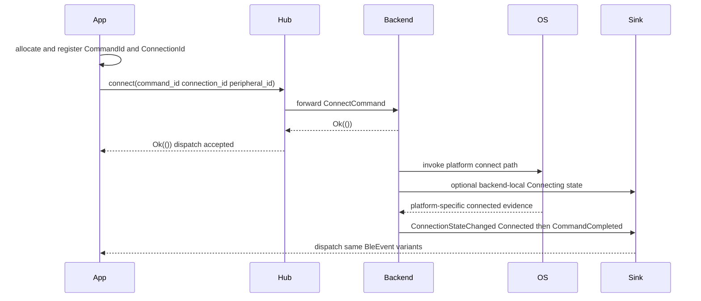
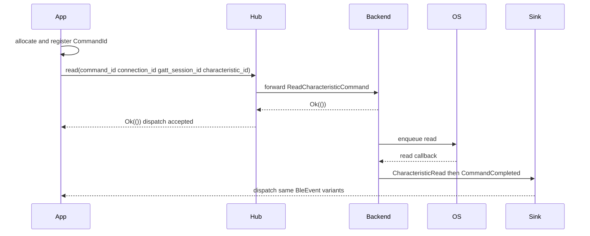
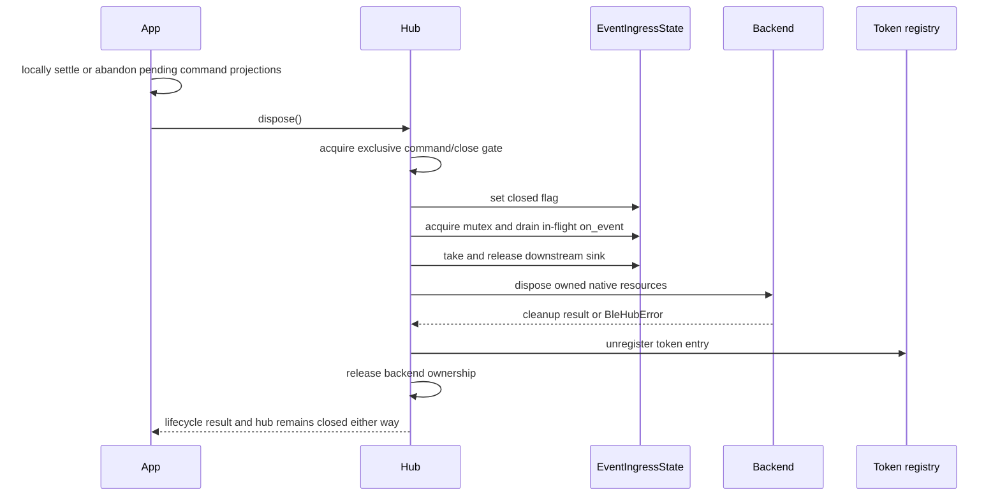

# BleHub 项目计划

**状态：已批准**

**日期：2026-08-29**

**硬件状态：QEMU/BLESS HIL 等待 USB 蓝牙适配器到货，当前不执行。**

本文件是 BleHub 唯一规划来源。Review 通过前不创建脚手架或实现代码；通过后从 Phase 0 开始执行。本文同时作为未来架构文档、API 文档和平台接入文档的来源。

---

## 1. 项目目标

BleHub 是一个以 Rust 为核心、支持 Windows、Android、iOS、macOS 和 Linux 的 BLE Central 抽象层。

上层应用只使用统一的 adapter、扫描、peripheral handle、连接、GATT、命令和事件基础模型；平台差异通过 capability、optional 字段和结构化平台错误表达，不伪造完全一致的行为。BleHub 是轻量协议适配层，不是设备管理框架。

开发顺序：

1. **Windows**：第一开发平台、参考实现和主要测试宿主。
2. **Android**：验证 BoltFFI 跨语言 backend 抽象，与 Windows 一起组成 v0.1。
3. **iOS/macOS**：复用稳定契约接入 Swift CoreBluetooth。
4. **Linux**：复用稳定契约接入 BlueZ D-Bus。

### 1.1 v0.1 必须支持

- adapter 可用性、开关和权限/授权状态
- 开始扫描、停止扫描和持续 advertisement 更新
- service UUID、设备名、manufacturer data 等基础扫描条件
- 连接、主动断开和被动断连
- GATT service、characteristic、descriptor 基础发现
- characteristic read
- write with response / without response
- notification / indication 开启、数据和关闭
- RSSI 读取
- 命令成功、失败、平台确认的超时/取消、caller deadline、重复和过期/晚到事件的统一 contract 与下游 reference handling（BleHub core 不内建 command tracker）
- 平台 capability 查询
- 幂等且线程安全的资源关闭
- Windows 与 Android 共享行为测试和真实外设闭环

### 1.2 设计时预留，但不阻塞 v0.1

- Android MTU request / MTU changed
- Android PHY 和 connection priority
- service changed 与 GATT cache invalidation
- pairing / bonding
- background scan / background connection
- Linux 多 adapter
- 持久化设备身份恢复

### 1.3 明确不做

- BLE Peripheral / GATT Server
- Classic Bluetooth
- 用 MAC 地址承诺跨平台、跨安装或长期稳定的设备身份
- 把所有平台错误压扁成字符串
- 在公共 API 暴露 WinRT、Android、CoreBluetooth 或 D-Bus 对象
- 在 backend trait 中暴露 `Future`、Rust stream 或平台 async 类型
- BleHub core 自建 Tokio/async executor、后台线程池或事件循环
- 设备选择、排序、收藏、分组、持久化 inventory 和跨进程身份恢复
- 自动连接、自动重连、重试退避、连接保活和业务 session orchestration
- 固件升级、业务协议、产品设备模型、fleet management 和云端同步
- 多应用订阅合并、后台任务调度和复杂资源仲裁
- 通用异步 `ShutdownCommand`；四个平台都没有统一的整体 BLE shutdown completion，v0.1 只提供本地幂等 `dispose/close`
- 等所有平台完整后才发布第一个版本

---

## 2. 已确定技术方案

| 领域 | 决策 |
|---|---|
| 核心语言 | Rust 2024 edition |
| FFI | BoltFFI；版本由 `Cargo.lock` 固定，当前本地参考版本 `0.30.1` |
| backend | Rust 定义 `BleBackend: Send + Sync` trait object |
| backend 方法 | 普通同步 `fn`，不使用 `async fn` |
| 调用模型 | fire-and-forget：同步 `Result` 表示即时校验/投递是否成功；`Ok` 后的平台 operation 结果通过事件完成 |
| 事件上行 | 平台 callback 经 backend 映射为统一 `BleEvent`；v0.1 调用 Rust exported `push_backend_event(BackendEventIngressToken, BleEvent)`，由 registry 解析到 `Weak<EventIngressState>` 后进入 bridge，再调用 Rust downstream `BleEventSink` trait object；BoltFFI #869 修复后迁移为 exported class handle 直推 |
| 事件落点 | 下游 `BleEventSink` 自行投递到 channel、Handler、actor、UI loop 或自选 runtime |
| 执行模型 | BleHub core 无 mailbox、无 pump、无 executor、无线程、无自有事件循环 |
| 状态归属 | 调用方拥有业务/command/session 状态；backend 拥有 native handle 状态；BleHub 不维护 canonical BLE state |
| Windows | Rust + `windows-rs` |
| Android | Kotlin + Android BLE API + BoltFFI trait object |
| Apple | Swift + CoreBluetooth + BoltFFI trait object |
| Linux | Rust + `dbus-rs` + BlueZ D-Bus |
| Rust 依赖 | Cargo |
| 外部工具 | Pixi |
| 项目 recipes | 根 Justfile；Just 由 Pixi 提供 |
| 标准入口 | `pixi run just <recipe>` |

### 2.1 `btleplus` 选择性参考（非架构基线）

CodeGraph 检查当前 `espkit/crates/std/btleplus` 后，BleHub 只借鉴少量领域语义：

- `PeripheralSnapshot` 中 local name、advertised services、manufacturer data、service data、RSSI、connectable 等 advertisement 字段。
- scan-time observation 与较稳定 device identity 分离；同一 peripheral 可以持续产生新 observation。
- GAP / GATT 的术语边界，以及 duplicate UUID instance 不能被简单 UUID map 覆盖的教训。

BleHub 不依赖或照搬 `btleplus` 代码。当前 `btleplus` 没有适合直接复用的 backend trait/event bridge；其 `AdapterRuntime`、Tokio timeout、canonical state、device/connection registry、GATT cache、phase wrapper ownership 和 UUID-only characteristic lookup 都不适合本项目的无 runtime、FFI-first 薄桥。BleHub 的 opaque GATT instance ID、caller-owned session ID 和 fire-and-forget event contract 独立设计。

数据结构也不是逐字段复制：`btleplus` 的平台 `id: String` 在 BleHub 中改为 backend opaque `PeripheralId`；`service_data` 使用 FFI 友好的 record list 而不是 map；`connectable` 使用 `Option<bool>` 表达平台缺失。将来若 `btleplus` 变化，不驱动 BleHub 公共 ABI 自动变化。

### 2.2 术语

核心与事件术语：

- **Thin Bridge**：Rust 中无 executor、无线程、无领域状态机的同步桥；只持有 backend、`EventIngressState`、command/close synchronization gate 和最小 lifecycle state。
- **Backend**：实现 `BleBackend` 的平台适配对象，负责把同步 command 投递给 WinRT、Android BLE、CoreBluetooth 或 BlueZ。
- **Closed Flag**：`EventIngressState` 内部从 `false` 单向变为 `true` 的原子 lifecycle 标记；它不是 event tag，也不是锁。`push` 用它快速拒绝 close 后 callback。
- **Command/Close Gate**：保护 backend ownership 的读写同步边界；command 取得 shared/read guard，close 取得 exclusive/write guard，防止 backend method 执行期间释放 backend。
- **Event Tag**：`BleEvent` tagged union 中标识 payload variant 的判别值；结构校验检查 tag 与 payload 是否匹配，与 Hub 是否 closed 无关。
- **Command Dispatch / 命令投递**：public method 的短同步阶段。backend 在自己的串行执行边界内原子完成“登记 correlation、取得 cleanup ownership、提交到执行路径”时，command 线性化为 accepted。`Ok(())` 只确认该事实；它不表示 native API、OS/BLE operation 或外设业务已成功。
- **Dispatch Rejection / 投递拒绝**：accepted 线性化点之前的同步 `Err(CommandDispatchError)`；backend 此时不得创建 callback source、保留 correlation/cleanup ownership或 emit event，因此该 `CommandId` 后续严格无事件。
- **Operation Completion / 操作完成**：accepted command 后由平台 callback/async result、D-Bus reply或明确定义的 backend-local completion point提供证据。到达该点后，backend 对需要公开状态/数据结果的 operation 先尝试一次 domain event（若有），再必须且至多一次尝试发送 terminal `CommandCompleted`；这不是 sink delivery guarantee。`Succeeded` 的强度按 command/platform 逐项定义，绝不统一解释为“外设已处理”。
- **Backend Event Ingress**：backend 把最终 `BleEvent` 送回 Rust 的受控入口。v0.1 是 opaque `BackendEventIngressToken` + exported `push_backend_event(token, event)` + process-local `token -> Weak<EventIngressState>` registry；BoltFFI #869 修复后迁移为 backend retain 的 exported `BackendEventIngressHandle`。两者都不是 downstream sink trait object。
- **Downstream Event Sink**：Rust application 实现并传给 BleHub 的 `BleEventSink: Send + Sync` trait object；它不是 BoltFFI foreign trait object。Rust bridge 完成最小结构校验后同步调用 `on_event(BleEvent) -> Result<(), EventSinkError>`。
- **Event Dispatch**：`BleEventSink` 的实现只负责按调用方策略接纳事件，例如放入 Rust channel、actor 或自选 runtime，并立即返回。`Ok(())` 表示 sink 已按自己的策略接纳事件，`Err(EventSinkError)` 表示未接纳。
- **Caller State**：command terminal、active scan/connection/GATT/subscription、timeout/retry 和业务状态均由调用方维护。
- **Backend State**：native adapter/device/GATT object、callback token、pending correlation 和 opaque public handle 映射由每个平台 backend 私有维护；只有 backend 的 command implementation 与 platform callback handler 访问，BleHub 不查询、不复制也不对外暴露这些状态。
- **Application Policy**：设备选择、排序、自动重连、retry、业务 session 等上层策略，不属于 BleHub。

BLE 与测试硬件术语：

- **Host**：运行 BLE host stack 的操作系统，例如 Windows Bluetooth stack 或 Linux BlueZ。
- **Controller**：真实蓝牙芯片/USB 蓝牙棒中的 HCI controller 和 radio。
- **Adapter**：操作系统/backend 对 controller 的软件表示，例如 BlueZ `Adapter1`；文档谈物理硬件时优先使用 controller。
- **Central**：扫描并发起连接的一侧，是 BleHub 支持的产品角色。
- **Peripheral**：广播并提供 GATT Server 的一侧；项目测试中由 Linux VM + BlueZ + BLESS 承担。
- **Central Controller（C-Controller）**：被测 Central 使用的物理蓝牙 controller。
- **Peripheral Controller（P-Controller）**：Linux Peripheral VM 独占的物理蓝牙 controller。
- **DUT（Device Under Test）**：当前被测的 BleHub Central 平台实现，例如 Windows 或 Android。
- **TPE（Test Peripheral Environment）**：Linux Peripheral VM、P-Controller、BlueZ、BLESS、scenario 和 telemetry 的整体。

文档不使用“主蓝牙棒/从蓝牙棒”作为正式术语。BLE 当前角色应写 Central/Peripheral；“主/从”还可能与 Host/Controller 层级混淆。

### 2.3 Rust 生态复用策略

原则是优先复用维护良好、语义匹配的 Rust 生态，依赖数量和 crate 数量本身不是优化目标。选择依据是维护质量、目标平台支持、FFI/ABI 影响、编译成本和能否减少自研错误；只有当依赖会把不属于 BleHub 的 runtime/state policy 强塞进 core 时才拒绝。

| 依赖/能力 | v0.1 决策 |
|---|---|
| `boltffi` | 必需；公共 DTO、foreign trait object 和 Rust class/handle 绑定 |
| `uuid` | 建议复用；Rust 内部解析、校验和规范化 BLE UUID；FFI wire 首版仍使用 canonical string |
| `windows` (`windows-rs`) | Windows backend 必需，不能泄漏到公共 DTO |
| `dbus` (`dbus-rs`) | Linux Phase 6 backend 使用，不进入 Windows/Android 首批依赖图 |
| `serde` / `serde_json` | test scenario、BLESS 控制面和日志 fixture 使用；不是 BleHub 事件运行时依赖 |
| `proptest` | dev-dependency 候选，用于 command outcome、duplicate/stale/orphan 和 close race 的状态序列测试 |
| `loom` | Phase 0 dev-dependency 候选，用于枚举纯 Rust closed flag、mutex、RwLock 与 Arc/Weak interleaving；不替代真实 JNI/Swift runtime stress，引入前按 local-first 规则固定版本并检查源码 |
| `thiserror` | Rust 内部和公开 Rust error 类型默认使用；跨 FFI `Result<T, E>` 的 `E` 还必须使用 BoltFFI `#[error]`，异步 event error 使用 BoltFFI data record |
| 同步与并发生态 | per-Hub gate/mutex 优先 `std`；v0.1 ingress registry 的 read-mostly 小表优先评估 `arc-swap` immutable snapshot/RCU，避免每个 event 获取全局锁；只有 entry/write 规模证明需要时才评估 `papaya`/`scc::HashIndex`，不默认使用仍有分片锁的 `dashmap`；core 不自建 channel，但 downstream adapter 可直接复用 `crossbeam`/`flume`/Tokio channel |
| `slotmap`/generational arena | Phase 1 评估 opaque handle 生命周期；若满足 BoltFFI `u64` wire 与不复用规则，优先复用而不是手写 generation/arena |
| Tokio/async runtime | 不进入 core/backend trait；具体 backend 可使用平台已有 callback context 或调用方注入执行器 |
| `bitflags` | 可用于 Rust/backend 内部 property flags；FFI public shape 首版使用生成语言更清晰的 bool record 或显式整数 mask |
| `tracing` | 建议用于 structured diagnostics、command/session correlation 和 HIL 日志；subscriber 由调用方安装 |
| `insta` | dev-dependency 候选，用于稳定 event scenario/FFI shape snapshot；若普通断言更清晰则不强制 |

FFI payload 首版仍使用 BoltFFI 支持最稳定的 `Vec<u8>`/record/enum；backend 或 downstream 内部可以使用 `bytes`、channel、actor 等成熟生态并在边界转换。原则不是“能手写就不依赖”，而是“不让依赖改变已确定的薄层职责”。

### 2.4 官方平台 API 证据库

公共 command/event contract 不只依赖经验判断。项目把与 BLE Central 语义直接相关的官方资料固定在 `docs/platform-api-reference/`，并通过以下唯一入口更新：

```text
pixi run just docs-update
```

当前来源与缓存策略：

- Windows：Microsoft `winrt-api` 固定 commit，包含 Bluetooth adapter/radio/access、advertisement watcher、device 和 GATT API。
- Android：Google 官方 Android 36 SDK Sources `source-36_r01.zip`，后端实现语言仍是 Kotlin；Java Framework source/Javadocs 是 Kotlin 所调用 API 的权威语义来源。
- Apple：Apple CoreBluetooth 官方 Markdown live snapshot。
- Linux：BlueZ 官方 D-Bus RST 固定 commit。
- Pooch 缓存 Android/Windows/BlueZ 的不可变 artifact 并校验已知 hash；Hishel 对 Apple live docs 使用 RFC HTTP cache、ETag/Last-Modified 条件重验证。
- `sources.lock.json` 记录 revision、URL、SHA-256、抓取时间和 upstream terms；更新过程使用临时目录并在全部成功后原子安装。

[`docs/research/cross-platform-command-event-contract.md`](../docs/research/cross-platform-command-event-contract.md)的跨平台operation matrix以这些snapshot为事实证据，Plan 7.1只保留审定后的规范性成功语义。实现发现API语义变化时，先更新snapshot/lock与research matrix，再显式评审是否需要修改Plan公共契约；生成文件不手工编辑。

---

## 3. 设计原则

1. **命令与事件分离**：命令方法立即返回，BLE 结果只能通过事件表达。
2. **BleHub 不做状态真源**：调用方维护 command/session/业务状态，backend 维护 native handle；BleHub 只转发 command，并对 backend 已构造的统一 `BleEvent` 做最小结构校验和直接交付。
3. **ID 所有权显式**：command/scan/connection/GATT session/subscription ID 由调用方提供；discovery handle 由 backend 生成且保持 opaque。
4. **扫描快照不等于设备身份**：同一设备可持续产生新的 observation。
5. **不伪造平台一致性**：用 capability、optional 字段和平台错误表达差异。
6. **允许 backend 同步 callback**：调用 backend 时不持有领域/protocol 状态锁；仅可持有 ingress 不会获取的 command/close lifecycle guard，因此 backend 可在 trait method 返回前调用 ingress sink。这不表示 downstream `on_event` 可以同步重入 BleHub。
7. **事件可关联**：命令结果原样回显调用方提供的 `CommandId`；平台主动变化可没有 command ID。
8. **显式 session 隔离**：domain/state/data event 回显其适用的 caller-owned scan/connection/GATT/subscription ID；`CommandCompleted`只回显全 lifecycle 唯一的`CommandId`，调用方从调用前登记的command record解析target。调用方据此忽略旧session，不依赖BleHub隐式generation。
9. **显式关闭**：不依赖 Rust Drop、JVM GC 或 Swift ARC 的精确时机。
10. **Windows-first，但不 Windows-shaped**：核心模型不得包含 WinRT 专属类型和假设。
11. **先 contract，再平台**：事件序列和异常组合先由纯 Rust FakeBackend/conformance harness 固定；状态机是契约参考，不是 BleHub 内部实现。
12. **调用方拥有运行时和事件队列**：BleHub core 不创建 mailbox、executor、线程池或事件循环；下游 sink 决定事件进入哪个线程、channel、Looper 或 DispatchQueue。
13. **成熟生态优先、按职责拆 crate**：优先复用经过验证的 Rust crate，不以最少依赖为目标；共享 contract/bridge、可复用 testkit 和各平台 backend 按依赖与发布边界拆分，但不把某个 async runtime 固化为公共 API。
14. **Ingress state 最小化**：`EventIngressState` 只保留 downstream ownership、closed flag 和用于 delivery/close-drain 的 mutex；Hub 另有 command/close gate。两者都不保留 command/device/connection/GATT registry。

---

## 4. 总体架构

事件路径有两个方向相反、所有者不同的端点，必须先区分：

| 端点 | 创建或实现方 | 持有并调用方 | 作用 |
|---|---|---|---|
| `BackendEventIngressToken` | BleHub/Rust 分配的 opaque FFI data token | platform backend | v0.1 backend 调用 `push_backend_event(token, event)` 时定位对应 Rust ingress state |
| `BleEventSink` Rust trait object | Rust application 实现并传给 BleHub | Rust bridge | bridge 把已校验的 `BleEvent` 交给调用方自己的队列或运行时 |

`BackendEventIngressToken` 不是 downstream trait object，也不是 Rust pointer。v0.1 因 BoltFFI #869 使用 process-local registry 将 token 解析为 `Weak<EventIngressState>`；backend 仍不能直接持有或调用应用 sink，否则会绕过 BleHub 的 close gate、结构校验和 delivery serialization。理想形态是 backend 直接持有 exported `BackendEventIngressHandle`，但当前 BoltFFI 不能把该 class handle 作为 foreign trait method 参数。两种形态共享相同的一次性 bind、Weak ownership 和 event delivery 语义。



Windows/Linux 的 `BackendApi` 与 `BackendImpl` 通常是同一个 Rust object；Android/Apple 则由 BoltFFI command proxy 把 `BackendApi` 调用转到 Kotlin/Swift `BackendImpl`。OS callback 只进入 backend implementation/delegate handler，再调用 exported `push_backend_event`；它不回调 `BleBackend` command trait 或其 vtable。
Windows/Linux 的 `BleBackend` 通常是 Rust object；Android/Apple 则是 Kotlin/Swift object 经 BoltFFI trait object 进入 Rust。BleHub downstream 固定为 Rust application 实现的普通 Rust trait object：Android/Apple 事件只在 backend 调用 `push_backend_event(token, event)` 时发生一次 native→Rust FFI crossing；registry lookup 只取得 `Weak` 并立即释放全局锁，随后 `EventIngressState::push -> BleEventSink::on_event` 都是 Rust 内部调用。

### 4.1 命令下行

1. 调用方先登记自己的 `CommandId`/session IDs，再把完整 FFI-safe request 交给 `BleHub`。
2. `BleHub` 只检查本地 lifecycle/wire 前置条件，并把 request 原样转发给 `BleBackend`；它不分配 ID、不查询 BLE protocol state。
3. backend 将命令投递到自己的平台执行位置：Android `Handler/Executor`、Apple serial queue、Windows/Linux OS callback context 或注入的 driver。thread-affine native object 不离开该位置。
4. method 立即返回 `Result<(), CommandDispatchError>`：
   - `Ok(())`：backend 已接受 command 并负责后续事件结果，不表示 OS/BLE operation 成功；
   - `Err(...)`：command 未进入事件生命周期，该 `CommandId` 后续必须零事件。
5. accepted command 的成功、失败、实际取消或平台 timeout 只通过 `BleEvent` 表达。

`BleBackend: Send + Sync` 允许 Hub ownership 跨线程移动并允许多个 caller thread 通过 `&self` 发令；它不允许任意线程直接操作 thread-affine native object，也不要求 BleHub 创建 worker 或串行执行器。

### 4.2 事件上行

装配时：

1. Rust application 实现 `BleEventSink: Send + Sync`。
2. platform factory 在 Kotlin/Swift/Rust 本地构造不含 ingress、尚未启动 BLE 工作且不会产生 callback 的 inert backend。
3. application 调用 `BleHub::new(backend, event_sink)`；constructor 创建并强持有 `Arc<EventIngressState>`，把 Rust sink 保存到 state，并分配非零、进程生命周期内永不复用的 `BackendEventIngressToken`。
4. constructor 调用一次 `backend.bind_event_ingress(token)`。bind 期间 token 尚未注册；backend 必须保持 inert、不得调用 `push_backend_event`，`Err` 必须表示未 retain token。
5. bind 成功后，constructor 才在 process-local registry 中注册 `token -> Weak<EventIngressState>`，保存该 entry 的 instance-owned registration guard，然后返回完整 Hub。registry 只负责 FFI ingress 路由，不是 BLE domain state。
6. bind 失败时，constructor 关闭 state、best-effort `dispose` backend 并返回 `BleHubError`；token 永不复用。bind 成功但 registry registration 失败时同样 rollback，backend 已 retain 的 token只能得到 `Closed`，随后由 dispose 释放。
7. close 先关闭并排空 state，再 dispose backend，最后注销 registry entry；因此 dispose 中或其后的迟到 callback 要么解析到 closed state，要么查不到 token，统一返回 `Closed`。

理想方案是 constructor 创建只含 `Weak<EventIngressState>` 的 `BackendEventIngressHandle` 并直接调用 `backend.bind_event_ingress(handle)`，从而删除 token registry。当前 BoltFFI `0.30.1` 无法生成 foreign trait method 的 exported Rust class-handle 参数，证据为 `spikes/boltffi-class-handle-callback-param/` 与上游 [issue #869](https://github.com/boltffi/boltffi/issues/869)。因此 v0.1 明确采用 token workaround；不使用 raw pointer、不会把 `Arc` 地址编码成整数，也不恢复 builder。

平台 callback 到达时：

1. backend 用自己的 native handle/correlation state 构造最终统一 `BleEvent`。event 由关联字段和 public FFI-safe payload 组成：既可携带 caller-owned IDs/backend opaque handles，也可携带 advertisement 数据、adapter/connection 状态、GATT hierarchy、characteristic/notification bytes、RSSI 和统一错误等公共 DTO。禁止跨边界的是 WinRT/`BluetoothGatt`/`CBPeripheral`/D-Bus proxy 等 native object，以及只对 backend 有意义的 private key/token。诊断和 ingress delivery failure 使用 out-of-band structured tracing，不占用 public `BleEvent` variant。
2. backend 调用 `push_backend_event(token, event)`。
3. exported function从`ArcSwap<HashMap<...>>` immutable snapshot中lock-free查找token并clone对应`Weak<EventIngressState>`，在upgrade或调用state前释放snapshot guard。token不存在、已注销或weak upgrade失败时返回`Closed`；成功后通过state的downstream mutex串行化同一hub的delivery attempt，并校验唯一variant/body、ID/wire value和size guard。它不做ID映射、stale/duplicate判断或状态归约。
4. state 在当前 callback 线程同步调用 `BleEventSink::on_event(event)`。
5. downstream sink 只按调用方策略把事件接纳到 Rust channel、actor 或 runtime，然后尽快返回 typed `Result`。

`Delivered`只表示`on_event`返回`Ok(())`，不表示downstream业务已处理。`InvalidEvent`/`DownstreamFailed`消费当前attempt：backend记录诊断但不得解析message、重试同一event或把它当BLE failure；它仍提交terminal/correlation cleanup并继续后续event，只有`Closed`才停止push。`BleEventSink` contract要求实现不得panic，所有预期失败走typed `Result`。Kotlin/Swift exception边界在foreign backend method与exported ingress wrapper，`downstream.on_event`本身不跨FFI。

### 4.3 并发、同步 callback 与 close

BleHub 每实例只需要两个互不嵌套的 lifecycle/delivery 同步边界和一个原子标记。v0.1 token workaround 另有 process-local immutable registry snapshot：event lookup 通过 `ArcSwap` lock-free load，不增加 per-event 全局 mutex；极少发生的 insert/remove 使用 RCU 复制小表并原子替换：

| 机制 | 保护什么 | 不保护什么 |
|---|---|---|
| command/close gate | backend ownership；command 使用 shared guard，close 使用 exclusive guard | 不保存 command table，不参与 event ingress |
| `EventIngressState.downstream` mutex | `Option<Box<dyn BleEventSink>>` ownership、串行 `validation -> on_event`、close 排空 in-flight delivery | 不等待 downstream 业务处理，不保护 BLE protocol state，不拥有 downstream queue |
| closed flag | 单向标记 ingress lifecycle；供 `push` 在加锁前后检查 | 不是 mutex，不是 event tag，不单独提供 in-flight drain 保证 |
| process-local registry snapshot | v0.1 `token -> Weak` immutable map；lookup lock-free，insert/remove 用 RCU replacement | snapshot guard 不跨 `Weak` upgrade、validation、sink call 或 close；不保存 BLE state |

close 在持有 exclusive command/close gate 后，先把 closed flag 置为 `true`，再取得 downstream mutex。该锁会等待已经进入的 `on_event` 返回；随后 close `take()` 并释放 downstream sink，再 dispose backend，最后注销 token entry。新 `push` 要么查到 state 后看到 closed，要么在注销后查不到 token，因此不会在 close 排空后开始新的 delivery。snapshot lookup 与 RCU unregister 的竞争只决定 callback 从哪条路径返回 `Closed`。

由此得到以下约束：

- backend 可以在 command method 返回前同步 `push`；ingress 不获取 command/close gate，因此不会因这条路径自锁。
- event 可能先于公共 method 的 `Ok(())` 到达 downstream。request/event 必须自带完整关联 ID；backend 一旦为该 command 发出任何事件，就不得再返回 `Err`。
- downstream `on_event` 在 `EventIngressState.downstream` mutex 的 delivery 临界区内被调用，所以只能快速 dispatch，不能同步重入同一个 `BleHub`；后续命令必须在 downstream 自己的执行位置发出。
- close 先阻止新 command，将 ingress 标记为 closed，排空已经进入的 callback并释放 downstream sink，再 dispose/release backend、注销 token entry；`close()` 返回后没有活跃或可新开始的 downstream callback。晚到 callback 因 closed state、missing token 或 weak upgrade failure 返回 `Closed`。
- BleHub 没有 protocol state lock、线程、mailbox、pump 或 executor。callback 从哪个线程进入，`on_event` 就在哪个线程被同步调用；业务线程由 downstream 决定。

详细 ownership graph、linearization point、竞态矩阵、备选方案与 Phase 0 验证方法见 [`docs/research/ffi-lifecycle-concurrency.md`](../docs/research/ffi-lifecycle-concurrency.md)。该调研记录证据与推荐，不替代本 Plan 的已审决策。

---

## 5. 组件职责

### 5.1 `BleHub`

概念对象形状：

```rust
pub struct BleHub {
    // 同时是 backend ownership slot 和 command/close gate。
    backend: RwLock<Option<Box<dyn BleBackend>>>,
    // Constructor 从 inert backend 读取并校验一次，之后不再跨 FFI 查询。
    capabilities: BackendCapabilities,
    ingress: Arc<EventIngressState>,
    // BoltFFI #869 修复并迁移到 direct handle 后删除。
    ingress_registration: BackendEventIngressRegistration,
}
```

`BleHub` 不再另设一份 closed flag：command path 在 backend slot 中观察 `None`，event path 观察 `EventIngressState.closed`。字段声明顺序不承担 lifecycle 协议；显式 `dispose/close` 和 Rust `Drop` fallback 必须走 8.12 的同一幂等关闭逻辑。

**拥有：**

- 一个 `Box<dyn BleBackend>`；
- constructor从backend读取并校验后缓存的一份`BackendCapabilities`静态metadata；
- 强引用 `Arc<EventIngressState>`；state 内含 closed flag 和 `Mutex<Option<Box<dyn BleEventSink>>>`；
- v0.1 ingress token 的私有 `BackendEventIngressRegistration` RAII guard；
- command/close gate 和 backend ownership。

**负责：**

- 在 `BleHub::new` 内从inert backend读取并校验静态capabilities，再创建`EventIngressState`、分配ingress token、一次性绑定backend并注册`token -> Weak<EventIngressState>`，只在全部assembly步骤成功后向application返回完整Hub；
- 同步接收 command，只执行context-free wire/shape/hard-limit校验和command/close gate检查，再原样转发caller-owned IDs与backend dispatch `Result`；
- 按 4.2 将 ingress event 交给 downstream sink；
- 执行幂等 close，并切断后续 event delivery。

**不负责：**分配 ID、维护 command/device/connection/GATT 状态、timeout/retry、事件队列、线程、executor 或业务策略。

### 5.2 `BleBackend`

**输入：**`BleHub` 转发的 FFI-safe command，以及装配阶段交付的 opaque `BackendEventIngressToken`。

**负责：**

- 按平台线程模型投递 command，并准确返回即时 accepted/rejected；
- 管理 native BLE object、callback token、串行 GATT operation 和最小 callback correlation；
- 把平台 callback 转为最终 `BleEvent`，回显 caller-owned IDs，再通过 `push_backend_event(token, event)` 上送；
- 按 lifecycle/session 回收平台资源并通过共享 conformance contract。

**不得：**直接调用 downstream `BleEventSink`、让 native object 跨公共边界、把平台状态复制成 BleHub canonical registry，或依赖 BleHub 修正 backend 发出的跨事件语义。

accepted transaction不整体上提到BleHub：correlation登记、cleanup ownership、native handle lookup和平台执行位置提交必须在同一个backend串行边界内完成，否则core与backend会各保存一份pending状态，却仍无法原子覆盖native queue/callback注册。BleHub只统一无状态validation、close gate和trait转发；accepted/rejected、terminal attempt和cleanup不变量由公共contract与共享conformance tests固定。Rust backend可以复用crate-private dispatch helper，Kotlin/Swift backend也可以各自封装同构helper，但helper不得成为第二套public状态机或改变线性化点。

backend-private 状态及释放边界：

| 状态 | 规模与释放 |
|---|---|
| native adapter/manager/dispatcher | 每 backend O(1)，`dispose/close` 释放 |
| `PeripheralId -> native object/reopen token` | O(本 lifecycle 发现的不同 peripheral)；优先只保留轻量 reopen key，native 重对象在平台允许时尽早释放 |
| `ConnectionId -> native connection` | O(active/closing connection)，disconnect 或 `dispose/close` 释放 |
| GATT opaque ID -> native service/characteristic/descriptor | O(active GATT session attributes)，rediscover/disconnect 时整 session 释放 |
| pending platform callback correlation | O(in-flight command)，只保存回显 caller IDs 所需的最小 operation metadata |
| callback registration token / Android GATT operation queue | O(active callback/in-flight operation)，平台完成、取消、断连或 `dispose/close` 时释放 |

这些状态是 backend-private routing/correlation state，不是供 BleHub 查询的 repository，也不是 BleHub domain state。下行时，BleHub 只把携带 public IDs 的 command 原样转发，backend 自己用 ID 查找 native object/reopen token 并调用平台 API；上行时，backend callback handler 自己把 native object/pending operation 反查为 public IDs 和 caller `CommandId`，构造完整 `BleEvent` 后 push。BleHub 不读取这些 map、不请求 snapshot，也不通过 facade 暴露查询接口；唯一例外是装配时固定的 `BackendCapabilities` metadata，它不包含动态 adapter/device/connection/GATT 状态。

Android callback 不直接携带 caller `CommandId`，WinRT/CoreBluetooth/BlueZ native object 也不能跨 FFI，因此上述映射只能由 backend 保存并按 session 回收。`PeripheralId` map 是唯一可能随长期扫描增长的部分；它用于后续 command 以 `PeripheralId` 路由到 native object/reopen token，不是供 Hub 枚举设备。v0.1 soak 记录 entry 数和内存，优先使用轻量 reopen token，只有真实数据证明必要时才另行设计 eviction。

### 5.3 `EventIngressState`、token 与 registry

v0.1 保留同一个最小私有 state，但因 BoltFFI #869 使用 opaque data token 和 process-local routing registry：

```rust
struct EventIngressState {
    closed: AtomicBool,
    downstream: Mutex<Option<Box<dyn BleEventSink>>>,
}

#[boltffi::data]
pub enum EventIngressStatus {
    Delivered,
    Closed,
    InvalidEvent { message: String },
    DownstreamFailed { message: String },
}

impl EventIngressState {
    fn push(&self, event: BleEvent) -> EventIngressStatus {
        if self.closed.load(Ordering::Acquire) {
            return EventIngressStatus::Closed;
        }

        let downstream = match self.downstream.lock() {
            Ok(downstream) => downstream,
            Err(error) => {
                return EventIngressStatus::DownstreamFailed {
                    message: error.to_string(),
                };
            }
        };

        // close may have started while this push was waiting for the mutex.
        if self.closed.load(Ordering::Acquire) {
            return EventIngressStatus::Closed;
        }

        let Some(downstream) = downstream.as_deref() else {
            return EventIngressStatus::Closed;
        };

        if let Err(error) = event.validate_shape() {
            return EventIngressStatus::InvalidEvent {
                message: error.to_string(),
            };
        }

        match downstream.on_event(event) {
            Ok(()) => EventIngressStatus::Delivered,
            Err(error) => EventIngressStatus::DownstreamFailed {
                message: error.to_string(),
            },
        }
    }
}

#[boltffi::data]
#[derive(Clone, Copy, Debug, PartialEq, Eq, Hash)]
pub struct BackendEventIngressToken {
    pub value: u64,
}

type EventIngressRegistrySnapshot =
    HashMap<u64, Weak<EventIngressState>>;

struct BackendEventIngressRegistry {
    next_token: AtomicU64,
    entries: ArcSwap<EventIngressRegistrySnapshot>,
}

impl BackendEventIngressRegistry {
    fn allocate_token(&self) -> Result<BackendEventIngressToken, BleHubError>;

    fn register(
        self: &Arc<Self>,
        token: BackendEventIngressToken,
        state: Weak<EventIngressState>,
    ) -> Result<BackendEventIngressRegistration, BleHubError>;

    fn lookup(
        &self,
        token: BackendEventIngressToken,
    ) -> Option<Weak<EventIngressState>> {
        self.entries.load().get(&token.value).cloned()
    }

    fn unregister(&self, token: BackendEventIngressToken);
}

// register/unregister use ArcSwap::rcu to clone the small immutable
// snapshot, insert/remove one entry, and atomically replace it.

struct BackendEventIngressRegistration {
    registry: Arc<BackendEventIngressRegistry>,
    token: BackendEventIngressToken,
    registered: AtomicBool,
}

impl BackendEventIngressRegistration {
    fn unregister(&self) {
        if self.registered.swap(false, Ordering::AcqRel) {
            self.registry.unregister(self.token);
        }
    }
}

impl Drop for BackendEventIngressRegistration {
    fn drop(&mut self) {
        self.unregister();
    }
}

static BACKEND_EVENT_INGRESS_REGISTRY: LazyLock<
    Arc<BackendEventIngressRegistry>,
> = LazyLock::new(|| Arc::new(BackendEventIngressRegistry::new()));

fn global_backend_event_ingress_registry() -> &'static Arc<BackendEventIngressRegistry> {
    &BACKEND_EVENT_INGRESS_REGISTRY
}

fn push_backend_event_with_registry(
    registry: &BackendEventIngressRegistry,
    token: BackendEventIngressToken,
    event: BleEvent,
) -> EventIngressStatus {
    let Some(state) = registry.lookup(token).and_then(|state| state.upgrade()) else {
        return EventIngressStatus::Closed;
    };
    state.push(event)
}

#[boltffi::export]
pub fn push_backend_event(
    token: BackendEventIngressToken,
    event: BleEvent,
) -> EventIngressStatus {
    push_backend_event_with_registry(
        global_backend_event_ingress_registry().as_ref(),
        token,
        event,
    )
}
```

ownership 链：

```text
downstream creates Box<dyn BleEventSink>
-> BleHub owns Arc<EventIngressState>
-> EventIngressState owns downstream sink
-> BleHub owns BackendEventIngressRegistration
-> process-local registry entry owns only Weak<EventIngressState>
-> backend owns only opaque BackendEventIngressToken
```

`Mutex<Option<Box<dyn BleEventSink>>>`有三个明确用途：串行化同一hub的`on_event`、让close等待in-flight delivery返回、让close通过`take()`确定性释放downstream。它不是额外trait abstraction。data enum路径的`BleEvent::validate_shape`只校验ID/wire value/size；tagged-record fallback再校验唯一tag/body。`downstream.on_event(event)`是普通Rust trait调用，所有可预期失败由typed `Result`表达；它不得panic。通用Rust panic containment属于最外层generated/manual FFI trampoline，不属于event delivery算法，也不能把panic解释为普通downstream rejection。

- `Delivered`：同步 `downstream.on_event` 返回 `Ok(())`；表示 sink 已按自己的策略接纳，不表示 downstream 业务已处理事件。
- `Closed`：token 未注册/已注销、weak upgrade 失败、closed flag 已置位或 downstream 已被 close 取走；未知或迟到 token 安全 no-op。
- `InvalidEvent { message }`：variant/body、ID、wire value或size guard非法，属于backend contract violation；当前attempt被消费，message不能用于stale/duplicate判断。
- `DownstreamFailed { message }`：downstream返回`Err(EventSinkError)`、mutex poison/failure，或最外层FFI trampoline containment了downstream panic；当前attempt被消费且不重试，backend照常清理correlation并继续后续event。message必须有长度限制且只供structured diagnostic，不是稳定机器协议。panic仍是downstream contract violation，不是`EventSinkError`；out-of-band trace必须把它与普通sink rejection区分。若BoltFFI generated trampoline不能在不让panic越过ABI的前提下返回该status，使用最小manual no-unwind wrapper；Phase 0必须证明实际生成行为。`close_and_drain`必须恢复poisoned downstream mutex、`take()`并释放sink，然后继续其余cleanup。
- token是opaque routing identifier，不是地址、Rust pointer、native object ID、认证credential或不受信任plugin隔离边界；`0`无效，分配器溢出时constructor失败而不是wrap。token在同一进程生命周期内永不复用，防止stale callback路由到后来创建的Hub。
- `BackendEventIngressRegistry` 封装 token allocator、`ArcSwap` entries 和 `register/lookup/unregister`。private `LazyLock<Arc<...>>` 是 production FFI 唯一实例，`global_backend_event_ingress_registry()` 隔离 static access；不得在运行时替换该全局实例。
- exported `push_backend_event` 只把全局 registry 传给 private `push_backend_event_with_registry`。pure Rust tests 直接构造独立 registry并调用 helper；Hub assembly tests 调 private `BleHub::new_with_registry`，避免并行测试共享/替换全局状态。
- registry 是 crate/process 级 FFI 基础设施，但 entry 生命周期由对应 Hub 的私有 `BackendEventIngressRegistration` RAII guard 管理；它只保存 `Weak`，不会延长 Hub/downstream 生命周期。guard 由 `BackendEventIngressRegistry::register` 创建、存入 Hub，explicit close 调 `unregister()`，`Drop` 幂等兜底。`register`必须failure-atomic：返回`Err`时不存在该token entry、不返回registration ownership，也不留下需要constructor额外回收的registry资源。
- `ArcSwap` lookup 只在 immutable snapshot guard 下 clone `Weak`；snapshot guard 不跨 upgrade、validation、sink call 或 close。register/unregister 是极低频 RCU write，复制 O(active Hub) 小表。
- bind 成功后先注册 entry 再返回 Hub；close 在 closed/drain 和 backend dispose 之后注销 entry。未注册、已注销和 stale token 都返回 `Closed`，backend 不得自动重试。
- 旧 Kotlin/JVM builder spike 只部分验证了 exported class wrapper 的 Weak ownership、Rust/JVM 跨线程调用、clone/free 和 close race；v0.1 token registry 对象图必须由新的 Kotlin/JVM 与 Swift spike 验证。
- `push_backend_event` 不调用 reducer，不判断 stale/duplicate，也不拥有 queue。

### 5.4 Thin bridge state

BleHub 仅保留：

- `Box<dyn BleBackend>` ownership。
- constructor校验后缓存的`BackendCapabilities`静态metadata。
- `Arc<EventIngressState>` ownership；state 内部持有 closed flag 和可在 close 时取走的 downstream sink。
- 一个私有 `BackendEventIngressRegistration` RAII guard，负责在 explicit close 或 Drop 时幂等注销本 Hub 的 `token -> Weak<EventIngressState>` entry。
- command/close synchronization gate，防止本地 `close()` 与正在下发的同步 backend method 发生资源释放竞争；它不序列化所有 BLE command，也不保存 command 数据。

backend 只持有 opaque token，registry entry 只持有 `Weak<EventIngressState>`；因此 backend、stale token 或晚到 callback 不会延长 Hub/downstream 生命周期。state 的 downstream mutex 同时负责串行 delivery 与 close drain，不再增加 bridge trait 或另一把 delivery lock。registry 使用 `ArcSwap` immutable snapshot；read path lock-free，snapshot guard 在进入 state 前释放，RCU write 只发生在 Hub 构造/关闭。

BleHub 明确不保留：

- command pending/terminal table。
- device/peripheral registry。
- connection registry。
- GATT database/cache/revision registry。
- notification subscription registry。
- canonical snapshot 或 state revision。
- timeout/deadline/clock。
- event sequence、duplicate set、stale/orphan filter 或 event history。

因此 BleHub 自身状态是固定 O(1)，不会随扫描设备数、连接数、GATT attribute 数或 command 数增长。跨事件正确性通过 caller-owned typed IDs、backend-private native handle map、下游状态机和共享 conformance tests 保证。

### 5.5 Downstream event sink

```rust
#[derive(Debug, thiserror::Error)]
#[error("event sink rejected delivery: {message}")]
pub struct EventSinkError {
    pub message: String,
}

pub trait BleEventSink: Send + Sync {
    fn on_event(&self, event: BleEvent) -> Result<(), EventSinkError>;
}
```

- sink trait object 由 Rust application 实现并传给 `BleHub::new`；它保留 `Send + Sync`，因为 callback 虽由 state 的 downstream mutex 串行，但调用线程可能来自 WinRT/JVM/Swift/BlueZ callback context。
- `BleEventSink` 是普通 Rust trait，不使用 `#[boltffi::export]`；v0.1 Kotlin/Swift backend 只能调用 exported `push_backend_event(token, event)`，未来 direct-handle backend 只能调用 exported `BackendEventIngressHandle`，两者都不能实现或持有 downstream sink。BleHub 不提供 native application consumer API 或 native sink adapter；若下游项目需要向 Kotlin/Swift 暴露事件，由该项目在 BleHub 之外自行使用 BoltFFI 或其他 FFI 包装其 Rust application/sink，额外边界不属于 BleHub contract。
- BleHub 不保存 public event queue，不提供 pump/stream，也不决定 backpressure policy。
- `on_event` 可从平台 callback thread 进入 Rust 后被同步调用；`EventIngressState.downstream` mutex 保证同一 hub 的 event callback 串行；下游可在自己的 queue 中编号。
- sink 实现必须快速 dispatch 并返回，不执行长业务逻辑，不同步重入 BleHub，并且不得 panic；所有可预期失败必须返回 `Err(EventSinkError)`。
- `Ok(())`表示sink已按自身queue/drop/coalesce策略接纳该delivery attempt；`Err(EventSinkError)`表示未接纳。BleHub返回`DownstreamFailed { message }`；当前attempt不重试，backend继续后续event并照常清理terminal/correlation，只有`Closed`停止push。
- `EventSinkError.message` 和 ingress status message 都只是简短 UTF-8 diagnostic，不是稳定错误码，不得包含 secret，也不得由 backend 解析成控制流；结构化分类由 `EventIngressStatus` variant 提供。

---

## 6. 公共契约数据结构

6.1–6.16只列会进入command/event/error/capability ABI的production DTO；不为downstream materialized state定义public`*Record`。6.17单独给出非API projection示例。准确derive、BoltFFI attribute和字段类型在实现时按生成器限制调整。

### 6.1 ID 与作用域

```rust
pub struct CommandId(pub u64);
pub struct ScanSessionId(pub u64);
pub struct PeripheralId(pub u64);
pub struct ConnectionId(pub u64);
pub struct GattSessionId(pub u64);
pub struct GattServiceId(pub u64);
pub struct GattCharacteristicId(pub u64);
pub struct GattDescriptorId(pub u64);
pub struct SubscriptionId(pub u64);
```

ID 所有权：

| ID | 生成方 | 作用域 |
|---|---|---|
| `CommandId` | 调用方 | 同一 hub/backend lifecycle 内唯一且不得复用 |
| `ScanSessionId` | 调用方 | 一次 start -> stop/fail scan lifecycle |
| `ConnectionId` | 调用方 | 一次 connect -> disconnect lifecycle |
| `GattSessionId` | 调用方 | 一次 discover request 及其结果生命周期 |
| `SubscriptionId` | 调用方 | 一次 enable -> disable/disconnect lifecycle |
| `PeripheralId` | backend | backend instance/lifecycle 内的 opaque discovered peripheral handle |
| `GattServiceId` | backend | `ConnectionId + GattSessionId` 内有效 |
| `GattCharacteristicId` | backend | `ConnectionId + GattSessionId` 内有效 |
| `GattDescriptorId` | backend | `ConnectionId + GattSessionId` 内有效 |

规则：

- BleHub 不分配或登记 caller-owned ID，也不检查重复；调用方 allocator 是其 runtime/application 的一部分。
- caller-owned `CommandId` 和各类 session ID 必须在调用 BleHub 前分配；`0` 保留为 invalid/unset，不作为有效 ID。
- caller-owned ID 在同一 hub/backend lifecycle 内不得复用于另一个 command 或 session；最简单的实现是调用方维护单调递增 allocator。
- backend 提供的每个 `BleEvent` 必须原样回显相关 caller-owned ID。
- backend-generated `PeripheralId` 及 GATT ID 在同一 backend lifecycle 内不得复用于不同 native object；GATT ID 还必须遵守表中声明的 session 作用域。
- ID 不复用使晚到 callback 与新 command/session 始终可区分；调用方通过比较显式 ID 忽略 stale event，BleHub 不隐式判断“当前 session”。
- backend 生成的 discovery ID 是 FFI-safe opaque handle，不是 MAC、native pointer 或平台对象。
- `PeripheralId` 不承诺跨 backend restart、应用重启或重新安装稳定。
- backend 私有 map 负责 `PeripheralId/GATT ID -> native object`；WinRT device ID、Android address/object、CoreBluetooth UUID/object 和 BlueZ object path 不跨公共边界。
- typed `u64` 是首版 wire shape；如 BoltFFI 目标语言生成质量要求调整，可改为 data record/string token，但所有权语义不变。

### 6.2 Caller-owned command envelope

每个 command request 显式携带 caller-owned correlation IDs。v0.1 production command DTO 完整集合如下；后续章节只解释语义，不重复定义：

```rust
pub struct InitializeCommand {
    pub command_id: CommandId,
}

pub struct StartScanCommand {
    pub command_id: CommandId,
    pub scan_session_id: ScanSessionId,
    pub options: ScanOptions,
}

pub struct StopScanCommand {
    pub command_id: CommandId,
    pub scan_session_id: ScanSessionId,
}

pub struct ConnectCommand {
    pub command_id: CommandId,
    pub connection_id: ConnectionId,
    pub peripheral_id: PeripheralId,
}

pub struct DisconnectCommand {
    pub command_id: CommandId,
    pub connection_id: ConnectionId,
}

pub struct DiscoverGattCommand {
    pub command_id: CommandId,
    pub connection_id: ConnectionId,
    pub gatt_session_id: GattSessionId,
}

pub struct ReadCharacteristicCommand {
    pub command_id: CommandId,
    pub connection_id: ConnectionId,
    pub gatt_session_id: GattSessionId,
    pub characteristic_id: GattCharacteristicId,
}

pub struct WriteCharacteristicCommand {
    pub command_id: CommandId,
    pub connection_id: ConnectionId,
    pub gatt_session_id: GattSessionId,
    pub characteristic_id: GattCharacteristicId,
    pub value: Vec<u8>,
    pub write_type: WriteType,
}

pub enum NotificationMode {
    Notification,
    Indication,
}

pub enum NotificationModeRequest {
    PlatformDefault,
    RequireNotification,
    RequireIndication,
}

pub enum NotificationAction {
    Enable { mode: NotificationModeRequest },
    Disable,
}

pub struct SetNotificationsCommand {
    pub command_id: CommandId,
    pub connection_id: ConnectionId,
    pub gatt_session_id: GattSessionId,
    pub subscription_id: SubscriptionId,
    pub characteristic_id: GattCharacteristicId,
    pub action: NotificationAction,
}

pub struct ReadRssiCommand {
    pub command_id: CommandId,
    pub connection_id: ConnectionId,
}
```

`NotificationModeRequest::PlatformDefault` 允许平台按 characteristic capability和自身 API选择；成功事件在 backend 能证明时返回 `actual_mode=Some(...)`，BlueZ 等不能证明时为 `None`。`RequireNotification`/`RequireIndication` 是严格要求：backend 只有能证明满足时才可成功，否则 terminal `NotSupported`，不得静默替换。disable 只通过原 `SubscriptionId` 识别已建立的 subscription，不要求 caller 重复 mode；disable 成功事件固定为 `enabled=false, actual_mode=None`。`NotificationAction` 是概念语义 shape，其 complex enum生成必须在 Phase 0 验证；必要时降为无重复真值的 tagged record。平台证据见 [`docs/research/cross-platform-command-event-contract.md`](../docs/research/cross-platform-command-event-contract.md#49-setnotifications)。

概念上的 backend trait：

```rust
#[boltffi::export]
pub trait BleBackend: Send + Sync {
    fn bind_event_ingress(
        &self,
        token: BackendEventIngressToken,
    ) -> Result<(), BleHubError>;
    fn capabilities(&self) -> Result<BackendCapabilities, BleHubError>;
    fn initialize(&self, command: InitializeCommand) -> Result<(), CommandDispatchError>;
    fn start_scan(&self, command: StartScanCommand) -> Result<(), CommandDispatchError>;
    fn stop_scan(&self, command: StopScanCommand) -> Result<(), CommandDispatchError>;
    fn connect(&self, command: ConnectCommand) -> Result<(), CommandDispatchError>;
    fn disconnect(&self, command: DisconnectCommand) -> Result<(), CommandDispatchError>;
    fn discover_gatt(&self, command: DiscoverGattCommand) -> Result<(), CommandDispatchError>;
    fn read_characteristic(&self, command: ReadCharacteristicCommand) -> Result<(), CommandDispatchError>;
    fn write_characteristic(&self, command: WriteCharacteristicCommand) -> Result<(), CommandDispatchError>;
    fn set_notifications(&self, command: SetNotificationsCommand) -> Result<(), CommandDispatchError>;
    fn read_rssi(&self, command: ReadRssiCommand) -> Result<(), CommandDispatchError>;
    fn dispose(&self) -> Result<(), BleHubError>;
}
```

边界规则：

- backend 必须以 inert 状态构造：没有 ingress，不启动 BLE 工作，不注册会产生 domain event 的 callback，也不接受 command。
- `capabilities`是constructor在bind前调用一次的side-effect-free assembly query，不是BLE command：无`CommandId`、不创建callback source、不emit event。它返回`Result<BackendCapabilities, BleHubError>`以覆盖foreign invocation/DTO conversion failure；成功值由Hub校验并缓存，public `BleHub::capabilities()`不再调用backend。
- `bind_event_ingress` 是 `BleHub::new` 内部调用的一次性 lifecycle assembly method，不是 BLE command：第一次成功后 backend 保存 opaque token，但仍保持无 callback source 的 inert 状态；重复 bind 必须返回 typed `BleHubError`；bind 期间不得执行 BLE operation、调用 `push_backend_event` 或 emit event。
- `bind_event_ingress` 返回 `Err` 时，backend 保证未保存传入 token；constructor 随后关闭 state、best-effort dispose backend 并返回错误。application 在 constructor 成功前拿不到 Hub，因此不存在公开的 unbound command 状态。
- v0.1 token 是对 BoltFFI [issue #869](https://github.com/boltffi/boltffi/issues/869) 的明确 workaround。它只通过受控 exported function 查找 `Weak`，绝不编码 raw pointer。理想 direct-handle 迁移保留相同 method 名、一次性 bind 和 rollback 语义，只把参数换成 `BackendEventIngressHandle` 并把 `push_backend_event(token, event)` 换成 `handle.push(event)`。
- BLE command method 返回 `Result<(), CommandDispatchError>`。backend 在自己的串行执行边界内原子完成 correlation登记、cleanup ownership取得和执行路径提交时，command线性化为 accepted并必须返回 `Ok(())`；这里的“原子”是协议上的单一线性化点，各平台可以用direct call、serial queue、dispatcher或D-Bus request等不同机制实现。此前可返回 `Err`，但不得创建 callback source、保留该 command状态或 emit event。
- accepted 后调用 native API得到的 `false`、Android non-success status、HRESULT/exception或D-Bus error，无论发生得多快，都必须成为 terminal failure；不能反悔返回 `Err`。若 backend 在 trait method 返回前同步 emit 任一事件，method必须返回 `Ok(())`。
- `initialize` 是每 backend lifecycle 唯一一次的 command。bind 后、initialize terminal success前，backend只接受`initialize`和`dispose`；public `BleHub::capabilities()`只读取constructor缓存，不再次进入backend。其他 command同步返回 `InvalidState`。Off/Unauthorized/Unavailable snapshot不等于 initialize失败；只要初始监听和snapshot建立成功，initialize即可成功。accepted initialize若因setup contract失败而terminal failed，该backend不可重试，caller应dispose并重建；并发或重复 initialize同步返回 `InvalidState`。
- `dispose` 不是 BLE command：没有 `CommandId`、没有 `CommandCompleted`，只执行本 backend 的本地 best-effort quiesce/resource release并返回同步 lifecycle result。即使返回 `Err`，对象也进入closed状态，不能继续发令；dispose线性化后撤销尚未到达completion point的terminal发送义务。

### 6.3 Hub 装配接口

v0.1 不提供通用 `BleHubConfig`。唯一公开构造入口接收 inert backend 与 Rust downstream sink，并在内部完成一次性绑定：

```rust
impl BleHub {
    pub fn new(
        backend: Box<dyn BleBackend>,
        event_sink: Box<dyn BleEventSink>,
    ) -> Result<BleHub, BleHubError>;

    pub fn capabilities(&self) -> BackendCapabilities;

    pub fn initialize(&self, command: InitializeCommand) -> Result<(), CommandDispatchError>;
    pub fn start_scan(&self, command: StartScanCommand) -> Result<(), CommandDispatchError>;
    pub fn stop_scan(&self, command: StopScanCommand) -> Result<(), CommandDispatchError>;
    pub fn connect(&self, command: ConnectCommand) -> Result<(), CommandDispatchError>;
    pub fn disconnect(&self, command: DisconnectCommand) -> Result<(), CommandDispatchError>;
    pub fn discover_gatt(&self, command: DiscoverGattCommand) -> Result<(), CommandDispatchError>;
    pub fn read_characteristic(&self, command: ReadCharacteristicCommand) -> Result<(), CommandDispatchError>;
    pub fn write_characteristic(&self, command: WriteCharacteristicCommand) -> Result<(), CommandDispatchError>;
    pub fn set_notifications(&self, command: SetNotificationsCommand) -> Result<(), CommandDispatchError>;
    pub fn read_rssi(&self, command: ReadRssiCommand) -> Result<(), CommandDispatchError>;
    pub fn dispose(&self) -> Result<(), BleHubError>;
}
```

平台 backend crate/package 负责提供构造 inert backend 的 factory，并在构造阶段接收只有该平台需要的依赖，例如 Android `Context`/`Handler`、Apple dispatch queue policy 或 Windows adapter selector；factory 在 trait object 交给 `BleHub::new` 前完成同 physical adapter 的 active-owner 仲裁并以 `BleHubError::ResourceBusy`拒绝冲突。具体factory函数签名在对应平台Phase按真实构建系统确定，不进入统一`BleBackend` trait，也不引入第二套backend abstraction。Android AAR与未来Apple package提供的是供Rust application integration使用的backend产物，不是BleHub native application consumer API；sample若有Kotlin/Swift UI，由sample自己的产品Rust adapter暴露所需方法和event projection。

概念上的 constructor 实现如下；准确 error conversion、foreign ownership transfer 与 best-effort cleanup 次序必须由 Phase 0 固定：

```rust
impl BleHub {
    pub fn new(
        backend: Box<dyn BleBackend>,
        downstream: Box<dyn BleEventSink>,
    ) -> Result<Self, BleHubError> {
        Self::new_with_registry(
            backend,
            downstream,
            Arc::clone(global_backend_event_ingress_registry()),
        )
    }

    fn new_with_registry(
        backend: Box<dyn BleBackend>,
        downstream: Box<dyn BleEventSink>,
        registry: Arc<BackendEventIngressRegistry>,
    ) -> Result<Self, BleHubError> {
        let capabilities = match backend
            .capabilities()
            .and_then(BackendCapabilities::validated)
        {
            Ok(capabilities) => capabilities,
            Err(error) => {
                let _ = backend.dispose();
                return Err(error);
            }
        };
        let ingress = Arc::new(EventIngressState::new(downstream));
        let token = match registry.allocate_token() {
            Ok(token) => token,
            Err(error) => {
                ingress.close_and_drain();
                let _ = backend.dispose();
                return Err(error);
            }
        };

        if let Err(error) = backend.bind_event_ingress(token) {
            ingress.close_and_drain();
            let _ = backend.dispose();
            return Err(error);
        }

        let registration = match registry.register(
            token,
            Arc::downgrade(&ingress),
        ) {
            Ok(registration) => registration,
            Err(error) => {
                ingress.close_and_drain();
                let _ = backend.dispose();
                return Err(error);
            }
        };

        Ok(Self {
            backend: RwLock::new(Some(backend)),
            capabilities,
            ingress,
            ingress_registration: registration,
        })
    }
}
```

这里依赖明确的 backend contract：`capabilities`在bind前无副作用且只调用一次；读取/校验失败时constructor best-effort dispose inert backend并返回`BleHubError`。`bind_event_ingress` 返回 `Err` 时没有 retain token；返回 `Ok` 时已保存唯一 token，但仍不启动 callback source，且 bind 过程中没有 event。registration 在 bind 成功后、Hub 返回前完成；若 registration 失败，constructor 关闭 state并 dispose 已绑定 backend。public facade 不重解释 backend 的 command 返回值：它只在本地 closed/wire validation 失败时直接返回 `CommandDispatchError`，否则原样返回 backend 的 dispatch `Result`。所有 command request 均按 value 传递并携带 caller-owned IDs。`dispose()` 是单独的本地 lifecycle API，不进入 command/event contract；准确导出名需在 Phase 0 避免与 BoltFFI Kotlin `AutoCloseable.close()` 生成方法冲突。

原则：

- 平台执行上下文、权限宿主和平台专属配置在创建 native backend 时提供，不塞入通用 Hub config。
- `BleBackend`/`BleEventSink` trait 自身已经声明 `Send + Sync`，所以 `Box<dyn Trait>` 自动保留这些约束，无需在每个使用点重复 `+ Send + Sync`。
- event queue、容量、drop/coalesce 和 backpressure 由下游 sink 配置。
- timeout scheduler 由下游拥有；BleHub 不维护 clock/timer。
- BleHub 没有 recent command retention、public ID allocator 或 BLE domain registry。v0.1 唯一的 process-local ingress registry 是 `ArcSwap<HashMap<u64, Weak<EventIngressState>>>` immutable snapshot，只保存 O(active Hub) 的 FFI routing entry，不需要用户配置。

### 6.4 Platform 与 capabilities

```rust
pub enum Platform {
    Windows,
    Android,
    Apple,
    Linux,
    Test,
}

pub struct BackendCapabilities {
    pub platform: Platform,
    pub supports_duplicate_scan_results: bool,
    pub supports_connectable_flag: bool,
    pub supports_read_rssi: bool,
    pub supports_required_notification: bool,
    pub supports_required_indication: bool,
    pub reports_actual_notification_mode: bool,
}
```

capability 表示当前 public command/event contract 可实际消费的 backend 能力，不表示 adapter 当前可用。backend assembly query在`BleHub::new`内执行一次并返回typed`Result`；Hub校验后缓存。public `BleHub::capabilities()`只是同步返回缓存的静态metadata，无`CommandId`、无event、无foreign backend调用。动态状态通过adapter/permission event表达。MTU、connection priority、PHY、pairing和multiple-adapter尚无对应v0.1 command/event，不提前占用稳定 capability字段；它们随未来contract版本一起增加。

v0.1 connected one-shot RSSI capability 固定为：Windows `false`、Android `true`、Apple `true`、BlueZ/Linux `false`。Windows `RawSignalStrengthInDBm` 与 BlueZ `Device1.RSSI` 都是 advertisement/inquiry observation，不满足 `ReadRssiCommand` 语义。

### 6.5 Adapter 与权限

```rust
pub enum AdapterPhase {
    Unknown,
    Unavailable,
    PoweredOff,
    Ready,
    Unauthorized,
}

pub enum PermissionState {
    Unknown,
    NotRequired,
    NotDetermined,
    Denied,
    Restricted,
    Granted,
}

pub struct AdapterSnapshot {
    pub phase: AdapterPhase,
    pub permission: PermissionState,
    pub name: Option<String>,
    pub platform: Platform,
}
```

adapter state 与 permission 分开，因为 Android/Apple 的授权变化和硬件开关不是同一状态维度。Windows v0.1 只枚举/read radio state，不控制系统 radio，因此不调用会弹 consent UI 的 `Radio.RequestAccessAsync()`，其 BLE read/scan lifecycle snapshot 通常使用 `PermissionState::NotRequired`；package capability/OS policy 导致的实际拒绝仍映射为 operation error。Android/Apple 按平台 authorization/permission API 填充动态状态。

### 6.6 扫描配置

```rust
pub struct ScanOptions {
    pub service_uuids: Vec<String>,
    pub name_prefix: Option<String>,
    pub manufacturer_id: Option<u16>,
    pub allow_duplicates: bool,
}
```

规则：

- `service_uuids`为空vector表示无service约束；vector中的每个item（包括空字符串）都必须在accepted前成功解析并规范化为canonical BLE UUID，否则返回`InvalidRequest`且零event，重复canonical UUID不改变语义；规范化后的列表做**any-of**匹配。service filtering是公共contract保证，不设置“是否支持”capability；平台不能native pushdown时由backend callback mapping补做。`name_prefix=None`表示无名称约束；`Some("")`是accepted前`InvalidRequest`，其他值按mapped UTF-8 local name做大小写敏感的精确prefix匹配。`manufacturer_id`匹配任意`ManufacturerData.company_id`。
- service、name和manufacturer三类已指定条件之间使用**AND**。平台已下推某项且callback本身即为该filter的positive match时，该平台证据可满足该项；否则observation缺少被要求字段时不匹配，不以unknown伪装成功。
- backend尽量把条件下推给OS，并必须在native callback mapping中补做OS未覆盖但可从该observation判断的公共predicate。只有满足predicate的observation才能emit `AdvertisementObserved`；downstream可以增加业务过滤，但不得承担公共`ScanOptions`的必要过滤。
- BleHub bridge不保存active `ScanOptions`，因此不二次过滤，也不会把一次backend event变成零/多个output。
- `allow_duplicates`是请求平台报告重复/变化observation的hint，不承诺跨平台完全相同；BleHub和backend不为此维护长期duplicate set。downstream用`PeripheralId + ScanSessionId`决定是否合并。
- Rust侧提供无状态纯函数用于UUID规范化和单条observation predicate；Windows/Linux backend直接复用，Kotlin/Swift由共享conformance fixtures证明相同输入得到相同predicate结果。
- 平台无法提供的字段使用optional data/capability表达，不为“统一”伪造值。

### 6.7 Advertisement 数据

```rust
pub struct ManufacturerData {
    pub company_id: u16,
    pub payload: Vec<u8>,
}

pub struct ServiceData {
    pub service_uuid: String,
    pub payload: Vec<u8>,
}

pub struct AdvertisementObservation {
    pub scan_session_id: ScanSessionId,
    pub peripheral_id: PeripheralId,
    pub local_name: Option<String>,
    pub advertised_services: Vec<String>,
    pub manufacturer_data: Vec<ManufacturerData>,
    pub service_data: Vec<ServiceData>,
    pub rssi: Option<i16>,
    pub connectable: Option<bool>,
}

```

`connectable` 是 `Option<bool>`，因为不是每个平台和每次 advertisement 都能可靠提供。`AdvertisementObservation` 就是 v0.1 对外的基础 peripheral scan-properties DTO；不再额外定义容易暗示“canonical/latest state”的 production `PeripheralProperties`。`PeripheralEntry`、merged latest properties、observation cache 和设备列表属于 downstream projection，不由 BleHub 定义或保存。

### 6.8 Scan session

```rust
pub enum ScanStopReason {
    Requested,
    AdapterUnavailable,
    PermissionRevoked,
    PlatformError,
    SystemSuspended,
    Unknown,
}
```

public contract不定义`ScanPhase`或`ScanSession` record：`ScanStarted`/`ScanStopped` event variant已经表达backend观察到的事实，caller再按自己的intent、deadline和late-event policy投影`Starting/Scanning/Stopping/Stopped/Failed`等本地phase。这样不会把某一种application状态机误冻结成BleHub ABI。

v0.1 conformance profile 规定每个 backend instance 同一时刻只执行一个 physical scan；BleHub 不保存 active scan，也不负责执行该限制。调用方负责串行化 scan session；backend 对冲突请求用相应 `CommandId/ScanSessionId` 发出明确 terminal failure。共享扫描、多逻辑订阅和订阅合并属于上层资源管理策略，不进入 BleHub v0.1。

`ScanStopped.command_id` 是 optional：主动 stop 成功时携带 stop command ID；WinRT error/suspend、adapter 状态变化或其他被动终止没有 stop command，必须为 `None`。被动 stop 不为已经 terminal succeeded 的 `StartScan` 再生成第二个 completion；`reason + error` 表达扫描 lifecycle 为什么结束。

### 6.9 连接模型

```rust
pub enum ConnectionPhase {
    Connecting,
    Connected,
    Disconnecting,
    Disconnected,
    Failed,
}
```

`ConnectionPhase`是production event字段，因为`ConnectionStateChanged`必须表达backend观察到的connection lifecycle事实。public contract不定义`ConnectionRecord`；caller若建立materialized connection record，把当前`phase`与时间、重试、业务session等字段放在自己的record中是合理的。connect timeout、自动重连、retry和backoff完全由上层应用决定。

### 6.10 GATT database

```rust
pub struct CharacteristicProperties {
    pub readable: bool,
    pub writable_with_response: bool,
    pub writable_without_response: bool,
    pub notifiable: bool,
    pub indicatable: bool,
}
```

backend 发现 GATT database 时生成 opaque public GATT handle，并回显 caller-owned `GattSessionId`：

```rust
pub struct GattDatabase {
    pub connection_id: ConnectionId,
    pub gatt_session_id: GattSessionId,
    pub services: Vec<GattService>,
}

pub struct GattService {
    pub id: GattServiceId,
    pub uuid: String,
    pub primary: Option<bool>,
    pub characteristics: Vec<GattCharacteristic>,
}

pub struct GattCharacteristic {
    pub id: GattCharacteristicId,
    pub uuid: String,
    pub properties: CharacteristicProperties,
    pub descriptors: Vec<GattDescriptor>,
}

pub struct GattDescriptor {
    pub id: GattDescriptorId,
    pub uuid: String,
}
```

backend 自己维护上述 opaque ID 到 native object 的私有 map。BleHub 不接触 backend key，不保存 GATT database；调用方若需要 cache，消费 `GattDiscovered` 后自行保存。duplicate UUID instance 通过不同 GATT ID 保留。

### 6.11 GATT command

```rust
pub enum WriteType {
    WithResponse,
    WithoutResponse,
}
```

完整 read/write command DTO 已在 6.2 定义。调用方把 backend 先前返回的 public characteristic ID 与 caller-owned connection/GATT session ID 一起传回。BleHub 原样转发；backend 校验 handle 是否属于该 connection/GATT session，并解析 native object。`WithResponse` 的成功最多表示 ATT/GATT write response 或平台等价确认，不表示业务处理完成；`WithoutResponse` 的成功只表示平台接受/完成本地发送尝试，不存在跨平台 remote acknowledgement。

### 6.12 Notification

public contract不定义`NotificationPhase`或`NotificationRecord`。command request用`NotificationAction`表达intent，`NotificationStateChanged(enabled, actual_mode)`表达backend确认的配置结果，持续`NotificationReceived`表达data；caller可据此在自己的subscription record中投影`Enabling/Enabled/Disabling/Disabled/Failed`。

notification callback 必须携带 caller-owned connection/GATT/subscription ID 和 backend 生成的 public characteristic ID。BleHub 不映射；下游按显式 ID 判断 subscription 是否仍属于当前 session。

### 6.13 命令模型

```rust
pub enum CommandKind {
    Initialize,
    StartScan,
    StopScan,
    Connect,
    Disconnect,
    DiscoverGatt,
    ReadCharacteristic,
    WriteCharacteristic,
    EnableNotifications,
    DisableNotifications,
    ReadRssi,
}

pub enum CommandOutcome {
    Succeeded,
    Failed,
    TimedOut,
    Cancelled,
}
```

`CommandKind`和`CommandOutcome`是production DTO；后者只表示**已经被接受的command**最终按该operation的平台映射语义确认的成功、失败、平台超时或实际取消。`Succeeded`的证据强度不是全局统一的：可能是native callback/async result，也可能是没有native completion时backend完成了明确定义的本地提交动作；逐项定义见7.1。

public contract不定义`CommandRecord`、`CommandTarget`或`ProjectedCommandPhase`。caller在调用前创建自己的pending record，再根据同步`Err(CommandDispatchError)`或异步event投影`Succeeded/Failed/TimedOut/Cancelled/Superseded/AbandonedByDispose`等本地phase。`AbandonedByDispose`表示caller因Hub本地关闭而放弃等待，不是backend`CommandOutcome`；`Pending`和`Superseded`同样不由backend伪造。dispatch rejection与accepted后的completion error必须在caller record中保持互斥，但具体record shape、timestamp和target索引属于application policy。

只有返回 `Ok(())` 的 command 才进入 backend event lifecycle。到达该 operation/platform定义的 completion point后，backend必须且至多一次尝试发送 terminal `CommandCompleted`；这是 emission-attempt obligation，不是sink delivery guarantee。native callback可能永久缺失的 operation可保持pending并由caller deadline终结；dispose线性化后撤销尚未到达completion point的义务。同步 `Err` 不得伴随或跟随任何该 `CommandId` 的event；一旦已emit任一event，即使发生在method返回前，也必须返回 `Ok(())`。调用方负责检测duplicate/orphan/late result。

### 6.14 错误模型

同步 FFI 调用错误与异步 BLE operation 错误分开：

| 类型 | 发生阶段 | 传递方式 |
|---|---|---|
| `BleHubError` | Hub/backend 装配、配置、资源仲裁、dispose、FFI lifecycle | 同步 `Result` |
| `CommandDispatchError` | command 到达 accepted 线性化点之前 | command method 的同步 `Result` |
| `BleFailure` | passive lifecycle/state failure，或accepted command failure的稳定详情 | `BleEvent` data |
| `BleOperationError` | command已accepted之后的BLE/platform operation failure；包装`CommandKind + BleFailure` | `CommandCompleted` data |
| `EventSinkError` | Rust downstream 拒绝一次 event delivery attempt | Rust-only `BleEventSink::on_event` result |
| `PlatformErrorDetails` | 对同步public error或`BleFailure`补充native code/name/message | 嵌套diagnostic DTO，不独立控制流程 |

```rust
#[boltffi::error]
#[derive(Clone, Debug, thiserror::Error)]
pub enum BleHubError {
    #[error("backend assembly failed: {message}")]
    BackendAssembly { message: String },
    #[error("backend cleanup failed: {message}")]
    BackendCleanup {
        message: String,
        platform: Option<PlatformErrorDetails>,
    },
    #[error("backend resource is busy: {message}")]
    ResourceBusy { message: String },
    #[error("invalid configuration `{field}`: {message}")]
    InvalidConfiguration { field: String, message: String },
    #[error("FFI contract error: {message}")]
    FfiContract { message: String },
}

#[boltffi::error]
#[derive(Clone, Debug, thiserror::Error)]
pub enum CommandDispatchError {
    #[error("BleHub is closed; cannot dispatch {operation:?}")]
    Closed { operation: CommandKind },

    #[error("invalid {operation:?} request: {message}")]
    InvalidRequest {
        operation: CommandKind,
        message: String,
    },

    #[error("invalid backend state for {operation:?}: {message}")]
    InvalidState {
        operation: CommandKind,
        message: String,
    },

    #[error("backend unavailable for {operation:?} dispatch: {message}")]
    BackendUnavailable {
        operation: CommandKind,
        message: String,
        platform: Option<PlatformErrorDetails>,
    },

    #[error("unexpected foreign backend exception: {message}")]
    FfiContract { message: String },
}

#[boltffi::data]
pub enum ErrorCategory {
    Permission,
    AdapterUnavailable,
    InvalidState,
    NotFound,
    Timeout,
    Cancelled,
    Connection,
    Gatt,
    Protocol,
    NotSupported,
    Backend,
    Internal,
}

#[boltffi::data]
pub struct PlatformErrorDetails {
    pub platform: Platform,
    pub code: Option<String>,
    pub name: Option<String>,
    pub message: Option<String>,
}

#[boltffi::data]
#[derive(Clone, Debug, thiserror::Error)]
#[error("{category:?}: {message}")]
pub struct BleFailure {
    pub category: ErrorCategory,
    pub message: String,
    pub platform: Option<PlatformErrorDetails>,
}

#[boltffi::data]
#[derive(Clone, Debug, thiserror::Error)]
#[error("{operation:?}: {failure}")]
pub struct BleOperationError {
    pub operation: CommandKind,
    pub failure: BleFailure,
}
```

边界规则：

- Rust error类型`BleHubError`、`CommandDispatchError`、`BleFailure`、`BleOperationError`和Rust-only `EventSinkError`都实现`std::error::Error`，优先由`thiserror`生成；这改善Rust ergonomics，且`thiserror`不引入运行时。`BleFailure`虽然实现`Error`，跨FFI时仍只是event data而不会自动throw。`PlatformErrorDetails`只是嵌入同步public error或`BleFailure`的FFI-safe diagnostic DTO，不独立参与`Result`控制流，默认只派生`Clone/Debug`等data traits，不需要实现`Error`。
- `thiserror` 只生成 Rust `Display/Error/source`，不定义 FFI wire format。用于 `Result<T, E>` 穿过 BoltFFI 的 `E` 还必须声明 BoltFFI `#[error]`；生成端再按 BoltFFI error style 映射成 Kotlin/Swift exception 或 result。
- `BleHubError` 只用于 constructor capabilities/bind assembly、platform factory 的 physical-adapter resource arbitration、config、dispose和FFI lifecycle这类同步失败；同一physical adapter已有active owner时返回`ResourceBusy`，不把资源竞争伪装成BLE command结果。backend dispose/cleanup失败使用`BackendCleanup`；即使返回该错误，Hub也已关闭且必须继续完成其余best-effort cleanup。
- `CommandDispatchError`只用于accepted线性化点前的提交拒绝：Hub已关闭、request无法通过基础wire/shape校验、backend lifecycle为`InvalidState`，或dispatcher无法原子接管该command。它不表达扫描、连接、GATT等operation的最终结果。
- permission denied、adapter off/unavailable、already scanning、unknown/stale BLE handle、connection/GATT status等属于operation/domain结果；一旦command已被接受，其terminal failure必须通过异步`BleOperationError`表达，不能再降格为dispatch `Err`。没有command的passive scan/connection state failure使用`BleFailure`，不得伪造`CommandKind`或为已完成command再发terminal。
- command method 返回 `Result<(), CommandDispatchError>`。`Ok(())` 是“已投递/已接受”的 acknowledgement，不是 operation completion；只有 accepted command 的异步结果才进入事件通道。不能删除该同步边界并让所有调用固定返回成功：closed/invalid wire/未进入backend/FFI invocation failure没有合法completion可发，也会让caller无法区分“从未接管”与“已接管但callback缺失”。
- `BleFailure`承载稳定category/message和optional platform诊断，可直接用于无command的passive state event；`BleOperationError`在其外层增加原command的`CommandKind`，只用于accepted command的异步terminal failure。两者跨FFI时都是data record，不会被自动throw。
- `EventSinkError` 是 Rust-only downstream sink 对单次 delivery attempt 的拒绝，不使用 BoltFFI `#[error]`，不表达 BLE operation 结果，也不规定 queue/backpressure 策略。其 message 通过 `DownstreamFailed { message }` 供 backend 诊断，但不是稳定机器协议。
- 同一调用只能走一个边界：立即 `Err(CommandDispatchError)` 后不得有该 ID 的 event；一旦 backend emit 任一该 ID 的 event，就必须返回 `Ok(())`，后续最终失败使用 `BleOperationError`。
- `#[boltffi::error] + #[derive(thiserror::Error)]` 以及 `#[boltffi::data] + thiserror` 的宏组合必须在 Phase 0 用当前 BoltFFI 版本实际编译 Kotlin/Swift bindings。若宏属性存在冲突，保留 BoltFFI wire 类型并为同一类型手写 `Display/Error`，或增加明确 conversion wrapper，不放弃 typed public error。
- BoltFFI foreign callback 若抛出声明类型之外的 Kotlin/Swift exception，会使用 `UnexpectedFfiCallbackError`；`BleHubError` 和 `CommandDispatchError` 必须实现对应 `From`，稳定映射到 `FfiContract`，不能让 exception 穿越 FFI 或随意映射成某个 BLE domain error。
- `message`与`PlatformErrorDetails`只用于诊断，不是稳定的机器分支协议。`CommandDispatchError::Closed`的`operation`已经完整表达拒绝原因，因此刻意不增加自由文本`message`；`FfiContract`保留message以记录foreign exception，其通用BoltFFI conversion没有operation参数，调用方仍可从正在调用的方法/command获知operation。
- 平台错误映射必须保留原始 code/name，同时给出稳定 category，方便业务决策与诊断；native exception 不得直接穿过 Rust FFI 栈。
- capability 为 false 的可选 command（v0.1 主要是 Windows/BlueZ connected RSSI）若仍被调用，backend 接受后使用 `ErrorCategory::NotSupported` terminal failure；不得用 cached advertisement RSSI 伪装成功。
- 公共错误不提供 `retryable`、recommended backoff 或 user-facing action 等策略字段；retry、提示、降级和结果优先级由 downstream 根据 operation/category/platform context 决定。

### 6.15 Unified event payload

backend 直接构造最终统一事件。语义真值只有一层 data enum；command/session/opaque IDs只出现在对应variant中，不再在外层重复。BoltFFI complex enum生成不适合时，可以把**这一层**降为 explicit tagged record，但 tag和每个ID仍只能有一个权威位置。

```rust
pub enum BleEventPayload {
    AdapterStateChanged { command_id: Option<CommandId>, state: AdapterSnapshot },
    ScanStarted { command_id: CommandId, scan_id: ScanSessionId },
    AdvertisementObserved { advertisement: AdvertisementObservation },
    ScanStopped { command_id: Option<CommandId>, scan_id: ScanSessionId, reason: ScanStopReason, error: Option<BleFailure> },
    ConnectionStateChanged { command_id: Option<CommandId>, connection_id: ConnectionId, phase: ConnectionPhase, error: Option<BleFailure> },
    GattDiscovered { command_id: CommandId, database: GattDatabase },
    CharacteristicRead { command_id: CommandId, connection_id: ConnectionId, gatt_session_id: GattSessionId, characteristic_id: GattCharacteristicId, value: Vec<u8> },
    CharacteristicWritten { command_id: CommandId, connection_id: ConnectionId, gatt_session_id: GattSessionId, characteristic_id: GattCharacteristicId },
    NotificationStateChanged { command_id: CommandId, connection_id: ConnectionId, gatt_session_id: GattSessionId, subscription_id: SubscriptionId, characteristic_id: GattCharacteristicId, enabled: bool, actual_mode: Option<NotificationMode> },
    NotificationReceived { connection_id: ConnectionId, gatt_session_id: GattSessionId, subscription_id: SubscriptionId, characteristic_id: GattCharacteristicId, value: Vec<u8> },
    RssiRead { command_id: CommandId, connection_id: ConnectionId, rssi: i16 },
    CommandCompleted { command_id: CommandId, outcome: CommandOutcome, error: Option<BleOperationError> },
}

pub struct BleEvent {
    pub payload: BleEventPayload,
}
```

### 6.16 Public event

v0.1 调用 `push_backend_event(token, event)`，未来 direct-handle路径调用 `BackendEventIngressHandle::push(event)`；两者进入同一个Rust state。enum形状由类型系统保证，bridge只做ID/wire-value/size guard；若Phase 0采用tagged-record fallback，`BleEvent::validate_shape`再校验唯一tag与body匹配。bridge把同一个语义值传给downstream，不维护第二套IDs或kind。

一次backend `push`严格对应一次downstream `on_event` attempt，bridge不推导、复制或合成额外domain event。成功command需要表达lifecycle/data update时，backend按顺序尝试两个带同一IDs的事件：先domain event，再`CommandCompleted(Succeeded)`；失败默认只尝试带`BleOperationError`的terminal，真实state也变化时才先发failure state event。passive OS event不发`CommandCompleted`。caller-local`Pending/Superseded/AbandonedByDispose`不是backend outcome。

公共event/error组合必须符合以下不变量；conformance tests从本表派生，不能自行定义另一套规则：

| event/outcome或state | `error`规则 |
|---|---|
| `CommandCompleted(Succeeded)` | 必须为`None` |
| `CommandCompleted(Failed)` | 必须为`Some`，`error.failure.category`不得为`Timeout`或`Cancelled` |
| `CommandCompleted(TimedOut)` | 必须为`Some`且`error.failure.category`为`Timeout` |
| `CommandCompleted(Cancelled)` | 必须为`Some`且`error.failure.category`为`Cancelled` |
| `ScanStopped(Requested)` | 必须为`None` |
| `ScanStopped(PlatformError)` | 必须为`Some`；其他被动reason可在有native诊断时携带`Some` |
| `ConnectionStateChanged(Failed)` | 必须为`Some` |
| `ConnectionStateChanged(Connecting/Connected/Disconnecting)` | 必须为`None` |
| `ConnectionStateChanged(Disconnected)` | 主动或正常断连为`None`；platform failure导致断连时可为`Some` |

`CommandCompleted.error.operation`必须与调用前登记的原command `CommandKind`一致。domain/state event只携带`BleFailure`；即使其`command_id=Some(...)`，operation仍由caller的command record确定，不在failure详情中重复。同一command-associated failure若按`failure state event -> CommandCompleted`形成一组有序completion attempts，terminal的`error.failure`必须与前一state event的`BleFailure`值相等；passive state event没有对应`BleOperationError`。reason/phase是稳定机器语义，message和`PlatformErrorDetails`只补充诊断。

### 6.17 Downstream projection（非 BleHub API）

本文的`record`不是Rust语言构造，而是调用方把事件归约后保存的一条**当前状态聚合**，也称materialized projection。需要snapshot、设备列表或command history的应用，可以在自己的runtime中消费`BleEvent`并建立projection。例如：

```rust
pub struct ExamplePeripheralProjection {
    pub peripheral_id: PeripheralId,
    pub latest: AdvertisementObservation,
    pub observation_count: u64,
}

pub struct ExampleConnectionProjection {
    pub connection_id: ConnectionId,
    pub peripheral_id: PeripheralId,
    pub phase: ConnectionPhase,
    pub gatt_session_id: Option<GattSessionId>,
}

pub struct ExampleApplicationBleState {
    pub adapter: Option<AdapterSnapshot>,
    pub active_scan: Option<ScanSessionId>,
    pub peripherals: Vec<ExamplePeripheralProjection>,
    pub connections: Vec<ExampleConnectionProjection>,
    pub gatt_sessions: Vec<GattSessionId>,
    pub subscriptions: Vec<SubscriptionId>,
}
```

该结构只是文档示例，不由BleHub导出或保存。`phase`放在这种downstream materialized record中是合理的：它表示caller消费event后归约出的当前视图，不是backend额外发送的canonical record。持久化、淘汰、排序、历史和并发模型全部由调用方决定。

---

## 7. Backend 可观察契约与 Rust downstream projection 参考

本章将跨平台backend必须满足的可观察契约与Rust application可选的downstream projection严格分开。`7.1`是Kotlin Android、Swift Apple、Rust Windows和Rust BlueZ backend的规范性要求，并由共享conformance tests验证；`7.2`仅给出caller如何消费同一事件流的参考模型。

### 7.1 Backend 可观察契约（规范性）

本节只规定backend和BleHub边界外可观察的行为，不规定任何backend内部状态机。backend可以按平台需要组织native handle、callback correlation与串行队列，但下列accepted/rejected、ID、event、terminal、sink和delivery规则必须一致。

**Accepted/rejected与terminal attempt**

- backend在其串行执行边界内原子登记correlation、取得cleanup ownership并提交执行路径时，command线性化为accepted。此前返回`Err(CommandDispatchError)`时不得创建callback source、保留该command状态或emit event；此后必须返回`Ok(())`，所有native结果都走event。
- backend若在method返回前同步emit任一event，必须返回`Ok(())`；`event -> Err`与`Err -> later event`都是contract violation。立即`Err(CommandDispatchError)`不是`BleEvent`，也不产生`BleOperationError`。
- 到达operation/platform定义的completion point后，backend必须且至多一次**尝试**发送terminal；`Delivered`不是该义务的一部分。native callback长期缺失时BleHub不启动timer；backend后来取得completion证据时仍作该唯一terminal attempt。
- 成功且有domain data/state的command固定按`domain event -> CommandCompleted(Succeeded)`作两个有序attempt。失败默认只作`CommandCompleted(Failed)` attempt；可观察state确有变化时才先作failure state event attempt。平台/backend确认timeout时作唯一`CommandCompleted(TimedOut)` attempt。
- backend不得为同一`CommandId`尝试第二个terminal。passive adapter、advertisement、notification和disconnect event没有command lifecycle，不合成`CommandCompleted`。

**ID、session与handle validation**

- domain/state/data event必须回显其适用的caller-owned target/session IDs；target与event IDs不一致属于contract violation。`CommandCompleted`只回显同一backend lifecycle内唯一且不复用的`CommandId`，caller从调用前登记的command record解析target，不在terminal中复制target IDs。晚到callback必须保留原command/session IDs，不得改挂到当前session。unknown或错误`CommandId`是orphan/contract violation；terminal不重复target字段本身不是错误。
- v0.1同一时间最多支持一个active scan。第二个scan command若已accepted，应以`InvalidState` terminal failure结束；只有尚未accepted时才返回`Err(CommandDispatchError)`。
- `StartScan`以`ScanStarted` domain event后terminal succeeded；session继续存在。`StopScan`使用新的`CommandId`并携带原`ScanSessionId`。主动stop的`ScanStopped.command_id=Some(stop_command)`；被动stop使用`None`并提供reason/error，不为已完成的start command生成第二个terminal。
- `AdvertisementObserved.scan_session_id`必须回显start request的scan ID；stop/failed后晚到advertisement仍携带旧ID。同一backend lifecycle中，同一平台peripheral的duplicate advertisement必须复用`PeripheralId`。
- 每个connect intent使用新的`ConnectionId`。v0.1同一peripheral最多一个active connection；违规请求在accepted前可同步拒绝，accepted后必须以`InvalidState` terminal failure结束。`Connected`回显connect `CommandId + ConnectionId`；被动断连可以没有command ID，但必须携带`ConnectionId`。
- discover request携带`ConnectionId + GattSessionId`，每个discover intent使用新的`GattSessionId`；非连接状态同样按accepted边界同步拒绝或terminal failure。duplicate UUID合法，backend必须生成不同GATT ID，不得按UUID去重。
- backend必须校验read/write/notify的characteristic handle属于request指定的connection/GATT session。enable notification前必须校验notify/indicate capability；callback必须回显connection/GATT session/subscription/characteristic typed IDs。enable command与持续notification data分开；对已移除/unknown subscription的重复disable在accepted前同步返回`InvalidState`且零event，不重复native side effect。`dispose/close`单独保持幂等成功。
- adapter非`Ready`时不得把operation伪装成成功：request若可accepted，应通过terminal failure报告adapter state；只有无法进入异步完成通道时才返回`Err(CommandDispatchError)`。adapter离开`Ready`时应emit相关scan/connection终止事件；由此导致的连接/GATT失败必须回显对应`CommandId`。permission与adapter phase分开表达，BleHub不预先维护adapter state。

**Sink status与delivery order**

- `InvalidEvent`或`DownstreamFailed`消费当前emission attempt：backend不重试同一event，仍提交terminal/correlation cleanup并继续后续event；只有`Closed`才停止向该ingress push。backend不得通过同一失败sink递归发送diagnostic。
- `EventIngressState.downstream` mutex只保证同一BleHub的`on_event`调用不并发。多个native callback线程并发push时，mutex取得顺序就是实际delivery-attempt顺序，但BleHub不宣称它是平台因果总序。
- backend必须保持同一command的`domain -> terminal`以及同一session teardown相关事件的程序顺序；不同command/source之间不保证全序。v0.1不携带统一platform timestamp；需要时间线的caller在接纳event时使用自己的clock记录。
- v0.1不分配event sequence，也不提供sink拒绝造成的gap检测。未来增加sequence属于public ABI变更，不能暗示v0.1已有gap语义。
- conformance harness必须验证：相同caller-owned IDs、相同backend attempt order和相同sink acceptance结果产生相同的可观察delivery结果；并覆盖本节全部accepted/rejected、ID回显、domain/terminal、terminal attempt、sink status、delivery order、session/handle validation、completion semantics和平台约束。

backend与BleHub obligation固定如下，不混入caller projection policy：

| 情况 | backend obligation | BleHub obligation |
|---|---|---|
| 立即提交拒绝 | 返回`Err(CommandDispatchError)`，不得emit该`CommandId`的任何event | 原样返回`Err`，不合成event |
| accepted command成功 | 返回`Ok(())`；到达completion point后必要时先attempt domain event，再作唯一`CommandCompleted(Succeeded)` attempt | 对每个attempt返回ingress status，不跟踪command |
| accepted command后续失败 | 返回`Ok(())`；作唯一`CommandCompleted(Failed)` attempt；真实state变化时可先attempt failure state event | 对每个attempt返回ingress status，不合成错误 |
| 平台/backend确认timeout | 作唯一`CommandCompleted(TimedOut)` attempt | 不启动timer |
| 平台/backend确认实际取消 | 原operation才可作唯一`CommandCompleted(Cancelled)` attempt；stop scan、disconnect、disable notification等cleanup operation使用各自的新`CommandId` | 不合成取消结果 |
| passive或晚到event | 保留原有IDs并翻译平台事实 | 对所有wire-valid `BleEvent`一视同仁，不过滤stale/orphan/duplicate |
| duplicate terminal attempt | contract violation | wire-valid时仍转发，不在bridge内修复 |

**v0.1 operation completion semantics**

所有完成点都发生在backend accepted command之后；trait method的同步`Ok(())`仍只表示backend接管。平台API在backend执行上下文中返回`false`、非success status、HRESULT/exception或D-Bus error时，backend发送terminal failure，不把它重新解释成先前trait调用的同步`Err`。

四个平台逐项调用链、官方证据、completion source、不能声称的更强语义、liveness缺口和待验证项只在[`docs/research/cross-platform-command-event-contract.md`](../docs/research/cross-platform-command-event-contract.md)维护；research解释证据但不覆盖本表的规范性决策。

| BleHub operation | v0.1 terminal success语义 |
|---|---|
| `Initialize` | 初始`AdapterStateChanged`已先尝试交付；snapshot可以是Off/Unavailable/Unauthorized，不要求Ready。 |
| `StartScan` | 平台有positive确认时使用该确认；无completion的平台以“native start call已执行且本`ScanSessionId`已建立”为backend-local成功点。 |
| `StopScan` | 本scan session的主动stop已按平台最强可用证据完成；被动stop使用`command_id=None`，不改写已完成的start command。 |
| `Connect` | 本`ConnectionId`已确认进入Connected；不顺带表示完整GATT已发现。 |
| `Disconnect` | 本`ConnectionId`的BleHub logical lifecycle已结束；不承诺系统物理链路立即消失。 |
| `DiscoverGatt` | v0.1 traversal scope内的完整`GattDatabase`已构造；失败不发布partial database。 |
| `ReadCharacteristic` | `CharacteristicRead(value)`已先尝试交付。 |
| `WriteCharacteristic(WithResponse)` | 平台/ATT等价write response成功；不表示peripheral业务层处理完成。 |
| `WriteCharacteristic(WithoutResponse)` | 平台接受/完成本地发送尝试；绝不表示remote acknowledgement或业务处理。 |
| `SetNotifications(enable)` | 本subscription routing/config按default或strict request成功；event报告可知的`actual_mode`，后续value是passive event。 |
| `SetNotifications(disable)` | 本`SubscriptionId`已关闭并报告`enabled=false, actual_mode=None`；不要求平台全局notification状态为false。 |
| `ReadRssi` | connected one-shot RSSI已取得；capability false的平台accepted后以`NotSupported` terminal failure结束。 |
| `dispose/close` | 不是command；同步关闭本backend lifecycle，不发event，不保证等待所有无线操作完成。 |

平台特例与实现约束：

1. Windows initialize不调用`Radio.RequestAccessAsync()`；该权限只用于改变radio state，枚举和读取state不需要。v0.1不提供打开/关闭系统Bluetooth的command。
2. Windows `ScanStarted`不是OS started callback；它表示watcher已进入`Started`且scan request pending。Windows被动`Stopped`可来自error/suspend。
3. Android scan callback固定在main Looper；GATT callback使用调用方提供的`Handler`，未提供时是unspecified background thread。backend应显式提供Handler以固定串行上下文。
4. Android API 33+ style characteristic/descriptor write的`Int SUCCESS`是immediate API acceptance；GATT completion status是另一层，不能混用。
5. Android backend写CCCD时必须显式选择notification/indication：`PlatformDefault`由backend按characteristic capability选择，strict request必须按请求选择或失败；`setCharacteristicNotification`不是CCCD completion，`onCharacteristicChanged`也不是enable completion。
6. Apple connect不自动timeout；write without response的ready callback是背压解除，不是某个write completion。
7. BlueZ method reply/error是D-Bus operation result，不是“先accepted、稍后另有通用completion”；Linux backend把异步D-Bus reply映射为BleHub terminal event。
8. `CommandCompleted(Succeeded)`必须按上表对应行解释，不得在公共文档中笼统定义成OS、controller、peripheral和业务应用全部完成。

### 7.2 Rust downstream projection（非 BleHub API）

本节只是一种Rust application reference projection，**非规范性**。这些状态、transition、event disposition和command tracker都不是public DTO，不由BleHub保存，也不是Kotlin/Swift/Rust backend内部状态机的实现蓝图；caller可以使用actor、channel、UI loop或其他runtime形成不同但等价的业务视图。

**Adapter projection**



permission与adapter phase在event中分开；application可以把两者组合投影为`Unauthorized` UI状态。

**Scan projection**



**Connection projection**



**GATT projection**

```text
Unknown -> Discovering -> Ready
                    \-> Invalidated/Failed
Ready -> Discovering    rediscover
Ready -> Invalidated    service changed or disconnect
```

**Notification projection**

```text
Disabled -> Enabling -> Enabled -> Disabling -> Disabled
                    \-> Failed          \-> Failed
Enabled -> Disabled on disconnect or GATT invalidation
```

**Command projection**

```text
Pending -> Succeeded
Pending -> Failed
Pending -> TimedOut
Pending -> Cancelled
Pending -> Superseded
Pending -> AbandonedByDispose
```

参考caller policy如下：

- caller在调用public command method前分配并登记`CommandId`，以关联method返回前同步到达的callback；同步`Err(CommandDispatchError)`使本地record立即按dispatch rejected终结。
- caller维护当前active scan、connection、GATT session和subscription IDs，并遵守v0.1同一时间最多一个active scan、同一peripheral最多一个active connection的约束。新session发布后不再使用旧session的GATT ID；disconnect、rediscover或GATT invalidation使关联session/subscription projection失效。旧ID event不得应用到新session。
- caller deadline与backend result竞争时，先被caller state machine接受的terminal outcome获胜。deadline可先把projection终结为`TimedOut`；原operation的晚到event仍按原ID识别为late，不改写既有outcome。
- v0.1不提供伪通用`cancel(command_id)`。caller可本地标记`Cancelled`，并按需要发出使用新`CommandId`的stop scan、disconnect或disable notification等operation-specific cleanup command；不可取消operation只在本地终结并忽略late result。
- retry是新的intent：caller分配新的`CommandId`，并在创建新scan、connection或GATT session时分配相应的新session ID；旧attempt的结果保持late/stale，不迁移到retry。
- `Superseded`表示caller用新intent替代旧pending intent；`AbandonedByDispose`表示caller在本地dispose/runtime shutdown时放弃等待。二者都只是projection outcome，不作为backend `CommandOutcome`发送。
- 需要可靠terminal的application sink应先可靠入队再返回成功。下游只能对成功接纳的event自行编号并维护state revision，不能依赖v0.1不存在的global sequence或gap detection。

event disposition参考表只描述application消费策略，不反向要求BleHub内建tracker或过滤：

| 输入/情况 | reference disposition | caller参考行为 |
|---|---|---|
| 首次匹配的domain/terminal event | `Accepted` | 按同一command的delivery order归约；terminal仅在record仍pending时终结，`Failed`保存异步`BleOperationError` |
| caller deadline | local `TimedOut` | 可发operation-specific cleanup；后续原ID completion按late处理 |
| duplicate observation | `Accepted`或application-defined coalesce | 决定保留、合并或丢弃，不把正常重复视为backend违规 |
| duplicate terminal | `Duplicate` / `ContractViolation` | terminal set保持第一次已接受outcome，并记录backend violation |
| 旧command/session ID | `Stale` | 忽略业务更新，可保留telemetry |
| caller table未知ID | `Orphan` | 忽略或记录backend/lifecycle diagnostic |
| command target与event IDs不一致 | `ContractViolation` | 不应用业务更新，记录contract diagnostic |

测试支持代码可以定义`ExampleEventDisposition::{Accepted, Duplicate, Stale, Orphan, ContractViolation}`和reference command tracker，用于conformance/proptest；它们不是BleHub production API或运行时状态。

---

## 8. 详细协议流程

以下流程描述 caller/backend/event contract，不表示 BleHub 内部保存状态。所有 command/session ID 在调用前由 caller runtime 创建并登记；BleHub 方法同步转发并立即返回 `Result<(), CommandDispatchError>`。图中的正常路径使用 `Ok(())`：它仅确认 command 已被接受，不确认 BLE operation 完成。通用 `Err` 分支是“无 event，caller 立即终结本地 record”；accepted command 的最终结果才由事件表达。backend 允许在 `Ok` 返回前同步 emit，因此 caller 不能等 method 返回后才登记 ID。

### 8.1 构造与初始化



初始化规则：

- platform factory只构造inert backend；backend在`bind_event_ingress`成功前不启动BLE工作、不接受command、不调用`push_backend_event`。
- `BleHub::new`先调用一次side-effect-free `backend.capabilities()`并校验/cache结果，再执行唯一一次token bind并注册`token -> Weak<EventIngressState>`；全部assembly步骤成功才返回完整Hub。capabilities/bind/registration任一步失败都best-effort dispose backend并返回typed`BleHubError`，不暴露半初始化Hub；bind `Err`必须表示backend未retain token，重复bind必须被backend拒绝。
- initialize是该backend lifecycle唯一一次attempt；它成功建立初始监听并按`AdapterStateChanged(command_id=Some(...)) -> CommandCompleted(Succeeded)`尝试交付。初始snapshot可为Off/Unauthorized/Unavailable。initialize成功前其他BLE command同步`InvalidState`；并发/重复initialize同样拒绝；accepted setup failure后backend必须dispose/recreate。
- 应用提供的`BleEventSink`是dispatch adapter，不应在callback栈中执行长业务逻辑。
- `on_event` 可能在公共 command method 返回前同步发生，因此 caller 必须在调用前分配并登记 ID，事件只依赖自身携带的 ID/payload。
- 下游负责把事件送到自己的 channel/Handler/actor，并在那里维护 UI 或业务状态。
- BleHub 不提供 snapshot/command history；下游若需要可观测状态，由其消费事件后自行建立。

### 8.2 扫描开始与结果



处理 advertisement：

1. backend 在 event 中回显 caller-owned `ScanSessionId`。
2. backend 为新发现的平台 peripheral 生成 opaque `PeripheralId`，duplicate observation 复用该 ID。
3. backend执行6.6定义的公共scan predicate：能下推的条件交给平台，未下推但可由当前observation判断的条件必须在单条callback mapping中补做；不匹配的observation不得emit。downstream只能增加业务过滤。Android/Apple没有scan-start success callback，其`ScanStarted`使用7.1定义的backend-local completion；后续平台失败作为被动`ScanStopped`或仍pending start的terminal failure。
4. bridge 只校验 payload shape，并把同一个 `BleEvent` 调用 downstream sink；不添加序号或其他字段。
5. 下游比较 active `ScanSessionId`，忽略旧 session event。
6. 下游决定是否缓存、合并、排序或丢弃 duplicate observation。

### 8.3 停止扫描

1. caller 分配新的 stop `CommandId`，调用 `stop_scan(command_id, scan_session_id)`。
2. BleHub 原样转发。
3. backend 停止 watcher 并解除 callback token。
4. 成功且 scan lifecycle 确实从 active 转为 stopped 时，`ScanStopped(command_id=Some(stop_command), reason=Requested)` 回显 scan session ID，随后 backend 发 `CommandCompleted(Succeeded)`。
5. 若 scan 已经 stopped/aborted，重复 stop 幂等 terminal succeeded，但不伪造第二个 `ScanStopped` 状态变化。
6. 平台因 error/suspend/adapter lost 被动停止时发 `ScanStopped(command_id=None, reason, error)`，不为已完成的 start command再发 completion。
7. 后续晚到 advertisement 仍携带旧 scan ID，由下游忽略。

### 8.4 建立连接



连接规则：

- caller 只能使用 backend 先前 advertisement event 给出的 `PeripheralId`。
- backend 使用自己的 private map 查找或创建 native device handle。
- backend 以 caller-provided `ConnectionId` 标记该 native connection lifecycle。
- `Connecting` 可以是 backend-local command lifecycle state；Windows 没有文档化的 connecting callback，不能声称每个平台都由 OS 产生该事件。
- connect 成功按 `ConnectionStateChanged(Connected) -> CommandCompleted(Succeeded)` 交付；Windows 不能把 `BluetoothLEDevice.FromIdAsync` object 创建当成 Connected。
- connect failure 必须回显同一 `CommandId + ConnectionId`；若连接 projection 确实进入 `Failed`，按 `ConnectionStateChanged(Failed) -> CommandCompleted(Failed)` 交付，否则只发 terminal failure。
- connect timeout、晚到 Connected 接受/忽略和是否主动 disconnect 都由 caller runtime/state policy 决定。

#### 主动断开

1. caller为disconnect分配新的`CommandId`，并传入当前`ConnectionId`。backend仍拥有active或connecting lifecycle、且能在当前dispatch边界原子取得logical teardown与cleanup ownership时才可accept；已移除/unknown connection返回`InvalidState`，dispatcher/ownership无法接管时返回`BackendUnavailable`，两者都发生在accepted前且该disconnect ID零event，因此重复调用不会产生第二次native side effect或状态事件。
2. connected lifecycle成功断开时，backend先尝试`ConnectionStateChanged(command_id=Some(disconnect_command), phase=Disconnected, error=None)`，再尝试`CommandCompleted(disconnect_command, Succeeded)`。成功只表示BleHub logical connection lifecycle与owned resources已结束，不承诺系统物理链路立即消失。
3. disconnect针对仍pending的connect时，backend分别保留两个correlation。平台能确认原connect**由该disconnect实际取消**时，原connect command先作唯一`CommandCompleted(Cancelled)` attempt，再按上一条完成disconnect；若平台返回的是独立connect failure，则按原证据terminal failed而不是cancelled。Windows等不能确认native connect cancellation的平台不得伪造`Cancelled`：backend可在logical lifecycle与owned resources结束后完成disconnect，原connect仍按其既有completion evidence/liveness规则等待；caller deadline可先终结projection，任何晚到结果保留原connect IDs。
4. passive disconnect与已accepted disconnect竞争时，只emit一次`Disconnected`状态变化；只要disconnect目标已经按7.1语义达到，disconnect terminal succeeded。若平台拒绝且logical lifecycle仍未结束，disconnect terminal failed；真实state同时变化时才先发对应state event。
5. disconnect完成后backend释放active connection/GATT/subscription native object；若native pending connect不能取消，只保留将晚到callback关联到原IDs所必需的最小correlation，直到native completion或Hub dispose，且不得让晚到callback重新成为当前logical connection。caller projection按旧IDs忽略该结果。

### 8.5 GATT discovery

1. caller 分配 `CommandId + GattSessionId`，调用 `discover_gatt(command_id, connection_id, gatt_session_id)`。
2. BleHub 原样转发。
3. backend 校验 native connection 状态并枚举 service、characteristic、descriptor。
4. backend 为每个实例生成 public opaque GATT ID，并保存到 native object 的 private map。
5. backend emit `GattDiscovered { command_id, database: GattDatabase { connection_id, gatt_session_id, services } }`，随后 emit `CommandCompleted(Succeeded)`；connection/GATT session ID只在database中保留一份。
6. bridge 按输入顺序逐个直接交付。
7. caller 决定是否替换自己的 GATT cache，并使旧 GATT session/subscription projection 失效；失败时只消费 terminal failure，不替换 cache。

发现结果必须保留重复 UUID instance，不能使用 UUID map 覆盖。

### 8.6 Characteristic read



read 成功按 `CharacteristicRead -> CommandCompleted(Succeeded)` 交付；失败默认只发 `CommandCompleted(Failed)`。result 必须由 backend 回显 command/connection/GATT session/characteristic ID；BleHub 不保存 command record。

### 8.7 Characteristic write

1. caller 分配 command ID，并传 connection/GATT session/characteristic ID、bytes 和 `WriteType`。
2. BleHub 原样转发，不建立 command record，也不合成 validation event。
3. backend 校验 payload size、handle scope/properties；MTU 最终约束由 backend/OS 决定，失败通过 terminal event 表达。
4. backend 串行或按平台要求调度 write。
5. with response 在平台/ATT 等价确认后成功，但仍不等于业务层处理完成。
6. without response 的“成功”定义为平台接受或完成本地发送尝试，不是 peripheral acknowledgement/receipt/processing。
7. Apple without-response 在 `canSendWriteWithoutResponse == false` 时由 backend 私有队列等待 readiness；ready callback 只解除背压，不完成某个 write。
8. Android characteristic write 使用两阶段结果：`BluetoothStatusCodes.SUCCESS` 只接受请求，`onCharacteristicWrite` 才是 framework completion；两种 write mode 共用 GATT operation queue。
9. backend 上报 `CharacteristicWritten` 后显式上报 terminal `CommandCompleted`；失败时只上报带错误的 `CommandCompleted(Failed)`，均回显 caller-owned ID。

Windows 与 Android conformance 文档必须明确两种 write 的成功语义；Apple 和 BlueZ mapping tests 也必须验证 without-response 不被命名为 peer acknowledgement。

### 8.8 开启 notification

1. caller分配`CommandId + SubscriptionId`，并传connection/GATT session/characteristic ID和`NotificationAction::Enable { mode }`或`Disable`。
2. backend校验handle/property；strict request只有能证明满足时才继续，否则terminal `NotSupported`。`PlatformDefault`允许native API选择，成功event尽可能报告`actual_mode`。
3. Android enable固定为：先`setCharacteristicNotification(true)`注册local routing，再按request写对应CCCD；CCCD失败时best-effort回滚local routing。
4. Android disable 固定为：先写 disable CCCD并等待成功，再关闭 local routing；远端已 disabled 但 local unregister 失败时报告 partial failure，不能伪造完整成功。
5. Windows enable 先注册 `ValueChanged` handler 再写 CCCD，避免早到 value 丢失；disable 在 CCCD 成功后撤销 handler。
6. enable成功按`NotificationStateChanged(enabled=true, actual_mode) -> CommandCompleted(Succeeded)`尝试交付并回显enable command与subscription ID；strict request无法证明满足时不得成功，失败默认只发terminal failure。disable成功对应`NotificationStateChanged(enabled=false, actual_mode=None)`。
7. 后续 `NotificationReceived` 不需要原 enable command ID，但必须携带 connection/GATT session/subscription/characteristic ID，且不产生 command completion；启用/关闭进行中的 value 处理由 conformance scenario 固定，首个 value 绝不是 enable completion。
8. disable使用新的command ID和原subscription ID；active subscription成功时按`NotificationStateChanged(enabled=false, actual_mode=None) -> CommandCompleted(Succeeded)`交付，并从backend active routing中移除该subscription。
9. 已成功disable、因disconnect/GATT session replacement而移除或unknown的subscription再次disable时，backend在accepted前同步返回`InvalidState`且零event；不保留只为重复成功服务的长期subscription tombstone，也不伪造第二个state event。
10. disconnect、GATT session replacement或dispose/close后，caller将相关subscription视为失效；backend停止native callback。

### 8.9 RSSI read

- RSSI read 是单次 command，不等于 advertisement RSSI。
- backend 不支持时 capability 为 false；若仍收到 command，backend emit 明确 `NotSupported` 类失败并回显 command ID。
- 成功按 `RssiRead(rssi: i16) -> CommandCompleted(Succeeded)` 交付；成功事件不使用 optional RSSI，无法得到值就是 failure。
- Android 与 Apple 支持 connected one-shot RSSI；Windows 与 BlueZ v0.1 capability 为 false。advertisement RSSI 始终只属于 `AdvertisementObservation.rssi`。

### 8.10 被动断连

1. 平台产生可无 command ID、但必须带 `ConnectionId` 的 Disconnected callback。
2. backend emit统一`ConnectionStateChanged(command_id=None, phase=Disconnected)`。
3. bridge 直接交付。
4. caller 比较当前 connection ID；旧 session event 可忽略。
5. caller projection 使对应 GATT session/subscription 失效。
6. backend 负责释放该 connection 的 native GATT/subscription object，并按 contract 终结其已接受但未完成的 command。

### 8.11 Timeout

BleHub 不拥有 clock、timer、watchdog、deadline、线程或调度器，也不提供 `expire_command`。

- 平台 API 自己产生 timeout 时，backend 可以 emit `CommandCompleted(TimedOut)`。
- application-level deadline 由 caller runtime 维护；到期后 caller 在自己的 command table 中标记 terminal，并按 operation 选择 `stop_scan`、`disconnect` 或只忽略晚到结果。
- 晚到 `BleEvent` 仍携带原 `CommandId` 和 session IDs，caller 可确定性识别。
- v0.1 取消遵循 7.2：优先 operation-specific cleanup command；不可取消 operation 由 caller 本地标记 `Cancelled` 并忽略 late result，不在 BleHub 内启动 timer 或伪造 backend acknowledgement。

### 8.12 本地 dispose/close

四个平台都没有统一的“关闭整个 BLE Central backend并异步回调完成”API：Windows/Android 是同步 object close/release，CoreBluetooth 没有整体 shutdown，BlueZ 也没有关闭 daemon/client 的统一方法。因此 v0.1 不定义 `ShutdownCommand`，避免 backend 伪造不可比较的 terminal event。



概念实现只保留`dispose()`这一份Hub关闭算法；`Drop`直接调用它：

```rust
impl BleHub {
    pub fn dispose(&self) -> Result<(), BleHubError> {
        // Acquire the exclusive gate and recover a poisoned guard if needed;
        // after this linearization point, never return before best-effort cleanup.
        let mut backend_slot = self.backend.write_recovering_poison();
        let Some(backend) = backend_slot.take() else {
            return Ok(());
        };

        self.ingress.close_and_drain();
        let backend_result = backend.dispose();
        self.ingress_registration.unregister();
        drop(backend);
        backend_result
    }
}

impl Drop for BleHub {
    fn drop(&mut self) {
        if let Err(error) = self.dispose() {
            trace_dispose_failure(error);
        }
    }
}
```

`write_recovering_poison`和`trace_dispose_failure`只是意图占位：实现必须在取得close线性化点后继续释放所有可安全释放的ownership，不能因lock poison或backend dispose `Err`提前`?`返回。显式`dispose`把第一个/聚合cleanup error返回caller；`Drop`没有错误返回通道，只能记录。constructor rollback时Hub尚未构造完成，因此直接best-effort调用同一个`backend.dispose()`并保留原assembly error，随后正常drop trait object。

生命周期不变量：

- `dispose/close` 是本地 lifecycle operation，不是 BLE command：不创建 `CommandId`、不产生 domain event 或 `CommandCompleted`。
- caller在调用前把pending command projection标记为`AbandonedByDispose`；BleHub不替它批量生成`Cancelled`。dispose取得exclusive command/close gate是本地关闭线性化点，此后撤销尚未到达completion point的backend terminal义务，backend只做correlation/native resource cleanup。
- Hub先阻止新command，再置位ingress closed flag；随后取得downstream mutex，等待已经进入的`on_event`返回并`take()`/释放sink，再要求backend best-effort stop scan、取消/断开本backend连接、撤销callback token并释放native handles，最后注销ingress token entry。close只drain正在执行的sink调用，不drain downstream自己的queue；dispose前已被接纳的event仍可能在业务层晚于dispose处理。close期间和之后的callback因closed state或missing token返回`Closed`。
- backend `dispose` 的同步 `Err(BleHubError)` 只报告清理异常；Hub 仍进入 closed 状态并释放可安全释放的 ownership，不能继续发令。
- `dispose/close`幂等；重复调用返回`Ok(())`。Rust`Drop`直接调用public`dispose()`并只能structured-log其cleanup error，不再增加private同义wrapper或第二份清理顺序。BoltFFI wrapper release只作为未显式dispose时的best-effort fallback，文档仍要求显式调用。
- close 成功表示 BleHub/backend 持有的逻辑 lifecycle 和 native ownership 已结束，不保证 Windows/Apple 的系统物理链路立即断开，也不关闭 BlueZ daemon 或系统 Bluetooth radio。
- 每个平台`BleBackend::dispose`本身必须幂等；Rust backend的`Drop`或Swift backend的`deinit`可直接调用同一个`dispose`作为兜底，不另设同义wrapper。Kotlin不能依赖GC/finalizer，必须由Hub确定性调用trait `dispose`。Kotlin生成class自带`AutoCloseable.close()`，Swift wrapper使用ARC/deinit；公开lifecycle method的最终命名与wrapper release顺序必须在Phase 0 spike固定，避免方法名冲突和double release。

---

## 9. 事件契约、错误与背压

### 9.1 Bridge 结构校验与 conformance 校验

Rust bridge 对 backend 提供的每个统一 `BleEvent` 只检查：

1. bridge 是否 closing/closed。
2. data enum或tagged-record fallback的唯一variant/body是否合法；不存在第二套外层kind/IDs。
3. variant必填caller-owned ID/opaque handle是否非零且wire value合法。
4. bytes/string/collection是否满足FFI安全和实现常量定义的hard size guard。
5. 通过`EventIngressState.downstream` mutex直接串行尝试交付。

Rust bridge不检查 command 是否 pending、哪个 scan/connection 是 current、state transition 是否允许，也不维护 backend key mapping。

共享 backend conformance tests 检查：

- accepted command 是否回显相同 caller-owned IDs。
- 每个accepted command是否至多作一次terminal push attempt；对scenario中到达completion point的operation是否恰好作一次attempt，并正确处理sink拒绝。
- immediate dispatch `Err` 是否严格不产生 event；已同步产生 event 的调用是否必定返回 `Ok(())`。
- advertisement/notification/passive disconnect 是否携带正确 session IDs。
- GATT opaque handle 是否只在声明的 connection/GATT session 中使用。
- close 后 backend 是否停止 emit，或其晚到 callback 是否因 weak upgrade/closed flag 被安全拒绝；`close()` 返回后是否不存在活跃 downstream callback。

运行时的 duplicate/orphan/stale/timeout 决策由 downstream state machine 使用显式 ID 完成。

### 9.2 Out-of-band diagnostics

v0.1 不定义 public `Diagnostic` event。invalid event shape/wire value、late callback after close、sink rejection 和 backend contract violation 都不属于 BLE domain state，也没有可移植的 application handling 语义；它们通过 backend/bridge 的 structured tracing、test assertion 和 HIL telemetry 记录。这样也避免 ingress 或 sink 已失败时递归尝试通过同一 event stream 报告失败。

诊断必须携带可关联的 operation/command/session context（若可用），但默认日志需要限长并按 12.4 redact。contract violation 在 debug/test 中应容易暴露；release 中不能因单个坏 callback 破坏进程安全。未来若出现明确、可操作且跨平台的 consumer use case，再作为 ABI 变更单独评审 public diagnostic DTO，而不是先冻结通用 message event。

### 9.3 背压

BleHub 没有 queue，因此不实现 backpressure。直接调用链是 `backend -> Rust bridge -> downstream sink`：

- downstream sink 必须快速 dispatch，不能阻塞 Android callback、WinRT watcher 或 CoreBluetooth delegate。
- critical event是否使用可靠queue、notification是否允许drop、advertisement如何coalesce，全由downstream runtime决定。需要terminal不丢失的sink必须为terminal提供可靠接纳路径；BleHub不提供delivery guarantee。
- downstream返回`Err`只拒绝当前attempt。bridge返回`DownstreamFailed`；backend不重试、不把它变成BLE failure、不停止其他event，仍完成本地terminal/correlation cleanup并继续push，直到看到`Closed`。
- downstream queue应有明确容量/try-send/overflow telemetry；这些配置不是BleHub API。sink delivery failure只能由backend structured log记录，不能通过同一sink递归发送替代 `BleEvent`。
- 如果sink阻塞，平台callback会被阻塞；这是contract violation，可由测试sink注入延迟检测。
- 如果未来需要标准 queue helper，作为独立 optional adapter/helper 提供，不进入 BleHub core。

### 9.4 Panic 与 native exception

- Rust FFI 导出边界不得让 panic 穿过 FFI；Kotlin/Swift exception/error 同样不得越过 BoltFFI boundary。
- Kotlin/Swift backend method 在 command 被接受/投递前抛出的 exception/error 转换为同步 `Err(CommandDispatchError)`，不得为该 `CommandId` emit event。
- command 已被接受后，平台调用或 callback completion 中发生的 exception/error 转换为异步 `CommandCompleted(Failed)`；若此前已经发出 domain event，也必须保持 method 返回 `Ok(())`。
- backend callback 数据转换失败时：若对应 accepted command，产生 terminal `CommandCompleted(Failed)`；若是 passive callback，只记录 out-of-band structured diagnostic，bridge 不合成替代 event。
- downstream返回`Err(EventSinkError)`或mutex poison映射为`DownstreamFailed { message }`。当前attempt被消费且不得重试；backend继续后续event并正常清理correlation，只有`Closed`才停止push。Rust sink panic是contract violation，不映射成普通dispatch failure；若BoltFFI同步exported wrapper未统一containment，则只在最外层FFI trampoline增加panic guard，防止unwind穿越ABI。

---

## 10. 仓库、文件与模块组织

本节描述 Review 通过并明确批准实施后拟采用的目录与职责边界。当前仓库中的规划文档、研究、官方 API snapshot、测试指南、工具或 spike 不表示 Rust workspace、公共 API、FFI binding 或平台 backend 已获实施批准；实际目录只在对应 Phase 启动时创建，并可在不改变本 Plan 架构职责的前提下按构建与发布需要收敛。

### 10.1 计划目录

```text
blehub/
├── AGENTS.md
├── Cargo.toml                          # 批准实施后创建的 Rust workspace
├── Cargo.lock                          # 锁定 Rust/BoltFFI 依赖
├── boltffi.toml
├── pixi.toml
├── pixi.lock
├── justfile
├── package.json                        # 仅文档 Mermaid 校验
├── package-lock.json
│
├── crates/
│   ├── blehub/                         # 公共 contract、ingress 与薄 facade
│   │   ├── Cargo.toml
│   │   └── src/
│   │       ├── lib.rs                  # 只重导出审定的公共 API
│   │       ├── contract/
│   │       │   ├── mod.rs
│   │       │   ├── ids.rs             # typed/opaque IDs 与作用域规则
│   │       │   ├── commands.rs        # command DTO
│   │       │   ├── events.rs          # BleEvent 与 event shape
│   │       │   ├── errors.rs          # 公共 error 与诊断 DTO
│   │       │   └── capabilities.rs    # typed backend capabilities
│   │       ├── backend.rs              # BleBackend contract
│   │       ├── hub.rs                  # BleHub 装配、dispatch 与 close-once
│   │       └── ingress/
│   │           ├── mod.rs              # token、push status 与导出入口
│   │           ├── state.rs            # close/downstream 串行投递
│   │           └── registry.rs         # token -> Weak<EventIngressState>
│   │
│   ├── blehub-testkit/                 # production crate 不依赖
│   │   ├── Cargo.toml
│   │   └── src/
│   │       ├── lib.rs
│   │       ├── fake_backend.rs         # 真实 BleBackend contract 的 fake
│   │       ├── scenario.rs             # EventScenario 驱动与断言
│   │       ├── recording_sink.rs       # 可观察 Rust downstream sink
│   │       └── projection.rs           # 非规范性的 reference projection
│   │
│   ├── blehub-windows/                 # Rust + windows-rs production backend
│   │   ├── Cargo.toml
│   │   └── src/
│   │       ├── lib.rs
│   │       ├── backend.rs              # WindowsBackend 直接实现 BleBackend
│   │       ├── scan.rs
│   │       ├── connection.rs
│   │       ├── gatt.rs
│   │       └── mapping.rs              # private native observation -> BleEvent
│   │
│   └── blehub-linux/                   # Phase 6：Rust + dbus-rs/BlueZ
│       ├── Cargo.toml
│       └── src/
│           ├── lib.rs
│           ├── backend.rs              # LinuxBackend 直接实现 BleBackend
│           ├── scan.rs
│           ├── connection.rs
│           ├── gatt.rs
│           └── mapping.rs
│
├── platforms/
│   ├── android/
│   │   ├── settings.gradle.kts
│   │   ├── build.gradle.kts
│   │   ├── gradle/                     # wrapper、version catalog 与 verification
│   │   ├── library/
│   │   │   ├── build.gradle.kts
│   │   │   └── src/
│   │   │       ├── main/kotlin/<package>/
│   │   │       │   ├── AndroidBleBackend.kt
│   │   │       │   ├── ScanController.kt
│   │   │       │   ├── GattConnection.kt
│   │   │       │   ├── GattOperationQueue.kt
│   │   │       │   └── AndroidEventMapper.kt
│   │   │       ├── test/               # JVM/fake-binding tests
│   │   │       └── androidTest/         # emulator/device integration tests
│   │   └── sample/                      # Android consumer/package smoke app
│   │
│   └── apple/
│       ├── Package.swift
│       ├── Sources/BleHubApple/
│       │   ├── AppleBleBackend.swift
│       │   ├── CentralManagerDelegate.swift
│       │   ├── GattSession.swift
│       │   └── AppleEventMapper.swift
│       └── Tests/BleHubAppleTests/
│
├── tests/
│   └── conformance/
│       ├── scenarios/                   # 跨 backend 的可复用行为输入
│       └── fixtures/                    # wire/mapping fixture，不复制 contract
│
├── examples/
│   └── windows-central/                 # Windows consumer/package smoke app
│
├── tools/
│   ├── update_platform_docs.py          # 官方 API snapshot 更新
│   ├── android_toolchain.py             # Phase 3：显式 bootstrap/doctor
│   ├── check_mermaid.mjs                # authored Markdown Mermaid 校验
│   └── test-peripheral/
│       ├── runner/                       # BLESS scenario 驱动
│       ├── scenarios/                    # GATT 行为定义
│       └── providers/                    # QEMU/KVM 等环境适配
│
├── vm/
│   ├── linux-peripheral/                # 跨平台 HIL managed Peripheral VM
│   └── linux-central/                   # Phase 6 才创建的 Central/dev VM
├── spikes/                              # 按 Phase 创建的最小 FFI/packaging 探针
├── docs/
│   ├── research/                        # durable evidence、结论与建议
│   ├── testing/                         # 可演进的测试/spike 执行指南
│   └── platform-api-reference/          # 生成的官方 API snapshot 与 lock
└── .plan/
    └── PLAN.md                          # 唯一规范性架构与验收 Plan
```

这是一张 **ownership map**，不是必须一次性创建的文件清单。上述内部文件名与拆分均为暂定：对应 Phase 只创建已有真实职责和调用点的模块，不创建空壳、预留 interface 或单实现 factory；可以合并过小模块，但不得改变本节职责边界或公共 contract。平台 helper 默认保持 crate/package private；尤其不得预先引入第二套 `WindowsPlatform`/platform-backend trait，只有实际 native 调用点证明有必要时，才增加最窄的 crate-private adapter。

初期不机械拆分 `blehub-core` 与 `blehub-ffi`：公共 contract 与 generated ABI 需要 lockstep 演进。`blehub-testkit` 从 Phase 0 起独立，防止 fake、property-test、fixture 和 reference projection 进入 production dependency。Android sample 就地属于 Gradle package，不再同时维护重复的根 `android-central` example。

### 10.2 Production、平台与测试模块边界

- `crates/blehub` 只拥有统一公共契约、`BleBackend`、FFI/event ingress、薄 facade 和本地 lifecycle；不得拥有平台 API、业务状态、runtime、timer、queue、worker 或测试 fake。
- `crates/blehub-windows` 与 Phase 6 的 `crates/blehub-linux` 是 Rust production backend，只依赖各自平台 API，并直接实现统一 `BleBackend`；平台 native 类型不得泄漏到公共 DTO。
- `platforms/android` 与 `platforms/apple` 分别拥有 Kotlin/Swift production backend、generated binding 消费集成和平台 package；Gradle、SwiftPM/Xcode 的构建图不进入 Rust core。
- `blehub-testkit`、`tests/conformance` 和平台 private mapping fixture 共同复用一套可观察 contract，不得复制第二套 command、event、error 或 backend lifecycle。
- `tools/test-peripheral` 与 `vm/linux-peripheral` 是测试基础设施，不是 BleHub Peripheral 产品能力；`vm/linux-central` 和 `blehub-linux` 到 Phase 6 才启动。
- `spikes/` 保存可复现的能力探针，不作为 production API 或长期兼容层。Durable 结论写入 `docs/research/`，规范性变化仍须回到本 Plan 评审。
- `docs/research/` 保存证据与建议，`docs/testing/` 保存会随 runner、fixture、provider 和报告格式演进的执行指南，`docs/platform-api-reference/` 保存生成的官方证据；三者都不形成第二份 Plan。

### 10.3 依赖与工具 ownership

- Cargo 管理 Rust dependency、feature、workspace build graph 和 `Cargo.lock`；BoltFFI 版本及其 runtime/generator compatibility 随 lockstep ABI 固定。
- Pixi 管理 Rust、Just、Python、JDK、LLVM、Node.js、QEMU/BLESS 等外部开发工具与可复现环境；`pixi.lock` 入库，不要求全局安装 Just、Python、Ruff 或 Node.js。
- npm 只管理 `package-lock.json` 精确锁定的 Mermaid 文档校验依赖；Node.js 和 `node_modules` 不进入 BleHub runtime 或发布物。
- Gradle Wrapper 管理 Android build graph，由 Just 调用；版本、distribution hash、集中仓库、dependency verification/lock 和国内镜像策略在 Phase 3 固定，普通 build/test 不静默安装 Android SDK/NDK 或接受 license。
- SwiftPM/Xcode 管理 Apple build/package graph，并只在受支持的 macOS runner 完成最终 Apple 构建。
- 目标 OS 提供 WinRT、Android Bluetooth Framework、CoreBluetooth、BlueZ/D-Bus 等 BLE service/runtime；项目 `doctor` recipe 只检查环境。

### 10.4 Recipe 与执行文档边界

所有项目入口统一经 Pixi 调用：

```text
pixi run just <recipe>
pixi run -e android just <android-recipe>
```

- 当前规划/文档阶段保留 `docs-update`、`docs-check-mermaid`、`fmt`、`lint` 等已存在 recipe。
- 实施批准后，根 Justfile 提供薄的 `bootstrap`、`doctor`、`check`、`clippy`、`test`、`generate-bindings` 与 package 聚合入口；复杂下载、hash、原子安装、环境检查和报告逻辑放在项目脚本或平台 build system 中。
- Android recipe 只在 Phase 3 创建；Apple package recipe 只在 Phase 5 创建；Linux Central build/test/VM recipe 只在 Phase 6 创建。
- 无硬件测试、共享 conformance、managed peripheral 与 HIL recipe 在相应模块和 Phase 中按需创建。具体测试层、CI lane、runner、provider command、case 和报告路径归 [`docs/testing/README.md`](../docs/testing/README.md) 演进，不在 Plan 固定详细矩阵。

---

## 11. 平台实现约束

### 11.1 Windows / `windows-rs`

- initialize 使用 `BluetoothAdapter.GetDefaultAsync`、`IsLowEnergySupported`、`IsCentralRoleSupported`、`GetRadioAsync`、`Radio.StateChanged`；先订阅 state event 再读取当前 state，避免注册窗口丢变化。
- v0.1 不调用 `Radio.RequestAccessAsync()`，因为它只用于控制 radio state；BleHub 不替应用打开/关闭系统 Bluetooth。
- 使用 `BluetoothLEAdvertisementWatcher` 扫描；start completion 读取 watcher `Status`，stop completion 使用 `Stopped` event，并支持无 command 的 error/suspend 被动 stop。
- 使用 WinRT BLE device/GATT API 连接、发现和操作；`BluetoothLEDevice.FromIdAsync` 只创建 object，不单独构成 connect success。
- GATT discovery/read 使用明确的 uncached 语义，所有 `IAsyncOperation` 完成后还必须检查 `GattCommunicationStatus`/result status。
- notification enable 先注册 `ValueChanged` handler 再写 CCCD；disable 成功后撤销 token。
- Windows 没有 connected one-shot RSSI，`supports_read_rssi=false`；advertisement RSSI 只进入 observation。
- `BluetoothLEDevice.Close`/`GattSession.Close` 只关闭本 backend 的逻辑 ownership，不能承诺系统物理链路断开。
- WinRT async operation 只存在于 Windows platform/backend 内部。
- BleHub core 不创建 worker/runtime；Windows backend 可使用 WinRT completion callback、OS thread pool 或调用方注入的执行上下文，trait method 只投递任务。
- callback 注册 token 在 stop/dispose 路径解除。
- HRESULT 保留并映射为标准 error category。
- 明确 unpackaged desktop 与 packaged app 的 capability/permission 差异，并检查 native target architecture，避免 Win32 架构不匹配导致 `GetRadioAsync` 看不到 radio。
- 第一套完整 backend 和 conformance 参考实现。

### 11.2 Android / Kotlin

进入production backend前，必须按[`docs/testing/ffi-spikes.md`](../docs/testing/ffi-spikes.md)关闭Kotlin/JVM lane的foreign trait长期持有、caller/callback thread attach、token bind/push、exception、close、晚到callback和对象释放blocker。该执行清单不在Plan重复；规范性对象图、Rust-only downstream与12.5 production blocker不变。

真实 backend：

- 只保存 `applicationContext`，不泄漏 Activity。
- 使用 `BluetoothLeScanner` 和 `BluetoothGatt`；Framework API 由 Kotlin 直接调用，Android 36 Java source/Javadocs 作为行为证据。
- 使用 application 提供的专用 `Handler/Looper` 固定 GATT callback 上下文；scan callback 由 Framework 投到 main Looper。若接入 coroutine dispatcher，它只属于 Android backend/application，不进入 BleHub core。
- 每个 connection 严格串行化 GATT read/write/descriptor operation，并保存最小 pending correlation；RSSI 至少限制同 connection 单 pending，避免 callback 无 request ID 无法关联。
- characteristic/descriptor write 优先使用返回 `BluetoothStatusCodes` 的新 API；旧 Android 版本使用 Boolean overload adapter，但统一成“immediate acceptance + callback completion”内部模型。
- notification enable/disable 按 7.1 的 local routing + CCCD 两阶段组合，显式区分 notification/indication。
- Android 12+ 与旧版本 location/scan/connect permission 分别映射；准确 minSdk 与 API 33 compatibility wrapper 在 Phase 3 固定。
- `BluetoothGattCallback` 只做 native object lookup、最小 correlation、DTO 转换和事件 push，不运行上层业务。
- dispose 调用 `BluetoothGatt.close()`、停止 scanner callback 并释放 Handler/执行 scope；Android 没有 close completion event。
- 复用 Windows 已固定的 command/event/conformance 语义。

Android执行层、emulator定位、真机HIL和报告方式由[`docs/testing/README.md`](../docs/testing/README.md)及Phase 3创建的Android测试文档维护。Plan只固定：emulator不能作为真实BLE/RF验收；第15节要求的两档API真机必须通过真实RF连接同一managed peripheral，BLE数据面不得由ADB或控制面伪造。

### 11.3 iOS/macOS / Swift

进入CoreBluetooth production backend前，必须按[`docs/testing/ffi-spikes.md`](../docs/testing/ffi-spikes.md)关闭Swift lane的generated protocol、foreign object长期持有、token bind/push、serial queue、ARC、exception、close与晚到callback blocker。该执行清单不在Plan重复。

真实 backend：

- `CBCentralManager` 和 delegate 使用 application 提供或 backend 配置选择的 serial `DispatchQueue`；BleHub core 不创建 queue。
- initialize 以首次 `centralManagerDidUpdateState` 作为初始 snapshot 证据；PoweredOff/Unauthorized 仍可完成 initialize，不等于 Ready。
- scan start/stop 没有 native completion，使用 7.1 定义的 backend-local completion；connect/cancel、GATT、with-response write、notification 和 RSSI 使用 delegate completion。
- without-response write 遵守 `canSendWriteWithoutResponse`/ready callback 背压，实际调用后只报告平台接受发送尝试。
- 使用 CoreBluetooth peripheral identity，不假设 MAC。
- authorization、state restoration 和 background mode 分阶段支持。
- CoreBluetooth 无整体 shutdown；dispose 组合 stop/cancel/reference release，不生成 command event。
- 输出 XCFramework + Swift Package。
- Apple 构建只在 macOS runner 完成。

Apple执行层、simulator定位、签名和设备HIL由[`docs/testing/README.md`](../docs/testing/README.md)及Phase 5创建的Apple测试文档维护。Plan只固定：simulator不能作为真实CoreBluetooth/RF验收；iPhone/iPad/真实Mac复用同一managed peripheral，最终build/sign使用macOS/Xcode官方工具链。

Impactor 评估：

- `CLARATION/Impactor` 是跨平台 iOS 应用签名、provisioning 和侧载工具，可在已有 IPA 的前提下帮助 Windows/Linux 开发机把测试应用安装到物理 iPhone/iPad。
- 它不能替代 macOS/Xcode 编译 Swift、生成 XCFramework、运行 iOS Simulator，也不能模拟 CoreBluetooth/BLE RF。
- 它仍需要 Apple ID、certificate/provisioning profile、设备 trust/pairing；免费账户通常还有短周期签名和应用数量限制。
- 当前仓库主要定位是终端用户侧载应用，并含 GUI 与 signing 组件；尚不把其 CLI/API 稳定性视为 BleHub 自动化测试契约。
- v0.1 不把 Impactor 加入 Pixi 或 CI 必需依赖。Apple 阶段可以做独立 spike：若能够稳定、非交互地安装 macOS CI 产出的已签名 IPA，可作为 Windows/Linux 控制机到 iOS 真机的可选部署器；失败则回到 Xcode/devicectl 官方链路。
- 使用 Impactor 时必须单独评估 Apple 凭据存储、网络访问、证书生命周期、设备 pairing 文件和 CI secret 风险，不能把个人 Apple ID 明文放入仓库或 recipe。

### 11.4 Linux / `dbus-rs`

- 对接 BlueZ system bus。
- 使用 ObjectManager、Adapter1、Device1、GattService1、GattCharacteristic1。
- 扫描事件来自 `InterfacesAdded` / `PropertiesChanged`；`StartDiscovery/StopDiscovery` reply 只管理本 D-Bus client 的 discovery session，不要求全局 `Discovering` 必然出现边沿。
- `Connect` D-Bus reply 与 `ServicesResolved` 分层；GATT discovery 通过 `ServicesResolved=true` 后枚举 object tree，不虚构 BlueZ discover method。
- read/write/notify 以 D-Bus method reply/error 作为 operation result；`Value.PropertiesChanged` 只作为 notification/passive value，不用于 read/write command correlation。
- BlueZ 只有 inquiry/advertising RSSI，`supports_read_rssi=false`；没有全局 shutdown，不通过 `Powered=false` 关闭系统 adapter。
- Linux 集成方提供/选择 D-Bus connection driver、poll loop 或 worker；BleHub core 不创建线程。trait method 只投递任务并立即返回。
- 区分 BlueZ daemon、D-Bus permission、adapter capability、transport 和 BLE protocol error。
- adapter 必须可显式配置；只有恰好一个可用 adapter 时才允许 `OnlyAvailable` convenience selection。
- 不依赖 BlueZ enumeration order，也不把 `hci0` 当成跨重启稳定 identity。
- backend session 启动时解析 adapter selector 并固定本次 lifecycle 使用的 BlueZ object path。
- adapter 消失、BlueZ daemon restart 或 object path 失效时，发出标准 adapter/command failure event；不静默切换到另一 controller。
- Linux VM 原生构建 target 首选 `x86_64-unknown-linux-gnu`。
- Linux backend 必须依次通过 D-Bus mapping、scripted object-manager、real BlueZ integration 和双 controller HIL。

### 11.5 平台测试环境边界

不存在能够跨Android/iOS/desktop并可信覆盖真实controller、平台BLE stack、权限、后台行为和RF的通用模拟器。跨平台确定性行为由`FakeBackend`与共享conformance覆盖；真实蓝牙验收由各平台真机/真实host通过RF连接同一个managed Linux Peripheral完成。emulator、simulator、RootCanal、Android-x86或设备农场的具体采用与case归[`docs/testing/`](../docs/testing/README.md)阶段性评审，不进入公共架构或替代第15节HIL。

---

## 12. FFI 与生命周期

### 12.1 装配

不变的架构contract是单入口装配：backend先以inert状态构造，application调用`BleHub::new(backend, rust_sink)`；constructor先执行一次typed capabilities query并缓存结果，再执行一次性ingress bind，只在完整可用后返回Hub。BoltFFI能力只影响这些assembly call和ingress capability如何跨FFI，不改变application API、Rust-only downstream、Weak ownership、close drain或command/event语义。

**理想方案（BoltFFI 支持 #869 后）：**

```text
BleHub::new
  -> backend.capabilities() -> validate and cache static metadata
  -> create Arc<EventIngressState>
  -> create BackendEventIngressHandle with Weak<EventIngressState>
  -> backend.bind_event_ingress(handle) exactly once
  -> backend calls handle.push(event)
```

该方案没有全局 registry；backend 由 BoltFFI generated wrapper 安全 retain exported Rust class handle。

**v0.1 实施方案（当前 BoltFFI `0.30.1`）：**

```text
BleHub::new
  -> backend.capabilities() -> validate and cache static metadata
  -> create Arc<EventIngressState>
  -> allocate nonzero never-reused BackendEventIngressToken
  -> backend.bind_event_ingress(token) exactly once
  -> register token -> Weak<EventIngressState>
  -> return usable BleHub

native callback
  -> push_backend_event(token, event)
  -> lock-free snapshot lookup and clone Weak
  -> upgrade Weak
  -> EventIngressState::push(event)
```

registry 属于 BleHub Rust crate 的 process-local FFI routing 基础设施；每个 Hub 私有持有对应 `BackendEventIngressRegistration`，entry 只持有 `Weak`。token 不是 raw pointer，不包含 `Arc` 地址，不复用，也不进入 `BleEvent`。bind 时尚未注册 token且 backend 必须保持 inert；bind 成功后注册、然后才返回 Hub。close 顺序是 closed/drain -> backend dispose -> unregister；无映射、已注销或 weak upgrade 失败统一返回 `Closed`。

本地 BoltFFI `0.30.1` 已编译复现 direct-handle 最小形状失败：generator 返回 `unsupported expansion: callback method parameter shape`。根因由上游 [issue #869](https://github.com/boltffi/boltffi/issues/869) 跟踪；expected-failure fixture `spikes/boltffi-class-handle-callback-param/` 保留为升级探针。临时最小 probe 已确认 data token parameter + exported free push function 可生成，但 Phase 0 仍须把该 shape 固化为可运行 Kotlin/JVM 与 Swift fixture。

**未来迁移边界：**

1. 升级到修复 #869 的 BoltFFI revision，使 expected-failure fixture 转为 pass。
2. 用 Kotlin/Swift spike 验证 class wrapper retain/release、跨线程 push、bind failure/repeated bind 和 close race。
3. 保持 `BleHub::new`、`bind_event_ingress` method 名、inert/bind/rollback 语义及所有 event DTO 不变；仅把参数从 `BackendEventIngressToken` 改为 `BackendEventIngressHandle`，backend 调用从 `push_backend_event(token, event)` 改为 `handle.push(event)`。
4. 协调升级所有 generated backend binding并提升 backend ABI version；迁移完成后删除 token allocator、registry、registration guard 和 free push function。
5. 不同时保留两套长期入口；需要过渡兼容期时必须单独评审，防止 event 重复上送。

`spikes/boltffi-lifecycle/` 的旧 builder runtime spike 只是 exported class wrapper retain/release、跨线程 push、Weak state、close race 的部分历史证据。它使用 foreign sink、由 application 先取 ingress 再构造 backend，既不证明 v0.1 token registry 对象图，也不证明未来 direct-handle assembly。v0.1 不恢复 builder，也不使用 raw pointer。

Kotlin wrapper 是 `AutoCloseable` 且没有 Cleaner/finalizer fallback；Swift wrapper 使用 ARC `deinit`。logical `dispose()` 与 wrapper `close()/deinit` 是两层 lifecycle，必须各自幂等且按顺序验证。领域 command/event 协议不受装配形状影响。

### 12.2 所有权

- `BleHub`强持有backend trait object、constructor-cached`BackendCapabilities`和唯一的`Arc<EventIngressState>` owner。
- `EventIngressState` 强持有 downstream `BleEventSink`，直到 close 在 downstream mutex 下将其 `take()`。
- v0.1 backend只持有opaque `BackendEventIngressToken`；process-local registry entry只持有`Weak<EventIngressState>`，不反向延长Hub/downstream生命周期。token是trusted-process内防stale误路由的opaque ID，不是认证、sandbox或不受信任plugin隔离边界；BleHub v0.1只接受同进程可信backend。未来direct-handle方案由wrapper直接持有同一个`Weak`。
- application强持有BleHub，直到自行把pending command projection标记为`AbandonedByDispose`，再显式调用本地`dispose/close`；Kotlin使用生成wrapper的确定性close/use，Swift必须验证显式dispose后ARC release顺序。
- 一个backend对象只能绑定一个Hub。v0.1不承诺同一进程中多个backend安全共享同一physical adapter；platform backend factory必须串行化/拒绝冲突生命周期，默认第二个active owner返回`BleHubError::ResourceBusy { message }`。若未来支持共享，process-scoped coordinator、scan/connection/notification仲裁和dispose引用计数必须在core之外单独评审。OS其他进程造成的共享及BlueZ设备级`Disconnect()`副作用无法由Hub隔离，需平台文档明确提示。
- `dispose/close` 通过 exclusive command/close gate 阻止新发令，置位 closed flag，在 downstream mutex 下排空 callback并释放 sink，然后调用 backend local dispose、注销 token entry并释放 backend ownership；不等待或生成 command completion。
- 由于 sink 禁止同步重入同一个 BleHub，close 等待 delivery mutex 不会形成合法路径上的自锁。
- close 后 platform callback 仍可能短暂到达；closed state、missing token 或 weak upgrade failure 必须使其返回 `Closed`，不访问已释放 sink。

### 12.3 线程安全

- BleHub exported class、foreign `BleBackend` trait object 与 Rust `BleEventSink` trait object 均以可跨线程使用为目标；Rust API 声明 `Send + Sync`。BoltFFI 只负责前两者的 Kotlin/Swift 生成与生命周期，Rust sink 的线程安全由 Rust 类型系统和 contract tests 验证。
- 导出方法使用 `&self + interior mutability`。
- 不采用 `single_threaded` 逃避线程安全，除非平台强约束且有验证。
- backend trait implementation 在调用方进入 BleHub command 的线程被同步调用；BleHub 不指定或创建调用线程。
- `push_backend_event(token, event)` 可以从 WinRT callback、JVM callback、DispatchQueue 和 D-Bus callback context 调用；ArcSwap snapshot guard 在进入 per-Hub state 前释放。
- downstream sink 接受同一 callback context 的同步调用，并负责立即 dispatch；同一 hub 的 delivery 由 backend/bridge contract 串行化。

### 12.4 FFI 数据约束

- 只跨 FFI 传 primitives、String、Vec、Option、data record 和受支持 enum。
- 不跨 FFI 传借用、native pointer、Mutex guard 或 Rust lifetime。
- UUID wire shape 初版使用规范字符串；BoltFFI type mapping 可映射到 Swift/Kotlin UUID。
- bytes使用`Vec<u8>`/native byte array。一次`WriteCharacteristicCommand`对应一次native characteristic write；BleHub/backend不做隐式应用层分片、重组或long-write业务协议。超过公共wire hard limit在accepted前返回`InvalidRequest`；wire合法但超过当前connection/platform有效write limit，在accepted后terminal `Gatt/Protocol` failure。
- ATT attribute上限、negotiated MTU和with/without-response有效write length是不同概念。v0.1不提供MTU command；实现阶段必须按operation固定bytes/string/collection/GATT-tree hard guard常量和boundary tests，避免超大FFI allocation，但这些guard不能被描述成negotiated MTU。
- native pointer、WinRT object、Android object/address policy、CoreBluetooth object和BlueZ object path留在backend private map；公共边界只传typed opaque ID。公开error和默认structured tracing必须限制长度并redact raw device address、object path、ingress token和完整advertisement/GATT payload；原始业务bytes只交付给显式downstream，不默认写日志。
- v0.1采用lockstep packaging：Rust core、BoltFFI generated bindings、Kotlin/Swift backend和public DTO/closed enum必须来自同一contract/ABI major。trait method、DTO字段或closed-enum variant变化均提升ABI major并整体重新生成，禁止新旧产物混装。若未来需要backend独立升级，必须在构造foreign trait object之前增加factory-level version handshake；仅在`BackendCapabilities`增加version字段不能保护trait ABI。

### 12.5 需要 spike 验证

本地 BoltFFI 源码与 `spikes/boltffi-class-handle-callback-param/` 已验证：当前锁定 revision 对 foreign trait method 接收 exported Rust class handle 返回 `unsupported expansion: callback method parameter shape`，上游 [issue #869](https://github.com/boltffi/boltffi/issues/869) 是已确认的 generator 能力缺口。它阻塞未来 direct-handle 迁移，但不单独阻塞 v0.1 token routing；generator 接受语法也不能替代运行时 ownership、线程、关闭与释放证明。

v0.1 在 Phase 4 production ABI freeze 前必须以 Kotlin/JVM 与 Swift clean consumer 对**完整ABI candidate**证明最终 token 对象图：一次 capabilities query、inert backend 的一次性 bind、bind 期间零 push、非零且永不复用的 token、只持 `Weak` 的 registry、不会跨入 state/downstream/foreign code 的 snapshot guard、native callback 到 Rust-only downstream 的完整路径，以及 rollback、close drain、late callback、跨线程 race、重复 lifecycle、typed error/event shape、payload ownership、性能和 packaging。

任一 crash、UAF、double free、永久死锁、stale-event 误投、token/registry/reference 泄漏，未声明 native exception 或 Rust panic 穿越 ABI/伪装为成功，bind/registration failure 暴露半成品 Hub，close 后仍接纳 callback，cleanup 执行多次，或 clean consumer 无法仅从产物构建运行，均阻塞 production ABI。完整 case、计数器、性能门槛、语言 lane 与 future direct-handle probe 见 [`docs/testing/ffi-spikes.md`](../docs/testing/ffi-spikes.md)。

---

## 13. 测试与 spike 执行边界

- 本 Plan 是架构、公共契约、backend obligation、阶段退出条件和 v0.1 验收的唯一规范性来源。[测试执行指南](../docs/testing/README.md) 及其平台/spike 文档只说明 fixture、runner、lane、provider、case 和报告如何执行；它们可随实施演进，但不得形成第二份 Plan 或削弱本 Plan。
- 测试必须先完成 contract/thin bridge、`FakeBackend`/共享 conformance、平台 mapping 与 scripted integration 等确定性层，再以 HIL 补充真实 OS、controller、driver、RF 和外设互操作证据。较高层不得替代较低层对失败、重复、乱序、stale、orphan 和 lifecycle race 的覆盖。
- HIL 使用独占资源且默认不阻塞普通 PR；普通 PR 必须通过其适用的无硬件确定性层。达到各阶段退出条件或 release candidate/v0.1 验收时，本 Plan 要求的 HIL smoke、soak、真机和参考外设证据必须执行并保存；skip 或 infrastructure failure 不得记为通过。
- 每次 spike/HIL 结果先保留原始日志、生成 API、计数器、环境身份与结构化报告，再将 durable 结论写入 `docs/research/`，明确区分 verified、inferred 与 unresolved。只有涉及规范性 contract、gate、表示、依赖或迁移条件的结果，才通过明确 Review 提升回本 Plan。

Managed Peripheral 的默认基线是项目管理的 **QEMU Linux Peripheral VM + BlueZ/BLESS + 独占 USB BLE controller**。这是可编程 GATT 外设环境，不是纯软件 BLE 模拟：controller、firmware、HCI、BlueZ、Central 平台栈、USB passthrough 与 RF 链路都是真实路径。Windows host 上的 QEMU USB passthrough 仍未验证，必须等待实际硬件后完成 capture、reset、reboot、recovery 与 soak spike；不得由配置推定可用。若 Windows QEMU 不稳定，首选在 Linux host 上使用 QEMU/KVM 承载同一 Peripheral VM；VMware Workstation 可作为经 capture、自动化、许可与可复现性评估后的本地 Windows fallback，但不是并行维护的默认基线。

执行细节索引：

- [共享测试层与 CI 责任](../docs/testing/README.md)
- [Windows mapping、scripted integration 与 HIL](../docs/testing/windows.md)
- [Managed Peripheral、provider 与硬件 spike](../docs/testing/managed-peripheral.md)
- [Linux Phase 6 开发、双 VM 与 HIL](../docs/testing/linux.md)
- [FFI token/direct-handle spike catalog](../docs/testing/ffi-spikes.md)

---

## 14. 实施路线图

### Phase 0：Windows-first 工具链、FFI mechanism 与测试骨架

工作：

- 在现有 Pixi/Just/官方文档更新工具基础上创建 Cargo workspace 和 BoltFFI 配置。
- 建立最小 `BleBackend`、`BackendEventIngressToken`、process-local `token -> Weak<EventIngressState>` registry、exported `push_backend_event`、Rust downstream `BleEventSink` 与 `BleHub` 闭环；不得使用 raw pointer 或把 `Arc` 地址编码为 token。
- 建立独立 `blehub-testkit` crate，提供 FakeBackend、EventScenario builder、recording sink 和 reference projection；最小 scan/connect scenario 必须经真实 ingress/bridge 注入。
- 按[`docs/testing/ffi-spikes.md`](../docs/testing/ffi-spikes.md)使用**representative production-shaped** contract执行Kotlin/JVM与macOS Swift host的generation、runtime、race、typed error/event、panic/exception、性能和clean-consumer packaging mechanism gate；它验证对象图与wire/macro策略，不冻结完整production ABI。保留#869 direct-handle expected-failure probe；它阻塞未来删除registry，不阻塞token路径的独立验证。旧builder spike只作历史证据。
- 建立 Windows-first doctor、fmt、check、clippy、test recipes，并按[共享测试执行指南](../docs/testing/README.md)建立 contract/bridge 与 portability lane。

退出条件：

- Windows 上一条命令运行全部 contract/bridge 检查，最小扫描和连接 scenario 可执行；conformance 证明 immediate `Err` 后零 event、event 后只能 `Ok`、accepted command 的最终成功/失败只走 event。
- 代表性公开Rust error实现`std::error::Error`；`BleHubError`、`CommandDispatchError`、event-data `BleFailure`、异步`BleOperationError`和统一event的BoltFFI wire/macro策略已实际生成验证，但字段全集和production ABI尚未冻结。
- representative token assembly/push路径可为Kotlin和Swift生成、运行和由clean consumer消费；capabilities、bind、failure-atomic registration、rollback、close、跨线程callback、stale/missing token与push/unregister/close race符合12.5。
- token在进程生命周期内不复用；10,000次lifecycle后registry、backend、state、sink和wrapper计数回到baseline，close排空in-flight downstream callback且晚到event安全返回`Closed`。
- 未声明Kotlin/Swift exception和Rust panic不得越过ABI或伪装为command success/`Delivered`。Phase 0通过只表示token/object-graph mechanism Go；任何mechanism blocker必须在进入Phase 1前修复或触发方案重审，完整catalog仍须对Phase 1后的ABI candidate重跑。

### Phase 1：平台无关薄契约与 FFI bridge

工作：

- 定义 caller-owned 与 backend-owned ID、6.2 完整 command、event、error 和 capability DTO，包括 optional-command passive `ScanStopped`、`NotificationMode` 与 `NotSupported`。
- 实现只持有backend、constructor-cached`BackendCapabilities`、`Arc<EventIngressState>`和command/close gate的薄`BleHub`；state以closed flag + `Mutex<Option<Box<dyn BleEventSink>>>`统一承担lifecycle、串行delivery、close drain和sink release，backend handle只持有`Weak`。实现无`CommandId`/无event的幂等local dispose，不实现`ShutdownCommand`。
- 所有 public command 同步接收完整 request、原样调用 backend 并返回 `Result<(), CommandDispatchError>`；`Ok` 仅表示 accepted，`Err` 表示未进入事件生命周期。
- backend提供的统一`BleEvent`只有一层variant/IDs；bridge校验唯一variant/body、ID/wire/size后直接交给downstream sink，不合成domain event、不增加sequence，也不为dispatch `Err`生成事件。BoltFFI需要fallback时只把这一层降为tagged record。
- 建立测试用 downstream projection，验证 caller 调用前登记 ID、immediate rejection、backend at-most-one terminal、accepted-and-resolved scenario terminal、caller exactly-one outcome、stale、duplicate、orphan 和 timeout race；projection 不进入 BleHub crate 的 production state。
- 完成 adapter、scan、connection、GATT 和 notification conformance scenario。
- 固定共享 backend conformance 场景和 caller responsibility 文档。

退出条件：

- 无 Windows API 和硬件也能覆盖主要 BLE event contract 组合。
- BleHub production code 无 domain registry/reducer/snapshot/timer/queue/worker。
- caller-owned IDs 端到端原样回显，backend opaque handles 不泄露 native object。
- public API无平台类型和async trait；同步dispatch acknowledgement与异步operation completion的边界通过共享tests固定。
- 6.1–6.16全部public method、DTO、closed enum、event/error invariant和wire hard guard已进入一份完整ABI candidate；Rust/Kotlin/Swift generated API snapshot与conformance fixture来自同一candidate，但此时仍不发布或承诺production ABI稳定。

### Phase 2：Windows backend

工作：

- 让 `WindowsBackend` 直接实现 `BleBackend`，建立 private mapping fixtures；只有真实调用点需要时才增加窄 native adapter，不复制第二套 backend trait。
- 接入 `windows-rs` adapter/radio、scan、logical connect/disconnect、GATT 和 notify；connected RSSI 明确 capability false 并以 `NotSupported` 完成，不伪造实现。
- 完成 HRESULT/error mapping、本地幂等 dispose、native handle/callback token 清理和 Windows console example；仅在 WinRT seam 证明必要时使用 OS callback/thread pool 或调用方注入的执行上下文，BleHub core 不创建 worker/runtime。
- 硬件到货前按 [Windows 测试指南](../docs/testing/windows.md)完成共享 conformance、mapping、scripted integration、package 与全部无硬件 backend 工作。
- 硬件到货后按 [Managed Peripheral 指南](../docs/testing/managed-peripheral.md)先完成 Windows QEMU USB passthrough 实机 spike，再执行 BLESS HIL smoke、至少 100 次扫描/连接 soak 和至少一个非 BLESS 参考外设 smoke；provider fallback 遵循第 13 节。

退出条件：

- Windows 完成 v0.1 闭环并成为 conformance 参考实现。
- 无已知 callback token/native handle 泄漏。
- managed peripheral 环境可由 Just 启停并产生可追踪测试报告；硬件未就绪时该项保持明确 blocker，不把 skip 记为通过。

### Phase 3：Android backend

工作：

- 在 Phase 0 Kotlin/JVM 证据基础上完成 Android Runtime、Handler/Looper、JNI 装载和 callback thread 生命周期验证；未声明 exception 伪装成功仍是 production blocker。
- 建立显式 `android-bootstrap <sdk-root>` 与 `android-doctor`，固定并验证 Android SDK/NDK、Rust targets、Gradle Wrapper/AGP/Kotlin、国内镜像、checksum、dependency verification/lock 和 license 流程；普通 build/test 不静默下载安装。
- 创建Android Gradle library/sample；Kotlin实现`BleBackend`并仅保存`BackendEventIngressToken`，通过exported`push_backend_event`上送；实现permission、scan、connect、串行GATT、read/write、notification/indication和connected RSSI。sample中的Kotlin UI只调用sample自己的产品Rust adapter，不把Rust-only `BleEventSink`扩展成BleHub native consumer API。
- 使用BoltFFI生成binding/JNI，运行共享conformance，并组装可被独立Rust-application integration consumer使用的AAR。
- 按[共享测试执行指南](../docs/testing/README.md)先完成 JVM/Android deterministic、emulator fake-backend 与 packaging 层，再以 Android 真机通过真实 RF 连接[项目 managed peripheral](../docs/testing/managed-peripheral.md)完成第 15 节要求的 HIL；模拟器不作为真实 BLE 验收。

退出条件：

- Android 不修改核心领域语义即可完成 v0.1 闭环。
- JVM/ART thread、lifetime、exception 和 close 验证通过。
- AAR可被独立Rust-application integration sample引用；sample不依赖源码树或未打包本地产物。
- 第15节要求的Android真机HIL已执行并保存可追踪证据。
- Windows+Android完整ABI candidate已具备Phase 4审计条件，但在Phase 4退出前不冻结production ABI。

### Phase 4：Windows + Android v0.1

工作：

- 对齐 timeout、stop、disconnect、notification 和 close。
- 完善 capability matrix、structured tracing 和平台差异文档。
- 执行长扫描、高频 notification 和反复重连 stress。
- 审计 panic、native exception、队列溢出和内存所有权。
- 验证并执行12.4的lockstep semver/ABI策略和完整consumer packaging，不允许core/generated backend混装。
- 生成Windows crate和Android AAR release candidate；在退出条件全部通过前不发布、不冻结production ABI。

退出条件：

- 第15节全部Windows/Android验收项通过；硬件skip、infrastructure failure或未执行项不得记为通过。
- 对完整ABI candidate重跑12.5与[`docs/testing/ffi-spikes.md`](../docs/testing/ffi-spikes.md)全部适用case；Kotlin/JVM、macOS Swift host、Android ART/AAR和clean consumer evidence齐全，零未关闭production blocker。
- Windows crate与Android AAR分别由不依赖源码树的clean consumer验证；core、generated binding、backend package的ABI major、generator/runtime revision和artifact manifest lockstep一致，混装被确定性拒绝。
- panic/native exception containment、failure-atomic assembly、close drain、10,000次lifecycle、长扫描、高频notification、反复重连和第15节HIL/stress报告均可追踪。
- 仅在以上条件全部满足后冻结Windows+Android v0.1 production ABI、发布candidate并进入release流程。

### Phase 5：iOS + macOS

- 按 [`docs/testing/ffi-spikes.md`](../docs/testing/ffi-spikes.md) 关闭 Swift/BoltFFI lifecycle、ARC、queue、exception、packaging blocker。
- 实现 CoreBluetooth backend，保持统一 contract 与 caller-owned execution model。
- 按[共享测试执行指南](../docs/testing/README.md)先通过 Swift/shared conformance、mapping、scripted 与 simulator fake-backend 层，再使用真实 iPhone/iPad/Mac 和[同一 managed peripheral](../docs/testing/managed-peripheral.md)完成 HIL；simulator 不作为真实 CoreBluetooth/RF 验收。
- 输出 XCFramework + Swift Package，并由 clean consumer 验证。

### Phase 6：Linux

Phase 6 是完整 Linux backend 的产品化阶段。Windows 契约稳定后主线直接进入 Android；Phase 6 前只保留普通 hosted Linux pure-core portability tests，以及在 Windows/Android HIL 硬件到位且确有需要时建设的 Linux Peripheral VM，不提前实现 Linux Central backend、development VM 或 Central recipe。

工作：

- 实现 BlueZ system D-Bus backend，并接入集成方选择的 D-Bus driver/poll loop/worker，保持 fire-and-forget command dispatch；BleHub core 不创建运行时。
- 实现显式 adapter selection；仅单 adapter 环境允许 convenience default。
- 按 [Linux 开发与测试指南](../docs/testing/linux.md)完成 guest-native build、共享 conformance、D-Bus mapping、scripted ObjectManager、real BlueZ integration、默认双 VM/双 controller HIL 和非 BLESS 参考外设 smoke；复用 managed peripheral scenario/telemetry，单 VM 双 controller 仅作资源节省备选。

退出条件：

- Linux backend 不修改核心领域语义即可完成 scan/connect/GATT/read/write/notify/disconnect 闭环。
- Linux 产物由 Pixi + Just 在目标 guest 可复现构建和运行。
- 多 adapter 环境不会因 enumeration order 误用 controller。
- hardware HIL 缺失时有明确 skip/environment report；硬件具备后默认双 VM、双 controller HIL 通过。

---

## 15. v0.1 验收标准

Windows 和 Android 均需在真实 BLE 外设上完成：

1. 初始化并报告 adapter/permission 状态。
2. 扫描只emit满足6.6公共predicate的目标设备并持续收到更新；service any-of、跨category AND、name prefix和manufacturer ID由共享fixture验证，至少一个Windows/Android HIL case使用组合filter。
3. 停止扫描后不接受旧 session 结果。
4. 连接并发现 GATT database。
5. 完成 read 和两种 write 中平台支持的行为验证。
6. 开启 notification、收到数据并关闭 notification。
7. 主动断开并处理被动断连；验证成功是BleHub logical connection lifecycle结束，不误承诺系统物理链路立即消失。pending connect场景必须覆盖：有明确取消证据时原connect terminal cancelled；Windows等无取消证据时disconnect可按logical语义成功，但不得伪造原connect cancelled，晚到结果保持原IDs且不能恢复为当前connection。
8. Android connected RSSI 成功；Windows `supports_read_rssi=false` 且调用得到 `NotSupported` terminal failure，advertisement RSSI 不被冒充。
9. public command 的同步 `Result` 只表达是否接受/投递：immediate `Err` 后零 event，任一同步 event 后只能返回 `Ok(())`。
10. caller projection对已接纳terminal保持唯一outcome；到达completion point的backend operation必须且至多作一次terminal push attempt，sink拒绝时不重试并继续后续event。
11. 晚到旧连接/GATT event 不污染新状态。
12. 主动与被动 scan stop 可区分；无 stop command 的 abort/suspend 不伪造 `CommandId`。
13. 重复stop对同一已停止scan terminal succeeded且不重复`ScanStopped`；已移除connection的重复disconnect和已移除subscription的重复disable同步返回`InvalidState`且零event；重复dispose返回`Ok(())`。
14. Windows和Android通过同一批conformance scenario，符合Plan 7.1的统一成功语义，并按cross-platform research matrix验证各自completion evidence。
15. 没有已知 use-after-free、double-free、引用环泄漏或锁死。
16. 至少一台 Windows 主机和两档 Android API 真机通过 HIL smoke。
17. Windows使用项目管理的BLESS managed peripheral完成至少100次扫描/连接soak；QEMU是默认provider，但验收不绑定未经实机验证的Windows USB passthrough实现。
18. Windows 使用至少一个非 BLESS 的真实参考外设通过 smoke，避免只适配测试外设。

---

## 16. 主要风险

| 风险 | 处理方式 |
|---|---|
| 核心被设计成 Windows 专属模型 | pure Rust core + 低成本 hosted Linux portability CI + Android conformance；不提前建设 Linux backend |
| backend 在 command 返回前同步 callback 导致死锁 | ingress 不获取 command/close gate；state downstream mutex 串行 delivery，downstream sink 不同步重入 BleHub |
| 晚到 callback 污染调用方新状态 | event 回显 caller-owned scan/connection/GATT/subscription ID；调用方 projection 比较 ID 后忽略 |
| 高频事件或慢 downstream sink 阻塞平台 callback | sink contract 要求只做快速 dispatch；queue 容量、try-send、drop/coalesce 和 telemetry 由下游实现并测试 |
| Android GATT 并发不稳定 | 每 connection 严格串行 operation queue |
| 平台身份差异 | backend 生成 session-scoped opaque `PeripheralId`/GATT handle 并私有映射 native object，不承诺 MAC 或跨重启稳定 |
| BoltFFI 长期对象生命周期 | Android/Apple 接入前分别做 foreign backend + token ingress + Rust sink runtime spike；未声明 exception 不得伪装成功 |
| token collision、registry 泄漏或 stale callback 误投 | token 非零且进程生命周期内永不复用；entry 只持 `Weak`；close 注销；10,000 次 lifecycle 与 race tests |
| 引用环或延迟释放 | Hub 强持有 `Arc<EventIngressState>`，registry entry 仅持 `Weak`，backend 仅持 token；explicit close/drain/unregister + drop/deinit lifetime tests |
| 工具链不可复现 | Pixi lock + Just 单入口 + doctor + CI |
| Apple 只能在 macOS 构建 | 独立 macOS CI，不跨平台最终打包 |
| QEMU USB passthrough 在 Windows 不稳定 | Phase 2 先做 spike；按物理 USB 端口绑定；失败时把同一 Linux Peripheral VM 移到 Linux/KVM host，保持 guest/harness 不变 |
| USB BLE adapter 不支持 peripheral/advertising | guest doctor 检查 BlueZ GATT/advertising manager 和 controller capabilities |
| Linux Central 与 BLESS 误用同一 controller | 自包含 RF HIL 强制双 controller doctor；一个 controller 时明确 skip 或改用外部 peripheral |
| 多 adapter 枚举顺序变化导致角色交换 | 显式 selector + object path/address/USB topology 解析；每次 scenario 记录最终绑定 |
| Windows 交叉编译 Linux 缺 linker/sysroot/native dependency | 首版在 Linux guest 原生构建；cross compilation 作为后续独立能力验证 |
| 单 BlueZ daemon 管理双 adapter 不稳定 | 首选明确绑定；必要时切换双 VM、每 VM 单 controller 的隔离拓扑 |
| 只用 BLESS 造成兼容性盲区 | scripted tests 覆盖异常时序，release 再跑至少一个非 BLESS 参考外设 |
