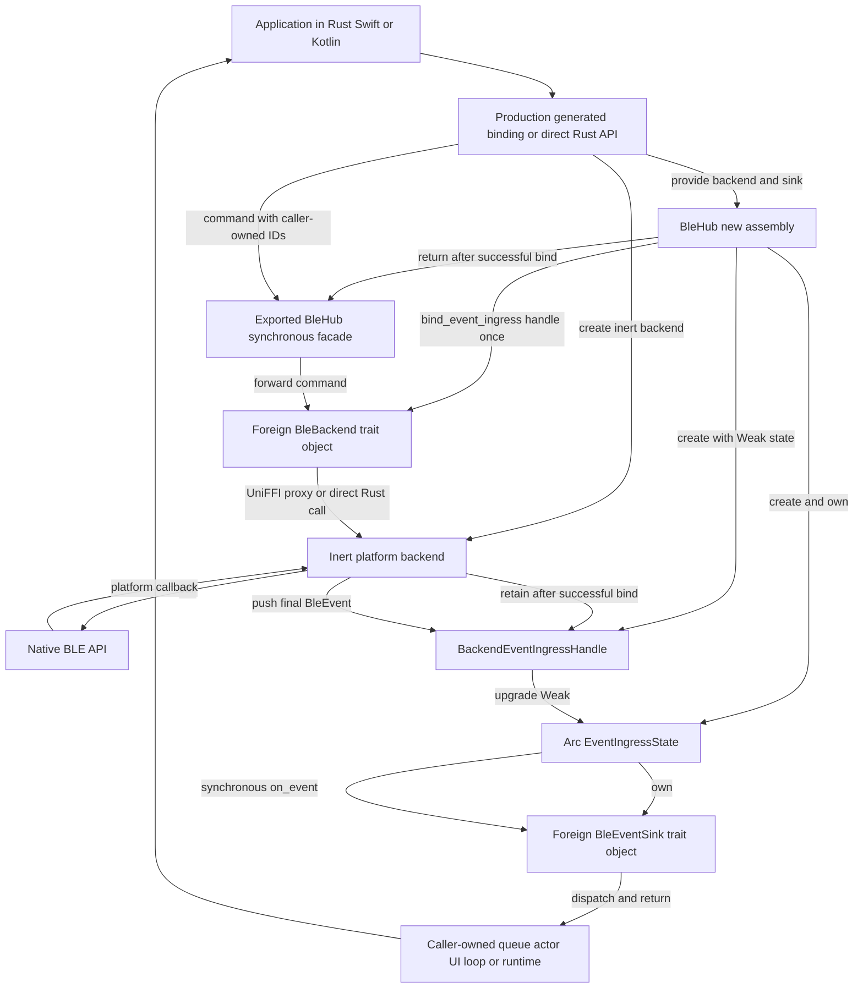
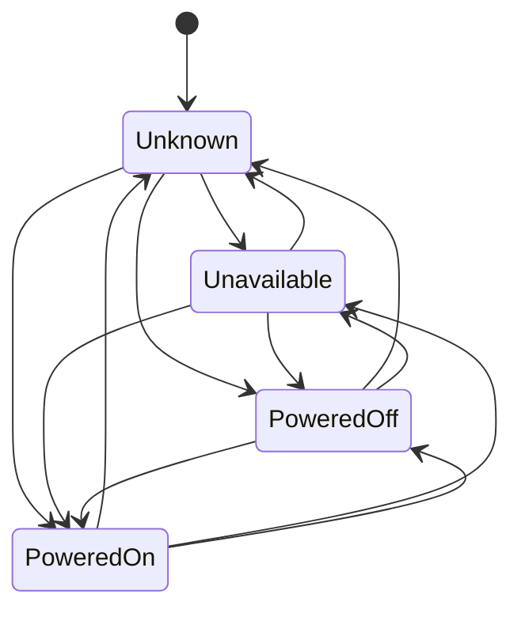
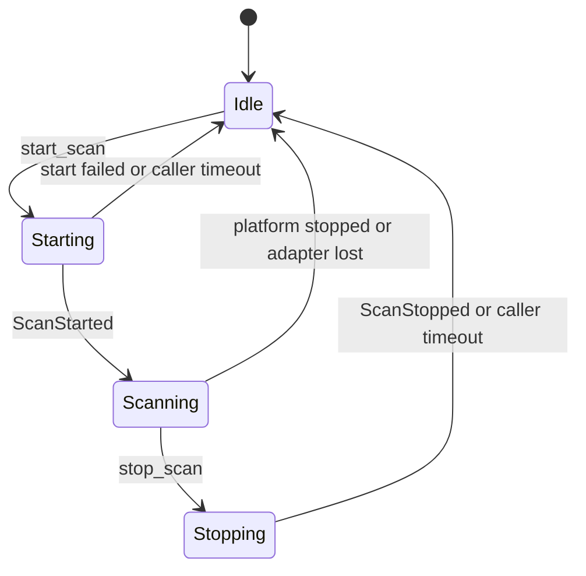
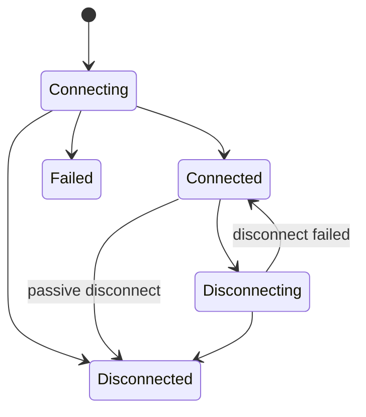
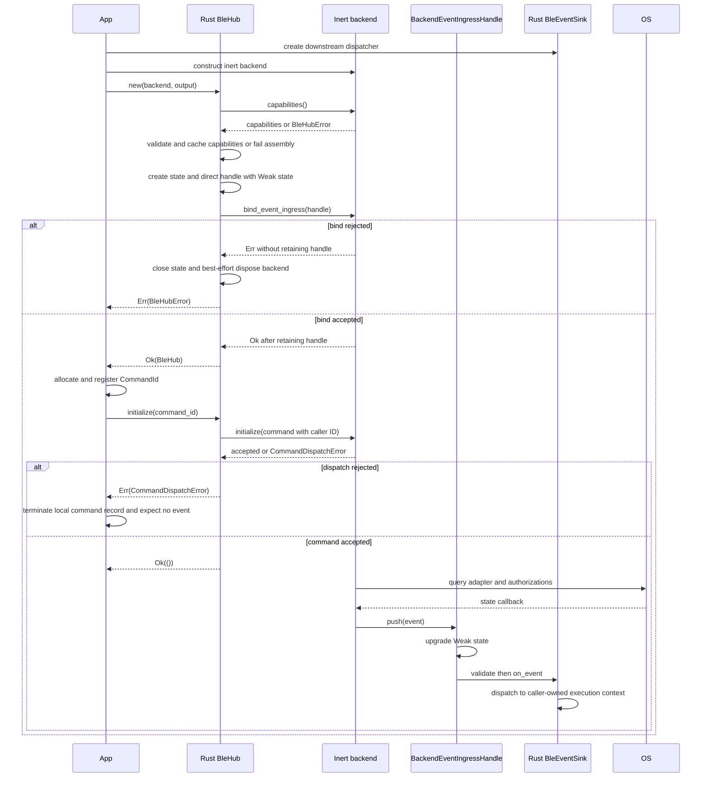
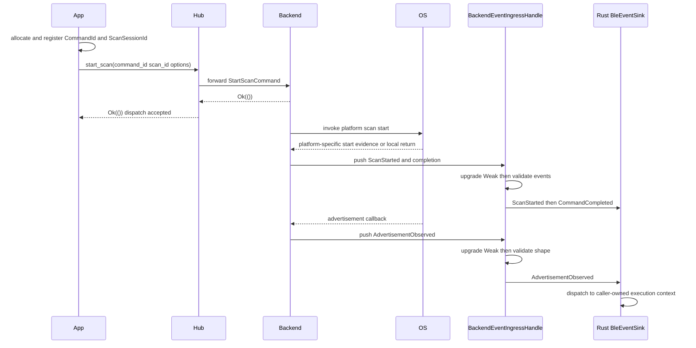
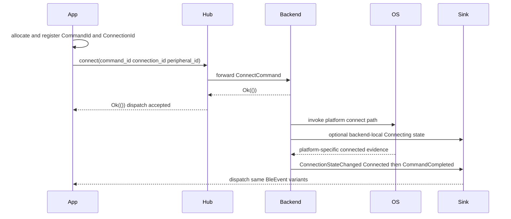
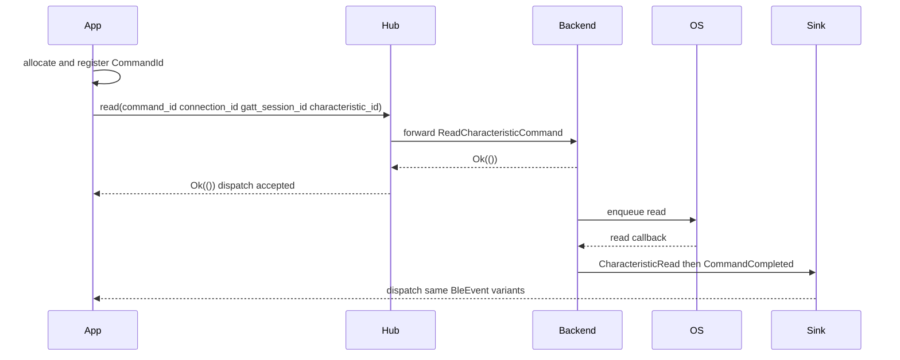
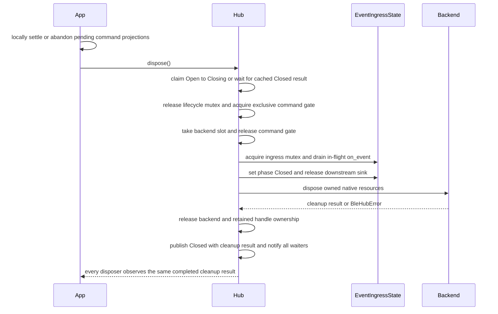
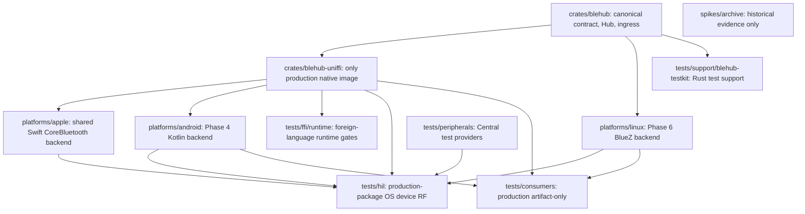

# BleHub 项目计划

**状态：已批准；RN/Nitro 移动端是当前优先 consumer lane（不改变 Phase 3→4→5 顺序）。桌面端 lane 已按 2026-11-27 用户决定重新纳入：一个 Rust host core + 一个二进制（一次性 CLI 与 `serve` daemon 合二为一）+ 一个可发布的 Tauri 插件，macOS 优先，Windows/Linux 延后；独立 RN macOS 宿主仍保持归档。**

**日期：2026-08-30**

**当前阶段：Phase 0、Phase 1与Phase 2已完成；public ABI仍未冻结。经用户批准，维护基线顺序为Phase 3统一Apple backend（macOS先行、随后iOS）、Phase 4 Android backend、Phase 5 Apple + Android v0.1/production ABI freeze；当前active implementation lane为Phase 3 Apple。RN/Nitro 移动端是优先 consumer/integration lane，但 RN 不替代上述 native production backend 与其退出 gate；桌面端按 2026-11-27 决定重新纳入（一个 Rust host core + 单二进制 CLI/daemon + Tauri 插件，macOS 优先，见 §5.7 与 Phase 7），Windows backend lane 与独立 RN macOS 宿主仍归档。归档源码和专用入口保留为显式历史兼容材料，既有本机构建缓存不随源码迁移。**

**阅读约定：**下列2026-08/09日期段落是当时candidate与provider的历史执行快照，不定义当前维护拓扑或Phase 5默认门槛；当前基线以本计划较新的已批准provider决定、各阶段退出条件及具名报告为准。历史结果不因后续通过而自动升级为同candidate证据。

**`IOS-RADIO-GATE` candidate checkpoint（2026-10-22）：** **iOS 系统蓝牙开关门禁** 已使用 fixed3 signed candidate、DK-B 和 v2-B contract/profile 完成一次 startup-off → ON 真实 RF pass：Settings ON→OFF→ON 读回、live backend OFF rejection、同一 native App PID/boot、fresh Probe scan/connect/GATT/read/write、disconnect、17 项 native resource-zero、physical cleanup 与最终 ON evidence 均通过。该报告只绑定本次 candidate/run/device/firmware receipt；不等于 active-loss/same-Hub recovery、最终 ABI/Phase exit 或 persistent result-page proof。原 non-RF 控制与失败记录保持历史范围，任何后续 radio mutation 仍需明确授权和 fresh evidence，不与 firmware/CCC 专项并跑。密码/Keychain/系统授权仍由人操作，不在 agent terminal 收集。详见 [fixed3 candidate report](../docs/testing/reports/2026-10-22-rn-ios-radio-gate-fixed3.md) 与 [历史控制范围](../docs/testing/reports/2026-10-17-rn-ios-radio-control-feasibility.md)。

**nRF v2 前向替换（2026-10-18，用户授权实现和本地 commit）：** `nRF52840 Multifunction Fault v2` 统一非阻塞 READ、response-write 与 managed CCCD fault；不维护 v1 semaphore/read-hold wire 兼容，旧身份文件和报告仅为历史证据。直接修改实际构建使用的 Zephyr fork，锁定提交后复用 nrftest clean-source/two-pass builder，不另建 patch staging 或 dirty allowlist。协议、ownership、1019-byte payload 与职责见 [v2 固件架构](../docs/research/peripheral/nrf52840-fault-firmware-v2.md)，提交、真实 A/B expected contracts、软件验证及 Linux/BabbleSim 未运行的限制见[实施报告](../docs/testing/reports/2026-10-18-nrf-fault-firmware-v2.md)。用户进一步批准机制/策略分层：底层保留有界capture/resolve/receipt/retirement与安全上限，镜像family、CCC场景转换、时序和verdict上移；Zephyr/nrftest改动进入所属仓库的本地提交，不为凑仓库数修改AutoPTS或复制第二套codec。当前机制分离后的提交树重放证据见[后续报告](../docs/testing/reports/2026-10-18-nrf-fault-mechanism-policy.md)，早期candidate报告保持原范围。已构建不等于已安装或RF通过；DK-B后续按独立明确授权执行一次恢复解锁和修复候选provision，双手机独立full-suite证据见[当前候选报告](../docs/testing/reports/2026-10-18-v2-dk-b-mobile-full-suite.md)。普通run仍无自动provision/unsecure/push授权，不改变native发布顺序或阶段退出条件；`IOS-RADIO-GATE` 的当前排队顺序以上述用户重开决定为准。

**真实 Central 执行主线（2026-10-18，用户确认）：** Mac 作为控制机，真实 Android/iPhone 作为 RN Central，真实 nRF52840 DK 作为 Peripheral，继续使用同一多功能固件；macOS 原生 Swift/CoreBluetooth Central 是独立开发/回归辅线，不复活已归档 RN macOS App，也不替代手机 RN、iOS 原生或 artifact-only consumer 证据。Linux/BabbleSim 不再作为开始真机 RF 的环境前置条件，不自动安装/建设 Linux 环境；其尚未证明的调度、资源失败与非法协议交错仍逐项列为缺口，不能被普通真机通过、ARM 编译或单测数量豁免。镜像变更须单独授权provision；每次真机run仍须同物理lease的新live receipt、唯一owner、精确命令/firmware ticket关联及有界cleanup；没有自动刷机授权；`IOS-RADIO-GATE` 按上述用户重开决定在当前固件/CCC 工作后独立推进。当前只读设备预检与 native Apple v2 会话桥接缺口见[真实 Central 预检报告](../docs/testing/reports/2026-10-18-real-central-rf-preflight.md)。

**历史证据索引（2026-08-30—09-03）：** Phase 1 的统一薄契约和单 production image（`crates/blehub` 定义，`crates/blehub-uniffi` 链接/生成）已建立；Phase 2 Windows 曾分别使用 Android Peripheral 与 Windows QEMU/BlueZ/BLESS 完成 RF、打包、资源记账和 fault/soak，2026-09-02 退出审查为 PASS。其早期 provider、USB 身份、吞吐数值和未执行项属于当时 candidate，详情见[Windows RF/打包汇总](../docs/testing/reports/2026-09-01-windows-current-candidate-rf-packaging-summary.md)、[吞吐矩阵](../docs/testing/reports/2026-09-01-windows-android-qemu-throughput-matrix.md)、[fault/soak/reboot 报告](../docs/testing/reports/2026-09-02-windows-phase2-fault-soak-reboot-hardening.md)及[退出审查](../docs/testing/reports/2026-09-02-windows-phase2-exit-review.md)。WHPX 同进程 reboot 失败，新进程恢复可用；新增 TCG boot-ID 断言、真实 Windows host reboot 与提权绑定路径没有通过。

**Apple 历史候选与当前 iOS nRF 证据：**真实 Mac mini 上的 Swift runtime、三 slice XCFramework/SPM、CoreBluetooth 初始化/扫描/连接/GATT/I/O/notification/RSSI 确定性切片与 macOS→Android Peripheral RF 已逐步验证；iPhone 签名/初始化及到 Android Peripheral 的 scan/connect/GATT/read/write RF 后续独立通过。2026-09-28 当前未冻结 candidate 又完成了 native Swift/CoreBluetooth iPhone→standalone nRF52840 DK 的 I/O、Notification、strict Indication、connected RSSI、Peripheral-initiated passive disconnect 和三周期 recovery；该证据只属于 native iOS Central，不替代 RN/Nitro RF、macOS RF 或 Android RF。详见[Apple bring-up](../docs/testing/reports/2026-09-02-apple-production-candidate-bringup.md)、[单 image ABI 迁移](../docs/testing/reports/2026-09-03-single-image-production-abi-migration.md)、[iPhone runtime](../docs/testing/reports/2026-09-04-apple-ios-production-runtime.md)、[iPhone Android RF](../docs/testing/reports/2026-09-08-apple-ios-android-rf-pass.md)与[2026-09-28 iPhone nRF native RF](../docs/testing/reports/2026-09-28-apple-ios-nrf-native-rf.md)。早期 ad-hoc macOS 初始化 `Unavailable/NotDetermined` 不等于授权通过；LaunchServices 可见 app 的 `PoweredOn/Authorized` 是另一轮证据。单 image 迁移报告中的 Android ART、iPhone 签名/RF 阻塞只描述该次运行，不能覆盖后续具名通过报告，也不能把后续结果继承给最终 ABI candidate。

**已退休的 Apple fixture 探索：**Mac QEMU + UB500 曾在 guest Realtek HCI `0xfc61` 超时，原生 macOS BLESS 探索仅通过非 RF 机制/profile 校验；两者均非维护中的 Apple Peripheral，也不能作为 Apple backend RF 失败或通过。见[Mac QEMU 记录](../docs/testing/reports/2026-09-02-apple-bless-qemu-macos-bringup.md)与[原生 BLESS 探索](../docs/testing/reports/2026-09-03-apple-native-macos-bless-design.md)。当前 provider 和独立平台 gate 以 2026-09-12 nRF 决定、第 11.5/13/14/15 节为准。

**2026-09-04 当时的Peripheral拓扑修订（后由2026-09-12 active nRF决定更新）：退休macOS原生BLESS与Mac QEMU + BLESS作为维护路线。** 当时macOS/iOS Apple Central使用项目Android Peripheral开发RF，并规划nRF52840 DK的standalone Peripheral作为Mac/iPhone参考外设；不再维护`apple-bless`环境、macOS BLESS进程控制器或`macos-bless-*` profile/recipe。Windows侧保留QEMU Linux + BlueZ + BLESS控制面；其USB passthrough改为读取机器本地`[peripheral_usb]`或`BLEHUB_PERIPHERAL_USB_*`配置，不再跟踪UB500、Zadig、WinUSB绑定/回滚或任何设备专用VID/PID/serial。nRF52840 Dongle到货后先按实际USB identity和固件模式建立配置与profile：HCI firmware用于Windows QEMU，standalone Peripheral firmware用于Windows直接RF，两者互斥；nRF52840 DK直接作为Mac/iPhone的standalone Peripheral。历史UB500与macOS BLESS报告保留为历史证据，不代表当前维护架构或通过结果。

本文是 BLEngine 唯一规划来源。Phase 0已完成框架选择、production FFI迁移、最小scan/connect contract/bridge和Windows/Android真实runtime gate；Phase 1已完成平台无关公共契约、共享conformance、reviewed API snapshots和完整candidate runtime复核；Phase 2已完成项目Android开发Peripheral、managed QEMU/BLESS fixture与production Windows backend的退出审查。后续实现优先级按执行host选择，但阶段完成、ABI冻结和各平台证据保持独立。本文同时作为未来架构文档、API文档和平台接入文档的来源。

**项目命名决策（2026-11-03，用户批准）：** 项目/产品总名称目标为 **BLEngine**，对应代码仓库、package 或新建技术标识使用小写 `blengine`。`BLEHub` 是底层 canonical BLE contract/core 的展示名，Rust 类型和既有 crate 标识继续使用 Rust/生态习惯的 `BleHub`/`blehub`；`BLeng` 是 async runtime 的展示名，Rust 类型和既有 crate 标识继续使用 `Bleng`/`bleng`；`bleng-supervisor` 继续表示 recovery/session orchestration。该命名决策先统一未来文档、产品和新入口的名称，不立即重命名现有 Rust 类型、crate、UniFFI component、artifact 或 public ABI；任何实际 API/ABI/package rename 必须单独提出迁移方案并在 ABI review/冻结边界执行。历史报告保留当时的 `BleHub`/`BLeng` 名称，不为品牌统一而改写历史证据。**

**React Native package/consumer topology（2026-11-03，用户批准方向，实施中）：** `integrations/react-native-bleng` 是唯一正式 RN package line；`integrations/react-native-internal` 与 `tests/consumers/react-native-internal` 是 transitional legacy probe/host，不得演化成正式 API，待其 test-only seams、host evidence 和仍有价值的 RF/HIL 场景迁出后整体删除。底层 UniFFI/Bleng/Supervisor ABI 由无 UI 语义的 `tests/ffi/runtime`、`tests/consumers/android/{blehub,bleng}` 与 `tests/consumers/apple/{blehub,bleng}/{ios,macos}` 分别验证；正式 RN API 由唯一 clean host `tests/consumers/react-native-bleng` 验证，host 内可以有 iOS/Android App target、native tests、Jest 和 UI tests，但不得把 raw UniFFI handles/events/CommandId/RecoveryPlan 暴露给 JS。Android formal package 已收敛为单 root library module；原包内 Kotlin Nitro Promise contract 和 legacy host 中的 Apple owner smoke 已迁至正式 consumer 的 native targets，并替换原占位测试。legacy host 已去掉正式 Nitro npm/Pod dependency，继续使用其所需的 combined UniFFI/backend artifacts；两套 host 的 autolinking graph 保持分离。formal Android App/test APK 与 Apple native `build-for-testing` 已构建，legacy 两端相应构建也已复核，但不据此声称 native runtime/UI/RF gate 通过。`formal-host-ios-build` 由同一 owner 先校验 installed Podspec，再编译 Nitro-free `ios/PlatformContract` 与正式 App/native-test graph，替代旧独立 static consumer 及其重复 npm/Pod setup；这是 source/local-package build，不冒充 clean npm tarball/artifact-only gate；safe-area 5.11.1 的 iOS Pod lock 与 Simulator App/native-test 构建已通过原 owner 刷新，见[构建及 helper handoff 候选](../docs/testing/reports/2026-11-04-formal-ios-build-automation-handoff.md)，不计作 iOS runtime。Apple BleHub artifact consumer 的 Swift backend 独立 stage 到 `.work/staged/apple-backend-production`，依赖 `.work/staged/apple-production` 的同一 UniFFI image；共同的 Apple prepare prerequisite 同时准备两包，不借 checkout 源码或第二 native image 补依赖。native consumer 保留 bound/disposed resource 与 lease reuse 回归；iPhone host 仅接受本次唯一 run ID、明确 `backend_resources=passed` 与唯一成功终态，不将 macOS/unsigned compile 计作 iPhone runtime。剩余 probe、Hermes reload、workbench 和 RF ledger 的迁移条件见 [`consumer ownership`](../tests/consumers/README.md)；正式 RN 的首个 typed 初始化投影候选为 `start(): Promise<BlengAdapterSnapshot>`：只映射 Rust `ForeignOwnerStart.adapterSnapshot` 的 state、独立 scan/connection authorization 与 optional name，不把 owner context/ID/recovery plan 传入 JS，也不从初始化成功推断 PoweredOn/Authorized。它替代原 private void 返回，但仍未冻结，具体共同 RN operation/event contract 继续需要评审。正式 operation surface 已按 capability 形状接通：scan、connect/disconnect、GATT discovery 与characteristic read/write、connected RSSI，以及 notification subscription 流（`beginEnableNotifications` → `waitUntilEnabled` → `nextEvent` / `beginDisable`）。这些能力都由 Rust 创建并携带精确 owner/connection/GATT session，JS 不持有任何 raw ID；enable receipt 现在携带 actual mode，notification backlog 有界并在溢出时 fail closed；一个 owner 仍只有一个 event reader，scan、notification 与 connection-end 是同一个 observation projection 的三条 lane；connection-end lane 按连接注册（与 connect 提交同锁安装），一条链路只有一个终止且该终止被保留而非一次性消费，归因只区分「本能力提交的 disconnect 产生了它」与「没人在这里要求它」，不从 peer 侧猜测，deadline 是调用方自己的界。均为软件验证（Rust `ffi_scan` + Jest + 两端 native graph 编译），尚未取得真机 RF。reload 后的业务面迁移、RF ledger 迁移与真实外设验证尚未完成，不能仅因已有 Appium lifecycle 场景或两端编译就删除 internal host。正式 App 已接入 Tests → Current run → Evidence：owner/pending action 位于视图切换之上，浏览不执行命令或清理，异步完成不抢回导航；关闭后保留初始化快照及失败/重试观察，直到下一次显式新 session。UI 摘要仅在当前 App runtime 内保留最近 32 次 action 并明确显示遗漏数量，不宣称跨 reload 持久化或替代 host bundle。共享 Appium 场景检查浏览前后 state 与初始化证据一致并停留 Evidence；Android 后续 managed lifecycle 已有正式 API 真机 UI 证据，见[候选报告](../docs/testing/reports/2026-11-04-formal-android-managed-lifecycle.md)；iOS 与 legacy RF scenario/provider/host ledger 迁移仍未完成。不要为 raw ABI consumer 与 formal RN UI consumer 复制同一 App；artifact consumer 无 UI 语义，formal RN consumer 是唯一产品 UI host。`tests/consumers` 的目录重命名/搬迁必须在本计划中按引用审计、artifact recipe、Just、Pod/Gradle、CI 和报告链接一起执行，不另建第二份架构 plan；archive/history 不因目录对称性删除。

**React Native internal consumer 物理退休（2026-11-22，完成）：** C 类（无 UI 面的非原生场景）全部迁入正式 App lane 后（adapter-transition 与 permission-transition 走正式 App 的 Kotlin instrumented test，iOS permission-authorization 走正式 App 的 XCTest target；`watchdog` 显式 re-admit 为 native-only 并删除两条 HIL recipe），`tests/consumers/react-native-internal`、`integrations/react-native-internal`、`tools/react_native/` 中只服务它们的 20 个 CLI/capture 模块及其测试、以及 74 条 `host-*` 类 Just recipe 已物理删除。正式 host 的 autolinking 守卫改为唯一保留的 `react-native-internal` 字样：`formal-host-install` 断言该依赖未泄漏进正式 RN 图。`tools/react_native` 保留 `formal-host-*`、`bleng_*`（scan/lifecycle/multi-link/managed scene/UI automation）、Appium/Maestro 与 `rf_*` 共享机制；`tools/tests/react_native` 的布局守卫改为只列出仍存在的 CLI。证据见 [C 类退休核对](../docs/research/react-native/c-class-retirement-audit.md) 与各 2026-11-22 报告。

**RF-lab host protocol 与 nRF52840 coordination 模式退休（2026-11-22，完成）：** 在 internal consumer 删除后，剩下的 RF-lab 证据链仍以「设备侧 coordination 模式 → BTP 模拟器 → host ledger → `rf_evidence_bundle`」的形式寄生在活的 `provider.py` / `direct_fixture.py` 上。审计确认没有任何维护中的 Just 入口传 `--coordination-mode`（`multi_fixture` 仅在 `coordination_root` 非空时传，而 readiness 入口不设），正式 managed 场景一律走 `run_bleng_*_scan --scene ...`。已删除：`provider`/`direct_fixture` 中 8 组 retired mode 与设备侧模拟器（`adapter_transition`、`pending_reload`、`recovery_ten`、`full_suite`、`write_reject`、`ccc_enable_reject`、`permission_transition`、`ios_adapter_startup`、`continuous_watchdog`、`suite_cancellation`、`notification_observation*`），`tools/react_native` 中 35 个只被它们与测试引用的模块（含 `rf_evidence_bundle`、`rf_scenario_runner`、`check_runtime_log`、pending-read、iOS adapter-startup、各类 `*_capture`/`*_ledger`），以及对应 45 个测试与 21 个 test support 模块。为避免倒挂，先抽出 `tools/react_native/evidence_io.py`（host 文件/流机制）和 `tools/react_native/ios_radio_control.py`（iOS radio-control 观察词汇与严格审计），让 `ios_radio_lease`/`ios_radio_restoration` 不再从证据 bundle 里借私有 helper；`ccc_disable_reject`（Apple native HIL Flow 12）的共享 GATT/CCC 载波抽到 `tests/peripherals/nrf52840/support/ccc_wire.py`。`tools/react_native` 从 105 降至 70 个模块，`tools/tests/react_native` 测试从 118 降至 87；原 RF-lab 架构文档归档为历史。验证：`tools-test` 1796 passed / 21 skipped / 5722 subtests（2:10），peripheral 356 tests OK，`ruff`/`just --fmt --check`/`docs-check-mermaid` 均通过。

**iOS 原生场景驱动落地（2026-11-22，用户批准方向后实施）：** 正式 App 自己的 XCTest target 里新增进程内 scene driver `ios/BleHubBlengHostUITests/BlengSceneDriverUITests.swift`，由 host 写入声明式 plan（`BLEHUB_SCENE_PLAN`），用 `XCUIElement` 直接执行 `wait`/`tap`/`tapWhen`/`tapUntil`/`read`，无 WDA、无 Appium server、无 tunnel、无 iproxy。条件只针对**一个**元素求解，可用 `exists`/`label`/`labelContains`/`enabled` 以及 `status`（对 App 的 `run-status` 单节点投影做 `key=value` 断言），因此一次轮询就是一个元素读取，且同一帧内的事实不会互相矛盾。两条新契约：(1) **plan 不能滚动** —— 没有 swipe/scrollTo/坐标步骤，并有单测阻止未来加入；Android 的 accessibility 树会省略视口外的 `ScrollView` 子节点，靠手势的场景会变成平台相关且精度取决于注入，所以树里缺的事实应当在 App 里 pin，而不是让驱动去滑（`scan-samples`/`lifecycle-evidence` 因此明确不是场景表面，计数读 `run-status`，最新观测读 `scan-latest`/`notify-latest`）；(2) **回执是 attachment，不是 stdout** —— UI 测试进程的输出不会进入 `xcodebuild` 日志，驱动加一个名为 `ios-scene-driver-receipt` 的 `XCTAttachment`，host 用 `xcrun xcresulttool export attachments` 读 `manifest.json`，并要求恰好一个匹配 `ios-scene-driver-receipt_<n>_<uuid>.json` 的附件（0 个/2 个/scope 不符/不安全导出名全部 fail closed）。`launch` 与 `activate` 明确区分：`launch` 起新进程（独立驱动入口用），`activate` 只把 host 已经 pin 住的 App 调到前台；实测 `devicectl` 起 pid 3742，`--launch false --activate true` 跑完 18 步后 pid 仍为 3742，回执里 `state=started`→`state=closed` 齐备。真机实测（iPhone 14 Plus / iOS 27.2.1，App 树 `215b300e…`）：`smoke` 18 步 **6.62 s**、`scan` 13 步 **5.65 s**，单次点击 0.45–0.80 s、单次读取 0.13–0.29 s，对照 Appium 车道每次点击 8.5 s。`scan` 这次抓到的是环境里的真实广播（`MX 8.3 - BT3`, rssi -69），只证明扫描通路，**不**证明 nRF52840 fixture（provider 要求显式不可变 `--fixture-request` 会话，只有 host lane 能创建）。守卫：`tools/tests/react_native/test_ios_scene_driver.py` 22 条（plan 形状、禁止滚动、回执契约、投影严格解码、`run_scene` 失败也先发布再抛）+ `test_workbench_ids.py` 现在把 plan 里驱动的标识也纳入「host 需求 ⊆ App 声明」检查（反证：改成 `start-scan-typo` 立刻指名缺失）。`run-status` 的 key set 与严格解码现在只归 `tools/react_native/run_status.py` 一份：Appium lane 把 `RunStatusError` 包回 `AppiumError`（既有断言不变），native lane 把每个 `read` 严格解码后发布为 `projection`，漂移的帧因此会失败而不是「匹配不到」。**真机新增三个事实**（均为失败运行暴露，非推断）：(1) `xcodebuild` **不会**重装 `devicectl` 已安装的目标 App —— 实测 pid 3757→3757、3773→3773，安装容器不变，所以 attach 模式是真能力；`activate` 因此是 **plan 步骤**而非入口模式（系统弹窗存在时 `activate` 会失败，必须先答弹窗）。(2) 全新安装会在 App 之上弹出系统授权（本地网络、蓝牙），它们吞掉点击：`run-status` 仍是 `state=idle` 而步骤只看到超时，靠 SpringBoard 树才看见 `Alert`；新增 `answerAlert` 步骤，只答 plan 里声明过的标题子串/按钮（中英双语数据），其余一律 fail closed，实测干净安装下第一步 1.2s 答本地网络、第五步 1.6s 答蓝牙，整场 22 步 13.7s 通过。(3) 弹窗按钮在 SpringBoard 树里出现两次（`kTCCServiceBluetoothAlways-allow-button` 包裹层+子节点），`buttons["允许"].tap()` 会硬失败「Multiple matching elements」并不抛错地中止测试（无回执），改用 `firstMatch`；同理不能用 `alerts.element`（弹窗消失瞬间读取会硬失败），并且 label/identifier 必须在 tap **之前**读完。这也堵了一个判定漏洞：XCTest 可以静默失败，所以 `run_scene` 现在**同时要求 `xcodebuild` 退出码为 0**，否则回执说 passed 也不算。**动作账本上移到 pinned 机器面（2026-11-22）：** 剩余场景（notification/indication/io/cancellation/write-reject/ccc-*）都要证明「App 确实记录了本次派发的动作」，而 Appium lane 读的 `lifecycle-evidence` 是滚动容器里的散文，进程内驱动既读不到也不该读。因此同一份有界列表另发为一个 pinned 节点 `action-ledger`：首行 `omitted=<n>`，之后每行 `sequence|action|result|detail`，值里的 `|` 与换行被剔除（一条记录不可能变成两条）；编码器 `src/actionLedger.ts`、严格解码器 `tools/react_native/action_ledger.py`（递增序号、枚举形状、有界 detail/条数，异常即 fail），`lifecycle-evidence` 原样保留给人看；该节点故意放在 pinned 区**最后**，因为它随运行增长，而场景要点的东西必须在它上面。守卫改为从源码推导「滚动内容词汇表」：从 `ids.ts` 读分组，收集 `ManualScan.tsx` 渲染的标识（即 `App.tsx` 放进 `workbench-content` 的那几个面板），任何原生 plan 驱动其中之一即失败——这个守卫也证明了旧的 `_SCROLL_TARGETS` 是「Appium 可以滚动找出来」的集合，而不是「内容」集合。本轮 App 树：`a3fdc37fd13e101e421e09f954e728fcf04c4b127b7124ed1292aa0e31d0ee06`。

**原生驱动信封重构（2026-11-22，实施完成，真机场景被设备端授权阻塞）：** UI 驱动从“信封里写死的 WebDriver”改成 `SceneDriver` 接口：`bleng_scan_runner.run_prepared_scene` 是**唯一**信封（admission、candidate binding、fixture/phone 守卫、cleanup 顺序、phone finalize、发布），`AppiumSceneDriver` 是 Appium 实现（Android 与尚未迁完的 iOS 场景继续用），`NativeIosSceneDriver` 是进程内 XCTest 实现；`run_prepared_scan(driver=..., automation=...)` 现在只是“构造 Appium driver 再调用信封”的入口，随最后一个 Appium 场景一起删除。`IosCandidateOwner.bind_native` 用同一套 `read_app_identity` 原生挑战（pid/executable/install+launch 收据/in-container run-id）完成无 WebDriver 绑定，并声明“进程内驱动无法提供 per-click 档，只能做场景首尾检查点”。证据层不再假设自动化服务器：bundle 用 `inner.driver.kind` 声明驱动，进程内形状要求 `driver/record.json`（xctestrun sha、plan、退出码 0、回执 sha 一致）与 `driver/result.json`，**不得**声称 WDA/server/helper；原始 xcresult 与 xcodebuild 日志留在 bundle 外（工具存储），只复制回执/结果/文本诊断。iOS request 对这条 lane 记 `driver_kind` + `xctestrun_sha256` 而不再记三个无用端口，`--xctestrun` 必填且 `--authorize-wda-build` 被拒绝。**Managed scan 实测（已通过）：** App 树 `4a69d66a87c7aa7bf79ea0ce10442d02870ddd34ee4677932f71cef49a989be8`，run `b622ac84-facd-4558-9f3c-391b969c0c87`：`status=passed`（`host_gate=pending`、`rf=scan-ui-observation`），scenario/session/phone/fixture 均 passed、`cleanup_errors=[]`，cleanup 顺序 scan.run-prepared → scan.result → fixture.close-record → lease-release → lease-record → bundle.prepare → cleanup.complete，fixture close 收据 `jlink:1050252028` + 本 run id；inner `driver.kind=ios-xctest-in-process`、`plan=scan`、22 步 27.9s、`xcodebuild` rc 0，trace 为 `idle, started, scan:running, scan:advertisement-matched, scan:stopped, closed`，且 bundle 过了 `verify_scan_bundle`。**三次失败换来的修正（都是真缺陷）**：(1) 第一版场景只要求「扫到任意广播」，实际抓到邻居（`rssi=-86`, `name=not reported`）——现在 host 从 fixture contract 取 `local_name`/`service_uuid`，场景先 `setText` 写 service filter 并用投影 `scanFilter` 验证，拉取循环只认 `name="<fixture>"`，没有 local name 驱动直接拒绝启动；(2) `scan-service-filter` 只存在于 Current run 页的 pinned 控制台，先设 filter 会 `setText` 超时于 absent——改为 start-session 之后、start-scan 之前；(3) trace 推导要的 `started` 读取在 scan plan 里漏了，导致场景跑完 27s 却在回执上失败——现在 plan 读齐 trace 断言的每个事实，并有单测钉住两者的对应。**设备端**：中途连续三次 `Timed out while enabling automation mode`（host 三项均 `unattended`），重启并重新授权后 probe 0.25s 通过。**两阶段场景真机通过（notification / indication，2026-11-22）：** App 树 `5cfabfac16fa188bea05eedf1be70814cfcc4817d94734fad4f97aeaa6e415fa`，run `301c47e8`（`.work/ios-native-notification-r8`）与 `79d4d320`（`.work/ios-native-indication`）均 `status=passed`、`host_gate=pending`，12 条 trace 全齐（`idle, started, scan:running, scan:advertisement-matched, scan:stopped, link:connected, gatt:ready, notify:subscribed, notify:value-matched, notify:disabled, notify:ended, closed`），每场景 39 步分两阶段（subscribe 30 步 35.2s → host 发射 → collect 9 步 6.0s），两阶段 `xcodebuild` rc 均为 0，`notifyMode` 分别回来 `notification`/`indication`（从 enable 收据读取并与 profile 比对，不是假设），拉到的值是 fixture 发射的 `1 bytes [ef]`，App 自己的账本 17 条动作全 succeeded 且与期望序列逐个对应。**这轮暴露的六个设备事实**：(1) App 切换器留在前台会吞掉点击（`activate()` 只把进程切前，切换器仍在收点击，表现为 90s 停在 `state=idle`），而切换器窗口在 SpringBoard 树里**始终存在**、检测不可靠，所以 `activate` 步骤改为**无条件先按 Home**；(2) `activate()` 在 App 真正到前台前就返回，按 Home 后立刻点击会落在转场动画上丢失，现加上 `.runningForeground` 等待（15s 有界，超时报出真实状态）；(3) Apple ID 的「你的账户中有设备加入」是**信息类**提示（只有一个「好」、不授予任何权限）但会反复出现并盖住 App，现已作为声明规则，回执记录 `answered[1] id= label=… button=…` 可审计；(4) 未声明的弹窗在 `required:false` 时**只记录不回答**（可能属于别的 App、未必盖住我们），`required:true` 才致命；(5) `gattMatch` 是对已发现拓扑的观测，必须在 discovery 之后才 setText 目标，否则永远不成立；(6) 订阅的终止是**经事件流**投递的，`disable` 后阶段仍是 `subscribed`，要再 pull 一次才消费到 `ended: disabled`——正是 Appium 车道末尾那条 `notify-pull → ended: disabled`。证据见 [iOS native scene driver](../docs/testing/reports/2026-11-22-ios-native-scene-driver.md)。**下一步**：把 `bleng_ios_scan.py` 中 `run_prepared_scan(driver=webdriver.Remote)` 换成原生驱动，同时保留 `candidate.bind`、`require_scan_authority`、App identity 检查点、passive fixture close 与 phone finalization——这些正是驱动必须用 `launch: false, activate: true` 的原因；随后逐场景迁移并在每迁完一个后删除对应 Appium 分支，最后 Android instrumented 对齐并删除 Appium。
**原生驱动第四个场景 `io` 真机通过（2026-11-23，候选事实）：** managed `io` 已从 Appium 迁到进程内 XCTest 驱动（`PHASES["io"]` 单阶段 + `lane.plans(io=...)`），真机 iPhone 14 Plus / iOS 27.2.1 对真机 nRF52840 DK（`jlink:1050252028`，v2-a）跑通：run `f4ef1c28`、App 树 `5cfabfac…`、`status=passed`、`host_gate=pending`、44 步 44.6 s、`xcodebuild` rc 0，12 项 trace 全齐（`io:read-initial` → `io:written` → `io:readback` → `rssi:observed`），App 自己的读数为写前 `1 bytes [00]`、写回 `wrote 1 bytes (withResponse)`、写后 `1 bytes [37]`、RSSI `-52 dBm`，动作账本 18 条全 succeeded 且「读→写→读」顺序与声明一致。三个新决定：(1) 写入载荷唯一推导 —— `bleng_scan_host.io_target()` = `read_write_target()` + `_io_write_payload()`（长度取 profile provision 的长度，字节为与当前值不同的可打印 ASCII），Appium 与原生两条 lane 共用，不可能写出不同 payload；(2) 一次读的归属靠 App 的**值渲染**（`N bytes [..]`）而不是阶段或存在性 —— App 派发命令时清空 `gatt-result`，`gattRead=done` 在第二次读时本就为 done，而元素存在会命中写回执，只有「等到值是值」能唯一确定「我刚请求的那次读」；(3) 回执的 `as` 名字在一个 plan 内必须唯一 —— 首轮真机正是 io 的第一次读也叫 `initial`、覆盖了 `_prefix` 的 run-status 前置读，host 拿 `fff10000-…: 1 bytes [00]` 按 run-status 解码而在 50 s 失败；现按来源命名（`io-*`）并加单测遍历所有组合 plan 要求唯一。App 字节渲染 codec 上移到 `bleng_scan_evidence.GATT_VALUE_TEXT`，两条 lane 共用一份（原生侧用它拒绝把写回执当值）。Android 仍用 Appium 的 `io` 分支，故 `AppiumSceneDriver` 的 `kind=="io"` 分派在其迁移前不可删。证据见 [io 场景报告](../docs/testing/reports/2026-11-23-ios-native-io-scene.md)。
**原生驱动第五个场景 `cancellation` 真机通过（2026-11-23，候选事实）+ 两个 App 缺陷根因修复：** `cancellation` 已迁到进程内 XCTest 驱动，真机 iPhone 14 Plus 对真机 nRF52840 DK（`jlink:1050252028`，v2-a）跑通：run `1fb58bb8`、App 树 `0fe5920d…`、`status=passed`、`host_gate=pending`，13 项 trace 全齐，四阶段 59 步、每阶段 `xcodebuild` rc 0（`open` 29 步 36.4 s → `hold` 5 步 → `queue` 11 步 → `settle` 14 步）。阶段之所以是四个，因为 `arm`/`require_held`/`release` 是 **fixture 命令**而不是 UI 步骤，且实测 fixture 拒绝在无连接时 arm（`READ hold requires a connected peer`），所以「开链路声明目标」必须独立于「提交被持有的读」；后续相只 `activate` + `state=started`，不重开会话/重扫/重连，也不从上一相回执推断。**一次读的归属改为标量计数**：`run-status` 新增 `gattReadTotal`（本 run 已结算的读等待数），因为 App 读完会一直显示上一次的值、`gattRead=done` 在第二次读时本就还是 done，阶段与存在性都无法区分；App 在 publish 之后才自增，所以观察到计数前进即意味着新渲染已在同一帧，恢复读因此等 `gattReadTotal=3` 而不是等 `bytes [`。**真机暴露并根因修复的 App 缺陷**：pinned 账本编码器读 `entry.detail`，而记录器把结局句子写在 `Observation.error`，于是**任何失败动作的细节从未进入机器账本**（这也是旧 Appium 场景只能从散文取证的原因）；编码器入参改用真实字段名并新增 App 测试钉住「失败句子必须出现在第 4 段」，宿主侧同时保留「被取消的等待必须点名 cancelled」的严格断言。**结构性整理**：`peer_hold.PeerHold`（arm/require_held/release/reject + 宿主守卫）从 Appium lane 私有 `_Hold` 提成两条 lane 共用的中性模块；`scene_ios_native.GATT_TARGET_KEYS` 声明每个 GATT 场景所需的目标字段（`io`=uuid+write，`cancellation`=uuid），多给/少给在构造期拒绝；`cancellation` 账本使用自己的形状（前缀折叠 + 读侧尾段，`gatt-read-cancel` 与被退役等待的结算顺序两种都接受，其余严格）。App 本轮改过两次，故用最终树 `0fe5920d…` 整条重跑：`scan`(f309550c, 23 步)、`notification`(af36208a, 39 步)、`indication`(542372a0, 39 步)、`io`(bf295476, 44 步) 全 passed，`scene_sequence=passed`。离线：tools-test 1763 passed/5360 subtests，App Jest 122 passed。Android 仍走 Appium 的对应 `kind` 分支。证据见 [cancellation 场景报告](../docs/testing/reports/2026-11-23-ios-native-cancellation-scene.md)。
**iOS managed 门禁全部迁入进程内驱动（2026-11-23，候选事实）：** 最后六个场景 `write-reject`、`ccc-enable-reject`、`ccc-disable-reject`、`passive-disconnect`、`recovery`、`recovery-ten` 迁到 `NativeIosSceneDriver`，至此 **11 个 managed iOS 场景全部在进程内 XCTest 上运行**，iOS 不再保留 Appium lane。同一最终 App 树 `abf0377a…`、同一 xctestrun、同一 iPhone 14 Plus 与同一 nRF52840 DK 上整跑：scan(24 步)、notification(40)、indication(40)、io(45)、cancellation(59)、write-reject(58)、ccc-enable-reject(51)、ccc-disable-reject(56)、passive-disconnect(50)、recovery(94, 6 相)、recovery-ten(276 步 / 20 相 / 162 s) 全部 passed、`cleanup_errors=[]`、`host_gate=pending`。两个新驱动能力（都只改 UI 测试 bundle，不改 App）：**`waitAny`** 有界析取（2..8 条件，回执记录命中的分支），因为一个问题可以有两个合法答案而「哪个可接受」是宿主的判断——`ccc-disable-reject` 的探测因此不需要把平台分支写进 plan；**`still`** 有界时间断言（条件必须在 `for` 秒内持续成立），因为「什么都没变」不是 `wait`（已成立会立刻返回）。**真机暴露并修复的三个缺陷**：(1) `setText` 对已填值的受控输入按旧长度删一次即输入，React 重渲染把删除补回、新值被追加（实测 `fff10000-…` 变成 48 字符），改为删到确实为空再输入并保留最终值校验；同时「同一 App 内的后续轮次不再重输目标，只等它仍解析为唯一一行」。(2) App 的「一次 scan = 一个 run」——`start-scan` 会重置读通道与视图，所以 recovery 每轮的读都是该轮 run 的第 1 次结算；先前按 `cycle+1` 等，真机立刻失败。 (3) `DirectFixture.drop_peer` 一次采样 `require_idle`，而引擎 busy 位由「活故障槽 **或** GATT target 待消费 evidence」组成，普通 ATT 流量后会短暂置位，十轮 recovery 的第 9 次 drop 因此撞上 `fault engine busy/quarantined`；修法只放在这条路径（自己的 deadline 内等到 idle，超时仍按原样失败），arming 路径的 `require_idle` 保持一次采样就拒绝。十轮场景的动作账本是有界窗口（`omitted=80`），所以「每轮都记录了一次读」改由该轮 run 的投影 `gattReadTotal=1` 逐轮断言，账本只断言「窗口内无失败动作且最后完整一轮逐项一致」。证据见 [全场景报告](../docs/testing/reports/2026-11-23-ios-native-all-scenes.md)。**下一步**：Android instrumented 驱动对齐同一套 plan 词汇（接缝仍是 `SceneDriver`），然后删除 `AppiumSceneDriver`、`run_prepared_scan`、WDA/tunnel/iproxy toolchain 与相关 recipe。

**Android 进程内场景驱动落地（2026-11-23，用户批准方向后实施，候选事实）：** Android 不再有 Appium 场景：同一套 `scene_plans` 词汇由正式 App 的 instrumented test（`androidx.test.uiautomator`）执行，`NativeAndroidSceneDriver` 只覆盖 executor，phases/宿主动作/账本/11 份观测推导都在平台中立的 `scene_native`。编码进架构的平台事实：instrumented test 跑在被测包自己的进程里，`am instrument` 会顶掉 host 启动的进程，所以一个场景是**一个进程**，宿主动作变成带内 `handoff` 步骤（驱动写 `handoff-request-<action>` 并等 `handoff-ack-<action>`，host 仍用自己的 authority guard 包住动作）；因此 Android 证据是 install-scoped（uid + 已安装 base APK 摘要）而不是 launch pid，且该 lane 结束时总是停包。真机（PHB110 `3ac5cc09` + nRF52840 `jlink:1050252028`）已通过 `scan`、`io`、`passive-disconnect`、`write-reject`、`cancellation`，其中 `scan` 的离线 bundle 复验为 `integrity_status=passed`、`host_gate_status=pending`；scan 的 24 步驱动耗时 23.1 s（对照 iOS 每次点击约 9 s）。未通过的两个根因都已定位且属产品缺陷而非驱动：(1) `notification`/`indication`/`ccc-enable-reject`/`ccc-disable-reject` 卡在 disable 之后 —— Android 的 `disable.wait()` 不结算，`notifyPending` 永真，App 因此一直禁用 pull 且 `notify` 停在 `subscribed`（一个缺陷挡住四个场景）；(2) `recovery`/`recovery-ten` 的第一个 `drop` 被 fixture 拒绝（`peer drop requires a connected peer`），而 App 自己的投影上一步仍是 `link=connected`。设备端事实（均由失败运行暴露）：`setText` 不得先 tap（软键盘会重排 App 的 ScrollView 并把 pinned 字段挤出无障碍树），tap 要等 `isEnabled`（React 控件在自身提交期间是 disabled），`UiObject2` 属性读取会抛 `StaleObjectException`（属重渲染，不是失败），`exists:false` 必须用布尔谓词（匹配到的“不存在”没有节点对象），logcat 会重放缓冲故 marker baseline 必须稳定，`am instrument` 顶掉目标进程后由 plan 的 `activate` 重新起 Activity。另新增 `tools/android/release_stale_lease.py`：只有在 owner host pid 可证已死且 run id 匹配时才释放手机租约，并把释放本身留成回执；`debug` APK 现在内嵌 JS bundle（`debuggableVariants = []`），设备门禁不再依赖 Metro/adb reverse。证据见 [候选报告](../docs/testing/reports/2026-11-23-android-native-scene-lane.md)。

**D7 async/await 便捷层（2026-11-24，用户批准的派生面）：** 按 D7 的决定实现 `begin*` 之上的一层，位置在 `integrations/react-native-bleng/src/pending.ts`（JS 侧，不进 Rust/UniFFI）。`beginPending(submission, timeoutMs)` 接受一次 `begin*` 的结果并返回 `{ result, cancel }`：被拒的提交**同步**抛 `BlengOperationError`（同步事实不该制造未处理拒绝），结算只走该操作自己的 `wait(timeoutMs)`，失败在 `result` 上 reject 且原生 `failure` 引用原样携带（`code` 唯一可做控制流）；**丢弃 `result` 永不等于取消**，只有显式 `cancel()` 会提交取消并原样返回它的 receipt。覆盖 8 条有 `wait`/`cancel` 的提交（read/write/discovery/rssi/connect/disconnect/scan-stop/notification-disable，各一条具名重载）；`beginScan()` 与 `beginEnableNotifications()` **刻意不覆盖**——它们叫 `waitUntilStarted`/`cancelStart`、`waitUntilEnabled` 且带一条不是 operation 的 `nextEvent`，统一改名会藏起 lane 差异；调用点写显式适配器（`{ operation: { wait: ms => scan.waitUntilStarted(ms), cancel: () => scan.cancelStart() } }`），类型可推断。守卫：`tests/consumers/react-native-bleng/src/pending.test.ts` 12 条纯 JS 测试（含「丢 drop 不 cancel」「receipt 原样返回」「两个 pending 互不影响」「非法预算/多能力提交被拒」）。验证：integration `npm run typecheck` 与 consumer `npm run typecheck` 均通过，consumer `npx jest` **133 passed**（12 条新增）。契约与冻结关系见 [`pending-operation-layer.md`](../docs/research/react-native/pending-operation-layer.md)；冻结清单将包含这五个 JS 签名。**同日续（用户追问「理想化吗 / 该放 JS 还是 Rust」后）：** 结论是 JS 正确——`wait` 在 Rust 侧本来就是 async，UniFFI 已把它编成 Promise；这层只做形状转换（失败记录→异常、提交→句柄），**不拥有任何状态**，一旦它想自动取消/超时重试/重连就必须搬进 Rust（那是资源归零与取消语义的唯一 owner）。同时改掉两处不够理想的地方：(1) 8 条手写重载改为**结构化映射类型**（`SettledOf`），覆盖范围由“能力是否有 wait/cancel”决定，不再靠人维护清单；两条 lane 命名控制的提交因此在类型上就是 `never`；(2) 宿主 App 的 connect / disconnect / gatt-discover 改为走这层（狗粮），账本文本逐字不变，并保留“类型是成功臂但原生没给 connection/session”的运行时兜底；App 测试的 package mock 改为`...jest.requireActual(...)` 以使用真实层。顺手根治一个真缺陷：`src/index.ts` 原来在 import 时就 `import { NitroModules }`，任何只要纯 JS 助手的引用方都被迫加载原生 TurboModule——现改为首次使用时加载。验证：两端 typecheck、consumer `npx jest` **135 passed**、`tools-test` 987 passed、`just lint`。这改变了 App 的 JS bundle，故上两轮的真机 pass 不能继承：必须重建产物并在冻结闭环里重挣。

**理想结构复审（2026-11-24，用户要求自查）：** 发现并补了两个真缺口：(1) **`indication` 分支从未被测**——订阅派生、CCC 派生都按 mode 分支（`notify` vs `indicate`、CCC enable 字节 `0100` vs `0200`），此前只有 notification 被覆盖；现新增 4 条（indication 订阅全 trace、把 indication 说成 notification 被拒、indication CCC enable 的 arm 字节、indication CCC disable 的 before 字节）。(2) **新增场景没有“必须有派生”的守卫**——新增 `test_every_managed_scene_kind_reaches_a_derivation`：遍历 `SCENES`，断言 `_observations` 认得每个 kind（而不是落到 “no observation derivation”）。App 侧同时把 `beginPending` 用到**全部符合条件的 lane**：read / write / rssi / notify-disable 已加入 connect / disconnect / discover；`beginScan`、`beginEnableNotifications`（提交返回 lane 而非操作）与 `scan.beginStop()`（`invalid_timeout` 后允许再等同一个 stop，单个 Promise 无法表达）按规则保持显式形式。`read` 的取消队列项改为存 `pending`，取消仍只能由按钮触发。验证：`tools-test` 992 passed / 21 skipped / 2833 subtests，两端 typecheck，consumer `npx jest` 135 passed，`just lint`、`docs-check-mermaid`（278 文件）。仍**未做**：两端真机 + 4 条 Android native lane + artifact consumer 编译 + 一次性 snapshot-check（冻结闭环）。

**ABI 九项拍板 + 场景语义套件迁移首批（2026-11-24，用户决定 + 架构清理）：** 用户逐项签署 [`abi-freeze-review-packet.md`](../docs/research/bleng/abi-freeze-review-packet.md)：D1–D6、D9 按推荐；**D7 改为**“`begin*`+`wait`+`cancel` 仍是唯一提交原语，但允许在其上加一层可移植 async/await 便捷接口（内部只调三个原语，取消仍必须显式 `cancel()`，错误仍只 `BlengFailureInfo`）”；**D8 改为**“当前处于开发阶段，不承诺版本兼容性，0.x 期间允许直接破坏并重建产物”。实现顺序按用户指定：**先清理测试架构，再加 async 层**，加完才做冻结清单。

**测试架构清理（同一轮，离线）**：把平台无关的场景派生从 iOS 执行器套件搬进 executor-free 的 `test_scene_semantics.py`，并删掉 iOS 侧重复的那几条（不复制第二份推导）：先建 `_ScriptedDriver`（**重写执行器接缝 `_run_phase` 供货，而不是 patch 平台模块**，仍符合 C1），`test_scene_semantics.py` 现在覆盖 `scan`（全 trace、广告不属该 fixture、账本不描述场景、投影自相矛盾）、`subscription`（宿主 publish 发生在两个 App 运行之间、且两侧用**同一个列表**断言“阶段边界与 authority 括号”的交错顺序；profile 未声明的字节被拒）、`io`（全 trace 与 record 回读、写后值未变、读值来自另一特征、写回执不是读值、目标不可读/不可写、RSSI 非负或不可解析、账本缺少读—写—读顺序）与 `cancellation`（四阶段 + 宿主 arm/held/release 顺序、未真的排队、cancel 误退了被 held 的读、恢复读不是独立的已结算读、账本里恰好一个 cancelled wait、失败必须指名 cancelled）、`write-reject`（全 trace + 宿主 arm/reject 顺序（且 arm 携带的正是要写的字节）、拒绝必须是被 peer 的 ATT 状态、拒绝期间值不变、恢复后读回等于请求、payload 本已是 peer 的值、park 时写等待必须仍 outstanding、失败等待必须唯一且指名 ATT 状态）；构造期校验（无名 peer、缺 profile target、声明不驱动 target、payload 不可携、预算非法）也一并搬过去。iOS 侧保留自己的事实：`test_each_phase_is_one_attach_run_against_the_same_app`（每阶段一次 attach 运行、永不 relaunch），且模块 docstring 明确“本模块不持有推导的第二份拷贝”。顺带删掉因测试迁移而失去消费者的开关（`_lane_result(advertised=…)`、`with_diagnostic`）。并核实“Popen 创建点统一”已无遗漏：`bleng_ios_native_common`、`run_ios_rf_scan` 早已走 `host_command.stop()`，`bleng_ios_multi_link` 的 `idevicesyslog` 必须 `communicate()` 排空输出，属有意例外。验证：`tools-test` 987 passed / 21 skipped / 2816 subtests，`just lint` 通过。iOS 模块 1982 → 414 行（8 条，全部是执行器事实），场景语义套件 266 → 1938 行（63 条）。本轮把 `passive-disconnect`、`recovery` 也迁完，**全部 10 个场景的派生现在都在 executor-free 套件里**；iOS 只剩 plan 命名/attach 模式/xcodebuild 退出码/附件/钉住产物这几条。术语同时改为 “scene semantics”（旧名 “heart” 只留在历史报告与本条更早的措辞里）。这是个纯离线改动，不需要真机重挣；本轮早先的双端 12/12 仍绑定到它之前的那份代码。

**背景场景的声明窗口 + 场景语义覆盖（2026-11-24，候选事实）：** 上一轮落地的 `background` 只在“瞬时离开”上通过：`away` 只有一步 `{"op": "background"}`，App 真正离开前台的时间 ≈ 一次宿主 publish 加下一次测试进程启动（1–4 s），而 iOS 数秒内就挂起后台 App——一个从未被挂起的 App 不可能丢掉订阅，所以场景几乎恒真，计时上也自相矛盾（Android 23 s，比 `ccc-disable-reject` 还短）。按约定 C8 的另一半（**要守住的窗口也必须声明**）改为：计划 `{"op": "background", "for": BACKGROUND_DWELL_SECONDS(30)}`，两端驱动都要求 `for ∈ (0, 60]`、先证明不在前台再按 1 Hz 守住窗口、提前回前台判失败，`observed["background"]` 记录实际时长；场景预算下限 90→120 s。派生侧新增 `_require_dwell`：不信阶段 `status`，而从 receipt 读实际停留并与声明的窗口比较（与 `passive-disconnect` 的 `_require_quiet_step` 同一条规则），所以“驱动忘了守住窗口”会在 host 侧失败。**测试架构**：`background` 的五条派生断言进 executor-free 的 `test_scene_semantics.py`（此前该场景零覆盖）；`test_every_step_names_a_known_op` 之前只遍历静态 `lane.PLANS`，组合计划（真正上设备的东西）从未被检查——现在两者都查，并按 op 分类（`ELEMENT_OPS` / `waitAny` 分支 / `activate` / `background` / `answerAlert`）。同一候选重建 iOS xctestrun（App 树 `7a9711d4…`）与 Android test APK（`a615af54…`，App APK 未变 `5191f971…`），两端各 12/12 通过：Android `background` 23→55 s（`for=30.8s`）、iOS 64→94 s（`for=30.1s state=2`），24/24 bundle `integrity=passed`/`host_gate=pending`/无 cleanup 错误；新增的 `_require_dwell` 用已发布 phase 视图回放两端真实 receipt，两端都重新得出完整 13 条 trace。验证：`tools-test` 992 passed / 21 skipped / 2814 subtests、`just lint`、`docs-check-mermaid`（277 文件）。详见[报告](../docs/testing/reports/2026-11-24-background-dwell-window.md)。

**Android 场景完成信号、run-scoped marker 与一键 sequence（2026-11-24，用户要求按理想架构继续，候选事实）：** 首次用一条命令串跑 11 个 Android 场景时暴露一个潜伏竞态：`_settled_stage_count` 把 logcat 回放中途 ≥0.1 s 的停顿当成「回放已稳定」，上一场 `cancellation` 的历史 `result:passed` 被当成下一场 `write-reject` 的完成信号，刚启动的 instrumentation 在 3 s 后被杀，而 `adb exec-out cat` 读不存在的文件返回 exit 0 并把 shell 报错放在 stdout，于是以 `JSONDecodeError` 失败。按既有架构原则修正（handshake 是文件不是 logcat；marker 只是诊断）：(1) 完成信号改为设备文件事实 —— 驱动最后原子发布（写临时名再 rename）`scene-done`，receipt/hierarchy 同样整份发布，宿主只在它出现后停进程；运行前清理改为一条命令并**回读验证**目录里没有残留的 run 文件与 handoff，残留即拒绝启动；(2) marker 按场次限定 —— 宿主在启动 instrumentation 前用自己的 tag（`BLEHUB_RN_HOST`）向 logcat 写唯一哨兵，`MarkerCapture.stages()` 只返回哨兵之后的 marker，settle 启发式删除，不再需要 `logcat -c`；(3) 新增平台无关的 `scene_sequence` 引擎（顺序校验、独占证据根、首败即停、按场景自己声明的 `min_seconds` 抬高预算、统一摘要行），`run_bleng_ios_scenes` 改为其薄绑定，新增 `run_bleng_android_scenes`（11 场景依赖序）与 recipe `formal-host-android-managed-sequence`。修正后同一 App APK（`fb914530…`）、新 test APK（`feea6190…`）一条命令 11/11 通过（`scene_sequence=passed`），每个 bundle 离线复验 `integrity_status=passed`、`host_gate_status=pending`，各场首条 marker 均为自身 `scene:<name>`，场景时间合计 497.9 s。另修正：非通过的 instrumentation 退出不再丢失 returncode/markers/handoffs，失败步骤的 receipt 文本成为 primary error，cleanup 失败使 result 记为 failed。**同日续（用户授权「按最理想的做」）：** 其余四个 native-contract lane（multi_link、permission_transition、native_notification、adapter_transition）已从 `adb logcat -c`（清空整机日志）迁到同一哨兵机制，共享 `run_instrumentation*` 在启动测试进程前要求回放已送达；真机逐条复跑通过：native-notification 的 single/sequence/overflow、adapter-transition（radio=restored）、permission-transition（death_reason=8）、multi-link 双 DK（DK-A v2-a + DK-B v2-b）1 轮与 2 轮（每轮只报自己的 24 个 stage），全部 `host_gate_status=pending`、无 cleanup 错误；仓库内已无 `logcat -c`，并有测试守住。**iOS：** managed 场景依赖序改为两端共用的一次声明（`scene_sequence.ORDER`），iOS sequence 由 4 个扩为 11 个；App 源码在旧构建后有过改动，已从当前源码重建签名（App 树 `b67288e1…`）。首跑暴露两个真缺陷并已修：(1) `release_app` 把「设备没回答」与「没装」混为一谈 —— 新建 CoreDevice tunnel 后首次 `devicectl device info apps` 在 8 s 预算内返回 `apps: []` 且 `outcome: success`，而当时本 App 已安装且在运行；现在空清点有界重试三次后拒绝，设备回答了但没有本 bundle 记为 `not-installed`；(2) 失败场景丢弃了唯一带 XCTest 原因的 `xcodebuild.log`；现在失败结果保留其尾部 16 KiB，并在错误中保留 XCTest 的「Timed out while enabling automation mode」。**iOS sequence 未通过、未声称任何场景：** `scan` 在 64 s 后失败，独立驱动复现时 UI runner 在测试体开始前超时。当时手机上「设置 › 开发者 › UI 自动化」的值未知。证据见 [候选报告](../docs/testing/reports/2026-11-24-native-lanes-without-log-clear-and-ios-sequence.md)。证据见 [候选报告](../docs/testing/reports/2026-11-24-android-scene-sequence-and-run-scoped-completion.md)。

**宿主工具链测试架构收敛（2026-11-24，用户要求按理想架构补全；离线完成，设备侧待重挣）：** 只做离线部分（不动设备），目标是把「测试放在哪、谁守规矩、哪些是刻意不做」变成可读的约定。**新建 observed 人群**：`tools/tests/observed/` 只放输入来自真机回答的回归（Android scene driver 的 replay marker 与 `exec-out` 缺失回执、iPhone 空 App 清单与首次查询重问、automation-mode 超时识别），配套 `test_population.py` 四条守卫（人群非空且全为回归、别处没有回归、每条都有 `Trigger/Symptom/Provenance` 且 provenance 带日期、模块自述人群）。**这里抓到一个真缺陷并根治**：五条回归的方法名是 `regression_*`，而 `unittest`/`pytest` 只收 `test*`，它们从未被执行过（上一轮“5 条通过”是假的）——现在统一为 `test_regression_<where>_<symptom>`（`-k regression_` 仍可切分），守卫同时要求该前缀，并扩展到模块级函数（原先只看类内方法，模块级回归可绕过全部规则）。修复后真跑又暴露一条：iPhone「空清单→九 App」的 fixture 只脚本了 apps、没脚本设备当时也回答的两次 process 清单——断言没错，fixture 补全。**约定与守卫**：新增 [`host-tooling-test-architecture.md`](../docs/research/react-native/host-tooling-test-architecture.md)（分层到测试的一一对应 + C1–C7：一个测试只替换一个接缝、测试输出不是 RF 证据、observed 与 synthetic 物理隔离、fake 必须通过 lane 自己的 validator、单一 discovery 根、失败自解释、进度是观测不是证据）；`test_layout.py` 的 support 依赖规则现在也扫 observed；新增 recipe `tools-test-observed`（同一 discovery 上的 `-k regression_`，由 `test_recipe_wiring` 断言命令行逐字相等）。**去重与真缺陷**：`host_command.stop()` 收拢 9 处手写的 terminate→wait→kill（3 处保留平台专有实现），并修掉它最后一次 wait 吞掉超时（docstring 声称会 report）；`file_digest.sha256_file` 收拢 12 份三种实现的 `_sha256`；共享 Android instrumentation 驱动改经 `adb.start_command`。**进度**：`ProgressReporter(journal=...)` + 7 个 producer 的 `--progress-journal`（默认 `<output>/progress.jsonl`），sequence 给每个场景传同一 journal 并写 `scene`/`finished`（中断也写）；journal 不进 sealed evidence。**executor 契约**：新增 `test_scene_android_native.py` 13 条，只钉 Android 独有事实（pinned test APK、平台拒绝、单进程合并运行与 in-band handoff、hierarchy 诊断 64 KiB 截断）；`scene_native` 的 heart 仍经 iOS executor 覆盖，抽成 executor-free 套件记为 staged。**iOS 失败证据**：`run_ios_scene_driver` 把 `_export_receipt` 拆成 `_export_attachments` + `_read_receipt`，附件清单在要求 receipt **之前**就写进结果——receipt 缺失/歧义/外来scope 这类最需要屏幕记录的失败，不再把已导出的 hierarchy 连同临时目录一起丢掉（失败场景发布诊断文件的断言已加在 executor 测试里）。验证：`tools-test` 976 passed / 21 skipped / 2737 subtests，`tools-test-observed` 7 passed / 993 subtests，`unittest tools.android.test_run_instrumentation tools.android.test_state_control` 29 tests OK，`npx jest` 122 passed，`just lint`（含 clippy/ruff/just --fmt）与 `docs-check-mermaid`（272 文件）通过。**限制**：本轮改了两端 executor 与 lane 的代码，Android 11 场景与 iOS 11 场景的旧 pass 不能继承，必须在设备上重跑；当时 iOS 仍停在 XCTest UI runner 初始化。详见[报告](../docs/testing/reports/2026-11-24-host-tooling-test-architecture.md)。

**Android 重挣 + 一个真竞态（2026-11-24，候选事实）：** 首次整跑在 `ccc-disable-reject` 失败（账本停在上一阶段的 `notify-pull`），逐字对比通过运行与失败运行发现**计划与步骤完全相同**，根因是 tap 只注入一次触摸：UiAutomator 的 `click()` 不等待 App 处理器，紧接的 `action-ledger` 读取可能赢过处理器（iOS 的 `tap()` 会等 idle，所以同一计划在 iOS 上稳定）。App 侧 `record(action)`→`settle`→`record(action-wait)`→`await` 是同一个同步块，因此“wait 行存在”就是可靠的 settle 信号；新增 `scene_plans._await_recorded()`（`wait` + `labelContains="<action>-wait|"`）用于所有 tap→读账本的位置（notification/indication/ccc-enable-reject 的 collect、`ccc-disable-reject.hold`、`write-reject.dispatch`、`ccc-enable-reject.enable`），推导与断言不变，并加守卫 `test_every_ledger_read_states_what_it_expects_to_see`。计划是运行期数据，无需重建 App。修正后修真机：11 个 managed 场景 `scene_sequence=passed`（`.work/android-native-sequence/2026-11-24-d`，场景合计约 502 s），逐 bundle 离线复验 11/11 `integrity=passed`/`host_gate=pending`/`cleanup=[]`；四条 native lane 也重挣：notification `single`/`sequence`/`overflow`、adapter-transition（`radio=restored`）、permission-transition（`death_reason=8`）、multi-link 2 peer × 2 轮。收尾实测：App 无进程、`bluetooth_on=1`、两个 BLE 权限 `granted=true`、无残留 fixture/lock。iOS 仍未跑，见[报告](../docs/testing/reports/2026-11-24-android-lane-re-earned.md)。

**iOS 车道重挣 + 两端耗时收敛（2026-11-24，候选事实）：** 同一台 iPhone、同一份 xctestrun 上，非 UI 的 `BleHubBlengHostDeviceTests` 在 4.6 s 通过，UI runner 在 63 s 后报 `Timed out while enabling automation mode`。设备属性记录了从系统更新快照启动，开关当时的值未知。期间用户重新开关了 UI 自动化、重插了 USB，宿主也跑了一次非 UI 测试。哪项影响了结果尚未确定。随后 iOS 11 场景**首次完整通过**（`.work/ios-native-sequence/2026-11-24-j`），并修掉三个真缺陷：(1) 循环场景阶段名 `scan:0` 含冒号、发出非安全诊断文件名，bundle 发布被拒——iOS 改用 `_slug()`（Android 早已如此）；(2) sequence 只加 `--release-retained-app`、没加 `--release-before-install`，平台把刚终止的 App 作为「最后前台」恢复后安装报 `refusing takeover`——现在两个 flag 都加，外部 App 仍 fail closed；(3) `answerAlert` 答完弹窗后又把 `observed` 覆盖成 `absent`（`required` 时误报失败）。**耗时先量后改**：逐步骤统计发现 `answerAlert` 每次 4.08 s、32 次全部「没弹窗」，占整轮四分之一，于是把「等待窗口」变成计划词汇 `grace`（两端同一语义：`watch = required ? timeout : min(timeout, grace)`，iOS 与 Android 驱动都读），Android 另加一个便宜前置问题（`currentPackageName == appPackage` 直接返回）；Android `activate` 也先问「是不是已在前台」（单进程场景里 47 次 × 1.32 s 有几余），iOS 刻意**不做**这个优化（按 Home 是为了关掉会吞点击的 App Switcher，检测不可靠）；`setText` 加 `focus/clear/type/verify` 埋点，真机数据表明 2.5 s/次里键盘 `type` 占 1.0–1.4 s，再往下只能改产品表面，记为候选。结果：Android 场景时间 **502 → 342 → 314 s（−37%）**，iOS **886 → 763 s（−14%）**，两端各项 11/11 `integrity=passed`/`host_gate=pending`/无 cleanup 错误；两条 lane 已能在两台 DK 上并行（以 `expected_local_name` 与 service UUID 隔离），墙钟从约 20 分钟降到约 10 分钟。另记录一条运行时事实：人在场景中拿起手机（停在 App Switcher）会让 `activate` 花 61 s、`tap` 花 121 s 而判定仍通过——真机 gate 期间设备必须无人触碰。详见[报告](../docs/testing/reports/2026-11-24-ios-lane-and-scene-speed.md)。

**背景连接场景落地（2026-11-24，候选事实）：** 用户确认“后台时尽可能保持连接”并接受 Android 常驻通知后，把该承诺变成可验证场景：iOS 加 `UIBackgroundModes: bluetooth-central`（构建产物的 `Info.plist` 已验证）；Android 新增 `BleHubKeepAliveService`（`foregroundServiceType=connectedDevice`，**仅 `onStop`→`onStart` 之间运行**，真机 `dumpsys` 验证 `isForeground=true`/`types=0x10`，回前台后服务消失）。新场景 `background`：`open → subscribe → value(host publish) → away → back(host publish)`，在 App 处于后台时由 fixture 发值，回前台后要求 `link=connected`/`notify=subscribed` 且 `notifyTotal>=2`（否则判“订阅没有活过后台窗口”）；两端新增 `background` 步骤（iOS 用 `app.state`，Android 用 `currentPackageName`）。实现过程中修掉两个真问题：两个 producer 各自硬编码了一份订阅场景清单（改为共用 `SUBSCRIPTION_KINDS`）、iOS `press(.home)` 偶尔被吞（3 秒后补按一次并把 `app.state` 原值写进证据）。结果：**两端各 12/12 通过**（iOS `.work/ios-native-sequence/2026-11-24-final`、Android `.work/android-native-sequence/2026-11-24-final`），新场景 Android 23 s / iOS 64 s，24/24 bundle `integrity=passed`/`host_gate=pending`/无 cleanup 错误。设计见[背景连接场景](../docs/research/react-native/background-connection-scene.md)。

**Android 十一个 managed 场景全部真机通过（2026-11-23，候选事实）：** 同一 App APK（内嵌 JS bundle，sha `fb9145…`）、同一 test APK（`45093a…`）、同一 PHB110（`3ac5cc09`，已 root）与同一 nRF52840 DK（`jlink:1050252028`，v2-a）上整跑 `scan` / `io` / `notification` / `indication` / `cancellation` / `write-reject` / `ccc-enable-reject` / `ccc-disable-reject` / `passive-disconnect` / `recovery` / `recovery-ten` 全部 passed，每场都有离线复验过的 bundle（`integrity_status=passed`、`host_gate=pending`，离线重放不能升级宿主门禁）；`recovery-ten` 295 步 / 19 次 handoff / 116 s。四个根因（全部由失败运行暴露，不是推断）：(1) **App 缺陷**：成功的 disable 必须自己公布 stream 终止（`notifyTerminal` + `notifyPhase: ended`），否则 `canPullNotification` 因 `notifyPending` 永久为假——notification/indication/ccc-enable-reject 三个场景是同一个根因。(2) **宿主**：`_split_phases` 原来假设「非首阶段必有 handoff 行」，而 `_merged_steps` 只为声明了宿主动作的阶段发那一行；`ccc-disable-reject` 是唯一带无宿主中间阶段（`subscribe`）的场景，于是单进程回执永远比 plan 少一行并报「shorter than the plan」。现在行→阶段映射由生成 plan 的同一个函数给出（`_merged_origin`），失败回执按能切多少切多少、只有声明 passed 的回执必须完整，整场运行文档以 `scene-<name>.json` 原样发布而不是首个阶段的切片。(3) **plan**：`ccc-disable-reject` 的 probe 结尾用 `tapUntil pull-notification until notify=ended`，而成功的 disable 恰恰会撤掉 pull 控件（真机回执已见 `notify-disable-wait|succeeded`）；改为一次 tap + 声明式结算窗口（`still` 8 s，落在 App 自己的 5 s 观测预算内）+ 两次读，由推导而非步骤超时判定。(4) **宿主**：`_drive_scene` 原来按动作名对整个运行去重，重复场景的第二次 `drop` 与之后每次 `resume` 都不会被应答，驱动程序在自己的 180 s handoff 超时里空转。文件协议本来就是逐次发生（驱动会删掉请求与应答两个文件），现在以**请求文件**为一次发生：宿主应答后等驱动消费再考虑同名动作；`drop_peer` 同时改为在故障引擎没有活 ATT 通道时用 tester 自己的 GAP connect 事件取对端地址，并把确认收敛到 15 s 有界且带观测状态。**下一步**：删除 Appium 整条链（`AppiumSceneDriver`、`run_prepared_scan`、`ScanAutomationOwner`/`AndroidAutomationOwner`/`IosWdaOwner`、helper APK 准备、`appium_toolchain`、WDA/tunnel/iproxy、`tools/appium/**` 与 `[toolchains].appium_root`），并同步改写 `run_bleng_*_scan` 的 Appium 分支与 `formal-host-*` recipe。

**Appium 整条链物理删除（2026-11-23，用户批准后实施）：** 上一轮的「下一步」已完成，Appium 不再是任何 lane 的实现或诊断。删除清单：驱动与归属（`AppiumSceneDriver`、`run_prepared_scan`、`ScanAutomationOwner`、`AndroidAutomationOwner`、`IosWdaOwner`）、helper 准备（`bleng_android_automation`/`bleng_android_preparation`/`android_managed_host`/`android_hans_policy`）、会话与诊断（`bleng_android_session`、`bleng_android_close_diagnostics`、`bleng_android_device_capture`、`android_appium_transport`）、toolchain（`appium_toolchain`、`tools/appium/{android,ios}`、`mobile_appium`、`android_appium`、`ios_appium`、WDA 探测块）、两个 Appium 专属 lane（`bleng_android_lifecycle`/`run_bleng_android_lifecycle`、`run_bleng_ui`）、3000 行的 Appium bundle 校验器（`bleng_lifecycle_evidence`）、8 条 recipe（`appium-*`、`formal-host-ui`、`formal-host-android-managed-lifecycle`、`formal-host-android-appium-transport`、`formal-host-lifecycle-verify`、`tools-test-appium`）与 `pixi` 的 `appium-python-client`。**不是删除而是重建的三处**：(1) `bleng_lifecycle_evidence` 的通用文件机制（deadline/identity/stable read/strict JSON/bounded snapshot/exclusive freeze）移入其声明所有者 `evidence_io`，release-shaped APK 盘点移入 `bleng_scan_evidence`（`require_release_apk`），冻结候选仍在**装机前**被检查；(2) `bleng_scan_host` 只剩 profile 派生，改名 `scene_targets`；(3) `ios_wda` 中与 WDA 无关的 host 开关探测（automation-mode 标记、DevToolsSecurity、keychain）移入唯一消费者 `xctest_unattended`。**顺带修掉的两个真缺陷**：(a) 两端 in-process 绑定的复核闭包失败时不再毒化 candidate，身份移动后 cleanup 仍可能关掉别人的进程——现在失败即记录 `_failure`（iOS 同时补上 `_guard()` 前缀）；(b) Android producer 的 native 分支没有把 `release_retained_app=True` 传给信封，真机 cleanup 报「in-process lane 不能保留 App」——已修并由真机复跑证明；也说明删掉那个 producer 级 mock 用例后，这类接线错误只能靠真机暴露。**真机复跑（新 CLI）**：`scan`（`dcd1698b`）与 `passive-disconnect`（`7f0f114a`，含一次 `drop` handoff）均 `status=passed`、`host_gate=pending`。验证：`pixi run just lint` 通过，`tools-test` 882 passed / 21 skipped / 1851 subtests，`npx jest` 122 passed，`docs-check-mermaid` 267 文件。


**单一 UI 标识 + Maestro 移除 + 原生驱动方向（2026-11-22，用户批准）：** App 的全部 `testID` 收敛到唯一词汇表 `tests/consumers/react-native-bleng/src/ids.ts`（58 个静态标识 + nav/snapshot 组合函数），组件只允许引用 `Ids.*`；新增 `tools/tests/react_native/test_workbench_ids.py` 三重守卫：词汇表无重复且 kebab-case、组件内不得残留字面量 `testID`、host 场景驱动的标识必须是 App 已声明集合的子集，并保留"出现 native view 就要求同源 accessibilityIdentifier/contentDescription"的升级守卫（当前 App 无 native view）。实测反证：把 `start-scan` 改成 `start-scan-typo` 会让守卫立刻失败并指名缺失标识。**Maestro 全套移除**：4 个 runtime 模块、1 个 toolchain + lock、6 个测试、2 个 test support、`e2e/maestro/` 两个 flow、7 条 Just recipe、`[toolchains].maestro_root`、相关文档段落——它从未参与任何门禁，且其重试策略无法约束到场景窗口。UI 门禁方向确立为**平台原生驱动**（iOS 用正式 App 自己的 XCTest target、Android 用 instrumented test），host 继续独占 fixture/lease/证据/判定；Appium 暂时保留为唯一可用的跨平台 UI 驱动，逐场景被原生驱动替换后再删除（连同 WDA、tunnel、iproxy、Appium server）。同日实测 iOS managed 场景真机全过（scan/notification/indication/io/passive-disconnect/write-reject/ccc-enable-reject/ccc-disable-reject/recovery/cancellation），并修复四个真实缺陷：App 树 hash 双实现导致冻结永不通过、scan 默认读 Release 而 builder 产出 Debug、被中断的 observation 租约无法归档、`wait_state` 无界轮询会烧掉 40 分钟预算（现为 90 秒有界失败）。iOS 每次点击 8.5 秒的根因是 XCUITest 整棵 accessibility 快照 + 每次点击 5–6 次驱动往返；`waitForIdleTimeout` 已从 10 秒降到 1 秒（单场景 idle 等待 145→37 次），进一步提速只能靠原生驱动或精简树，不能靠截断快照深度（实测会把控件移出树并造成 12 分钟空转）。

**Managed RN notification scene（2026-11-12，实现完成，真机待跑）：** 正式 App 的 notification capability 现在有一条与 scan 同源的 managed UI 场景：同一个 producer（`run_android_scan`）、同一个 prepared runner（bleng_scan_runner）与同一个证据发布器，只由 scene 描述符（`SceneEvidence`）选择外层 scope、inner scope、`rf` claim 与期望 observation trace。scene 只有三个：`scan`、`notification`、`indication`；subscription scene 的 target 完全由 fixture profile 的 role 推导（characteristic UUID、由 properties 决定的 notification/indication mode、`notification_value`），不硬编码 UUID/mode/value。host 在 App 报告 `subscribed` 之后通过 fixture 真实 `set_value` 发一条值，并把实际 applied 的字节交给 UI 场景；UI 侧要求 pulled projection 与该字节完全一致，才允许 `notify:value-matched`。disable 只是 receipt，场景必须在 disable 之后读到流自身的 terminal（`ended: disabled`）才算结束，并且终态后不再提供 pull；CI/failing 路径有 Hardware-free regressions（`test_bleng_notification_ui.py`、`OwnedNotificationTests`）。真机 gate 仍待跑：Android 真机 + nRF52840 multifunction（`updates` 与`indications` 两条 role）、iPhone 同 candidate 之后再做；本条不宣称任何 RF 通过。
2026-11-12 真机侧另外确认了三件事（均由失败运行而非推断得到）：设备当前安装的 Appium helper 是 pinned `android-4.0.0-beta.7-uia2-9.0.1` 套件（与本机 toolchain 的 `installed.json` 字节一致），3.9.0 基线 hash 对该机已过期；手动 scan 在密集 RF 环境下必须能声明 `serviceUuids` 过滤，否则 64 条 advertisement 预算会在首次 pull 前耗尽；配置类输入若占用固定头部会把 `workbench-content` 挤出可访问树。对应改动为 App 的 `scan-service-filter` / `scan-filter` 投影、配置区下沉到可滚动内容、操作面板前置，以及 host 侧改为有界 `mobile: swipeGesture`（UiScrollable scroll-to 在真机上耗时 15.3s 并卡死 UiA2）。剩余阻塞仍是已记录的 UiA2/ADB stall（session 存活但 App 视图不进入可访问树），本条不宣称 RF 通过。
**2026-11-12 Android 真机 notification/indication RF 已通过（scene 级，非 release gate）：** 因 UiA2 stall 仍阻塞 UI 路径，改用 Android instrumentation lane：正式 App 进程通过同一 Nitro 公共面打开真实订阅，host 拥有 fixture/时序/设备动作。run `31d5abb8`（role `updates`/`fff20000`、mode notification）与 `04588dd4`（role `indications`/`fff50000`、mode indication）均 `scenario_status=passed`、`phone_status=passed`、`fixture_status=passed`、cleanup 为空、fixture passive close 证明 `advertising_inactive`+`resources_closed`、蓝牙权限还原为基线 denied；实际空口值 `ef` 与 host 应用字节一致，disable 后流以 `disabled` 终止。target facts（UUID/mode/value）全部由 session profile 推导；新增 `DirectFixture.drain_events`（in-process host 自行泵送 tester 队列与线路，与长驻 fixture loop 一致，也是 passive close 正确的前提）与只读的 `peer_present`/`observed_peers`；预算不足 1/4 拒绝启动场景，卡死的 instrumentation 只 force-stop 字节匹配授权 APK 的那一份安装。`host_gate_status` 仍为 pending，UI 路径的 notification、iOS lane 与 release gate 均未通过。
同一 lane 随后以三个 scene 补齐 bounded stream 真机证据：`single`（单值投递+disable 终态，notification 与 strict indication 两角色）、`sequence`（8 值无丢失/无重复/无乱序）、`overflow`（host 送 96 值而消费者不读，首次读取必须得到 `delivery.value_overflow`，绝不允许拿到值；该 scene 不做 disable，因为流已 fail closed，只有断开适用）。`--scene` 只选择测试方法与阶段契约，不新增 runner/image。
**2026-11-13 正式 Android UI notification lane 的真实缺陷（不是 UiA2 stall）：** 带上 instrumentation lane 已过的同一 candidate 复跑 UI 路径后，`gatt:ready` 之前不再是 stall，而是逐层暴露的产品缺陷：(1) `projectGatt` 按**发现顺序**截断到 8，真机 21 个特征里标准服务（GAP/GATT/DIS）在前，把 fixture 服务整段挤掉 → App 根本寻址不到被测服务；改为**每服务先各占一席**的轮转分配，并把上界 8→64（发现本身已由 backend 限定为 1024，屏幕界只为视图规模服务）。(2) GATT 面板为每个特征渲染 4 个控件，页面高度随对端拓扑增长，把 notify 面板和最后的 `close-session` 推出 Android 可访问树 → 改为**有界操作条**：`gatt-summary` + 可寻址索引（`gatt-rows`，每行 `<key> <uuid> [properties]`）+ `gatt-key` 输入 + Read/Write/Subscribe，控件作用于显式行键。(3) host 曾按 `services × limit` 逐个位置探测行（每次 miss 最多 16 次 swipe）→ 改为一次读取 App 自己的索引，并要求它与 summary 一致、目标 UUID 恰好命中一行。(4) fixture 被动关闭与 App 自己断开竞争，每次失败都留下 `passive close refuses a connected peer` → 在 `close_fixture` 里按 instrumentation lane 的做法有界等待 `observed_peers()`/`peer_present()` 一致。(5) `_wait_evidence_receipt` 假设入口页，导航点击一旦未生效就再也满足不了自己的前置条件，白等整个预算 → 新增 `_WorkbenchUi.navigate()`：读实际页面、派发、重读，最多 3 次后 fail closed（导航幂等，可重试；BLE 动作不可重试）。(6) 场景/总预算曾是散落的魔法数（300/600 且互相矛盾）→ 改为 `run_bleng_ui.MAX_SCENE_SECONDS=600` 与 `bleng_android_scan.MAX_TOTAL_SECONDS=1200`。结果：observations 已到 `notify:ended`（12 条 trace 中的 11 条），尾段（Evidence→Current run→Close）仍失败；实测该场景约 25 次逻辑读取却产生 1300–3000 次 Appium 请求、200–475s 服务端时间，单次 `find` 40–500ms、单次 `swipeGesture` ~600ms、`displayed` 偶发卡 ~11s，属于**自动化服务器往返成本**而非 App/BLE 缺陷；RF 结论仍由 instrumentation lane 支撑，UI lane 与本条都不宣称 release gate。详见 [UI lane 报告](../docs/testing/reports/2026-11-13-formal-android-ui-lane.md)。
第三轮（按理想架构重写，不做兼容）：观测层改为**一次请求 = 一个原子快照**——`_WorkbenchUi` 以前用 `find + displayed + text` 三次独立调用读一个元素，既是等待循环的主要成本，也让调用方可能基于三个不同瞬间拼出的状态行动。现在统一为 `_Observation`（identity + 同次读到的属性），Android 用 `shouldUseCompactResponses=false` + `elementResponseAttributes=text,displayed,enabled` 一次 `POST /element` 返回全部字段，并在**会话准入**（`apply_compact_reads`）时写入并回读验证，服务器若静默保持旧 profile 则该 run 直接失败，而不是让每次读取悄悄变成三次；iOS 无等价投影，仍是**有界序列**，并在值里标 `atomic=False`，差异被显式记录而非隐藏。属性按需付费（`text=`/`enabled=`），存在性检查不再为丢弃的值付费。另外把“平台读不出来”（`_Unreadable`）与“元素不在树里”彻底分开：前者原地重试、绝不滑动，后者才需要滚动；派发前的复核改成**同一快照内**比较 identity/displayed/enabled，比原先「先信句柄、再读三次」更严。**实测（3 轮 × 30 样本交替，真机 3ac5cc09）**：legacy 三次请求中位 90.8ms / p90 122.2ms，compact 单请求中位 **70.4ms** / p90 **94.9ms** —— 收益约 **1.3×**，**不是 3×**：往返次数降 3 倍但单次服务端工作并没有降，省下的是两次 HTTP/JSON 往返开销。因此先前 200–475s 的 scene 大约能收回四分之一，而不是三分之二；无条件拿到的是语义正确性。393 个定向 Python 回归全绿（含新增的 admission/parse/absence-vs-stale 契约测试）。

同日追加（第二轮）：UI lane 又定位并修掉五个真实缺陷：(a) 点击的页面/状态前置条件永不满足时会无声轮询到 deadline，再报一个指向不明的传输超时 → 现在 20s 不满足即失败并报出实际观测到的 state/page；(b) `mobile: swipeGesture` 传 `elementId` 在这台机器上是**静默空操作**（绕过 Appium 的 `adb shell input swipe` 探针 2 次就露出目标，而 harness 16 次全部未命中）→ 改为传滚动容器的屏幕区域 `left/top/width/height`，不经元素句柄；(c) reveal 盲试方向 → 改为用已存在但被裁剪节点的 rect 判方向，记忆方向只作回退；(d) 目标在滑动预算耗尽后只报“不可达”而不说明 → 现在以 `unrevealed` 阶段和实际滑动次数 fail closed；(e) 会话控件位于滚动内容中，`close-session` 会被长拓扑挤出 Android 可访问树 → start/close 固定到 pinned 面板（run ownership 不属于 content）。另外真机单次只读探针证实 UiAutomator2 可用 `shouldUseCompactResponses=false` + `elementResponseAttributes=text,displayed,enabled` 把 find+displayed+text **合成一个请求**（返回体含 text/displayed/enabled，设置随 session DELETE 消失、不欠设备状态）；该改动已实现后**同会话内撤回**：它一次性改写 lifecycle(41)、scan_ui(17) 与 prepared-scan 套件的精确请求 trace 契约，应作为独立可评审窗口进行，探针与证据保留在 `.work/compact-response-probe/`。本轮定向回归：225 个 Python 测试 + 95 个 App 测试全绿。
**2026-11-13 第四轮：UI notification lane 真机通过（scene 级，非 release gate）。** run `3ea57b5d`（APK `5168be96…`，物理 OnePlus + 物理 nRF52840）`status=passed`、`scenario_status=passed`、`cleanup_errors=[]`、`phone_cleanup_errors=[]`，12 条 observation 全达：`idle → started → scan:running → scan:advertisement-matched → scan:stopped → link:connected → gatt:ready → notify:subscribed → notify:value-matched → notify:disabled → notify:ended → closed`，fixture 被动关闭回执 `advertising_inactive=true`/`resources_closed=true`（`btp-gap-controller-info-advertising-bit-clear`）。`host_gate_status` 仍为 `pending`：UI lane 通过不升级为 release gate。三个根因（真机实测，不是推断）：(1) 手势机制——`mobile: swipeGesture`（区域形式）返回 HTTP 200 但**完全不滚动**这个 RN ScrollView（元素 y 恒为 1459），只有显式坐标的 `mobile: dragGesture` 真的滚动。一个成功但不动的操作比失败更糟，因为它照样花掉有界预算。(2) 方向——读完页面末尾的 `scan-samples` 后，记忆方向指向内容边界，每次拖动都是空操作，而目标 `connect-peripheral` 在**相反**方向，于是报 `16 bounded swipes did not bring it into view`。`_reveal` 改为**双向有界扫描**（每方向 `_MAX_REVEAL_SWIPES=8`，从上次方向开始），并把「两个方向都走完仍不存在」记进 `_reveal_sweep`，使后续 required 读取/点击立即点名失败而不是空转到 deadline。回归测试用**移动窗口**建模（内容坐标 + 视口偏移 + 窗口外 404），因为只有它能让手势方向可观测——把扫描改回单向时该测试即以真机同一句话失败。(3) fixture 关闭策略存在三份且两份有同一缺陷：条件写成 `while observed_peers() or peer_present()`，而 `observed_peers()` 只知道**已被排空**的 peer 事件；经另一栈驱动 App 的场景会把 connect 与 disconnect **两条事件**都留在队列里、`_connected_peers` 为空，于是条件首次即为假、排空被跳过、一次性被动关闭正确拒绝 `passive close refuses a GAP peer event`。现收敛为 fixture 自己的 `settle_no_peer(deadline)`：先排空再读两个事实（这是唯一能让 `observed_peers()` 有意义的顺序），三处关闭点统一调用，三条回归钉住该策略。另把 `.work` 清理策略改为 `tools/clean_work.py` 的单一 `POLICY` 表（run-window/whole 两类保留语义 + opt-in 昂贵根），补上此前漏掉的 Android artifact-consumer 与一个无引用的 Gradle scratch 树，实测回收 137 GiB。**未采用的简化路线（已实测记录，避免重复论证）**：UiScrollable `scrollIntoView` 在 App 进程内做原生滚动，确实能一次请求找到树里不存在的控件，但 `maxSearchSwipes` ∈ {1,2,4} 对应 0.3s/6.3s/8.0s，耗时由预算而非距离决定，且返回的是容器而非子节点；`GET /source` 35KB/454ms 只含视口附近节点，因此它也不是取元素捷径。结论：宿主拖动仍是主机制，`allowInvisibleElements` 属未做项。详见 [UI lane 报告](../docs/testing/reports/2026-11-13-formal-android-ui-lane.md)。

**2026-11-13 第七轮：iOS 真机 lane 已实现到唯一的人工步骤（keychain 授权）。** 按发布顺序 Apple 先于 Android/ABI freeze，故先推进 iOS。本轮在**不碰任何 Apple 账号、不请求 provisioning 更新**的前提下把设备构建链路写完：(1) `ios_preflight.development_signing(device)` 只做**本地枚举**——从证书 OU 取 Team、取绑定该 Team 的有效 `Apple Development` 身份、再取一个授权该 Team、含显式 `ProvisionedDevices`、未过期、`get-task-allow` 且（指定设备时）确实列出该设备的开发 profile；不解锁 keychain、不签名、不升级 profile，读不出的 blob 跳过而非让整次查询失败。(2) `signed_bundle_id()`：profile 授权的是**模式**，故 bundle id 由它推导（`<team>.*` → `<team>.bleng-rn-host`，显式 id 原样使用），两种 profile 形状都成立。(3) `formal-host-ios-device-build <udid>`：独立 derived-data（设备产物不得与模拟器产物混淆）、按 profile 自身形状选择签名方式（Xcode 托管→automatic；手动→manual 并点名该 profile）、**不传** `-allowProvisioningUpdates`，产物最后由 `ios_preflight.require_prebuilt()` 验证，于是签名/描述文件不对在**构建期**失败而非安装期。(4) `require_prebuilt()` 复用既有 preflight 作为「是否可安装」的唯一判断者，避免第二份会漂移的实现。本机只读核对：team `FWVYQ287W5`、身份 `Apple Development: ZiJian LIU (6J7DUSCP6X)`、profile `iOS Team Provisioning Profile: *`（Xcode 托管、通配、2027-09-18 到期）的设备清单含已连接 iPhone `00008110-000C61160C39401E`，设备就绪与 Developer Mode 均通过。**阻塞点是真实且有证据的**：RN 全图 `iphoneos` 编译完成后，构建在 CocoaPods `[Embed Pods Frameworks]` 处**可复现挂起**——`xcodebuild` 0.0% CPU、无子进程、日志 11 分钟不前进，每次中断都在 `codesign --force --sign … React.framework` 上留一个孤儿进程，而 `security show-keychain-info login.keychain-db` **同样挂起**，把原因隔离到 login keychain 访问而非 Xcode/CocoaPods/本项目；编译本身正常（`.app`、可执行文件、`main.jsbundle`、`React.framework` 均已产出）。按 `AGENTS.md` 签名/keychain 解锁/开发者授权为 human-only，故 lane 停在此处：需人工 `security unlock-keychain` 和/或在 Keychain Access 里给该密钥授予 codesign 常驻访问，之后同一命令应能在已热的 derived data 上直接完成。**本轮不宣称任何 iOS 通过**：无 scene trace、无 fixture 回执、无 host gate；`development_signing` 只证明身份与 profile 一致，不证明私钥可用——上述挂起正是这一点。详见 [iOS 设备 lane 报告](../docs/testing/reports/2026-11-13-formal-ios-device-lane.md)。

**同日续：keychain 授权后 iOS 设备构建已通过（这是 iOS lane 的构建段，不是 scene）。** 人工在 Keychain Access 给签名私钥授予访问后，两个诊断探针立即返回（`security show-keychain-info` 与 `codesign` 各自 exit 0），同一命令在已热的 derived data 上 **~90s 完成**：产物 `…/ios/build/device-derived/Build/Products/Release-iphoneos/BleHubBlengHost.app`，bundle id `FWVYQ287W5.bleng-rn-host`（由通配 profile 推导），签名身份 `Apple Development: ZiJian LIU (6J7DUSCP6X)`，`codesign --verify --deep --strict` exit 0，`require_prebuilt()` verified，App 树指纹 `628506068d3e883d56f5edd6ce3050edf2516a2408aa6e3c7a1cdf61adead9a3`。**设备未被改动**（未安装、未启动、未碰 radio）。iOS scene 仍未通过，且剩余阻塞是**代码而非权限**，按本仓库自己的架构记录「iOS concrete WDA/forwarder owner 仍待接入」：(1) **WDA owner** —— `ScanAutomationOwner` 刻意要求宿主已备好的 WDA URL（`create_ios_attached_driver` “never fall back to building it”），Android 的对称件是拥有 helper provisioning 的 `AndroidAutomationOwner`，iOS 无对应模块；(2) **iOS Appium toolchain** —— 本机只有 `android-*` toolchain，无 XCUITest driver bundle，安装属 tool installation，需显式授权；(3) **iOS scene producer**（`bleng_ios_scan.py`）—— `run_prepared_scan`/`exercise_owned_scan`/`IosCandidateOwner`/`IosRadioLease`/`ScanAutomationOwner` 均已接受 iOS，故这是接线而非新语义；(4) `bleng_scan_evidence.py` 目前硬编码 Android helper/permission 事实，需 iOS 分支。

**同日续二：iOS Appium toolchain 已安装（用户显式授权），工具链模块收拢为单一平台注册表。** 安装候选：`appium` 4.0.0-beta.7（与 Android **共用同一核心**）+ `appium-xcuitest-driver` 13.1.0 + `appium-webdriveragent` 17.0.2，home `ios-4.0.0-beta.7-xcui-13.1.0-b6e978f1ed7e`，`driver list` 只含 `xcuitest`。选 13.1.0 而非 13.1.1 的原因写在 `tools/appium/ios/selection.json`：13.1.1 要求 `appium ^4.0.0-beta.8`，而 Android 候选钉在 beta.7 且有已证 scene、helper APK hash 与运行命令全部指向该钉；不因 iOS 反向重钉 Android。`tools/appium_toolchain.py` 改为 `PLATFORMS` 注册表（而非第二份 installer），两候选**刻意互排**——各自 installer 断言只有自己的 driver，反向断言为本轮新增。为保住已 provision 的 Android home，三处刻意保留：输入文件移入 `tools/appium/android/` 但**字节未变**（`inputs_sha256`、home 名后缀、receipt 全部照旧）；home tag 仍为 `uia2`（目录名与磁盘上已存在的那份逐个字符一致，改名会静默不再选中已证 home）；Android receipt 字段仍为 `helper_apks_sha256`，iOS 用 `helper_assets_sha256`（hash WDA 源码树只会证明一个 tarball 而非可安装 runner）。验证：`appium report --platform ios` 解析到候选，服务器 `/status` 返回 `ready: true`，同一 beta.7 核心；安裝器**未** build/sign/install/launch 任何东西到设备。旧报告里 `tools/appium/*` 路径已加一行布局说明（字节未变，旧 receipt 继续有效）。

**同日续三：iOS managed scene 链路的三处缺口已全部实现并离线验证，只剩一个人工隧道步骤。** 上一段列出的三个阻塞项现在都是代码：(1) **WDA owner** `tools/react_native/ios_wda.py` —— WDA 才是真正驱动 iPhone 的进程（Appium 的 XCUITest driver 只是它前面的代理），所以它与 Android 的 helper owner 对称：`new→verified→built→running→finalized` 单向阶段，`prepare`/`launch` 即使失败也 one-shot；隧道 registry 用既有的 `require_remotexpc_tunnel` 作为**前置检查**，失败时点名解析后的 tunnel-creation 命令并拒绝，永不提权；`wda_bundle_id(team)` 从签名 Team 推导 runner id，于是同一个通配开发 profile 同时授权 App 与 runner；最终回执固定 `resource_zero=not-claimed`、`host_gate_status=pending`，只声明「本 owner 的 child 已退出」。**(2) producer** `tools/react_native/bleng_ios_scan.py` —— 阶段顺序、退役顺序与回执词汇与 Android 一致；iOS 特有事实显式声明：候选是**目录**（signed `.app` 复制进 attempt 并用 `app_artifact.fingerprint` 绑定，对应 Android 的冻结 APK）、runner 是**构建**而非安装（WDA 先于 Appium session；`require_owner`/`finalize` 作为 platform-owner 对交给 `ScanAutomationOwner`；automation 未被准入时 producer 自己 finalize WDA，避免失败启动留下 XCTest runner）、没有 helper 也没有 permission scope（改记 `authorize_wda_build`，证据要求 `helper_restoration=not_owned` 而不伪造 pass）。为此 `ScanAutomationOwner` 增加显式 `appium_home` 输入（Android 仍从 concrete owner 派生并拒绝覆盖）。(3) **evidence 按平台分型** —— result/request 字段集按平台键控（Android `apk_sha256`、iOS `app_tree_sha256`），共享阶段（fixture、phone、inner、cleanup 顺序）保持共享，平台特有事实各自校验：iOS candidate 校验冻结树指纹 + 官方 install/launch 回执（本设备/本 bundle）+ finalization identity + fresh native identity challenge；iOS automation 校验 session start/close + WDA launch + finalization（child 已退出、PID 一致、无 helper 声明）；iOS phone journal 必须是达到 `released` 的 observation lease，并保留与 Android 相同的内层 hash 绑定。**Android bundle 重放行为逐字节不变**（26 项 evidence 测试照旧通过）。同时修掉两个真实缺陷：WDA 命令的非零返回码原先只在 capture 分支抛出（失败的 `build-for-testing` 会被静默当成功），以及 iOS 输入校验里对 `PosixPath` 无效的 `type(p) is Path`（会拒绝每一次真实运行）；两者都由新测试先行暴露。入口：`formal-host-ios-managed-{scan,notification,indication}`；CLI 从产物与既有 owner 取值（`Info.plist` 的 bundle/executable、`ios_preflight.development_signing(device)` 的 Team/身份、toolchain registry 的 Appium home/entry 与 WDA 源码），只要求人工评审过的 `--app-tree-sha256`。离线回归：`test_ios_wda` 22 项、`test_bleng_ios_scan` 15 项，加既有 UI/scan/evidence/preflight/toolchain/recipe 目标集共 403 项全绿。另用与 `prepare` **完全相同**的 argv 做了一次 `build-for-testing` 诊断（不安装、不启动、不碰 radio）：~30s `TEST BUILD SUCCEEDED`、derived data 里唯一一个 `WebDriverAgentRunner_iphoneos27.2-arm64.xctestrun`、runner 签名权威为 `Apple Development: ZiJian LIU (6J7DUSCP6X)`；这一步同时暴露并修掉本轮自己的一个会到设备才失败的缺陷：`wda_bundle_id` 曾把 Team 小写化（`fwvyq287w5.bleng-wda`），而 bundle id 区分大小写、通配 profile 与 App 自身都写作 `FWVYQ287W5`，现已按 Team 原样推导，签名后的 runner id 为 `FWVYQ287W5.bleng-wda.xctrunner`（`.xctrunner` 后缀由 Xcode 添加）。**唯一剩余人工步骤**：本机 `curl 127.0.0.1:42314/remotexpc/tunnels` 仍返回 `000` 且无属主进程，`sudo -n true` 返回 `sudo: a password is required`，故需人工启动隧道 registry。首次尝试碰到的障碍本身是一个仓库缺陷：上游拼写 `sudo appium driver run xcuitest tunnel-creation` 在本机直接 `appium: command not found`，因为 Appium 被刻意装在隔离候选目录而没进 `PATH`；现已改为**解析而非拼写**——`appium_toolchain.driver_script()` 定位 `<candidate>/node_modules/<driver>/scripts/<name>.mjs`，`tunnel_creation_command()` 返回带引号的 node + 脚本，前置检查错误与 `appium-ios-tunnel-command` recipe 共用它（recipe 只打印不执行，因为该脚本是长驻 registry server 且需 root）。为了不让这个人工步骤基于猜测，本轮做了**不建隧道的对照实测**：XCUITest driver 确实有 usbmux fallback tier（`remote-xpc/facade.js` 的 `initialize()` 优先隧道、无隧道只 warn 并退到 usbmux），且 `webDriverAgentUrl` 会让它跳过真机发现（`device-discovery.js`），看起来我们的 attach-only 路径可能不需要隧道；于是直接用已建好的 `.xctestrun` 无隧道启动 runner，再用 `iproxy` 走 usbmuxd 转发（不需 root）——结果 runner 安装并启动后 XCTest 无法启用 automation mode：`The test runner failed to initialize for UI testing. (Underlying Error: Timed out while enabling automation mode.)`。结论：usbmux fallback 只覆盖 lockdown 与端口转发，**XCTest 的 automation mode 是 tunnel-only**，所以该前置检查反映的是真实设备约束而非我们多加的门。探测后本地 child 与设备侧 runner 均已退出（无残留 `iproxy`/`xcodebuild`/`WebDriverAgentRunner` 进程）。这次探测又抓到一个会让本 lane **每一次真机运行**都失败的缺陷：`IosWdaOwner.launch()` 把 `-project`/`-scheme`/`-configuration`/`-derivedDataPath` 与 `-xctestrun` 一起传，而 xcodebuild 直接报 `Cannot use -xctestrun with -project, -workspace or -scheme options`；现已改为只描述已构建产物 + destination，并在测试中断言这四个互斥 flag 缺席。隧道就绪后即可直接跑上面的 recipe。本轮仍**不宣称任何 iOS scene 通过**（无 scene trace、无 fixture 回执）。

**同日续四：iOS lane 首次真机全链执行 —— 链路工作，卡在 Apple 的 automation mode 授权。** 隧道就绪后真机运行了一次（`db72d8de-0541-4a02-bbdd-297078dc7664`）：冻结 App 树、安装、启动、WDA 构建与启动、以及有序退役**全部执行**，失败被完整收容——`fixture_status=passed`（被动 fixture 到达已验证的 `advertising_inactive`+`resources_closed`）、`phone_status=quarantined`（不冒充已释放）、`cleanup_order` 完整；两条 cleanup error 是诚实的后果而非新故障：`platform.prepare: resource unwind unverified`（platform owner 未到 `running`）与 `candidate.finalize: no bound native identity; refusing cleanup adoption`（App 已启动但从未 pin，故清理期拒不接管）。**失败发生在 UI runner 初始化**：runner 安装并启动后 ~60s 报 `Failed to initialize for UI testing: Timed out while enabling automation mode`。已逐项排除：隧道（本次有 85 个已发布服务的活跃隧道）、签名（`get-task-allow: true`、通配开发 profile、`codesign --verify --deep --strict` exit 0）、设备锁态（`passcodeRequired: false`、`unlockedSinceBoot: true`）、主机会话（`launchctl managername` = `Aqua`、console user = `vision`）、以及 `-xctestrun` 形式（改用规范 `-project/-scheme` + `test-without-building` 同样失败）。本机 `/usr/bin/automationmodetool` 当时报 **“Automation Mode is disabled. This device requires user authentication to enable Automation Mode.”**。前一句是 Mac 当前会话状态，后一句是启用时的主机认证策略。运行中出现过密码提示，来源未单独验证。Appium 维护者在 WebDriverAgent #587 对同一错误说明：iOS 15 起真实 iPhone/iPad 的 XCTest 会话启动可能要求设备认证，**上游记录的绕过是去掉设备密码**，并明确“out of Appium thing by Apple”；#1273 亦记录同一失败形态。当时评估过主机免认证和上游所述的设备密码变更，两者均属人工操作。历史 WDA 工具 `IosWdaOwner` 当时对这个错误给出的提示是：runner 日志含该消息时，launch 错误直接点名 automation-mode 约束与两条补救措施，并声明本 owner 从不改动它们（读日志为 best-effort，缺日志只是无诊断，绝不替换 launch 失败本身），并配两条测试（正例与负例）。另修一个真机必挂的缺陷：`launch()` 曾把 `-project/-scheme/-configuration/-derivedDataPath` 与 `-xctestrun` 同传，xcodebuild 直接拒绝（`Cannot use -xctestrun with -project, -workspace or -scheme options`），现只描述已构建产物 + destination，测试断言四个互斥 flag 缺席。详见 [iOS 设备 lane 报告](../docs/testing/reports/2026-11-13-formal-ios-device-lane.md)。


**2026-11-19（续三）：`cancellation` 两端真机通过；iOS 慢的根因是「一次点击付两道身份证明」，不是等待或重试。** iOS `formal-host-ios-managed-cancellation` run `99c23a6e` 与 Android `f1f30fb6` 均 `status/scenario/session/phone/fixture=passed`、`cleanup_errors=[]`；产物 APK `5afb1ab0…`、App 树 `c10b906b…`。iOS 依次跨过三道障碍：设备侧 UI Automation 授权、固件 HELD 20 s（`CBATTErrorDomain: 14`，`arm_read` 发的是 `limits.hold_max_ms`）、以及根因——`click()` 派发后还会跑一次**完整** native identity。新增 `BLEHUB_UI_TIMING=1` 诊断层（只写 stderr、不进证据、不改判定）先推翻了两个猜测：`held/queued read submission` 都是 polls=1/0.6 s（等待循环不是瓶颈），所有 `observe:*` 都是 polls=1（没有重试风暴）；真机单次点击 ≈9.4 s 的切口为 `status` 0.5 + `reveal` 0.45 + prechecks/final-status 2.1（含 1.6 s pinned identity）+ dispatch-observe 0.47 + dispatch 0.64 + **post-identity 4.7**。按 PLAN 的两频率原则改成两次点击证明都用点击档（pinned），peer-held 窗口内三次点击再 `verify_after=False` 跳过派发后那次，窗口从 ~30 s 降到 ~14 s（固件 20 s）。因改动的是共享 `_WorkbenchUi` 路径，已按纪律复跑：iOS 序列 `6b163ccc`/`8389f4db`/`90f40129`/`49b8f76c`（`scene_sequence=passed`）、Android 金丝雀 `io` `d6dfbc8a`，全部通过。离线 `tools/tests/react_native` **2173 passed / 21 skipped / 0 failed**。`react-native-internal` 的 A 类现在只剩三项 fault reject。详见 [cancellation 与 run 可观测性报告](../docs/testing/reports/2026-11-19-formal-managed-cancellation-and-run-observability.md)。

**2026-11-19（续二）：native safety watchdog 默认值改为 30 s，语义写清为「防丢回调」而非「防对端慢」。** 上一轮的 iOS 定量证明 held-read 窗口在 10 s 下无法成立（iOS 一次 UI 点击 9.4 s、窗口 ~21 s；Android ~8 s 刚好压线），而两端旧默认值（Android `DEFAULT_ACTIVE_OPERATION_WATCHDOG_MS`、Apple `gattIoWatchdogMilliseconds`）都是 10 s。按 ATT 事务上限（Core spec Vol 3 Part F 3.3.3，30 s；AOSP 也用同一上界退役 GATT 事务）改为 **30 s**，并在两处注释里写明：这个计时器防的是 native 回调丢失，不得早于平台自己的单事务上界——比平台更短不会增加安全，只会把「对端合法地慢」变成「连接被退役」，而 caller 无法区分。`PLAN.md` 的 normative 段（native safety watchdog 只防无限占用，不代替 caller deadline）不变；受影响的是四处文档里「冻结 10 s / 不得调大」的表述，已一并改为 30 s 并保留「场景仍要把窗口做短」的约束。firmware v2 的 10 s ARM / 20 s HELD 不变，因此 20 s HELD 现在会先于 backend watchdog 到期。

**2026-11-19（续）：iOS `cancellation` 能跑到 `read:held`，暴露的是场景形状与冻结 watchdog 的冲突。** 设备侧 UI Automation 授权后 iOS lane 全链打通（安装启动/WDA/session/扫描/连接/发现到 `read:held`），失败在 `operation/bleng.operation.timeout: Apple GATT operation watchdog expired: characteristic read`。`cProfile` + Appium 日志定量：一次 `ui.click()` **9.4 s**（9 个 Appium 请求≈1.4 s + identity + reveal/settle），完整 native identity（6 条 CoreDevice 命令）4.45 s，pinned identity（1 条）~0.6 s；scene 144–177 s 中 Appium 只占 44–62 s。held-read 窗口最少需要三次点击（submit→queued→cancel→release），即使 identity 降到 pinned 也要 18 s+，而两端 watchdog 冻结在 10 s。因此**没有继续压测而是停下求决**：①重审 watchdog 语义（防丢回调而非防对端慢，对端 withhold 应受 ATT 30 s 事务上限约束）；②声明 held-read 窗口为 Android 形状、iOS 用更弱形式的取消场景；③继续压 iOS 单步成本（即便 identity 归零仍约 6 s/点击）。本轮已落地并回归的修复（非为适配而放宽）：identity 分两档（`read_app_identity(pinned_only=True)` 一条命令，点击边界用，观察边界仍用六条命令完整档）；guard 分两频率（`ScanAutomationOwner.require_attached` 只查本地所有权且保留自有子进程存活，设备侧 `/status` 归检查点，PLAN 本就如此要求）；新增 `--release-before-install` 让本次 run 能按精确 PID+安装目录归属终止自己 bundle 的残留副本并留回执复验（此前每次失败后下一次都拒接，本轮丢了 3 次 run）；`_wait_gatt_reads` 失败时同时点名 `gattRead` 与该 read 的 App 错误。离线：`tools/tests/react_native` **2167 passed / 21 skipped / 0 failed**。详见 [cancellation 与 run 可观测性报告](../docs/testing/reports/2026-11-19-formal-managed-cancellation-and-run-observability.md)。

**2026-11-19：第五个 managed 场景 `cancellation` 的 Android 真机通过（两次），并修掉「一次 run 只能盲等」的观测缺陷。** Android PHB110 上 `formal-host-android-managed-cancellation` 的 run `96c52cd4`（首次通过）与 `79616ffc`（收据读优化后）均到达 13 项 trace（`… gatt:ready → read:held → read:queued → cancel:queued-accepted → read:active-completed → read:recovered → closed`），`scenario/session=passed`、`cleanup_errors=[]`，APK `85d50d5b…`；iOS 侧 App 树 `547454a3…` 与 tunnel registry 已就绪，但 WDA 以 `Timed out while enabling automation mode`（exit 65）退出，当次日志定位到 UI runner 初始化超时，手机设置和弹窗状态未知；该失败留下的手机租约 quarantine 已按 `archive_observation_owner` 归档（observation-only，不改写 journal），并终止了本次安装启动的 App，下次从干净状态开始。两次真机失败各教一条： (1) 取消码写错平台一侧（App 比对 `'cancelled'`，supervisor 发布 `bleng.cancelled`），离线 fake 用同一个错码，于是 220 项离线测试全绿却掩盖了它——fake 必须与 supervisor 同源； (2) **关键路径撞上 backend native watchdog**：从提交被 hold 的读到 `hold.release()` 的 Appium 往返约 10–11 s（逐请求累加 + 场景分段计时），正好等于 `AndroidBleBackend` 的 10 000 ms。处置不是调大 watchdog——`PLAN.md`、`react-native-host-tooling-architecture.md`、`nrf52840-fault-firmware-v2.md` 都冻结了 10 s 默认值与「超时即停整条 lane」的语义——而是删掉窗口内三个 `ui.identity()` 重复检查点：`hold.*` 的每个动作前后已跑完整 host-authority guard，`ui.click()` 在 dispatch 前也做 foreground+identity+guard。删后窗口降到 3.3 s / 4.2 s / 2.6 s 三段，同一次运行通过。由此固化**场景预算规则**：在「对端已被卡住 → 释放对端」之间可花的 host 往返时间是 backend native watchdog，不是场景自己的 timeout。同时根治了「单次 run 只能 `sleep` + `tail` 盲等」：现场实测慢的不是文件大小（该 run 的 `appium.log` 只有 65 KB）而是轮询量化与「生产者全程不报进度」。把已有但未接线的 `ProgressReporter` 接到 managed lane：新增 `phase()` 三态上下文（失败带异常类型）与可选守护线程心跳（阶段打开时每 15 s 重复一次），新增 `ReportedObservations` 让场景的观察日志自己在边界报 `since_previous=` 段耗时（一个接缝覆盖所有场景，场景不需要第二个 progress 参数），`run_android_scan`/`run_ios_scan` 接 keyword-only `progress=`，两个 CLI 入口以 `auto_heartbeat=True` 托管 ticker 生命周期；`_emit` 只吞 `OSError`/`ValueError`，进度是观测而非证据，输出流坏掉不能改变判定。效果：Android run 从「盲等 10 min」变成 2 分钟内跑完且失败点直接落在输出里，`scene` 段从 104 s 降到 71 s（其中 `read:recovered` 从 52.6 s 降到 19.5 s：原先 7 次 `_receipts()` 每次都要「Evidence → 读 trace → Current run」两次导航，改为每个收据边界只读一次 trace、在 host 里断言全部 action/result 对，并用导航次数回归钉住）。离线：`tools/tests/react_native` 全目录 **2163 passed / 21 skipped / 0 failed**（新增 `test_rf_runner_progress.py` 11 项 + CLI 接线 1 项 + 收据导航次数 1 项）。`host_gate=pending`，ABI 未冻结；`read:recovered` 段实测 52.6 s（全部花在收据核验的 Appium 读上）是下一个效率目标。详见 [cancellation 与 run 可观测性报告](../docs/testing/reports/2026-11-19-formal-managed-cancellation-and-run-observability.md)。

**同日续九：`tools/tests/react_native` 的 44 项既有失败全部根治，全目录 2137 项通过。** 这些失败此前被当作"与本轮无关"记录，实际是同一个真实根因：`create_android_driver` 在**构造期**调用 `apply_compact_reads`（一次 `POST /appium/settings` + 一次回显 `GET`，用来自证 compact-read 设置生效），而 `test_bleng_android_session`/`test_android_hans_policy`/`test_mobile_appium` 仍在把构造期这次读计成"owner 的 live proxy 探针"。三处按各自语义修好，没有一处是放宽断言：(1) 测试 harness 的 `attached_driver()` 在构造后清空调用记录，并在 docstring 里写明"构造与 binding 是两个边界，只有后者是本 harness 的对象"——于是"成功 binding 恰好探一次 / 在探针前被拒则零次"两条既有断言原样成立；(2) 需要"让 binding 的探针失败"的 HANS 用例改用新的显式缝 `fail_live_proxy_reads()`，它让紧跟其后的**第一次**读（即构造回显）照常应答，之后的读才抛——否则失败会被归因到构造，被测的补偿逻辑根本不会跑；(3) `test_mobile_appium` 的线序契约把 Android 的 settings pair 计入 expected routes，并新增断言"构造发送的 settings 就是它随后验证的那一份"。修完 `test_bleng_android_session` 74 项、`test_android_hans_policy` 28 项、`test_mobile_appium` 38 项均绿；全目录 2137 passed / 21 skipped / 10792 subtests，零失败。

**同日续八：第四个 managed UI 场景 `io` 两端真机通过（仍是 scene 级候选事实）。** iPhone（`36b0f0e0-62bc-4d88-bb70-713b715e165c`）与 Android PHB110（`5a5abb87-e8db-4085-84a6-d31731f16716`）各自产出同一 12 项 trace（`io:read-initial`/`io:written`/`io:readback`/`rssi:observed`），`cleanup_errors=[]`、fixture 到达 `advertising_inactive`+`resources_closed`；App 树指纹 `313401e0…`、APK `c394c9a8…`。这一场景此前没有任何离线覆盖，三次真机失败各教了一条**架构**规则：(1) 场景不得断言 peer 的初始值——profile 的 `initial_value_hex` 描述它写就时的镜像，安装镜像当前持有什么只能被观测；(2) 机器读的值必须 pinned——`gatt-result`/`rssi-value` 原先在可滚动内容区，iOS 下 `is_displayed` 恒为 false（84 次 `/displayed` 响应中 21 次 `{"value":false}` 全是 `gatt-result`），值有文本但场景读不到，修法是把 `gatt-result`/`gatt-error`/`rssi-value`/`rssi-error` 移进 `CommandConsole` 并加 App 侧 pinned 断言，而不是给 iOS 加滚动手势；(3) 写入长度由 fixture 决定——BTP tester 的 `write_value` 对 `offset+len > value->len` 返回 `INVALID_ATTRIBUTE_LEN`，所以删掉 runner 里硬编码的 `IO_WRITE_PAYLOAD = b"01"`，改由 profile provision 的长度派生，并取一个与当前值不同的可打印 ASCII 字节；(4) 值正则必须接受截断渲染（`62 bytes [.. …]` 的省略号在方括号内）——这条由新写的离线测试抓到，真机没机会暴露。新增 `test_bleng_io_ui.py`（11 项，含"值渲染了但不在屏内"点名布局缺陷的回归）、`OwnedIoTests`（4 项，profile 派生目标/合法 payload/seam 参数）、以及 `off_screen()` 与 `_wait_rssi` 的 settle 上界，使"peer 没给值"与"值存在但看不见"在失败消息里可区分。iOS 序列入口扩到 `scan → notification → indication → io`。因为布局改动动的是四个场景共用的 pinned 面，两端各自重跑了全部场景：iOS 一条序列（`scene_sequence=passed scenes=scan,notification,indication,io`，run id `e570a1ef`/`b9e5e632`/`3449607e`/`3f4219e7`），Android 逐场景 scan/notification/indication/io（`d6fb64cf`/`ca758966`/`2dc389a9`/`5a5abb87`），八个结论全部 `cleanup_errors=[]` 且 fixture 到达 `advertising_inactive`+`resources_closed`。离线：`test_bleng_io_ui`/`test_bleng_ui`/`test_bleng_scan_ui`/`test_bleng_notification_ui`/`test_bleng_scan_host`/`test_bleng_scan_evidence`/`test_bleng_ios_scenes` 共 199 项通过，App 侧 `formal-host-test` 103 项通过。随后为 `rf-cancellation` 补了 App 的**读取取消面**（此前 `read()` 内联 await、不保留句柄，未完成的读从 UI 无法取消）：`cancel-gatt-read` 进 pinned 命令面，`run-status` 新增标量 `gattRead=none|waiting|cancelled|done|failed`，只有“本次运行请求了取消”的 `cancelled` 才是终态，未请求的一律当故障；顺手修掉 `gatt-subscribe` 在渲染期直接调用 async handler（订阅成功后无限更新）的真实缺陷。因为 App 与 host 的 `run-status` 契约必须同步，两端用新产物（App 树 `b7fd3487…`、APK `e2dcd6ff…`）再次全量重跑：iOS `c6717441`/`251c27d5`/`27817127`/`5bd2fa18`，Android `7d3d59f4`/`27088c63`/`948ecbd2`/`45ca458c`，八项全部 passed。随后把读取取消从“单个最新句柄”改为**未完成读队列**（同一契约、同一 pinned 面），因为旧读完成时会把新读的
记账清掉；App 侧新增第 4 项测试覆盖“取消队列中的那一个、活动读照常完成”，107 项全绿。最终产物（App 树 `91a702ed…`、APK `ccd0247a…`）
用单场景金丝雀确认仍说同一套契约：Android `io`=`53563b67`、iOS `io`=`468c28a3`，均 passed；`tools/tests/react_native` 全目录 2137 项、
App 107 项均绿。`host_gate=pending`，ABI 未冻结，stress 仍未开始。详见 [managed io 场景报告](../docs/testing/reports/2026-11-18-formal-managed-io-scene.md)。

**同日续七：iOS 三场景可由一条命令连跑（仍为 scene 级，非 release gate）。** 新增序列入口 `pixi run just react-native::formal-host-ios-managed-sequence`：按 `scan → notification → indication` 顺序跑，每个场景各自拥有 run id、手机租约与证据根（`<output>/<scene>`），第一个失败即停止并报告跳过的场景。真机验证（`wu2pzngz`）：`scene_sequence=passed`，`scan=560db428`/`notification=dcf71107`/`indication=dba37558`，全部 `scenario/session/phone/fixture=passed`、`cleanup_errors=[]`、fixture 关闭 `advertising_inactive`+`resources_closed`；整条约 18 分钟（每场景约 6 分钟，属往返次数受限而非空等）。为让序列有意义，修掉两个真实缺陷：(1) **文本输入会丢字符**——indication 实测 `observed 'ff0000-…', requested 'fff50000-…'`（UUID 里丢了 `f5`）；根因是 `clear()` 与击键落在同一个受控输入的 render pass，收尾那次 render 覆盖了刚输入的字符，而 iOS 对空输入框返回的是 **placeholder**，所以「等它读成空」不可行（除非硬编码 UI 文案）；现改为最多投递两次（第二次只是重述同一声明值），并始终按精确值验收，仍不一致则按实际读到的值失败。(2) **平台会重新拉起刚被终止的 App**——release 回执报 `absent`，紧接着下一个场景的准入就看见同一安装目录在运行，于是「跑完一个再跑下一个」原本需要人工停一次；新增 `pixi run just react-native::formal-host-ios-release-app`，按设备自身清单解析**本 bundle 的安装目录**，只终止该目录内的一个进程，并要求安装目录在连续多次清单中保持缺席（终止有界、不重试）；序列在每个场景（含第一个）前调用它，上述 run 记录 `terminated×1` / `absent×0`。回归：`tools/tests/react_native` 1479 项通过（`test_mobile_appium` android 分支与 `test_android_hans_policy` 仍为既有失败）。

**同日续六：iOS 三个 managed scene 真机全部通过（scene 级，非 release gate）。** 重启后一直卡在 `Timed out while enabling automation mode`：主机侧豁免仍在（`This device DOES NOT REQUIRE user authentication…`）、设备解锁、UI 自动化开关已开。那次 runner 启动时，操作者在手机实际弹出的 XCTest 自动化提示上输入了设备 6 位密码，随后的三个 scene 启动时均未再次弹窗。Mac 上的 `automationmodetool` 记录的是主机免认证策略。授权后 `scan`（`ff5adf3b`）、`notification`（`fd2cf329`）、`indication`（`d65fd045`）在 iPhone 14 Plus + 实物 nRF52840 上连续通过，自身回执均为 `status/scenario/session/phone/fixture=passed`、`cleanup_errors=[]`、`phone_cleanup_errors=[]`、fixture 关闭 `advertising_inactive=true`+`resources_closed=true`；`host_gate_status` 保持 `pending`。成本回到与 Android 同量级：每 scene 34/44/44 次点击 + 159/187/187 次 accessibility find（失败那轮是 23 478 次请求）。达成的前提是两处按业主修复：(1) 翻页一律走幂等 `navigate`（重新读取页面、最多三次重投），`verify_page` 增加 20s 结算上界并用观测到的 page/state/title 失败——正是这两点把「一次丢 tap → 烧掉整轮」变成可恢复；(2) 离线验签侧的**命名空间 Bug**：`_ios_candidate_facts` 要求 CoreDevice 的 `deviceIdentifier`（UUID）等于 run 的 UDID，结构上永不可能，只因从未有 iOS scene 通过而未被触发；现改为用回执自身记录的 argv（`--device <udid>`）绑定设备、并交叉要求 install/launch 指向同一 CoreDevice，测试夹具也改为携带两个命名空间与“指向另一设备/两回执不一致”的负例。另修隧道前置：registry 活着不等于本设备可达（重启后的旧 registry 仍答 `metadata` 但 0 条隧道），`require_remotexpc_tunnel(port, device)` 现在要求本设备自己的目录条目，`pixi run just react-native::appium-ios-tunnel-script` 把解析后的命令落成 `.work/ios-tunnel-registry.sh` 以便短命令启动（脚本自身不含 `sudo`，避免双重提权）。回归：`tools/tests` 共 2006 项通过；两处既有失败与本轮无关（`test_mobile_appium` android 分支、`test_android_hans_policy` 代理派发）。详见 [iOS 设备 lane 报告](../docs/testing/reports/2026-11-13-formal-ios-device-lane.md)。

**同日续五：iOS managed scene 的第二次与第三次真机运行 —— 一个真实架构缺口已根治，阻塞点缩到设备侧一个开关。** 第二次运行（`0dd1ea8f`）在冻结 App 后立即失败：`FileExistsError` 指向一个 64 位裸十六进制名。根因不是竞态而是**设计后果**：手机 lease 的锁目录名就是 `sha256(device)`，而上一轮 quarantine 按设计是终态、不会被自动清掉，所以同设备的下一次 acquire 必然撞名。行为正确，但错误信息不可用，而且更严重的是 `archive_phone_owner` **完全不支持** observation scope（它要求独立 radio-ON inspection，而 observation lease 结构性从不碰 radio）——即一个 quarantined 的正式 scan lease 原本**没有任何解封路径**，会永久占用设备。已按 owner 模块根治：(1) `acquire()` 撞到已有 owner 时改抛具名 `ExistingPhoneLeaseError`（`FileExistsError` 子类，保住既有契约）并在消息里点名 run/scope/host pid；(2) 新增 `archive_observation_owner()` 与 `archive-observation` CLI——只证明可验证的事实（journal 是该设备 quarantined observation lease 且字节未变、锁属同一 run 且 owner 字节未变、记录的 host pid 已消失、无 pending restoration、flock 独占），记录 receipt（`radio_state=never-owned-by-this-scope`、`rf_gate_passed=false`），然后一次同根 rename 到 `restored-<name>-<nonce>` 并校验归档 inode；从不接管、从不改写 journal、从不删东西。测试 6 项新增（含“归档后可重新 acquire”与四条拒绝路径）。用它归档了 `db72d8de` 的 quarantine 后设备才可再用。第三次运行（`ce0c7ff4`）因此真正跑到 WDA 启动，仍卡在同一个 Apple 授权点。本轮进一步确认 `automationmodetool` **只是 Mac 半边**：开启后本机报 `This device DOES NOT REQUIRE user authentication`，下一次运行**仍然**超时——与上游 WebDriverAgent #587 的问答完全一致（维护者明确该工具不是解法）；**Settings → Developer → UI Automation** 的值及是否出现提示，只按操作者在手机上的观察记录。GoCarrot 的 iOS runner 曾记录设备提示，`KyleMit/Splotch` #2244 记录 “`devicectl lockState` reports `passcodeRequired: false` and `unlockedSinceBoot: true` while that prompt is on screen”，与本机实测吻合。当时 `IosWdaOwner` 的提示按“设备 UI Automation → 主机 automationmodetool → 上游去密码”三级顺序陈述，并明确写出“绿色 lockState 不构成证据”与“本 owner 从不改动这些设置”。

**2026-11-13 证据 guard 成本根治：** 慢的不是等待而是系统调用（`real ≈ user + sys`，harness 早已 fake `time.sleep`）。根因是三个 owner 在**每次 guard**（每次 UI 轮询边界）重读文件：`_records_current` 全量重算所有已发布 receipt 的 hash（receipt 数随设备命令增长、guard 数随轮询增长 → O(guards×receipts)）、candidate 每次重算整个 APK、lease 每次读 `owner.json`。改为记录「digest 被计算时所处的 lstat 身份」并用单次 lstat 比对：身份相同即已认证过的字节；身份不同对已发布证据一律失败（**比只比 hash 更严**，同内容替换会被拒绝，已有测试即要求此语义）。唯一例外是手机 lease：其字节是权威，恢复原内容必须仍可用，故身份只是快路径、未命中回退一次读取。结果：lifecycle 457→93s、candidate 190→22s、prepared-scan 135→23s、scan 163→31s。剩余 O(receipts) per guard 需改证据模型（单 append-only 回执日志或降低 guard 节奏），属于架构决策，不在本轮性能修复内；另两个 owner 的同类读取尚未进入热路径，故未做推测性修改。详见 [guard 成本报告](../docs/testing/reports/2026-11-13-evidence-guard-cost.md)。

**2026-11-13 第五轮：UI lane 改为「固定命令面 + 人读内容」并真机零手势通过（scene 级，非 release gate）。** 前四轮的所有 UI 失败都是同一形状：宿主需要的控件在滚动内容里，够到它就是一次手势，而手势正是不可靠的那一环（同机实测 `swipeGesture` 区域形式 200 但移动 **0px**、`scrollGesture` 带 elementId 也 **0px**、`dragGesture` 显式坐标移动恒定 ~216px 且与 `speed` 无关）。所以不修手势，改布局：(1) App 分两区——**固定区**（不在任何 ScrollView 内）承载 `run-status` 投影、最新观测 `scan-latest`/`notify-latest`、启动快照，以及**全部命令**（session start/close、scan start/pull/stop、connect/disconnect/discover/RSSI、GATT target+write 输入与 read/write/subscribe、notification pull/disable、scan timeout/filter 输入）；**内容区**只留人读的叙述、拓扑索引全行、有界样本列表、证据 trace 与 cancel 控件。(2) GATT 目标从「位置行键」改为**声明 UUID**：宿主在固定输入里写 UUID，App 在自己的投影里解析并回报 `gattMatch`（`none`/`invalid`/`ambiguous`/`one`）与 `gattProps`；行键只是发现顺序的产物、在别的对端上没有意义，而 UUID 是场景契约本来就知道的身份。宿主因此**完全不读**拓扑摘要与索引。(3) 最新观测固定化后 pull 循环只读两个小的固定元素，样本列表留在页面与 Evidence 供人读。(4) 场景断言自身验收条件：`_require_no_gesture` 在有手势时失败并点名次数与标识符——布局回退会**按名失败**，而不是留下一个只是更慢、偶尔错的 run。真机验证：run `50eebe4d`（APK `a77f3b23…`）12 条 observation 全达、`cleanup` 为空、fixture 回执 `advertising_inactive`+`resources_closed`，**注入手势 0 次**；期间两次各 1 次手势（`evidence-scan-authorization`、一个被裁的命令）均被断言按名拦下，随后改的是布局而非手势。退化路径（失败时读 `scan-error`、证据 trace）仍保留 reveal 机制，但改由 reader 级测试覆盖、不再由场景覆盖。机器可读文本刻意更小（投影 10–11pt、紧凑命令按钮）：它是投影不是标题，且它占的每一行都是固定区的一行。回归：Python 282 项、App Jest 102 项全绿。详见 [UI lane 报告](../docs/testing/reports/2026-11-13-formal-android-ui-lane.md) 与 `tests/consumers/README.md` 的投影/分区契约。

第六轮（三个 scene 全跑 + 连续跑授权）：`scan`/`notification`/`indication` 三个 managed UI scene 已用**同一 APK 真机连续通过**（`d003e8cb` / `a2ba72d8` / `00be16d1`），均零手势、`cleanup` 为空、fixture 回执 `advertising_inactive`+`resources_closed`。过程中暴露一个真实可用性缺口：通过的 run 会**保留**它启动的 App（App 本身也是人要看证据），于是下一个 scene 直接拒绝接管（`Android App/UID already running`）——安全但使「跑 scan 再跑 notification」需要人工 `am force-stop`。新增显式授权 `--release-retained-app`：run 按与失败路径**完全相同**的已验证路径停掉自己安装的那一份，并在回执里同时记录 `action=force-stop` 与 `released_retained_app=true`；证据校验只接受这两种形状——**停止而没有该标记、或有标记而没有停止，都会验签失败**，所以一个无来由的终止永远不能搭上通过的 bundle。默认仍为保留（不改变既有证据语义），iOS candidate 同步支持同一参数。

**正式 Android 自动化准备边界（2026-11-04，本地审计及用户澄清）：** 当前唯一 Android 测试手机已经 root，既有 `adb push + su -c pm install` 是显式 provisioning 的可复用安装路径；root 本身与安装器人工确认不是正式链路的架构阻塞，不新增普遍 no-root 要求。UiAutomator2 的已知启动/关闭行为应按归属与场景影响处理：允许显式准备自动化 helper，必要的 settings/AppOps 变更须记录范围与恢复结果，不将所有内部自动化重试等同于 BLE 场景重跑；未知旧 session/process 不接管，不隐式改变目标 App BLE 权限、radio 或 firmware。正式 managed 入口只认同 run 的 concrete platform owner，缺少 owning handoff 的裸入口仍 fail closed；软件接线不替代设备验证，不因 root 存在自动放行，也不因出现 `su` 就决定 fork driver。优先接 stock Appium 的有界 host preflight/ownership/readback，只有实际缺口无法通过配置和 host 控制解决时才另行评审最小扩展；不修改本机第三方依赖，不另建 UI 框架。显式 helper provision 在发出首条设备命令前要求唯一完整的三个本地 APK；缺 server、多版本、空文件、链接或非 regular 文件拒绝。现已增加实际 phone lease 下的只读准备清单：对照显式 helper SHA256 验证 installed path/hash/UID、instrumentation 注册、旧进程/forward 冲突及 settings/AppOps scope，并反向检测漂移。inventory 结果仅为 inventory-verified/automation_admission=pending，不是 session authority，不接入逐字段 UI polling。现已在软件层接具体 AndroidAutomationOwner：自行 fresh prepare/提交检查、固定实际 Appium endpoint/home/systemPort 和 protected caps、绑定 host/device 独立 session ID 与原 OS identity，按已知 DELETE 回执及只读 finalizer 核对基线。首版只接真正 absent 的 hidden keys、显式 package-scope allow/已存在 mock store、无当前 Settings services 的受限 profile，不自动 provision/repair；JSON 或外部 Android callbacks 不能覆盖此 authority。实际 OnePlus 只读 preparation 已核对 helper exact hashes，并按真机输出修复 OEM envelope/输出上限、空 forward 清单与 AppOps default-scope 解析；用户随后明确授权仅对 helper 临时准备 AppOps/store 并恢复；普通 shell 的 AppOps 写入被权限拒绝，fresh root-scoped attempt 已使实际 owner prepare/无 session finalizer 通过。临时 store 删除、mode 回 deny 后系统保留 package deny record，原 exact-shape restoration 失败与 quarantine 记录保留，见[原恢复边界](../docs/testing/reports/2026-11-04-formal-android-helper-scope.md)。用户随后批准保留测试功能/安全契约、按实际调整非功能细节：helper rollback 可接受原 default deny 变为仅 package deny 记录，但不合并 UID scope、不接受权限升级或 MODE_DEFAULT 替代 deny，不为消除记录执行全包/global reset。已在新鲜只读核对后归档释放该已知 quarantine，原失败文件未改写；新租约下真实 helper prepare/无 session finalizer/权限与文件恢复通过，仍没有 WebDriver session 或 RF，见[语义恢复与新 attempt](../docs/testing/reports/2026-11-04-formal-android-helper-restoration.md)。后续[正式 Android managed lifecycle 候选](../docs/testing/reports/2026-11-04-formal-android-managed-lifecycle.md) 已用显式 helper scope、root-aware 单次安装和原 OS identity 验证真实 Appium 创建/绑定/DELETE、正式 API idle→started→closed、Evidence 留存与 helper/phone 收尾；保留先前 cmdline padding、safe-area 标题和 Nitro 注册失败候选。APK `02ad94fe…` 的初始化快照为 poweredOn/scan denied/connection denied，没有 grant、scan 或 RF；host_gate 仍 pending。创建临时 helper scope 的 host 现必须显式以 `android_preparation` 转交 managed automation owner，后者在 session/server/platform 收尾后恢复 helper，`require_closed` 复验恢复证据后才允许外层释放 phone；外部已 provision 的普通基线不隐式变更。此新增交接已有[软件回归](../docs/testing/reports/2026-11-04-formal-ios-build-automation-handoff.md)，不继承前一真机 run 为本次新 handoff 的设备通过。正式非 RF `run_android_lifecycle` 现已组合原 owners、共享 UI 场景、按序 helper/phone 收尾与独立 sealed lifecycle bundle，并接薄 CLI/Just `formal-host-android-managed-lifecycle` 和只读 `formal-host-lifecycle-verify`；参数必须显式指定 reviewed APK/helper hashes 与安装/helper-settings 授权，不 build/grant DUT BLE/radio/RF。用户随后明确授权关闭既知 retained App 并执行新入口；旧 identity fresh 核对和已知 lease 归档后，新 maintained run `6f7d93ab…` 已实测安装/session binding 与 idle→started，但 Close/DELETE timeout、ADB shell 随后全部不可用，单次指定 serial 的 host-side reconnect 后 offline。结果 failed，phone quarantine；helper AppOp/store 恢复及 App/session 退休未验证，不释放、不盲目重跑。首次本地 helper APK 误用 8 MiB JSON reader 的接线缺陷已由 red/green 回归修复，复用原 bounded APK reader且不放宽receipt。设备解锁后已按原 bound identity 强制退休原 instrumentation/App，精确恢复 helper/driver 配置并归档已知 quarantine，原 failed verdict 与缺失 DELETE 回执不改写。同候选 fresh run `d4b5635f…` 又在 Close 后页面读取 timeout，亦已独立恢复并归档；不再无诊断重跑。已增加无 payload/ID 的 gated Android Close 阶段日志及 formal host JS 边界日志，通过 Jest/正式 codegen/Android release 编译，日志 tag scope 已以 `--close-diagnostics` 显式接入原 phone lease，并有 capture/恢复/隔离及 bundle 语义回归；诊断 run `daed9cf0…` 在 Close click timeout，缺少 Close phase，后来已按原身份恢复 helper/log tag 并归档，不改写 failed verdict。真实 native Kotlin `closeIsIdempotentAndOwnerCanRestart` 在 installed `079d5b9a…` 候选上通过（1 test），但不经过 JS/UI、不等于 RN gate。随后以官方 clickGesture 作为受控点击机制实验的 run `548f7c0a…` 同样失败，未获改善，已撤回该分支与专用 fake，保留失败；该 run 随后在只读 shell 恢复且原 boot/进程身份匹配后，已精确恢复 helper/log tag 并归档租约；后续 Close 前同元素单次原始 PNG/XML/bounds 取证已接入显式诊断 scope。`aa1535c9…` 首次 rect GET 就阻塞、Close 未提交，实测 SDK 隐式 GET 重试导致 5 秒变约 20 秒；已在 Android 显式 timeout 构造路径禁用 HTTP 自动重试并用真实连接池/本地 server 红绿验证。PNG/XML 优先的 `ceb7314c…` 取得按钮完整可见、前后稳定 bounds，但单次 click 200 后 UI 查询仍 timeout；不能把预算修复升级为 UI gate pass。新两轮均已按原身份恢复 helper/tag 并归档，原 failed verdict 与缺失回执保留，当前无活动 phone lease。Android/Mac 只读电源记录不足以证明锁屏/睡眠根因；后续 `0f13db83…` 新候选已实测完整 native Start/Rust/Promise 日志正控，Start 后 UI 查询仍成功，但 Close 前第一条截图 GET 即超时、未提交 Close。该 run 已按原身份恢复 helper/tag 并归档租约；shell 恢复后原 App 日志另见 Fabric MissingViewState 软异常，仅为线索、不认定根因。显式诊断 scope 现补上 Appium debug/timestamps 与原 bound UiAutomator2 PID 的一次只读日志；`9707b82f…` 真机确认 host 已尝试 proxy 截图，但设备日志中未见截图 handler 入口，不能把缺失日志直接等同未收到请求。shell 恢复后原 forwarding 的只读 `/status` 仍 timeout；原 run 已在随后 fresh boot/identity 检查后精确恢复并归档租约，failed verdict 不改写。后续只读 host 检查确认 SDK client 为 ADB 37.0.1，但 5037 的实际 daemon 是 QtScrcpy 自带的 33.0.2，且 QtScrcpy/外部 ADB 客户端仍运行；这只是已证实的 provenance 差异，不能单独认定超时根因或追溯改写历史。用户随后明确授权该隔离：QtScrcpy 已退出，实际 daemon 经 lsof/server-status 核对切为 SDK 37.0.1；同 APK `cff6c19f…` 仍在 Close 前 screenshot 超时，不能再把旧 daemon/QtScrcpy 当作充分根因。本轮 App finalizer/tag restore 成功，session DELETE/helper 清理仍未闭合；后续已按原身份精确退休 instrumentation、恢复 helper/driver 并归档租约，failed verdict 保留。当前 QtScrcpy 关闭、SDK daemon 运行、无活动 phone lease。后续 Node socket 诊断已观察到截图/XML/rect 连续成功后普通请求停顿，不能归为截图专属或 Agent 等待容量。显式诊断现增加 UI primary error 后、DELETE 前的一次 fresh/direct 8237 `/status`（≤2 秒、原 half-cleanup 子预算、原 identity/session/endpoint receipt guard）；真机新连接也 timeout，且 logcat/shell 同时不可用，cached get-state 仍 device，原 run 已恢复归档。恢复后无 Appium/UI/Rust owner 的 200 条有界只读 ADB 对照通过；随后显式 --automation-idle-control 复用同owners、独立 formal-android-managed-idle-control scope 与 CLI identity，真机 d0833fa7… 的 idle 页面浏览、session DELETE/helper/phone 收尾通过，成功页保留。它不调用 Start/Close/scan，不计为 lifecycle/ABI/RF；不能仅据此把 Start 增量中某一层判为根因。随后显式 --automation-start-hold-control 以独立 scope/CLI/quiet-window record 取得同原 APK 的 Start→Current run 静置读取→PNG/XML→同页 Close 正控（8cb21309…），session/helper/tag/phone 收尾通过，host_gate仍pending、无scan/RF；不是完整浏览或native thread/resource-zero通过。离线 release package 模型确认 collection-jvm 1.4.2，吻合 RN 0.87.1 Fabric registry corruption 的上游58388/58389；正式 consumer App 单独选1.4.4，构建及release依赖解析通过。新APK51711779…的92b093b1…仍在Started浏览返回Current run后首个状态查询停顿（尚未Close），fresh status/logcat/shell同样超时，故依赖修正未解决整体故障，不将上游问题认定为充分根因。本轮后续已在shell恢复且原boot/App/server/forward身份匹配后精确退休、恢复helper/driver/tag并归档，原failed和缺失DELETE不改写，当前无活动phone lease。显式诊断随后以前置、有限时间/字节的live logcat补足故障后新ADB stream不可用的取证缺口，保留原identity及有界host-arrival记录、DELETE前只退休本次host child，软件验证拒绝越界selector/raw/arrival与未确认local cleanup。330ff546…同APK仍在Evidence→Current后的状态查询停顿；原stream在超时附近仍收到新系统日志，host-local server-status约16ms返回，不能再将新连接超时直接等同整条ADB数据链完全停传，也不据此排除partial transport问题。该run已在shell自行恢复后按原身份精确退休、恢复helper/driver/tag并归档，原failed不改写，无活动lease。后续显式failure诊断已加入最多3秒、无autostart/kill的固定只读ADB握手；6bb87911…故障窗口中daemon协议版本、cached device、transport选择均返回，但新shell服务接受回执timeout、未进入boot输出；恢复后的独立同协议只读control约47ms通过。原run已按原身份恢复归档，无活动lease，仍failed/RF未运行。用户随后授权一次受控 SDK ADB daemon trace：无活动lease/QtScrcpy/Appium时，以ADB_TRACE=all + LIBUSB_DEBUG=4启动pid14951，先健康smart-socket control通过，再执行同APK runner；该attempt 2e18…在UI初始阶段失败（observations=[]），离线细查实际为标题查询持续快速返回404/no-such-element、外层UI预算耗尽，foreground/status/ADB与cleanup正常，不是原HTTP/service卡死，也未复现Started后边界。缺当时截图/XML，先补UI现场区分覆盖层/未挂载/定位，不与此前failure合并。切换前原PID1152仅确认监听5037、SDKclient server-status返回unknown host service，未fresh映射exe，不声称其已验证为SDK37.0.1。trace在成功packet exchange后出现macOS usb_osx.cpp:168 `Unable to create an interface plug-in (e00002be)`并重复，但同daemon仍有UsbReadMessage/OKAY/WRTE/service activity；记录为USB backend线索，未判根因。随后停止trace daemon、普通SDK daemon恢复，get-state/devices/boot只读均通过，无活动lease。随后只读macOS unified log按USB/IOUSB/e00002be筛选，trace同窗见18:53:35 Chrome USB ACM device-locked/terminating、18:53:36起IOUSBHostFamily adb missing usb.billboard entitlement及SmartCCADesenseUSBPresence变化；未见明确目标Android detach/attach，可能是其他USB接口/使用者或探测噪声，仍非根因。普通SDK daemon和设备只读检查恢复通过，当前无lease。下一步仍分开服务接受阶段的host USB/transport与adbd/设备服务建立，不把transport OKAY/plugin/unified-log相关性或初始UI timeout当远端收发/根因证明，不先改Rust/Close/watchdog或再重复完整lifecycle；另发现的 Android reader 超时/HandlerThread 退休源码缺口须独立 test-first/native 验证，不当作本次故障根因；不擅自重启其他共享 daemon/关闭非本轮 App，不继续同条件重跑、仅换点击机制或扩大 timeout；见[点击前证据/HTTP retry 修复](../docs/testing/reports/2026-11-05-formal-android-preclose-evidence.md)。不凭 HTTP/ADB timeout、日志缺失或单个 native 用例通过归因 Rust，也不放宽关闭语义/timeout，见[恢复与 Close 诊断候选](../docs/testing/reports/2026-11-05-formal-android-close-diagnosis.md)及[原 maintained runner 实测失败](../docs/testing/reports/2026-11-04-formal-android-managed-runner.md)。完整 provenance、iOS concrete owner、scan/RF outer composition 与 RF 仍 pending，裸 attach-only CLI 不放行，见[concrete owner 软件候选](../docs/testing/reports/2026-11-04-formal-android-session-owner.md)，见[准备清单软件证据](../docs/testing/reports/2026-11-04-formal-android-automation-inventory.md)。详见[审计及后续更正](../docs/testing/reports/2026-11-04-formal-android-automation-admission.md)。

**Android 最新诊断边界（2026-11-07，覆盖上段历史“当前”状态）：** 用户要求保留 QtScrcpy，runner 不拥有/关闭外部投屏客户端；运行前核对其连接的实际共享 SDK daemon，期间仅观察、不并发输入。显式诊断已补 bound UI failure 后、DELETE 前的一次 PNG→XML 现场捕获，无预期页面/Close element 依赖、不清弹窗、不重试、保留 partial failure 与 half-cleanup 预算。新同 APK `e9c6c064…` 已实际观察 idle→started→closed，native/Rust Close/Promise 返回；最终 Evidence 点击仍 timeout，failure 截图也 timeout，ADB 新 shell service acceptance 未返回。不是 initial-title failure，也不再表述为本轮 Close 未返回；完整 lifecycle 仍 failed、RF未运行。最初 DELETE/helper/App/tag 恢复未确认而保留 quarantine；随后 shell 自行恢复、原 boot 一致后，已按不可变原 bundle/lease 与原 App/server identity 精确退休 instrumentation/App、恢复 helper/driver/tag，并归档已知 lease，当前无活动 lease。原 failed/quarantined 与缺失 DELETE 回执不改写，QtScrcpy/其 ADB stream/SDK daemon 全程保留原 PID，未重启或重插 USB。不盲目重跑或从 phase 日志/force-stop 推导 resource-zero。详见[同轮证据与限制 §20](../docs/testing/reports/2026-11-05-formal-android-preclose-evidence.md#20-2026-11-07保留-qtscrcpyclose-已返回最终-evidence-点击仍超时)。

**UI 工具评估范围补充（2026-11-08，用户允许）：** 在现有分层和唯一正式 App 下评估 Detox/Maestro 的小型 UI 对照，兼容性、真机范围和 setup/cleanup 未证明前不正式采用、不并行建设第二套默认框架。不改变现有 Appium/native/RF gate、BLE API 或 internal 删除条件；dependency setup 与软件检查分开，组件/device discovery 和 synthetic fixture 所有权隔离。具体候选证据及未执行项见[职责与工具评估](../docs/testing/reports/2026-11-08-rn-test-responsibilities-and-ui-tool-evaluation.md)。2026-11-09 已接入具名、显式 opt-in 的 macOS controller → Android Maestro idle-only 软件候选，含本地 archive 离线工具准备、owned helper teardown 和独立 directory evidence；不新增 DUT npm dependency 或第二 App，Appium 仍为默认，既有 lifecycle/scan gate 不变。新 maintained runner 后续取得独立 fresh session 的 idle UI/原身份/helper 与 phone 收尾/真实 directory bundle 及只读重放通过，不继承或重标旧 ignored 实验；host gate 仍 pending、RF 未运行，不证明 Start/Close、正式 scan 全链、持续页面可见性或长期稳定性。这不是默认采用批准、计划重批或 Phase exit，见[接入与限定真机候选](../docs/testing/reports/2026-11-09-formal-android-maestro-idle-integration.md)。同一 opt-in owner 后续已接单 CLI Start/Close lifecycle 软件路径；首轮真机 Start 后因动态断言的插值规则失败，未执行 Close，原 failed bundle 保留；已用锁定原版 JVM 引擎离线复现并修正；首轮修正后的设备 candidate 暴露小屏快照/Close 可见性边界，随后新 release APK 完成一次 Start → Close → final Evidence comparison pass。仍不升级为 Appium replacement、native resource-zero、scan/RF 或 Phase exit，见[限定失败与软件修正及 comparison pass](../docs/testing/reports/2026-11-09-formal-android-maestro-lifecycle.md)。

**跨平台 UI E2E 复用（2026-11-03，用户批准软件接入，真机验证待执行）：** 唯一正式 RN clean host `tests/consumers/react-native-bleng` 优先复用已有 Appium Python/server、XCUITest/WDA 与 UiAutomator2 helper；产品 UI 场景共享一份，不再新增同一按钮流程的 Swift/Kotlin 双份实现，也不并行建设 Detox 体系。首批 [`run_bleng_ui`](../tools/react_native/run_bleng_ui.py) / `formal-host-ui` 只连接 host 已准备并打开的 idle App，通过 `testID` 验证 `idle → started → 初始化快照可见 → closed`，快照字段记录到 `startup_snapshot`，PoweredOff/Denied 等合法观测不被改为就绪或 gate 失败；它是启动时证据，不是 live state subscription。该入口不自动安装、启动、重置或终止目标 App；错误、清理失败和初始化未执行场景必须分别保留。Appium 仅承担 UI 操作与观察，不拥有 BLE/recovery policy、Peripheral provisioning、resource-zero 判定或最终 RF verdict；完整 typed operation UI 流程在正式 JS surface 就绪后迁入同一 host，而非取消端到端覆盖。软件回归不代表双端真机通过；仍须验证锁定 RN/Nitro/driver 的兼容性、WDA 签名部署、前台身份、稳定定位、有界等待、结果页保留及 host 设备租约/失败 cleanup 接入，后续 App/Settings 切换须单独验证。沿用显式工具/设备 setup，不隐式安装 Appium/WDA 工具依赖；真机接入验证前不删除现有原生 UI 测试或 legacy RF evidence。任何 radio/permission 变更仍须单独授权、读回并恢复，不以页面通过替代 native/RF gate。

**2026-09-12 Peripheral provider ownership revision（用户批准，实施中）：** 所有 provider-specific Peripheral 测试实现统一归属 `tests/peripherals/{android,bless,nrf52840}`；共享 profile/scenario JSON 唯一归属 `tests/conformance/scenarios`；公共进程、readiness、cleanup、锁和报告机制归属 `tests/support/peripheral`；顶层 `tools/` 不再承载 provider-specific fixture 实现。迁移顺序固定为 Android → BLESS → nRF52840。nRF52840 provider 最终必须独立运行，不得把 `nrftest` 作为 `blehub` 的 build、default test 或 runtime dependency；`nrftest` 保留为独立、锁定 revision 的黄金行为参考和迁移 oracle。nRF provider 维护 standalone Peripheral firmware project/configuration、host control path、artifact identity 和可选硬件 recipes；Zephyr/SDK/AutoPTS 等外部依赖必须由 `blehub` 自己显式锁定，不复制工具缓存或受许可限制的二进制。普通 `blehub` 构建和测试在没有 nRF hardware、nrftest 或 nRF toolchain 时仍必须运行。详见 [`docs/research/peripheral/peripheral-provider-ownership.md`](../docs/research/peripheral/peripheral-provider-ownership.md) 与 [`docs/research/peripheral/nrf52840-provider-independence.md`](../docs/research/peripheral/nrf52840-provider-independence.md)。

**2026-09-12 Active nRF baseline decision（用户批准，开始实施）：** 活跃 Peripheral conformance baseline 收敛为 `nRF52840 standalone firmware + BTP/隔离 AutoPTS adapter`。AutoPTS 只属于 `tests/peripherals/nrf52840` 的控制面，不进入 `tests/support/peripheral`、`tests/conformance` 公共 API、BleHub production crate 或普通 default test；需要保留的是锁定版本的 BTP/Core/GAP/GATT 控制子集、serial/socket transport、session/event/response 语义、profile provisioning 和 bounded cleanup，而不是整套 AutoPTS qualification runner。`nrftest` 继续作为外部 golden reference，不是 BleHub runtime/build dependency。Android provider、BLESS provider 与 `vm/linux-peripheral` 进入 `tests/peripherals/archive/` 与 `vm/archive/` 的迁移路线，保留源码、历史 profile、recipe 和报告作为 optional compatibility/reference，不进入 active conformance/default HIL。归档分阶段执行：先冻结 active 引用和新增改动，再迁移 recipe/profile/source，最后删除默认入口但保留可审计历史。nRF readiness 必须表示 transport、BTP capability 和 profile ready，而不只是进程启动；设备级 session 必须独占并支持 bounded teardown/recovery。

**迁移验收边界：** nRF active lane 必须先通过 BTP codec/dispatcher fake tests、真实 Core/GAP/GATT doctor、固定 profile provisioning、macOS/iPhone/Windows RF、被动断连、恢复、soak 和 cleanup 报告；Android/BLESS/Linux VM 归档期间不重标历史报告为 nRF 通过。AutoPTS 集成和 firmware ownership 仍需完成 BTP、license/distribution、standalone firmware reproducibility spikes；迁移期间不改变 production `BleHub` API 或 ABI。

**Archive layout rule（用户确认）：** 归档目录按 ownership 边界设置，并与 active 目录同级：`tests/peripherals/archive/{android,bless}` 保存历史 Peripheral provider，`vm/archive/linux-peripheral` 保存历史 BLESS/BlueZ VM 输入，`spikes/archive` 保存历史探针；不在每个 provider 内再嵌套 `archive/`，也不建立混合不同 ownership 的仓库根级总 `archive/`。历史测试报告继续留在 `docs/testing/reports/`，通过 provider/status/candidate 标记其证据属性，不随源码移动。archive 内容默认不进入 conformance、default test、production package 或 active HIL；需要复现时必须使用显式 archive/compatibility recipe。

**2026-10-10 Windows archive decision（用户批准）：** Windows production backend、Windows HIL、artifact-only consumer、Central example 与专用 Just recipes 迁入各自 `archive/` 路径，不再属于 root Cargo workspace、默认 test/lint、active packaging gate 或 Phase 5 freeze gate。Windows 历史报告、锁文件和源码保留以便审计/显式复现；公共 `BleHub` contract 暂不删除 Windows platform/error wire 形状，避免把平台归档误当作 ABI breaking change。维护产品面收敛为 Apple + Android native backends 与 RN/Nitro mobile integration。归档路径不得被 production 或 default test 依赖。**

**2026-10-10 Native operation queue and watchdog implementation：** Android production backend 已将同一 `BluetoothGatt` connection 的 characteristic read/write、CCCD notification/indication 与 RSSI 统一到有界 FIFO，由队头驱动并严格校验 route、generation、native object 与 callback identity；队列满返回 typed `ResourceExhausted`，排队项支持一次 queued cancellation，active operation 明确返回 `OperationNotCancellable`，disconnect/dispose 统一退役整条 lane。Android active native GATT I/O 和 service discovery 现在由 owner `Handler` 的统一 watchdog 保护；超时在线性化边界内退役旧 connection，超时目标使用 `Timeout`，其余被连带退役的工作使用 `OperationAborted`，锁外执行 best-effort GATT teardown，晚 callback 继续按旧 route/gatt/operation fail-closed。watchdog 时长在 backend 构造时可注入，生产默认 10 秒。Apple production backend 现已将 RSSI 纳入同一 per-connection GATT FIFO：RSSI 使用独立 callback key 与 stale barrier，但与 read/write/CCCD 共用队头驱动、queued cancellation、retireAll 和 dispose；断连后先消费 RSSI retired barrier，再查询 active connection，避免晚回调永久阻塞 route reuse。Apple GATT discovery 的 services/characteristics/descriptors action、普通 GATT I/O、notification 和 rediscovery native action 现在由 backend serial queue 的可取消 watchdog 保护，并以同样的 active `Timeout`/queued `OperationAborted` 分类进入 fail-closed disconnect recovery；watchdog 时长在 backend 构造时可注入，生产默认 10 秒；dispose 与 safety fault 会主动清空所有 watchdog registry 条目，旧独立 `RssiController` 实现和重复测试已移除。Apple deterministic suite（75 tests，包含 active/queued retirement 与 watchdog token replacement 状态分类）通过；Android backend build、生产绑定/后台件发布和 staged Maven clean consumer 的 debug/instrumentation APK 构建、Android library JVM unit tests（含 watchdog stale-callback slot）通过；首次诊断可用 `BLEHUB_VERBOSE=true pixi run just ffi android-backend-consumer-build` 关闭 `rtk`，默认 recipe 仍使用 `rtk`。完整 recovery/disconnect-timeout、callback-before/after-return、ART/RF gate 与 BLeng reservations 对 native queue 的重新评估仍未完成；本条不宣称这些边界已通过。**

**2026-10-12 RN RF Lab fixture architecture decision（用户批准，开始实施）：** RN 真机 RF 采用“`provision` 改变 fixture、`assert` 证明 installed image、`run` 只执行 RF”的分层模型。每个 flow/连续 suite 必须声明 fixture role、image ID/version/hash、board、profile、service UUID 和 capabilities；host 在启动 RN 前以设备控制面返回的 installed-image attestation 做 fail-closed preflight。普通 run 不隐式刷机，image mismatch 只提示显式 provisioning。Android/iOS 各保留一个连续 RN runtime，Jest/fake 只覆盖 UI/state machine，RF evidence 必须是 RN/Nitro → production BleHub → production backend → real phone → nRF 的可追溯链路。2026-10-12 的早期实施快照已新增 active nRF strict contract/attestation parser、profile binding、wrong-hash/missing-capability tests、diagnostic pending-read contract 和 Android/iOS continuous runner 的显式 opt-in preflight 参数，并按本地 AutoPTS/Zephyr 的 `vendor=0xff` 保留规则建立 BleHub-owned `vendor/0x01` image-attestation wire codec、BTP wrapper 和 malformed-payload tests；当时 firmware readback、normal contract 与 hardware gate 尚未完成。该历史快照不覆盖下述 2026-10-13 正式 normal image 验证结果；local image manifest 本身始终只证明本地产物。完整架构、差距与实施顺序见 [`docs/research/archive/react-native-rf-lab-test-architecture.md`](../docs/research/archive/react-native-rf-lab-test-architecture.md)。**

**2026-10-13 RN fixture session 与正式 normal baseline 验证进展：** 在已批准的 image/provision/assert/run 分层下，已实现 serial-based 物理租约、attempt-owned 刷机 HEX/manifest 快照，以及 continuous RN suite 的即时 installed-attestation session 协议。host 固定 contract/profile 快照、session UUID 和物理 USB serial；fixture 在同一租约与 BTP session 内读取 image identity，绑定 child PID/PGID 的 receipt 校验通过后才开始广告和 RN。历史 capture JSON 只作可选 expected baseline，不能单独授权新 session；Android 安装和 iOS 安装/启动均在 live proof 之后。串口/协调等待和 host runtime wait 监控 ownership，cleanup 失败阻止最终 pass，成功/失败 evidence 均保留。迁移期 nrftest 提供共享 kernel-lock authority，BleHub 通过独立 Pixi broker 使用；不改变最终独立 nRF provider 的既有目标，也不进入 production ABI，普通无硬件测试在缺少 nrftest 配置时跳过跨仓库 broker 测试。后续正式 normal baseline 已完成以下验证，没有由 fake/Jest 结果推断真机通过：

- BleHub 的 `tests/peripherals/nrf52840/firmware/images/normal-rf-v1-{a,b}.json` declaration 拥有 image identity/version、board、`profile_id`、fixture capabilities 和 settings（`CONFIG_BTTESTER_GATT_READ_HOLD=n`）；service UUID/local name 从各自 canonical profile 派生，不重复声明。Central cancellation 是 backend/BLeng 语义，不是 DK capability。
- nrftest build CLI 显式接收 `--image-declaration` 和 `--rf-profile`，两份输入各读取一次并保留 exact-byte 快照，输出 `build_dir/images/<image_id>`；两遍 normalized-slot 构建验证实际 artifact。symlink guard 仅检查固定 consumed/published artifact 与祖先，允许 Zephyr 合法 syscall links。`firmware-build-dk-image declaration profile`、`firmware-export-contract manifest declaration profile output`（exclusive-create）和 `firmware-check-contract manifest declaration profile contract`（`--check`）已落地；export/check 只证明 expected build identity。
- `firmware-flash-dk manifest hex_sha256` 与 `firmware-provision-dk manifest hex_sha256 contract attestation` 均要求 manifest 为第一个显式 recipe 参数；只消费 `manifest.parent/zephyr/zephyr.hex` 的私有只读 HEX/manifest 快照，provision 的同一共享物理租约覆盖 flash/readback/assert。
- 正式 contract 为 `tests/conformance/scenarios/fixture-contracts/normal-rf-v1-a.json` 与 `normal-rf-v1-b.json`。A normalized image digest 为 `83b42f5ef1d28f410ea48785bcb5a8eaa3b6dc2152deee3d58eb3c026d526003`，B 为 `6418fd767310ad495645d85ebf2842e1e7e0913adf716c523bd38871ee412385`；两块 DK 各自 physical provision + BTP installed-image readback 均通过。image digest 不等于 flash 参数所需的原始 HEX artifact SHA-256。
- Android OnePlus 11 与 iOS iPhone 14 Plus 在同一 DK-A image 上各自 continuous REAL 9/9 通过，均 `app=kept-open`，包含 cancellation、strict Indication 和 passive disconnect；每轮 live request/receipt guard 授权，不是历史 baseline。机器身份与详细证据见 [`2026-10-13 normal-attested RN RF Lab 报告`](../docs/testing/reports/2026-10-13-normal-attested-rn-rf-lab.md)。DK-B RF 未重跑；pending-read 新 image 仅 build 通过，不证明其物理安装身份。
- nrftest 软件门禁记录为 471 passed、1 skipped、4 subtests；BleHub nRF 175 tests 与 suite 30 tests 的最终 rerun 由主执行线记录，本次文档更新不宣称已代为重跑。watchdog RF、adapter/permission transitions、Android pending reload、统一 production artifact/逐 flow provenance manifest 仍未完成。上述进展不增加未经批准的架构能力、不改变最终独立 provider 目标，也不冻结 public ABI。

**2026-10-13 RN native watchdog diagnostic gate 进展：** 已在独立 `watchdog-v1` image/contract 下实现同一物理租约覆盖 live installed-image attestation、BTP hold、真实 RF、release 与 cleanup；普通 run 不刷机，不缩短 production backend 默认 10 秒 watchdog，Peripheral hold 上限为 30 秒。Android RN/Nitro → production backend → nRF 真机已通过 active `Timeout`、queued `OperationAborted`、host `WAITING → STILL WAITING → RELEASED`、物理旧 peer 断连、释放后至少一秒 old-route 隔离、新 connection/GATT 的 updates 特征精确 `00` readback、13 条 command exactly-once ledger 与 cleanup，成功 App 保留。diagnostic read-write 特征每次 read 都要求一次性 ARM，恢复读不绕过该授权规则。BTP `poll_event` 已改为一次消费，避免返回事件又留在 dispatcher 队列内而被重复处理。iOS 新 signed App 已构建，但本轮 Locked preflight 未进入 RF，不能继承 Android pass。normal 9/9 cancellation 与独立 watchdog 证据分别归档；adapter/permission transitions、Android pending reload、完整统一 artifact/逐 flow manifest 与 ABI freeze 仍未完成。详见 [`2026-10-13 RN native watchdog RF 报告`](../docs/testing/reports/2026-10-13-rn-native-watchdog-rf.md)。

**2026-09-12 nRF BTP spike started：** `spikes/nrf-btp/` 已建立 hardware-free/provider-independent BTP frame、incremental parser 和 serialized response/event dispatcher spike；10 项 unit cases 与 targeted Ruff 已通过。该 spike 不 import/invoke `nrftest` 或 AutoPTS，不接入 active provider，不代表真实硬件或 RF 通过；提升到 `tests/peripherals/nrf52840` 前仍需完成 AutoPTS integration/license、serial transport、firmware reproducibility 和 hardware doctor spikes。正式 provider 代码只能从 spike 独立提升到 `tests/`；任何 `tests/`、production 或长期 HIL 路径都不得 import、引用或通过 `sys.path` 依赖 `spikes/`。

`spikes/nrf-autopts/` 已建立隔离 AutoPTS process-boundary spike；8 项 fake-process lifecycle/readiness/lock tests 已通过，验证 explicit checkout/command、new process group、bounded/idempotent stop、terminal closed state、readiness/failure marker 和 exclusive device/session lock。该 spike 不启动 AutoPTS、不打开串口、不访问硬件，不能视为 AutoPTS session 或 nRF RF 通过。

---

## 1. 项目目标

BLEngine 是一个以 Rust 为核心、面向 Apple + Android mobile 产品面的 BLE Central 项目；其中 `BleHub` 是底层 canonical contract/core，公共 contract 保留跨平台表达能力，Windows 实现已归档，Linux 仍是未来独立评审的平台。

上层应用只使用统一的 adapter、扫描、peripheral handle、连接、GATT、命令和事件基础模型；平台差异通过 capability、optional 字段和结构化平台错误表达，不伪造完全一致的行为。BleHub 是轻量协议适配层，不是设备管理框架。

基线依赖与发布顺序：

1. **macOS/iOS**：Phase 3使用同一个Swift/CoreBluetooth backend与SwiftPM product；macOS先行，iOS保持独立验证。
2. **Android**：Phase 4验证Stable UniFFI跨语言backend抽象。
3. **Apple + Android v0.1**：Phase 5统一审计、打包并冻结维护产品面的production ABI。
4. **Linux**：Phase 6是否接入BlueZ D-Bus另行评审；归档的Windows backend不再占用维护阶段。

当前implementation order：

- 在真实Mac mini的独立Git clone上完成Phase 3 Apple；Windows与Mac共享同一GitHub远端和提交历史，两端均在`main`开发，不维护按宿主拆分的分支，不再通过Mutagen同步两个工作树。`platforms/apple`统一支持macOS/iOS，但macOS不证明iOS。
- Phase 3退出后再进入Phase 4 Android backend；Apple早期Android Peripheral RF仅保留已执行的历史证据，当前默认RF使用standalone nRF provider；Peripheral测试不代表Android Central backend完成。
- Phase 5前所有维护平台只消费当前未冻结candidate；冻结前必须以同一最终candidate重跑受影响的generation、runtime、package、lifecycle与RF gate。归档Windows源码和历史报告不证明当前移动平台build/runtime/package/RF通过。

### 1.1 v0.1 必须支持

- adapter 可用性、开关和权限/授权状态
- 开始扫描、停止扫描和持续 advertisement 更新
- service UUID、设备名、manufacturer data 等基础扫描条件
- 连接、主动断开和被动断连
- GATT service、characteristic、descriptor 基础发现
- characteristic read
- write with response / without response
- notification / indication 开启、数据和关闭
- RSSI 读取
- 命令成功、失败、平台确认的超时/取消、caller deadline、重复和过期/晚到事件的统一 contract 与下游 reference handling（BleHub core 不内建 command tracker）
- 平台 capability 查询
- 幂等且线程安全的资源关闭
- Apple 与 Android 共享行为测试和真实外设闭环
- Apple/Android 独立、只消费 staged/release artifact 的 clean consumer；它们是 v0.1 packaging gate

### 1.2 设计时预留，但不阻塞 v0.1

- 维护中的宿主集成优先 RN New Architecture + Nitro；以同一 production `BleHub` artifact 验证 internal low-level bridge，`bleng`可验证后再建立正式 UI-facing surface。RN mobile 的 feasibility、artifact-only consumer、生命周期与 RF 证据独立取得，不取代 Apple/Android native HIL、nRF provider 或 Phase 3/4/5 gate，详见5.6.1。
- Tauri plugin 与 reference app 从维护路线归档并暂停：不再要求 macOS/iOS/Android/Windows/Linux 的 Tauri assembly、RF、压力/故障/soak 或扩平台工作。此前通过的 Tauri 结果保留其原始 candidate/provider/host 范围，仅作历史证据；不构成 RN/Nitro RF、Apple native HIL 或 nRF provider 的通过。Tauri 手写源码和专用 recipe 已迁入各自归档目录，活跃 Just 入口已移除；历史报告原样保留，忽略的本机构建产物不纳入归档。
- 宿主框架适配层归入`integrations/`，下游应用与独立 consumer 分别归入`examples/`和`tests/consumers/`；`platforms/`只放生产 BLE backend。Tauri 为归档历史，未来 Flutter 仅在独立评审后按需启动；任何 active integration 都不得复制 BleHub contract 或拥有第二个 production native image。
- 按真实产品需求增加Kotlin/Swift convenience adapter（例如`Flow`或`AsyncStream`）；production `BleHub`与foreign `BleEventSink`已经是native application的统一入口，adapter只能包装同一API且由调用方拥有queue/runtime，不能建立第二套command/event contract
- Android PHY
- service changed 与 GATT cache invalidation
- background scan / background connection
- Linux 多 adapter
- 持久化设备身份恢复

### 1.3 明确不做

- 把 BLE Peripheral / GATT Server 作为 BleHub 发布给下游的产品能力；`tests/peripherals/` 中仅服务于 Central 验证的项目测试 fixture 不受此限制
- Classic Bluetooth
- 用 MAC 地址承诺跨平台、跨安装或长期稳定的设备身份
- 把所有平台错误压扁成字符串
- 在公共 API 暴露 WinRT、Android、CoreBluetooth 或 D-Bus 对象
- 在 backend trait 中暴露 `Future`、Rust stream 或平台 async 类型
- BleHub core 自建 Tokio/async executor、后台线程池或事件循环
- 设备选择、排序、收藏、分组、持久化 inventory 和跨进程身份恢复
- 自动连接、自动重连、重试退避、连接保活和业务 session orchestration
- 固件升级、业务协议、产品设备模型、fleet management 和云端同步
- 多应用订阅合并、后台任务调度和复杂资源仲裁
- 通用异步 `ShutdownCommand`；四个平台都没有统一的整体 BLE shutdown completion，v0.1 只提供本地幂等 `dispose/close`
- 等所有平台完整后才发布第一个版本
- 用 Tauri mobile plugin 的 JSON command/event bridge 替代统一 `BleBackend`、UniFFI foreign trait object 或 backend event ingress
- 在 v0.1 发布通用 `tauri-plugin-blehub`或`flutter_blehub`；Tauri 已归档、暂停维护，不是 v0.1 交付物。未来新 integration 是否发布须在真实项目、跨平台复用、版本兼容、artifact loading 和生命周期证据通过后另行评审

---

### 1.4 功能收敛验收清单（2026-10-25 用户授权完善）

本表把 §1.1、§5.6.2 和 §16.1.9 的既定要求细化为可检查边界，不增加产品能力。每项必须关联实际实现和有意义的测试断言；具体候选的状态、红绿结果和剩余缺项记入 [功能审计报告](../docs/testing/reports/2026-10-25-core-functional-convergence.md)；F15 的实现/模型/真实系统分层及后续修复见 [平台 loss 审计](../docs/testing/reports/2026-10-26-platform-loss-functional-convergence.md)。这些报告不另立架构计划，也不将模型输入或手动 replacement 当作真实系统恢复。较早的日期段落是历史快照，不能以其中的“骨架”“crate-private”“已通过”替代当前源码和证据。

| ID | 既定功能 | 收敛要求 |
|---|---|---|
| F01 | 统一 DTO、capability 与输入校验 | UUID 规范化、长度/UTF-8 字节边界、二进制值和完整 typed error 保留；非法请求在 dispatch 前拒绝且零 event。Capability 不伪造平台支持，也不替代异步结果。 |
| F02 | assembly、ingress 与关闭 | 失败原子性、weak ingress、bind/active/closed 边界、command 与 dispose 互斥、in-flight delivery drain、重复关闭共享 cleanup 结论、late callback 不恢复旧 owner。 |
| F03 | adapter 初始化与状态 | 单次初始化及前置条件，精确 snapshot + terminal；PoweredOff/Denied snapshot 可正常返回，不等同于 BLE 操作可执行。这里观察系统状态，不增加应用控制 OS 权限/radio 的 API。 |
| F04 | 扫描 | 单 backend scan、start/stop、持续广告、service UUID/name prefix/manufacturer company ID 基础过滤、失败/被动停止/迟到回调与重新扫描；不新增任意 manufacturer payload predicate 或多逻辑 scan 虚拟化。 |
| F05 | 连接与多设备 | 同 Peripheral 独占、不同 Peripheral 独立、进度与最终状态区分、主动/被动断连、显式重连新 identity、断连仅退役所属连接；普通 BleHub command path 不自动重连或重放操作，系统-loss recovery 只由已批准的 native Supervisor policy 负责。 |
| F06 | aggregate GATT discovery | service/characteristic/descriptor 元数据、实例 ID 与 connection/session 相关性、rediscovery barrier、失败与旧回调隔离；不包含 descriptor read/write、Service Changed 或 cache invalidation 产品能力。 |
| F07 | characteristic read | 已提交 GATT 身份、二进制值、精确 domain/terminal、失败重试与旧 reservation 安全退役；不把 caller deadline 当作 native read 已结束。 |
| F08 | 两种 characteristic write | bytes 和模式映射、response completion、without-response 本地提交与 native slot 分离、失败/断连/迟到结果；不承诺远端交付、回滚或自动重试。 |
| F09 | notification / indication | enable/value/disable 分离、strict mode 与 actual mode、subscription 身份、失败保留/退役、disable 后 silence 和 rejected-disable continuity；已知平台失败不得由合成事件或放宽判据关闭。iOS 已接受的候选级 continuity 限制见下，不改原 gate verdict。 |
| F10 | connected RSSI | 精确 command/connection 关联、typed value/error、同 native lane 有界调度、断连和迟到结果隔离。 |
| F11 | 一次完成与投影隔离 | dispatch acceptance 与 domain/terminal 分层、callback-before-return、乱序、同步拒绝零 event、重复/未知/过期事件分类；BleHub 不新增 tracker，BLeng/reference projection 不让旧 session 替换新状态。 |
| F12 | deadline、cancel 与 typed handle | §16.1.9 的 control/result 分离、并发 wait/cancel、一次领取、回执未决时不丢 reservation、已完成未领取结果跨正常 shutdown 保留、pending close 返回 Closed、fault 不伪装成功。既定 operation 类型的 handle surface 与 convenience 包装须补齐；具体新增公开签名仍须显式评审。 |
| F13 | runtime、容量与异常清理 | actor 不阻塞 BLE callback、mailbox/event/waiter/native lane 有界、溢出 fail closed、dispatch panic/worker stop/cleanup failure 明确、无静默丢 terminal 或无限 tombstone。 |
| F14 | Rust / FFI / artifact 可用性 | 公开 Rust 返回类型可命名；Stable UniFFI typed handle/result/error 的必要 foreign runtime 验证；Apple/Android 各自 artifact-only consumer 与 package-line single-image，无 checkout leakage。 |
| F15 | 平台故障与恢复边界 | 对承诺操作验证适用的 queued/active cancellation、watchdog、断连、radio/permission loss 和旧代隔离；read loss、ATT REJECT、fresh-Probe 恢复不外推为 write/CCCD loss 或 same-Hub 恢复。System-loss recovery 必须区分自动尝试、显式 manual reconnect、platform-timeout 和 manual-reconnect-required；无法实现或平台不保证的行为应显式裁决，不假绿。 |

**选测规则：**按 owner 与风险选择能区分错误实现的代表性断言，覆盖合法路径、拒绝/失败和相关生命周期竞态，不要求每个参数/平台/事件顺序的全笛卡尔积。不用单测数量或覆盖率百分比代替本表映射。Rust 确定性测试证明算法和状态机，必要 foreign/runtime/RF 证明各自边界；low-level RN RF 不冒充 BLeng 或 public RN surface。Android 继续只使用现有一台真机，不新增多版本强制门槛。

**交接规则：**已知缺少实现、缺少测试、平台未验证与已测失败分别列出；补齐影响既定功能的缺项或取得明确的限制裁决后，才交付集中核心 review。最终 ABI freeze、审核后的同候选发布闭环与长期 stress 仍按 §14 后置；§1.2–1.3 的范围不因清单完善自动转正。

**iOS continuity 限制裁决（2026-10-26 用户明确接受）：**在已记录的 iOS/CoreBluetooth 版本与候选上，CCC disable REJECT 后原 subscription 的 continued-value delivery 不作保证。保留真实失败及 typed error，不合成 value、不自动 re-enable/reconnect、不宣称远端已关闭；原 continuity gate 仍为 failed/pending，不改为 Passed，也不因接受限制扩大为所有 Apple 系统的结论。该项不再单独阻塞集中核心 review，但仍须在发布能力说明和平台验收中披露；其他 F15 平台 loss / same-Hub 缺口没有被接受或关闭。显式断连/重连/重订阅仍是待取得专项证据的恢复路径，不作为已验证 workaround。事实边界见 [RN + sniffer](../docs/testing/reports/2026-10-24-rn-ios-ccc-disable-v2-a-sniffer.md)、[生产 Native HIL](../docs/testing/reports/2026-10-24-ios-native-hil-ccc-disable-reject.md) 与 [当前关闭条件](../docs/testing/reports/2026-10-26-platform-loss-closure-readiness.md)；不重复 RF 仅为 reconfirm 已知失败。

### 1.5 Recovery architecture（2026-10-31 用户批准）

Recovery 采用“Rust policy + Rust Supervisor + native platform adapter + Bleng owner/backend”的分层，不在 `crates/bleng` 增加 `replace_backend/reopen` 或隐式 recovery ABI。新增架构文档 [`docs/architecture/bleng-recovery.md`](../docs/architecture/bleng-recovery.md) 作为本节的详细规范：`crates/bleng-supervisor/src/recovery.rs` 负责纯 recovery phase、same-owner/fresh-owner/fresh-process policy、identity/terminal/link/evidence 校验；`crates/bleng-supervisor` 负责跨 owner 的 session/recovery 编排、`Bleng`/`RuntimeOwner` 生命周期、plan context/sequence fence 和 native session factory 边界；iOS Swift 与 Android Kotlin 只保留真实 BLE backend、native dispose、resource snapshot、event reader/ingress 和 platform factory/lease，不再拥有跨平台 recovery 状态机；Nitro 只通过 `bleng-uniffi` 的 supervisor facade 对接 Rust，不直接持有 recovery policy、BLE handles 或 native session supervisor。旧 Swift/Kotlin lifecycle supervisor 已移入 archive；active native path 是 Swift/Kotlin PlatformSession adapter + Rust Supervisor。Host 继续拥有 Settings、phone lease、provider、relay 与最终 verdict。`same-owner-recovered`、`fresh-owner-recovered`、`fresh-process-recovered` 和 `platform-timeout/manual-reconnect-required` 必须保持独立，禁止旧 session 事件/identity/link 进入新 session。R0–R4 的 Rust supervisor、FFI facade、Apple/Android adapter static seam、三组件 package 和 artifact-only compile evidence 已完成；R5 仍要求单次授权 real RF candidate 评估，且不因静态构建关闭 runtime/RF/ABI 缺口。

Recovery 的用户操作语义已经确定：Android 用户打开系统 Bluetooth 后，Supervisor 可以自动执行一次有界 recovery；iOS 用户在 Settings → Bluetooth 打开 Bluetooth 后，App 只能执行 best-effort recovery，不能程序化打开 radio，也不能保证 CoreBluetooth 重新交付 advertisement callback。自动尝试失败后，UI 的“重新连接”必须是一次显式、可审计的 fresh-session recovery，而不是对旧 `Bleng`、旧 `CBPeripheral` 或旧 connection 重试：旧 operation 必须逐一 terminal，旧 owner/backend/event reader 必须退休并证明 resource-zero，随后创建新 owner/backend，使用新 connection/GATT/subscription identity，重新 retrieve/scan/connect/discover/subscribe，并以真实 value 验证成功。每次点击最多启动一个 bounded attempt；不能切换 radio、合成 event、用 sniffer 替代 App callback 或进入 retry loop。失败必须发布 `platform-timeout` 或 `manual-reconnect-required`，不能将 Bluetooth ON readback 当作 BLE recovery success。当前 iOS same-owner、Central recreation 与 same-process fresh-owner 真实候选均未恢复 advertisement callback，system-loss gate 仍为未通过，不能以模型、spike 或 fresh-owner lifecycle smoke 代替 RF recovery 证据。

**BLeng facade/UniFFI amendment（2026-10-31 用户批准）：** `crates/bleng/src/facade` 继续作为单代 BLeng engine facade，保留 typed operation、`next_event`、assembly 和 shutdown 的 Rust API；它不是 recovery supervisor，也不负责跨 owner replacement。`crates/bleng-uniffi` 继续是 `blehub + bleng + bleng-supervisor` 的最终 package-line image，并保留 BLeng engine component，而不是用 supervisor 替换它。长期 Nitro/RN public lifecycle 只持有 Swift/Kotlin HybridObject；Nitro 的 C++ 代码仅承载必要的 JSI/JNI glue，不承载 BLeng/UniFFI 业务接口；Android package 保留最小 JNI_OnLoad，按锁定 Nitrogen/fbjni 的要求调用生成注册函数，不能把 System.loadLibrary 成功等同于 HybridObject 已注册。Swift/Kotlin HybridObject 内部持有 supervisor FFI object；supervisor 内部持有一个 BLeng，不把 raw `Bleng`、`RuntimeOwner`、`BleBackend` 或 `RecoveryPolicy` handle 交给 JS。typed BLE operation 继续使用现有 `OperationAdapter`/typed operation proxy，保持一次性结果槽与独立 cancel control；supervisor facade 只做生命周期/session 编排和必要的 operation/event forward，不复制第二套 operation waiter、timeout、cancel 或 event contract。当前 native-only 转发候选已提供十类同步 `begin_*`，请求完整 context 必须同时匹配实际 owner 与 policy，且仅在 `Active/Recovered` 接受；FFI `try_lock` 将校验和提交线性化，竞争/正在执行 lifecycle 返回 typed busy，不等待 BLE 或异步生命周期。直接返回原 BLeng operation；同 owner recovery 继续沿用其 context，fresh owner 拒绝旧 context。该候选及生成快照不冻结 ABI，也不批准新增 JS operation/event 签名。扫描事件的下一段内部接线为 Rust-created、owner-bound `ScanEventProjection`，由现有单 reader 同步投影 scan start/advertisement/stop 并携带固定完整 source context；lease 在 shutdown/失败/drop 时 revoke，不新增 queue/runtime，也不消费 operation terminal。已返回 envelope 无法撤回，下游异步排队仍须检查 context。Apple recovery advertisement 已改为 scan-scoped one-shot capture：提交 scan 前订阅，按确切 scan ID 选取，退出/失败/取消时释放，不再积压无消费者的普通广告。active capture overflow 仍 owner-fatal fail-closed；terminal/radio 历史证据各容量 64 的消费责任未改变，旧 scan 输入在绑定/消费过滤前仍可能占有限容量，不能把此修复视为普通持续扫描或正式 RN scan 已通过。无设备 Swift 回归由现有 HIL project 的 standalone macOS XCTest target 运行，不新增 App；具体边界见 recovery 架构文档。`Bleng` 的低层 UniFFI object 可在迁移期间保留给 artifact/engine consumer，旧 Nitro → Swift/Kotlin session-owner 路径在新 supervisor facade 和对等 lifecycle/runtime evidence 通过后删除。

在 Android 与 iOS 两端的 production Supervisor/package、deterministic lifecycle、artifact consumer 和适用平台证据完成前，不冻结共同 Nitro state/operation/recovery contract；两端收敛后才确定公共 UI 状态和 Nitro surface。

**正式 RN scan contract 与测试边界（2026-11-03 用户批准，实施中）：** 按[设计说明](../docs/research/react-native/react-native-bleng-scan-contract.md) 采用同步 begin 返回 opaque scan handle，原 typed start wait/cancel、独立 stop operation 与单 pending pull 保持分离；完整 context/command/scan/peripheral ID 不进入 JS。Rust 拥有必要的有界 scan delivery，不新增第二 runtime/reader，不在 Swift/Kotlin 复制 BLeng 状态机；首版每 scan 64 条广告/256 KiB 数据双重预算，overflow 明确失败并保留控制，不隐式 stop/retry/关闭整个 owner，由调用方显式 stop/close。keyed result/error 形状与 owner-bound peripheral 方向已批准，精确错误映射仍须按真实 variants 实现和验证，ABI 未冻结。正式 RN 测试必须贯通原 Supervisor → BLeng → BleHub → backend；底层完整 contract/ABI 继续由 Rust、直接 UniFFI/native artifact consumer 验证，不为测试向正式 JS 增加 raw BleHub/Bleng getter 或绕过 Supervisor 的命令入口。底层只补责任所属的只读、结构化、必要可观测性，优先 native/test-only seam；不自动提升为正式 JS diagnostics API，不暴露可变内部状态或默认记录敏感 payload。Rust 首段已将原 typed start operation 与有界 delivery 接入同一 reader/projection，owner 退休同时撤销仍存活的旧交付端；[软件证据与剩余缺口](../docs/testing/reports/2026-11-03-rust-scan-delivery.md) 不替代 native/RN/RF。native-only UniFFI `SupervisedScan` 已接原 operation wait/cancel、原 owner runtime 内的 pull deadline、typed error 与只读 snapshot；proxy 弱持有 Supervisor，不保活 Hub。新的 [FFI/foreign artifact 证据](../docs/testing/reports/2026-11-03-supervised-scan-ffi.md) 包含真实 macOS Swift consumer 执行与 Android AAR/consumer 静态构建，仍不证明 iPhone/ART/RN/RF。正式 Nitro specs/JS exports、Swift/Kotlin 薄桥及唯一 App 的手动 scan 已接入；Rust 集中投影 options、typed failures、owned bytes 和 opaque peripheral，不在两端复制错误状态机。同步 start ticket/close epoch 阻止 delayed start 在 close 后创建 owner 或重发 scan receipt，duplicate start rejection 不撤销已有真实 receipt。App 不自动 pull/retry/stop；原 stop wait 一次性消费后只保留 cancel control，须用户显式提交新的 stop，输入失败则允许修正后等待原结果。`close(): Promise<BlengCloseResult>` 按 Rust 回执分别返回 `ownerClosed` 和安全 typed failure：busy 不退休，终态 cleanup failure 退休 controls、保留失败并显示 `closedWithError`，不伪装成可重试 shutdown 或 resource-zero；重复 close 保留首次终态失败。2026-11-04 [正式 scan/close candidate](../docs/testing/reports/2026-11-04-formal-rn-scan.md) 已通过软件回归、严格快照与两端 App/native-test 编译；未执行 iOS/Android native runtime、Hermes/Appium 或 RF。共享 Appium 已补仅供受信 host 注入的 `exercise_scan` 场景：既有 driver、必填活动所有权 guard、同一总 deadline、最多 8 次 pull、同条新广告匹配、一次 stop/close 与最终 Evidence 完整保留；异步 count/sample 撕裂用稳定读取处理，省略 service 不推测。CLI/Just 仍仅 lifecycle，未开放 scan 开关或 ready-JSON 捷径。`exercise_owned_scan` 已组合实际 phone owner、同 run 活动 in-process `DirectFixture`、冻结 request/receipt 与权威 live proof，App identity callback 前后复查漂移；`require_active_session` 只查本地 phase/broker，旧 receipt 不能授权已停 fixture。iOS 已增加共用 phone lock 的 scan observation scope 与必填 owned-finalizer 收尾，主失败/cleanup 分离，失败 quarantine，不借用 radio ON/restoration，不跨 scope 释放。App 身份 pin/recheck 已具体实现：Android 固定 installed APK hash、OS boot/start ticks/PID/UID/cmdline；iOS 的正式 consumer opt-in native responder 在 RN 前建立 process nonce，host 用新鲜 challenge 和 exact receipts/process identity 检查，异步 post 只允许同 boot 合法 pending 的有界观察，不把 sentinel/旧 response 当成功。两端逐命令守护同一 owner/deadline，失配不重选；已运行 WDA 有独立无 build/signing/fallback 的 attach helper。[软件与编译证据](../docs/testing/reports/2026-11-04-formal-host-app-identity.md) 不证明移动 runtime/RF，频繁检查耗时和目标机支持仍未验证。iOS 本地 artifact hash 不冒充 installed hash；`IosCandidateOwner` 已在软件层落实一次性 managed install/launch provenance 并接入 fresh identity binding：按旧 installation bundle URL 拒绝运行进程，固定本轮 argv/原始回执，失配永久撤销，不自动重试或接管未知 App。App finalizer 已在软件层接现有 observation lease：独立 cleanup deadline 不延长场景，成功保留 App，失败只在原 bound identity 新鲜检查后尝试一次 PID termination 并查消失，不明身份/收尾/证据失败 quarantine，主错误与 cleanup notes 分开保留。CoreDevice PID-only 终止并非原子 boot-conditioned 操作，最后观察之后的外部 PID race 保持显式限制，不能视为已接受或真机通过。Android managed candidate owner 亦已软件接入：frozen APK/aapt2 metadata、single user 0/非shared UID、UID+完整进程名准入、显式 root 选择且无 grant/fallback 的单次安装、installed hash与COLD launch、原OS identity绑定；App-only observation finalizer复用原phone lock，失败quarantine而不沿用旧radio ON收尾。包级 force-stop 仍非原子；CLI/ps/procfs 已有记录的 OnePlus 受限 lifecycle 候选验证（含 argv 尾部 NUL padding 修复），不推广为其他设备/API 或 RF cleanup 通过。`run_prepared_scan` 已接已准备资源后的共同执行阶段：准入后绑定同run candidate/driver/fixture/phone，UI cheap authority逐边界检查，完整native identity仅在入口/出口、点击前后和完成点新鲜核对；bind收窄绝对deadline，独立cleanup按automation（session/server/platform finalizer 及显式转交的临时 helper 恢复）→App→严格被动fixture→prepared evidence→phone→final result顺序执行。provider stop/readback需同boot idle/no-peer及ADVERTISING位清零，缺证据不算通过；无disconnect/reset/flash。阶段成功仍明确host_gate_status=pending，不把外层自动化/借用lease清理或完整bundle当已完成，见[prepared scan软件证据](../docs/testing/reports/2026-11-04-formal-prepared-scan.md)。本地Appium/session已由`ScanAutomationOwner`接管：独占日志/nonce route/明确ready/owned child，prepared runner必须接此owner，不再接受裸driver作为phone释放依据；session→local server→必填平台finalizer完成并重验记录后才允许后续phone释放。iOS WDA/forwarder producer仍外部；Android concrete producer 的受限 profile 已有真实 managed lifecycle/cleanup 候选，但不替代 scan/RF 或完整 provenance，guard/finalizer不得默认成功，不从接口合成测试推导平台已就绪；unknown session不接管、不盲删，启动/清理预算与证据错误分别保留，见[automation ownership软件证据](../docs/testing/reports/2026-11-04-formal-automation-ownership.md)。physical phone selection、签名/preflight、具体平台producer的真实接入/来源证据、借用资源收尾与完整bundle仍须由真实host接通；scan fixture/provider/host ledger 与其余 operation/reload 的迁移尚未完成，不满足 internal 删除条件。独立 [`spikes/nitro-scan-contract`](../spikes/nitro-scan-contract/README.md) 保留为锁定 Nitro 0.37.1 的历史 codegen 证据，不代替正式实现或 runtime/RF。

**Recovery public surface 后续规划（2026-11-02 用户批准记录，尚未实现）：** recovery 机制继续由 Rust policy + Rust Supervisor + native PlatformSession 全权拥有；当前不把 raw `ForeignRecoverySignal`、`RecoveryPlan`、platform action、owner context、generation、operation terminal ID 或 BLE handle 暴露给 JS。未来如果 RN 产品需要用户主动“重新连接”，只增加高层 intent/state/result surface，例如 `requestRecovery()`、`RecoveryState`、`RecoveryResult`；自动 `RadioLost` recovery 由 native adapter 提交给 Rust，JS 只观察状态和最终结果。JS 不参与 action ordering、retry、retirement、fresh-owner context 生成或 resource-zero 判定。该 public surface 必须等现有 Rust/native/HIL 架构收紧、Android/iOS 对等 deterministic/runtime/package evidence 完成后，单独做 contract review 与测试映射，再实现；不因本记录提前冻结 ABI 或共同 Nitro contract。

当前架构收紧顺序（2026-11-02）：**production native wrapper 只保留 lifecycle 和平台 adapter；platform progress 只能由 Rust action loop 回传，external host input 与 platform result 使用不同 typed boundary；HIL-only raw observation seam 不得进入 Nitro/JS。formal `react-native-bleng` 的旧 Apple supervisor 已删除，Android formal owner 已只保留 lifecycle；`react-native-internal` 的默认 Android probe 已通过 internal-only `ForeignPlatformOwnerSessionFactory` 接到 Rust `SessionSupervisor`，并使用 BLeng typed operation；deterministic/resource-accounting 构造仍明确保留 test-only direct path。旧 `platforms/android` `AndroidBleSessionSupervisor` 及其专属测试已删除。下一步迁移 iOS probe 的同类 session/test seam，随后清理 Android/iOS probe 的低层 Nitro protocol，最后再评审高层 JS recovery surface。

## 2. 已确定技术方案

| 领域 | 决策 |
|---|---|
| 核心语言 | Rust 2024 edition |
| FFI | Stable UniFFI `0.32.0` proc-macro interface；Rust crates、bindgen与language runtime必须精确锁定并随contract lockstep；相邻源码checkout只用于审计，不参与production构建/生成 |
| public API owner | `crates/blehub`定义并UniFFI导出production `BleHub` object、foreign `BleBackend`、foreign `BleEventSink`、direct ingress、commands/events/errors；Rust consumer仍可直接使用同一定义 |
| backend | Rust 定义并以Stable UniFFI foreign trait导出`BleBackend: Send + Sync`；Linux未来可直接以Rust实现，Apple/Android以Swift/Kotlin实现；Windows实现已归档 |
| backend 方法 | 普通同步 `fn`，不使用 `async fn` |
| 调用模型 | fire-and-forget：同步 `Result` 表示即时校验/投递是否成功；`Ok` 后的平台 operation 结果通过事件完成 |
| 事件上行 | 平台 callback 经backend映射为统一`BleEvent`；backend retain Rust exported `BackendEventIngressHandle`并调用`handle.push(event)`，handle只持`Weak<EventIngressState>`，upgrade后进入bridge，再调用由Rust/Swift/Kotlin application提供的foreign `BleEventSink` trait object；无token、无process-local registry、无free push function |
| 事件落点 | 下游 `BleEventSink` 自行投递到 channel、Handler、actor、UI loop 或自选 runtime |
| 执行模型 | BleHub core 无 mailbox、无 pump、无 executor、无线程、无自有事件循环 |
| 状态归属 | 调用方拥有业务/command/session 状态；backend 拥有 native handle 状态；BleHub 不维护 canonical BLE state |
| Windows | Rust + `windows-rs`；实现与专用验证已归档，仅保留公共 contract 兼容形状 |
| Android | Kotlin + Android BLE API + Stable UniFFI foreign trait；稳定Kotlin binding使用JNA，已接受其相对JNI开销并保留final-ABI性能回归gate |
| Apple | Swift + CoreBluetooth + Stable UniFFI foreign trait |
| Linux | Rust + `dbus-rs` + BlueZ D-Bus |
| Consumer validation | 维护中的 Apple/Android/RN consumer 使用独立、只消费 staged/release artifact 的 clean consumer；不允许源码路径、Gradle project dependency 或未打包本地产物掩盖 packaging 问题；Windows consumer 已归档 |
| 宿主集成 | 当前优先 RN New Architecture + Nitro；按5.6.1验证 internal low-level `BleHub` bridge，再评审`bleng`正式 UI surface。桌面端 lane 2026-11-27 重新纳入：一个 Rust host core + 单二进制（一次性 CLI 与 `serve` daemon 合二为一）+ Tauri 插件，macOS 优先，Windows/Linux 延后，见 §5.7；归档 plugin/app 源码仅作历史参考，复活须重新验证；Flutter 仅保留独立评审可能性。integration不进入BleHub core/backend contract，不复制 native image或逐BLE-operation协议 |
| Rust 依赖 | Cargo |
| 外部工具 | Pixi |
| 项目 recipes | 根 Justfile；Just 由 Pixi 提供 |
| 标准入口 | `pixi run just <recipe>` |

### 2.1 选择性参考（非架构基线）

#### `btleplus`

CodeGraph 检查当前 `espkit/crates/std/btleplus` 后，BleHub 只借鉴少量领域语义：

- `PeripheralSnapshot` 中 local name、advertised services、manufacturer data、service data、RSSI、connectable 等 advertisement 字段。
- scan-time observation 与较稳定 device identity 分离；同一 peripheral 可以持续产生新 observation。
- GAP / GATT 的术语边界，以及 duplicate UUID instance 不能被简单 UUID map 覆盖的教训。

BleHub 不依赖或照搬 `btleplus` 代码。当前 `btleplus` 没有适合直接复用的 backend trait/event bridge；其 `AdapterRuntime`、Tokio timeout、canonical state、device/connection registry、GATT cache、phase wrapper ownership 和 UUID-only characteristic lookup 都不适合本项目的无 runtime、FFI-first 薄桥。BleHub 的 opaque GATT instance ID、caller-owned session ID 和 fire-and-forget event contract 独立设计。

数据结构也不是逐字段复制：`btleplus` 的平台 `id: String` 在 BleHub 中改为 backend opaque `PeripheralId`；`service_data` 使用 FFI 友好的 record list 而不是 map；`connectable` 使用 `Option<bool>` 表达平台缺失。将来若 `btleplus` 变化，不驱动 BleHub 公共 ABI 自动变化。

#### SimpleBLE

本地审计 SimpleBLE `1.1.1` revision `ceb2f295a2cca0d38d19a5a30946e8997ffc2f61` 后，BleHub 把它作为 Windows、Android、Apple 和 Linux 平台细节与失败模式的参考；完整证据见 [`docs/research/platform/simpleble-cross-platform-api-assessment.md`](../docs/research/platform/simpleble-cross-platform-api-assessment.md)。规范性借鉴限定为：backend-private persistent native identity/handle record 与 scan-session observation 分离；同一 backend ownership domain 内一个 native identity 只有一个 owning record；callback payload 在离开 native frame、跨线程或跨 FFI 前转成 owned DTO；accepted 前失败必须 failure-atomic rollback；cleanup 先切断 callback/correlation，再按 child-to-parent 释放 native handle；release artifact 同时做内容断言和 artifact-only consumer 验证。

BleHub 不依赖或照搬 SimpleBLE 的统一 C++ object model、blocking `scan_for/connect/read/write/subscribe`、shared mutable `Peripheral`、address/hash/raw-pointer identity、UUID-only GATT addressing、process-global runtime/cache/config、message-only error 或 fixed payload buffer。该参考不改变已审平台语言：Windows/Linux 仍为 Rust，Android 仍为 Kotlin，Apple 仍为 Swift；统一的是 Rust contract 和可观察语义，不是 backend 实现语言。

### 2.2 术语

核心与事件术语：

- **Thin Bridge**：Rust 中无 executor、无线程、无领域状态机的同步桥；只持有 backend、`EventIngressState`、command/close synchronization gate 和最小 lifecycle state。
- **Backend**：实现 `BleBackend` 的平台适配对象，负责把同步 command 投递给 WinRT、Android BLE、CoreBluetooth 或 BlueZ。
- **Ingress Phase**：`EventIngressState` mutex内部的`Binding | Active | Closed`单向lifecycle phase；它不是event tag。`Binding`拒绝并记录过早push，`Active`允许串行delivery，`Closed`拒绝close后callback。
- **Command/Close Gate**：保护 backend ownership 的读写同步边界；command在同步backend method期间持有shared/read guard，close取得exclusive/write guard并从slot取走backend，随后立即释放guard，再排空ingress并清理局部强持有的backend。这样既防止dispatch中途释放backend，也不把Hub ownership锁跨越callback drain/native cleanup。
- **Event Tag**：`BleEvent` tagged union 中标识 payload variant 的判别值；结构校验检查 tag 与 payload 是否匹配，与 Hub 是否 closed 无关。
- **Command Dispatch / 命令投递**：public method 的短同步阶段。backend 在自己的串行执行边界内原子完成“登记 correlation、取得 cleanup ownership、提交到执行路径”时，command 线性化为 accepted。`Ok(())` 只确认该事实；它不表示 native API、OS/BLE operation 或外设业务已成功。
- **Dispatch Rejection / 投递拒绝**：accepted 线性化点之前的同步 `Err(CommandDispatchError)`；backend 此时不得创建 callback source、保留 correlation/cleanup ownership或 emit event，因此该 `CommandId` 后续严格无事件。
- **Operation Completion / 操作完成**：accepted command 后由平台 callback/async result、D-Bus reply或明确定义的 backend-local completion point提供证据。到达该点后，backend 对需要公开状态/数据结果的 operation 先尝试一次 domain event（若有），再必须且至多一次尝试发送 terminal `CommandCompleted`；这不是 sink delivery guarantee。`CommandCompleted { error: None }`的强度按command/platform逐项定义，绝不统一解释为“外设已处理”。
- **Backend Event Ingress**：backend 把最终 `BleEvent` 送回 Rust 的受控入口。v0.1 是 backend retain 的 UniFFI exported `BackendEventIngressHandle`；handle只持`Weak<EventIngressState>`并暴露`push(event)`。它不是 downstream sink trait object，也不需要opaque token、全局registry或free push function。
- **Downstream Event Sink**：application以Rust直接实现或通过generated Swift/Kotlin protocol实现并传给BleHub的foreign `BleEventSink: Send + Sync` trait object。Rust bridge完成最小结构校验后同步调用`on_event(BleEvent) -> Result<(), EventSinkError>`；foreign sink callback是production ABI的一部分。
- **Event Dispatch**：`BleEventSink` 的实现只负责按调用方策略接纳事件，例如放入 Rust channel、actor 或自选 runtime，并立即返回。`Ok(())` 表示 sink 已按自己的策略接纳事件，`Err(EventSinkError)` 表示未接纳。
- **Caller State**：command terminal、active scan/connection/GATT/subscription、timeout/retry 和业务状态均由调用方维护。
- **Backend State**：native adapter/device/GATT object、callback token、pending correlation 和 opaque public handle 映射由每个平台 backend 私有维护；只有 backend 的 command implementation 与 platform callback handler 访问，BleHub 不查询、不复制也不对外暴露这些状态。
- **Application Policy**：设备选择、排序、自动重连、retry、业务 session 等上层策略，不属于 BleHub。

BLE 与测试硬件术语：

- **Host**：运行 BLE host stack 的操作系统，例如 Windows Bluetooth stack 或 Linux BlueZ。
- **Controller**：真实蓝牙芯片/USB 蓝牙棒中的 HCI controller 和 radio。
- **Adapter**：操作系统/backend 对 controller 的软件表示，例如 BlueZ `Adapter1`；文档谈物理硬件时优先使用 controller。
- **Central**：扫描并发起连接的一侧，是 BleHub 支持的产品角色。
- **Peripheral**：广播并提供 GATT Server 的一侧。当前 active RF 使用运行项目 standalone fixture 固件的 nRF52840 DK；Android 真机 fixture 与 Linux VM + BlueZ/BLESS 是历史/显式兼容实现，不用于当前默认门禁。
- **Managed Peripheral / 受控测试外设**：由项目管理profile、启动/停止、数据触发和telemetry的测试Peripheral；“managed”描述可控性，不限定Android、Linux或嵌入式实现。
- **Android Development Peripheral（显式兼容 fixture）**：运行 `tests/peripherals/android` 中 Kotlin 应用的 Android 真机；曾用于 Phase 2 Windows RF smoke 和显式 notification/indication，现在仍可被 `just peripheral android-*` 与保留的 `just apple rf-macos-android` 桥接显式驱动，但不是 active RF fixture，也不替代当前 nRF 门禁。
- **BLESS Managed Peripheral（历史）**：Phase 2 使用的 Linux Peripheral VM、BlueZ/BLESS 与独占 USB controller；现只保留显式兼容/复现路径，不再是 active RF 默认门槛。
- **Hardware Reference Peripheral / 硬件参考外设**：运行独立fixture固件的真实设备；standalone nRF52840 是当前 active Peripheral baseline，跨不同 GATT Server 实现的交叉验证另行评审。
- **Central Controller（C-Controller）**：被测 Central 使用的物理蓝牙 controller。
- **Peripheral Controller（P-Controller）**：Linux Peripheral VM独占并由BlueZ驱动的物理HCI controller。运行standalone Peripheral固件的nRF52840是完整外设fixture，不称为P-Controller；只有另行刷写并验证HCI controller固件、交由BlueZ管理时才属于该角色。
- **DUT（Device Under Test）**：当前被测的 BleHub Central 平台实现，例如 Windows 或 Android。
- **TPE（Test Peripheral Environment，历史）**：Phase 2 BLESS VM、USB controller、BlueZ、BLESS、scenario 和 telemetry 的整体名称；不指当前 standalone nRF provider。

文档不使用“主蓝牙棒/从蓝牙棒”作为正式术语。BLE 当前角色应写 Central/Peripheral；“主/从”还可能与 Host/Controller 层级混淆。

### 2.3 Rust 生态复用策略

原则是优先复用维护良好、语义匹配的 Rust 生态，依赖数量和 crate 数量本身不是优化目标。选择依据是维护质量、目标平台支持、FFI/ABI 影响、编译成本和能否减少自研错误；只有当依赖会把不属于 BleHub 的 runtime/state policy 强塞进 core 时才拒绝。

| 依赖/能力 | v0.1 决策 |
|---|---|
| `uniffi` | 必需并精确锁定`0.32.0`；production `BleHub` object、公共DTO/error、foreign backend/sink trait、Rust ingress object handle和Kotlin/Swift binding；只使用stable Android Kotlin/JNA binding，不以experimental JNI作为v0.1基础 |
| `uuid` | 建议复用；Rust 内部解析、校验和规范化 BLE UUID；FFI wire 首版仍使用 canonical string |
| `windows` (`windows-rs`) | 仅供归档Windows backend显式复现；不进入维护平台依赖图，也不能泄漏到公共 DTO |
| `dbus` (`dbus-rs`) | Linux Phase 6 backend 使用，不进入 Windows/Android 首批依赖图 |
| `serde` / `serde_json` | test scenario、BLESS 控制面和日志 fixture 使用；不是 BleHub 事件运行时依赖 |
| `proptest` | dev-dependency 候选，用于 command result、duplicate/stale/orphan 和 close race 的状态序列测试 |
| `loom` | Phase 0 dev-dependency候选，用于枚举纯Rust ingress phase mutex、RwLock与Arc/Weak interleaving；不替代真实Stable UniFFI Kotlin/JNA和Swift runtime stress，引入前按local-first规则固定版本并检查源码 |
| `thiserror` | Rust error统一优先使用；public callable error已验证可同时派生`thiserror::Error + uniffi::Error`，event-data error可组合`thiserror::Error + uniffi::Record`，Rust-only error只需`thiserror::Error`。`thiserror`只生成`Display`/`std::error::Error`，不定义FFI wire；每次升级仍须重跑Kotlin/Swift error generation和runtime consumer，不得把typed error降级成字符串 |
| `derive_more` / `delegate` / `getset` | 可在确实减少重复样板时引入；不为一两个显然的getter/delegation增加宏。任何进入UniFFI exported type或impl的attribute macro都必须先通过binding generation验证，不得遮蔽ownership、validation、FFI或lifecycle语义 |
| 同步与并发生态 | per-Hub command/close gate与ingress delivery mutex优先`std`；direct handle删除process-local registry，因此不引入`arc-swap`/concurrent map；core不自建channel，但downstream adapter可直接复用`crossbeam`/`flume`/Tokio channel |
| `slotmap`/generational arena | Phase 1评估backend opaque discovery handle生命周期；若满足UniFFI `u64` wire与不复用规则，优先复用而不是手写generation/arena |
| Tokio/async runtime | 不进入 core/backend trait；具体 backend 可使用平台已有 callback context 或调用方注入执行器 |
| `bitflags` | 可用于 Rust/backend 内部 property flags；FFI public shape 首版使用生成语言更清晰的 bool record 或显式整数 mask |
| `tracing` | 建议用于 structured diagnostics、command/session correlation 和 HIL 日志；subscriber 由调用方安装 |
| `insta` | dev-dependency 候选，用于稳定 event scenario/FFI shape snapshot；若普通断言更清晰则不强制 |

FFI payload首版使用Stable UniFFI支持的primitive、`String`、`Vec<u8>`、`Option`、record和data-carrying enum。callable `Result<T, E>`只作为抛错通道；event内成功/失败互斥值固定使用语义等价的显式data enum，不尝试导出nested Rust `Result`，也不退回互相约束的tag加多个`Option`。backend或downstream内部可以使用`bytes`、channel、actor等成熟生态并在边界转换。原则不是“能手写就不依赖”，而是“不让依赖改变已确定的薄层职责”。

### 2.4 官方平台 API 证据库

公共 command/event contract 不只依赖经验判断。项目把与 BLE Central 语义直接相关的官方资料固定在 `docs/platform-api-reference/`，并通过以下唯一入口更新：

```text
pixi run just docs-update
```

当前来源与缓存策略：

- Windows（历史归档证据）：Microsoft `winrt-api` 固定 commit，包含 Bluetooth adapter/radio/access、advertisement watcher、device 和 GATT API；不再是维护平台 gate。
- Android：Google 官方 Android 36 SDK Sources `source-36_r01.zip`，后端实现语言仍是 Kotlin；Java Framework source/Javadocs 是 Kotlin 所调用 API 的权威语义来源。
- Apple：Apple CoreBluetooth 官方 Markdown live snapshot。
- Linux：BlueZ 官方 D-Bus RST 固定 commit。
- Pooch 缓存 Android/Windows/BlueZ 的不可变 artifact 并校验已知 hash；Windows snapshot 仅服务历史归档复现，Hishel 对 Apple live docs 使用 RFC HTTP cache、ETag/Last-Modified 条件重验证。
- `sources.lock.json` 记录 revision、URL、SHA-256、抓取时间和 upstream terms；更新过程使用临时目录并在全部成功后原子安装。

[`docs/research/platform/cross-platform-command-event-contract.md`](../docs/research/platform/cross-platform-command-event-contract.md)的跨平台operation matrix以这些snapshot为事实证据，Plan 7.1只保留审定后的规范性成功语义。实现发现API语义变化时，先更新snapshot/lock与research matrix，再显式评审是否需要修改Plan公共契约；生成文件不手工编辑。

---

## 3. 设计原则

1. **命令与事件分离**：命令方法立即返回，BLE 结果只能通过事件表达。
2. **BleHub 不做状态真源**：调用方维护 command/session/业务状态，backend 维护 native handle；BleHub 只转发 command，并对 backend 已构造的统一 `BleEvent` 做最小结构校验和直接交付。
3. **ID 所有权显式**：command/scan/connection/GATT session/subscription ID 由调用方提供；discovery handle 由 backend 生成且保持 opaque。
4. **扫描快照不等于设备身份**：同一设备可持续产生新的 observation。
5. **不伪造平台一致性**：用 capability、optional 字段和平台错误表达差异。
6. **允许 backend 同步 callback**：调用 backend 时不持有领域/protocol 状态锁；仅可持有 ingress 不会获取的 command/close lifecycle guard，因此 backend 可在 trait method 返回前调用 ingress sink。这不表示 downstream `on_event` 可以同步重入 BleHub。
7. **事件可关联**：命令结果原样回显调用方提供的 `CommandId`；平台主动变化可没有 command ID。
8. **显式 session 隔离**：domain/state/data event 回显其适用的 caller-owned scan/connection/GATT/subscription ID；`CommandCompleted`只回显全 lifecycle 唯一的`CommandId`，调用方从调用前登记的command record解析target。调用方据此忽略旧session，不依赖BleHub隐式generation。
9. **显式关闭**：不依赖 Rust Drop、JVM GC 或 Swift ARC 的精确时机。
10. **平台独立，但不 Windows-shaped**：核心模型不得包含 WinRT 专属类型和假设。
11. **先 contract，再平台**：事件序列和异常组合先由纯 Rust FakeBackend/conformance harness 固定；状态机是契约参考，不是 BleHub 内部实现。
12. **调用方拥有运行时和事件队列**：BleHub core 不创建 mailbox、executor、线程池或事件循环；下游 sink 决定事件进入哪个线程、channel、Looper 或 DispatchQueue。
13. **成熟生态优先、按职责拆 crate**：优先复用经过验证的 Rust crate，不以最少依赖为目标；共享 contract/bridge、可复用 testkit 和各平台 backend 按依赖与发布边界拆分，但不把某个 async runtime 固化为公共 API。
14. **Ingress state 最小化**：`EventIngressState`只保留ingress phase、bind-push违约标记、downstream ownership和统一用于delivery/close-drain的mutex；Hub另有command/close gate。两者都不保留command/device/connection/GATT registry。

---

## 4. 总体架构

事件路径有两个方向相反、所有者不同的端点，必须先区分：

| 端点 | 创建或实现方 | 持有并调用方 | 作用 |
|---|---|---|---|
| `BackendEventIngressHandle` UniFFI object | BleHub/Rust 创建，内部只持 `Weak<EventIngressState>` | platform backend retain并调用 | backend 调用 `handle.push(event)` 时进入对应Rust ingress state |
| `BleEventSink` foreign trait object | Rust、Swift或Kotlin application实现并传给production `BleHub` | Rust bridge | bridge把已校验的`BleEvent`交给调用方自己的队列或运行时 |

`BackendEventIngressHandle`不是downstream trait object，也不直接持有应用sink。backend只能调用handle公开的`push`；handle先upgrade私有`Weak<EventIngressState>`，再由state执行close gate、结构校验和delivery serialization。BleHub production contract和project-authored routing code不形成`Hub -> backend -> handle -> state -> sink`强引用环，也不引入raw pointer、整数化`Arc`、token allocator、process-local `token -> Weak` registry或free push function；UniFFI generated opaque object handle和foreign callback handle map是framework-managed实现细节，必须纳入lifecycle counter。



Linux的`BackendApi`与`BackendImpl`通常是同一个Rust object；Android/Apple则由Stable UniFFI foreign-trait proxy把command调用转到Kotlin/Swift `BackendImpl`。归档Windows遵循同一历史形状但不属于维护架构。OS callback只进入backend implementation/delegate handler，再调用retained `BackendEventIngressHandle::push`；它不回调`BleBackend` command trait或其vtable。
Windows/Linux的`BleBackend`通常是Rust object；Android/Apple则是Kotlin/Swift object经UniFFI foreign trait进入Rust。`BleEventSink`同样是production foreign trait：Rust application可直接实现，Kotlin/Swift application可实现generated protocol。Android/Apple event在`handle.push(event)`时先native→Rust进入ingress；若sink也是foreign object，`EventIngressState::push -> BleEventSink::on_event`再通过generated callback返回调用方语言。这个明确的第二次FFI crossing必须纳入runtime、异常、线程和性能gate。

### 4.1 命令下行

1. 调用方先登记自己的 `CommandId`/session IDs，再把完整 FFI-safe request 交给 `BleHub`。
2. `BleHub` 只检查本地 lifecycle/wire 前置条件，并把 request 原样转发给 `BleBackend`；它不分配 ID、不查询 BLE protocol state。
3. backend 将命令投递到自己的平台执行位置：Android `Handler/Executor`、Apple serial queue、Linux OS callback context 或注入的 driver。thread-affine native object 不离开该位置；归档Windows不进入维护执行模型。
4. method 立即返回 `Result<(), CommandDispatchError>`：
   - `Ok(())`：backend 已接受 command 并负责后续事件结果，不表示 OS/BLE operation 成功；
   - `Err(...)`：command 未进入事件生命周期，该 `CommandId` 后续必须零事件。
5. accepted command 的成功、失败、实际取消或平台 timeout 只通过 `BleEvent` 表达。

`BleBackend: Send + Sync` 允许 Hub ownership 跨线程移动并允许多个 caller thread 通过 `&self` 发令；它不允许任意线程直接操作 thread-affine native object，也不要求 BleHub 创建 worker 或串行执行器。

### 4.2 事件上行

装配时：

1. application以Rust直接实现或以generated Swift/Kotlin protocol实现`BleEventSink: Send + Sync`。
2. platform factory 在 Kotlin/Swift/Rust 本地构造不含 ingress、尚未启动 BLE 工作且不会产生 callback 的 inert backend。
3. application通过direct Rust API或production generated binding调用`BleHub::new(backend, event_sink)`；constructor创建并强持有`Arc<EventIngressState>`，把sink trait object保存到state，再创建只含`Weak<EventIngressState>`的`Arc<BackendEventIngressHandle>`。
4. constructor调用一次`backend.bind_event_ingress(handle)`。backend必须保持inert且bind期间不得调用`handle.push`；`Err`必须表示未retain handle，`Ok`必须表示已retain唯一handle。
5. bind成功后constructor直接返回完整Hub；没有registration、process-global write或第二个可失败的routing步骤。
6. bind失败时constructor先关闭并排空state，再best-effort `dispose` backend，释放local handle/backend ownership并返回`BleHubError`。application拿不到半初始化Hub。
7. close先把state切到`Closed`并排空，再dispose并释放backend；dispose中或之后的迟到callback要么看到closed phase，要么在Hub/state释放后因`Weak` upgrade失败而返回`Closed`。

Stable UniFFI `0.32.0`的representative direct-object fixture及早期candidate运行已验证foreign backend、direct ingress、binding phase、constructor rollback、root release、close drain与基础lifecycle机制，但旧的Rust-only sink/test-artifact对象图不证明本次修订后的exported `BleHub` + foreign `BleEventSink` production ABI。`tests/ffi/runtime`必须只装载`crates/blehub-uniffi`生成的production image，由Swift/Kotlin直接实现测试backend与sink并重跑完整event catalog、异常、线程、close和10,000次lifecycle。当前历史macOS与三slice package证据仍只适用于其测试candidate；CoreBluetooth、iPhone签名安装/运行、真实RF、性能和冻结ABI后的最终production-package rerun仍须按适用边界完成。BoltFFI #869/#872和token-ACK只作为历史比较证据，不进入production contract。

平台 callback 到达时：

1. backend 用自己的 native handle/correlation state 构造最终统一 `BleEvent`。event 由关联字段和 public FFI-safe payload 组成：既可携带 caller-owned IDs/backend opaque handles，也可携带 advertisement 数据、adapter/connection 状态、GATT hierarchy、characteristic/notification bytes、RSSI 和统一错误等公共 DTO。禁止跨边界的是 WinRT/`BluetoothGatt`/`CBPeripheral`/D-Bus proxy 等 native object，以及只对 backend 有意义的 private key/token。诊断和 ingress delivery failure 使用 out-of-band structured tracing，不占用 public `BleEvent` variant。
2. backend调用retained `BackendEventIngressHandle::push(event)`。
3. handle upgrade其`Weak<EventIngressState>`；upgrade失败返回`Closed`，成功后通过state的ingress mutex原子检查phase并串行化同一hub的delivery attempt，再校验唯一variant/body、ID/wire value和size guard。它不做ID映射、stale/duplicate判断或状态归约。
4. state在当前callback线程同步调用`BleEventSink::on_event(event)`。
5. downstream sink只按调用方策略把事件接纳到Rust channel、Kotlin Handler/Executor、Swift DispatchQueue/actor或其他runtime，然后尽快返回typed `Result`。

`Delivered`只表示`on_event`返回`Ok(())`，不表示downstream业务已处理。`InvalidEvent`/`DownstreamFailed`消费当前attempt：backend记录诊断但不得解析message、重试同一event或把它当BLE failure；它仍提交terminal/correlation cleanup并继续后续event，只有`Closed`才停止push。`BleEventSink` contract要求实现不得panic/throw未声明异常，所有预期失败走typed `Result`。Kotlin/Swift exception边界同时覆盖foreign backend method、exported ingress wrapper和foreign sink callback；runtime必须验证这些边界不穿越ABI或伪装成`Delivered`。

### 4.3 并发、同步 callback 与 close

完整竞态清单见[`docs/research/cross-cutting/concurrency-case-matrix.md`](../docs/research/cross-cutting/concurrency-case-matrix.md)。每实例的三个同步职责必须分开，不能再以“两个锁”或backend slot为空代表完整关闭。Direct ingress handle只做一次`Weak` upgrade；运行期event routing没有process-local registry或全局锁，短生命周期assembly registry是12.1所述的独立装配例外。

| 机制 | 保护什么 | 不保护什么 |
|---|---|---|
| command/close gate：backend `RwLock` | backend ownership；command在dispatch期间持read guard；唯一closer用write guard等待已进入command并取走slot后立即释放 | 不保存command table，不参与ingress；不跨drain/native cleanup |
| lifecycle `Mutex + Condvar` | `Open -> Closing -> Closed(result)`；领取唯一cleanup ownership、并发dispose共同等待、缓存最终结果 | 不参与command dispatch、event delivery或BLE state；等待时释放mutex，不跨drain/cleanup |
| `EventIngressState.inner` mutex | `Binding | Active | Closed`、bind-push违约标记、sink ownership、串行`validation -> on_event`与close drain | 不等待downstream业务处理，不保护BLE protocol state，不拥有queue |

Ingress初始为`Binding`；bind期间任何`push`返回`Closed`并记录违约，只有bind成功且没有过早push才能activate。Hub lifecycle的`Closing`表示已有closer领取清理职责，不是command拒绝的线性化点：closer先释放lifecycle mutex，再取得command write guard、等待已进入的command并取走backend。slot变为`None`之后，通过wire validation的新command返回`Closed`；slot为空只证明停止dispatch，不证明drain/cleanup已完成。

唯一closer释放command guard后执行ingress close/drain、释放sink、backend dispose与backend ownership drop，最后发布`Closed(result)`并`notify_all`。其他dispose调用在`Closing`上经Condvar循环等待完整清理，之后都返回同一缓存结果，包括cleanup error；不得因看到`None`提前返回成功。

由此得到以下约束：

- backend可以在command返回前同步`push`；ingress不获取command/close gate，因此这条路径不会自锁。
- event可能早于dispatch `Ok(())`到达；caller必须先登记IDs，backend一旦发出该command的event就不得再返回`Err`。
- `on_event`在ingress delivery临界区内执行，只能快速交接，禁止同步重入同一Hub的command/dispose；后续工作由downstream自己的执行位置发出。
- 关闭调用链中的sink/backend `Drop/deinit`、backend `dispose`及其同步回调，不得直接或间接同步等待所属同一Hub的`dispose`完成。锁外析构只避免持锁重入，不消除关闭完成的自等待；backend自身的幂等cleanup不等于递归关闭所属Hub。独立并发disposer仍等待同一最终结果，不为递归关闭提前发布`Closed`或返回成功。
- 每个dispose调用返回时，已进入的sink调用和唯一backend cleanup都已结束，没有活跃或可新开始的downstream callback。晚到callback因closed phase或weak upgrade failure返回`Closed`；downstream自己的已接纳queue不由core排空。
- BleHub没有protocol state lock、线程、mailbox、pump或executor。Condvar只是同步lifecycle等待，不是运行时；callback在哪个线程进入，sink就在哪个线程同步执行。

详细 ownership graph、linearization point、竞态矩阵、备选方案与 Phase 0 验证方法见 [`docs/research/integrations/ffi-lifecycle-concurrency.md`](../docs/research/integrations/ffi-lifecycle-concurrency.md)。该调研记录证据与推荐，不替代本 Plan 的已审决策。

---

## 5. 组件职责

### 5.1 `BleHub`

概念对象形状：

```rust
pub struct BleHub {
    // 同时是 backend ownership slot 和 command/close gate。
    backend: RwLock<Option<Arc<dyn BleBackend>>>,
    // Constructor 从 inert backend 读取并校验一次，之后不再跨 FFI 查询。
    capabilities: BackendCapabilities,
    ingress: Arc<EventIngressState>,
    lifecycle: (Mutex<LifecycleState>, Condvar),
}

enum LifecycleState {
    Open,
    Closing,
    Closed(Option<BleHubError>),
}
```

三个状态各司其职：backend slot中的`None`只关闭command dispatch；ingress phase关闭event delivery；lifecycle `Closed(None | Some(error))`证明drain/cleanup完成并保存结果，不是可与slot互换的closed flag。字段声明顺序不承担lifecycle协议；显式`dispose/close`和Rust `Drop` fallback必须走8.12的同一关闭算法。

**拥有：**

- 一个`Arc<dyn BleBackend>`；Rust backend与UniFFI foreign backend使用同一ownership shape；
- constructor从backend读取并校验后缓存的一份`BackendCapabilities`静态metadata；
- 强引用`Arc<EventIngressState>`；state以单个mutex原子保护ingress phase、bind-push违约标记和`Option<Arc<dyn BleEventSink>>`；
- command/close gate和backend ownership，以及固定大小的lifecycle状态/Condvar与最终cleanup结果。

**负责：**

- 在`BleHub::new`内从inert backend读取并校验静态capabilities，再创建`EventIngressState`和只持其`Weak`的`BackendEventIngressHandle`，一次性绑定backend，只在bind成功后向application返回完整Hub；
- 同步接收 command，只执行context-free wire/shape/hard-limit校验和command/close gate检查，再原样转发caller-owned IDs与backend dispatch `Result`；
- 按 4.2 将 ingress event 交给 downstream sink；
- 执行幂等 close，并切断后续 event delivery。

**不负责：**分配 ID、维护 command/device/connection/GATT 状态、timeout/retry、事件队列、线程、executor 或业务策略。

### 5.2 `BleBackend`

**输入：**`BleHub`转发的FFI-safe command，以及装配阶段交付的`Arc<BackendEventIngressHandle>`。

**负责：**

- 按平台线程模型投递 command，并准确返回即时 accepted/rejected；
- 管理 native BLE object、callback token、串行 GATT operation 和最小 callback correlation；
- 把平台callback转为最终`BleEvent`，回显caller-owned IDs，再通过retained `BackendEventIngressHandle::push(event)`上送；
- 按 lifecycle/session 回收平台资源并通过共享 conformance contract；
- `dispose()`在返回前（包括cleanup error路径）必须先永久标记backend closed、detach/invalidate native callbacks与correlation，再原子取走backend保存的root `BackendEventIngressHandle`，显式释放Kotlin generated wrapper或Swift strong reference，然后继续其余best-effort cleanup；不得恢复ingress或callback delivery。已排队/在途closure可以暂时保留自己的handle并安全收到`Closed`。

**不得：**直接调用 downstream `BleEventSink`、让 native object 跨公共边界、把平台状态复制成 BleHub canonical registry，或依赖 BleHub 修正 backend 发出的跨事件语义。

Rust实现的backend或sink不得panic；BleHub不对backend trait call使用项目级`catch_unwind`，也不把Rust panic降级成`BleHubError`/`CommandDispatchError` fallback。Kotlin/Swift声明内及未声明exception由Stable UniFFI callback error channel转换为对应typed `Result`或明确的FFI contract failure；Rust panic若到达exported UniFFI scaffolding只能按framework的ABI containment处理，仍是阻塞gate的实现bug，不具有可恢复语义。`BackendEventIngressHandle::push`对Rust sink implementation的panic保留最窄containment；foreign sink exception则必须由generated callback boundary转换且不得伪装成`Delivered`。

accepted transaction不整体上提到BleHub：correlation登记、cleanup ownership、native handle lookup和平台执行位置提交必须在同一个backend串行边界内完成，否则core与backend会各保存一份pending状态，却仍无法原子覆盖native queue/callback注册。accepted线性化点前任一步失败时，backend必须撤销已经建立的callback source、correlation、queue entry和cleanup owner，再返回`Err`；不得留下稍后emit的路径。accepted后任何native失败都只走event。BleHub只统一无状态validation、close gate和trait转发；所有command通过同一个crate-private `with_backend`持有command-gate read guard直到trait call返回，避免重复poison/closed映射并保证dispose的write guard不能在dispatch中途移除backend。accepted/rejected、terminal attempt和cleanup不变量由公共contract与共享conformance tests固定。Rust backend可以复用crate-private dispatch helper，Kotlin/Swift backend也可以各自封装同构helper，但helper不得成为第二套public状态机或改变线性化点。

backend-private 状态及释放边界：

| 状态 | 规模与释放 |
|---|---|
| native adapter/manager/dispatcher | 每 backend O(1)，`dispose/close` 释放 |
| `PeripheralId -> native object/reopen token` | O(本 lifecycle 发现的不同 peripheral)；优先只保留轻量 reopen key，native 重对象在平台允许时尽早释放 |
| `ConnectionId -> native connection` | O(active/closing connection)，disconnect 或 `dispose/close` 释放 |
| GATT opaque ID -> native service/characteristic/descriptor | O(active GATT session attributes)，rediscover/disconnect 时整 session 释放 |
| pending platform callback correlation | O(in-flight command)，只保存回显 caller IDs 所需的最小 operation metadata |
| callback registration token / Android GATT operation queue | O(active callback/in-flight operation)，平台完成、取消、断连或 `dispose/close` 时释放 |

这些状态是 backend-private routing/correlation state，不是供 BleHub 查询的 repository，也不是 BleHub domain state。下行时，BleHub 只把携带 public IDs 的 command 原样转发，backend 自己用 ID 查找 native object/reopen token 并调用平台 API；上行时，backend callback handler 自己把 native object/pending operation 反查为 public IDs 和 caller `CommandId`，构造完整 `BleEvent` 后 push。BleHub 不读取这些 map、不请求 snapshot，也不通过 facade 暴露查询接口；唯一例外是装配时固定的 `BackendCapabilities` metadata，它不包含动态 adapter/device/connection/GATT 状态。

Android callback 不直接携带 caller `CommandId`，WinRT/CoreBluetooth/BlueZ native object 也不能跨 FFI，因此上述映射只能由 backend 保存并按 session 回收。`PeripheralId` map 是唯一可能随长期扫描增长的部分；它用于后续 command 以 `PeripheralId` 路由到 native object/reopen token，不是供 Hub 枚举设备。v0.1 soak 记录 entry 数和内存，优先使用轻量 reopen token，只有真实数据证明必要时才另行设计 eviction。

同一 backend/adapter ownership domain 内，同一平台 native identity 只能对应一个 owning record；scan callback 产生的是独立 immutable observation snapshot，不创建会竞争 native callback registration 的第二个 owner。native object 必须重建时，backend-private generation/correlation随之失效或前进，旧 callback只能匹配旧record并被安全消费/丢弃，不能完成新command。该不变量不允许升级成process-global canonical device cache。

所有disconnect、GATT session replacement、subscription cleanup和backend dispose路径都先停止/解除本owner的callback delivery并使pending correlation失效，再best-effort停止notification/native operation，释放child GATT handle，最后释放parent connection/device/manager。可能同步触发、等待或重入callback的native `Cancel`/event-token removal/`Close`不得在backend event-delivery serialization锁内执行：backend先在锁内detach ownership并设置最小cleanup gate，释放锁后执行native teardown，再仅为按序event attempt重新进入delivery边界。任一步native teardown失败只形成typed cleanup result或structured diagnostic，不恢复callback delivery，也不跳过后续可安全释放的ownership。

### 5.3 `EventIngressState` 与 direct ingress handle

v0.1保留最小私有state，并通过Stable UniFFI exported object直接把只含`Weak`的handle交给backend：

```rust
enum EventIngressPhase {
    Binding { push_attempted: bool },
    Active,
    Closed,
}


struct EventIngressInner {
    phase: EventIngressPhase,
    downstream: Option<Arc<dyn BleEventSink>>,
}

struct EventIngressState {
    inner: Mutex<EventIngressInner>,
}

#[derive(uniffi::Enum)]
pub enum EventIngressStatus {
    Delivered,
    Closed,
    InvalidEvent { message: String },
    DownstreamFailed { message: String },
}

impl EventIngressState {
    fn activate(&self) -> Result<(), &'static str> {
        let mut inner = self
            .inner
            .lock()
            .unwrap_or_else(std::sync::PoisonError::into_inner);
        match inner.phase {
            EventIngressPhase::Binding {
                push_attempted: false,
            } => {
                inner.phase = EventIngressPhase::Active;
                Ok(())
            }
            EventIngressPhase::Binding {
                push_attempted: true,
            } => Err("backend attempted to push an event while binding ingress"),
            EventIngressPhase::Active => Err("event ingress is already active"),
            EventIngressPhase::Closed => Err("event ingress is closed"),
        }
    }

    fn push(&self, event: BleEvent) -> EventIngressStatus {
        let mut inner = match self.inner.lock() {
            Ok(inner) => inner,
            Err(error) => {
                return EventIngressStatus::DownstreamFailed {
                    message: error.to_string(),
                };
            }
        };

        match &mut inner.phase {
            EventIngressPhase::Binding { push_attempted } => {
                *push_attempted = true;
                return EventIngressStatus::Closed;
            }
            EventIngressPhase::Closed => return EventIngressStatus::Closed,
            EventIngressPhase::Active => {}
        }

        let Some(downstream) = inner.downstream.as_deref() else {
            return EventIngressStatus::Closed;
        };


        match std::panic::catch_unwind(std::panic::AssertUnwindSafe(|| {
            downstream.on_event(event)
        })) {
            Ok(Ok(())) => EventIngressStatus::Delivered,
            Ok(Err(error)) => EventIngressStatus::DownstreamFailed {
                message: error.to_string(),
            },
            Err(_) => {
                trace_downstream_panic();
                EventIngressStatus::DownstreamFailed {
                    message: "downstream panicked while handling an event".into(),
                }
            }
        }
    }

    /// Waits for any admitted delivery and releases the sink before returning.
    fn close(&self) {
        let mut inner = self
            .inner
            .lock()
            .unwrap_or_else(std::sync::PoisonError::into_inner);
        inner.phase = EventIngressPhase::Closed;
        inner.downstream.take();
    }
}

#[derive(uniffi::Object)]
pub struct BackendEventIngressHandle {
    state: Weak<EventIngressState>,
}

impl BackendEventIngressHandle {
    fn new(state: Weak<EventIngressState>) -> Self {
        Self { state }
    }
}

#[uniffi::export]
impl BackendEventIngressHandle {
    pub fn push(&self, event: BleEvent) -> EventIngressStatus {
        self.state
            .upgrade()
            .map_or(EventIngressStatus::Closed, |state| state.push(event))
    }
}
```

ownership 链：

```text
application provides Arc<dyn BleEventSink> directly or through a foreign proxy
-> BleHub owns Arc<EventIngressState>
-> EventIngressState owns downstream sink
-> BleHub owns Arc<dyn BleBackend>
-> backend retains Arc<BackendEventIngressHandle>
-> BackendEventIngressHandle owns only Weak<EventIngressState>
```

`Mutex<EventIngressInner>`有四个明确用途：在bind完成前阻止sink delivery并记录过早push、串行化同一hub的`on_event`、让close等待in-flight delivery返回、让close通过`take()`确定性释放downstream。它不是额外trait abstraction。`BleEvent`直接使用UniFFI data enum，variant/body合法性由类型系统和generated lifting保证；ingress只在完整DTO落地后校验契约明确规定、类型系统无法表达的wire invariant，不设置任意diagnostic字符串长度上限。`downstream.on_event(event)`通过统一trait object调用：Rust sink是直接调用，Swift/Kotlin sink是generated foreign callback。所有可预期失败由typed `Result`表达；实现不得panic或throw未声明异常。项目代码的显式panic guard只包围Rust sink调用；foreign sink exception由UniFFI callback boundary转换。两条路径都必须向backend返回`DownstreamFailed`且不得poison ingress mutex或伪装成`Delivered`。

- `Delivered`：同步 `downstream.on_event` 返回 `Ok(())`；表示 sink 已按自己的策略接纳，不表示 downstream 业务已处理事件。
- `Closed`：weak upgrade失败、state仍处于`Binding`、phase已变为`Closed`或downstream已被close取走；bind期间push会额外记录违约并阻止constructor activation，迟到handle安全no-op。
- `InvalidEvent { message }`：完整DTO中契约明确规定、但类型系统无法表达的wire invariant非法时使用，属于backend contract violation；当前attempt被消费，message不能用于stale/duplicate判断。不得用无平台依据的任意字符串或collection长度上限制造invalid event。
- `DownstreamFailed { message }`：downstream返回`Err(EventSinkError)`、ingress mutex poison/failure，或最外层FFI trampoline containment了downstream panic；当前attempt被消费且不重试，backend照常清理correlation并继续后续event。message保留给调用方诊断，不是稳定机器协议，也不应原样写入默认日志。panic仍是downstream contract violation，不是普通sink rejection；out-of-band trace以固定分类区分两者。Stable UniFFI scaffolding与最外层Rust实现必须共同保证panic不越过ABI；Phase 0以真实生成binding/runtime验证。`close`必须恢复poisoned ingress mutex、等待已接纳的delivery返回、切换`Closed`、`take()`并释放sink，然后继续其余cleanup。
- `BackendEventIngressHandle`是同进程可信backend使用的capability object，不是native object ID、认证credential或不受信任plugin sandbox。它只暴露`push`，不暴露state或downstream。
- `EventIngressState`不实现自定义`Drop`：in-flight `push`持有upgrade所得临时强`Arc`，所以state只能在这些调用返回后析构；strong count归零后所有晚到handle都无法upgrade，字段析构也会自动释放sink。逻辑关闭与`ingress close -> backend dispose`顺序仍由`BleHub::dispose`显式执行，并由`BleHub::Drop`调用同一路径兜底，不能推迟到state析构。
- handle只持`Weak<EventIngressState>`；backend或迟到native callback持有handle不会延长Hub/downstream生命周期，也不会形成强引用环。Hub存在但closed时返回`Closed`；Hub/state已释放时`Weak` upgrade失败并返回`Closed`。
- bind成功必须由backend retain唯一handle并保持inert，随后Rust constructor调用`activate()`；bind期间任何push返回`Closed`且使activation失败。bind `Err`按contract不得retain，但rollback仍必须处理恶意/错误backend先retain再返回`Err`的路径。repeated bind、bind rollback、backend release、handle create/drop counters、跨线程push、close drain和late callback由shared runtime tests固定。
- direct handle没有process-global mutable state、token allocator、registry registration failure或unregister race；pure Rust tests可直接构造state/handle，不需要替换global。
- `BackendEventIngressHandle::push`不调用reducer，不判断stale/duplicate，也不拥有queue。

### 5.4 Thin bridge state

BleHub 仅保留：

- `Arc<dyn BleBackend>` ownership。
- constructor校验后缓存的`BackendCapabilities`静态metadata。
- `Arc<EventIngressState>` ownership；state内部以单个mutex持有phase、bind-push违约标记和可在close时取走的downstream sink。
- command/close synchronization gate，防止本地`close()`与正在下发的同步backend method发生资源释放竞争；它不序列化所有BLE command，也不保存command数据。
- lifecycle `Mutex + Condvar`与`Open -> Closing -> Closed(result)`，让并发dispose共同等待唯一drain/cleanup并返回缓存结果；不持该mutex执行foreign cleanup。

backend retain的`BackendEventIngressHandle`只持有`Weak<EventIngressState>`；因此backend或晚到callback不会延长Hub/downstream生命周期。state的ingress mutex同时负责binding activation、串行delivery与close drain，不再增加closed atomic、bridge trait、另一把delivery lock或process-global registry。

BleHub 明确不保留：

- command pending/terminal table。
- device/peripheral registry。
- connection registry。
- GATT database/cache/revision registry。
- notification subscription registry。
- canonical snapshot 或 state revision。
- timeout/deadline/clock。
- event sequence、duplicate set、stale/orphan filter 或 event history。

因此 BleHub 自身状态是固定 O(1)，不会随扫描设备数、连接数、GATT attribute 数或 command 数增长。跨事件正确性通过 caller-owned typed IDs、backend-private native handle map、下游状态机和共享 conformance tests 保证。

### 5.5 Downstream event sink

```rust
#[derive(Debug, thiserror::Error, uniffi::Error)]
#[error("downstream rejected the event: {detail}")]
pub enum EventSinkError {
    Rejected { detail: String },
}

#[uniffi::export(foreign)]
pub trait BleEventSink: Send + Sync {
    fn on_event(&self, event: BleEvent) -> Result<(), EventSinkError>;
}
```

- sink trait object由Rust application直接实现，或由Swift/Kotlin application实现generated foreign protocol，并传给production `BleHub::new`；它保留`Send + Sync`，因为callback虽由state的ingress mutex串行，但调用线程可能来自WinRT/JVM/Swift/BlueZ callback context。
- `BleEventSink`与`BleBackend`同属`crates/blehub`的canonical production UniFFI surface。backend不能直接持有或调用sink；它只能调用exported `BackendEventIngressHandle`，由Rust state执行validation、close gate和串行delivery后调用sink。
- BleHub 不保存 public event queue，不提供 pump/stream，也不决定 backpressure policy。
- `on_event`可从平台callback thread进入Rust后被同步调用；`EventIngressState.inner` mutex保证同一hub的event callback串行；下游可在自己的queue中编号。
- sink 实现必须快速 dispatch 并返回，不执行长业务逻辑，不同步重入 BleHub，并且不得 panic；所有可预期失败必须返回 `Err(EventSinkError)`。
- `Ok(())`表示sink已按自身queue/drop/coalesce策略接纳该delivery attempt；`Err(EventSinkError)`表示未接纳。BleHub返回`DownstreamFailed { message }`；当前attempt不重试，backend继续后续event并照常清理terminal/correlation，只有`Closed`停止push。
- `EventSinkError.detail`和ingress status message都只是简短UTF-8 diagnostic，不是稳定错误码，不得包含secret，也不得由backend解析成控制流；结构化分类由`EventIngressStatus` variant提供。
- 历史Tauri downstream实现曾采用该contract（现归档、暂停维护；以下仅记载当时的内部设计，不是新gate）：Rust plugin实现sink，`on_event`只以bounded `try_send`交接或拒绝；plugin-owned task负责typed projection与`AppHandle::emit`，reference frontend拥有command tracker、IDs、timeout与domain/terminal等待。不得在平台callback stack做WebView/UI业务或同步重入Hub；bounded transport不承诺可靠送达。当时这条路径用于internal low-level BleHub证据，不是当前维护gate或最终普通WebView产品surface。
- 历史Tauri frontend `invoke` 的返回值只映射 command 的同步 dispatch acknowledgement；实际 BLE 成功、失败、数据和平台主动变化继续通过 `BleEvent` 异步到达。macOS/iOS/Android Tauri native glue 只负责 package 引用、backend assembly、权限配置和 app lifecycle，不得为每个 BLE operation 建立第二套 `run_mobile_plugin` JSON command/event 协议。当时规划的BLeng-facing WebView surface现已暂停；历史low-level command/event路径不宣称稳定产品API。

#### 5.5.1 Tauri 薄适配器装配（归档设计与历史证据）

Tauri plugin、reference app与移动端/Windows扩展均已归档、暂停维护，不是当前架构的consumer或Phase 3/4/5验收门槛。历史实现曾使用同一production `BleHub`/UniFFI image、薄Rust plugin和平台assembly：`invoke`成功只表示dispatch accepted，domain/terminal另由event交付；这些Tauri专属IPC、队列、构建、权限和生命周期细节不得用于定义RN/BLeng contract。历史单image验证不证明当前candidate的RN或原生Apple package。

历史macOS Tauri到standalone nRF的internal low-level RF运行记录为6 passing / 0 skipped，覆盖当时的scan/connect/GATT/read、被动断连与dispose；它不是BLeng、RN、原生Apple或Phase 5通过，也不证明iOS/Windows、连续soak或归档后candidate。完整装配设计、TCC/签名探索与执行边界分别见[归档研究](../docs/research/integrations/tauri-plugin-spike.md)、[历史nRF报告](../docs/testing/reports/2026-09-13-tauri-macos-nrf-rf.md)和[归档integration说明](../integrations/archive/tauri-plugin-blehub/README.md)。2026-11-27 已按用户决定重新纳入桌面 lane（见 §5.7 与 Phase 7）；本节仍只作归档历史，旧 must/不得 要求不从本段恢复，复活路径须重新实现与验证。

### 5.6 Consumer 拓扑与可选 convenience adapter

UniFFI导出是同一canonical Rust API的production语言边界，不会替换或削弱Rust直接调用方式。`crates/blehub`定义exported `BleHub`、foreign backend/sink与全部DTO/error；`crates/blehub-uniffi`只把这些定义组装成唯一production native image并生成package。

| Consumer拓扑 | v0.1路径 | 事件最终交付 | BleHub core是否增加queue/runtime |
|---|---|---|---|
| Rust application | 直接构造并持有`BleHub`，实现`BleEventSink` | sink投递到caller-owned channel/actor/UI runtime | 否 |
| Rust-hosted application（历史Tauri为已归档示例） | 调用方Rust adapter持有`BleHub`并实现sink | adapter在自己的runtime中投影并转发 | 否 |
| Kotlin/Swift native application | 从production package取得generated API，直接实现`BleBackend`与`BleEventSink`并构造production `BleHub` | foreign sink交给Handler、DispatchQueue、actor或应用runtime | 否 |
| `crates/bleng` async facade | `bleng` actor持有`BleHub`，把同步command dispatch与foreign sink事件投影为上层async API | actor mailbox、caller-owned async waiter/stream | 否；async runtime只属于`bleng` |

`bleng`是位于`crates/bleng`的可选上层async actor facade，不改变`blehub` canonical contract。项目/产品总名称目标为`BLEngine`；`BleHub`（展示名`BLEHub`）特指`crates/blehub`的底层canonical contract，`BLeng`特指建立在其上的高层BLE application engine，Rust crate名固定为小写`bleng`。既有Rust类型、crate、UniFFI component和artifact名称在单独迁移获批前保持不变。`bleng`可以拥有actor mailbox、operation waiter、timeout/cancellation、retry、业务状态和缓存，并将`BleHub`的同步accepted/rejected结果与后续事件组合成上层`async/await`语义；`bleng`不得在`blehub`中复制第二套BLE contract、platform state或FFI object graph。

对需要同时支持两层能力的consumer，采用同一owned runtime上的显式API view，而不是在RN或其他integration中硬编码`low-level/high-level`模式开关：low-level view使用canonical`BleHub` command/event语义，high-level view使用可选的`bleng`async语义；两者不得默认创建两个底层Hub或两套native event/resource graph。`bleng`必须惰性创建：只使用`BleHub`时不创建actor、mailbox、waiter/timer、BLeng事件投影或其额外线程/task；只加载package或native module不等于创建任一BLE runtime。若consumer同时取得两层view，必须明确同一资源的写入ownership和冲突策略，不能让low-level操作静默破坏`bleng`的pending operation/state/cache。具体public命名、暴露集合和并发ownership API留待consumer设计阶段确定。

所有consumer拓扑遵守以下规则：

1. Rust与foreign consumer使用同一个`BleHub` command/event语义，不建立native-only facade或第二套DTO。
2. foreign sink callback线程、异常映射、retain/release、close drain、晚到callback、backpressure和第二次FFI crossing必须由`tests/ffi/runtime`及artifact-only consumer验证。
3. `BleEventSink`只负责快速交接；Kotlin `Flow`/`Channel`、Swift `AsyncStream`或`bleng` actor等convenience adapter由调用方/package helper拥有，不能把mailbox、queue、worker、timer或executor放入BleHub core。
4. `bleng`的async operation必须由`command_id`与terminal/domain event建立一次性完成关系，并自行处理timeout、取消、晚到/重复event和passive disconnect；不得把`BleHub`同步返回的dispatch accepted误当作BLE operation成功。
5. 每种正式支持的package都必须有独立、只消费staged/release artifact的clean consumer；示例应用或in-repository源码直连不能替代package验证。

#### 5.6.1 React Native 到 Rust 的桥接选择

本节确定 Tauri 归档后优先推进的多平台 RN integration 桥接路线，不改变 Phase 3/4/5 顺序，也不把尚未实现的`bleng`或 RN 接入记录为已通过。正式 RN UI 作为未来`bleng`应用层 contract consumer：正式 UI-facing surface 默认只暴露`bleng`，不把完整`BleHub` low-level contract 暴露给普通 UI；Rust/native application、conformance、FFI runtime 和明确的 expert/diagnostic consumer 仍可直接使用`BleHub`。在`bleng`实现之前，允许 RN 提供 repository-owned、不可发布的 internal low-level integration，直接消费同一 production `BleHub` artifact/contract 用于端到端与 RF 验证；该 internal surface 不是普通 UI API，不复制 native image、backend 或第二套 BLE 状态。底层与上层 view 的具体形状及共同资源 ownership 另行设计；这不意味着发布第二个 RN 包。

RN 当前维护目标为 iOS 与 Android 移动端，两者各自取得正式 gate；独立 RN macOS 宿主已完成一次有界 feasibility（含签名运行与 UI 可访问性检查）后归档，不再维护其单独的 RN 0.81.x/Podfile/签名/运行门禁。Windows RN 保留独立 desktop feasibility 评审可能；Linux RN 是否纳入由 Phase 6 结合 Linux backend 与目标 RN desktop 宿主另行决定。归档 RN macOS 不影响生产 macOS CoreBluetooth backend、Swift package consumer、原生 Apple HIL 或 iPhone RN Swift adapter；若要恢复 RN macOS 维护，须先明确产品需求并重新评审与验证。已有平台 backend 或非 RN Swift/Rust consumer 的通过证据，不能直接重标为对应 RN host 通过。

- **选定机制：React Native New Architecture + Nitro Modules + TypeScript HybridObject spec + 现有 Stable UniFFI。** RN 桥接边界由 Nitro 的静态类型绑定描述；iOS 使用 Swift HybridObject 实现，Android 使用 Kotlin HybridObject 实现，Windows 不在当前 RN mobile scope；如未来重新支持，必须先单独重开平台与产品评审，不得从归档实现自动继承 RN gate。各平台 adapter 消费对应 package line 的 generated API：低层 internal adapter 连接 `blehub-uniffi`，BLeng/RN public adapter 连接 `bleng-uniffi`。Nitro adapter 不复制`bleng`或`BleHub`语义；归档的 Tauri adapter 不是 RN 必须共建或维护的宿主接头。采用实施时已验证的稳定 RN/Nitro 版本，精确锁定 RN、Nitro、Nitrogen 和构建依赖；不以浮动`latest`作为可复现构建输入，不新增 Legacy Bridge 或平行 TurboModule 实现。
- **保留Rust分层和 package-line 单image。** `crates/blehub`继续拥有canonical command/event API；`crates/bleng`拥有async facade。`crates/blehub-uniffi` 是 BleHub-only 的最终 `cdylib/staticlib`、bindgen 和 package staging owner；`crates/bleng-uniffi` 是 BLeng package 的最终 `cdylib/staticlib`、bindgen 和 package staging owner，并在自身 image 内组合 `blehub + bleng` 两个 component。低层 consumer 只链接 `blehub-uniffi`，BLeng/RN public consumer 只链接 `bleng-uniffi`；同一宿主不得同时链接两条 image 或创建两套 native runtime。每条 package line 各自保持 single-image gate，不再把 repository-wide single image 与 package-line single image 混为一谈。BLeng外语async API仍需经过对应 package、foreign lifecycle 和 RN gate 验证，不能从Rust支持`async`推断整个RN链路已兼容。Tauri WebView surface 已按 2026-11-27 决定重新纳入（§5.7），但仍不随 RN 或`bleng`实现自动恢复，须单独实现与验证；RN 不为复用历史 Tauri 桥而绕行Swift/Kotlin。
- **UniFFI 装配 ownership（2026-10-05）。** `crates/blehub-uniffi` 只负责 BleHub component 的最终 native image、bindgen 和 package staging；`crates/bleng-uniffi` 负责 BLeng package 的最终 native image、bindgen 和 package staging，并依赖 `blehub` + `bleng`，通过 re-export scaffolding 生成一组 combined `blehub + bleng` bindings/native symbols。两者不存在反向依赖：`blehub-uniffi` 不依赖 `bleng` 或 `bleng-uniffi`。`bleng-uniffi` 不是只有 `rlib` 的中间壳，而是正式 BLeng package owner；但低层和高层 package line 不能在同一宿主混链。component crate 与 final image crate 的职责仍不得合并，也不得复制 Rust runtime。
- **adapter只做宿主边界工作。** 负责module注册、平台backend装配、类型/错误转换、Promise completion和事件投递、宿主生命周期退役；复用production backend与assembly机制，不用RN逐操作协议替代`BleBackend`或direct ingress。业务timeout、retry、waiter和状态投影由选用的`bleng`或low-level caller负责；adapter只拥有必要的、有界的transport状态，不复制BLE engine。
- **两层语义不能混淆。** BleHub方法即使因RN调度包装为Promise，其成功仍只表示dispatch accepted，BLE结果仍通过canonical事件交付；BLeng操作的Promise才按该操作定义等待相应domain/terminal结果。Promise本身不代表原生取消，BLeng超时/取消也不自动等于空口操作撤销。所有`u64` IDs须采用无损投影，不能经JavaScript `Number`舍入；二进制和错误字段映射在锁定Nitro/Nitrogen版本后验证，不预先假定所有Rust类型可直接映射。
- **事件和关闭以正确性优先。** 不从foreign sink同步执行JS；由integration拥有的有界交接路径转投RN运行线程，明确顺序、溢出和运行时销毁策略。仅在消费者需要时建立JS事件投影，不为未使用的API层建立额外queue/serialization；但移除JS listener不能丢弃BLeng完成pending operation所需的内部事件。关闭须先停止新投递并退役listener/Promise路由，再按owner规则完成engine/Hub清理；阻塞的`BleHub::dispose()`必须隔离执行并等待其完成，不依赖JS GC、Swift ARC或Kotlin finalizer代替显式关闭。RN reload/invalidation与晚到callback必须独立验证。
- **Nitro替代方案已选定，TurboModule仅作为已评估备选。** TurboModule同样使用JSI，不将其等同旧JSON Bridge；但本项目选择Nitro是因为它能以静态生成绑定直接承载Swift/Kotlin HybridObject，并继续消费现有Stable UniFFI，而不要求新增Rust C ABI。不得同时维护TurboModule和Nitro两套桥，不预建通用transport框架。纯C++/JSI直连Rust或新增FFI机制须单独审计和评审。Nitro的选择仍须由本项目最小spike验证类型、分配、二进制传输、生命周期和构建/符号边界；桥接microbenchmark不能推断BLE RF吞吐收益。
- **目录与发布边界：保留`integrations/`并分离 module 与 host。** 正式 BLeng RN 接入位于`integrations/react-native-bleng/`（`integrations/react-native-internal/`已于 2026-11-22 删除），与已归档的历史`integrations/archive/tauri-plugin-blehub/`同属宿主边界，但不依赖它。`integrations/react-native-bleng/`只承载repository-owned、`private: true`的Nitro module（npm package、单一`specs/`、TypeScript包装和按平台拆分的薄adapter），正式 package 可包含经过 BLeng/API review 批准的平台目录，但不承载 RN 应用、Metro 配置、签名或 emulator/device workflow。正式 RN 下游 consumer host 位于`tests/consumers/react-native-bleng/`；公开演示才放`examples/`（目前仅 `examples/archive/`）；历史 Tauri plugin/app 原有分层仅作归档记录，源码已分别迁入`integrations/archive/`与`examples/archive/`；独立 RN macOS 宿主保存于`tests/consumers/archive/react-native-macos/`，不在活跃 module/host 的构建门禁中。RN 可以复用与宿主无关的 contract 测试规则，但不得依赖 Tauri 源码或生命周期 glue。正式包保持 repository-owned、npm `private: true`，生成 glue 和 build 产物不作为手写源码维护；正式包名为 `@blehub/react-native-bleng`，operation/event surface 仍须经过 BLeng/API 与准入评审。公开包的 native 标识在实现时核对。
- **Nitro spike 与正式准入验证：** 先在`spikes/react-native-nitro/`建立 repository-owned、不可发布的最小 spike，并保持`module/`与`host/`分离：`module/`只验证一个 HybridObject、一个`BleHub` command、一个`BleHub` event、无损`u64` ID、bytes payload、typed error、listener 注册/移除和显式 close；`host/`只作为下游 RN consumer 验证 JavaScript 调用、New Architecture/autolinking、reload/invalidation 与应用生命周期。spike 必须使用真实 production `BleHub`/UniFFI image 边界，不得用第二个 Rust image 或假定 BLeng 已经存在；未实现`bleng`时仅证明 internal low-level bridge。Android production Central backend 在 Phase 4 之前未实现时，可在 spike module 内使用显式标记的 Swift/Kotlin 测试 backend 驱动真实 production Hub/ingress 验证机制，但不得视为 production backend 或 RF 证据，不因此提前实现 Phase 4。长期 integration 和测试不得依赖`spikes/`；spike 通过后，经过 review 的 private module 实现须迁入`integrations/react-native-internal/`；正式 package 已建立于`integrations/react-native-bleng/`并保持 lifecycle-only surface；host/test 实现须位于`tests/consumers/react-native-bleng/`，不把下游应用代码带入 integration。

  正式 RN integration 按平台独立准入：iOS 与 Android 首批要求 native package、最终 app single-image/symbol、generated binding、artifact-only consumer、类型/错误/ID/bytes 往返、两种操作语义、初始化 rollback、close/reload、晚到 callback、队列溢出、无未决 Promise 泄漏及 RF 证据；Windows 已归档，不加入当前 RN mobile gate；如未来经独立 feasibility/产品评审重新纳入，必须重新建立适用的 build/package/runtime/lifecycle gate。macOS RN feasibility 是已归档历史，不是当前或未来默认 gate；Linux 只有在 Phase 6 纳入 RN 后才建立对应 gate。任何平台的非 RN backend、SwiftPM probe 或其他 host 证据都不能替代该平台的 RN gate。未使用`bleng`时无 actor/mailbox/timer/task 和额外事件投影是可测的运行时目标，不等同于零安装包体积或零 native library 加载成本；版本、裁剪和具体资源计数门槛在实施时记录。
- **实施顺序与非阻塞边界：** RN UI-facing正式surface默认只消费`BLeng`，因此在`crates/bleng`具备可验证的最小actor、事件投影、operation completion与close语义前，不宣称RN高层runtime或RF gate可用。先以repository-owned internal low-level RN integration消费同一production`BleHub` artifact/contract，使用low-level dispatch/event语义驱动测试应用，验证package加载、native lifecycle、事件/错误/ID/bytes映射、close/reload及平台独立RF gate；internal RN 保留为独立的`private: true`测试package，不作为公开package内的test-only entrypoint。该路径只用于测试/诊断，须显式标记、不得作为普通UI API发布，不得创建第二套native image或把测试fake带入production。随后独立实现并测试`crates/bleng`（使用Fake/recording BleHub event source和Rust contract tests），由`crates/bleng-uniffi`将`blehub + bleng`组装为该package line的单一native image，正式 `@blehub/react-native-bleng` 已建立 lifecycle surface 与 clean consumer，须针对其实际发布产物继续重跑 artifact-only consumer、lifecycle 和 RF gates；internal probe 的通过不能替代正式包验收。BleHub conformance、FFI runtime、Rust测试及Apple native/nRF HIL继续验证各自边界；已归档Tauri low-level integration不再承担维护中的gate。BLeng之前的RN工作可执行真实production BleHub internal E2E，但只证明低层bridge，不证明BLeng runtime或高层语义；历史Tauri RF也不构成RN RF通过。
- **当前 iOS RN artifact 与 RF 状态：** private Nitro module 已通过独立 npm tarball 的 iOS clean-consumer 静态门禁：离线安装、RN CLI autolinking、TypeScript、CocoaPods、已安装 XCFramework 的双 slice provenance/`-force_load`、unsigned Simulator/device build 与两个 single-image 检查均通过。该 gate 记录于 [`docs/testing/reports/2026-09-27-react-native-ios-artifact-consumer.md`](../docs/testing/reports/2026-09-27-react-native-ios-artifact-consumer.md)。签名 clean-artifact iPhone runtime 已在 iPhone 14 Plus `00008110-000C61160C39401E` / team `FWVYQ287W5` 通过：安装 tarball 后的 signed single image、Nitro 创建、u64/bytes/error、listener removal 和 close ledger 均通过；它只验证安装包 runtime/lifecycle，不等于 RF。证据见上述报告。2026-09-28 同一 clean artifact host 又通过 signed iPhone XCUITest：contract-lab UI 首次完成、点击 recreate 后第二次完成并保持 close 控件；该 UI/lifecycle gate 不等于 RF。artifact runner 已统一 RN host identity、关闭子进程 stdin 并隔离 controlling TTY，Apple signing/keychain 仍由显式 human-only 本机准备步骤负责，普通 recipe 不接收或保存密码。UI gate 直接由 XCUITest 启动已安装 App，不再先重复 runtime launch/terminate，以避免镜像过渡黑屏和无证据等待；独立 device-runtime recipe 仍保留。2026-09-28 同一候选又通过 private RN/Nitro iPhone → standalone nRF52840 DK 的 scan/connect/GATT/I/O/RSSI/Notification/strict Indication/passive-disconnect/三周期 recovery/reload 全矩阵；runner 的 module-launch 路径和 exit-0 coordination flush race 在复测前已修复。详见 [`docs/testing/reports/2026-09-28-react-native-ios-nrf-rf.md`](../docs/testing/reports/2026-09-28-react-native-ios-nrf-rf.md)。该结果只证明 RN low-level internal bridge，不替代 native Swift RF、macOS/Android RF 或 BLeng/public RN API；formal BLeng/RN lifecycle surface 已实现并由 clean consumer 验证；typed operation/event surface 仍待 BLeng API review。

- **Private RN adapter lifecycle parity (2026-10-05):** Android host instrumentation and iOS `BleHubNitroHostNativeTests` now both verify the native adapter pending-dispose Promise boundary with a private deterministic disposal gate: close remains pending until owner disposal returns, repeated close reuses the exact Promise, and settlement occurs exactly once. The iOS target is a standalone XCTest bundle linked to the same Nitro/UniFFI/Apple Pods as the RN host; it does not use SwiftPM handoff tests or UI screenshots as a substitute. The seam is not part of the Nitro spec or public package, and the default iOS path still assembles `AppleBleBackend` from the production Stable UniFFI image. This is a non-RF simulator gate and does not change the completed dual-DK iOS/Android RF evidence. See [`docs/testing/reports/2026-10-04-react-native-android-scan-notification-boundary.md`](../docs/testing/reports/2026-10-04-react-native-android-scan-notification-boundary.md).

**2026-10-31 Rust Supervisor / Nitro C++ architecture amendment（用户批准，开始 R0/R1）：** 长期目标不再维护“`Nitro Swift/Kotlin session owner → Bleng`”作为 recovery/lifecycle owner。`bleng-supervisor/src/recovery.rs` 保持纯 policy；新增 `bleng-supervisor` 统一跨 owner 的 session/recovery orchestration；Swift/Kotlin 继续实现 CoreBluetooth/Android BLE backend 与 platform factory/lease，但逐步退出跨平台 supervisor 职责；`bleng-uniffi` 后续组合 supervisor facade，Nitro 只保留薄 C++ JSI/Promise/Dispatcher bridge。迁移采用可回滚顺序：先 fake factory 和 Rust deterministic lifecycle tests，再验证 native factory/lease 与 artifact-only FFI，最后迁移 RN/Apple/Android active callers；旧 Swift/Kotlin supervisor 在新路径取得对等 build/runtime/lifecycle evidence 前不得删除。C++ bridge 不替代 CoreBluetooth/Android BLE backend，不创建第二套 Rust runtime 或 BLE contract。该 amendment 不把 recovery policy 或 supervisor 直接声称为 Stable UniFFI 已完成，也不把 spike 结果当作 RF/Phase/ABI 通过。

机制参考：[Nitro文档](https://nitro.margelo.com/)、[Nitro源码与生成器](https://github.com/mrousavy/nitro)、[RN Turbo Native Modules（已评估备选）](https://reactnative.dev/docs/turbo-native-modules)。这些是机制文档，不替代锁定版本的源码审计、candidate运行和性能证据。

#### 5.6.2 BLeng 多设备与 actor 实施边界（用户已批准，具体 API 待实现评审）

**当前阅读边界：**本节下列带日期的实现叙述保留当时范围。当前 Rust 已有公开 `Bleng` operation facade 与确定性测试；不能继续称为仅有骨架，也不能由已存在的接口推导功能齐全。当前功能收敛逐项按 §1.4 审计；typed handle 的已批准行为以 §16.1.9 为准，其他 operation 仍缺 handle 时必须记作实现缺项，不能只验证 read 就声称全部取消 surface 完成。

**批准边界：**2026-09-28 用户批准本节的 1–6、8 项边界：BLeng 是独立的 async facade；一个 BLeng instance 管理同一 Hub 上的多个 Peripheral；同一 Peripheral 最多一个 active connection；scan 是 backend 级 singleton；operation Promise 按 domain/terminal 语义完成；timeout/cancellation 不承诺 native cancel；public RN surface 等 BLeng 语义完成后再建立。用户同时批准直接选 Kameo 作为 BLeng actor 实现，不再并行维护另一套 actor framework。该批准不冻结具体 Rust/UniFFI/TypeScript API，不把 Kameo 加入 `crates/blehub`，也不自动批准 public RN package。社区源码依据、Kameo资料和未验证范围见[BLeng多设备/actor评估](../docs/research/bleng/bleng-multi-device-actor-assessment-2026-09-26.md)及[三库实现对比](../docs/research/react-native/react-native-ble-library-implementation-comparison-2026-09-26.md)。

- **目标和层次：**在Rust `crates/bleng`建立可选、惰性启动的async facade；由它拥有caller IDs、operation waiter、deadline/cancellation、本地connection/GATT/subscription projection和显式close。`crates/blehub`继续只定义和导出同步dispatch、event和foreign backend/sink；平台backend继续拥有native callback相关性与每连接GATT FIFO；Nitro只映射类型、Promise/事件和宿主生命周期。单一Hub和单一production native image，不因一个设备或一个UI listener创建第二套Hub/后端。
- **多设备模型：**一个BLeng实例原则上管理同一Hub上的多个**不同**`PeripheralId`及对应的`ConnectionId`；同一peripheral仍最多一个active connection，每个connection独立保存当前`GattSessionId`及subscription/operation作用域，rediscovery或disconnect后旧GATT实例ID失效。扫描是每backend一个共享physical scan，不把“多连接”误写成“多scan”；首版不承诺共享扫描的多逻辑订阅/过滤虚拟化，也不承诺固定最大连接数。backend/OS/controller可能拒绝并发连接，应保留typed failure，不制造成功假象。多设备RF必须用**两块独立的 standalone nRF52840 DK**；分别核验独立的 BTP session、profile identity、广播 identity 与 connection/GATT 作用域。单块 DK 即使提供两个 service、两个 logical profile 或多个连接标识，也不足以证明双 Peripheral。当前多设备 fixture 统一使用 DK，不为现有 Dongle 增加 standalone/HCI 双用途路径；超过两设备时按同样的每板独占身份和 readiness 扩展，不把最小门槛误写成固定连接数上限。
- **应用API待设计：**优先研究`engine.scan(options)`返回显式可停的scan session/observation stream、`engine.connect(peripheral)`返回与connection generation绑定的handle、handle上的aggregate `discover_gatt`/characteristic read/write/notification subscription/connected RSSI及`engine.close()`；结果和事件保留typed error/capability、原生GATT实例ID和明确的subscription移除。这里是易用性目标，不是已确定的Rust/UniFFI/TypeScript签名。借鉴PLX的对象式导航、事务取消/显式销毁及操作结果与持续事件的分离；借鉴Manager的scan generation、逐设备callback/CCCD确认和失败路径；借鉴BLE Nitro的Nitro spec/bytes/error映射**仅用于RN薄适配器**，不照搬其Swift/Kotlin BLE engine。三者源码均为参考/反例，不沿用UUID-only convenience lookup造成的歧义、无界通知缓冲、JS超时等同native取消，也不把descriptor I/O、MTU、bonding或后台恢复偷换为v0.1已实现能力。具体证据见本节链接的研究报告。
- **一次完成语义：**操作在调用同步BleHub command前先登记唯一`CommandId`及所属connection/session的waiter，随后关联domain event和`CommandCompleted`；以每种operation的定义处理二者的乱序、同步rejection、失败、重复和晚到。dispatch accepted不等于操作成功；write without response完成只表示本地提交，不是远端收到。deadline/取消只终结上层waiter，不承诺native取消或回滚；晚到event按旧ID/generation分类，不能改写已终结结果或污染新session，被动断连只终结受影响connection的pending操作。默认不做自动重连或不安全写入重试。
- **actor选择：**首选验证每Hub一个轻量协调actor及按连接分区的状态/等待者，而不是预先每设备一个actor。actor只处理短状态转换、ID分配与事件关联，不在mailbox handler内等待整个BLE操作或阻塞式foreign dispatch；callback sink仅快速有界交接，不能同步重入Hub。需要阻塞的dispatch和`BleHub::dispose()`与actor执行隔离；close停止新请求、确定性终结等待者/订阅、隔离调用同步dispose并等待结果、释放Hub及wrapper，重复close返回同一cleanup结论。队列和subscriber必须有明确有界容量/背压；关键event交接溢出应fail closed并终结waiter，不能静默丢terminal后挂起。
- **Kameo已选定并加入BLeng生产骨架，完整BLE语义仍待实现：**独立、非workspace的固定版本 spike 验证了 actor、有界 mailbox、模拟 waiter 关联和 stop/panic；`crates/bleng` 已精确依赖 Kameo `0.22.2` 并建立内部 Tokio runtime/actor 生命周期。Kameo `ask` 的 handler 不能等待 BLE 回调才返回，应先登记外部 waiter，再由后续 event 完成 waiter；生产骨架现已通过真实 `BleHub` → 有界 sink/actor ingress、溢出自动触发 Hub 清理、blocking-isolated `BleHub::dispose()`，以及 actor-owned 的有界 scan-start/domain + terminal waiter、同步拒绝/取消/超时/关闭分流测试；内部 `initialize` 现由 actor 作一次性 attempt，要求精确 `AdapterSnapshotChanged(command_id=Some(id))` 与 terminal 双证据，乱序和同步回调均可关联；初始化未完成时其余内部 BLE 操作返回 `NotReady` 而不 dispatch，已接受的初始化失败（含上层超时后的迟到失败）fail closed 并清理 Hub；无任何回调的同步拒绝保留 typed `DispatchRejected` 并清理该一次性 Hub，拒绝前已有回调则因原生 ownership 歧义 fail closed。PoweredOff/Denied snapshot 仍可成功初始化。现有独立操作切片单测用仅测试可见的已初始化 actor 种子保留原命令 ID；该种子不是 production 快捷路径，也不证明真实 backend 初始化或平台授权。内部 `start_scan` 现由 actor 分配单调 ID/独占 scan 槽，在 blocking lane 执行真实 Hub dispatch，并以先回调后返回、先回调后拒绝及 timeout/迟到 stop 的 Rust fake-backend 用例验证。此切片仍是 crate-private；内部 `stop_scan` 已通过 Rust fake-backend 的 domain/terminal 乱序、dispatch 拒绝、错误/被动停止、超时后迟到完成、取消前置与重新扫描测试；内部 `connect` 已通过单 scan 外的两个 Peripheral 交错连接、同 Peripheral 独占、严格 command/connection 相关性、同步回调、失败释放、超时保守占用、被动断连及 dispatch 拒绝测试；内部 `discover_gatt` 已通过严格 connection/session/database 相关性、同步回调、rediscovery、失败释放、断连前置缓冲及 GATT waiter 终结测试；已提交 GATT database 与进行中的 discovery reservation 分离；内部 characteristic read 已通过 Rust fake-backend 的已提交 session/characteristic 身份校验、二进制值与 domain/terminal 乱序、错误后重试、同连接占位/超时迟到完成、dispatch 前断连及回调与拒绝歧义 fail-closed 测试；内部 characteristic write 已通过两种 write mode 的严格 domain/terminal 与 bytes 映射、读写互斥、失败重试、超时后原生占位/迟到完成、断连与拒绝后回调歧义测试。without-response 的成功仅表示 backend 报告的平台本地提交，不证明 Peripheral 接收。`ScanStopped::Err` 表示原生扫描已结束，只有 stop command 的 terminal 失败且未收到停止事件才保留扫描槽位。内部 notification/indication enable、持续 value 与 disable 现已通过 Rust fake-backend 的严格 ID/domain + terminal 相关性、两种事件顺序、dispatch 前同步回调与拒绝、读订阅互斥、禁用失败重试、超时迟到完成、被动断连和 GATT rediscovery 失效测试；value 不完成命令 waiter，strict mode 必须匹配 backend 报告的实际模式。内部 connected RSSI 也已通过 Rust fake-backend 的精确 command/connection 关联、domain/terminal 乱序、拒绝与同步回调 fail-closed、超时迟到完成及被动断连测试。内部显式 disconnect 已通过 Rust fake-backend 的新 ID、连接状态与 terminal 双证据、同步回调/拒绝、terminal 失败重试、超时保守占位、被动断连竞争、accepted pending connect 退役及同 Peripheral 重连测试；同连接尚未取得 dispatch 结果的其他操作先返回 busy，以避免被动断连只被一个预分发槽缓存而遗留 waiter，纯被动断连与同步拒绝分别保留自身证据；成功仅表示 logical lifecycle 结束，不证明物理链路立即消失，也不宣称 native connect cancellation。上述切片仍是 crate-private，真实双设备、foreign runtime、BLeng RF 与 Apple/Android 单 image 仍未验证；阻塞在平台同步 dispatch 内的 native 调用不能靠上层 deadline 强行结束，close 仍须等待其释放 Hub command gate。Kameo 只能属于 `crates/bleng`，不得进入 `crates/blehub` core；不能让 supervision 静默重启后遗留旧 Hub 或已接受请求。仅使用 low-level BleHub 时不得创建 BLeng actor、线程、timer 或额外事件投影。
- **单 Hub 双设备确定性串联：**crate-private Rust fake-backend 测试现从真实 facade `initialize` 起，经过单次扫描观察两个不同 `PeripheralId`、扫描结束、两条连接与独立 GATT database/session、交错 read/write 和 B 订阅，验证 A 被动断连仅终结 A 的 pending read，B 的 pending write/通知路由保持可用，A 可重新连接，最后 close/dispose 恰好一次。此处设备身份与回调均为模拟输入，不构成双 DK RF、平台 backend 或 foreign runtime 通过。
- **UniFFI async 与真实 BLeng 外语机制探针（非 production package）：**已归档的独立非 workspace [`spikes/archive/bleng-uniffi-async/`](../spikes/archive/bleng-uniffi-async/README.md) 以显式 `foreign-probe` feature 链接现有 `blehub`、真实 `bleng` crate 的临时外语 owner 以及玩具 async component 到同一个实验 native image；离线 Rust 测试、三组 Swift/Kotlin 绑定生成、macOS Swift `async` 调用和 macOS ARM64 Kotlin/JVM 绑定编译及运行通过；Kotlin/JVM 经真实 BLeng actor 的 fake backend 完成装配/初始化/扫描/重复 shutdown/一次 dispose，不能当作 Android ART 或 RF 证据。macOS Swift backend 经真实 BLeng actor 与 production BleHub ticket/Hub 装配通过 initialize、scan、重复 shutdown/一次 dispose、晚到 ingress 拒绝和 shutdown 后拒绝；Swift `Task.cancel()` 不会自动终结 pending future，显式 owner shutdown 将 pending BLeng 初始化终结为 `Closed`。该历史 probe feature 不进入 production `blehub-uniffi` package，也不冻结 public BLeng 错误/API；不构成 Kotlin ART、iOS runtime、RN、RF 或最终 production single-image 通过。现有 production `BackendAssembly` ticket 经 crate-private BLeng owner-side admission 包装，在 Rust-only fake-backend 测试中已通过初始化、扫描、一次 dispose 和失败 rollback；close/fault 对阻塞 foreign attach、close 对阻塞 rollback 的等待、重复装配与关闭后拒绝也已验证，ticket 不再逃逸到 host。这不是 production Swift/Kotlin foreign runtime；foreign callback 永不返回时 close 不能强制取消；底层 `BleHub::new` 的失败 rollback 现已在 backend `dispose()` 失败时返回 `BleHubError::BackendCleanup`，保留 assembly stage 与 primary/cleanup diagnostics；BLeng close 仍需在正式 facade 中决定如何映射该 cleanup error。crate-private `Bleng` shared owner 已用 Rust fake-backend 验证独立 blocking-lane 装配、真实 initialize/scan、pending 初始化与 event reader 并发 close、取消一个 close waiter 后独立继续 shutdown、重复 close 及一次 dispose；其 close 和事件读取不再持有共享同步锁跨 `.await`。跨语言对象释放、真实并发与 reload、Android ART/iOS device runtime 及 production single-image 当时仍未验证；当时 Apple packager 只允许一个 `blehub` component 的 bindings，后续 opt-in 候选验证见下。锁定 UniFFI 0.32.0 源码显示 Swift generated async 未把 `Task.cancel()` 接到 Rust future 的 cancel/free，玩具 pending-future 的 Swift 真正运行也验证取消后仍需释放才返回；Kotlin generated coroutine 取消经 `finally` free 已在隔离 macOS JVM 以 pending Rust future drop guard 观察到，但尚无 Android ART 结果；toy probe 的 async `close()` 曾与 Kotlin UniFFI 对象自带 `close()` 冲突，已改称 `shutdown()`，正式 public API 仍待评审。纳入 production 前必须验证 `bleng` owner 的 API/错误语义、两组 binding/headers 的显式打包白名单和 clean consumer，不能因隔离单 image 探针而直接改写 production 准入；证据和未决边界见[BLeng foreign 装配研究](../docs/research/bleng/bleng-foreign-assembly-boundary-2026-09-29.md)。临时外语 probe 已验证的语义不得直接提升为正式 API；完成 owner-side public 评审和 package 准入后，仍需在唯一 production image 上独立验证。
- **2026-09-29 BLeng foreign API candidate review（不冻结 ABI）：**已新增[BLeng foreign API candidate review](../docs/research/bleng/bleng-foreign-api-candidate-2026-09-29.md)，明确 production candidate 只允许 `blehub` + `bleng` 两个 UniFFI component；`blehub` 继续唯一拥有 canonical DTO/foreign trait，BLeng 只拥有 async owner、runtime/lifecycle、waiter 和 reviewed facade error。候选逻辑关闭方法使用 `shutdown()`，不与 Kotlin UniFFI wrapper 自带的同步 `close()` 混淆；`nextEvent` 单逻辑 reader、deadline 表示、错误 taxonomy、assembleBackend 所属对象和 staged operation surface 仍待 API review，不得从 foreign-probe 直接升格。后续先完成 Rust cleanup error accounting 与 crate-private operation surface；当前已新增 feature-gated `candidate-api` 的 `BlengApi`/`BlengError`，并在唯一 `crates/blehub-uniffi` 增加 opt-in `candidate-bleng` bridge。该 opt-in macOS image 已同时生成 `blehub` + `bleng` 的 Swift/Kotlin bindings、headers/modulemaps，Swift/Kotlin 静态编译和双 component/no toy symbol gate 通过；默认 production 仍保持单 `blehub` component，候选 facade 现已覆盖 assembly、initialize、scan/stop、connect/disconnect、GATT discovery、characteristic read/write、notification enable/disable、RSSI、单逻辑 event reader、shutdown，这些方法的完整 foreign runtime 仍未验证，不能称为 production package。opt-in `pixi run just binding candidate-snapshot-check` 现已使用隔离 build/bindgen 目录，新增三份未冻结的 BLeng Rust/Swift/Kotlin candidate snapshots；精确限制 `blehub` + `bleng` 的生成文件并检查 canonical DTO/trait 引用，默认 `binding snapshot-check` 三份原有快照仍通过。后续 Apple 候选 artifact-only 门禁见下；下一步扩展 Android artifact-only consumer 和各 operation 的 foreign lifecycle runtime gate；在此之前不得声称 production BLeng、public API、ABI freeze 或 BLeng RF。证据仍见[BLeng foreign 装配研究](../docs/research/bleng/bleng-foreign-assembly-boundary-2026-09-29.md)。
- **2026-09-29 Apple BLeng 候选 package 与 macOS artifact consumer（非默认生产包）：**`pixi run just ffi apple-bleng-candidate-package` 在独立目标目录生成三片 XCFramework：五种 Apple Rust target 编译、各片一个原生 archive、`blehubFFI.h` + `blengFFI.h` 与单一 combined modulemap、精确双 component/no probe symbol 白名单均通过；默认 `.work/staged/apple-production` 没有改为双 component。独立的 [`tests/consumers/apple/bleng-candidate-macos/`](../tests/consumers/apple/bleng/macos/Package.swift) 只导入 staged package，macOS Swift fake backend 已通过真实候选 `BlengApi` 的装配、初始化、扫描、重复 shutdown/一次 dispose、晚到 ingress 拒绝、关闭后 typed `Closed`，以及未完成 foreign 初始化期间 shutdown 并终结 pending waiter；完整记录见[候选 API 调查](../docs/research/bleng/bleng-foreign-api-candidate-2026-09-29.md)。这不是 production CoreBluetooth、iOS 真机、Android ART、RN 或 BLeng RF 验收，其他操作的 foreign lifecycle 仍未覆盖，ABI 未冻结。
- **2026-09-30 iOS BLeng 候选 artifact-only 静态门禁：**独立的 [`tests/consumers/apple/bleng-candidate-ios/`](../tests/consumers/apple/bleng/ios/project.yml) 仅依赖 staged 双 component Swift package；`pixi run just apple consumer-bleng-candidate-ios-unsigned` 已通过 generic iOS device 与 Simulator 无签名编译/链接。对 app 内全部 Mach-O 核验恰好一个包含 `blehub` + `bleng` UniFFI 符号的镜像（Xcode Debug 符号位于 `.debug.dylib` 而非启动壳），无 toy/probe component；详见[候选 API 调查](../docs/research/bleng/bleng-foreign-api-candidate-2026-09-29.md)。显式 `pixi run just apple consumer-bleng-candidate-ios-device` 先作连接/签名身份预检，随后非交互式签名、安装、带唯一 run ID 启动及限时结果校验，app 显示运行状态。配对 iPhone 14 Plus 曾因 wired tunnel `disconnected` 在签名前被拒；一次有界 `devicectl device info details` 建立 tunnel 后，维护版仅对唯一已配对且已启用开发者模式的有线物理设备尝试一次唤醒，并重跑严格预检。该 recipe 随后在 iPhone 14 Plus `00008110-000C61160C39401E` 通过 signed/provisioned app、最终单镜像双 component 符号、安装、启动及本次 run ID 对应的设备 `passed` 回执；iOS fake backend 真实执行了 `BlengApi` 装配、initialize、scan、重复 shutdown、一次 dispose、迟到 ingress 拒绝与关闭后 typed `Closed`。同候选后续真机 run ID `70570775-2e3d-4406-bad9-181581f8da08` 又通过未完成 foreign initialize 期间 shutdown、pending Swift waiter 返回 `Closed`、一次 dispose 和迟到 ingress 拒绝。以上**只是 iOS 候选 foreign fake-backend runtime**，没有运行 production CoreBluetooth、其他 BLeng operation、RN 或 RF，不冻结 ABI；默认 production iOS consumer 未改动，详见[候选 API 调查](../docs/research/bleng/bleng-foreign-api-candidate-2026-09-29.md)。
- **2026-09-30 iOS BLeng 候选 production CoreBluetooth 初始化（非 RF）：**独立的 [`tests/hil/apple/bleng-candidate-ios/`](../tests/hil/apple/bleng-ios/project.yml) 直接编译现有 Apple production backend Swift sources，仅依赖 staged `apple-bleng-candidate` package，不引入仍指向默认单 component image 的 `platforms/apple/Package.swift`。`pixi run just apple bleng-candidate-ios-apple-init-build` 已通过 generic iOS device/Simulator unsigned build 和最终 app 恰好一个镜像包含精确 `blehub` + `bleng` UniFFI symbols 的检查。签名真机首次 run ID `1526022e-1821-41fb-a0f9-f5996aaf53ff` 在 30 秒初始化 deadline 返回 `Timeout`；用户允许 iOS Bluetooth 权限后，未改 recipe 的 iPhone 14 Plus 重跑 run ID `9fc83b4f-c30b-407b-a935-0d07a76df444` 通过 `AppleBleBackend` 装配、`BlengApi.initialize()`、`shutdown()`，设备回执为 adapter `poweredOn`、scan/connection authorization 均为 `authorized`。先前超时与权限提示时序相符，但不能断言 TCC 是唯一原因。此门禁**只证明当前候选的 iOS BLeng + production CoreBluetooth 初始化**，不证明 scan/GATT/RF、RN、Android 或 ABI 冻结；详见[候选 API 调查](../docs/research/bleng/bleng-foreign-api-candidate-2026-09-29.md)。`candidate` feature/staging/snapshot/recipe/app 仅作为转正前隔离脚手架；待 API 评审与完整同候选 Apple/Android/package/runtime/RF gate 后再将默认唯一 image 迁至审核后的双 component，并迁移有价值的门禁、删除无独立证据价值的 candidate-only 入口，不长期维护第二套产品，也不提前机械改名。
- **2026-09-30 iOS BLeng 候选单 DK scan RF：**独立 BLeng iOS HIL 显式 RF 模式用 canonical nRF v2 profile 的 `fd000000-0000-4000-8000-000000000000` 服务过滤；provider-owned BTP fixture ready 后，iPhone 14 Plus 真机经 production `AppleBleBackend` + staged 双 component 单镜像执行初始化、`BlengApi.startScan()`、`nextEvent()` 收到匹配广告、`stopScan()`、requested-stop event 与 1 秒停止后 app 事件静默，并 shutdown。首次设备 run ID `9e86c6eb-4f61-473f-a1f2-cff7e25b3804` 回执为 `scan=passed`，但主机误将 Apple 合法的 `peripheral_id=0` 判为错误；仅修正主机 validator 并补回归后完整重跑通过：run ID `cdc26b89-3903-498f-ba38-bfebe7b84759`、scan session `3`、peripheral `0`、adapter `poweredOn`、scan authorization `authorized`，结束后 fixture 确认停止。详细证据与边界见[候选 API 调查](../docs/research/bleng/bleng-foreign-api-candidate-2026-09-29.md)。这**只证明该未冻结候选的 iOS 单设备 BLeng scan/start/stop RF**；不证明 connect/GATT/I/O/notification/RSSI/recovery、两块 DK 并发、RN、Android 或 ABI 冻结；1 秒 app 事件静默不等于无线电层没有空口包。
- **2026-09-30 iOS BLeng 候选单 DK connect/disconnect RF：**复用上述隔离 HIL 与 production `AppleBleBackend`，同一个 `BlengApi` owner 在 profile-filtered 扫描获得真实 `PeripheralId` 后停止扫描、连接并要求同一 connect 命令的 `Connecting`→`Connected` 事件，随后主动断开并要求不同且非空的 disconnect 命令 ID 对应 `Disconnected`，最后 shutdown。`pixi run just apple bleng-candidate-ios-rf-connection` 在 iPhone 14 Plus + standalone nRF52840 DK 上通过 signed single-image、安装/运行和当前 run ID `0f1fe63f-2444-4a80-8e7d-2cea287ef03e` 回执：scan session `3`、peripheral `0`、connection `6`、`connecting,connected,disconnected`；结束后 fixture 确认停止。详见[候选 API 调查](../docs/research/bleng/bleng-foreign-api-candidate-2026-09-29.md)。这只是**该未冻结候选的单设备 iOS BLeng scan/connect/logical-disconnect RF**；不承诺物理断链时延，也不证明 GATT/I/O/subscription/RSSI、fault recovery、双 DK、RN/Android 或 ABI 冻结。
- **2026-09-30 iOS BLeng 候选单 DK GATT/I/O/RSSI RF：**同一隔离 HIL、production `AppleBleBackend` 与 staged 单镜像双 component，在 iPhone 14 Plus + standalone nRF52840 DK 上分别通过 GATT discovery（run `69f3aef6-865d-46fb-ba20-4d9397a295d8`，session `8`、FFF1–FFF5 五个特征、两个 CCCD、实例 ID 唯一）、characteristic I/O（run `bd0dc5ba-4da6-47de-8afd-f299da364767`，初始读 `00`、response 写并回读 `10`、no-response 本地提交 `ab` 后独立延迟回读 `ab`）以及 connected RSSI（run `69544c81-9bf9-48be-ad9e-73a16b9884d3`，`-61` dBm 与同 connection 唯一事件一致）；三次 fixture 均确认停止。可选 notification 路径已通过 generic iOS device/Simulator build 与七个 host classifier 测试；首次签名安装和 single-image 核验通过，但 iPhone 在 `devicectl` launch 时锁屏导致 `SBMainWorkspace Locked`，未进入 app RF，fixture 已停止。解锁后的订阅与恢复门禁现已通过，最终完整复跑见下一条。该 RF 运行时的 `BlengError::Operation` 当时以 debug detail 字符串传递 `NotSupported`；随后候选错误已改为携带 canonical `BleEventError`，HIL 也已改为 typed matching，因此本段 RF receipts 属于改动前 candidate，需对结构化错误 candidate 复跑。以上单设备 BLeng candidate RF 不替代 RN、Android、双 DK 或默认 production ABI 验收；具体见[候选 API 调查](../docs/research/bleng/bleng-foreign-api-candidate-2026-09-29.md)。
- **2026-09-30 iOS BLeng 候选单 DK RF 矩阵完成：**同一最终 HIL 已复跑 scan/connect/GATT/I/O/RSSI/Notification/strict Indication/passive loss/reconnect/三周期 recovery，均通过 signed app single-image 双 component 与当前 run-ID 回执；完整 run-ID、失败历史与语义边界见[单 DK RF 报告](../docs/testing/reports/2026-09-30-bleng-ios-single-dk-rf.md)。Notification 为 FFF2 实际模式 Notification、精确 `EF`；strict Indication 覆盖 FFF2 strict 拒绝和后续可重新启停、FFF5 实际 Indication `EF`。被动断连回执保留无 command ID 的 `connection-error(category=connection)`，不伪装成 `.ok(.disconnected)`；旧 connection 的操作拒绝为 `ConnectionNotActive`，新 connection 上的旧 subscription 拒绝为 `SubscriptionNotActive`；三周期使用同一 owner、每轮新 connection/GATT/subscription、重连读 `00` 和有界 app-event 静默。HIL 曾错漏 error terminal 与旧 connection 的 unsubscribe 拒绝类型，修正后完整重跑；production Rust/Apple backend 未因此改动。provider readiness/post-start 状态失败现按精确 PID/PGID 回滚，并通过故障回归和四项协调 RF 重跑；最终 fixture 确认停止。此处只完成该未冻结候选枚举的单设备 iOS BLeng RF，不证明 native 资源精确释放、原生 late callback 缺失、soak、两块 DK 并发、Android、RN high-level、默认 production package 或 ABI 冻结；后续进入 API/error/lifecycle 评审与其余平台独立验收。
- **2026-09-30 BLeng foreign lifecycle 收尾与结构化错误待评审：**Apple artifact consumers 增加 PoweredOff/Denied 的成功初始化、两个已启动 Swift event-reader task 在 shutdown 后返回 end-of-stream，以及 Swift Task.cancel 后显式 shutdown 终结 pending initialize 为 Closed/一次 dispose/late ingress 拒绝；等待握手改为 Dispatch worker 上的有界 semaphore + Swift continuation，避免同步阻塞 Swift executor，基础 flow 失败显式 shutdown。macOS fake-backend runtime、三 slice candidate package、iOS device/Simulator unsigned build 与最终 app 单 image 双 component 检查通过，BLeng 133 项 Rust 测试通过。iPhone 签名/安装通过，但 run `cabfe2e6-ec92-4cdc-b792-bc5bb7c23d5a` launch 因 Locked 被拒，新增生命周期范围尚无本轮 iOS runtime 通过；不重标前次 RF。现有 blehub assembly try_lock 测试在默认并发下误受共享 registry 锁竞争干扰，隔离与全套串行复跑通过，production 未修改，默认并发不稳定仍待单独处理。已在[候选 API 调查](../docs/research/bleng/bleng-foreign-api-candidate-2026-09-29.md)实施并记录用户已批准的结构化错误候选：保留 canonical BleEventError/CommandDispatchError/BleHubError payload，区分本地 lifecycle/not-ready/busy/exhaustion/contract reason；候选 bindings/snapshots 已重生成，HIL 已去除 debug 字符串匹配，默认 production 包保持单 blehub。该形状仍不是冻结 ABI；timeout 上限与 BlengApi 名字未改。结构化错误改变后，既有单 DK RF receipts 属于旧 candidate，须对新 candidate 复跑受影响 RF 后才能重新称为完整通过。
- **2026-09-28 补充批准的生命周期边界：**BLeng 是 library、没有 Tokio `main`；它内部管理 runtime/task，Kameo/Tokio 类型不出现在 public API。显式 close 幂等且终态，拒绝新操作、终结 pending waiter、隔离同步 Hub dispose 并等待清理，重复 close 返回第一次结论；操作主动 close 使用结构化 `Closed`，与被动 `Disconnected`、caller `Cancelled`、本地 `Timeout` 区分。取消或超时不宣称 native cancel；关键 event ingress 满时必须 fail closed，不能静默丢事件。actor panic 不自动带着旧 Hub/native 状态重启，必须明确清理并由调用方决定是否新建实例。正式 public RN API 仍等 BLeng 语义实现和评审后再建立。此处批准的是行为边界，不是已有 Rust/UniFFI/RN runtime 或 RF 通过。
- **2026-09-30 structured-error candidate 已实现并复跑：**用户批准的错误方案已在 opt-in `candidate-api` 实施：`Operation` 保留 canonical `BleEventError`，`DispatchRejected` 保留 `CommandDispatchError`，`Assembly`/`Cleanup` 保留 `BleHubError`，本地 `Closed`/`Cancelled`/`Disconnected`/`Timeout`/`NotReady`/`Busy`/`ResourceExhausted`/`ContractFailure`/transport/worker 状态均为 typed variants。候选 Swift/Kotlin/Rust snapshots 已更新，strict-Indication 与 recovery HIL 已去除 debug 字符串匹配；macOS artifact consumer、iOS unsigned/device/backend 静态门禁与 135 项 BLeng tests 通过。结构化错误后的 iOS 单 DK RF 八项 receipt 已在[单 DK 报告](../docs/testing/reports/2026-09-30-bleng-ios-single-dk-rf.md)登记，fixture 每次确认停止。Apple package builder 另加 candidate/production 分离的 advisory staging lock，避免并行 recipe 破坏共享 `.work` 输出。该 candidate 仍未冻结 public ABI；timeout 范围、BlengApi 名字未改。结构化错误改变后，既有单 DK RF receipts 属于旧 candidate，须对新 candidate 复跑受影响 RF 后才能重新称为完整通过。
- **2026-10-05 BLeng candidate lifecycle hardening：**candidate foreign event reader 统一为显式 `nextEvent(timeoutMs)`；Swift/Kotlin artifact consumers 与 iOS candidate HIL 不再调用无界无参 reader，并验证空 FIFO 返回 typed `Timeout`、shutdown 后返回 end-of-stream、single-reader 仍消费共享 FIFO。Rust runtime 新增 owner-side fault supervisor：transport fault 触发 native cleanup 的同时优雅停止 Kameo actor，使 waiter/reservation 不会因 foreign owner 长期保留而悬挂；不自动重启 Hub、不改变 public `BleHub` contract。`crates/bleng` candidate tests 为 139 项，严格 Clippy、Swift macOS artifact consumer、iOS device/Simulator unsigned consumer 和 candidate snapshots 通过；Android candidate AAR 静态 consumer、OnePlus 11 ART `OK (5 tests)` 也已按最终 native image 重跑通过。该条仍是未冻结 candidate evidence，不等于 public BLeng/RN API 或 ABI freeze。
- **2026-09-30 BLeng foreign API review 决议已落地：**对外 candidate object 固定为 `Bleng`，内部 crate-private runtime owner 为 `BlengOwner`；单一 `nextEvent()` reader 竞争同一个 bounded FIFO，每个事件只消费一次，不做 broadcast；timeout 采用 `1..=86_400_000` ms，非法值在 backend dispatch 前返回 typed `InvalidTimeout`，不提供 infinite sentinel。候选 Swift/Kotlin/Rust snapshots 已由实际生成 binding 重建并通过，macOS artifact-only consumer、iOS device/Simulator unsigned consumer、iOS production CoreBluetooth generic build 与单 image 双 component gate 均通过。随后同一 reviewed name/timeout candidate 已在 iPhone 14 Plus + 单 standalone nRF52840 DK 完成 scan、connection、GATT、I/O、RSSI、Notification、strict Indication、passive disconnect 与三周期 recovery RF；完整 run IDs 登记于[单 DK RF 报告](../docs/testing/reports/2026-09-30-bleng-ios-single-dk-rf.md)。以上仍是未冻结 candidate；2026-09-30 已完成隔离 Android `blehub + bleng` AAR、Maven-only artifact consumer 与 OnePlus 11 Android 16 ART foreign-lifecycle gate（`OK (5 tests)`），并以项目自有 `adb push + pm install` runner 重跑现有单 component production bindings/consumer ART（`10 + 1` tests）；2026-10-01 同一设备又通过私有 RN/Nitro Android host runtime，RN CLI autolinking、release host 构建、root-aware `adb push + su -c pm install` 安装、App 启动及 runtime log gate 均通过；随后 debug host 的 Android single-image audit 也通过（`2` UniFFI ABI slices + `2` Nitro slices）。证据见[Android ART 报告](../docs/testing/reports/2026-09-30-bleng-android-art.md)。上述 RN 结果最初只证明 deterministic/test backend 的 RN Android bridge；2026-10-03 后续已改接 production `AndroidBleBackend`，并在 OnePlus 11 上通过非 RF contract runtime。它仍不证明 Android scan/connect/GATT/RF、RN reload/invalidation、双 DK RF 或默认双 component image graduation。
- **2026-10-01 Phase 4 Android backend foundation started：**新增 `platforms/android/library` production Kotlin backend library，消费 staged `dev.blehub:blehub-uniffi:0.0.0` 而不复制 UniFFI binding/native image；caller-owned dedicated `Handler/Looper`、process adapter lease、初始化 snapshot、单 scan reservation、Android scan callback/advertisement mapping、passive scan failure retirement 与幂等 dispose 的首片已通过 debug/release Gradle 构建及本地 AAR/POM ownership 检查。随后静态接入了 connection generation/native `BluetoothGatt` identity correlation、connect/disconnect/passive-disconnect、aggregate GATT discovery、characteristic read/write、CCCD notification/indication、connected RSSI 与 per-connection single pending operation slot；debug/release/clean-consumer 静态构建通过，但 Android backend BLE operation runtime、Android RF、operation retirement deterministic tests 与默认 ABI graduation 仍未完成。详见[Android backend foundation 报告](../docs/testing/reports/2026-10-01-android-backend-foundation.md)。
- **2026-10-01 Android backend clean consumer：**现有 `tests/consumers/android` 已改为仅从 staged Maven 消费 `dev.blehub:blehub-android:0.0.0`，由 POM 传递 canonical `blehub-uniffi`；consumer/debug 与 instrumentation APK 构建通过，OnePlus 11 上项目自有 root-aware `adb push + su -c pm install` runner 执行 3 个 artifact/foreign-lifecycle/initialization tests 通过；其中 initialization test 通过真实 `BleHub` ingress 收到 `AdapterSnapshotChanged`，但不扫描、不连接、不证明 Android BLE/RF。详见[Android backend foundation 报告](../docs/testing/reports/2026-10-01-android-backend-foundation.md)。
- **2026-10-03 Android RN production bridge/runtime：**私有 Nitro Android probe 已通过 Nitro 官方 `NitroModules.applicationContext` 创建 production `AndroidBleBackend`，每个 probe 拥有独立 `HandlerThread`，close 顺序为 Hub dispose、UniFFI close、线程停止；scan projection 已覆盖 adapter/scanStarted/advertisement/scanStopped/commandCompleted/backendError，并保持 connection/GATT/I/O 未映射时 fail-closed。Huawei Cloud Gradle/Maven mirror、OnePlus 11 RN production contract smoke、root-aware APK 安装、release host build 和 Android single-image gate 通过。OnePlus smoke 仍只证明 initialize/completion/listener removal/close，不证明 Android RF；当前 nRF provider 仍卡在旧 PCA10059 application identity 与单 J-Link/DK 识别，详见 Android backend foundation 报告。
- **2026-10-03 Android RN production RF follow-up：**在 OnePlus 11 `3ac5cc09` 与 standalone nRF52840 DK（J-Link `1050252028`）上，当前 private RN/Nitro host 已切换到 production `AndroidBleBackend` 后重新通过单 DK scan/filter/stop、connect/disconnect、aggregate GATT、read/write 两种语义、connected RSSI（`-58 dBm`）、PlatformDefault Notification（实际 Notification、`ef`、disable 后 2 秒静默）、strict Indication（dual-property rejection + pure Indication、`ef`、disable 后 2 秒静默）以及 passive disconnect/recovery（`commandId=none`、stale-route silence）。release host、root-aware install、RN CLI autolinking、APK single-image 和 production initialization 均在同一 lane 验证；日志和限制见[2026-10-03 RN Android RF 报告](../docs/testing/reports/2026-10-03-react-native-android-nrf-rf.md)。首次 Indication 尝试只暴露了 logcat 非 UTF-8 导致 runner `UnicodeDecodeError`，修复为 replacement decoding 后未改 BLE 语义即重跑通过。该结果仍只证明 private low-level RN、单 DK；后续 Android reload/invalidation、双 DK 并发、public BLeng/RN API 和 ABI freeze 已在后续条目补充，Nitro Promise 在 backend dispose 阻塞期间保持 pending 的专门门禁仍未完成。
- **Android RN host-only lifecycle controller（2026-10-03，device gate passed）：**新增 `tools/react_native/run_android_runtime.py`，普通 Android contract runtime 和 lifecycle stress 共用有界的 ADB/logcat controller；它清空并采集本次 logcat、识别 `BLEHUB_NITRO_RUNTIME` 结构化失败后立即退出、按终端 marker 结束而不使用固定 `sleep`、保留 bounded log，并在成功/失败后只 force-stop 自己启动的 `com.blehubnitrohost`。新增 `host-android-lifecycle-stress` recipe 与定向 controller tests，覆盖 close/recreate、listener removal、late-callback silence、post-close dispatch marker/checker 选择；同一候选在 OnePlus 11 `3ac5cc09` 通过 basic contract runtime 和 lifecycle stress。随后 Android RN 0.87 host 通过真实 `ReactDelegate.reload()` 完成两代 JS/Nitro generation、第一代 cleanup、第二代 recreate 和 checker gate；详见[2026-10-04 RN 双 DK报告](../docs/testing/reports/2026-10-04-react-native-android-scan-notification-boundary.md)。Android callback handoff overflow/close seam、root-aware instrumentation 以及 private deterministic backend dispose-wait Promise gate 已通过；该 gate 验证 backend `dispose()` 未返回时 Nitro `close()` Promise 不提前 settle，释放后 exactly once settle，且重复 close 复用同一 Promise。它不属于 Nitro/JS spec，也不替代 iOS adapter 对等门禁；iOS 仍需在真实 RN/Xcode test target 中单独验证，不能由 Swift handoff unit test 或 iOS RF ledger 推断。
- **Android RN clean artifact lifecycle（2026-10-03，device gate passed）：**Android artifact-only consumer 新增可选 `--device`/`host-android-artifact-device-lifecycle` 扩展；静态 tarball host 先构建 debug single-image，再独立构建含 bundled JS 的 release APK、执行 release single-image、root-aware install，并在 OnePlus 11 `3ac5cc09` 通过 shared lifecycle stress。该过程中修复并验证 clean host 的 Metro 配置使用 installed package `require.resolve()`，不依赖 checkout 相对路径；无设备时默认 artifact recipe 仍保持 static-only。证据见 [`2026-10-03 Android RN report`](../docs/testing/reports/2026-10-03-react-native-android-nrf-rf.md)。
- **双 DK RN 基础设施（2026-10-04，静态、readiness 与双平台 fault RF 已通过）：** `tests/peripherals/nrf52840/multi_fixture.py` 提供显式 `dk_a`/`dk_b` TOML 映射、CDC/USB serial 一致性校验、每板独立 profile/log/process-group 和 failure-atomic cleanup；新增 `blehub-nrf-indication-v2-b.json` 保持相同 GATT 语义但使用独立 service UUID/local name。两块 DK 已刷写并验证同一份 BTP/AutoPTS-compatible Tester firmware，readiness 输出 `devices=2`；profile、local name、service UUID、CDC mapping 和 BTP session 仍由每板 host 配置区分，不需要第二份固件。private RN probe 增加共享 `rf-multi` 与 fault flow：scan→双 Peripheral connect→独立 GATT session→交错 I/O→只断 DK-A→确认 DK-B 仍可读→重启 DK-A→重新 scan/connect/GATT/readback→逐设备 disconnect/close。`stop_device` 通过同一 BTP owner 先断开 active peer 再停止 fixture，避免把 host 进程退出误当作 RF fault。Android OnePlus 11 与 iOS iPhone 14 Plus 均通过该 production backend/Nitro/Rust fault gate；iOS/Android 共享 flow 不强制 Android-only `Disconnecting` intermediate event，只验证跨平台最终断开语义。详见[RN multi-DK readiness/RF report](../docs/testing/reports/2026-10-03-react-native-multi-dk-static-and-readiness.md)。该证据仍只属于 private low-level RN/Nitro，不等于 public BLeng/RN API 或 ABI freeze。
- **双 DK RN Notification route isolation（2026-10-04，iOS通过、Android未通过）：** 共享 `rf-multi` flow 增加每板 BTP value coordination、两条 Notification subscription 的精确 connection/GATT/subscription/characteristic correlation、`EF` value、逐路 disable 后 stale-route silence；成功 fixture 目录清理、失败目录保留。iPhone 14 Plus + 两块 DK 通过 production Apple backend/Nitro/Rust 全流程。OnePlus 11 上两路 CCCD enable 与两板 `value-applied` 均通过，但仅第一条 Android native route 收到 `NotificationReceived`，第二条 route 在 bounded timeout 内无 callback；该结果不标记为 Android/cross-platform subscription pass，详见同一[RN multi-DK readiness/RF report](../docs/testing/reports/2026-10-03-react-native-multi-dk-static-and-readiness.md)。
- **2026-10-04 Android scan/callback boundary：** 增加 `host-android-rf-single` profile-aware 单 DK runner；fixture name、CDC、J-Link identity、profile 和 service UUID 必须显式成组，单板 controller 只能通过显式 opt-in 使用，不能削弱双 DK gate。DK-B readiness、RN production host build/install/init 通过，但 OnePlus 单独运行 DK-B 时 native scanner 收到约 3,670 个结果而没有包含 `fd200...` 的 `AdvertisementObserved`；同一 DK-B 在双 DK 扫描中能发现并完成 GATT/I/O，因此该单板结果不是 firmware/readiness pass。Android backend 的 service UUID 过滤改为 callback 后本地匹配，避免 vendor filter offload 差异；A/B route identity matcher 的 JVM tests 和 Android library test 通过。新增 `both`/`only-dk-a`/`only-dk-b`/`reverse` 矩阵：两块 DK 都连接时只启用 A 或只启用 B 均通过；同时启用两路时第一条 enabled route 通过、第二条超时；反转顺序后先 B 通过、后 A 超时。因此失败跟随第二个并发 Android Notification route，不固定 DK-B 或 UUID，当前最强结论是测试 OnePlus controller/native delivery 的第二并发 notification 边界，而不是 Rust/JS route cross-talk。完整边界见[2026-10-04 Android scan/Notification report](../docs/testing/reports/2026-10-04-react-native-android-scan-notification-boundary.md)。
- **双 DK RN Indication 结果（2026-10-04）：**共享 `rf-multi` 已参数化为 `subscription_mode=notification|indication`，fixture coordination 按 profile 的 `updates`/纯 `indications` characteristic 驱动；两块 DK 继续使用同一份 BTP/AutoPTS-compatible firmware，不因 profile/service UUID 不同而重刷第二份固件。Android OnePlus 11 的 `only-dk-b` strict Indication 通过精确 `EF`、disable 后 stale-route silence、断开和 close；当前 candidate 的 `both` strict Indication 也已通过两路 enable/value、独立 correlation、disable silence、断开和 close。iPhone 14 Plus 的双 DK strict Indication 完整通过两路 enable/value/disable、独立 correlation、断开和 close。此前第二并发 route 超时保留为历史 controller-boundary 证据，不再代表当前 candidate。fixture teardown 新增 best-effort dynamic GATT server reset，coordination watcher 改为同一日志行匹配 marker 与 service UUID；两次恢复后的双 DK readiness 连续通过。详见[2026-10-04 Android scan/Notification boundary report](../docs/testing/reports/2026-10-04-react-native-android-scan-notification-boundary.md)。该证据仍只属于 private low-level RN/Nitro；可作为当前 Android/iOS private cross-platform subscription pass，但不重标为 public BLeng/RN API 或 ABI freeze，也不修改 shared contract。
- **下一步验收顺序：**（1）保留 DK-B 单板 scan-record/topology、双 DK Notification 矩阵和双 DK Indication Android boundary 证据，不修改 shared contract 或用 profile UUID 改写失败语义；（2）保留 Android deterministic callback seam，确认 A/B/stale/late/native-object mismatch 均 fail closed；（3）不再重复同一 OnePlus 第二并发 route 变量实验；（4）Android/iOS 双 DK RSSI 已在当前 RN candidate 完成一次与 Notification/Indication flow 的 correlation 证据；iOS active RF reload 与 Android `ReactDelegate.reload()` 均已通过各自 generation/cleanup ledger；（5）Android 同一 RN process/probe 的 Notification continuous soak `cycles=10`、后续 `cycles=20`，以及 strict Indication `cycles=3` 均已通过；iOS Notification `cycles=10`、后续 `cycles=20` 与 strict Indication `cycles=3`/`cycles=5` 均已通过；Android runner 使用专用 ReactNativeJS streaming capture，fixture coordination 按 cycle 重置 value、等待 GAP disconnect 并恢复 advertising；这些仍不是连续多小时 soak；（6）Android private adapter 的 pending-Promise-during-backend-dispose seam 已通过，保留为非 public、非 RF 的 lifecycle evidence；下一项是为 iOS RN host 建立真实 Xcode test target 并验证同一 close/Promise 语义，而不是把 macOS Swift handoff package 结果冒充 iOS Nitro 结果；随后再做 iOS/Android staged-artifact、生成 binding 和真实 public RF gate。当前所有 RN RF/生命周期证据仍不等于 public BLeng/RN API 或 ABI freeze。

- **2026-10-05 Android RN 实体 runtime 与双 DK RF 收口：**OnePlus 11 `3ac5cc09` 通过 private RN/Nitro production Android bridge 的 basic runtime、lifecycle stress、`ReactDelegate.reload()` 两代 generation/invalidation；同一候选的 npm tarball + staged Maven clean artifact consumer 也通过静态 single-image 与实体 device lifecycle；安装始终使用 root-aware `adb push + su -c pm install`。同一当前候选随后通过单 DK scan、connect/disconnect、aggregate GATT、read/write/readback、connected RSSI（`-56 dBm`）、PlatformDefault Notification、strict Indication、passive disconnect/recovery；日志与边界见[2026-10-05 Android RN/DK 报告](../docs/testing/reports/2026-10-05-react-native-android-dk-rf.md)。两块独立 nRF52840 DK 由同一份 BTP/AutoPTS-compatible Tester firmware 驱动，host 以独立 profile/service UUID/identity/session 区分；双 DK 交错 flow、同一 RN process 的 Notification 10-cycle soak，以及停止 DK-A 后 DK-B 存活并恢复 DK-A 的 destructive fault/reconnect 均通过。该证据仍只属于 private low-level RN/Nitro，不等于 public BLeng/RN API、public clean consumer 或 ABI freeze；本轮没有重新执行 iOS RF 或多小时 soak。
- **2026-10-11 RN mobile current-candidate RF and artifact checkpoint：**当前未冻结 candidate 在 OnePlus 11 `3ac5cc09` 与 iPhone 14 Plus `00008110-000C61160C39401E` 上分别通过单 DK scan/connect/GATT/read/write/RSSI/Notification/strict Indication/passive disconnect-recovery；两平台各自的双 DK交错 flow、同一 RN process 的 Notification 10-cycle soak、停止 DK-A 后 DK-B 存活并恢复 DK-A 的 destructive fault/reconnect 也通过。单设备 Android 最近 RSSI 约 `-49 dBm`，iOS 约 `-57 dBm`；Android/iOS 的 no-response terminal 均仍按本地 submission 与独立 readback 记录。随后 `host-android-artifact-consumer` 与 `host-ios-artifact-consumer` 均通过 clean npm-tarball/static single-image consumer；Android fingerprint 命中 fresh，iOS stale fingerprint 按 recipe 重建 Apple package 后通过 component/slice/single-image 检查。此前 Android stale contract-5 artifact 原因已修复并在本轮 current contract consumer 中验证。完整命令、日志、work tree 与边界见[2026-10-11 RN mobile RF current-candidate report](../docs/testing/reports/2026-10-11-react-native-mobile-rf-current-candidate.md)及[中文报告](../docs/testing/reports/2026-10-11-react-native-mobile-rf-current-candidate.zh-CN.md)。这仍只属于 private RN/Nitro mobile integration，不等于 public BLeng/RN API、native cancellation、public package 或 ABI freeze；未执行多小时 soak。

#### 5.6.3 iOS RN pending-ATT read/reload diagnostic HIL 毕业边界（可选私有门禁已迁移并复测）

**状态与边界：**原 [`spikes/archive/nrf-att-hold/`](../spikes/archive/nrf-att-hold/) 诊断机制已有[隔离 RF 可行性报告](../docs/testing/reports/2026-09-27-react-native-ios-dk-pending-att-faults.md)；BleHub 自有的可选固件构建、BTP 控制器和 RN runner 随后完成[同候选真实 iPhone + DK 复测](../docs/testing/reports/2026-09-27-react-native-ios-dk-pending-att-maintained.md)，并已归档原 spike。固件会在 Tester 的 ATT read callback 内做最长 5 秒的受控阻塞，不符合普通 Tester 的非阻塞预期。维护版通过仅证明旧 Hub `dispose()` 返回、旧 sink 拒绝一次**合成**迟到提交、新代 RF 读 `00` 和已观察到的 JS ledger 隔离；不证明真实 CoreBluetooth late callback、Nitro 已提交队列排空、完整 `rf-io`、USB 物理故障恢复或 DK installed flash readback。**此门禁仅属于可选私有 iOS RN 诊断 HIL，不授权修改默认 provider 固件、提升为生产/默认 HIL 或冻结 public BLeng/RN ABI。**

- **归属与隔离：**将通过评审的诊断固件源/补丁、构建身份和 BTP read-hold 控制器归属 `tests/peripherals/nrf52840/`，与正常 standalone provider 固件、profile 和日常 RF recipe 明确分离；跨 provider 的 RN HIL 编排可归 `tools/react_native/` 或明确的 provider-owned 控制器（iOS RN 两代 app/ledger 已随 internal host 于 2026-11-22 删除）。长期运行/HIL 入口不得 import `spikes/`、导入 `nrftest` Python/运行时、复制生产 UniFFI image 或修改 shared `contrib/zephyr`。**仅显式 DK 诊断固件构建**允许读取本机已有的 `nrftest` west 工作区、SDK 和 Pixi 工具：BleHub 自有 patch、构建器、输入 pin、产物清单及验证，逐项校验 Zephyr commit、west 模块 revision/清洁状态和 SDK 版本；不修改/更新 `nrftest` 工作区，不自动安装、刷写或将它带入 RN/DK runtime。此为用户批准的构建期复用，不将 `nrftest` 结果当作 BleHub 维护版 RF 结果。普通 build、lint、测试在没有 DK、J-Link、Zephyr toolchain 或 `nrftest` 时仍可通过；硬件入口须显式 opt-in，绝不隐式刷写、复位或抢占设备。
- **构建/许可/恢复：**由 BleHub 校验 Zephyr/SDK 的 pin、west 模块、构建期 `nrftest` Pixi lock/工具环境、patch、firmware manifest/hash 与测试协议；本机路径仅放在忽略的配置中，记录构建时工具锁与输入身份，不提交受限二进制或拷贝工具缓存。刷写仅允许独立的人工确认入口，验证唯一 J-Link/目标/HEX 身份；当前 DK 原应用没有备份且没有已验证的 stock restore image，不能承诺自动 restore。运行门禁只接受预先安装且经身份/能力核验的诊断 firmware；本地 HEX 的 SHA-256 仅证明本地构建 artifact，BTP 能力/行为仅证明连接的设备响应了诊断协议，未做 SWD readback 或私有固件 build-ID 时不得声称已验证 DK flash 内容等于该 HEX。firmware 状态未知、控制口不唯一或锁被占用时 fail closed，不自动修复/刷写。
- **运行与断言：**单一 BTP serial owner 按 J-Link USB identity 加真实 BTP response 选择 VCOM，不依赖设备节点后缀；独占锁、bounded process/ATT timeout、日志保留和失败时 cleanup 都必须可单测。每次同时关联固件 sequence/handle、旧新 JS command/connection/GATT IDs、native run/probe identity 和两代生命周期；在旧 read 确实进入 `WAITING` 后才触发 reload，要求旧代 native dispose-return/closed-sink rejection、旧 GAP disconnect、新代重新广播/连接/发现/精确 `00` read，拒绝缺失、重复、错序、跨代标记。固件状态和 UI 文本均不能单独作 Central RF oracle；保留“合成 late submit ≠ 实际 CoreBluetooth late callback”和“close Promise ≠ Nitro queue drained”的证据限制。
- **毕业检查：**先补针对 native close/handoff/重复 close/错误 identity/失败不放行的确定性 Swift 单元测试，再将 host controller 与 BTP/firmware 依赖分层、迁移纯软件回归和可选 iPhone + DK recipe，并在迁移后用同一候选重新跑 RN host、signed device build、single-image、ledger 与真实 RF gate。上述当前范围已复测并将历史探针归档 `spikes/archive/nrf-att-hold/`；长期测试不得对 spike 保留动态引用。诊断 gate 仅作为可选 iOS RN pending-read fault gate，不能替代正常 nRF provider、Apple native HIL、Android gate 或 BLeng/public RN API 评审。

### 5.7 Desktop host topology（桌面端；macOS 优先；Tauri 插件为框架适配器、不锁死桌面；移动端当前归 RN；2026-11-27 用户批准）

**形态与结论：**桌面端重新纳入维护 lane。**不是三套实现，而是一个 Rust host core + 一个二进制 + 一个可发布的 Tauri 插件**：

| 交付形态 | 运行模式 | 前端 | 是否原生 Rust |
|---|---|---|---|
| CLI（一次性） | 前台执行 `scan/connect/read/...` 后退出 | 终端 | 是 |
| 本地 daemon（`serve`） | 长驻、多客户端 | 浏览器 / Zed·VSCode / DSH 插件 | 是 |
| Tauri 插件 | 在宿主 App 内嵌 webview | 宿主 App 前端 | 是（插件 Rust 侧即 host） |

`cli` 与 daemon **合二为一**：同一个二进制（如 `blehub`）用子命令区分——`blehub serve` 起 daemon，`blehub scan|connect|...` 是一次性 CLI；两者都构建在同一个 `apps/desktop/host` 库之上，不维护两套入口或第二套 BLE 逻辑。Tauri 也只是同一 host core 的另一个 carrier/UI 附着。**Tauri 采用插件形态**（`tauri-plugin-*`，便于发布与跨 App 复用）：插件拥有 host core、assembly/lifecycle、IPC/命令、typed projection 与 capabilities/permissions；宿主 App 拥有窗口、配置与前端。新的 maintained 插件命名为 `tauri-plugin-bleng`（基于 BLeng 的高层 surface）；归档的 `tauri-plugin-blehub` 是旧的低层插件、仅作形状参考，不继承其通过。macOS 优先；Windows/Linux 延后。

**范围：**`tauri-plugin-bleng` 是 **Tauri 框架适配器，不锁死为桌面专属**。当前实现范围是桌面端（macOS 优先，Windows/Linux 延后）；移动端 integration 当前由 RN/Nitro 负责。未来若产品要做 Tauri 手机端，应在**同一个 `tauri-plugin-bleng`** 上扩展（而不是新建第二个插件），但 Tauri 移动端不是当前交付，也不自动复活归档的 iOS/Android glue。macOS 桌面仍复用 `platforms/apple` 的 Swift `AppleBleBackend`（transport），这是 Apple backend 的复用，不等于 Tauri 承担移动端。

选择理由：

- 桌面宿主自然用 Rust，和既有"Rust 拥有 Hub + 平台原生 backend"一致；Windows/Linux backend 本就是 Rust（§11.1/§11.4）。
- 一次性 CLI 是最小、最容易调试的形态（当前 macOS 即可用），daemon 与 Tauri 复用它。
- 历史已有通过评审的 Tauri 薄适配器与 macOS 装配设计（§5.5.1，`docs/research/integrations/tauri-apple-assembly-ecosystem.md`）。

**Node 边界：**不考虑 Node——不引入 Node 运行时，也不新增 Node/napi 绑定 lane。桌面运行时（CLI / daemon / 插件的 Rust 侧）全部是 Rust；Tauri 插件前端只经 Tauri 自带命令通道（`invoke`）访问。Tauri 构建可用 Rust 版 CLI，前端为静态资源即可，无需 Node。

**分层：**

- `crates/blehub` / `crates/bleng` / `crates/bleng-supervisor`：**不变**；桌面不是新契约，`Platform::{Windows,Linux,Apple}` 已存在。桌面 host/plugin 直接依赖这些 Rust 库，app-facing surface 用 BLeng（必要时加 Supervisor），不直接暴露低层 BleHub。
- `crates/blehub-uniffi` / `crates/bleng-uniffi`：是外语言 consumer（RN 的 Swift/Kotlin）用的 production image，桌面 Rust host/plugin 不经过它们；桌面路径唯一使用 UniFFI 的地方是 macOS 复用 Swift `AppleBleBackend` 时的 `BackendAssembly`/`attach_backend`。
- `platforms/apple`：macOS 复用 Swift `AppleBleBackend`，经 `BackendAssembly` ticket + `attach_backend` 进入 Rust 拥有的 Hub；**不新增 `platforms/macos` Rust CoreBluetooth backend**。
- `integrations/tauri-plugin-bleng`：可发布的 **Tauri 插件**（`tauri-plugin-*` 形状；当前桌面，未来可扩 Tauri 移动端），复用 `apps/desktop/host`；插件拥有 host/assembly/IPC/permissions，宿主 App 拥有窗口与前端。
- `apps/desktop/host`：第一方共享库（crate `blehub-desktop-host`），拥有 assembly/lifecycle、client session/lease、typed projection、carrier 抽象；不定义第二套 command/event/DTO。workspace 内部 crate（`publish = false`）。
- `apps/desktop/server`：第一方单二进制（crate `blehub-desktop-server`，命令名 `blehub`），用子命令区分一次性 CLI 与 `serve` daemon，复用 `desktop/host`。
- `apps/desktop/protocol`（可选）：客户端 typed protocol 的单一来源（Rust 定义 + 生成 schema/TS），server 与各前端共用；不手抄第二份 DTO。
- `tests/consumers/desktop/{cli,macos}`：只消费 staged 产物。

**Surface 与机制：**app-facing surface 是 **BLeng（必要时 BLeng + Supervisor）**，不是低层 `BleHub`——与 RN 同一条规则（正式 UI surface 默认只暴露 BLeng，低层 BleHub 只作 expert/diagnostic/conformance 视图）。差别在机制：Tauri 插件与 daemon 是 Rust，直接依赖 `crates/bleng`（+ `crates/bleng-supervisor`）；RN 是外语言，走 `bleng-uniffi`（组合 `blehub + bleng + bleng-supervisor`）生成的 Swift/Kotlin binding。

**目录布局：`integrations/` 放宿主框架适配器，`apps/` 放第一方可运行宿主。**

```text
integrations/
  tauri-plugin-bleng/           # Tauri 插件（当前桌面，未来可扩 Tauri 移动端；复用 apps/desktop/host）
  react-native-bleng/           # 移动端 integration（不变）
  archive/tauri-plugin-blehub/  # 历史，仅参考（含已废弃的移动端 glue）

apps/
  desktop/
    README.md      # ownership、构建/运行、发布边界
    host/          # 库：assembly/lifecycle、session/lease、projection、carrier
    server/        # 二进制：`blehub`（一次性 CLI + `serve` daemon）
    protocol/      # 可选：typed client protocol 单一来源（schema/TS 生成）
```

配套资料去向：插件代码在 `integrations/tauri-plugin-bleng`，第一方宿主代码在 `apps/desktop/{host,server,protocol}`；Just 用 `just/desktop/mod.just`（facade `desktop::*`，归档 `just/tauri` 保持历史）；架构文档放 `docs/research/desktop/*`；执行指南放 `docs/testing/desktop.md`，候选报告放 `docs/testing/reports/`；消费门在 `tests/consumers/desktop/{cli,macos}`；platform backend 仍在 `platforms/*`。

**复用与发布边界：**CLI 与 daemon 的复用依靠同一 workspace 的 path 依赖，**不需要发布 crate**。`apps/desktop/host` 是第一方宿主内部库，不是 public ABI；当前 workspace 全部 `publish = false`、ABI 未冻结，不对外发布。若未来要让第三方 Rust App 直接嵌入、或把 Tauri 插件分发到 crates.io，需单独评审发布链（`apps/desktop/host` 能否发布、semver/license/ABI gate、provenance 与可复现构建），不得把 integration 形态当成 public 契约。

**归档退休条件：**`tauri-plugin-bleng` 实现并重新取得其适用 gate 后，`integrations/archive/tauri-plugin-blehub`（连同归档的 `just/tauri` 与 example）可退休删除；在此之前保留作历史参考，不长期维护两份 Tauri 实现。

**运行时约束（沿用 §5.5）：**

- `on_event` 只做有界 `try_send` 交接，由 host/driver task 投影并发往前端；不得在平台 callback 栈同步重入 Hub，也不承诺可靠送达。
- 桌面睡眠/唤醒、窗口前后台须映射为 passive scan/adapter/connection 事件；不得伪造 `CommandId`，不得静默切换 controller。
- 一次性 CLI 与 daemon 的 request 成功只表示 dispatch accepted；BLE 结果由事件交付。
- 每个已安装的插件实例只允许一个 Hub；重启需要新 App/新插件实例，不复用已关闭状态。

**验收边界：**桌面 macOS lane 可与 mobile 收敛并行启动，**不改变 Phase 3→4→5 顺序，也不改变 mobile ABI freeze 条件**。Windows 桌面依赖 Phase 2 backend 复活、Linux 桌面依赖 Phase 6 backend，均需其 backend 重新纳入后单独评审。任何 command/event/DTO/capability 变更仍走 ABI review 与快照更新。

#### 5.7.1 本地 daemon / server 模式（浏览器 / 编辑器插件客户端）

**形态：**一个本地 BLE daemon 进程拥有唯一 `BleHub`/BLeng 与平台 backend；前端是进程外客户端：浏览器（loopback HTTP+WS）、Zed/VSCode 插件（stdio 或 UDS 上的 JSON-RPC）、桌面 shell/DSH 插件（UDS/WS）。Tauri 可视为"进程内 webview 客户端"，与本模式共享同一 host core。

**协议：**

- 单一 typed client protocol，多 carrier：stdio（编辑器）、UDS（本机客户端）、loopback HTTP+WS（浏览器，浏览器不能开 raw socket）。最安全的浏览器模式是 daemon 自己托管前端页面（进程内同源，避免任意网页连 loopback）。
- 保留两阶段语义：request 成功 = dispatch accepted，BLE 结果 = 异步事件；禁止用 HTTP 200 表示 BLE 成功。
- DTO 无损：u64 ID 用十进制字符串/大数，bytes 用 base64，typed error 保留 discriminant。
- 版本/能力握手：客户端声明 protocol 版本，daemon 回 `contract_version` + capabilities。

**多客户端：**

- scan 是 backend 级 singleton；多客户端共享一个 physical scan 的只读观察，冲突 start 返回 `Busy`，不做每客户端过滤虚拟化。
- connection/subscription 以 **client lease** 归属（含稳定 client 身份），客户端不能操作他人资源。
- per-client 有界事件队列；溢出 fail closed 关闭该 session，不阻塞引擎、不静默丢 terminal。

**连接是重连友好的（lease + grace + reattach）：**

- 每个资源（connection/subscription/scan 所有权）挂在一个 **client lease** 上，lease 由稳定 client 身份标识，跨重连保持。
- 客户端断开时资源**不立即拆除**：进入可配置的 **grace 窗口**（默认几十秒）。
- 同一 client 身份在 grace 内重连：**reattach** 到既有 lease，daemon 回一个**当前状态快照**（adapter、活动 scan、归属本 client 的 connection/subscription），并从此刻继续推事件。
- grace 到期仍无重连：daemon **有界拆除**该 client 的资源（disconnect/unsubscribe）并释放 lease。
- **daemon 崩溃 = BLE 状态全丢**（进程死亡），不伪造续接；客户端须重新 scan/connect。离线期间的事件**不缓冲、不重放**（避免无界内存），重连只拿快照 + 从当下续推。

**安全：**默认只绑 loopback + per-install token + `Origin`/`Host` 校验，token 文件 0600；**不得默认把 BLE 暴露到 LAN/公网**，远程客户端是单独安全评审的产品决定。**macOS TCC 归因**：daemon 必须是能被系统正确归因的负责进程（LaunchAgent/独立 app），不能由编辑器插件作为父进程随意 spawn 而让授权归因到启动者；强制单例。

**非目标：**前端不直接访问 BLE；不复制第二套 command/event/DTO；不在 core 放 session/lease/auth/queue/runtime；不用 HTTP 成功冒充 BLE 成功；不加 Node/napi 运行时绑定；不为离线客户端重放事件。

---

## 6. 公共契约数据结构

6.1–6.16只列会进入command/event/error/capability ABI的production DTO；不为downstream materialized state定义public`*Record`。6.17单独给出非API projection示例。准确derive、UniFFI attribute和字段类型在实现时按生成器限制调整。

### 6.1 ID 与作用域

```rust
pub struct CommandId(pub u64);
pub struct ScanSessionId(pub u64);
pub struct PeripheralId(pub u64);
pub struct ConnectionId(pub u64);
pub struct GattSessionId(pub u64);
pub struct GattServiceId(pub u64);
pub struct GattCharacteristicId(pub u64);
pub struct GattDescriptorId(pub u64);
pub struct SubscriptionId(pub u64);
```

ID 所有权：

| ID | 生成方 | 作用域 |
|---|---|---|
| `CommandId` | 调用方 | 同一 hub/backend lifecycle 内唯一且不得复用 |
| `ScanSessionId` | 调用方 | 一次 start -> stop/fail scan lifecycle |
| `ConnectionId` | 调用方 | 一次 connect -> disconnect lifecycle |
| `GattSessionId` | 调用方 | 一次 discover request 及其结果生命周期 |
| `SubscriptionId` | 调用方 | 一次 enable -> disable/disconnect lifecycle |
| `PeripheralId` | backend | backend instance/lifecycle 内的 opaque discovered peripheral handle |
| `GattServiceId` | backend | `ConnectionId + GattSessionId` 内有效 |
| `GattCharacteristicId` | backend | `ConnectionId + GattSessionId` 内有效 |
| `GattDescriptorId` | backend | `ConnectionId + GattSessionId` 内有效 |

规则：

- BleHub 不分配或登记 caller-owned ID，也不检查重复；调用方 allocator 是其 runtime/application 的一部分。
- typed ID 使用完整 `u64` 值域，包含 `0`；缺失值通过 `Option<Id>` 表达，不保留数值哨兵。caller-owned `CommandId` 和各类 session ID 必须在调用 BleHub 前分配。
- caller-owned ID 在同一 hub/backend lifecycle 内不得复用于另一个 command 或 session；最简单的实现是调用方维护单调递增 allocator。
- backend 提供的每个 `BleEvent` 必须原样回显相关 caller-owned ID。
- backend-generated `PeripheralId` 及 GATT ID 在同一 backend lifecycle 内不得复用于不同 native object；GATT ID 还必须遵守表中声明的 session 作用域。
- ID 不复用使晚到 callback 与新 command/session 始终可区分；调用方通过比较显式 ID 忽略 stale event，BleHub 不隐式判断“当前 session”。
- backend 生成的 discovery ID 是 FFI-safe opaque handle，不是 MAC、native pointer 或平台对象。
- `PeripheralId` 不承诺跨 backend restart、应用重启或重新安装稳定。
- backend 私有 map 负责 `PeripheralId/GATT ID -> native object`；WinRT device ID、Android address/object、CoreBluetooth UUID/object 和 BlueZ object path 不跨公共边界。
- typed `u64`是首版wire shape；如UniFFI目标语言生成质量要求调整，可改为record/string token，但所有权语义不变。

### 6.2 Caller-owned command envelope

每个 command request 显式携带 caller-owned correlation IDs。v0.1 production command DTO 完整集合如下；后续章节只解释语义，不重复定义：

```rust
pub struct InitializeCommand {
    pub command_id: CommandId,
}

pub struct StartScanCommand {
    pub command_id: CommandId,
    pub scan_session_id: ScanSessionId,
    pub options: ScanOptions,
}

pub struct StopScanCommand {
    pub command_id: CommandId,
    pub scan_session_id: ScanSessionId,
}

pub struct ConnectCommand {
    pub command_id: CommandId,
    pub connection_id: ConnectionId,
    pub peripheral_id: PeripheralId,
}

pub struct DisconnectCommand {
    pub command_id: CommandId,
    pub connection_id: ConnectionId,
}

pub struct DiscoverGattCommand {
    pub command_id: CommandId,
    pub connection_id: ConnectionId,
    pub gatt_session_id: GattSessionId,
}

pub struct ReadCharacteristicCommand {
    pub command_id: CommandId,
    pub connection_id: ConnectionId,
    pub gatt_session_id: GattSessionId,
    pub characteristic_id: GattCharacteristicId,
}

pub struct WriteCharacteristicCommand {
    pub command_id: CommandId,
    pub connection_id: ConnectionId,
    pub gatt_session_id: GattSessionId,
    pub characteristic_id: GattCharacteristicId,
    pub value: Vec<u8>,
    pub write_type: WriteType,
}

pub enum NotificationMode {
    Notification,
    Indication,
}

pub enum NotificationModeRequest {
    PlatformDefault,
    RequireNotification,
    RequireIndication,
}

pub enum NotificationAction {
    Enable { mode: NotificationModeRequest },
    Disable,
}

pub struct SetNotificationsCommand {
    pub command_id: CommandId,
    pub connection_id: ConnectionId,
    pub gatt_session_id: GattSessionId,
    pub subscription_id: SubscriptionId,
    pub characteristic_id: GattCharacteristicId,
    pub action: NotificationAction,
}

pub struct ReadRssiCommand {
    pub command_id: CommandId,
    pub connection_id: ConnectionId,
}
```

不定义携带上述DTO的公共`BleCommand` data enum，也不把backend收缩成单个`dispatch(BleCommand)`。统一payload enum只会把typed method的重复转移到每个平台的exhaustive match，并暗示BleHub拥有queue/mailbox/command bus；这些都不属于薄core。各command保留独立record和独立typed backend method；无payload的`CommandKind`与typed backend method一一对应，只用于事件、测试、diagnostic与conformance分类。`SetNotifications`的enable/disable intent只由`NotificationAction`表达，不在`CommandKind`复制第二份真值。

只有存在实际wire invariant或规范化需求的command DTO才在Rust core内提供crate-private validation helper，不为typed ID或纯字段转发增加空校验。`StartScanCommand::validated(self)`在进入backend前校验名称并把`BluetoothUuid.value`规范化为canonical lowercase hyphenated 128-bit；`WriteCharacteristicCommand::validate(&self)`执行512-byte hard guard。校验失败直接返回现有`CommandDispatchError::InvalidRequest`，不增加只有单一消费者的中间validation error类型。非法command必须在获取backend command gate和进入foreign trait前被拒绝；helper跟随对应record定义放在`contract/commands.rs`，不得在每个Hub delegation或平台backend中复制基础wire校验。

`NotificationModeRequest::PlatformDefault` 允许平台按 characteristic capability和自身 API选择；成功事件在 backend 能证明时返回 `actual_mode=Some(...)`，BlueZ 等不能证明时为 `None`。`RequireNotification`/`RequireIndication` 是严格要求：backend 只有能证明满足时才可成功，否则 terminal `NotSupported`，不得静默替换。disable 只通过原 `SubscriptionId` 识别已建立的 subscription，不要求 caller 重复 mode；disable成功事件固定使用`NotificationState::Disabled`，类型上不携带`actual_mode`。`NotificationAction` 是概念语义 shape，其 complex enum生成必须在 Phase 0 验证；必要时降为无重复真值的 tagged record。operation completion证据见[`cross-platform-command-event-contract.md`](../docs/research/platform/cross-platform-command-event-contract.md#49-setnotifications)，平台控制能力、actual-mode信息损失与兼容处理见[`platform-abstraction-and-compatibility.md`](../docs/research/platform/platform-abstraction-and-compatibility.md#5-notification-与-indication)。

概念上的 backend trait：

```rust
#[uniffi::export(foreign)]
pub trait BleBackend: Send + Sync {
    fn bind_event_ingress(
        &self,
        ingress: Arc<BackendEventIngressHandle>,
    ) -> Result<(), BleHubError>;
    fn capabilities(&self) -> Result<BackendCapabilities, BleHubError>;
    fn initialize(&self, command: InitializeCommand) -> Result<(), CommandDispatchError>;
    fn start_scan(&self, command: StartScanCommand) -> Result<(), CommandDispatchError>;
    fn stop_scan(&self, command: StopScanCommand) -> Result<(), CommandDispatchError>;
    fn connect(&self, command: ConnectCommand) -> Result<(), CommandDispatchError>;
    fn disconnect(&self, command: DisconnectCommand) -> Result<(), CommandDispatchError>;
    fn discover_gatt(&self, command: DiscoverGattCommand) -> Result<(), CommandDispatchError>;
    fn read_characteristic(&self, command: ReadCharacteristicCommand) -> Result<(), CommandDispatchError>;
    fn write_characteristic(&self, command: WriteCharacteristicCommand) -> Result<(), CommandDispatchError>;
    fn set_notifications(&self, command: SetNotificationsCommand) -> Result<(), CommandDispatchError>;
    fn read_rssi(&self, command: ReadRssiCommand) -> Result<(), CommandDispatchError>;
    fn dispose(&self) -> Result<(), BleHubError>;
}
```

边界规则：

- backend 必须以 inert 状态构造：没有 ingress，不启动 BLE 工作，不注册会产生 domain event 的 callback，也不接受 command。
- `capabilities`是constructor在bind前调用一次的side-effect-free assembly query，不是BLE command：无`CommandId`、不创建callback source、不emit event。它返回`Result<BackendCapabilities, BleHubError>`以覆盖foreign invocation/DTO conversion failure；成功值由Hub校验并缓存，public `BleHub::capabilities()`不再调用backend。
- `bind_event_ingress`是`BleHub::new`内部调用的一次性lifecycle assembly method，不是BLE command：第一次成功后backend retain唯一`Arc<BackendEventIngressHandle>`，但仍保持无callback source的inert状态；重复bind必须返回typed `BleHubError`；bind期间不得执行BLE operation、调用`handle.push`或emit event。
- `bind_event_ingress`返回`Err`时，backend保证未retain传入handle；constructor随后关闭state、best-effort dispose backend并返回错误。application在constructor成功前拿不到Hub，因此不存在公开的unbound command状态。
- direct handle只持`Weak<EventIngressState>`并通过受控exported method进入bridge；不编码raw pointer，不暴露downstream，也不使用token、registry或free function。
- BLE command method 返回 `Result<(), CommandDispatchError>`。backend 在自己的串行执行边界内原子完成 correlation登记、cleanup ownership取得和执行路径提交时，command线性化为 accepted并必须返回 `Ok(())`；这里的“原子”是协议上的单一线性化点，各平台可以用direct call、serial queue、dispatcher或D-Bus request等不同机制实现。此前可返回 `Err`，但不得创建 callback source、保留该 command状态或 emit event。
- accepted 后调用 native API得到的 `false`、Android non-success status、HRESULT/exception或D-Bus error，无论发生得多快，都必须成为 terminal failure；不能反悔返回 `Err`。若 backend 在 trait method 返回前同步 emit 任一事件，method必须返回 `Ok(())`。
- `initialize` 是每 backend lifecycle 唯一一次的 command。bind 后、initialize terminal success前，backend只接受`initialize`和`dispose`；public `BleHub::capabilities()`只读取constructor缓存，不再次进入backend。其他 command同步返回 `InvalidState`。`Unknown`/`PoweredOff`/`Unavailable` adapter state或任一`NotDetermined`/`Denied`/`Restricted` authorization不等于 initialize失败；只要初始监听和snapshot建立成功，initialize即可成功。accepted initialize若因setup contract失败而terminal failed，该backend不可重试，caller应dispose并重建；并发或重复 initialize同步返回 `InvalidState`。
- `dispose` 不是 BLE command：没有 `CommandId`、没有 `CommandCompleted`，只执行本 backend 的本地 best-effort quiesce/resource release并返回同步 lifecycle result。即使返回 `Err`，对象也进入closed状态，不能继续发令；dispose线性化后撤销尚未到达completion point的terminal发送义务。

### 6.3 Hub 装配接口

v0.1不提供通用`BleHubConfig`。唯一production构造入口由`crates/blehub`定义并导出，接收inert foreign backend与foreign downstream sink，在内部完成一次性绑定；Rust consumer直接调用同一定义，Swift/Kotlin consumer通过`crates/blehub-uniffi`生成的production binding调用：

```rust
#[uniffi::export]
impl BleHub {
    #[uniffi::constructor]
    pub fn new(
        backend: Arc<dyn BleBackend>,
        event_sink: Arc<dyn BleEventSink>,
    ) -> Result<Arc<BleHub>, BleHubError>;

    pub fn capabilities(&self) -> BackendCapabilities;

    pub fn initialize(&self, command: InitializeCommand) -> Result<(), CommandDispatchError>;
    pub fn start_scan(&self, command: StartScanCommand) -> Result<(), CommandDispatchError>;
    pub fn stop_scan(&self, command: StopScanCommand) -> Result<(), CommandDispatchError>;
    pub fn connect(&self, command: ConnectCommand) -> Result<(), CommandDispatchError>;
    pub fn disconnect(&self, command: DisconnectCommand) -> Result<(), CommandDispatchError>;
    pub fn discover_gatt(&self, command: DiscoverGattCommand) -> Result<(), CommandDispatchError>;
    pub fn read_characteristic(&self, command: ReadCharacteristicCommand) -> Result<(), CommandDispatchError>;
    pub fn write_characteristic(&self, command: WriteCharacteristicCommand) -> Result<(), CommandDispatchError>;
    pub fn set_notifications(&self, command: SetNotificationsCommand) -> Result<(), CommandDispatchError>;
    pub fn read_rssi(&self, command: ReadRssiCommand) -> Result<(), CommandDispatchError>;
    pub fn dispose(&self) -> Result<(), BleHubError>;
}
```

每个公开command方法采用固定顺序：先调用具体DTO的`command.validate()?`，再通过私有`with_backend`取得command-gate读锁并在backend调用返回前持续持有，最后调用同名typed `BleBackend` method。`with_backend`只统一closed/poisoned gate处理和dispose互斥，不做命令分类、排队、重试或状态投影。这样公共API保持可发现和强类型，同时避免每个delegation重复锁与closed检查。

平台 backend crate/package负责提供构造inert backend的factory，并在构造阶段接收只有该平台需要的依赖，例如Android `Context`/`Handler`、Apple dispatch queue policy或Windows adapter selector；factory在trait object交给`BleHub::new`前完成同physical adapter的active-owner仲裁并以`BleHubError::ResourceBusy`拒绝冲突。具体factory函数签名在对应平台Phase按真实构建系统确定，不进入统一`BleBackend` trait，也不引入第二套backend abstraction。Android/Apple production package同时提供同一candidate的generated `BleHub`/backend/sink/DTO API与平台backend；native application可直接实现sink并持有Hub，Rust-hosted consumer可直接使用Rust API；历史Tauri不再是维护中的consumer。两种路径共享同一production image与contract。

概念上的 constructor 实现如下；准确 error conversion、foreign ownership transfer 与 best-effort cleanup 次序必须由 Phase 0 固定：

```rust
impl BleHub {
    pub fn new(
        backend: Arc<dyn BleBackend>,
        downstream: Arc<dyn BleEventSink>,
    ) -> Result<Arc<Self>, BleHubError> {
        let capabilities = match backend
            .capabilities()
            .and_then(BackendCapabilities::validated)
        {
            Ok(capabilities) => capabilities,
            Err(error) => {
                let _ = backend.dispose();
                return Err(error);
            }
        };
        let ingress = Arc::new(EventIngressState::new(downstream));
        let ingress_handle = Arc::new(BackendEventIngressHandle::new(
            Arc::downgrade(&ingress),
        ));

        if let Err(error) = backend.bind_event_ingress(ingress_handle) {
            ingress.close();
            let _ = backend.dispose();
            return Err(error);
        }

        if let Err(detail) = ingress.activate() {
            ingress.close();
            let _ = backend.dispose();
            return Err(BleHubError::FfiContract { detail: detail.to_owned() });
        }

        Ok(Arc::new(Self {
            backend: RwLock::new(Some(backend)),
            capabilities,
            ingress,
            lifecycle: (Mutex::new(LifecycleState::Open), Condvar::new()),
        }))
    }
}
```

这里依赖明确的backend contract：`capabilities`在bind前无副作用且只调用一次；读取/校验失败时constructor best-effort dispose inert backend并返回`BleHubError`。`bind_event_ingress`返回`Err`时没有retain handle；返回`Ok`时已retain唯一handle，但仍不启动callback source，且bind过程中没有event。public facade不重解释backend的command返回值：它只在本地closed/wire validation失败时直接返回`CommandDispatchError`，否则原样返回backend的dispatch `Result`。所有command request均按value传递并携带caller-owned IDs。`dispose()`是单独的本地lifecycle API，不进入command/event contract；准确导出名和generated object release顺序须在Phase 0 final-candidate runtime consumer固定。

原则：

- 平台执行上下文、权限宿主和平台专属配置在创建 native backend 时提供，不塞入通用 Hub config。
- `BleBackend`/`BleEventSink` trait自身声明`Send + Sync`；Rust与generated foreign proxy使用同一trait object ownership，无需在每个使用点重复`+ Send + Sync`。
- event queue、容量、drop/coalesce 和 backpressure 由下游 sink 配置。
- caller-visible timeout/deadline scheduler 由下游拥有；BleHub 不维护 caller clock/timer。Platform backend 另自有不可变的 native safety watchdog，用于防止 active native operation 无限占用 driver lane；它不是 caller deadline，也不由 `BleHub` 控制。
- BleHub没有recent command retention、public ID allocator、BLE domain registry或process-local ingress registry。direct handle对象图每Hub固定O(1)，不需要用户配置。

### 6.4 Platform 与 capabilities

```rust
pub enum Platform {
    Windows,
    Android,
    Apple,
    Linux,
    Test,
}

pub const BLEHUB_CONTRACT_VERSION: u32 = 7;

pub struct BackendCapabilities {
    pub platform: Platform,
    /// Diagnostic/packaging metadata for the lockstep candidate. It does not
    /// make an already ABI-incompatible foreign trait safe to construct.
    pub contract_version: u32,
    pub supports_duplicate_scan_results: bool,
    pub supports_connectable_flag: bool,
    pub supports_read_rssi: bool,
    pub supports_required_notification: bool,
    pub supports_required_indication: bool,
    pub reports_actual_notification_mode: bool,
}
```

contract revision 4将单字段`BleEvent { payload }` envelope扁平化为直接的`BleEvent` data enum，因此与revision 3生成binding不兼容；revision 5固定Phase 1完整command/event/error、advertisement/GATT DTO和wire guard candidate，因此与revision 4生成binding不兼容；revision 6加入public cancellation control、精确 cancellation dispatch errors 和 `OperationAborted`，因此与revision 5生成binding不兼容；revision 7加入descriptor I/O、MTU、connection priority、bonding、GATT cache refresh、adapter control、device inventory 与 companion association/presence，并把MTU应答事件命名为`MtuRead`，因此与revision 6生成binding不兼容（新增required backend method即属不兼容修订）。冻结时必须把这些变化并入revision说明，不能沿用旧revision的生成binding。capability 记录回答两类问题，两者都不是“这个命令能不能用”：一是身份与兼容性——`BackendCapabilities.platform`是成功装配后整个`BleHub`的唯一平台身份来源，`contract_version`在bind前校验；二是观察质量——`supports_*`/`reports_*`声明 backend 能上报什么，让 host 在依赖某条观察前判断它是否有意义（例如 Android API 26 前无法上报 `connectable`）。命令不支持的唯一回答仍是提交后的类型化拒绝（`CommandDispatchError::NotSupported`），flag 不得抢先拒绝派发。同一Hub内的adapter snapshot、普通event和其他domain DTO不得重复携带该平台身份字段；同一Hub内的adapter snapshot、普通event和其他domain DTO不得重复携带该静态字段。backend assembly query在`BleHub::new`内执行一次并返回typed`Result`；Hub必须先验证`contract_version == BLEHUB_CONTRACT_VERSION`及其他metadata，再缓存并执行ingress bind。public `BleHub::capabilities()`只是同步返回缓存的静态metadata，无`CommandId`、无event、无foreign backend调用。`contract_version`用于同一lockstep candidate的诊断、manifest与装配校验，不能让一个已经ABI不兼容的foreign trait object变得安全；若未来允许backend独立升级，必须在构造trait object前增加factory-level handshake。动态状态通过adapter snapshot event表达。MTU只有一条有界`MtuCommand`/`MtuRead`（`request: Option<u16>`区分查询与协商），平台不支持协商时以`NotSupported`拒绝而不是静默成功；connection priority只有一条以`CommandCompleted`为全部回执的`SetConnectionPriorityCommand`，不发明“生效模式”事件；PHY、pairing和multiple-adapter尚无对应v0.1 command/event，不提前占用稳定 capability字段；它们随未来contract版本一起增加。

v0.1 connected one-shot RSSI capability 固定为：Windows `false`、Android `true`、Apple `true`、BlueZ/Linux `false`。Windows `RawSignalStrengthInDBm` 与 BlueZ `Device1.RSSI` 都是 advertisement/inquiry observation，不满足 `ReadRssiCommand` 语义。

### 6.5 Adapter 与授权

```rust
pub enum AdapterState {
    Unknown,
    Unavailable,
    PoweredOff,
    PoweredOn,
}

pub enum AuthorizationState {
    NotRequired,
    NotDetermined,
    Denied,
    Restricted,
    Authorized,
}

pub struct AdapterSnapshot {
    pub state: AdapterState,
    pub scan_authorization: AuthorizationState,
    pub connection_authorization: AuthorizationState,
    pub name: Option<String>,
}
```

adapter state 与 authorization 是正交维度：`AdapterState`只表达adapter/central能力是否存在以及当前电源状态，不能用`Unauthorized`重复编码授权。`scan_authorization`覆盖start/stop scan及advertisement observation；`connection_authorization`覆盖connect/disconnect、GATT discovery/read/write/notification和connected RSSI。对应operation可执行的正常组合是`PoweredOn + (Authorized | NotRequired)`；一个authorization group未允许不得阻止另一个已允许group的operation，具体command仍须在执行时重新检查，snapshot不替代operation error。snapshot只在initialize建立初始监听后发布，因此两个authorization字段都必须映射为五个确定值；`NotDetermined`只表示平台确认尚未作出授权决定，无法读取或转换状态属于setup/operation error，不以长期`Unknown`占位。

平台映射固定为：Windows无default adapter或无LE central能力时为`Unavailable`，`RadioState::Unknown/On/Off/Disabled`分别映射为`Unknown/PoweredOn/PoweredOff/PoweredOff`，v0.1不请求radio control consent且两个authorization都使用`NotRequired`；Android adapter缺失或不支持BLE central时为`Unavailable`，稳定ON/OFF映射为`PoweredOn/PoweredOff`，turning状态映射为`Unknown`，Android 12+ `BLUETOOTH_SCAN`与旧版scan/location要求映射到`scan_authorization`，`BLUETOOTH_CONNECT`映射到`connection_authorization`；Apple poweredOn/poweredOff/unsupported/unknown或resetting分别映射为`PoweredOn/PoweredOff/Unavailable/Unknown`，全局`CBManagerAuthorization`同时映射到两个authorization字段，native unauthorized且不透露电源状态时adapter state为`Unknown`；BlueZ adapter缺失为`Unavailable`，`Powered`映射为`PoweredOn/PoweredOff`且两个authorization都使用`NotRequired`。Windows package capability、Android operation-time permission变化及BlueZ D-Bus policy等仍按具体operation报告错误。逐平台事实、压缩掉的信息和`NotRequired`边界见[`platform-abstraction-and-compatibility.md`](../docs/research/platform/platform-abstraction-and-compatibility.md#3-adapterstate-与-authorizationstate)。

### 6.6 扫描配置

```rust
pub struct BluetoothUuid {
    pub value: String,
}

pub struct ScanOptions {
    pub service_uuids: Vec<BluetoothUuid>,
    pub name_prefix: Option<String>,
    pub company_id: Option<u16>,
    pub allow_duplicates: bool,
}
```

规则：

- `service_uuids`为空vector表示无service约束；每个`BluetoothUuid.value`（包括空字符串）都必须在accepted前成功解析，否则返回`InvalidRequest`且零event。v0.1接受4位16-bit、8位32-bit、32位simple 128-bit和36位hyphenated 128-bit文本；BleHub在进入backend前统一规范化为lowercase hyphenated 128-bit，不接受`0x`前缀、brace、URN或隐式trim。重复canonical UUID不改变语义；规范化后的列表做**any-of**匹配。service filtering是公共contract保证，不设置“是否支持”capability；平台不能native pushdown时由backend callback mapping补做。`name_prefix=None`表示无名称约束；`Some("")`是accepted前`InvalidRequest`，其他值按mapped UTF-8 local name做大小写敏感的精确prefix匹配。`company_id`只匹配任意`ManufacturerData.company_id`是否存在，不匹配payload。
- service、name和company三类已指定条件之间固定使用**AND**；`service_uuids`列表内部固定为any-of。某类条件未指定时该类为true；已指定时，只有native filter对完全相同predicate提供positive evidence，或mapped observation字段本身匹配，才为true。缺少被要求字段时不匹配，不以unknown伪装成功。`allow_duplicates`不参与predicate。
- 过滤职责固定在backend：backend保存本scan session不可避免的`ScanOptions`/correlation，尽量把条件下推给OS，并在native callback mapping后补做OS未完整覆盖的公共predicate；只有满足predicate的observation才能emit `AdvertisementObserved`。BleHub facade只做accepted前wire校验和UUID规范化，不保存active options、不二次过滤，也不会把一个backend event变成零/多个output。
- v0.1不定义通用boolean expression、任意predicate、address filter、RSSI阈值或payload mask。空`ScanOptions`请求平台当前可观察到的最宽scan stream；调用方应只把“必须满足”的硬条件放入`ScanOptions`，并在downstream对已上行结果增加产品级软过滤、排序、聚合和选择。downstream不得承担公共`ScanOptions`的必要过滤。
- `allow_duplicates`是请求平台报告重复/变化observation的hint，不承诺跨平台完全相同；BleHub和backend不为此维护长期duplicate set。downstream用`PeripheralId + ScanSessionId`决定是否合并。
- v0.1不为`service_uuids`另设数量或原始文本长度上限；每项必须符合前述四种文本形态，因此有效文本最长为36 ASCII bytes。`name_prefix`以Bluetooth名称上界限制为至多248 UTF-8 bytes，不表示单个advertisement一定能承载同等长度；超限在accepted前返回`InvalidRequest`且零event。
- Rust core使用无状态纯函数规范化command UUID，所有backend收到的`ScanOptions.service_uuids`都已canonical。backend仍须把native observation中的UUID映射为同一`BluetoothUuid`形态并执行单条observation predicate；Windows/Linux可直接复用Rust helper，Kotlin/Swift由共享conformance fixtures证明相同native输入得到相同canonical值和predicate结果。平台支持度、信息损失和兼容处理见[`platform-abstraction-and-compatibility.md`](../docs/research/platform/platform-abstraction-and-compatibility.md)。
- 平台无法提供的字段使用optional data/capability表达，不为“统一”伪造值。

### 6.7 Advertisement 数据

```rust
pub struct ManufacturerData {
    pub company_id: u16,
    pub payload: Vec<u8>,
}

pub struct ServiceData {
    pub service_uuid: BluetoothUuid,
    pub payload: Vec<u8>,
}

pub struct AdvertisementObservation {
    pub scan_session_id: ScanSessionId,
    pub peripheral_id: PeripheralId,
    pub local_name: Option<String>,
    pub advertised_services: Vec<BluetoothUuid>,
    pub manufacturer_data: Vec<ManufacturerData>,
    pub service_data: Vec<ServiceData>,
    pub rssi: Option<i16>,
    pub connectable: Option<bool>,
}

```

`connectable` 是 `Option<bool>`，因为不是每个平台和每次 advertisement 都能可靠提供。`AdvertisementObservation` 就是 v0.1 对外的基础 peripheral scan-properties DTO；不再额外定义容易暗示“canonical/latest state”的 production `PeripheralProperties`。`PeripheralEntry`、merged latest properties、observation cache 和设备列表属于 downstream projection，不由 BleHub 定义或保存。

`AdvertisementObservation`是**platform-normalized observation**，不是原始RF packet，也不是某个peripheral的canonical/latest state。一个observation中的字段可能来自平台对advertisement与scan response的合并视图，不保证来自同一个物理packet；空vector或`None`只表示该次mapped observation没有相应证据，不表示该peripheral永久不存在该字段。平台API可能合并或覆盖重复manufacturer/service-data AD structure，v0.1保留平台能提供的mapped entries但不承诺恢复原始结构边界。v0.1不导出platform timestamp、scan-response标记、Android data completeness、PHY/SID、TX power或raw advertisement bytes；这些信息损失不得由backend伪造。逐字段平台来源与压缩边界见[`platform-abstraction-and-compatibility.md`](../docs/research/platform/platform-abstraction-and-compatibility.md)。

Apple的`advertisedServices`只映射实际`CBAdvertisementDataServiceUUIDsKey`和`CBAdvertisementDataOverflowServiceUUIDsKey`字段；原生service-filter匹配证据只在backend内部参与predicate，不能把请求中的UUID追加到公开observation。HIL选择必须关联实际发出的scan command与同一session：仅single-provider filter能在字段隐藏时证明该provider匹配，多filter只证明OR、不能判定是哪一个；不得伪造advertisement字段或将此选择策略写成新的RF通过证据。

### 6.8 Scan session

public contract不定义`ScanPhase`或`ScanSession` record：`ScanStarted`/`ScanStopped` event variant已经表达backend观察到的事实，caller再按自己的intent、deadline和late-event policy投影`Starting/Scanning/Stopping/Stopped/Failed`等本地phase。这样不会把某一种application状态机误冻结成BleHub ABI。`ScanStopReason`与nested `Result` shape在6.15第一次完整定义。

v0.1 conformance profile 规定每个 backend instance 同一时刻只执行一个 physical scan；BleHub 不保存 active scan，也不负责执行该限制。调用方负责串行化 scan session；backend 对冲突请求用相应 `CommandId/ScanSessionId` 发出明确 terminal failure。共享扫描、多逻辑订阅和订阅合并属于上层资源管理策略，不进入 BleHub v0.1。

### 6.9 连接模型

`ConnectionStateChanged`表达backend观察到的connection lifecycle事实，其`ConnectionState`与失败case在6.15第一次完整定义。public contract不定义`ConnectionRecord`；caller若建立materialized connection record，把当前`state`与时间、重试、业务session等字段放在自己的record中是合理的。connect timeout、自动重连、retry和backoff完全由上层应用决定。

### 6.10 GATT database

```rust
pub struct CharacteristicProperties {
    pub readable: bool,
    pub writable_with_response: bool,
    pub writable_without_response: bool,
    pub notifiable: bool,
    pub indicatable: bool,
}
```

backend 发现 GATT database 时生成 opaque public GATT handle，并回显 caller-owned `GattSessionId`：

```rust
pub struct GattDatabase {
    pub connection_id: ConnectionId,
    pub gatt_session_id: GattSessionId,
    pub services: Vec<GattService>,
}

pub struct GattService {
    pub id: GattServiceId,
    pub uuid: BluetoothUuid,
    pub primary: Option<bool>,
    pub characteristics: Vec<GattCharacteristic>,
}

pub struct GattCharacteristic {
    pub id: GattCharacteristicId,
    pub uuid: BluetoothUuid,
    pub properties: CharacteristicProperties,
    pub descriptors: Vec<GattDescriptor>,
}

pub struct GattDescriptor {
    pub id: GattDescriptorId,
    pub uuid: BluetoothUuid,
}
```

backend 自己维护上述 opaque ID 到 native object 的私有 map。BleHub 不接触 backend key，不保存 GATT database；调用方若需要 cache，消费 `GattDiscovered` 后自行保存。duplicate UUID instance 通过不同 GATT ID 保留，service、characteristic和descriptor都不得按UUID去重或以UUID作为唯一operation key。

v0.1的GATT database明确是`service -> characteristic -> descriptor`的flat traversal scope。`GattService.primary`只表达平台能够提供的primary/secondary分类：Android、Apple与BlueZ直接映射native分类，Windows device-level root service映射为`Some(true)`；无法可靠分类时为`None`。它不表达included-service topology。v0.1不遍历或导出included-service graph，也不增加`included_service_ids`；因此“完整GATT database”只表示在该flat scope内完成全部service、characteristic和descriptor枚举。

GATT discovery采用all-or-error：只有flat scope全部成功映射后才emit一个`GattDiscovered`；任一必要层级发现或映射失败时不得发送partial database，按accepted command failure结束。native service-changed/cache invalidation event仍按1.2延后，不进入v0.1 ABI；但backend观察到native invalidation后必须立即使旧native GATT map失效，旧callback不得关联到新`GattSessionId`，使用旧GATT ID的command必须显式失败，且不得用`BackendError`伪装成invalidation event。v0.1允许downstream直到下一次operation failure才观察到该事实。

### 6.11 GATT command

```rust
pub enum WriteType {
    WithResponse,
    WithoutResponse,
}
```

完整 read/write command DTO 已在 6.2 定义。调用方把 backend 先前返回的 public characteristic ID 与 caller-owned connection/GATT session ID 一起传回。BleHub 原样转发；backend 校验 handle 是否属于该 connection/GATT session，并解析 native object。v0.1 `WriteCharacteristicCommand.value` wire hard guard为至多512 bytes，超限在accepted前返回`InvalidRequest`且零event；该上限是ATT attribute/public FFI边界，不代表当前negotiated MTU，实际operation可写长度仍由backend/OS判断并在accepted后以terminal event表达。`WithResponse` 的成功最多表示 ATT/GATT write response 或平台等价确认，不表示业务处理完成；`WithoutResponse` 的成功只表示平台接受/完成本地发送尝试，不存在跨平台 remote acknowledgement。

### 6.12 Notification

public contract不定义`NotificationPhase`或`NotificationRecord`。command request用`NotificationAction`表达intent，6.15的`NotificationState::Enabled { actual_mode } | Disabled`表达backend确认的配置结果，持续`NotificationReceived`表达data；caller可据此在自己的subscription record中投影`Enabling/Enabled/Disabling/Disabled/Failed`。

notification callback 必须携带 caller-owned connection/GATT/subscription ID 和 backend 生成的 public characteristic ID。BleHub 不映射；下游按显式 ID 判断 subscription 是否仍属于当前 session。

### 6.13 命令模型

```rust
pub enum CommandKind {
    Initialize,
    StartScan,
    StopScan,
    Connect,
    Disconnect,
    DiscoverGatt,
    ReadCharacteristic,
    WriteCharacteristic,
    SetNotifications,
    ReadRssi,
}
```

`CommandKind`是production DTO；6.15的`CommandCompleted.error: Option<BleEventError>`只描述**已经被接受的command**最终完成为成功或失败：`None`是成功，`Some(error)`是失败。平台/backend确认的timeout和实际cancel分别使用`error.category = Timeout | Cancelled`；普通失败使用其他稳定category。`None`所表示的成功证据强度不是全局统一的：可能是native callback/async result，也可能是没有native completion时backend完成了明确定义的本地提交动作；逐项定义见7.1。

public contract不定义`CommandRecord`、`CommandTarget`或`ProjectedCommandPhase`。caller在调用前创建自己的pending record，再根据同步`Err(CommandDispatchError)`或异步`CommandCompleted.error`投影`Succeeded/Failed/TimedOut/Cancelled/Superseded/AbandonedByDispose`等本地phase。`TimedOut`既可能来自backend-confirmed `BleErrorCategory::Timeout`，也可能是caller deadline产生的本地结果；两者必须在caller telemetry中保持来源可区分。`Cancelled`同理：backend只有取得实际取消证据时才可发送`BleErrorCategory::Cancelled`，caller仍可按自己的policy本地取消等待。`Pending`、`Superseded`和`AbandonedByDispose`不由backend伪造。dispatch rejection与accepted后的completion failure必须在caller record中保持互斥，但具体record shape、timestamp和target索引属于application policy。

只有返回`Ok(())`的command才进入backend event lifecycle。同步返回只表达accepted/rejected，不表达BLE operation完成。accepted后，backend通常在native callback、async result或D-Bus reply中取得completion evidence；没有native completion callback的operation只能使用7.1逐项定义的backend-local completion point。到达该点后，backend必须且至多一次尝试发送terminal `CommandCompleted { command_id, error }`；它终结caller-owned command record，但不终结由该command建立的scan/connection/subscription session，也不是sink delivery guarantee。native callback可能永久缺失的operation可保持pending并由caller deadline终结；dispose线性化后撤销尚未到达completion point的义务。同步`Err`不得伴随或跟随任何该`CommandId`的event；一旦已emit任一event，即使callback或backend-local completion同步发生在method返回前，也必须返回`Ok(())`。调用方负责检测duplicate/orphan/late result。

### 6.14 错误模型

同步 FFI 调用错误与异步 BLE operation 错误分开：

| 类型 | 发生阶段 | 传递方式 |
|---|---|---|
| `BleHubError` | Hub/backend 装配、配置、资源仲裁、dispose、FFI lifecycle | 同步 `Result` |
| `CommandDispatchError` | command 到达 accepted 线性化点之前 | command method 的同步 `Result` |
| `Option<BleEventError>` | accepted command terminal；`None`成功，`Some(error)`失败 | `CommandCompleted.error` data |
| `ScanStopResult` / `ConnectionStateResult` | scan/connection event中的正常data/state或失败data互斥 | UniFFI data enum；不是callable error channel |
| `BleEventError` | accepted command failure、passive domain failure或unscoped backend fault的统一稳定event详情 | 只作为`BleEvent`直接或间接嵌套data |
| `EventSinkError` | Rust/Swift/Kotlin downstream拒绝一次event delivery attempt | foreign `BleEventSink::on_event` callable error |
| `PlatformErrorDetails` | 对同步public error或`BleEventError`补充native code/name/message | 嵌套diagnostic DTO，不独立控制流程 |

```rust
#[derive(Clone, Debug, thiserror::Error, uniffi::Error)]
pub enum BleHubError {
    #[error("backend assembly failed: {detail}")]
    BackendAssembly { detail: String },
    #[error("backend cleanup failed: {detail}")]
    BackendCleanup {
        detail: String,
        platform_details: Option<PlatformErrorDetails>,
    },
    #[error("backend resource is busy: {detail}")]
    ResourceBusy { detail: String },
    #[error("invalid configuration `{field}`: {detail}")]
    InvalidConfiguration { field: String, detail: String },
    #[error("FFI contract error: {detail}")]
    FfiContract { detail: String },
}

#[derive(Clone, Debug, thiserror::Error, uniffi::Error)]
pub enum CommandDispatchError {
    #[error("BleHub is closed; cannot dispatch command")]
    Closed,

    #[error("invalid command request: {detail}")]
    InvalidRequest { detail: String },

    #[error("invalid backend state: {detail}")]
    InvalidState { detail: String },

    #[error("backend unavailable for command dispatch: {detail}")]
    BackendUnavailable {
        detail: String,
        platform_details: Option<PlatformErrorDetails>,
    },

    #[error("unexpected foreign backend exception: {detail}")]
    FfiContract { detail: String },
}

#[derive(uniffi::Enum)]
pub enum BleErrorCategory {
    Permission,
    AdapterUnavailable,
    InvalidState,
    NotFound,
    Timeout,
    Cancelled,
    Connection,
    Gatt,
    Protocol,
    NotSupported,
    Backend,
    Internal,
}

#[derive(uniffi::Record)]
pub struct PlatformErrorDetails {
    pub platform: Platform,
    pub code: Option<String>,
    pub name: Option<String>,
    pub message: Option<String>,
}

#[derive(
    Clone,
    Debug,
    PartialEq,
    Eq,
    thiserror::Error,
    uniffi::Record,
)]
#[error("{category:?}: {message}")]
pub struct BleEventError {
    pub category: BleErrorCategory,
    pub message: String,
    pub platform_details: Option<PlatformErrorDetails>,
}
```

`BleEventError`的名字表明它是event中携带的BLE/backend error data。它实现`std::error::Error`方便Rust downstream组合，但只导出为UniFFI record，不派生`uniffi::Error`，因此出现在event data enum中时不是callable抛错通道。`platform_details`是可选的自描述native诊断，不是另一份Hub平台身份；它保留`platform`是因为constructor/bind/cleanup等错误可能发生在Hub成功装配前，而且native code/name必须带平台命名空间才能解释。

边界规则：

- Rust error类型`BleHubError`、`CommandDispatchError`、`BleEventError`和`EventSinkError`实现`std::error::Error`；callable error另外派生`uniffi::Error`，event error只派生`uniffi::Record`。`PlatformErrorDetails`只是嵌入同步public error或`BleEventError`的FFI-safe diagnostic DTO，不独立参与`Result`控制流。
- `thiserror::Error`只负责Rust `Display/Error/source`，UniFFI derive定义FFI role。Stable UniFFI `0.32.0` fixture已实际生成并运行同时派生`thiserror::Error + uniffi::Error`的fielded callable error，因此不再需要BoltFFI时期的`derive_more`/handwritten error workaround；event-data `BleEventError`则组合`thiserror::Error + uniffi::Record`。callable return/callback return的`Result<T, E>`使用error channel，其中`E`必须是UniFFI error；Stable UniFFI不把nested Rust `Result<T, E>`作为普通data field导出，因此event中的成功/失败互斥值使用显式`ScanStopResult`/`ConnectionStateResult` data enum。`BleEventError`不能派生`uniffi::Error`后再被误当成callable error channel。
- `BleHubError`只用于constructor capabilities/bind assembly、platform factory的physical-adapter resource arbitration、config、dispose和FFI lifecycle这类同步失败；同一physical adapter已有active owner时返回`ResourceBusy`，不把资源竞争伪装成BLE command结果。backend dispose/cleanup失败使用`BackendCleanup`；即使返回该错误，Hub也已关闭且必须继续完成其余best-effort cleanup。
- `CommandDispatchError`只用于accepted线性化点前的提交拒绝：Hub已关闭、request无法通过基础wire/shape校验、backend lifecycle为`InvalidState`，或dispatcher无法原子接管该command。它不表达扫描、连接、GATT等operation的最终结果。各variant不重复携带`CommandKind`：被调用的方法与caller在调用前登记的command record是operation的唯一权威；detached diagnostic需要operation时由调用侧structured tracing补充。
- permission denied、adapter off/unavailable、already scanning、unknown/stale BLE handle、connection/GATT status等属于operation/domain结果；一旦command已被接受，其terminal failure必须通过event `CommandCompleted { error: Some(error) }`表达，不能再降格为dispatch `Err`。没有command的passive scan/connection failure使用相应result-like data enum的`Err { error }` case，不为error复制`CommandKind`。
- command method返回`Result<(), CommandDispatchError>`。`Ok(())`是“已投递/已接受”的acknowledgement，不是operation completion；completion通常由backend在native callback/async result/D-Bus reply中产生，没有native callback时才使用逐项定义的backend-local completion point。即使completion同步发生在method返回前，它仍走event ingress。不能删除该同步边界并让所有调用固定返回成功：closed/invalid wire/未进入backend/FFI invocation failure没有合法completion可发，也会让caller无法区分“从未接管”与“已接管但callback缺失”。
- `BleEventError`是唯一event failure DTO，承载稳定category/message和可选`platform_details`诊断，只直接或间接嵌套于`BleEvent`。单独的`Option<BleEventError>`、result-like data enum与`NotificationState`通过互斥case表达terminal/result/state，不再使用discriminator + `Option<error>`或额外operation-error包装。
- `BackendError { error }`只报告无法归入具体command、scan、connection或其他domain状态变化的被动backend fault。能用具体domain event表达时必须优先使用具体event；它不是日志通道。downstream rejection和invalid ingress event分别通过`EventIngressStatus::DownstreamFailed`与`InvalidEvent`返回，绝不能递归生成`BackendError`。
- `EventSinkError`是foreign downstream sink对单次delivery attempt的声明式拒绝error，作为`BleEventSink::on_event` callable error导出；它不表达BLE operation结果，也不规定queue/backpressure策略。其detail通过`DownstreamFailed { message }`供backend诊断，但不是稳定机器协议。
- 同一调用只能走一个边界：立即`Err(CommandDispatchError)`后不得有该ID的event；一旦backend emit任一该ID的event，就必须返回`Ok(())`，后续terminal使用`CommandCompleted.error`。
- Stable UniFFI `0.32.0`代表性fixture已经验证fielded callable error、declared/undeclared foreign callback error和`UnexpectedUniFFICallbackError`转换。完整`BleEvent`与本节result-like data enum仍须作为final ABI candidate重新生成，并运行Android ART/AAR以及项目真实Mac mini上的macOS/iOS Swift runtime、package、consumer与HIL适用gate，不能沿用简化fixture证据。历史Windows Swift不属于未来gate。以后升级任一macro、runtime或bindgen同样必须重跑兼容性检查。
- UniFFI foreign callback若抛出声明类型之外的Kotlin/Swift exception，`BleHubError`和`CommandDispatchError`必须实现`From<uniffi::UnexpectedUniFFICallbackError>`并稳定映射到`FfiContract`，不能让exception穿越FFI、panic或随意映射成某个BLE domain error。Android与Apple runtime gate已证明该机制；完整candidate仍必须重跑。
- 顶层`uniffi::Error` variant的自由文本字段统一命名为`detail`；event data中的`BleEventError.message`和`PlatformErrorDetails.message`保留`message`。本地collision fixture已证明Stable UniFFI Kotlin对error字段名`message`/`cause`同样存在生成冲突，因此不得放宽。字段都只用于诊断，不是稳定机器分支协议。`CommandDispatchError::Closed`不增加自由文本；所有dispatch variant都由正在调用的方法与caller command record确定operation。`FfiContract.detail`只记录foreign exception，不复制operation。
- 平台错误映射必须保留原始code/name，同时给出稳定category，方便业务决策与诊断；native exception不得直接穿过Rust FFI栈。
- 删除`CommandOutcome`/operation-error wrapper、移除dispatch error中的operation，并引入`BleEventError`与显式result-like data enum会改变FFI wire shape；实施该修订时必须递增`BLEHUB_CONTRACT_VERSION`，旧生成binding/native library不得与新candidate混用。ABI尚未冻结不等于可以静默复用旧contract version。
- capability为false的可选command（v0.1主要是Windows/BlueZ connected RSSI）若仍被调用，backend接受后使用`BleErrorCategory::NotSupported` terminal failure；不得用cached advertisement RSSI伪装成功。
- 公共错误不提供`retryable`、recommended backoff或user-facing action等策略字段；retry、提示、降级和结果优先级由downstream根据operation/category/platform context决定。

### 6.15 Unified event payload

backend直接构造最终统一事件。`BleEvent`本身是按“发生了什么可观察事实”组织的UniFFI data enum，而不是单字段record再包装一层payload，也不是把整个event stream全局拆成success/error：advertisement、notification和被动状态变化本身都不是command success。其variant分为domain/state/data事实、终结accepted command的`CommandCompleted`，以及无法归入具体domain事实的`BackendError`。`CommandCompleted.error: Option<BleEventError>`以`None | Some(error)`直接保证unit terminal成功/失败互斥；scan和connection在成功侧携带数据，因此使用UniFFI可导出的result-like data enum，notification用领域enum消除互相约束的字段组合。command/session/opaque IDs只出现在拥有其语义的variant/case中。若Stable UniFFI对完整complex enum的目标语言质量不满足要求，可以把`BleEvent`降为explicit tagged record，但tag和每个ID仍只能有一个权威位置，不能退回额外discriminator + 多个互相约束的`Option`；`CommandCompleted.error`是唯一判别值，不存在第二个outcome字段。

```rust
#[derive(uniffi::Enum)]
pub enum ScanStopReason {
    /// A stop command ended the active scan successfully.
    Requested {
        command_id: CommandId,
    },
    /// The platform suspended scanning without a stop command or BLE error.
    SystemSuspended,
}

#[derive(uniffi::Enum)]
pub enum ConnectionState {
    Connecting,
    Connected,
    /// Optional backend progress; callers must not require this event cross-platform.
    Disconnecting,
    /// The connection lifecycle ended without a BLE failure.
    Disconnected,
}

#[derive(uniffi::Enum)]
pub enum ScanStopResult {
    Ok { reason: ScanStopReason },
    Err { error: BleEventError },
}

#[derive(uniffi::Enum)]
pub enum ConnectionStateResult {
    Ok { state: ConnectionState },
    Err { error: BleEventError },
}

#[derive(uniffi::Enum)]
pub enum NotificationState {
    /// Notifications are enabled; the actual mode is absent only when the
    /// platform cannot report whether notification or indication was chosen.
    Enabled {
        actual_mode: Option<NotificationMode>,
    },
    /// Notifications are disabled; no actual mode exists in this state.
    Disabled,
}

#[derive(uniffi::Enum)]
pub enum BleEvent {
    AdapterSnapshotChanged {
        command_id: Option<CommandId>,
        snapshot: AdapterSnapshot,
    },
    ScanStarted {
        command_id: CommandId,
        scan_id: ScanSessionId,
    },
    AdvertisementObserved {
        advertisement: AdvertisementObservation,
    },
    ScanStopped {
        scan_id: ScanSessionId,
        /// Ok carries a non-failing reason; Err is an abnormal passive stop.
        result: ScanStopResult,
    },
    ConnectionStateChanged {
        command_id: Option<CommandId>,
        connection_id: ConnectionId,
        /// Ok carries the observed state; Err means the lifecycle failed.
        result: ConnectionStateResult,
    },
    GattDiscovered {
        command_id: CommandId,
        database: GattDatabase,
    },
    CharacteristicRead {
        command_id: CommandId,
        connection_id: ConnectionId,
        gatt_session_id: GattSessionId,
        characteristic_id: GattCharacteristicId,
        value: Vec<u8>,
    },
    CharacteristicWritten {
        command_id: CommandId,
        connection_id: ConnectionId,
        gatt_session_id: GattSessionId,
        characteristic_id: GattCharacteristicId,
    },
    NotificationStateChanged {
        command_id: CommandId,
        connection_id: ConnectionId,
        gatt_session_id: GattSessionId,
        subscription_id: SubscriptionId,
        characteristic_id: GattCharacteristicId,
        state: NotificationState,
    },
    NotificationReceived {
        connection_id: ConnectionId,
        gatt_session_id: GattSessionId,
        subscription_id: SubscriptionId,
        characteristic_id: GattCharacteristicId,
        value: Vec<u8>,
    },
    RssiRead {
        command_id: CommandId,
        connection_id: ConnectionId,
        rssi: i16,
    },
    /// The only terminal event for an accepted command.
    /// It is emitted from the backend completion path, usually after a native
    /// callback/async result and after any command-associated domain event.
    /// It ends the command record, not a scan/connection/subscription session.
    CommandCompleted {
        command_id: CommandId,
        /// None is terminal success; Some(error) is terminal failure.
        error: Option<BleEventError>,
    },
    /// A passive backend fault that cannot be represented by a command result
    /// or a more specific domain/state event. This is not a logging channel and
    /// must not represent downstream rejection or ingress validation failure.
    BackendError {
        error: BleEventError,
    },
}
```

### 6.16 Public event

v0.1统一调用`BackendEventIngressHandle::push(event)`进入Rust state。`BleEvent` enum形状由类型系统和generated lifting保证；bridge只校验完整DTO中契约明确规定、类型系统无法表达的wire invariant，不设置任意diagnostic字符串长度上限。bridge把同一个语义值传给downstream，不维护第二套IDs或kind。

一次backend `push`严格对应一次downstream `on_event` attempt，bridge不推导、复制或合成额外domain event。成功command需要表达lifecycle/data update时，backend按顺序尝试两个带同一IDs的事件：先domain event，再`CommandCompleted { error: None }`；失败默认只尝试`CommandCompleted { error: Some(error) }`，真实state也变化时才先发携带同值`BleEventError`的state event。passive OS event不发`CommandCompleted`。caller-local`Pending/Superseded/AbandonedByDispose`不是backend result。

`CommandCompleted`是该`CommandId`唯一的terminal event，而不是所有后续session event的结束标记。例如`StartScan`在`ScanStarted -> CommandCompleted`后已经结束，但同一`ScanSessionId`仍持续产生advertisement；enable notification在state event与completion后结束，但同一`SubscriptionId`仍持续产生notification。其直接触发源通常是native callback/async result/D-Bus reply；无callback的平台才使用规范定义的backend-local completion point。无论completion是在method返回后异步发生，还是同步发生在返回前，都必须通过event ingress表达，不能改写成dispatch success/failure。

6.15代码中的result-like data enum和其他enum case就是规范性error shape，conformance tests直接从这些可构造值派生，不再维护另一张组合校验表。`CommandCompleted`只携带`CommandId + Option<BleEventError>`；operation和target由caller调用前登记的command record确定。同一command-associated error若按failure state event后terminal failed形成一组有序attempt，两个event中的`BleEventError`值必须相等；它们分别更新domain projection与command projection。state/cause/category是稳定机器语义，message和`PlatformErrorDetails`只补充诊断。

### 6.17 Downstream projection（非 BleHub API）

本文的`record`不是Rust语言构造，而是调用方把事件归约后保存的一条**当前状态聚合**，也称materialized projection。需要snapshot、设备列表或command history的应用，可以在自己的runtime中消费`BleEvent`并建立projection。例如：

```rust
pub struct ExamplePeripheralProjection {
    pub peripheral_id: PeripheralId,
    pub latest: AdvertisementObservation,
    pub observation_count: u64,
}

pub struct ExampleConnectionProjection {
    pub connection_id: ConnectionId,
    pub peripheral_id: PeripheralId,
    pub state: Result<ConnectionState, BleEventError>,
    pub gatt_session_id: Option<GattSessionId>,
}

pub struct ExampleApplicationBleState {
    pub adapter: Option<AdapterSnapshot>,
    pub active_scan: Option<ScanSessionId>,
    pub peripherals: Vec<ExamplePeripheralProjection>,
    pub connections: Vec<ExampleConnectionProjection>,
    pub gatt_sessions: Vec<GattSessionId>,
    pub subscriptions: Vec<SubscriptionId>,
}
```

该结构只是文档示例，不由BleHub导出或保存。`phase`放在这种downstream materialized record中是合理的：它表示caller消费event后归约出的当前视图，不是backend额外发送的canonical record。持久化、淘汰、排序、历史和并发模型全部由调用方决定。

---

## 7. Backend 可观察契约与 Rust downstream projection 参考

本章将跨平台backend必须满足的可观察契约与Rust application可选的downstream projection严格分开。`7.1`是Kotlin Android、Swift Apple、Rust Windows和Rust BlueZ backend的规范性要求，并由共享conformance tests验证；`7.2`仅给出caller如何消费同一事件流的参考模型。

### 7.1 Backend 可观察契约（规范性）

本节只规定backend和BleHub边界外可观察的行为，不规定任何backend内部状态机。backend可以按平台需要组织native handle、callback correlation与串行队列，但下列accepted/rejected、ID、event、terminal、sink和delivery规则必须一致。

**Accepted/rejected与terminal attempt**

- backend在其串行执行边界内原子登记correlation、取得cleanup ownership并提交执行路径时，command线性化为accepted。此前任一步失败必须完整rollback已建立的callback source、correlation、queue entry和cleanup owner，再返回`Err(CommandDispatchError)`；不得保留该command状态或emit event。此后必须返回`Ok(())`，所有native结果都走event。
- backend若在method返回前同步emit任一event，必须返回`Ok(())`；`event -> Err`与`Err -> later event`都是contract violation。立即`Err(CommandDispatchError)`不是`BleEvent`，也不产生`CommandCompleted`。
- 到达operation/platform定义的completion point后，backend必须且至多一次**尝试**发送terminal；`Delivered`不是该义务的一部分。completion evidence通常来自native callback、async result或D-Bus reply；无callback的operation只能使用下表明确列出的backend-local completion point。native callback长期缺失时BleHub不启动timer；backend后来取得completion evidence时仍作该唯一terminal attempt。
- 成功且有domain data/state的command固定按`domain event -> CommandCompleted { error: None }`作两个有序attempt。失败默认只作`CommandCompleted { error: Some(error) }` attempt；可观察state确有变化时才先作携带同值`BleEventError`的failure state event attempt。平台/backend确认timeout或实际取消时仍使用`Some(error)`，并分别把`error.category`设为`Timeout`或`Cancelled`；不得再增加第二个outcome discriminator。
- backend不得为同一`CommandId`尝试第二个terminal。passive adapter、advertisement、notification和disconnect event没有command lifecycle，不合成`CommandCompleted`。

**ID、session与handle validation**

- domain/state/data event必须回显其适用的caller-owned target/session IDs；target与event IDs不一致属于contract violation。`CommandCompleted`只回显同一backend lifecycle内唯一且不复用的`CommandId`，caller从调用前登记的command record解析target，不在terminal中复制target IDs。晚到callback必须保留原command/session IDs，不得改挂到当前session。unknown或错误`CommandId`是orphan/contract violation；terminal不重复target字段本身不是错误。
- v0.1同一时间最多支持一个active scan。第二个scan command若已accepted，应以`InvalidState` terminal failure结束；只有尚未accepted时才返回`Err(CommandDispatchError)`。
- `StartScan`以`ScanStarted` domain event后terminal `error: None`；scan session继续存在并产生advertisement。`StopScan`使用新的`CommandId`并携带原`ScanSessionId`。主动stop成功使用`ScanStopped { result: ScanStopResult::Ok { reason: ScanStopReason::Requested { command_id: stop_command } } }`；被动挂起使用`Ok { reason: SystemSuspended }`，被动失败使用`Err { error }`；后二者不携带stop command，也不为已完成的start command生成第二个terminal。
- `AdvertisementObserved.scan_session_id`必须回显start request的scan ID；stop/failed后晚到advertisement仍携带旧ID。同一backend lifecycle中，同一平台peripheral的duplicate advertisement必须复用`PeripheralId`。
- 每个connect intent使用新的`ConnectionId`。v0.1同一peripheral最多一个active connection；违规请求在accepted前可同步拒绝，accepted后必须以`InvalidState` terminal failure结束。`Connected`回显connect `CommandId + ConnectionId`；被动断连可以没有command ID，但必须携带`ConnectionId`。
- discover request携带`ConnectionId + GattSessionId`，每个discover intent使用新的`GattSessionId`；非连接状态同样按accepted边界同步拒绝或terminal failure。duplicate UUID合法，backend必须生成不同GATT ID，不得按UUID去重。
- backend必须校验read/write/notify的characteristic handle属于request指定的connection/GATT session。enable notification前必须校验notify/indicate capability；callback必须回显connection/GATT session/subscription/characteristic typed IDs。enable command与持续notification data分开；对已移除/unknown subscription的重复disable在accepted前同步返回`InvalidState`且零event，不重复native side effect。`dispose/close`单独保持幂等成功。
- 同一characteristic的explicit read与subscription lifecycle不得重叠：enable pending、active subscription或disable in-flight时，`ReadCharacteristic`必须在accepted前返回`InvalidState`且零event；pending read存在时，enable notification同样返回`InvalidState`且零event。不得用“pending read消费下一条value callback”等heuristic分类Apple/BlueZ共享value callback。disable完成后的late value由backend runtime隔离；若平台不能证明后续read callback可安全分类，backend可在该`GattSessionId`剩余生命周期内继续保守拒绝该characteristic的read。
- adapter非`PoweredOn`或当前operation group的authorization不是`Authorized | NotRequired`时不得把operation伪装成成功：request若可accepted，应通过terminal failure报告adapter/authorization state；只有无法进入异步完成通道时才返回`Err(CommandDispatchError)`。adapter离开`PoweredOn`或相关authorization变为不可用时，应在相关`ScanStopped.result`或`ConnectionStateChanged.result`中emit `Err { error }`；由此导致的accepted command失败必须在terminal回显对应`CommandId`。另一authorization group不参与本operation的可用性判断；BleHub不预先维护这些snapshot状态。

**Sink status与delivery order**

- `InvalidEvent`或`DownstreamFailed`消费当前emission attempt：backend不重试同一event，仍提交terminal/correlation cleanup并继续后续event；只有`Closed`才停止向该ingress push。backend不得通过同一失败sink递归发送diagnostic。
- `EventIngressState.inner` mutex只保证同一BleHub的`on_event`调用不并发。多个native callback线程并发push时，mutex取得顺序就是实际delivery-attempt顺序，但BleHub不宣称它是平台因果总序。
- backend必须保持同一command的`domain -> terminal`以及同一session teardown相关事件的程序顺序；不同command/source之间不保证全序。v0.1不携带统一platform timestamp；需要时间线的caller在接纳event时使用自己的clock记录。
- v0.1不分配event sequence，也不提供sink拒绝造成的gap检测。未来增加sequence属于public ABI变更，不能暗示v0.1已有gap语义。
- conformance harness必须验证：相同caller-owned IDs、相同backend attempt order和相同sink acceptance结果产生相同的可观察delivery结果；并覆盖本节全部accepted/rejected、ID回显、domain/terminal、terminal attempt、sink status、delivery order、session/handle validation、completion semantics和平台约束。

backend与BleHub obligation固定如下，不混入caller projection policy：

| 情况 | backend obligation | BleHub obligation |
|---|---|---|
| 立即提交拒绝 | 返回`Err(CommandDispatchError)`，不得emit该`CommandId`的任何event | 原样返回`Err`，不合成event |
| accepted command成功 | 返回`Ok(())`；到达completion point后必要时先attempt domain event，再作唯一`CommandCompleted { error: None }` attempt | 对每个attempt返回ingress status，不跟踪command |
| accepted command后续失败 | 返回`Ok(())`；作唯一`CommandCompleted { error: Some(error) }` attempt；真实state变化时可先attempt携带同值`BleEventError`的failure state event | 对每个attempt返回ingress status，不合成错误 |
| 平台/backend确认timeout | 作唯一`CommandCompleted { error: Some(error) }` terminal，`error.category = Timeout` | 不启动timer |
| 平台/backend确认实际取消 | 原operation才可作唯一`CommandCompleted { error: Some(error) }` terminal，`error.category = Cancelled`；stop scan、disconnect、disable notification等cleanup operation使用各自的新`CommandId` | 不合成取消结果 |
| 可归入domain的passive failure | 在对应scan/connection或其他具体domain event中发送显式`Failed { error }` case | 对wire-valid event直接转发 |
| 无法归入domain的passive backend fault | 发送`BackendError { error }`；不得把它当日志通道 | 对wire-valid event直接转发，不合成command结果 |
| passive或晚到event | 保留原有IDs并翻译平台事实 | 对所有wire-valid `BleEvent`一视同仁，不过滤stale/orphan/duplicate |
| duplicate terminal attempt | contract violation | wire-valid时仍转发，不在bridge内修复 |

**v0.1 operation completion semantics**

所有完成点都发生在backend accepted command之后；trait method的同步`Ok(())`仍只表示backend接管。平台API在backend执行上下文中返回`false`、非success status、HRESULT/exception或D-Bus error时，backend发送terminal failure，不把它重新解释成先前trait调用的同步`Err`。

四个平台逐项调用链、官方证据、completion source、不能声称的更强语义、liveness缺口和待验证项只在[`docs/research/platform/cross-platform-command-event-contract.md`](../docs/research/platform/cross-platform-command-event-contract.md)维护；research解释证据但不覆盖本表的规范性决策。

| BleHub operation | v0.1 terminal success语义 |
|---|---|
| `Initialize` | 初始`AdapterSnapshotChanged`已先尝试交付；snapshot不要求`PoweredOn`或任一authorization已允许，关闭、不可用或未授权状态同样可以成功初始化。 |
| `StartScan` | 平台有positive确认时使用该确认；无completion的平台以“native start call已执行且本`ScanSessionId`已建立”为backend-local成功点。 |
| `StopScan` | 本scan session的主动stop已按平台最强可用证据完成；被动stop使用`Ok(ScanStopReason::SystemSuspended)`或`Err(error)`，不改写已完成的start command。 |
| `Connect` | 本`ConnectionId`已确认进入Connected；不顺带表示完整GATT已发现。 |
| `Disconnect` | 本`ConnectionId`的BleHub logical lifecycle已结束；不承诺系统物理链路立即消失。 |
| `DiscoverGatt` | v0.1 traversal scope内的完整`GattDatabase`已构造；失败不发布partial database。 |
| `ReadCharacteristic` | `CharacteristicRead(value)`已先尝试交付。 |
| `WriteCharacteristic(WithResponse)` | 平台/ATT等价write response成功；不表示peripheral业务层处理完成。 |
| `WriteCharacteristic(WithoutResponse)` | 平台接受/完成本地发送尝试；绝不表示remote acknowledgement或业务处理。 |
| `SetNotifications(enable)` | 本subscription routing/config按default或strict request成功；event报告可知的`actual_mode`，后续value是passive event。 |
| `SetNotifications(disable)` | 本`SubscriptionId`已关闭并报告`NotificationState::Disabled`；不要求平台全局notification状态为false。 |
| `ReadRssi` | connected one-shot RSSI已取得；capability false的平台accepted后以`NotSupported` terminal failure结束。 |
| `dispose/close` | 不是command；同步关闭本backend lifecycle，不发event，不保证等待所有无线操作完成。 |

平台特例与实现约束：

1. Windows initialize不调用`Radio.RequestAccessAsync()`；该权限只用于改变radio state，枚举和读取state不需要。v0.1不提供打开/关闭系统Bluetooth的command。
2. Windows `ScanStarted`不是OS started callback；`BluetoothLEAdvertisementWatcher::Start()`成功本地返回表示scan request已提交，backend据此尝试`ScanStarted -> CommandCompleted`。不得把紧随`Start()`的同步`Status()`读取作为额外完成gate：2026-08-31实测该读取仍可为`Created`，后续失败、abort或suspend继续由`Stopped`表达。对应开发RF证据见[`2026-08-31 Windows/Android scan smoke`](../docs/testing/reports/2026-08-31-windows-android-scan-smoke.md)。
3. Android scan callback固定在main Looper；GATT callback使用调用方提供的`Handler`，未提供时是unspecified background thread。backend应显式提供Handler以固定串行上下文。
4. Android API 33+ style characteristic/descriptor write的`Int SUCCESS`是immediate API acceptance；GATT completion status是另一层，不能混用。
5. Android backend写CCCD时必须显式选择notification/indication：`PlatformDefault`由backend按characteristic capability选择，strict request必须按请求选择或失败；`setCharacteristicNotification`不是CCCD completion，`onCharacteristicChanged`也不是enable completion。
6. Apple connect不自动timeout；write without response的ready callback是背压解除，不是某个write completion。
7. BlueZ method reply/error是D-Bus operation result，不是“先accepted、稍后另有通用completion”；Linux backend把异步D-Bus reply映射为BleHub terminal event。
8. `CommandCompleted { error: None }`必须按上表对应行解释，不得在公共文档中笼统定义成OS、controller、peripheral和业务应用全部完成。

### 7.2 Rust downstream projection（非 BleHub API）

本节只是一种Rust application reference projection，**非规范性**。这些状态、transition、event disposition和command tracker都不是public DTO，不由BleHub保存，也不是Kotlin/Swift/Rust backend内部状态机的实现蓝图；caller可以使用actor、channel、UI loop或其他runtime形成不同但等价的业务视图。

**Adapter projection**



adapter state与两个operation-group authorization在snapshot中分开；application按`PoweredOn + (Authorized | NotRequired)`分别判断scan和connection操作组当前是否可用，也可以把`Denied | Restricted`组合投影为未授权UI状态。

**Scan projection**



**Connection projection**



**GATT projection**

```text
Unknown -> Discovering -> Ready
                    \-> Invalidated/Failed
Ready -> Discovering    rediscover
Ready -> Invalidated    service changed or disconnect
```

**Notification projection**

```text
Disabled -> Enabling -> Enabled -> Disabling -> Disabled
                    \-> Failed          \-> Failed
Enabled -> Disabled on disconnect or GATT invalidation
```

**Command projection**

```text
Pending -> Succeeded
Pending -> Failed
Pending -> TimedOut
Pending -> Cancelled
Pending -> Superseded
Pending -> AbandonedByDispose
```

参考caller policy如下：

- caller在调用public command method前分配并登记`CommandId`，以关联method返回前同步到达的callback；同步`Err(CommandDispatchError)`使本地record立即按dispatch rejected终结。
- caller维护当前active scan、connection、GATT session和subscription IDs，并遵守v0.1同一时间最多一个active scan、同一peripheral最多一个active connection的约束。新session发布后不再使用旧session的GATT ID；disconnect、rediscover或GATT invalidation使关联session/subscription projection失效。旧ID event不得应用到新session。
- caller deadline与backend result竞争时，先被caller state machine接受的terminal outcome获胜。deadline可先把projection终结为`TimedOut`；原operation的晚到event仍按原ID识别为late，不改写既有outcome。
- v0.1提供受控的`cancel_operation(command_id)`，但它不是伪造完成结果的万能清理命令：`BleHub`只在线性化backend control request后返回同步接受/拒绝，`Ok`仅表示backend接受了取消请求，不表示native teardown已经完成；原operation仍必须按自己的唯一terminal/domain evidence完成，迟到event保留原`CommandId`。
- `BLeng`的typed operation handle将一次性结果接收器与可共享的`OperationControl`分开持有：`wait()`只消费结果接收器，另一任务仍可调用`cancel()`；重复`wait()`返回`OperationResultConsumed`，等待已消费不等于native operation已完成。目标已完成时取消返回`OperationAlreadyCompleted`，目标不存在或当前不可取消时分别返回typed dispatch error；backend拒绝取消不得取消原waiter。当前 11 类 operation 已按同一私有泛型 slot/control/ticket 提供具体 typed handle；surface、deadline 与生命周期裁决见 §16.1.9。Rust、生成绑定、artifact runtime 与真机证明仍各自独立，不能由接口存在推导全部平台已通过。
- retry是新的intent：caller分配新的`CommandId`，并在创建新scan、connection或GATT session时分配相应的新session ID；旧attempt的结果保持late/stale，不迁移到retry。
- `Superseded`表示caller用新intent替代旧pending intent；`AbandonedByDispose`表示caller在本地dispose/runtime shutdown时放弃等待。二者都只是projection outcome，不作为backend `CommandCompleted`发送。
- 需要可靠terminal的application sink应先可靠入队再返回成功。下游只能对成功接纳的event自行编号并维护state revision，不能依赖v0.1不存在的global sequence或gap detection。

event disposition参考表只描述application消费策略，不反向要求BleHub内建tracker或过滤：

| 输入/情况 | reference disposition | caller参考行为 |
|---|---|---|
| 首次匹配的domain/terminal event | `Accepted` | 按同一command的delivery order归约；terminal仅在record仍pending时终结，`CommandCompleted { error: Some(error) }`保存其`BleEventError` |
| caller deadline | local `TimedOut` | 可发operation-specific cleanup；后续原ID completion按late处理 |
| duplicate observation | `Accepted`或application-defined coalesce | 决定保留、合并或丢弃，不把正常重复视为backend违规 |
| duplicate terminal | `Duplicate` / `ContractViolation` | terminal set保持第一次已接受outcome，并记录backend violation |
| 旧command/session ID | `Stale` | 忽略业务更新，可保留telemetry |
| caller table未知ID | `Orphan` | 忽略或记录backend/lifecycle diagnostic |
| command target与event IDs不一致 | `ContractViolation` | 不应用业务更新，记录contract diagnostic |

测试支持代码可以定义`ExampleEventDisposition::{Accepted, Duplicate, Stale, Orphan, ContractViolation}`和reference command tracker，用于conformance/proptest；它们不是BleHub production API或运行时状态。

---

## 8. 详细协议流程

以下流程描述 caller/backend/event contract，不表示 BleHub 内部保存状态。所有 command/session ID 在调用前由 caller runtime 创建并登记；BleHub 方法同步转发并立即返回 `Result<(), CommandDispatchError>`。图中的正常路径使用 `Ok(())`：它仅确认 command 已被接受，不确认 BLE operation 完成。通用 `Err` 分支是“无 event，caller 立即终结本地 record”；accepted command 的最终结果才由事件表达。backend 允许在 `Ok` 返回前同步 emit，因此 caller 不能等 method 返回后才登记 ID。

### 8.1 构造与初始化



初始化规则：

- platform factory只构造inert backend；backend在`bind_event_ingress`成功前不启动BLE工作、不接受command、不调用`handle.push`。
- `BleHub::new`先调用一次side-effect-free `backend.capabilities()`并校验/cache结果，再创建direct handle并执行唯一一次bind；全部assembly步骤成功才返回完整Hub。capabilities/bind任一步失败都best-effort dispose backend并返回typed`BleHubError`，不暴露半初始化Hub；bind `Err`必须表示backend未retain handle，重复bind必须被backend拒绝。
- initialize是该backend lifecycle唯一一次attempt；它成功建立初始监听并按`AdapterSnapshotChanged(command_id=Some(...)) -> CommandCompleted { error: None }`尝试交付。初始snapshot不要求`PoweredOn`或任一authorization已允许；关闭、不可用或未授权状态仍可成功初始化。initialize成功前其他BLE command同步`InvalidState`；并发/重复initialize同样拒绝；accepted setup failure后backend必须dispose/recreate。
- 应用提供的`BleEventSink`是dispatch adapter，不应在callback栈中执行长业务逻辑。
- `on_event` 可能在公共 command method 返回前同步发生，因此 caller 必须在调用前分配并登记 ID，事件只依赖自身携带的 ID/payload。
- 下游负责把事件送到自己的 channel/Handler/actor，并在那里维护 UI 或业务状态。
- BleHub 不提供 snapshot/command history；下游若需要可观测状态，由其消费事件后自行建立。

### 8.2 扫描开始与结果



处理 advertisement：

1. backend 在 event 中回显 caller-owned `ScanSessionId`。
2. backend 为新发现的平台 peripheral 生成 opaque `PeripheralId`，duplicate observation 复用该 ID。
3. backend执行6.6定义的公共scan predicate：能下推的条件交给平台，未下推但可由当前observation判断的条件必须在单条callback mapping中补做；不匹配的observation不得emit。downstream只能增加业务过滤。Android/Apple没有scan-start success callback，其`ScanStarted`使用7.1定义的backend-local completion；后续平台失败作为被动`ScanStopped`或仍pending start的terminal failure。
4. bridge 只校验 payload shape，并把同一个 `BleEvent` 调用 downstream sink；不添加序号或其他字段。
5. 下游比较 active `ScanSessionId`，忽略旧 session event。
6. 下游决定是否缓存、合并、排序或丢弃 duplicate observation。

### 8.3 停止扫描

1. caller 分配新的 stop `CommandId`，调用 `stop_scan(command_id, scan_session_id)`。
2. BleHub 原样转发。
3. backend 停止 watcher 并解除 callback token。
4. 成功且scan lifecycle确实从active转为stopped时，backend发送`ScanStopped { scan_id, result: ScanStopResult::Ok { reason: ScanStopReason::Requested { command_id: stop_command } } }`，随后发送同一command的`CommandCompleted { error: None }`。
5. 若scan已经stopped/aborted，重复stop幂等terminal `error: None`，但不伪造第二个`ScanStopped`状态变化。
6. 平台因system suspend被动停止时发送`result: ScanStopResult::Ok { reason: ScanStopReason::SystemSuspended }`；因adapter lost、scan authorization revoked、platform error或其他异常停止时发送`result: ScanStopResult::Err { error }`。两者都没有stop command，也不为已完成的start command再发completion。
7. 后续晚到 advertisement 仍携带旧 scan ID，由下游忽略。

### 8.4 建立连接



连接规则：

- caller 只能使用 backend 先前 advertisement event 给出的 `PeripheralId`。
- backend 使用自己的 private map 查找或创建 native device handle。
- backend 以 caller-provided `ConnectionId` 标记该 native connection lifecycle。
- `Connecting` 可以是 backend-local command lifecycle state；Windows 没有文档化的 connecting callback，不能声称每个平台都由 OS 产生该事件。
- connect成功按`ConnectionStateChanged { result: ConnectionStateResult::Ok { state: ConnectionState::Connected } } -> CommandCompleted { error: None }`交付；Windows不能把`BluetoothLEDevice.FromIdAsync` object创建当成Connected。
- connect failure必须回显同一`CommandId + ConnectionId`；若连接projection确实进入失败state，按`ConnectionStateChanged { result: ConnectionStateResult::Err { error } } -> CommandCompleted { error: Some(error) }`交付，并保证两个event中的`BleEventError`值相等；否则只发terminal failure。
- connect timeout、晚到 Connected 接受/忽略和是否主动 disconnect 都由 caller runtime/state policy 决定。

#### 主动断开

1. caller为disconnect分配新的`CommandId`，并传入当前`ConnectionId`。backend仍拥有active或connecting lifecycle、且能在当前dispatch边界原子取得logical teardown与cleanup ownership时才可accept；已移除/unknown connection返回`InvalidState`，dispatcher/ownership无法接管时返回`BackendUnavailable`，两者都发生在accepted前且该disconnect ID零event，因此重复调用不会产生第二次native side effect或状态事件。
2. connected lifecycle成功断开时，backend先尝试`ConnectionStateChanged { command_id: Some(disconnect_command), result: ConnectionStateResult::Ok { state: ConnectionState::Disconnected }, ... }`，再尝试`CommandCompleted { command_id: disconnect_command, error: None }`。成功只表示BleHub logical connection lifecycle与owned resources已结束，不承诺系统物理链路立即消失。`Disconnecting`是可选的backend进度事件：Android可以在调用`BluetoothGatt.disconnect()`前发出，Apple因`cancelPeripheralConnection`是nonblocking且以`didDisconnectPeripheral`作为可靠终态，可以不发该中间事件；共享caller/test不得把它作为跨平台必需序列。
3. disconnect针对仍pending的connect时，backend分别保留两个correlation。平台能确认原connect**由该disconnect实际取消**时，原connect command先作唯一`CommandCompleted { error: Some(error), ... }`且`error.category = Cancelled`的attempt，再按上一条完成disconnect；若平台返回的是独立connect failure，则按原证据terminal failed而不是cancelled。Windows等不能确认native connect cancellation的平台不得伪造`Cancelled`：backend可在logical lifecycle与owned resources结束后完成disconnect，原connect仍按其既有completion evidence/liveness规则等待；caller deadline可先终结projection，任何晚到结果保留原connect IDs。
4. passive disconnect与已accepted disconnect竞争时，只emit一次`Disconnected`状态变化；只要disconnect目标已经按7.1语义达到，disconnect terminal succeeded。若平台拒绝且logical lifecycle仍未结束，disconnect terminal failed；真实state同时变化时才先发对应state event。
5. disconnect完成后backend释放active connection/GATT/subscription native object；若native pending connect不能取消，只保留将晚到callback关联到原IDs所必需的最小correlation，直到native completion或Hub dispose，且不得让晚到callback重新成为当前logical connection。caller projection按旧IDs忽略该结果。

### 8.5 GATT discovery

1. caller 分配 `CommandId + GattSessionId`，调用 `discover_gatt(command_id, connection_id, gatt_session_id)`。
2. BleHub 原样转发。
3. backend 校验 native connection 状态并枚举 service、characteristic、descriptor。
4. backend 为每个实例生成 public opaque GATT ID，并保存到 native object 的 private map。
5. backend emit `GattDiscovered { command_id, database: GattDatabase { connection_id, gatt_session_id, services } }`，随后emit`CommandCompleted { error: None }`；connection/GATT session ID只在database中保留一份。
6. bridge 按输入顺序逐个直接交付。
7. caller 决定是否替换自己的 GATT cache，并使旧 GATT session/subscription projection 失效；失败时只消费 terminal failure，不替换 cache。

发现结果必须保留重复 UUID instance，不能使用 UUID map 覆盖。发现采用all-or-error：只在v0.1 `service -> characteristic -> descriptor` flat traversal全部成功后发送一个database；included-service graph不在本阶段遍历或导出。

### 8.6 Characteristic read

同一characteristic存在enable pending、active subscription或disable in-flight时，read在accepted前同步返回`InvalidState`且零event。该限制是公共contract，不是caller可选择的优化：Apple和BlueZ共享value callback无法可靠区分explicit read与notification，backend不得使用pending-read/next-callback heuristic。



read成功按`CharacteristicRead -> CommandCompleted { error: None }`交付；失败默认只发`CommandCompleted { error: Some(error) }`。result必须由backend回显command/connection/GATT session/characteristic ID；BleHub不保存command record。

### 8.7 Characteristic write

1. caller 分配 command ID，并传 connection/GATT session/characteristic ID、bytes 和 `WriteType`。
2. BleHub 原样转发，不建立 command record，也不合成 validation event。
3. backend 校验 payload size、handle scope/properties；MTU 最终约束由 backend/OS 决定，失败通过 terminal event 表达。
4. backend 串行或按平台要求调度 write。
5. with response 在平台/ATT 等价确认后成功，但仍不等于业务层处理完成。
6. without response 的“成功”定义为平台接受或完成本地发送尝试，不是 peripheral acknowledgement/receipt/processing。
7. Apple without-response 在 `canSendWriteWithoutResponse == false` 时由 backend 私有队列等待 readiness；ready callback 只解除背压，不完成某个 write。
8. Android characteristic write 使用两阶段结果：`BluetoothStatusCodes.SUCCESS` 只接受请求，`onCharacteristicWrite` 才是 framework completion；两种 write mode 共用 GATT operation queue。
9. backend上报`CharacteristicWritten`后显式上报terminal `CommandCompleted`；失败时只上报`CommandCompleted { error: Some(error) }`，均回显caller-owned ID。

Windows 与 Android conformance 文档必须明确两种 write 的成功语义；Apple 和 BlueZ mapping tests 也必须验证 without-response 不被命名为 peer acknowledgement。

### 8.8 开启 notification

1. caller分配`CommandId + SubscriptionId`，并传connection/GATT session/characteristic ID和`NotificationAction::Enable { mode }`或`Disable`。
2. backend校验handle/property；同一characteristic存在pending read时，enable在accepted前同步返回`InvalidState`且零event。strict request只有能证明满足时才继续，否则terminal `NotSupported`。`PlatformDefault`允许native API选择，成功event尽可能报告`actual_mode`。
3. Android enable固定为：先`setCharacteristicNotification(true)`注册local routing，再按request写对应CCCD；CCCD失败时best-effort回滚local routing。
4. Android disable 固定为：先写 disable CCCD并等待成功，再关闭 local routing；远端已 disabled 但 local unregister 失败时报告 partial failure，不能伪造完整成功。
5. Windows enable 先注册 `ValueChanged` handler 再写 CCCD，避免早到 value 丢失；disable 在 CCCD 成功后撤销 handler。
6. enable成功按`NotificationStateChanged { state: NotificationState::Enabled { actual_mode }, ... } -> CommandCompleted { error: None }`尝试交付并回显enable command与subscription ID；strict request无法证明满足时不得成功，失败默认只发terminal failure。disable成功对应`NotificationState::Disabled`。
7. 后续 `NotificationReceived` 不需要原 enable command ID，但必须携带 connection/GATT session/subscription/characteristic ID，且不产生 command completion；启用/关闭进行中的 value 处理由 conformance scenario 固定，首个 value 绝不是 enable completion。
8. disable使用新的command ID和原subscription ID；active subscription成功时按`NotificationStateChanged { state: NotificationState::Disabled, ... } -> CommandCompleted { error: None }`交付，并从backend active routing中移除该subscription。
9. 已成功disable、因disconnect/GATT session replacement而移除或unknown的subscription再次disable时，backend在accepted前同步返回`InvalidState`且零event；不保留只为重复成功服务的长期subscription tombstone，也不伪造第二个state event。
10. disconnect、GATT session replacement或dispose/close后，caller将相关subscription视为失效；backend停止native callback。
11. read与enable/active/disable-in-flight subscription在同一characteristic上始终互斥。disable完成后的late value必须保留旧subscription/session correlation并不得完成后续read；Apple/BlueZ backend若无法证明安全分类，可在该`GattSessionId`剩余生命周期内继续对该characteristic的read返回`InvalidState`。

### 8.9 RSSI read

- RSSI read 是单次 command，不等于 advertisement RSSI。
- backend 不支持时 capability 为 false；若仍收到 command，backend emit 明确 `NotSupported` 类失败并回显 command ID。
- 成功按`RssiRead(rssi: i16) -> CommandCompleted { error: None }`交付；成功事件不使用optional RSSI，无法得到值就是failure。
- Android 与 Apple 支持 connected one-shot RSSI；Windows 与 BlueZ v0.1 capability 为 false。advertisement RSSI 始终只属于 `AdvertisementObservation.rssi`。

### 8.10 被动断连

1. 平台产生可无 command ID、但必须带 `ConnectionId` 的 Disconnected callback。
2. 正常或远端正常结束时，backend emit统一`ConnectionStateChanged { command_id: None, result: ConnectionStateResult::Ok { state: ConnectionState::Disconnected }, ... }`；link loss或其他异常终止使用`result: ConnectionStateResult::Err { error }`。
3. bridge 直接交付。
4. caller 比较当前 connection ID；旧 session event 可忽略。
5. caller projection 使对应 GATT session/subscription 失效。
6. backend 负责释放该 connection 的 native GATT/subscription object，并按 contract 终结其已接受但未完成的 command。

### 8.11 Timeout

`BleHub` 不拥有 caller clock、caller deadline、caller timer、线程或调度器，也不提供 `expire_command`。Platform backend 可以拥有自己的 native safety watchdog，但它只负责防止 active native operation 无限占用 driver lane，不替代 caller deadline。

- 平台API或 backend safety watchdog 产生 native timeout 时，backend可以emit`CommandCompleted { error: Some(error) }`，其中`error.category = Timeout`；caller deadline不是backend result。
- application-level deadline 由 caller runtime 维护；到期后 caller 在自己的 command table 中标记 terminal，并按 operation 选择显式 cancellation、`stop_scan`、`disconnect` 或只忽略晚到结果。
- backend safety watchdog 超时不能直接释放 active slot 继续 FIFO；backend必须停止受影响 connection lane并执行 best-effort cancellation/recovery，直到旧 native ownership 被隔离。
- 晚到 `BleEvent` 仍携带原 `CommandId` 和 session IDs，caller 可确定性识别。
- v0.1 取消遵循 7.2：caller cancel 与 native cancellation 分层；不可取消 operation 由 caller 本地标记 `Cancelled` 并忽略 late result，不在 `BleHub` 内启动 caller timer 或伪造 backend acknowledgement。

### 8.12 本地 dispose/close

四个平台都没有统一的“关闭整个 BLE Central backend并异步回调完成”API：Windows/Android 是同步 object close/release，CoreBluetooth 没有整体 shutdown，BlueZ 也没有关闭 daemon/client 的统一方法。因此 v0.1 不定义 `ShutdownCommand`，避免 backend 伪造不可比较的 terminal event。



概念实现只保留`dispose()`这一份Hub关闭算法；`Drop`直接调用它：

```rust
impl BleHub {
    pub fn dispose(&self) -> Result<(), BleHubError> {
        let (state, completed) = &self.lifecycle;
        let mut lifecycle = state.lock_recovering_poison();
        loop {
            match &*lifecycle {
                LifecycleState::Open => {
                    *lifecycle = LifecycleState::Closing;
                    break;
                }
                LifecycleState::Closing => {
                    lifecycle = completed.wait_recovering_poison(lifecycle);
                }
                LifecycleState::Closed(error) => {
                    return error.clone().map_or(Ok(()), Err);
                }
            }
        }
        drop(lifecycle);

        let backend = {
            let mut slot = self.backend.write_recovering_poison();
            slot.take().expect("open lifecycle must own the backend")
        };
        // Neither lifecycle nor command guard crosses drain or foreign cleanup.
        self.ingress.close();
        let result = backend.dispose();
        if result.is_err() {
            trace_fixed_cleanup_failure();
        }
        drop(backend);

        let mut lifecycle = state.lock_recovering_poison();
        *lifecycle = LifecycleState::Closed(result.clone().err());
        completed.notify_all();
        result
    }
}

impl Drop for BleHub {
    fn drop(&mut self) {
        let _ = self.dispose();
    }
}
```

上面的`*_recovering_poison`与`trace_fixed_cleanup_failure`是概念占位，实际实现见[`hub.rs`](../crates/blehub/src/hub.rs)。`Closing`领取唯一cleanup职责，slot取走才关闭command admission，`Closed(result)`才证明drain/cleanup结束；三个时点不能混同。不能因lock poison或backend dispose `Err`提前`?`跳过安全释放或结果发布。显式dispose与并发/重复调用均返回同一缓存结果；`Drop`委托同一路径，不另做cleanup或重复打印foreign文本。constructor rollback时Hub尚未构造完成，直接best-effort调用backend dispose并保留原assembly error。

生命周期不变量：

- `dispose/close` 是本地 lifecycle operation，不是 BLE command：不创建 `CommandId`、不产生 domain event 或 `CommandCompleted`。
- caller在调用前把pending command projection标记为`AbandonedByDispose`；BleHub不替它批量生成`Cancelled`。dispose取得exclusive command/close gate是本地关闭线性化点，此后撤销尚未到达completion point的backend terminal义务，backend只做correlation/native resource cleanup。
- Hub用exclusive gate等待已进入command返回并原子取走backend slot，随后立即释放gate；新command可继续取得read guard，但因slot为`None`只能返回`Closed`。Hub再取得ingress mutex；该锁等待已经进入的`on_event`返回，随后Hub把phase切换为`Closed`并`take()`/释放sink，再要求局部强持有的backend best-effort stop scan、取消/断开本backend连接、撤销native callback registration并释放native handles及retained ingress handle。command/close ownership锁不跨越ingress drain或native cleanup，从而消除跨边界AB/BA锁序风险。close只drain正在执行的sink调用，不drain downstream自己的queue；dispose前已被接纳的event仍可能在业务层晚于dispose处理。close期间和之后的callback因closed phase或`Weak` upgrade失败返回`Closed`。
- backend `dispose`的同步`Err(BleHubError)`只报告清理异常；Hub仍释放可安全释放的ownership、发布`Closed(Some(error))`并唤醒全部waiter，不能继续发令。backend slot为`None`但lifecycle仍为`Closing`时，任何并发dispose都不得提前返回。
- `dispose/close`幂等指cleanup只执行一次，**不是重复调用一律成功**。并发调用在`Closing`上共同等待drain/cleanup，后续调用返回缓存的`Closed(None | Some(error))`结果。Rust `Drop`直接调用public dispose；Swift/Kotlin consumer仍须显式dispose production Hub并按generated wrapper规则释放ownership。历史Tauri application wrapper的task/emission关闭属于当时integration职责，不取代Hub close；归档不改变当前Hub close契约。
- close 成功表示 BleHub/backend 持有的逻辑 lifecycle 和 native ownership 已结束，不保证 Windows/Apple 的系统物理链路立即断开，也不关闭 BlueZ daemon 或系统 Bluetooth radio。
- 每个平台`BleBackend::dispose`本身必须幂等。它在返回前（包括cleanup error路径）必须按顺序：标记backend closed；detach/invalidate native callbacks与correlation；原子取走并显式释放root retained ingress wrapper/strong reference；继续其余best-effort native cleanup；永久禁止恢复ingress。即使application另持有一个backend `Arc`，root ingress也必须已经释放。已排队/在途closure可短暂保留自己的handle并安全收到`Closed`。Rust backend的`Drop`或Swift backend的`deinit`可调用同一个`dispose`兜底；Kotlin不能依赖GC/finalizer。Phase 0必须验证Kotlin destroy/Cleaner与Swift ARC的generated handle release、double-release防护，以及caller保留额外backend owner时的root-handle释放。

---

## 9. 事件契约、错误与背压

### 9.1 Bridge 结构校验与 conformance 校验

Rust bridge 对 backend 提供的每个统一 `BleEvent` 只检查：

1. bridge 是否处于`Active` phase；closing/closed时不交付。
2. 完整DTO中契约明确规定、但UniFFI类型系统无法表达的wire invariant是否合法；caller-owned ID使用完整`u64`值域，不额外禁止零值。
3. 通过`EventIngressState.inner` mutex原子完成phase检查并直接串行尝试交付。

`BleEvent` enum的variant/body合法性由Rust类型系统与generated lifting保证。没有平台或协议依据的bytes/string/collection长度不设置任意hard cap；确有协议上限的command输入仍在accepted前按对应契约校验。

Rust bridge不检查 command 是否 pending、哪个 scan/connection 是 current、state transition 是否允许，也不维护 backend key mapping。

共享 backend conformance tests 检查：

- accepted command 是否回显相同 caller-owned IDs。
- 每个accepted command是否至多作一次terminal push attempt；对scenario中到达completion point的operation是否恰好作一次attempt，并正确处理sink拒绝。
- immediate dispatch `Err` 是否严格不产生 event；已同步产生 event 的调用是否必定返回 `Ok(())`。
- advertisement/notification/passive disconnect 是否携带正确 session IDs。
- GATT opaque handle 是否只在声明的 connection/GATT session 中使用。
- close后backend是否停止emit，或其晚到callback是否因weak upgrade/closed phase被安全拒绝；`close()`返回后是否不存在活跃downstream callback。

运行时的 duplicate/orphan/stale/timeout 决策由 downstream state machine 使用显式 ID 完成。

### 9.2 Out-of-band diagnostics

v0.1 不定义 public `Diagnostic` event。invalid event shape/wire value、late callback after close、sink rejection 和 backend contract violation 都不属于 BLE domain state，也没有可移植的 application handling 语义；它们通过 backend/bridge 的 structured tracing、test assertion 和 HIL telemetry 记录。这样也避免 ingress 或 sink 已失败时递归尝试通过同一 event stream 报告失败。

诊断可携带operation/command/session context，但core/assembly的foreign failure默认日志只使用固定`diagnostic`/`error_class`和受控context，不格式化任意foreign error、sink detail或panic payload。公开typed error/ingress result仍保留契约字段与原错误信息；日志脱敏不等于删减公开error或把它改成固定通用错误。contract violation在debug/test中应容易暴露，release不能因单个坏callback破坏进程安全。未来public diagnostic DTO需独立ABI评审。

### 9.3 背压

BleHub 没有 queue，因此不实现 backpressure。直接调用链是 `backend -> Rust bridge -> downstream sink`：

- downstream sink 必须快速 dispatch，不能阻塞 Android callback、WinRT watcher 或 CoreBluetooth delegate。
- critical event是否使用可靠queue、notification是否允许drop、advertisement如何coalesce，全由downstream runtime决定。需要terminal不丢失的sink必须为terminal提供可靠接纳路径；BleHub不提供delivery guarantee。
- downstream返回`Err`只拒绝当前attempt。bridge返回`DownstreamFailed`；backend不重试、不把它变成BLE failure、不停止其他event，仍完成本地terminal/correlation cleanup并继续push，直到看到`Closed`。
- downstream queue应有明确容量/try-send/overflow telemetry；这些配置不是BleHub API。sink delivery failure只能由backend structured log记录，不能通过同一sink递归发送替代 `BleEvent`。
- 如果sink阻塞，平台callback会被阻塞；这是contract violation，可由测试sink注入延迟检测。
- 如果未来需要标准 queue helper，作为独立 optional adapter/helper 提供，不进入 BleHub core。

### 9.4 Panic 与 native exception

- Rust FFI导出边界不得让panic穿过FFI；Kotlin/Swift exception/error同样不得越过UniFFI boundary。
- Kotlin/Swift backend method 在 command 被接受/投递前抛出的 exception/error 转换为同步 `Err(CommandDispatchError)`，不得为该 `CommandId` emit event。
- command已被接受后，平台调用或callback completion中发生的exception/error转换为event `CommandCompleted { error: Some(error) }`；若此前已经发出domain event，也必须保持method返回`Ok(())`。
- backend callback数据转换失败时：若对应accepted command，产生terminal `CommandCompleted { error: Some(error) }`；若是passive callback且能映射到具体domain failure，在对应domain event的显式result-like data enum中发送`Failed { error }`；无法归入具体domain但仍能安全构造诊断时发送`BackendError { error }`。无法安全构造wire-valid event时只记录out-of-band structured diagnostic，不发送伪造payload。
- downstream返回`Err(EventSinkError)`、foreign sink抛出未声明exception或mutex poison均映射为`DownstreamFailed { message }`。当前attempt被消费且不得重试；backend继续后续event并正常清理correlation，只有`Closed`才停止push。Rust sink panic与foreign sink未声明exception都是contract violation：Rust路径只在`downstream.on_event(event)`最窄边界使用`catch_unwind`，foreign路径依赖generated callback containment。默认trace只记录固定分类，区分普通rejection、unexpected callback与panic，不打印任意foreign文本或panic payload；公开typed error和ingress message保留其契约数据，Rust panic则使用固定containment message。不得把日志脱敏混同为公开错误替换，不得poison ingress mutex、越过ABI或伪装成`Delivered`。

---

## 10. 仓库、文件与模块组织

本节是当前已批准并正在实施的仓库 ownership map。目录位置表达依赖方向和发布责任，而不是按编程语言机械分组；尚未启动的 Phase 只保留规划位置，不创建空壳。任何 production 模块和长期测试都不得依赖 `spikes/`，规范性结构变化必须先更新本 Plan。

### 10.1 计划目录

```text
blehub/
├── AGENTS.md
├── Cargo.toml                          # Rust workspace 与统一版本/dependency
├── Cargo.lock                          # 锁定 production Rust/UniFFI 依赖
├── pixi.toml
├── pixi.lock
├── justfile
├── package.json                        # 仅文档 Mermaid 校验
├── package-lock.json
│
├── crates/
│   ├── blehub/                         # 公共 contract、ingress 与薄 facade
│   │   ├── Cargo.toml
│   │   └── src/
│   │       ├── lib.rs                  # 只重导出审定的公共 API
│   │       ├── contract/
│   │       │   ├── mod.rs
│   │       │   ├── ids.rs             # typed/opaque IDs 与作用域规则
│   │       │   ├── commands.rs        # command DTO
│   │       │   ├── events.rs          # BleEvent 与 event shape
│   │       │   ├── errors.rs          # 公共 error 与诊断 DTO
│   │       │   └── capabilities.rs    # typed backend capabilities
│   │       ├── backend.rs              # BleBackend contract
│   │       ├── hub.rs                  # BleHub 装配、dispatch 与 close-once
│   │       └── ingress.rs              # status、串行sink投递、close与Weak direct handle
│   │
│   └── blehub-uniffi/                  # production Stable UniFFI artifact assembly
│       ├── Cargo.toml                  # final staticlib/cdylib/rlib owner
│       ├── src/lib.rs                  # 只重导出 canonical blehub component
│       ├── src/uniffi_bindgen.rs       # 锁定版本的 bindgen CLI 入口
│       └── generated/                  # no active output; package staging is under .work/staged
│
├── platforms/
│   ├── archive/windows/                # archived Rust + windows-rs backend; not an active member
│   │   ├── Cargo.toml
│   │   └── src/                        # historical initialization/scan/connection/GATT/mapping/error
│   ├── android/
│   │   ├── settings.gradle.kts
│   │   ├── build.gradle.kts
│   │   ├── gradle/                     # wrapper、version catalog 与 verification
│   │   └── library/                    # Android production Gradle library；native AAR
│   │       ├── build.gradle.kts
│   │       └── src/
│   │           ├── main/kotlin/<package>/
│   │           │   ├── AndroidBleBackend.kt
│   │           │   ├── ScanController.kt
│   │           │   ├── GattConnection.kt
│   │           │   ├── GattOperationQueue.kt
│   │           │   └── AndroidEventMapper.kt
│   │           ├── test/               # JVM/fake-binding tests
│   │           └── androidTest/         # emulator/device integration tests
│   │
│   ├── apple/
│   │   ├── Package.swift               # shared macOS+iOS production Swift Package
│   │   ├── Sources/BleHubApple/        # Swift + CoreBluetooth backend
│   │   └── Tests/BleHubAppleTests/     # deterministic private state/mapping tests
│   └── linux/                          # Phase 6：Rust + dbus-rs/BlueZ backend
│
├── tests/
│   ├── support/
│   │   └── blehub-testkit/             # Rust-only reusable fake/scenario/sink/projection
│   ├── ffi/
│   │   └── runtime/                    # Swift/Kotlin/Android直接验证production ABI；无Rust test image
│   ├── conformance/
│   │   ├── scenarios/                  # 跨 backend 与测试Peripheral共享的行为/profile输入
│   │   └── fixtures/                   # wire/mapping fixture，不复制 contract
│   ├── peripherals/                    # 只用于Central验证的项目测试Peripheral
│   │   ├── README.md                   # provider能力、共享profile与验证强度
│   │   ├── nrf52840/                   # active：standalone firmware + BTP/AutoPTS provider
│   │   │   ├── btp_protocol.py         # provider-owned frame/parser boundary
│   │   │   ├── autopts_adapter.py      # isolated optional AutoPTS session boundary
│   │   │   ├── profile.py              # scenario-to-GATT provisioning
│   │   │   └── firmware/               # owned inputs/manifests, no restricted binaries
│   │   └── archive/                    # historical/optional providers, not default HIL
│   │       ├── android/                # archived Android Framework fixture
│   │       └── bless/                  # archived BLESS host/guest fixture
│   ├── hil/                            # 显式运行的真实OS/device/RF；不进入普通workspace测试
│   │   ├── apple/                      # production-package macOS/iPhone probes
│   │   └── archive/windows/            # archived standalone smoke/fault/soak runner crate
│   └── consumers/                      # 原生artifact消费者 + 唯一正式RN下游host
│       ├── android/
│       │   ├── blehub/                 # 独立Gradle root，消费BleHub/backend production AAR
│       │   └── bleng/                  # 独立Gradle root，消费combined BLeng/Supervisor AAR
│       ├── apple/
│       │   ├── blehub/
│       │   │   ├── ios/                # 独立iOS production-package consumer
│       │   │   └── macos/              # 独立macOS production-package consumer
│       │   └── bleng/
│       │       ├── ios/                # combined package，复用同lane typed fixture
│       │       └── macos/              # combined package，独立SwiftPM consumer
│       ├── react-native-bleng/          # 唯一正式RN App、native bridge contract及共享UI E2E
│       │   ├── android/
│       │   ├── ios/                    # 含PlatformContract：不依赖Nitro的独立Swift编译target
│       │   └── src/
│       ├── archive/windows/            # archived Cargo console consumer
│       ├── archive/react-native-macos/  # 历史RN桌面feasibility宿主，暂停维护
│       └── linux/                      # Phase 6未来评审项，不创建默认依赖
│
├── integrations/                       # 宿主框架适配层；不拥有第二套BLE contract
│   ├── react-native-bleng/              # 当前正式 private RN/Nitro module；host在tests/consumers/react-native-bleng
│   ├── tauri-plugin-bleng/              # Tauri 插件（当前桌面，未来可扩 Tauri 移动端）；复用 apps/desktop/host
│   │   ├── Cargo.toml
│   │   ├── build.rs                     # 单 target 一个 Swift/link owner
│   │   ├── src/                         # Rust commands、sink、projection、lifecycle
│   │   ├── permissions/                 # capabilities/permissions
│   │   └── assembly/                    # macOS Apple backend composition；不复制BLE operation协议
│   ├── archive/
│   │   └── tauri-plugin-blehub/         # 旧的低层Tauri插件（已归档；含废弃的移动端glue）
│   └── flutter-blehub/                  # future only：产品评审前不得创建
│
├── apps/                               # 第一方可运行宿主与共享库（非宿主框架适配层）
│   └── desktop/
│       ├── host/                        # 库：assembly/lifecycle、session/lease、projection、carrier
│       ├── server/                      # 二进制 `blehub`：一次性 CLI + `serve` daemon
│       └── protocol/                    # 可选：客户端 typed protocol 单一来源（schema/TS 生成）
│
├── examples/
│   ├── archive/windows-central/         # archived Phase 2 Rust-first caller-owned example
│   └── archive/tauri-blehub-internal/   # 已归档的历史E2E/RF app
│       ├── package.json                # 官方Tauri CLI与scripts.tauri
│       ├── package-lock.json
│       ├── ui/                         # 独立frontend manifest/lock；不直接调用native backend
│       └── src-tauri/
│           ├── Cargo.toml
│           ├── capabilities/
│           ├── src/                    # product wiring；消费 integrations/archive/tauri-plugin-blehub
│           └── gen/
│               ├── android/            # Tauri CLI 管理的 app/bootstrap project
│               └── apple/              # 官方Tauri ignored生成物；不手改project.yml
│
├── just/                               # Rust式recipe module tree；mod.just为namespace facade
│   ├── binding/mod.just
│   ├── peripheral/                     # active nRF provider; archived provider recipes remain explicit
│   ├── ffi/mod.just
│   ├── apple/mod.just                  # 真实Mac mini上的Apple package/backend/HIL入口
│   ├── test/mod.just
│   └── archive/windows/                 # archived backend、consumer、example与HIL子模块
│
├── blehub.local.example.toml             # 入库的本机路径配置示例
├── blehub.local.toml                     # ignored；开发机实际路径
├── tools/
│   ├── local_config.py                   # env/local TOML/fallback 路径解析
│   ├── update_platform_docs.py           # 官方 API snapshot 更新
│   ├── swift_toolchain.py                # 真实Mac mini上selected Xcode/Swift的verify/report
│   ├── android_toolchain.py              # Phase 4：显式 bootstrap/doctor
│   ├── check_mermaid.mjs                 # authored Markdown Mermaid 校验
│   ├── test_uniffi_runtime_swift_macos.py # 真实Mac mini上的Swift production-ABI runtime
│   ├── apple/                             # Apple package/backend/macOS+iPhone HIL编排
│   └── archive/stage_windows_crates.py   # archived Windows artifact staging helper
│
├── vm/
│   ├── archive/linux-peripheral/         # archived BLESS/BlueZ VM input
│   └── linux-central/                    # Phase 6 才创建的 Central/dev VM
├── spikes/                              # 最小 FFI/packaging/RN机制探针与历史归档
├── docs/
│   ├── research/                        # durable evidence、结论与建议
│   ├── testing/                         # 可演进的测试/spike 执行指南
│   └── platform-api-reference/          # 生成的官方 API snapshot 与 lock
└── .plan/
    └── PLAN.md                          # 唯一规范性架构与验收 Plan
```

这是一张 **目标 ownership map**，不表示所有未来目录都已存在：Tauri plugin/app 与独立 RN macOS 宿主的手写源码已物理归档，Tauri 与 RN macOS 专用 recipe 已退出活跃根 Just 入口；旧路径保留的忽略本机构建缓存不是维护中的源码。`platforms/apple`与`tests/peripherals/nrf52840`继续活跃，绝不随 Tauri 归档。上述内部文件名与拆分均为暂定：对应 Phase 只创建已有真实职责和调用点的模块，不创建空壳、预留 interface 或单实现 factory；可以合并过小模块，但不得改变本节职责边界或公共 contract。平台 helper 默认保持 crate/package private；尤其不得预先引入第二套 `WindowsPlatform`/platform-backend trait，只有实际 native 调用点证明有必要时，才增加最窄的 crate-private adapter。

`blehub`与`blehub-uniffi` lockstep演进但职责不同：前者是唯一canonical definition owner，定义并导出production `BleHub` object、foreign `BleBackend`、foreign `BleEventSink`、direct ingress及全部command/event/error，同时保持普通Rust `rlib`可直接消费；后者故意保持极薄，只拥有唯一production `staticlib/cdylib`最终链接、锁定bindgen入口和production language-package staging，不定义第二套API或测试component。Swift/Kotlin FFI runtime与Apple HIL都消费这个production image/package并在语言侧实现测试backend/sink；仓库不存在第二个test-only UniFFI native image。

规范性依赖方向如下；箭头表示“依赖或消费”，不得反向：



所有production、FFI runtime与Apple HIL graph都只允许`crates/blehub-uniffi`拥有BleHub UniFFI symbols。测试行为由Swift/Kotlin侧的test backend/sink和Rust-only `blehub-testkit`提供，不通过feature、额外component或第二个native image注入；package检查必须拒绝重复BleHub native entry/symbol owner。

### 10.2 Production、平台与测试模块边界

- `crates/blehub`只拥有统一公共契约、exported production `BleHub` object、foreign `BleBackend`/`BleEventSink`、FFI/event ingress、薄facade和本地lifecycle；不得拥有平台API、业务状态、runtime、timer、queue、worker或测试fake。全部UniFFI annotations/scaffolding与canonical定义共置，避免复制第二套wire contract。
- `crates/blehub-uniffi`不定义第二套API；它只重导出`blehub`并拥有唯一production `staticlib/cdylib`、锁定bindgen入口与production package staging。artifact必须断言只含canonical `blehub` component，不含fixture、testkit或test-only export。
- `platforms/{windows,apple,android,linux}` 统一承载 production backend，与实现语言无关。Windows/Linux Rust backend直接依赖`blehub`；Apple/Android backend消费由同一 production image生成的Swift/Kotlin binding。平台 native 类型不得泄漏到公共DTO，平台 package不得依赖`tests/`或`spikes/`。
- `tests/support/blehub-testkit`、`tests/conformance` 和平台 private mapping fixture 共同复用一套可观察 contract，不得复制第二套 command、event、error 或 backend lifecycle。`blehub-testkit`可作为workspace member接受常规检查，但任何production crate/package不得依赖它。
- `tests/ffi/runtime`不拥有Rust crate或native image。Swift/Kotlin runtime代码直接消费`crates/blehub-uniffi`的production binding/artifact，在语言侧实现可控test `BleBackend`与`BleEventSink`，并通过exported production `BleHub`验证foreign traits、binding、异常、线程、ARC/JNA、close/dispose、event wire和artifact装载。它直接验证production ABI，但仍不宣称CoreBluetooth/Android BLE或RF。
- `tests/hil/<platform>`承载显式真实OS/device/RF runner。Apple HIL只消费staged production XCFramework/Swift package，直接使用production `AppleBleBackend`与Swift `BleEventSink`实现并调用exported `BleHub`；不得源码替换、测试image或第二个BleHub symbol owner。HIL必须作为独立build graph并只由Just显式硬件lane调用；普通workspace测试不得执行。涉及radio、USB passthrough或破坏性故障注入的case必须独占资源并保存可追踪报告。HIL不替代artifact-only consumer，也不作为用户示例发布。
- `tests/peripherals`只实现Central验证所需的GATT Server测试行为，不进入BleHub发布物，也不依赖production Android Central backend或UniFFI generated binding。当前active nRF profile由`tests/conformance/scenarios/`提供；归档Android/BLESS profile只用于显式兼容复现。并行广播的provider必须有互不冲突的profile ID、local name和advertised/root service UUID，Central smoke按目标provider的service UUID过滤；不靠RSSI或发现顺序猜测。共享schema/角色/属性语义不得因provider私有控制能力漂移。
- `tests/consumers/<platform>` 是发布与 packaging gate，不是共享实现：每个 consumer 有独立 manifest/lock/build graph，只消费 recipe staged 的 crate/AAR/XCFramework/Swift Package 等产物，不得引用 `crates/`、`platforms/` 或 `generated/` 源码路径，不得使用 Gradle `project(...)` 依赖，也不得依赖 workspace feature unification。嵌套 Cargo consumer 必须从根 workspace 排除或声明独立 workspace。
- `integrations/archive/tauri-plugin-blehub`与`examples/archive/tauri-blehub-internal`是已落地的归档 ownership；原 plugin/app、专用 assembly、Tauri spike/recipe 与依赖暂停维护，不属于 active consumer、默认测试、production package 或 Phase 3/4/5 交付。`tests/consumers/archive/react-native-macos`保存独立 RN macOS 宿主的历史 feasibility 源码，不再作为 RN 移动端依赖或未来默认 gate。历史 RF 与 macOS RN 报告保留原处与原证据范围。2026-11-27 用户批准重新纳入桌面端：一套第一方 `apps/desktop/{host,server}`（库 + 单二进制，一次性 CLI 与 `serve` daemon 合二为一，`publish = false`）+ 可发布的 `integrations/tauri-plugin-bleng` Tauri 插件（当前桌面，未来可扩 Tauri 移动端），consumer 位于 `tests/consumers/desktop/{cli,macos}`；归档 plugin/app 仍只作历史参考，复活须重新验证，Windows/Linux 桌面在各自 backend 重新纳入后再评审。
- ~~优先 private RN/Nitro module `integrations/react-native-internal` 与独立下游 host `tests/consumers/react-native-internal`~~ —— **2026-11-22 已物理删除**：C 类场景全部迁入正式 App lane 后，internal package/host、其专属 tools 与 Just recipe 一并移除；正式 RN 唯一入口为 `integrations/react-native-bleng` + `tests/consumers/react-native-bleng`。`integrations/react-native` 仅预留给BLeng/API review后的future public package；5.6.1 的机制与分平台 gate 不得用 Tauri 或 native Apple 结果代替。Flutter 仅在产品需求与独立评审后启动，不为已归档 Tauri 保持共用 host 生命周期 glue。
- `tests/peripherals`与`vm`是测试基础设施，不是BleHub Peripheral产品能力：active `tests/peripherals/nrf52840`拥有standalone nRF + BTP/隔离AutoPTS provider，`tests/support/peripheral`只做通用进程/readiness/cleanup/报告机制；`tests/peripherals/archive/{android,bless}`与`vm/archive/linux-peripheral`只保留历史/optional compatibility 实现和输入，不进入active conformance/default HIL。归档按各自 ownership 边界与 active 目录同级，不在 provider 内嵌 archive，也不把不同领域混入仓库根级总 archive；历史报告留在`docs/testing/reports/`。顶层`tools/`不承载provider-specific实现。`vm/linux-central`和`blehub-linux`到Phase 6才启动。
- `spikes/` 只保存尚未提升的最小能力探针与 `spikes/archive/` 历史证据；一旦机制进入 `crates/`、`platforms/`、`integrations/`、`tests/ffi` 或长期HIL，active spike必须归档。Production、长期测试、examples与工具不得反向依赖spike路径。Durable结论写入`docs/research/`，规范性变化仍须回到本Plan评审。
- `docs/research/` 保存证据与建议，`docs/testing/` 保存会随 runner、fixture、provider 和报告格式演进的执行指南，`docs/platform-api-reference/` 保存生成的官方证据；三者都不形成第二份 Plan。

### 10.3 依赖与工具 ownership

- Cargo管理Rust dependency、feature、workspace build graph和`Cargo.lock`；`blehub`、`blehub-uniffi`和UniFFI runtime/bindgen版本lockstep。Production lock属于根workspace，standalone HIL/consumer可保留自己的lock。所有language binding配置和生成入口由`blehub-uniffi`的production artifact/package职责统一拥有；`tests/ffi/runtime`只消费其输出，不拥有另一套component或native-image配置；维护中的语言runtime为Swift与Android Kotlin，desktop Kotlin/JVM仅保留历史证据。
- Pixi管理Rust、Just、Python、JDK、LLVM、Node.js、RTK、sccache、Packer和BLESS等外部开发工具与可复现环境；Windows QEMU portable binary及guest image仍由入库URL/hash显式固定；`pixi.lock`入库，不要求全局安装Just、Python、Ruff、RTK、sccache或Node.js。Just的Cargo/Gradle test recipe使用RTK压缩成功日志并保留失败详情与原始exit code；RTK只优化工具输出，不改变测试选择或通过条件。普通Rust编译和明确支持的C/C++ glue使用Pixi-managed sccache，并关闭Cargo incremental，避免`target` incremental与sccache双份缓存；sccache只减少重复编译，不减少最终库/包必需产物，Swift/Kotlin编译不走sccache。UniFFI scaffolding由锁定的proc macro随普通Cargo build生成；Kotlin/Swift source/header/modulemap由锁定bindgen从同一candidate library生成，不保留BoltFFI metadata专用target或绕过sccache的特殊路径。
- 根 npm manifest/lock 只管理 Mermaid 文档校验依赖；历史 Tauri example 的 CLI/frontend manifest/lock 随源码归档，暂停维护且不得污染根工具依赖。RN/Nitro module 与 host 各自锁定其构建依赖；Node.js 和 `node_modules` 不进入 BleHub core/backend runtime 或发布物。
- Tauri CLI/Rust crate、frontend dependency 与专用 recipe 只属历史归档路径，不是 BleHub core、platform backend、clean consumer 或 active RN lane 的依赖；专用源码与入口已物理隔离，历史依赖留在归档 manifest 中。
- 除Apple Swift/Xcode外，本机可配置工具链根目录先按 `BLEHUB_<TOOL>_ROOT` 环境变量、ignored `blehub.local.toml` 的 `[toolchains].<tool>_root` 解析。Android 随后采用机器级共享 SDK 约定：读取一致的 `ANDROID_HOME`/`ANDROID_SDK_ROOT`，否则使用 macOS `~/Library/Android/sdk`、Windows `%LOCALAPPDATA%/Android/Sdk` 或 Linux `~/Android/Sdk`，让 Android Studio 与其他项目复用已固定版本的 SDK/NDK 包；其他项目管理工具仍 fallback 到 `~/.cache/blehub/toolchains/<tool>`。Apple Swift只来自项目真实Mac mini上由`xcode-select`选中的Xcode，不设`BLEHUB_SWIFT_ROOT`或`[toolchains].swift_root`，也不提供项目管理的Swift bootstrap。未来非Apple CI可使用环境变量，开发者可从入库的 `blehub.local.example.toml` 复制本地配置。local TOML只保存机器本地路径和endpoint，不保存版本、URL、hash或license状态；这些可复现输入继续固定在入库脚本与lock中。`pixi run just toolchain-paths`报告适用工具的最终值及来源。
- 经用户批准，开发协作改为Windows与真实Mac mini各自拥有独立Git clone和`.git`，共享同一GitHub远端与提交历史，两端均使用`main`，不维护`windows`/`macos`宿主分支。两端均可在用户明确授权后commit/push。开始工作前在干净工作树上`git pull --ff-only`；若两端各有提交导致分叉，应fetch、审查并merge `origin/main`，解决冲突并验证后再push，不得force-push覆盖另一端。迁移先从Windows发布当前共同基线，再备份Mac旧目录并从同一历史clone；Mac空仓库不能单独root commit后使用unrelated-histories强行拼接。操作指南见[`docs/git-workflow.md`](../docs/git-workflow.md)。
- 本次迁移已终止BleHub Mutagen项目并停止daemon；不得对这两个独立Git工作树重新开启实时同步，也不得复制`.git`。现有Mutagen脚本与recipe仅保留为用户显式请求的临时非Git副本工具，不是维护中的协作流程；继续采用`two-way-safe`、VCS忽略与ignored本机endpoint配置，不进入build/runtime/package或普通recipe安装。`.pixi`、`.work`、`blehub.local.toml`和build/cache/generated output仍由各机独立管理。Git push/merge与历史Mutagen传输均不构成macOS/iOS build、runtime、package或RF证据，必须针对明确candidate分别执行各平台gate。
- Gradle Wrapper 管理 Android build graph，由 Just 调用；版本、distribution hash、集中仓库、dependency verification/lock和国内镜像策略在Phase 4固定。Android SDK/NDK bootstrap脚本使用上述`android_root`，显式检查所需版本并按用户主动调用安装；普通 build/test 不静默安装 SDK/NDK 或接受 license。
- 不维护Windows desktop Swift lane、Windows-managed Swift toolchain/root/bootstrap或GitHub-hosted macOS workflow。`tools/swift_toolchain.py`只在项目真实Mac mini上验证由`xcode-select`选中的Xcode/Swift；SwiftPM/Xcode管理Apple build/package graph，全部Apple Swift runtime、package、backend与HIL gate通过本机Pixi + Just入口执行。
- 目标 OS 提供 WinRT、Android Bluetooth Framework、CoreBluetooth、BlueZ/D-Bus 等 BLE service/runtime；项目 `doctor` recipe 只检查环境。

### 10.4 Recipe 与执行文档边界

所有项目入口统一经 Pixi 调用：

```text
pixi run just <recipe>
pixi run -e android just <android-recipe>
```

- 当前规划/文档阶段保留`docs-update`、`docs-install`、`docs-check-mermaid`、`fmt`、`lint`等recipe；`docs-install`通过lockfile显式安装文档检查依赖，普通`docs-check-mermaid`不得隐式安装、访问网络或改动依赖树。
- 根Justfile只保留`fmt`、`check`、`lint`、`verify`、`docs-*`、通用toolchain doctor/bootstrap等跨域入口；正式binding/package、FFI runtime、平台测试、active spike与Peripheral provider分别使用`binding`/平台、`ffi`、`test`、`spike`、`peripheral`子命令模块。模块不得偷偷安装工具或请求凭证；跨域聚合由根recipe或明确的platform facade完成，复杂下载、hash、原子安装、环境检查和报告逻辑放在项目脚本或平台build system中。
- Android production backend/package recipe 属于 Phase 4；Phase 2 Windows RF 开发曾使用 Android Peripheral 的 build/install/start/stop/notify/indicate/status recipe，现位于 `tests/peripherals/android`，仅作为历史/显式兼容路径，不得进入 active RF 或被 production AAR 依赖。Apple package recipe 属于 Phase 3；Linux Central build/test/VM recipe 属于 Phase 6。
- 无硬件测试、共享conformance和active nRF HIL通过对应模块的显式recipe执行；归档Android/BLESS只保留显式兼容入口，不进入默认测试。具体CI lane、runner、provider command、case和报告路径归[`docs/testing/README.md`](../docs/testing/README.md)演进。

---

## 11. 平台实现约束

### 11.1 Windows / `windows-rs`

- initialize 使用 `BluetoothAdapter.GetDefaultAsync`、`IsLowEnergySupported`、`IsCentralRoleSupported`、`GetRadioAsync`、`Radio.StateChanged`；先订阅 state event 再读取当前 state，避免注册窗口丢变化。
- v0.1 不调用 `Radio.RequestAccessAsync()`，因为它只用于控制 radio state；BleHub 不替应用打开/关闭系统 Bluetooth。
- 使用 `BluetoothLEAdvertisementWatcher` 扫描；`Start()`同步成功本地返回即表示start request已提交，按第7.1节不得再用紧随其后的同步`Status`读取作为completion gate；后续abort/error/suspend与stop completion使用`Stopped` event表达，并支持无command的被动stop。
- 使用 WinRT BLE device/GATT API 连接、发现和操作；`BluetoothLEDevice.FromIdAsync` 只创建 object，不单独构成 connect success。
- connect的uncached GATT probe确认真实可用并进入`Connected`后，v0.1 Windows backend best-effort请求`BluetoothLEPreferredConnectionParameters::ThroughputOptimized()`；API/driver不支持、status拒绝或查询失败只做限长debug tracing，不把已成功连接改写为失败。该默认策略以更高功耗换取更低延迟，实测显著提升response-based吞吐；未来若公共contract需要balanced/power/throughput选择，必须作为新的显式版本决策，而不是平台私有参数泄漏。
- GATT discovery/read 使用明确的 uncached 语义，所有 `IAsyncOperation` 完成后还必须检查 `GattCommunicationStatus`/result status。
- backend保留后续operation所需的WinRT service/characteristic/descriptor/session对象和event token；disconnect/GATT replacement/dispose先在`delivery -> state`边界内invalidate correlation、detach native ownership并设置connection/GATT cleanup gate，释放锁后revoke callback、取消operation、释放child GATT对象并关闭parent device/session，最后重新进入delivery边界尝试prepared events并drain deferred disconnect/services-changed。WinRT `Cancel`、`Remove*`与`Close`不得在delivery锁内调用。mapping tests区分logical disconnect、native disconnect confirmation与不可证明的physical link teardown，并验证`RSSI == -127`等synthetic observation是否应过滤，不能直接照搬第三方策略。
- GATT I/O driver必须在backend state锁内领取唯一ownership，并结合`io_driver_running`与queue状态判断，不能只凭queue为空启动第二个driver；completion与退役同样在锁内交接。disconnect callback即使已在外部检查cleanup gate，也必须在最终state临界区重新检查并延迟处理，避免check-to-use窗口穿过cleanup。
- notification enable 先注册 `ValueChanged` handler 再写 CCCD；disable 成功后撤销 token。
- Windows 没有 connected one-shot RSSI：read-RSSI 以 `NotSupported` 拒绝；advertisement RSSI 只进入 observation。
- `BluetoothLEDevice.Close`/`GattSession.Close` 只关闭本 backend 的逻辑 ownership，不能承诺系统物理链路断开。
- WinRT async operation 只存在于 Windows platform/backend 内部。
- BleHub core 不创建 worker/runtime；Windows backend 可使用 WinRT completion callback、OS thread pool 或调用方注入的执行上下文，trait method 只投递任务。
- callback 注册 token 在 stop/dispose 路径解除。
- HRESULT 保留并映射为标准 error category。
- 明确 unpackaged desktop 与 packaged app 的 capability/permission 差异，并检查 native target architecture，避免 Win32 架构不匹配导致 `GetRadioAsync` 看不到 radio。
- 第一套完整 backend 和 conformance 参考实现。

### 11.2 Android / Kotlin

进入production backend前，必须按[`docs/testing/ffi-runtime.md`](../docs/testing/ffi-runtime.md)关闭Stable UniFFI Android Kotlin/JNA lane的foreign trait长期持有、caller/callback thread attach、direct-handle bind/push、exception、close、晚到callback和对象释放blocker。representative fixture已通过；完整ABI candidate仍按12.5重跑。该执行清单不在Plan重复；规范性对象图、foreign downstream与production blocker不变。

真实 backend：

- 只保存 `applicationContext`，不泄漏 Activity。
- 使用 `BluetoothLeScanner` 和 `BluetoothGatt`；Framework API 由 Kotlin 直接调用，Android 36 Java source/Javadocs 作为行为证据。
- 使用 application 提供的专用 `Handler/Looper` 固定 GATT callback 上下文；scan callback 由 Framework 投到 main Looper。若接入 coroutine dispatcher，它只属于 Android backend/application，不进入 BleHub core。
- 每个 connection 严格串行化 GATT read/write/descriptor operation，并保存最小 pending correlation；correlation至少包含caller `CommandId`、operation kind、target instance ID和backend-private generation，timeout/close后的late callback不得通过可复用boolean flag完成下一条operation。RSSI 至少限制同 connection 单 pending，避免 callback 无 request ID 无法关联。
- characteristic/descriptor write 优先使用返回 `BluetoothStatusCodes` 的新 API；旧 Android 版本使用 Boolean overload adapter，但统一成“immediate acceptance + callback completion”内部模型。
- `ScanCallback.onScanFailed`必须终结仍pending的start或产生被动`ScanStopped`，不能只更新local `scanning` bool；adapter/peripheral/GATT wrapper使用显式dispose与scoped opaque allocation，不使用address hash、raw pointer或process-lifetime native cache作为public handle。
- notification enable/disable 按 7.1 的 local routing + CCCD 两阶段组合，显式区分 notification/indication。
- Android 12+ `BLUETOOTH_SCAN`与旧版本location/scan要求映射到`scan_authorization`，`BLUETOOTH_CONNECT`映射到`connection_authorization`；准确minSdk与API 33 compatibility wrapper在Phase 4固定。
- `BluetoothGattCallback` 只做 native object lookup、最小 correlation、DTO 转换和事件 push，不运行上层业务。
- dispose先解除scanner/GATT callback owner并invalidate pending correlation，再调用`BluetoothGatt.close()`、停止scanner callback并释放Handler/执行scope；所有路径幂等，Android没有close completion event。
- 复用 Windows 已固定的 command/event/conformance 语义。

Android执行层、emulator定位、真机HIL和报告方式由[`docs/testing/README.md`](../docs/testing/README.md)及Phase 4创建的Android测试文档维护。Plan只固定：emulator不能作为真实BLE/RF验收；第15节要求的Android真机必须通过真实RF连接managed peripheral，BLE数据面不得由ADB或控制面伪造。

**2026-10-25用户批准的验收范围调整：** 当前只有一台Android真机，移除“两档Android API真机”和多版本matrix的当前v0.1强制门槛，不要求添置第二台设备，也不因此阻塞推进。使用现有Android真机完成适用的runtime、artifact consumer、native HIL与RF gate，逐次记录型号、系统/API、产物和session；跨Android版本/OEM兼容性保持未验证，不标为通过，也不将此调整解释为仅支持API 36或取消旧API兼容实现。未来有设备及明确需求时再独立评审扩展覆盖，不自动恢复为发布门槛。

### 11.3 iOS/macOS / Swift

进入CoreBluetooth production backend前，必须按[`docs/testing/ffi-runtime.md`](../docs/testing/ffi-runtime.md)关闭Stable UniFFI Swift lane的generated protocol、foreign object长期持有、direct-handle bind/push、serial queue、ARC、exception、close与晚到callback blocker。representative Apple runtime/XCFramework/SPM gate已通过；完整ABI candidate仍须重跑。该执行清单不在Plan重复。

真实 backend：

- `CBCentralManager` 和 delegate 使用 application 提供或 backend 配置选择的 serial `DispatchQueue`；BleHub core 不创建 queue。
- initialize 以首次 `centralManagerDidUpdateState` 作为初始 snapshot 证据；`PoweredOff`或authorization未允许仍可完成initialize，不等于`PoweredOn`且两个authorization均为`Authorized | NotRequired`。
- scan start/stop 没有 native completion，使用 7.1 定义的 backend-local completion；connect/cancel、GATT、with-response write、notification 和 RSSI 使用 delegate completion。
- without-response write 遵守 `canSendWriteWithoutResponse`/ready callback 背压，实际调用后只报告平台接受发送尝试。
- 使用 CoreBluetooth peripheral identity，不假设 MAC；service/characteristic/descriptor以native instance-backed opaque ID表示，不用UUID-keyed operation dictionary合并duplicate instance。
- CoreBluetooth的`didUpdateValueFor`同时承载explicit read与notification，native callback本身不提供source discriminator；因此同一characteristic的read与enable/active/disable-in-flight subscription按7.1在accepted前互斥并返回`InvalidState`，不得把pending read或“下一条value”当作分类heuristic。disable后的late delegate value必须保持旧correlation；若无法证明后续read可安全分类，可在该`GattSessionId`剩余生命周期内保守拒绝该characteristic的read。
- authorization、state restoration 和 background mode 分阶段支持。
- CoreBluetooth 无整体 shutdown；dispose在同一serial queue/lifecycle gate上先detach delegate/event delivery并invalidate correlation，再组合stop/cancel和child-to-parent ARC reference release，不生成command event。mapping/runtime tests必须覆盖delegate queue上的callback-first teardown、command/dispose并发和late callback；这里不要求也不允许`BleEventSink::on_event`同步重入同一个`BleHub`，后续command必须由downstream交接到caller-owned queue/actor后发出。
- 输出 XCFramework + Swift Package。
- Apple Swift runtime、package、backend与HIL只在项目真实Mac mini上通过本机Pixi + Just完成；不要求或维护GitHub-hosted macOS runner。

Apple执行层、simulator定位、签名和设备HIL由[`docs/testing/README.md`](../docs/testing/README.md)及Phase 3创建的Apple测试文档维护。Plan只固定：simulator不能作为真实CoreBluetooth/RF验收；iPhone/iPad/真实Mac复用同一managed peripheral，最终build/sign使用macOS/Xcode官方工具链。

Impactor 评估：

- `CLARATION/Impactor` 是跨平台 iOS 应用签名、provisioning 和侧载工具，可在已有 IPA 的前提下帮助 Windows/Linux 开发机把测试应用安装到物理 iPhone/iPad。
- 它不能替代 macOS/Xcode 编译 Swift、生成 XCFramework、运行 iOS Simulator，也不能模拟 CoreBluetooth/BLE RF。
- 它仍需要 Apple ID、certificate/provisioning profile、设备 trust/pairing；免费账户通常还有短周期签名和应用数量限制。
- 当前仓库主要定位是终端用户侧载应用，并含 GUI 与 signing 组件；尚不把其 CLI/API 稳定性视为 BleHub 自动化测试契约。
- v0.1 不把 Impactor 加入 Pixi 或必需工具。Apple 阶段可以做独立 spike：若能够稳定、非交互地安装项目真实Mac mini通过本机Pixi + Just产出的已签名 IPA，可作为 Windows/Linux 控制机到 iOS 真机的可选部署器；失败则回到 Xcode/devicectl 官方链路。
- 使用 Impactor 时必须单独评估 Apple 凭据存储、网络访问、证书生命周期、设备 pairing 文件和自动化secret风险，不能把个人 Apple ID 明文放入仓库或 recipe。

### 11.4 Linux / `dbus-rs`

- 对接 BlueZ system bus。
- 使用 ObjectManager、Adapter1、Device1、GattService1、GattCharacteristic1。
- 扫描事件来自 `InterfacesAdded` / `PropertiesChanged`；`StartDiscovery/StopDiscovery` reply 只管理本 D-Bus client 的 discovery session，不要求全局 `Discovering` 必然出现边沿。
- `Connect` D-Bus reply 与 `ServicesResolved` 分层；GATT discovery 通过 `ServicesResolved=true` 后枚举 object tree，不虚构 BlueZ discover method。每个BlueZ object path在一个backend ownership domain内只有一个owning wrapper，避免重复owner竞争或清除callback。
- read/write/notify 以 D-Bus method reply/error 作为 operation result；成功read也可能引发与notification共用的`Value.PropertiesChanged`，该signal不用于read/write command correlation。同一characteristic的read与enable/active/disable-in-flight subscription按7.1在accepted前互斥并返回`InvalidState`，不得用pending read或下一条property change分类source。pending D-Bus call timeout/cancel后先cancel或invalidate其correlation，再释放completion context；late reply或property change不得完成新command。
- BlueZ 只有 inquiry/advertising RSSI：read-RSSI 以 `NotSupported` 拒绝；没有全局 shutdown，不通过 `Powered=false` 关闭系统 adapter。
- Linux 集成方提供/选择 D-Bus connection driver、poll loop 或 worker；BleHub core 不创建线程。trait method 只投递任务并立即返回。
- 区分 BlueZ daemon、D-Bus permission、adapter capability、transport 和 BLE protocol error。
- adapter 必须可显式配置；只有恰好一个可用 adapter 时才允许 `OnlyAvailable` convenience selection。
- 不依赖 BlueZ enumeration order，也不把 `hci0` 当成跨重启稳定 identity。
- backend session 启动时解析 adapter selector 并固定本次 lifecycle 使用的 BlueZ object path。
- adapter 消失、BlueZ daemon restart 或 object path 失效时，发出标准 adapter/command failure event；不静默切换到另一 controller。
- BlueZ `StartNotify`无法证明notification/indication mode时按capability和平台语义报告，不伪造区分；`Battery1`等convenience interface不默认合成为GATT database。
- Linux VM 原生构建 target 首选 `x86_64-unknown-linux-gnu`。
- Linux backend 必须依次通过 D-Bus mapping、scripted object-manager、real BlueZ integration 和 Phase 6 评审确定的独立 controller/Peripheral HIL；双 controller 仅在所选拓扑需要时作为前置。

### 11.5 平台测试环境边界

**当前维护边界：** macOS/iOS/Windows/RN 以及未来 Android Central 的默认 Peripheral RF 与 conformance provider 是 standalone nRF52840 DK；单设备 RF 使用一块 DK，多设备 RF 至少使用两块独立 DK；现有 Dongle 不纳入 active Peripheral fixture。手机不再担任 active Peripheral，但 Android Central backend 及其 Phase 4 RF 验收仍须推进；Apple 不维护 native macOS BLESS 或 Mac QEMU + BLESS。Windows保留QEMU Linux + BlueZ + BLESS控制路径，使用忽略的`[peripheral_usb]`/`BLEHUB_PERIPHERAL_USB_*`配置作为显式兼容/复现能力，历史Phase 2结果不自动成为当前candidate或默认nRF门槛。nRF52840若分别用作standalone Peripheral或QEMU HCI controller，固件模式互斥，不能把同一设备同时记作两个provider。

不存在能跨Android/iOS/desktop可信覆盖真实controller、平台BLE stack、权限与RF的通用模拟器；确定性行为由`FakeBackend`/共享conformance覆盖，真实验收由各平台DUT连接独立的项目Peripheral完成。当前默认使用standalone nRF；归档Android/BLESS仅作具名历史证据或显式兼容验证，不替代nRF当前candidate gate。Windows QEMU/BLESS控制路径保留但不作为默认provider；任何重新提升为必需gate的决定须单独评审。同一controller不得同时担当Central DUT与Peripheral，RF前必须独占资源并完成fixture preflight。模拟器和设备农场的执行策略见[`docs/testing/README.md`](../docs/testing/README.md)，不替代真实RF。

---

## 12. FFI 与生命周期

### 12.1 装配

不变的架构contract是由canonical `BleHub::new(backend, sink)`完成单入口装配：backend先以inert状态构造，普通Rust或production generated-binding consumer可直接调用该constructor。需要由Rust host最终持有Hub、但backend只能在Swift/Kotlin侧构造时，Rust先创建`BackendAssembly` RAII guard，把短生命周期ticket交给host launcher；foreign host通过production generated binding调用唯一exported `attach_backend(ticket, backend)`，内部仍只调用同一个`BleHub::new`，随后Rust以`assembly.finish()`领取`Arc<BleHub>`。constructor先执行一次typed capabilities query并缓存结果，再执行一次性direct-ingress bind，只在完整可用后返回Hub。`BleHub`、foreign backend/sink、exported ingress、装配guard和DTO/error的canonical定义全部位于`crates/blehub`；`crates/blehub-uniffi`只组装唯一production native image、运行bindgen并stage package，不改变Weak ownership、close drain或command/event语义。

**v0.1实施方案（Stable UniFFI `0.32.0`）：**

```text
direct consumer
  -> BleHub::new(backend, sink)

Rust-owned host + foreign-constructed backend
  -> let assembly = BackendAssembly::new(sink)
  -> foreign launcher(assembly.ticket())
  -> generated attach_backend(ticket, backend)
  -> canonical BleHub::new(backend, sink)
  -> let hub = assembly.finish()

BleHub::new
  -> backend.capabilities() -> validate and cache static metadata
  -> create Arc<EventIngressState>
  -> create Arc<BackendEventIngressHandle> with Weak<EventIngressState>
  -> backend.bind_event_ingress(handle) exactly once while state is Binding
  -> activate state only if bind succeeded with zero push attempts
  -> return usable BleHub

native callback
  -> retained handle.push(event)
  -> upgrade Weak<EventIngressState>
  -> EventIngressState::push(event)
```

BleHub project-authored运行期event routing没有全局registry、token allocator、free push function、raw pointer或整数化`Arc`。UniFFI generated opaque object handle与foreign callback handle map仍是framework-managed实现细节并纳入lifecycle gate。backend通过Stable UniFFI generated wrapper retain exported Rust object；handle只持`Weak`，所以`Hub -> backend -> handle -> state`不形成强引用环。bind `Err`按contract不得retain handle，但rollback必须安全处理retain-before-error违约；bind `Ok`必须retain唯一handle且仍保持inert。state在bind完成前保持`Binding`，任何过早push只返回`Closed`并使activation失败；只有成功bind且零push attempt才切到`Active`。close顺序是phase `Closed`/drain -> backend dispose/release -> backend ownership drop；closed phase或weak upgrade failure统一返回`Closed`。

唯一project-authored整数ticket例外是`crates/blehub`内的短生命周期assembly registry。`BackendAssembly`是Rust-only RAII guard，ticket只允许foreign binding把一个backend交回canonical constructor；它不是event ingress capability、command ID、BLE identity或长期backend lookup key，也不进入Swift/Kotlin公共类型面。guard未成功`finish()`就drop时必须确定性取消：`Pending`先在锁内移除entry、锁外释放sink，`Attaching`标记`Cancelled`并由完成装配的一侧在registry mutex外dispose，`Attached`但未领取的Hub同样在锁外dispose；异常entry和finish失败路径也必须先取出、解锁，再析构entry/foreign ownership。析构可能执行foreign代码，不能只把显式dispose移出锁。成功`finish()`才把Hub ownership转移给Rust caller。重复、未知和迟到attach必须拒绝。该低频one-shot状态机继续使用`AtomicU64 + Mutex<HashMap>`和显式`Drop`：通用scope-guard、arena或generational-key crate不能替代状态转换、取消竞态和锁外cleanup，引入它们只会增加依赖与错误映射层。

representative UniFFI direct-object mechanism fixture已经在Windows Swift host、Android ART/AAR和真实macOS Swift/XCFramework/SPM运行；GitHub Actions run `33249751300`仅保留为已发生的历史Apple机制证据，对应hosted workflow已删除且不再维护，当前Apple证据与gate以项目真实Mac mini上的本机Pixi + Just执行为准。早期candidate又在Windows Kotlin/JVM、Windows Swift `6.3.3`、Android 16 arm64真机与x86_64模拟器覆盖capabilities/version、binding phase、constructor rollback、retain-before-error、backend root release、close drain、panic containment和10,000次lifecycle，并由Android published artifact consumer加载。由于这些运行使用修订前对象图，它们不证明exported production Hub与foreign sink。2026-09-03单production-image迁移后的当前未冻结candidate已在macOS以direct Swift backend/sink重跑production event catalog、concurrency/error/lifecycle runtime，并通过Apple三slice package/symbol、71项Apple确定性测试、generic iOS build、iPhone HIL工程生成/unsigned generic build、Android AAR assembly/publish与macOS NDK native-slice build。Android ART因锁屏手机上的两次APK安装超时而未运行；iPhone production签名、安装、启动与CoreBluetooth initialization已在2026-09-04后续运行通过；本次迁移报告本身未运行RF；后续iPhone RF已由2026-09-08独立报告通过。Windows Swift未重跑，且该历史lane现已退出维护，不属于未来gate。CoreBluetooth设备边界、独立artifact-only consumer、性能及冻结ABI最终重跑仍须按适用平台独立完成。完整结论、Windows JNA checksum carrier约束与Android JNA性能取舍见[`docs/research/integrations/ffi-lifecycle-concurrency.md`](../docs/research/integrations/ffi-lifecycle-concurrency.md)和[`docs/research/integrations/uniffi-vs-boltffi-for-blehub.md`](../docs/research/integrations/uniffi-vs-boltffi-for-blehub.md)。

BoltFFI token、#869 direct-handle probe、#872 unchecked-exception与token-ACK fixture保留在`spikes/`和research中作为迁移历史、benchmark与rollback evidence，不再定义production contract，也不得与UniFFI入口并存。迁移实施必须一次性协调Rust annotations、generated Kotlin/Swift bindings、Android AAR、Apple package、consumer与contract version，防止event重复上送或新旧产物混装。

logical `dispose()`与UniFFI wrapper/native handle release是两层lifecycle，必须各自幂等并按顺序验证。Kotlin不能依赖GC/finalizer，Swift不能只依赖ARC时机；领域command/event协议不受装配实现变化影响。`BleHub::dispose()`保持同步完成语义：它可以等待并发cleanup完成，并在backend cleanup返回后报告结果，不改成与普通BLE command相同的fire-and-forget。`crates/bleng`对外可以提供async `close()`，但必须通过caller-owned blocking executor、专用线程或等价隔离方式调用`dispose()`，并在close完成后才报告上层关闭成功；不得把异步runtime放入`blehub` core。

### 12.2 所有权

- `BleHub`强持有backend trait object、constructor-cached`BackendCapabilities`和唯一的`Arc<EventIngressState>` owner。
- `EventIngressState`强持有downstream `Arc<dyn BleEventSink>`；它可以是Rust implementation或generated Swift/Kotlin foreign proxy，并与phase和bind-push违约标记一起由ingress mutex保护，直到close在该mutex下切换`Closed`并将sink `take()`。
- backend retain `Arc<BackendEventIngressHandle>`；handle只持有`Weak<EventIngressState>`，不反向延长Hub/downstream生命周期。handle是同进程可信backend的capability object，不是认证、sandbox或不受信任plugin隔离边界；BleHub v0.1只接受同进程可信backend。
- Application强持有production `BleHub`：Rust直接持有`Arc<BleHub>`，Swift/Kotlin持有generated object wrapper。调用方先按自己的policy处理pending command projection，再显式调用`dispose/close`；wrapper deinit/Cleaner只作fallback。UniFFI同时生成foreign backend/sink callback-interface handle、exported Hub与ingress wrapper；Kotlin/Swift必须确定性释放Hub/backend/sink/root-ingress ownership，不能只依赖GC/ARC时机。
- 一个backend对象只能绑定一个Hub。v0.1不承诺同一进程中多个backend安全共享同一physical adapter；platform backend factory必须串行化/拒绝冲突生命周期，默认第二个active owner返回`BleHubError::ResourceBusy { detail }`。若未来支持共享，process-scoped coordinator、scan/connection/notification仲裁和dispose引用计数必须在core之外单独评审。OS其他进程造成的共享及BlueZ设备级`Disconnect()`副作用无法由Hub隔离，需平台文档明确提示。
- `dispose/close`通过exclusive command/close gate阻止新发令，在ingress mutex下排空callback、切换phase为`Closed`并释放sink，然后调用backend local dispose并释放backend/retained-handle ownership；它不等待或生成BLE command completion，但`BleHub::dispose()`本身同步等待必要的并发cleanup/backend cleanup完成后返回，`bleng::close()`以async形式隔离并等待该完成语义。
- 由于 sink 禁止同步重入同一个 BleHub，close 等待 delivery mutex 不会形成合法路径上的自锁。
- close后platform callback仍可能短暂到达；closed phase或weak upgrade failure必须使其返回`Closed`，不访问已释放sink。

### 12.3 线程安全

- Exported `BleHub`、foreign `BleBackend`/`BleEventSink` trait object与`BackendEventIngressHandle`均以可跨线程使用为目标；Rust API声明`Send + Sync`，generated Kotlin/Swift wrappers与callback interfaces必须通过runtime验证实际线程行为。
- Exported Hub与ingress method使用`&self + interior mutability`；导出`BleHub`只提供production language entry，不改变core无runtime/queue的职责。
- 不采用 `single_threaded` 逃避线程安全，除非平台强约束且有验证。
- backend trait implementation 在调用方进入 BleHub command 的线程被同步调用；BleHub 不指定或创建调用线程。
- `BackendEventIngressHandle::push(event)`可以从WinRT callback、JVM callback、DispatchQueue和D-Bus callback context调用；handle在同一线程upgrade `Weak`并进入per-Hub state。
- downstream sink 接受同一 callback context 的同步调用，并负责立即 dispatch；同一 hub 的 delivery 由 backend/bridge contract 串行化。

### 12.4 FFI 数据约束

- 只跨 FFI 传 primitives、String、Vec、Option、data record 和受支持 enum。
- 不跨 FFI 传借用、native pointer、Mutex guard 或 Rust lifetime。
- UUID wire shape初版使用规范字符串；只有Stable UniFFI custom type mapping在Kotlin/Swift均通过generated API snapshot与runtime consumer后，才可映射为native UUID。
- bytes使用`Vec<u8>`/native byte array。一次`WriteCharacteristicCommand`对应一次native characteristic write；BleHub/backend不做隐式应用层分片、重组或long-write业务协议。超过公共wire hard limit在accepted前返回`InvalidRequest`；wire合法但超过当前connection/platform有效write limit，在accepted后terminal `Gatt/Protocol` failure。
- native callback中的borrowed buffer、`NSData`、JNA/JNI byte array、WinRT buffer或D-Bus message view必须在其native frame/lifetime结束前复制或移动为owned payload，再跨线程、排队或调用Rust ingress；禁止以original length描述已截断的fixed buffer。payload ownership、边界长度与callback返回后的可读性必须有跨语言runtime test。
- ATT attribute上限、negotiated MTU和with/without-response有效write length是不同概念。`MtuCommand`只查询/请示链接参数：`request: None`不触发原生协商，`Some(mtu)`在平台支持时才协商，回执`MtuInfo`的三字段都可缺失且不得以`0`代替未知；它不改变`WriteCharacteristicCommand`的wire hard guard。descriptor write恒为with-response（执行 descriptor 在链路上没有 write type），与 characteristic 的 with-response write 共用同一 ATT attribute 上限约束。实现阶段必须按operation固定bytes/string/collection/GATT-tree hard guard常量和boundary tests，避免超大FFI allocation，但这些guard不能被描述成negotiated MTU。
- native pointer、WinRT object、Android object/address policy、CoreBluetooth object和BlueZ object path留在backend private map；公共边界只传typed opaque ID。默认structured tracing不得记录raw device address、object path、完整advertisement/GATT payload或任意foreign错误文本；使用固定分类和受控context。公开typed error仍保留契约要求的detail/message/platform details，不以默认日志策略截断或替换；错误生产方不得填入secret，原始业务bytes只交付显式downstream。
- v0.1采用lockstep packaging：Rust core、Stable UniFFI generated bindings、Kotlin/Swift backend和public DTO/closed enum必须来自同一contract/ABI major。trait method、DTO字段或closed-enum variant变化均提升ABI major并整体重新生成，禁止新旧产物混装。若未来需要backend独立升级，必须在构造foreign trait object之前增加factory-level version handshake；仅在`BackendCapabilities`增加version字段不能保护trait ABI。
- 每个平台package recipe必须断言artifact中的expected native library/architecture或ABI目录、contract ABI major、generator/runtime revision和manifest，拒绝missing/duplicate native entry与重复symbol/library；解包检查之后仍必须由artifact-only clean consumer实际运行backend assembly、一次callback ingress和显式close，不能以文件存在代替可消费性。
- 历史Tauri Android assembly设计要求单一BleHub native image、symbol owner及Kotlin/JNA一致性，现归档且不是Phase 4/5 gate。active RN/Nitro最终artifact仍须独立验证单image/symbol、binding及实际装配/回调；不得用`pickFirst`或静默exclude掩盖双image，也不得用历史Tauri检查冒充RN通过。

### 12.5 FFI runtime 与最终 artifact 验证

Stable UniFFI `0.32.0` representative direct-object mechanism与早期candidate已通过历史desktop Kotlin/JVM、历史Windows Swift host、Android ART/AAR与macOS Swift/XCFramework/SPM机制gate；这些历史运行不自动证明本次修订后的exported Hub/foreign sink ABI。Windows Swift lane与旧GitHub-hosted macOS workflow均已退出维护，不定义未来gate。维护中的`tests/ffi/runtime`只消费`crates/blehub-uniffi`生成的production image/package，由Swift/Android Kotlin直接实现test backend与sink并exercise production `BleHub` API；`tests/ffi/harness`已删除，不存在test-only Rust component或第二个native image。2026-09-03当前未冻结candidate已在macOS通过direct Swift event/concurrency/error/lifecycle runtime、Apple三slice package/symbol检查、Android AAR assembly/publish与macOS NDK native-slice build；Windows Kotlin/JVM checksum workaround与desktop runtime仅保留历史证据，Android与Swift保留normal generated checksum checks。Android ART因APK安装两次超时而未运行；独立artifact-only consumer、iPhone签名安装/运行、真实RF、performance及冻结candidate最终重跑仍按适用边界重新取证。Apple相关重跑全部在项目真实Mac mini上通过本机Pixi + Just执行。完整边界见[单production-image ABI迁移报告](../docs/testing/reports/2026-09-03-single-image-production-abi-migration.md)。

v0.1在Phase 5 production ABI freeze前必须以Android ART/AAR与macOS Swift `tests/ffi/runtime`直接装载的**唯一production image/package**，并以每个平台独立的**production artifact-only consumer**对**完整ABI candidate**重新证明：

- capabilities成功、typed/undeclared failure、invalid `contract_version`/metadata，以及只查询一次并在bind前校验；
- inert backend的一次性bind、bind期间零push、成功retain唯一handle、typed/undeclared bind failure、repeated bind，以及“先retain再返回error”的对抗路径；
- rollback先close/drain再best-effort dispose，cleanup failure不覆盖原assembly error；
- handle只持`Weak<EventIngressState>`，native callback完整到达Swift/Kotlin direct foreign sink或Rust sink，并以Hub/state/sink/backend/handle/wrapper计数证明没有隐藏强环；
- backend `dispose()`在所有返回路径主动释放root ingress，即使caller另持有backend `Arc`；queued/in-flight closure只可暂存自己的handle并在close后收到`Closed`；
- command/close、push/close、root-release/queued-callback race，close drain、late callback与10,000次重复lifecycle；
- foreign sink declared rejection、未声明exception、mutex poison恢复和Rust sink panic containment；violation必须产生独立out-of-band trace并向backend返回`DownstreamFailed`；
- callable error、`Option<BleEventError>`、`ScanStopResult`、`ConnectionStateResult`、`NotificationState`和完整`BleEvent`的generated API/runtime round-trip；
- foreign callback frame结束后的payload ownership、绝对throughput、payload/tail/close latency、package size和artifact-only packaging。

Android Stable Kotlin/JNA 相对 direct JNI 的已知开销已作为框架选择取舍接受，但final candidate仍须防止绝对性能退化到不适合BLE workload。`tests/ffi/runtime`直接验证production ABI/runtime；它不替代Phase 2–6的`tests/consumers/<platform>`独立release-package isolation，也不替代真实BLE/HIL。

任一crash、UAF、double free、永久死锁、stale-event误投、handle/reference泄漏，未声明native exception或Rust panic穿越ABI/伪装为成功，invalid contract metadata被接受，bind failure暴露半成品Hub，backend dispose后仍拥有root ingress，close后仍接纳callback，cleanup/final-free执行多次，完整data enum/error无法无歧义生成，或production-image FFI runtime/production artifact-only consumer无法从声明的production产物构建运行，均阻塞production ABI。完整case、计数器、性能门槛、language lane与historical BoltFFI comparison见[`docs/testing/ffi-runtime.md`](../docs/testing/ffi-runtime.md)。

---

## 13. 测试与 spike 执行边界

- 本 Plan 是架构、公共契约、backend obligation、阶段退出条件和 v0.1 验收的唯一规范性来源。[测试执行指南](../docs/testing/README.md) 及其平台/spike 文档只说明 fixture、runner、lane、provider、case 和报告如何执行；它们可随实施演进，但不得形成第二份 Plan 或削弱本 Plan。
- 测试必须先完成 contract/thin bridge、`FakeBackend`/共享 conformance、平台 mapping 与 scripted integration 等确定性层，再以 HIL 补充真实 OS、controller、driver、RF 和外设互操作证据。较高层不得替代较低层对失败、重复、乱序、stale、orphan 和 lifecycle race 的覆盖。
- HIL 使用独占资源且默认不阻塞普通 PR；普通 PR 必须通过其适用的无硬件确定性层。达到各阶段退出条件或 release candidate/v0.1 验收时，本 Plan 要求的 HIL smoke、soak、真机和参考外设证据必须执行并保存；skip 或 infrastructure failure 不得记为通过。
- 任何真实 BLE Peripheral/RF 测试开始前，须说明 DUT、fixture 配置、预计时长和独占资源并等待用户确认就绪；不得静默启动或把未准备 fixture 记作 DUT 失败。经 Pixi/Just 显式启动的 RF lane 在场景前须 preflight 广播、GATT shape 与设备独占。历史 LightBlue 人工 smoke 和 Android 开发 Peripheral 仅按实际执行的 provider/candidate 记证据，不替代当前 standalone nRF 或故障/soak gate。
- 每次 spike/HIL 结果先保留原始日志、生成 API、计数器、环境身份与结构化报告，再将 durable 结论写入 `docs/research/`，明确区分 verified、inferred 与 unresolved。只有涉及规范性 contract、gate、表示、依赖或迁移条件的结果，才通过明确 Review 提升回本 Plan。

**2026-09-13 当前测试架构修订（已批准方向；后补多 DK 边界）：**主动 RF provider 收敛为项目管理的 standalone nRF52840 DK Hardware Reference Peripheral；单设备与双设备 RF 分别以一块和至少两块独立 DK 验收，只有一块时双设备 gate 未验证，不使用手机或现有 Dongle 补足；Android Peripheral、QEMU/Linux/BlueZ/BLESS及其面向BLESS的scenario输入逐步迁移到集中历史归档，不再被active macOS/iOS/Windows/RN RF路径调用；Tauri RF 本身另行归档。归档使用唯一仓库内分层：`tests/peripherals/archive/bless/`、`tests/conformance/scenarios/archive/android/`、`tests/conformance/scenarios/archive/bless/`和`vm/archive/linux-peripheral/`，不在每个provider目录下继续嵌套`archive`，也不建立混合ownership的根级archive。Android provider 自身仍是显式兼容 fixture，位于 `tests/peripherals/android/`（见 Phase 2 术语表）。历史报告可以保留原始结果，但必须明确标注为historical，不能重标为nRF或当前candidate证据。

nRF provider位于`tests/peripherals/nrf52840/`，通过USB CDC/BTP由provider独占串口；固件被视为已准备好的外部硬件前置条件，BleHub production crate不依赖nrftest，也不在普通测试中烧录、reset或维护固件。nrftest/AutoPTS可以继续作为黄金参考和显式fixture控制来源，但不进入production dependency graph。历史Tauri `examples/archive/tauri-blehub-internal`曾由nRF provider-owned BTP coordination控制RF；该报告保留为历史Tauri low-level证据，不能冒充`crates/bleng`、RN Nitro low-level bridge、当前candidate的Apple native/nRF HIL或未来产品high-level API通过。RN仍采用`BLeng + Nitro Modules + TypeScript HybridObject spec + Stable UniFFI + 薄平台adapter`的后续 lane：当前维护的移动端iOS使用Swift、Android使用Kotlin；独立RN macOS宿主已归档，Windows与未来Linux须单独feasibility/准入；只有BLeng语义完成后才建立独立high-level RF gate。当前`blehub-nrf-indication-v2` profile含纯`indicate` characteristic；严格Indication在双`notify + indicate` characteristic上的`NotSupported`策略与纯Indication characteristic上的成功证据必须分开，私有RN iPhone通过只证明其实际执行路径，不是BLeng或Phase 3/5通过。见[RN严格Indication报告](../docs/testing/reports/2026-09-26-react-native-ios-nrf-indication.md)。

历史provider证据（非当前要求）：Phase 2 的 QEMU/Linux/BlueZ/BLESS + USB controller 曾以 Packer 三层镜像/fixture 部署完成 Windows RF、故障和 soak；Android Kotlin GATT Server 曾提供独立的开发 RF，macOS 原生 BLESS 与 Mac QEMU 探索后来退休。它们的旧 profile、USB 身份、部署、fallback 与 WinRT/BLESS spike 细节只供显式兼容复现，不是 Phase 4 前置或 Phase 5/nRF 同 candidate 证据；详见[managed Peripheral 历史执行指南](../docs/testing/managed-peripheral.md)、[Phase 2 退出审查](../docs/testing/reports/2026-09-02-windows-phase2-exit-review.md)和[Apple BLESS 历史研究](../docs/testing/reports/2026-09-03-apple-native-macos-bless-design.md)。当前 standalone nRF provider 负责独立 RF、BTP/profile readiness、故障恢复与 soak，具体 gate 以本章 active 决定及第 15 节为准；改刷为 QEMU HCI firmware 与 standalone 互斥，不把旧 BLESS gate 当作前置。

执行细节索引：

- [共享测试层与 CI 责任](../docs/testing/README.md)
- [测试分层职责、Apple 调用路径与证据边界](../docs/research/cross-cutting/testing-layer-responsibilities.md)
- [Windows mapping、scripted integration 与 HIL（历史归档）](../docs/testing/archive/windows.md)
- [Managed Peripheral、provider 与硬件 spike](../docs/testing/managed-peripheral.md)
- [Linux Phase 6 开发、双 VM 与 HIL](../docs/testing/linux.md)
- [FFI direct-handle 与历史框架对比 spike catalog](../docs/testing/ffi-runtime.md)

---

## 14. 实施路线图

### 当前工作顺序与人工 review 边界（2026-10-25 用户批准）

- **人工主控范围是 `crates/blehub` 与 `crates/bleng`。** 不得为方便外围测试而擅自改动这两个 crate 的契约、调度或业务语义。用户进一步明确 review 前置条件为既定功能与测试收敛：先按已批准需求逐项核对核心实现、确定性测试和必要的外语/平台接线证据；确认缺项后先写能复现缺口的失败测试，再补最小实现、跑相关回归。未决 public API/行为决策仍须显式评审，不由测试便利性暗中决定，也不自动建立 public RN package 或扩大产品范围。
- **外围工程收口、功能/测试收敛、核心人工 review、最终发布验收是四个不同节点。** 外围具备清晰边界、可靠日常入口、可定位失败的确定性/native 测试、artifact 隔离及适用最小平台 smoke，只完成第一节点。交付人工 review 前，应将已批准功能逐项映射到实现与有意义的测试，补齐影响这些功能的已知实现/测试缺项及必要平台验证；不得仅凭测试总数、接口存在、构建成功或 low-level RN RF 通过宣称 BLeng 功能齐全。缺少实现、缺少测试、平台未验证与已测失败必须分开；无法消除的平台限制需显式交用户决定，不默认为通过或接受。目标是让用户集中 review 功能收敛的候选，避免因已知功能遗漏反复修改和重审；不是承诺审核后零缺陷。ABI freeze、审核后的最终同候选发布闭环、长稳与未承诺功能不因这一前置条件提前执行。必要设备权限/签名人工设置仍独立，不能为绕过它而隐式授权或伪造通过。
- **长期压力后置。** 先完成外围测试基础及已批准 BleHub/BLeng 功能与对应测试闭环，再由用户 review/打磨核心；项目整体功能和人工 review 收敛、release-shaped candidate 稳定后，再评审长扫描、高频 notification、反复重连的负载、持续时间、资源观察和失败判据，并执行 Phase 5 适用 stress。当前不新建长时间 soak 框架、不临时增加固定小时数、不将长期压力作为开始 BLeng review 的前置条件。已有 bounded lifecycle、watchdog、close/退役安全回归继续维护；后置不是将未执行压力标为通过或删除发布前要求。
- **按改动选测，不把所有入口串行当日常门槛。** RN Jest 以维护中的统一 discovery 为总入口，具名脚本为定向子集；`tools-test` 是 `tools-fixture-test` 的子集，按责任二选一。日常 backend 检查优先使用现有 staged bindings 的局部回归/增量构建；干净 candidate 重建与最终适用验收另行显式执行。full-suite 已覆盖的 baseline/watchdog/RecoveryTen 不再默认额外全跑 standalone；REJECT、engine reload、permission/radio、multi-DK 保持各自独立语义与显式准入。
- **native smoke 验证独立调用路径，而不是复制 RN 场景库。** Android 复用现有 artifact consumer 与 production Kotlin sink，提供最小真实 BLE smoke；Apple 复用现有 production native HIL。复杂故障组合优先由确定性测试与已有具名 RF gate 验证，不为目录对称新增 App、第二 native image 或通用 runner。跨平台/非 RF/物理证据不能互相冒充，硬件验证仍须 lease、live receipt 和显式设备身份。

### Phase 0：Windows-first 工具链、FFI mechanism 与测试骨架

**状态：完成（Windows/Android mechanism Go）。** Apple production-candidate runtime/package未在Phase 0执行；这不表示Apple通过，也不冻结ABI。

工作：

- 在现有Pixi/Just/官方文档更新工具与Cargo workspace基础上锁定Stable UniFFI `0.32.0`和binding配置；先迁移当前BoltFFI annotations/build，再继续扩展contract。
- 建立最小foreign `BleBackend`/`BleEventSink`、只持`Weak<EventIngressState>`的exported `BackendEventIngressHandle`与exported production `BleHub`闭环；canonical定义位于`crates/blehub`，唯一final native image/bindgen/package owner为`crates/blehub-uniffi`；删除production token、registry、registration guard、free push function和test-only image，不保留双入口。
- 建立独立 `blehub-testkit` crate，提供 FakeBackend、EventScenario builder、recording sink 和 reference projection；最小 scan/connect scenario 必须经真实 ingress/bridge 注入。
- 已按[`docs/testing/ffi-runtime.md`](../docs/testing/ffi-runtime.md)完成BoltFFI/UniFFI representative comparison；早期Stable UniFFI fixture与candidate在Android ART/AAR、desktop Kotlin/JVM、Windows Swift及macOS Swift/XCFramework/SPM验证了direct handle、capabilities、binding phase、rollback、root release、close drain和基础lifecycle。修订后的长期gate改为Swift/Android Kotlin直接实现backend/sink并通过唯一production image调用exported `BleHub`；旧Rust-only sink/test-artifact结果只作迁移证据。2026-09-03当前candidate已重跑macOS Swift与Apple package适用gate，Android package build也通过，但Android ART、独立final consumers及Phase 5完整candidate仍须按各自边界执行；desktop Kotlin/JVM与Windows Swift仅保留历史证据，不再重跑。历史BoltFFI probe只作rollback/benchmark evidence。
- 建立 Windows-first doctor、fmt、check、clippy、test recipes，并按[共享测试执行指南](../docs/testing/README.md)建立 contract/bridge 与 portability lane。

退出条件：

- Windows 上一条命令运行全部 contract/bridge 检查，最小扫描和连接 scenario 可执行；conformance 证明 immediate `Err` 后零 event、event 后只能 `Ok`、accepted command 的最终成功/失败只走 event。
- Phase 0 minimal callable error、event-data error和scan/connect event enum在Rust、desktop Kotlin/JVM、Android ART/AAR和Windows Swift完成generation/runtime验证；完整`Option<BleEventError>`、`ScanStopResult`、`ConnectionStateResult`、`NotificationState`、`BackendError`与统一event字段集属于Phase 1 ABI candidate。Apple runtime/package未在Phase 0执行，production ABI尚未冻结。历史desktop Kotlin/JVM不再是维护中的语言runtime lane。
- production direct-handle assembly/push路径已在desktop Kotlin/JVM、Android ART/AAR consumer和Windows Swift生成运行；`BackendCapabilities.contract_version`、capabilities、bind、retain-before-error、failure-atomic command/assembly rollback、close、跨线程callback、late handle与push/close race符合Phase 0适用case。Apple production candidate和完整artifact manifest/package gate未在Phase 0执行，不记为已通过。
- backend `dispose()`在typed/undeclared cleanup failure与caller额外保留backend `Arc`时仍主动释放root ingress；queued/in-flight closure只暂存自己的handle并在close后得到`Closed`。
- 10,000次lifecycle后backend、ingress handle、state、sink和wrapper计数回到baseline，close排空in-flight downstream callback且晚到event安全返回`Closed`。
- 未声明Kotlin/Swift exception和Rust panic不得越过ABI或伪装为command success/`Delivered`。Phase 0通过只表示Stable UniFFI direct-handle/object-graph mechanism Go；任何mechanism blocker必须在进入Phase 1前修复或触发方案重审，完整catalog仍须对Phase 1后的ABI candidate重跑。

### Phase 1：平台无关薄契约与 FFI bridge

**状态：完成。** `pixi run just verify`固定长期platform-independent contract/conformance与reviewed Rust/Kotlin/Swift API snapshot gate；既有candidate的desktop Kotlin/JVM、Windows Swift和Android真机ART/AAR结果保留为已执行的历史机制证据。本次单production-image/exported-Hub/foreign-sink修订发生在ABI冻结前，不把旧test-artifact结果继承为新ABI通过；2026-09-03当前candidate已按12.5完成macOS Swift与Apple package适用重跑并通过Android package build，尚未完成Android ART、全部独立consumer或Phase 5最终candidate重跑；Windows Swift仅保留历史证据，不再是待完成项。

工作：

- 定义 caller-owned 与 backend-owned ID、6.2 完整 command、event、error 和 capability DTO，包括 optional-command passive `ScanStopped`、`NotificationMode` 与 `NotSupported`。
- 实现只持有backend、constructor-cached`BackendCapabilities`、`Arc<EventIngressState>`和command/close gate的薄`BleHub`；state以单个`Mutex<{ Binding | Active | Closed, bind violation, downstream }>`统一承担assembly activation、lifecycle、串行delivery、close drain和sink release，backend handle只持有`Weak`。实现无`CommandId`/无event的幂等local dispose，不实现`ShutdownCommand`。
- 所有 public command 同步接收完整 request、原样调用 backend 并返回 `Result<(), CommandDispatchError>`；`Ok` 仅表示 accepted，`Err` 表示未进入事件生命周期。
- backend提供的统一`BleEvent`只有一层variant/IDs；bridge校验唯一variant/body、ID/wire/size后直接交给downstream sink，不合成domain event、不增加sequence，也不为dispatch `Err`生成事件。Stable UniFFI目标语言生成质量需要fallback时只把这一层降为tagged record。
- 建立测试用 downstream projection，验证 caller 调用前登记 ID、immediate rejection、backend at-most-one terminal、accepted-and-resolved scenario terminal、caller exactly-one outcome、stale、duplicate、orphan 和 timeout race；projection 不进入 BleHub crate 的 production state。
- 完成 adapter、scan、connection、GATT 和 notification conformance scenario，包括platform-normalized advertisement fixture及其缺失字段语义、同native identity跨scan复用opaque ID、duplicate GATT instance不合并、flat traversal scope与all-or-error discovery、同characteristic read/subscription冲突在accepted前返回`InvalidState`且零event、event-before-command-return、timeout后late callback不命中新operation、native invalidation使旧map失效且旧callback不命中新session、subscription rollback与callback-first cleanup。
- 固定共享 backend conformance 场景和 caller responsibility 文档。

退出条件：

- 无 Windows API 和硬件也能覆盖主要 BLE event contract 组合。
- BleHub production code 无 domain registry/reducer/snapshot/timer/queue/worker。
- caller-owned IDs 端到端原样回显，backend opaque handles 不泄露 native object。
- public API无平台类型和async trait；同步dispatch acknowledgement与异步operation completion的边界通过共享tests固定。
- 6.1–6.16全部public method、DTO、closed enum、event/error invariant和wire hard guard已进入一份完整ABI candidate；advertisement/GATT fixture固定四平台映射后的observation语义、duplicate instance、flat all-or-error discovery、read/subscription互斥及native invalidation isolation；Rust/Kotlin/Swift generated API snapshot与conformance fixture来自同一candidate，但此时仍不发布或承诺production ABI稳定。

### Phase 2：Windows backend

**状态：完成（2026-09-02 exit review PASS）。** 规范性退出条件与保留边界见[Phase 2退出审查](../docs/testing/reports/2026-09-02-windows-phase2-exit-review.md)。

工作与已执行证据（历史Phase 2 candidate，不自动继承为当前nRF或Phase 5同candidate结果）：

- `WindowsBackend`直接实现canonical `BleBackend`，完成WinRT adapter/scan、connection/GATT、read/write、Notification/Indication、capability-false RSSI、typed error、callback-first cleanup和独立staged-artifact consumer；Hub core没有平台runtime。项目Android Peripheral及Linux/BlueZ/BLESS VM在当时提供两套互相隔离的RF profile/fixture，Windows/QEMU仍保留显式兼容控制路径，但不是当前active default HIL。详见[Phase 2退出审查](../docs/testing/reports/2026-09-02-windows-phase2-exit-review.md)与[历史candidate RF/打包汇总](../docs/testing/reports/2026-09-01-windows-current-candidate-rf-packaging-summary.md)。
- 历史candidate通过Android/QEMU非破坏性矩阵、双provider吞吐/fixture ledger、10-cycle资源记账、被动断连、fault/recovery及长Notification/Indication delivery；no-response WinRT terminal只表示本地progress，不等于Peripheral接收。各次candidate、吞吐测量及未执行边界分别见[吞吐矩阵](../docs/testing/reports/2026-09-01-windows-android-qemu-throughput-matrix.md)、[资源与10-cycle报告](../docs/testing/reports/2026-09-01-windows-resource-accounting-qemu-soak.md)、[被动断连报告](../docs/testing/reports/2026-09-02-windows-passive-disconnect-resource-recovery.md)和[fault/soak/reboot报告](../docs/testing/reports/2026-09-02-windows-phase2-fault-soak-reboot-hardening.md)。
- Phase 2当时QEMU 11.1.0/WHPX同进程guest reboot失败，fresh-process restart是已验证支持路径；加入Linux boot-ID断言后的TCG RF复跑、真实Windows host reboot和改变driver binding的UAC执行均未通过，不得补记为PASS。该Phase 2已完成的历史门槛不替代Phase 5最终Windows+Apple+Android同candidate、当前nRF provider或RN/BLeng独立验收。

退出条件：

- Windows 完成 v0.1 闭环并成为 conformance 参考实现。
- `tests/consumers/windows` 只使用 staged Windows/core crate candidate 构建运行，不依赖 workspace/path source 或 feature unification。
- 无已知 callback token/native handle 泄漏。
- Android development peripheral可由Just构建、安装和触发确定payload的notification/indication；BLESS managed peripheral环境可由Just启停并产生可追踪测试报告。对应硬件未就绪时各自保持明确blocker，不把一个provider通过或另一个provider skip记为等价通过。

2026-09-02 exit review逐项确认以上四项均满足，结论为**PASS**。WHPX同进程guest reboot作为已接受的QEMU 11.1.0/WHPX基础设施限制，支持路径为fresh-process restart；保留的未执行边界不被改写为通过。Phase 2完成不冻结public ABI。

### Phase 3：统一 Apple backend，macOS先行随后iOS

**Peripheral 选择：** Apple Central 早期RF使用Android Peripheral（历史证据），当前active gate使用standalone nRF52840 provider，macOS与iOS分别验证；native macOS BLESS、`apple-bless`和Mac QEMU + BLESS不属于维护路线。Windows QEMU/Linux/BlueZ/BLESS结果仅保留Phase 2历史范围，不作为当前active gate。

Phase 2退出后优先推进本阶段。`platforms/apple`以一个SwiftPM library product和同一套Swift/CoreBluetooth Central实现同时支持macOS与iOS；macOS负责先行开发和快速RF回归，iOS必须通过独立签名、安装、application lifecycle与真实RF gate，不能由macOS结果推断。全部Apple Swift runtime、package、backend与HIL gate在项目真实Mac mini上通过本机Pixi + Just执行；不维护Windows Swift补充lane或GitHub-hosted macOS workflow。

工作：

- Apple backend消费当前未冻结core candidate；若修改trait、DTO、error或closed enum，必须回到统一Plan与受影响平台共同审计，不能形成Apple私有contract。Phase 5冻结后，对受最终contract或artifact影响的真实macOS/iOS Stable UniFFI、ARC、queue、exception、XCFramework/SPM packaging与CoreBluetooth/RF gate重跑。
- 未冻结的 Apple candidate 已通过 real-macOS direct Swift production ABI runtime、三 slice package/symbol gate、71 项确定性 CoreBluetooth mapping/lifecycle 测试、unsigned generic iOS builds；这些结果不替代最终同 candidate 的 iOS 真机、package 或 RF。详见[bring-up](../docs/testing/reports/2026-09-02-apple-production-candidate-bringup.md)与[单 image 迁移](../docs/testing/reports/2026-09-03-single-image-production-abi-migration.md)。历史 Windows Swift 与 Mutagen 传输不属于维护中的 Apple gate。
- Apple backend 已实现精确 native object/generation 关联、单 active scan、单 peripheral lifecycle、depth-first aggregate GATT/duplicate instance/all-or-error 发布、service invalidation quarantine、per-connection I/O/subscription FIFO、unsubscribe-before-rediscovery 与有界 late-callback fail-closed；no-response write terminal 仅表示 CoreBluetooth 本地提交。双 notify+indicate 属性的严格 Indication 按当前策略返回 `NotSupported`，纯 indicate 特征的证据需按各自报告区分。具体约束与私有 FFI 分配 guard 见[discovery](../docs/testing/reports/2026-09-03-apple-gatt-discovery-slice.md)、[I/O](../docs/testing/reports/2026-09-03-apple-gatt-io-slice.md)、[通知与指示](../docs/testing/reports/2026-09-03-apple-notification-indication-slice.md)、[RSSI/架构加固](../docs/testing/reports/2026-09-03-apple-architecture-hardening-rssi-slice.md)；公共语义以第 6—8 节为准。
- 历史 Android Peripheral RF：macOS 可见 app 取得 Bluetooth 授权后通过 scan/connect、GATT discovery、read/write、Notification/Indication、RSSI、被动断连/恢复的具名测试；iPhone 14 已独立通过签名/运行及 scan/connect/GATT/read/write、主动断开与静默。见[macOS 初始化/扫描](../docs/testing/reports/2026-09-02-apple-scan-slice-macos-runtime.md)、[macOS scan/连接](../docs/testing/reports/2026-09-02-apple-android-scan-rf-connection-slice.md)、[GATT RF](../docs/testing/reports/2026-09-03-apple-android-gatt-discovery-rf.md)、[macOS 后续 RF](../docs/testing/reports/2026-09-08-apple-macos-android-rf-completion.md)与[iPhone RF](../docs/testing/reports/2026-09-08-apple-ios-android-rf-pass.md)。这不证明当前 nRF provider、RN/BLeng 或 Phase 5 最终 ABI；旧 Mac QEMU/BLESS 探索已退休。
- iPhone HIL使用tracked XcodeGen YAML生成工程，只消费staged production XCFramework/Swift package，以production `AppleBleBackend`和direct Swift `BleEventSink`构造exported `BleHub`，并仅与macOS runtime probe共享pure-Swift helper；它只通过macOS/Xcode官方`xcodebuild`与`xcrun devicectl --json-output`完成development signing、安装、启动和run-ID关联结果拉取，项目Python只做BleHub证据编排，不实现或引入第三方iOS设备协议栈。当前工程生成与unsigned generic iOS build已通过。XcodeGen 2.46.0通过显式recipe安装为系统共享Homebrew工具，普通build/test只验证版本，不静默安装或更新。当前iPhone 14、Developer Mode、唯一非Personal Team、Swift/SPM编译、automatic provisioning、development signing、安装、启动和production CoreBluetooth initialization runtime均已通过；iPhone到项目Android Peripheral的真实RF也已通过扫描、连接、aggregate GATT discovery、characteristic read/write、logical disconnect与post-disconnect silence。结果见[iPhone production runtime报告](../docs/testing/reports/2026-09-04-apple-ios-production-runtime.md)与[iPhone Android RF通过报告](../docs/testing/reports/2026-09-08-apple-ios-android-rf-pass.md)。钥匙串解锁与Apple signing-tool key-partition授权仅允许用户显式运行human-only recipe并在本机输入密码，不得成为普通测试依赖或接收密码参数。测试层职责与真实`BleHub`/Stable UniFFI/Swift/CoreBluetooth调用路径见[测试分层职责](../docs/research/cross-cutting/testing-layer-responsibilities.md)。
- 实现CoreBluetooth backend，保持统一contract与caller-owned execution model；delegate/ARC state固定在backend-owned serial queue，GATT使用native instance-backed opaque ID，read与notification严格分离，并验证callback-first teardown、command/dispose并发和late callback。downstream sink只做快速事件交接，禁止在`on_event`栈内同步重入同一Hub。
- Apple production transport直接使用系统CoreBluetooth与Swift标准库/Dispatch；优先复用Apple平台能力和SwiftPM，而不是重建Bluetooth transport。高层BLE wrapper只有在不拥有runtime、timer、retry、canonical device/GATT state、operation queue或async/reactive public model，并可保留BleHub exact native-object/generation correlation与event ordering时才可进入production。当前评估不采用`IOS-BLE-Library`、`AsyncCoreBluetooth`、`RxBluetoothKit`或`Bluejay`作为production transport；它们分别引入Combine/async、AsyncStream/observable、RxSwift或自有FIFO/timeout/reconnect/state模型。Nordic `IOS-CoreBluetooth-Mock` `1.0.6`固定源码审计已完成：其独立`CBM...` wrapper/delegate类型要求广泛CB/CBM adaptation，mock扫描回调不服从调用者manager queue，native retrieve可替换wrapper identity，且no-response flow-control模型不可靠；现有controller fakes已覆盖BleHub的关键identity/generation/duplicate/invalidation/late-callback不变量。因此不把它加入当前production或test target，仅保留固定源码作为本地参考；不得为接入mock而把production backend改造成第二套抽象框架。见[Swift BLE生态评估](../docs/research/platform/swift-ble-ecosystem-assessment.md)。
- 按[共享测试执行指南](../docs/testing/README.md)先通过Swift/shared conformance、mapping、scripted与simulator fake-backend层，再使用真实Mac/iPhone和active standalone nRF52840 provider完成独立原生HIL；已有Android Peripheral RF报告仅保留其已执行candidate范围。归档的Mac QEMU/BLESS与native macOS BLESS均不作为active Apple provider；simulator不作为真实CoreBluetooth/RF验收。
- 输出XCFramework + Swift Package；package recipe断言slice/architecture、native entry、contract/generator/runtime manifest和无duplicate library/symbol。`tests/consumers/apple/blehub/ios`与`tests/consumers/apple/blehub/macos`各自拥有独立manifest、lock和build graph，只消费同一批staged production package，以direct Swift sink实际运行exported Hub assembly、callback ingress和close。
- Tauri plugin/reference app 已批准归档，macOS/iOS/Windows/Android的插件assembly、从Tauri入口执行的P-Android或nRF RF/压力/故障/soak、移动端扩展均不是Phase 3任务或退出条件。Phase 3仍须独立完成production Apple backend、macOS/iOS native HIL、nRF RF与Apple clean consumers；历史Tauri结果不替代这些gate。RN/Nitro按5.6.1独立推进，不能据此提前完成Phase 4 Android Central。

退出条件：

- 同一`BleHubApple` Swift product与源码实现同时构建macOS和iOS；平台差异仅限availability、entitlement/permission、application lifecycle、background/restoration与构建签名边界，不复制command/correlation/GATT状态机。
- CoreBluetooth backend不修改核心领域语义即可通过Apple shared conformance、mapping、scripted、simulator与要求的macOS/iOS真实设备HIL验证。
- `tests/consumers/apple/blehub/ios`与`tests/consumers/apple/blehub/macos`分别只使用同一批staged Rust/Apple candidate构建运行；任一consumer失败都阻塞对应Apple artifact进入Phase 5。
- Stable UniFFI Swift lifecycle、ARC、queue、exception、close与packaging blocker全部关闭；Apple native macOS/iOS HIL与active nRF provider证据按适用退出要求独立取得。Tauri 已归档，不是downstream交付物或Apple production ABI退出条件；RN 也不替代Apple backend gate。

### Phase 4：Android backend

Phase 3 Apple退出后推进本阶段。归档Android Peripheral的既有Apple RF证据仍有效于其原candidate；当前默认使用standalone nRF验证，任何Peripheral fixture结果都不等于Android Central backend完成。

工作：

- 在Phase 0 Stable UniFFI证据基础上完成Android Runtime、Handler/Looper、JNA native library装载和callback thread生命周期验证；未声明exception伪装成功仍是production blocker。
- 建立显式 `android-bootstrap <sdk-root>` 与 `android-doctor`，固定并验证 Android SDK/NDK、Rust targets、Gradle Wrapper/AGP/Kotlin、国内镜像、checksum、dependency verification/lock 和 license 流程；普通 build/test 不静默下载安装。
- 创建Android Gradle production library；Kotlin实现`BleBackend`并retain唯一`BackendEventIngressHandle`，真实`ScanCallback`/`BluetoothGattCallback`通过`handle.push`上送；实现permission、scan failure、connect、带generation correlation的per-connection串行GATT、read/write、failure-atomic notification/indication、connected RSSI和explicit idempotent dispose。
- 使用Stable UniFFI生成Kotlin/JNA production binding，运行共享conformance，并组装debug与release/minified AAR；AAR暴露exported `BleHub`、foreign backend/sink及同一canonical DTO/error。package recipe断言ABI目录、native entry、contract/generator/runtime manifest、JNA传递依赖、R8/consumer rules和无duplicate library/symbol，并重跑final performance/package-size gate。`tests/ffi/runtime`以直接Kotlin test backend/sink验证production ABI；`tests/consumers/android/blehub`使用独立Gradle build，只消费staged production AAR，不使用workspace/path、`project(...)`或源码树产物，并实际运行assembly、callback ingress和close。
- Android backend与clean consumer通过后，RN/Nitro Android host依5.6.1独立验证其production artifact、single-image/symbol、lifecycle与RF；Phase 4不扩展已归档Tauri plugin。RN host验证不得替代Android Central backend、Kotlin production ABI或真机HIL。
- 按[共享测试执行指南](../docs/testing/README.md)先完成JVM/Android deterministic、emulator fake-backend与packaging层；Android真机DUT须连接active standalone nRF52840 provider完成第15节真实RF HIL，不得与Peripheral共用同一设备。第13节Windows原生WinRT/BLESS spike与Linux VM/BLESS仅作历史/可选兼容性路径，不是Phase 4前置或当前active RF/soak证据；模拟器不作为真实BLE验收。

退出条件：

- Android 不修改核心领域语义即可完成 v0.1 闭环。
- JVM/ART thread、lifetime、exception 和 close 验证通过。
- `tests/consumers/android/blehub`可仅从staged production AAR构建并以direct Kotlin sink运行exported Hub、backend assembly、callback ingress和close；consumer不依赖源码树、Rust adapter或未打包本地产物。
- 第15节要求的Android真机HIL已执行并保存可追踪证据。
- Apple + Android maintained ABI candidate已具备Phase 5审计条件，但在Phase 5退出前不冻结production ABI；Windows归档实现不再是前置条件。

### Phase 5：Apple + Android v0.1

工作：

- 对齐 timeout、stop、disconnect、notification 和 close。
- 完善 capability matrix、structured tracing 和平台差异文档。
- 在整体功能、人工 review 与 release-shaped candidate 收敛后，执行长扫描、高频 notification 和反复重连 stress；当前外围收口与开始 BLeng review 不以长期压力为前置条件，具体顺序见本章当前工作边界。
- 审计 panic、native exception、队列溢出和内存所有权。
- 验证并执行12.4的lockstep semver/ABI策略和完整consumer packaging，不允许core/generated backend混装。
- 生成Android AAR和Apple XCFramework/Swift Package release candidate；以同一批candidate重跑Apple/Android artifact-only clean consumers；Windows archive 不进入 active release graph。
- RN/Nitro mobile gate按5.6.1逐平台单独记录，作为移动端 consumer 交付的必要证据，但不替代 Apple/Android native production ABI、HIL 或 RF gate；未完成只延后对应RN consumer交付。Tauri plugin/reference app 与 Windows integration 已归档，不要求同candidate重跑其RF、fault/soak或artifact gate。
- Phase 5冻结由Apple与Android共同退出条件决定。Phase 3 Apple和Phase 4 Android工作基于未冻结candidate，冻结前必须对受最终contract/artifact影响的适用gate重跑，不能把早期通过直接继承到冻结candidate。

退出条件：

- 第15节全部适用的Apple/Android验收项通过；硬件skip、infrastructure failure或未执行项不得记为通过。Windows历史报告不再作为当前退出条件。
- 对完整Apple/Android ABI candidate重跑12.5与[`docs/testing/ffi-runtime.md`](../docs/testing/ffi-runtime.md)全部当前适用case；Android ART/AAR以及项目真实Mac mini上的macOS/iOS Swift直接production-ABI runtime、package、backend/HIL适用gate和Apple/Android release clean-consumer evidence齐全，零未关闭production blocker。
- Apple XCFramework/Swift Package与Android AAR分别由`tests/consumers/apple/blehub/{macos,ios}`和`tests/consumers/android/blehub`验证；它们不依赖源码树，core、generated binding、backend package的ABI major、generator/runtime revision和artifact manifest lockstep一致，混装被确定性拒绝。Windows artifact consumer保留在archive，仅用于历史复现。
- panic/native exception containment、failure-atomic assembly、close drain、10,000次lifecycle、长扫描、高频notification、反复重连和第15节适用HIL/stress报告均可追踪。此项是最终发布/冻结门槛，不是外围工程可 review 或开始 BLeng 人工 review 的门槛；长期 stress 按本章批准顺序后置，不将延期重标为通过。
- 仅在以上条件全部满足后冻结Apple + Android v0.1 production ABI、发布candidate并进入移动端 release 流程。


### Phase 6：Linux

Phase 6是完整Linux backend的产品化阶段。它在Phase 3 Apple、Phase 4 Android与Phase 5三平台v0.1之后启动。Phase 6前只保留普通hosted Linux pure-core portability tests；归档Linux Peripheral VM可供显式兼容复现，不是当前default HIL或Phase 6的既定依赖。不提前实现Linux Central backend、development VM或Central recipe。

工作：

- 实现BlueZ system D-Bus backend，并接入集成方选择的D-Bus driver/poll loop/worker，保持fire-and-forget command dispatch；一个object path只有一个owning wrapper，pending call取消/失效后late reply不误关联，callback-first cleanup，且不默认合成`Battery1` GATT service；BleHub core不创建运行时。
- 实现显式 adapter selection；仅单 adapter 环境允许 convenience default。
- 以 `tests/consumers/linux` 的独立 Cargo console consumer 验证 staged Linux crate；不扩展归档的 Tauri example 到 Linux，RN Linux 宿主是否纳入按5.6.1另行评审。
- 按 [Linux 开发与测试指南](../docs/testing/linux.md)完成guest-native build、共享conformance、D-Bus mapping、scripted ObjectManager、real BlueZ integration与真实独立Peripheral RF。Phase 6启动时评审Linux Central的controller隔离与nRF可用性；归档双VM/BLESS路径只是可选兼容复现，不预设为默认门槛。

退出条件：

- Linux backend 不修改核心领域语义即可完成 scan/connect/GATT/read/write/notify/disconnect 闭环。
- Linux 产物由 Pixi + Just 在目标 guest 可复现构建和运行。
- `tests/consumers/linux` 只使用 staged Linux/core crate candidate 构建运行，不依赖 workspace/path source 或 feature unification；失败阻塞 Linux artifact 发布；归档的 Tauri Linux target 不属于该 gate。
- 多 adapter 环境不会因 enumeration order 误用 controller。
- hardware HIL缺失时有明确skip/environment report；硬件具备后通过Phase 6评审确定的独立controller/Peripheral HIL，不把归档双VM拓扑当作默认必需条件。

### Phase 7：桌面端（macOS 优先；Windows/Linux 延后；2026-11-27 用户批准）

**状态：已批准方向，待实施。** 可与 mobile 功能收敛/人工 review 收尾并行启动 macOS；不改变 Phase 3→4→5 顺序或 mobile ABI freeze 条件。

工作：

- 建立第一方 `apps/desktop/host`（assembly/lifecycle、client session/lease、typed projection、carrier 抽象），并由**一个二进制** `apps/desktop/server` 用子命令提供一次性 CLI 与 `serve` daemon；两者合二为一，不维护两套入口。
- `integrations/tauri-plugin-bleng` 以**可发布的 Tauri 插件**形态复用同一 `apps/desktop/host`（拥有 host/assembly/IPC/permissions），便于被多个 App 复用；当前桌面实现，未来可同一插件扩展 Tauri 移动端，宿主 App 拥有窗口与前端。
- 范围限桌面端（macOS/Windows/Linux）；iOS/Android integration 由 RN/Nitro 负责，Tauri 不覆盖移动端，也不复活归档的 Tauri iOS/Android glue。
- macOS 复用 `platforms/apple` Swift backend，经 `BackendAssembly`/`attach_backend`，并做单 image / 单 symbol owner 断言；不新增 Rust CoreBluetooth backend。
- daemon：单一 typed client protocol 走 stdio/UDS/loopback HTTP+WS；scan 为 backend singleton、connection/subscription 按 client lease 归属、per-client 有界 fail-closed 事件；**lease + grace 支持客户端重连并与既有 lease reattach，daemon 崩溃不续接、离线事件不重放**；单例、TCC 归因、loopback 安全边界须验证。
- 插件本身是 Rust，不引入 Node；前端由宿主 App 自备（静态资源即可），不新增 Node/napi 绑定。
- 实现 sleep/wake 与前后台映射、显式 cleanup。
- `tests/consumers/desktop/{cli,macos}` 只消费 staged 产物（CLI 用 staged crate，macOS 用 staged Apple package + 插件）。
- 真实 RF：macOS 真实 controller + standalone nRF52840 DK，不以模拟器替代。

退出条件：

- macOS 桌面宿主不修改核心语义即可完成 scan/connect/GATT/read/write/notify/disconnect 闭环。
- 一次性 CLI 与 `serve` daemon 复用同一 host core；桌面产物通过单 image / 单 symbol owner 断言；consumer 不依赖源码树。
- `tauri-plugin-bleng` 以官方 plugin 形状发布（含 permissions/capabilities），可被多个宿主 App 复用，不为每个 App 复制 BLE 逻辑；取得 gate 后归档的 `integrations/archive/tauri-plugin-blehub`（及归档 just/example）可退休。
- daemon 只绑 loopback、带 token/Origin 校验，不默认暴露到 LAN/公网；前端都不直接访问 BLE。
- 客户端断开后按 lease + grace 保留资源，grace 内可 reattach，grace 到期有界拆除；daemon 崩溃后客户端重新 scan/connect，不伪造续接。
- 无已知 callback/handle 泄漏；sleep/wake 与前后台事件不伪造 ID。
- Windows/Linux 桌面不在本阶段；各自 backend 重新纳入后单独评审。

### 后续 Consumer convenience：按产品需求启动

Production `BleHub`与foreign `BleEventSink`已直接支持Kotlin/Swift application，不再需要另一个native consumer facade。后续工作只可增加调用方侧convenience，例如Kotlin `Flow`/`Channel`或Swift `AsyncStream` adapter：

- adapter必须包装同一production Hub/command/event/DTO，不定义第二套协议；
- queue、executor、buffer、drop/backpressure与application lifecycle由adapter/调用方拥有，不进入BleHub core；
- 为正式发布的adapter补充API snapshot、exception/panic containment、callback线程、重入、close drain、late callback和artifact-only consumer；
- 若需要修改共享command/event/DTO、`BleBackend`或`BleEventSink`，按ABI reopening流程重新审计所有已发布平台。

详细架构约束以5.6为准；Rust consumer始终保留同一canonical定义的direct调用路径。

---

## 15. v0.1 验收标准

Apple（macOS/iOS分别）与Android须完成各自适用的真实BLE外设门槛；Windows历史实现不再属于当前 v0.1 验收门槛，Apple/Android具体退出条件另见Phase 3、Phase 4和Phase 5：

1. 初始化并通过`AdapterSnapshotChanged`报告adapter、scan authorization和connection authorization状态。
2. 扫描只emit满足6.6公共predicate的目标设备并持续收到更新；service any-of、跨category AND、name prefix和manufacturer ID由共享fixture验证，Apple/Android native HIL 至少各有一个组合filter case。
3. 停止扫描后不接受旧 session 结果。
4. 连接并发现 GATT database。
5. 完成 read 和两种 write 中平台支持的行为验证。
6. 开启 notification、收到数据并关闭 notification。
7. 主动断开并处理被动断连；验证成功是BleHub logical connection lifecycle结束，不误承诺系统物理链路立即消失。pending connect场景必须覆盖：有明确取消证据时原connect terminal cancelled；无取消证据时（如历史Windows实现）disconnect可按logical语义成功，但不得伪造原connect cancelled，晚到结果保持原IDs且不能恢复为当前connection。
8. Android connected RSSI 成功；历史 Windows 的 read-RSSI `NotSupported` terminal failure 保留为兼容语义，不作为当前平台 gate；advertisement RSSI 不被冒充为 connected RSSI。
9. public command 的同步 `Result` 只表达是否接受/投递：immediate `Err` 后零 event，任一同步 event 后只能返回 `Ok(())`。
10. caller projection对已接纳terminal保持唯一outcome；到达completion point的backend operation必须且至多作一次terminal push attempt，sink拒绝时不重试并继续后续event。
11. 晚到旧连接/GATT event 不污染新状态。
12. 主动与被动 scan stop 可区分；无 stop command 的 abort/suspend 不伪造 `CommandId`。
13. 重复stop对同一已停止scan terminal succeeded且不重复`ScanStopped`；已移除connection的重复disconnect和已移除subscription的重复disable同步返回`InvalidState`且零event；重复dispose返回`Ok(())`。
14. Apple与Android按Phase 3、Phase 4和Phase 5既有适用范围通过共享conformance scenario，符合Plan 7.1的统一成功语义，并按cross-platform research matrix验证各自completion evidence；Windows仅保留历史conformance与兼容语义，不要求当前candidate重跑。
15. 没有已知 use-after-free、double-free、引用环泄漏或锁死。
16. 至少一台现有 Android 真机通过 HIL smoke，并记录型号、系统/API、candidate 与真实 Peripheral 证据。多 Android 版本/API 真机 matrix 已按 §11.2 移出当前 v0.1 强制门槛；未验证版本不宣称兼容性已通过。Windows 仅保留历史证据，不新增当前验收要求。
17. Windows的nRF迁移、扫描/连接重复、故障恢复与资源归零RF待办随该lane归档，不再要求当前candidate执行；Phase 2 BLESS的10-cycle历史通过仍不得重标为nRF通过，QEMU/BLESS仅保留历史或显式兼容复现语义。当前Apple（macOS/iOS分别）与Android的适用RF门槛按本节开头及Phase 3、Phase 4和Phase 5既有退出条件执行，不从归档Windows待办新增测试要求。
18. Phase 2 Windows曾通过与BLESS/BlueZ实现独立的Android参考外设smoke；该结论保留原candidate/provider范围，不构成Phase 5同candidate通过。当前active nRF是独立硬件参考外设；如需另设跨GATT Server实现的强制交叉互操作gate，应在具备第二provider时独立评审，不能默默把归档Android/BLESS恢复为默认测试依赖。
19. Apple与Android的artifact-only clean consumers按Phase 3、Phase 4和Phase 5既有适用门槛，只使用同一批 staged/release candidate 构建运行，不依赖源码路径、Gradle project dependency、未打包本地产物或 workspace feature unification；Windows consumer已归档，仅保留历史证据与显式兼容复现，不属于当前packaging/freeze gate。

Tauri plugin/showcase 已归档、暂停维护与扩平台，不再是Phase 3 downstream交付或v0.1验收项；既有Tauri nRF/Android RF报告维持历史通过的原始范围，不得重标为RN/Nitro、Apple native HIL或当前candidate的nRF HIL。后续 consumer 优先 RN/Nitro，先做 internal low-level、再在`bleng`可验证后做正式surface，各平台单独保存artifact、lifecycle与RF证据；RN consumer gate 不替代本节production验收，也不自动阻塞Phase 5 ABI冻结。Flutter如有产品需求须另行评审。Tauri 源码/recipe 与独立 RN macOS 宿主已物理归档；忽略的本机依赖及构建缓存不会自动迁移，也不构成维护 gate。

---

**桌面端（macOS 优先）是独立验收轨**，不计入本节 v0.1 移动端验收，也不改变 mobile ABI freeze 条件；桌面宿主形态（一次性 CLI / 本地 daemon / Tauri 插件共享同一 host core）与多客户端 lease/reconnect 语义详见 §5.7 与 Phase 7。

## 16. 主要风险

| 风险 | 处理方式 |
|---|---|
| 核心被设计成 Windows 专属模型 | pure Rust core + 低成本 hosted Linux portability CI + Android conformance；不提前建设 Linux backend |
| backend在command返回前同步callback导致死锁 | ingress不获取command/close gate；state ingress mutex串行delivery，downstream sink不同步重入BleHub |
| 晚到 callback 污染调用方新状态 | event 回显 caller-owned scan/connection/GATT/subscription ID；调用方 projection 比较 ID 后忽略 |
| 高频事件或慢 downstream sink 阻塞平台 callback | sink contract 要求只做快速 dispatch；queue 容量、try-send、drop/coalesce 和 telemetry 由下游实现并测试 |
| Android GATT 并发不稳定 | 每connection严格串行operation queue；correlation包含command/operation/target/generation，late callback不能完成下一条operation |
| duplicate native wrapper竞争callback或被另一owner清理 | 同一backend/adapter ownership domain内一个native identity只有一个owning record；重建使旧correlation失效 |
| 平台身份差异 | backend生成session-scoped opaque`PeripheralId`/GATT handle并私有映射native object，不承诺MAC或跨重启稳定 |
| UniFFI长期对象生命周期 | Android/Apple接入前及完整ABI freeze前分别以唯一production image重跑exported Hub + foreign backend + direct handle + foreign sink runtime；未声明exception不得伪装成功 |
| direct handle形成引用环或晚到callback访问已释放state | handle只持`Weak<EventIngressState>`；explicit close/drain、backend release、10,000次lifecycle与race tests |
| Stable UniFFI Kotlin/JNA性能或包体开销 | 已接受representative benchmark中的相对JNI开销；final candidate记录绝对throughput/latency、AAR体积和高频notification结果，超过BLE workload门槛时先优化payload/call frequency，不切experimental JNI或恢复双框架 |
| 工具链不可复现 | Pixi lock + Just 单入口 + doctor + CI |
| 历史Windows QEMU提权/USB身份路径 | Phase 2已完成Zadig/PowerShell源码静态加固，但提权执行未验证；仅在显式兼容复现或重新评审QEMU门槛时复核当时controller、绑定和TOCTOU风险，不作为active nRF路径已通过证据 |
| clean consumer 与源码树耦合导致假通过 | 独立manifest/lock/build graph，只消费staged artifact；package先断言native entry/ABI/revision/manifest/duplicate，再实际运行assembly、callback和close；禁止path/project dependency |
| RN/Nitro adapter演变成第二套BLE协议 | RN只做宿主边界装配与投递；BLE command/event继续走统一`BleBackend`、UniFFI与ingress，BLeng高层语义另行验证 |
| RN JS事件交接阻塞平台 callback | sink快速交接到有界队列，由RN宿主线程投递；独立验证overflow、reload/close和late callback |
| RN打包产生重复native image/symbol或生命周期泄漏 | 按5.6.1对每个平台独立验证同candidate最终app、artifact-only consumer、close/reload与single-image；历史Tauri报告不能代替 |
| Apple 只能在 macOS/Xcode 构建 | 使用项目真实Mac mini通过本机Pixi + Just执行全部Apple gate；不以Windows Swift或GitHub-hosted macOS workflow替代 |
| Windows QEMU兼容路径的USB passthrough不稳定 | 保留显式兼容控制与本机配置；若重新作为必需门槛，先独立评审controller、guest/USB恢复及失败回滚，不能从Phase 2旧硬件通过推断当前nRF或新controller通过 |
| USB BLE adapter 不支持 peripheral/advertising | guest doctor 检查 BlueZ GATT/advertising manager 和 controller capabilities |
| Android开发Peripheral受厂商后台限制或保存配置时重建GATT Server | 首版保持前台和亮屏、显式记录server/advertiser lifecycle；notification必须调用Framework发送API并等待completion callback，不以value编辑或UI状态推定成功 |
| nRF52840角色混淆或固件与共享profile漂移 | standalone Peripheral与可选Windows QEMU HCI固件模式互斥并分别记录；active nRF gate按其BTP/profile/恢复/soak真实能力独立验收，不以BLESS等价与否替代已批准nRF迁移要求 |
| Linux Central 与测试Peripheral误用同一 controller | RF HIL 强制验证Central/Peripheral角色独立；若采用双controller拓扑须doctor校验两者，一个controller且没有外部Peripheral时明确skip |
| 多 adapter 枚举顺序变化导致角色交换 | 显式 selector + object path/address/USB topology 解析；每次 scenario 记录最终绑定 |
| Windows 交叉编译 Linux 缺 linker/sysroot/native dependency | 首版在 Linux guest 原生构建；cross compilation 作为后续独立能力验证 |
| 单 BlueZ daemon 管理双 adapter 不稳定 | 首选明确绑定；必要时切换双 VM、每 VM 单 controller 的隔离拓扑 |
| 单块DK被误用来证明双设备或多设备身份混淆 | 双设备RF至少需要两块独立standalone DK，各自显式选择probe serial/串口、独占BTP session并核验profile/广播identity及connection/GATT作用域；缺少第二块时标为未验证，不以两个service、logical profile、Dongle或历史手机Peripheral替代 |
| 只用单一Peripheral实现造成兼容性盲区 | 保留历史Android/BLESS互操作证据的原candidate范围；新增跨实现release gate须在第二provider具备时显式评审，不把archive旧结果重标为当前candidate通过 |

### 16.1 Platform native operation queue 与 BLeng admission 对齐计划（2026-10-10）

**状态：native Apple/Android queue 第一阶段与 BLeng 对齐实现已完成，端到端验证仍按阶段审查；本节不冻结新的 public ABI，也不改变 Phase 3 → Phase 4 → Phase 5 的平台顺序。** 本计划响应当前对 native BLE 基础设施的重构要求：Apple/Android platform 层已经建立 operation admission、per-connection FIFO、callback correlation、disconnect/dispose 和并发边界；`crates/bleng` 随后完成 `IoReservations` 存储迁移与同一 connection 的有界并发 admission，并保留 discovery、disconnect、subscription route 和 pre-dispatch handoff barrier。剩余工作是针对同一 candidate 完成跨层 deterministic、artifact、runtime/RF 验证，不把单层测试结果扩大解释为端到端通过。

#### 16.1.1 目标和非目标

目标：

1. 同一个 `Connection` 采用一个有界 native operation lane；read、write、CCCD/subscription transition、RSSI 和 discovery barrier 不绕过该 lane。
2. 不同 `Connection` 使用独立 lane，可以独立推进；backend 不人为建立全局 GATT operation queue。
3. scan 是 backend 级独立资源。scan 与 connect、已有连接的 GATT I/O、其他连接的 disconnect 可以并行，但同一 scan session 的 start/stop 仍按 scan lifecycle 排序。
4. disconnect 是 connection-level teardown/supersession：关闭该连接的新 operation admission，结算 active/queued operation，清除 callback route，并安全处理晚到 callback。
5. dispose 是 backend-level close barrier：关闭全局 admission，退休 scan 与所有 connection，重复调用共享一个最终 cleanup 结果。
6. 同步 command `Result` 只表示 dispatch 是否被 native backend 接受；callback/domain event 可以在 dispatch 方法返回前或返回后出现，但一个命令一旦已经产生 event，不得再从 native dispatch 返回普通 `Err`。
7. no-response write 的 public terminal 与 native queue slot release 分离：本地 submission 可以较早完成，但 native driver 仍须等待平台允许继续发送或完成其 flow-control 阶段。

非目标：

- 不强制保证 native 方法返回先于 callback event；这不能单独保证 `BleHub` actor 先处理 dispatch result。
- 不在 backend trait 中引入 `async fn`、Rust `Future`、Tokio runtime 或新的跨平台 BLE wrapper。
- 不把 React Native library、RxAndroidBle 或其他高层 BLE engine 引入 production backend；它们只作为行为参考。
- `bleng` 不复制 native FIFO，而使用按 `CommandId` 索引的 `IoReservations` 保存独立 evidence；bounded admission 已实现，实际执行顺序仍由各平台 private native FIFO 决定。
- 不承诺多个连接在物理 RF 层面同时传输；只承诺 BleHub 不对不同连接施加不必要的全局串行化。

#### 16.1.2 规范性并发矩阵

| 组合 | 同一资源 | 不同资源 | 规范策略 |
|---|---|---|---|
| `startScan` / `startScan` | 拒绝第二个 | — | 一个 backend 只有一个 active scan session |
| `startScan` / `stopScan` | 同一 scan lane 排序 | — | stop 不能绕过未完成的 start；旧 session 退休前不能开始新 session |
| scan / connect | 允许 | 允许 | 平台可能因 controller 资源失败，但 backend 不人为互斥 |
| scan / GATT I/O | 允许 | 允许 | scan 不属于某个 connection |
| scan / disconnect | 允许 | 允许 | 停止扫描不自动断开 connection |
| `connect(A)` / `connect(B)` | — | 允许 | 每个 connection 独立 lifecycle |
| `connect(A)` / `connect(A)` | 拒绝第二个 | — | 同一 peripheral 只有一个 active connection lifecycle |
| connect / GATT（同一 connection） | 排序 | — | GATT 仅在连接和 GATT session ready 后 admission |
| connect / disconnect（同一 connection） | disconnect supersede | — | disconnect 可终止 pending connect，不建立第二条独立 native lifecycle |
| GATT / GATT（同一 connection） | bounded FIFO | — | 一个 native callback owner；不依赖 Android/Apple 的偶然并行能力 |
| GATT(A) / GATT(B) | — | 允许 | 独立 operation lane |
| GATT / disconnect（同一 connection） | disconnect supersede | — | active/queued operation 各自只结算一次 |
| disconnect(A) / disconnect(B) | — | 允许 | 不同 connection 独立 teardown |
| 任意 operation / dispose | dispose supersede | — | dispose 关闭全局 admission 并退休所有资源 |
| dispose / dispose | 一个 coordinator | — | 所有调用方等待同一 cleanup result |
| callback / command return | 可能早或晚 | 可能早或晚 | 通过 native identity、generation 和 operation correlation 处理 |

该矩阵与 [`docs/research/cross-cutting/concurrency-case-matrix.md`](../docs/research/cross-cutting/concurrency-case-matrix.md) 的 Hub/ingress 规则共同生效；本节补充 platform native driver 的资源级约束。

#### 16.1.3 共同 native driver 模型

每个平台 backend 最终应能表达如下所有权结构：

```text
BackendCoordinator
├── global lifecycle
├── scan controller（一个 backend 级 scan lane）
└── connection registry
    ├── ConnectionDriver A
    │   ├── connection lifecycle
    │   ├── native identity + generation
    │   ├── GATT session
    │   ├── bounded operation FIFO
    │   └── active native operation
    ├── ConnectionDriver B
    └── ...
```

`BackendCoordinator` 负责 adapter/lifecycle、scan 唯一性、connection registry 和 dispose barrier；`ConnectionDriver` 负责单 connection 的 native handle、generation、GATT session、operation FIFO、callback correlation 和 retirement。平台自己的 Handler/DispatchQueue/state mutex 只负责短状态转换和 driver ownership，不得把所有 connection 的实际 BLE 工作强行汇聚成一个全局 lane。

每次 operation admission 必须在 native 调用前完成：

1. 校验 backend lifecycle、connection、GATT session、target identity 和 queue capacity。
2. 登记 `command_id`、connection/generation、operation kind 和 native correlation。
3. 将 operation 放入 bounded FIFO；如果 driver 空闲，取出 active operation。
4. 释放状态锁后调用 Android/Apple/Windows native API。
5. native API 若在 callback 前同步拒绝，回滚这一次 admission 并返回 `CommandDispatchError`；一旦 acceptance point 已建立，不再把后续 native outcome 转换成同步 dispatch error。

callback 必须重新验证 exact native object、generation、operation kind 和 active owner；成功或失败只释放自己拥有的 active slot，并推进同一 connection 的下一项。disconnect/dispose 先切断公开 correlation，再进行 best-effort native cancel/unsubscribe/close；任何 late callback 都不得重新建立 route 或污染新 generation。不得持有状态锁跨越 native 调用、foreign callback 或 cleanup wait。

BLeng 在 native driver 之上只保存 caller-facing evidence 和 command correlation：`ConnectionReservation` 的 `IoReservations` 对 read/write/RSSI 使用与维护中 native lane 对齐的有界容量，subscription transition 计入同一 lane，active subscription route 不计入；accepted sibling 共享一个 connection 的逻辑生命周期，但每个 command 仍独立 settlement、cancellation 和 retirement。BLeng 不宣称 physical RF parallelism。

#### 16.1.4 分阶段实施顺序

**P0：契约和测试模型先行。**

- 将本节矩阵、dispatch acceptance/event ordering、per-connection FIFO、disconnect supersession、dispose barrier 和 no-response write 双阶段语义补充到 platform research/conformance 文档。
- 明确三类结果：同步 dispatch accepted/rejected、native/domain evidence、public terminal event；不得用其中一类替代另一类。
- 建立跨平台 deterministic driver scenarios：callback-before-return、callback-after-return、queue full、same-connection FIFO、different-connection progress、disconnect with active/queued work、queued cancellation、active cancellation request、safety watchdog、connection recovery、dispose race、late callback 和 repeated close。
- 先验证 queue/driver 纯状态逻辑，不用测试放宽生产 visibility，也不把 `bleng` reservation 私有 API 暴露给 platform tests；随后由 BLeng 自己的 deterministic fake-backend 测试验证 IoReservations、bounded admission、sibling isolation、queued cancellation 和 disconnect retirement。

**P1：Apple native driver（当前 Phase 3 优先）。**

- 以现有 `AppleBleBackend` 的 serial queue 和 `GattIoController` 为基础，不引入第二套 operation engine；现有 GATT FIFO 已补齐按 `CommandId` 的 queued cancellation，并对 active head 返回 `OperationNotCancellable`。
- **已完成第一步：** RSSI 已纳入同一 per-connection operation lane，使用独立 callback key/stale barrier，并与 read/write/CCCD 共用 admission、active owner、queued cancellation 和 retirement；断连后先消费 RSSI retired barrier，再查询 active connection。
- **已完成实现第一步：** GATT discovery 的 services/characteristics/descriptors action、普通 GATT/notification/rediscovery action 由 Apple backend serial queue 的可取消 safety watchdog 保护；超时区分 active `Timeout` 与 queued `OperationAborted`，先切换 connection 到 fail-closed recovery，再退役 queue、subscription/GATT route 和旧 callback barrier，最后锁外执行 CoreBluetooth disconnect。watchdog 时长可由 backend initializer 注入，生产默认 10 秒。
- **仍待完成：** disconnect/recovery callback 的完整确定性矩阵、Apple macOS/iOS 各自适用的 runtime/RF gate，以及 watchdog 实际 timing/late-callback 的 HIL 证据。
- 保留现有 CoreBluetooth native-object identity、connection generation、callback/value-route barrier、notification unsubscribe-before-rediscovery 和 no-response flow-control 语义。
- 明确 discovery 是 barrier；rediscovery 前必须处理已有 subscription route，不能让旧 GATT session 的操作越过 barrier。
- 验证 disconnect、adapter loss、dispose、native unsubscribe callback 和 replacement peripheral object 的 late callback 安全性。
- queue capacity、RSSI FIFO、双 connection 独立推进和 RSSI dispose/late-callback barrier 已有 deterministic Swift tests；仍需补齐 scan/connect 并行、watchdog/recovery 与 macOS/iOS 各自适用的 runtime/HIL gate。

**P2：Android native driver（Phase 4；当前进行中）。**

- **已完成第一步：** `ActiveConnection.pendingIo` 已改为容量 1024 的 bounded FIFO；characteristic read/write、CCCD transition 和 RSSI 共用同一 connection lane，由 owner `Handler` 只推进队头；不同 connection 仍可独立推进。
- **已完成第一步：** queued cancellation 会从 FIFO 移除并产生一次 `Cancelled` terminal；active head 不伪造取消，当前明确返回 `OperationNotCancellable`。队列满返回 `ResourceExhausted`。
- **已完成第一步：** callback 侧按 `BluetoothGatt`、characteristic/descriptor exact identity 和 active queue entry 做 fail-closed correlation；disconnect/dispose 通过同一 retirement 路径一次性结算 active/queued work。
- 遵守 Android framework 对 GATT read/write/descriptor operation 的 `mDeviceBusy` 约束；不能在 public no-response terminal 后提前释放 native slot。
- **已完成实现第一步：** active native I/O head 和 GATT service discovery 由 owner `Handler` 的统一 safety watchdog 保护；超时先退休旧 route 和整条 pending lane，超时目标返回 `Timeout`、其余 pending work 返回 `OperationAborted`，再锁外 best-effort `disconnect/close`，晚 callback 按 exact route/gatt/operation 忽略。watchdog 时长可由 backend initializer 注入，生产默认 10 秒。
- **仍待完成：** active cancellation recovery 与旧 `BluetoothGatt` generation 的完整恢复矩阵、pending discovery barrier 的完整交互、watchdog timing/late-callback deterministic seam 和 Android ART/RF gate。
- RSSI 的串行化是 BleHub 跨平台策略，不声称 Android `readRemoteRssi()` 使用了 `BluetoothGatt.mDeviceBusy`。

**P3：Windows driver（已归档，不是当前 active phase）。**

Windows backend、HIL、consumer、example 和 recipes 已移至 `archive/`，不再作为维护 lane、默认 gate 或本节的实现目标。历史 Windows driver 设计仅保留作兼容参考；若未来恢复，必须重新进行平台/产品评审，不得由本节自动恢复。

**P4：Apple + Android native 退出审查。**

每个平台都必须针对同一 candidate 保存：

- queue admission/overflow 和同步 rejection 零 event 证据；
- queued cancellation、active cancellation request、watchdog timeout、connection recovery 和 late callback barrier 证据；
- callback-before/after-dispatch-return 证据；
- scan 与 connect、scan 与 disconnect 的并行证据；
- 两个不同 connection 交错推进证据；
- 同一 connection FIFO 顺序和 no-response write slot 证据；
- active/queued disconnect retirement 和 passive disconnect 证据；
- dispose 与 command/callback race、重复 dispose、晚到 callback 证据；
- native identity/generation 错配 fail-closed 证据；
- 静态 package/symbol、ART/Swift runtime 和适用 RF/HIL 证据。

P4 退出前不修改或放宽 `crates/bleng` 的 reservation visibility，不把 native queue 直接宣称为 BLeng queue，也不删除 BLeng pre-dispatch reconciliation。Windows archive 不计入当前 P4 active gate。

**P5：native 稳定后重新评估 BLeng。**

仅在 P4 完成后再决定：

- BLeng 是否继续对同一 connection 只允许一个 public pending operation；或
- BLeng 是否采用有界 operation collection/queue，接受多个调用方命令并分别维护 `CommandProgress`。

若进入第二种方案，必须单独解决 passive disconnect 对多个 pending command 的广播结算、queue full/backpressure、timeout 后 native reservation 保留、discovery barrier、dispatch/admission 顺序和 no-response 双阶段完成；不能只把三个 `Option` 机械替换为 `VecDeque`。该阶段需要独立 API/行为评审，不属于本节 native 重构的自动结果。

#### 16.1.5 退出条件、禁止事项和证据边界

退出条件：

1. 每个平台的 native queue 都是有界的，并在 admission 前处理容量耗尽。
2. 同一 connection 没有多个未经 correlation 管理的 native callback owner。
3. 不同 connection 不因共享状态锁而被错误地全局串行化。
4. disconnect/dispose 不会留下 active/queued operation、subscription route 或 waiter 所需的未记账 ownership。
5. late callback 不会恢复已退休的 connection、scan 或 GATT generation。
6. queue 和 callback 的确定性测试通过后，才运行对应 platform package/runtime/RF gate。
7. 所有结果按 tested candidate、platform、host、provider 和 gate 类型记录；一个平台的 queue 通过不替代另一个平台的 runtime/RF 证据。

禁止事项：

- 不以“native 方法通常返回很快”作为 callback 顺序保证。
- 不持锁跨 native API、callback、foreign sink 或 dispose wait。
- 不用全局 operation queue 伪装多 connection 并行。
- 不用无界 queue、无界 callback map 或 caller timeout 假设 native 已取消。
- 不把 `react-native-ble-plx` 的 RxAndroidBle 内部行为、`react-native-ble-manager` 的历史 queue 或 Nitro 的 descriptor-only queue 当作 BleHub 的平台保证；它们只提供参考和回归问题来源。
- 不在 BLeng 尚未重新评审前修改其 public async semantics、reservation ownership 或 operation concurrency contract。

本节计划本身不表示任何新的 native queue、Android/Apple/Windows runtime、RF、BLeng 或 ABI gate 已通过；实现和证据必须按阶段分别登记。

#### 16.1.6 操作身份、取消和“事务”命名决策

本项目借鉴 `react-native-ble-plx` 的 `transactionId` 思想，但 v0.1 不新增一个同时承担多种含义的公共 `TransactionId`。PLX 中该标识主要用于把异步请求与取消句柄关联起来；它不保证 native operation 已回滚、peripheral 已停止处理、callback 不再到达或多个 BLE 操作具备原子性。BleHub 必须保留这些边界，不能把 transaction 命名误解为数据库事务。

当前和目标层次固定如下：

| 语义 | 当前/目标实体 | 责任 |
|---|---|---|
| 单个 BLE command 的事件关联 | `CommandId` | 一个 command 一个唯一 ID；native/domain event 原样回显；不得复用 |
| 资源作用域 | `ConnectionId`、`GattSessionId`、`SubscriptionId` | 限定 operation 的 connection、GATT database 或 subscription 生命周期 |
| caller waiter 控制 | `WaiterTicket` / waiter retirement | timeout/drop/caller cancel 终结上层等待；不承诺 native cancel |
| native callback 相关性 | native identity + generation + operation correlation | 防止 replacement object、late callback 和旧 session 污染新状态 |
| 多个 command 的业务分组 | 暂不提供 | 如未来需要，应先定义 group failure/partial success/cancel 语义，再单独评审 `OperationGroupId` 或等价高层概念 |

因此，native queue item 只需要保留 `CommandId`、connection/session/generation、operation kind 和 exact native target；不为了模仿 PLX 再复制一个公共 transaction 字段。除非未来一个高层 BLeng operation 确实展开成多个独立 BleHub commands，并且调用方需要整体取消/观察，否则 `TransactionId` 只是重复 `CommandId` 或混淆 waiter cancellation。

取消语义必须明确区分三件事：

```text
caller cancel / timeout
    -> waiter 不再等待
native cancellation
    -> backend 尝试移除 queued operation 或请求 active operation 停止
BLE rollback
    -> v0.1 不承诺；外设已经观察到的副作用不能由取消自动撤销
```

native operation 的推荐状态是 `Registered -> Accepted/Queued -> Active -> Completed`；取消可能在任何阶段发生，但 active operation 的 callback 仍可能迟到。disconnect/dispose 可以退休 correlation 和失败 queued work，却不能伪造“远端已回滚”。这条规则同时适用于 BLeng、platform backend 和未来 RN adapter。

**距离理想状态的审计：**

- **接近目标：** `CommandId` 已经是 caller-owned、每 command 唯一的 event correlation；`ConnectionId`/`GattSessionId` 等作用域 ID 已存在；`WaiterTicket` 和 reservation 生命周期已把 caller waiter retirement 与 native reservation 保持分离；late callback/generation 的设计原则已经明确。
- **部分完成：** Apple 已有包含 RSSI 的 per-connection GATT FIFO、queued cancellation 和 serial-queue watchdog 实现，Android 已有 bounded FIFO、队头驱动、queued cancellation、exact callback correlation 和 Handler watchdog 实现；两端都已实现超时后的 fail-closed retirement，但 recovery 的完整证据仍未完成。
- **主要缺口：** Apple/Android 尚未按同一 platform matrix 完成 active/queued disconnect retirement、dispose race、watchdog timing/recovery、callback-before/after-return 的完整 deterministic/RF 证据。Windows 已归档，不属于当前 active matrix。
- **有意保留的缺口：** BLeng 当前 reservations 仍是单槽/按类别模型。这不是遗漏，而是等待 native driver 稳定后的 P5 决策；不能在 platform queue 尚未完成前仅凭 PLX 的 `transactionId` 推断 BLeng 应开放多命令并发。
- **不属于当前缺口：** v0.1 不需要业务级 transaction grouping，也不需要 native rollback。若产品以后需要多步配对、发现、配置或写入流程的整体取消，应在 BLeng/application 层设计补偿式 workflow，而不是向底层 BLE command 追加一个含糊的事务字段。

这意味着当前整体距离理想架构不是缺少一个 `TransactionId`，而是 Apple/Android native driver 仍缺少统一完成的 watchdog/recovery、退休/取消语义和跨平台并发证据。下一步继续完成 P1/P2 与 P4 active matrix，P5 才重新审查 BLeng reservations。

#### 16.1.7 Native cancellation 与 safety watchdog 的统一设计（当前 Platform 重构必需能力）

native cancellation 不作为一个孤立的 cancel API 补丁实现，而是和 per-connection operation driver、active-operation watchdog、connection recovery 以及 late-callback barrier 一起设计。它解决的是“如何安全地停止或退休 native operation”，不是“如何回滚已经被 peripheral 观察到的 BLE 副作用”。

推荐的 native operation 状态模型为：

```text
Registered
    -> Accepted
    -> Queued
    -> Active
    -> Terminal

Queued
    -> CancelledQueued

Active
    -> CancelRequested
    -> Terminal
    -> RecoveryRequired

Active watchdog timeout
    -> TimeoutTerminal
    -> RecoveryRequired
```

### 分层取消语义

1. **Caller cancellation**：`WaiterTicket`/BLeng waiter 不再等待；不自动改变 native queue，也不抑制事件。
2. **Queued native cancellation**：如果 operation 仍未进入 native API，driver 可以在自己的串行状态边界内安全移除它，并为已 accepted command 产生一次明确的 cancellation terminal。
3. **Active native cancellation**：backend 向平台发起 best-effort cancel/close/disconnect；在平台给出可靠 completion 或 connection recovery 完成前，不能复用 active slot，也不能启动下一条 operation。
4. **Safety watchdog**：active operation 超过 backend-configured safety deadline 时，产生一次 timeout terminal，退休公开 correlation，停止推进该 connection 的普通 FIFO，并进入 recovery；不能只释放 slot 后盲目执行下一条。
5. **Connection recovery**：取消或 watchdog 使 native stack 状态不再可证明时，关闭该 connection 的 operation admission，结算 queued operations，清理 subscription/CCCD routes，best-effort disconnect，分配新的 generation；所有 late callback 必须被旧 generation barrier 拦截。
6. **BLE rollback**：不承诺。write、CCCD 或其他已经进入 native/peripheral 的副作用不能因为 caller/native cancellation 自动撤销；需要业务补偿时由 BLeng/application workflow 负责。

统一的安全顺序是：

```text
retire public correlation
    -> emit at-most-once cancellation/timeout terminal
    -> stop admitting or advancing the affected lane
    -> request best-effort native cancellation
    -> wait for native completion or enter connection recovery
    -> retire active/queued operations and routes
    -> install generation/late-callback barrier
    -> release connection only after native ownership is no longer reused
```

**Active timeout 不能直接释放 slot。** Android `BluetoothGatt`、Apple CoreBluetooth 和 Windows async GATT 都可能在本地 deadline 之后仍有迟到 completion；若 timer 触发后立即启动下一条 operation，旧 callback 可能消费新 operation 或 native stack 仍处于 busy 状态。timeout 后的安全默认动作是 connection-level fail-closed recovery，而不是普通 FIFO 继续运行。

### 配置和 public 边界

`NativeOperationTimeoutConfiguration` 可在 backend 构造时传入，按 operation kind 配置有限的 safety deadline，例如 connect、discovery、read、write-with-response、write-without-response flow-control、CCCD 和 RSSI。配置必须有安全上下限，不能使用无限等待；它是 backend safety policy，不是 caller-visible operation deadline，也不加入普通 `BackendCapabilities`。生产默认值和测试小值都必须由平台 backend 校验，非法配置在 assembly 前失败。

当前 Platform driver 和 public cancellation contract 都优先以现有 `CommandId` 作为 cancellation target，而不是新增公共 `TransactionId`。第一阶段同时实现 backend-private queued removal、active best-effort request、watchdog recovery 和 caller waiter retirement；BleHub/BLeng 的 public control shape 见 16.1.8。任何形状都不能承诺 cancel 返回就代表空口操作已经停止。

### 平台实现边界

- **Android**：characteristic/descriptor/GATT busy 状态不提供可任意复用的 active cancel 边界；cancel/watchdog 后优先停止该 connection driver，best-effort `BluetoothGatt` teardown/disconnect，并以新 generation/reconnect 恢复，不在不确定的旧 `BluetoothGatt` 上继续 FIFO。
- **Apple**：CoreBluetooth 不为每类 GATT operation 提供统一的撤销确认；取消先退休 exact peripheral/characteristic route、停止 `GattIoController` driver，再按平台可用路径 unsubscribe/disconnect；late delegate callback 只能进入 retired barrier。
- **Windows**：使用 WinRT operation 的可取消/关闭能力时，仍须等待或验证 driver ownership 的释放；若无法证明 active operation 已退出，采用同样的 connection recovery，不将 task cancellation 当作 native completion。

### 验收要求

每个平台把 native cancellation/watchdog 作为当前 driver 的正式基础设施后，必须通过：

- queued operation 在 active 前取消且只产生一次 terminal；
- active operation 取消请求后 callback 迟到、重复或错 generation；
- watchdog timeout 不复用旧 active slot；
- timeout 后 queued operation 按 connection recovery 结算；
- cancel/disconnect/dispose 的竞态和重复调用；
- no-response write flow-control 卡住后的 recovery；
- 新 generation operation 不被旧 callback 完成；
- caller waiter cancellation 不抑制 native event；
- backend dispose 等待 native ownership 退休而不是只等待 queue 变空。

本节把 native cancellation/watchdog 纳入当前 P1–P4 Platform driver 重构，但不表示代码或 runtime gate 已经通过。P1–P4 的基础 queue、retirement、recovery、BleHub cancellation 和 BLeng cancellation tests 必须一起完成；public cancellation 不是表面的 `TransactionId` API，而是以现有 command identity 为目标、明确 native stop 边界的控制语义。

#### 16.1.8 BleHub 与 BLeng 的 public cancellation contract（当前设计范围）

public cancellation 与普通 BLE operation 使用同一个 caller-owned `CommandId`，不额外引入 `TransactionId`。取消请求本身是 control-plane action，不是一个需要再分配第二个 operation ID 的 GATT operation：它的目标就是已有的 `target_command_id`。

**BleHub 层候选契约：**

```rust
pub struct CancelOperationRequest {
    pub target_command_id: CommandId,
}

trait BleBackend {
    // This control request has no independent command lifecycle or command ID.
    fn cancel_operation(
        &self,
        request: CancelOperationRequest,
    ) -> Result<(), CommandDispatchError>;
}
```

`BleHub::cancel_operation(target_command_id)` 的同步 `Ok(())` 只表示 cancellation request 已在 backend 的 control plane 线性化；它不表示 active native operation 已经停止。取消请求不产生第二个普通 BLE operation 的 domain event。目标 command 最终至多产生一次：

```text
CommandCompleted {
    command_id: target_command_id,
    error: Cancelled,
}
```

queued operation 可以在 native API 调用前安全移除；active operation 则进入 `CancelRequested`，由平台 best-effort cancel、watchdog 或 connection recovery 完成内部清理。active callback 可能迟到，但不得恢复目标 command、消费新 operation 或产生已经退休的目标 domain event。connection-level state（例如 disconnect/recovery）仍然正常上报。

取消请求的精确 rejection 至少区分：

```text
Closed
OperationNotFound
OperationAlreadyCompleted
OperationNotCancellable
ResourceExhausted（仅适用于 backend 自身无法登记 cancellation control work）
```

重复取消一个已经进入 `CancelRequested` 的 target 应是幂等成功，不重复产生 terminal；取消已经完成的 target 不应伪造新的 event。初始化、scan、connect、disconnect、GATT、CCCD、RSSI 的 cancelability 必须由每个 operation 的 driver contract 明确，而不是由调用方猜测。

**BLeng 层候选契约：**

当前 `Bleng` 的 async convenience method 只返回最终值，调用方看不到内部 `CommandId`，因此仅增加 `Bleng::cancel(command_id)` 不足以形成可用的 public API。BLeng 应同时提供一个可取消的 operation handle/view：

```text
begin operation
    -> operation handle（内部持有 CommandId）
    -> handle.cancel()
    -> handle.wait() / typed completion
```

已有的 `start_scan`、`connect`、`read_characteristic` 等 run-to-completion convenience method 可以保留为包装层，但需要明确：

- 显式 `handle.cancel()` 才请求 native cancellation；
- foreign task drop、caller timeout 和 waiter retirement 默认不自动变成 native cancel；
- handle 的取消结果表示 cancellation request 被接受/拒绝，最终 operation result 单独返回 `Cancelled`、`Timeout`、`Disconnected` 或具体 operation error；
- handle drop 不得隐藏地创建第二套 cancellation policy；如未来提供 cancel-on-drop，必须是明确的独立 API 语义。
- `wait()` 是 single-consumer，最多成功消费一次最终结果；`cancel()` 可重复调用且幂等；不为普通 operation handle 提供多 waiter/broadcast 语义。
- 同一 handle 必须允许两个并发任务分别调用 `wait().await` 与 `cancel().await`（可以在不同线程，也可以在同一 async runtime）；`wait()` 挂起期间取消入口仍可用。`wait()` 不持有 handle 的同步锁跨 `.await`，也不能通过取走整个 operation ticket 一并取走取消控制。先完成还是先取消，由 actor/backend 的线性化边界决定；`cancel()` 成功不保证已完成的 operation 被改写为 `Cancelled`。

**Typed handle 内部所有权候选（不暴露 Tokio/Kameo 或 `CommandId` 给普通调用方）：**

```text
OperationHandle<T>
├── 共享控制：target CommandId + OperationControl（供 cancel 独立使用）
└── 一次性结果槽：Mutex<ResultSlot<T>>
    └── Available(waiter) | Waiting | Consumed（含等待已返回或任务被 drop）
```

`begin` 在 caller handoff 完成后安装这两部分；`wait()` 只在短临界区将 `Available(waiter)` 转为 `Waiting` 并取走接收器，然后释放锁再异步等待，第二次 `wait()` 立即返回 `OperationResultConsumed`。等待完成或任务被 drop 后结果槽转为 `Consumed`；drop 只退休该 waiter、不隐式请求 native cancel。`cancel()` 不占有结果接收器，而是使用稳定的 target/control 向 actor 发送控制请求；结果槽处于 `Waiting` 或 `Consumed` 本身不构成 `OperationResultConsumed`，仍要按 target 的实际状态裁决。成功/失败的原生 terminal 已完成时取消返回 `OperationAlreadyCompleted`（而不是误用结果已消费错误）；若仅 caller 等待超时或任务被 drop，而原生工作仍在运行，取消仍可请求。重复取消仍按 target 的 cancellation state 幂等。实现须在 actor reservation 退休后保留可判别的目标完成状态（例如 handle-local 的已确认完成标记或有界的退休记录），不能用无限增长的 command tombstone；actor/native reservation 的生命周期由证据和 cleanup 决定，不能依赖 waiter 所有权。控制与结果槽不得复制成两个 native reservation 或两个 terminal。

全部 typed handle 共用私有 `ResultSlot<M>`、`OperationTicket<M>` 和独立 `OperationControl`：`wait()` 只在短临界区取得一次性 ticket，`cancel()` 不消费结果。已完成但未领取、正在 wait、超时或任务 drop 后不应丢失目标完成判定；由既有 `CommandProgress` 的 actor evidence/退役路径确认 handle-local 单调 completion observer，不能依赖仍存活的 caller receiver，也不引入 tombstone registry。正常 shutdown 保留此前已完成结果，pending shutdown 与 transport fault 保持各自错误。取消回执未决时，terminal 可以到达，但不得提前销毁保存回执和原结果的 reservation；收到回执后分别结算控制与结果，再退休。具体红绿证据和各平台范围见 §1.4 链接的报告。

BLeng actor 必须在同一 actor-owned reservation 中线性化 `cancel_operation`：先确认 target 仍处于可取消状态，登记请求，再通过 BleHub dispatch native control；请求标记不等于取消已接受，拒绝不能撤销原操作的结果或公开证据。回执未决期间，现有 connection/scan owner 以每 scope 64 项有界 publication buffer 保持同 scope 的 domain/terminal/被动 teardown 次序；拒绝释放原证据，接受抑制目标 domain 并保留 terminal，其他 scope 独立推进，溢出 fail closed。释放只发布、不重复记录或结算。actor 不在 mailbox 内等待 native stop；caller waiter、native reservation、public event 和 native recovery 继续分层。

**事件和副作用边界：**

```text
cancel accepted
    -> target operation 的公开完成语义变为 Cancelled
    -> target domain success event 不再发送
    -> native cleanup/recovery 继续在后台执行
    -> late callback 只用于内部 retirement 或被 barrier 丢弃
```

这表示“调用方不再把 target 当作成功 operation”，不表示外设已经撤销此前观察到的 write/CCCD 副作用。需要补偿写入或业务恢复的流程属于 BLeng/application workflow。

**公共错误候选：** `CommandDispatchError` 增加 `OperationNotFound`、`OperationAlreadyCompleted` 和 `OperationNotCancellable`；`BleErrorCategory::Cancelled` 用于目标 command 的 cancellation terminal，必要时另增 `OperationAborted` 表达因 connection recovery 被动终止的其他 queued operation。所有新增错误必须在 Rust、Swift、Kotlin binding 和 artifact consumer 中锁步验证。

**当前验收必须覆盖：**

- BleHub queued target cancellation：零 native submission、一次 `Cancelled` terminal；
- BleHub active target cancellation：best-effort native request、slot 不提前复用、迟到 callback 隔离；
- cancellation 与 normal callback、timeout、disconnect、dispose 的竞态；
- BLeng operation handle 的 `wait()` single-consumer 且只完成一次，重复 `wait()` 返回明确的 consumed 错误；一个任务已挂起 `wait()` 时，另一个并发任务仍可 `cancel()`，取消入口不能被结果接收器的所有权转移遮蔽；覆盖 wait/cancel/完成/close 的两种竞争顺序、重复 `cancel()`、wait 任务 drop 后仍可显式 cancel、foreign task drop 不隐式 cancel；
- cancel unknown/completed/non-cancellable target 的精确 error；
- cancellation 后 target domain success event 不泄漏，新 generation operation 不被旧 callback 完成；
- 维护中的 Apple、Android 各自通过适用的 control-plane/conformance matrix；Windows 已归档，仅保留历史形状与证据，不恢复当前 gate。

本节将 public cancellation 与 native queue/watchdog 一起纳入当前 P1–P4 设计和 ABI candidate；它不宣称当前代码已经实现或任何 platform/runtime/RF gate 已通过。

#### 16.1.9 已确认的补充决策

以下决策已经确认，并覆盖本计划中较早的候选表述：

1. **Recovery 不自动重连。** Native cancellation、watchdog timeout 或 connection recovery 只负责停止当前 driver、清理 active/queued operation、撤销旧 routes、建立 generation barrier 并将连接置为 `Disconnected`。不自动重连、不自动重放 GATT/CCCD/写入操作；调用方必须显式调用 `connect()`。
2. **Cancellation 与 disconnect/dispose 按线性化顺序竞争。** 同一 connection driver/actor 的线性化边界决定先后，不额外建立全局优先级：cancel 先赢返回 `Cancelled`；explicit disconnect 先赢则未完成 operation 返回 `OperationAborted`；passive disconnect 先发生则返回 `Disconnected`；dispose 先赢则返回 `Closed`。
3. **旧连接身份永久退休。** Recovery 后不复用旧 `ConnectionId`；generation 只用于 native callback 隔离。显式重新连接创建新的 connection identity，不恢复旧 command。
4. **Native queue 默认有界。** 每个 connection 使用独立 FIFO，生产默认容量为 `1024`，测试可传入 `1` 或 `2`；backend 构造后不可修改。容量耗尽在 acceptance 前同步返回 `ResourceExhausted`，不产生 event、不创建 route、不修改 reservation。
5. **Watchdog 默认值可以平台不同。** 配置结构、毫秒单位、最小/最大边界和不可变性统一；具体生产默认时长由 Apple、Android、Windows backend 按平台事实提供，测试可以显式使用短时长。具体默认数值不进入 `BackendCapabilities`，也不改变 public ABI shape。
6. **BLeng 对外使用 typed operation handle。** Rust 内部将共享的私有 `OperationControl`/target ID 与一次性结果接收器分开持有，Stable UniFFI 对外按 operation 类型提供 typed handle；一个任务挂起 `wait()` 时另一个任务仍能在同一 handle 上调用 `cancel()`，不持同步锁跨 `.await`。`wait()` 返回对应 typed result，`cancel()` 只返回 cancellation request 是否被接受。保留现有 run-to-completion API 作为 `begin + wait` 包装。
7. **重复消费有明确错误。** typed handle 的 `wait()` 是 single-consumer；重复调用返回 `OperationResultConsumed`，不提供普通 handle 的多 waiter/broadcast 语义。`cancel()` 幂等，不因并发 `wait()` 取走结果接收器而报 consumed；目标完成后取消返回目标已完成错误。handle drop 只退休 caller waiter，不自动触发 native cancellation。
8. **Runtime close 终止未完成 handle。** close 前已完成的 operation 保留其结果；因 runtime close 终止的等待返回 `Closed`；close 后调用 `cancel()` 返回 `Closed`。handle 不拥有逻辑 runtime lifecycle：最后一个 `Bleng` facade 释放时非阻塞请求现有 close/cleanup，handle 可保活执行器以领取既有结果，但不能隐式保活 Hub。仅释放 handle 不关闭仍存活的 Bleng、不发 native cancel。Drop 不保证 cleanup 成功；需要完成与错误保证时仍须显式 `shutdown().await`。
9. **Cancellation 是 control-plane request。** 它不占普通 BLE operation FIFO slot，不分配第二个 `CommandId`，也不产生第二个普通 BLE event；但必须与目标 connection driver 使用同一线性化边界。
10. **取消错误携带目标身份。** `OperationNotFound`、`OperationAlreadyCompleted` 和 `OperationNotCancellable` 均携带目标 `CommandId`；`ResourceExhausted` 携带诊断 detail。`BleErrorCategory::Cancelled` 表示目标主动取消，`BleErrorCategory::OperationAborted` 表示因 disconnect/recovery 被动终止的其他 operation。
11. **Native cancel 失败不改写已获胜的取消语义。** 如果 cancellation 已在线性化边界获胜，即使平台 best-effort cancel 调用失败，目标仍只产生一次 `Cancelled` terminal；connection 进入 recovery，其他被连带终止的 operation 使用 `OperationAborted`。
12. **公共 trait 不隐藏取消能力。** `BleBackend::cancel_operation(CancelOperationRequest)` 是强制 trait 方法，不提供默认实现。尚未具备 native cancellation driver 的 backend 必须显式返回 `OperationNotCancellable`，不能用默认实现掩盖能力缺口。
13. **ABI 仍未冻结。** 上述 cancellation contract 立即纳入当前未冻结 ABI candidate，并同步 Rust、Swift、Kotlin binding/conformance；只有维护中的 Apple、Android 的 queue、cancellation、watchdog、recovery 和适用跨平台 gate 全部通过后，才进入 Phase 5 ABI freeze；归档 Windows 不构成当前门槛。

**当前 typed surface 与同步提交（2026-10-26 用户明确批准，不保留旧 async begin 兼容入口）：**11 类 `begin_*` 均为同步、非阻塞、有界提交，只有操作参数，不带 timeout，返回 `Result<Arc<具体 handle>, BlengError>`。成功表示请求进入 BLeng submission mailbox，不表示 actor 已准入、backend 已接受或 BLE 已完成。Hub 未组装、Closed、TransportFault、submission queue full 和 command ID 耗尽可同步拒绝；状态相关的 Busy、NotInitialized、失效 connection/GATT/subscription、actor waiter 容量及 backend/BLE outcome 由结果交付。队列满只拒绝本次请求，不把正常 backpressure 升为 Hub fault。

每个 handle 提供同步、只读、无失败的 `command_id() -> CommandId`，以及 async `wait(timeout_ms)` 和 `cancel()`，不提供通用无类型结果。`command_id()` 复用提交时已有身份，用于将 operation 与 canonical event/error/log 关联，不分配第二个 ID、不查询 actor/runtime，也不证明 actor 准入、backend 接受或 BLE 完成。ID 在所属 Bleng lifecycle 内唯一、不可变，wait 消费、cancel、正常 shutdown 后仍可读取；不同 Bleng 实例的相同数值不表示同一操作，日志和跨 owner 聚合仍需 owner 上下文。begin 同步拒绝时没有可领取的 operation。未来 connection/GATT/subscription ID 仍按 actor admission/typed result 产生，不因公开 command ID 提前预测。eager submission 仍可能在 begin 返回前发布事件，getter 不新增 listener 注册屏障、replay 或 broadcast；调用方负责早到事件的关联策略，操作结果仍以 typed wait 为准。`wait` 的预算从调用方首次 poll 开始，包含 private-runtime 调度延迟与尚未完成的 admission；不调用 wait 也会推进已提交请求。convenience 方法保留，同步提交与结果等待共用入口计算的一个 absolute deadline。invalid wait timeout 不消费结果。drop/timeout 只关闭 caller delivery，不撤回 eager submission、不请求 native cancel。

**可选 Rust-only operation outcome observation（2026-11-04 用户批准）：** `crates/bleng/src/operation_observation.rs` 统一承载非消费式结果摘要，不复制 typed result/error payload，也不成为第二个 waiter、event reader 或运行时。需要该能力的操作在提交进入 actor 前启用摘要，注册可以晚于结果结算；当前仅扫描启动启用，只有 `StartScanOperation::observe_failure` 提供公开 Rust 注册入口，使用 `OperationFailureObserver` 和可撤销 `OperationFailureRegistration`，不新增其他 operation、UniFFI 或 Nitro 方法。submission/actor 的准入拒绝、dispatch 拒绝、结果与取消裁决共用通用接线；被动断连终结未完成操作时也记录失败，但不能覆盖已完成且等待取消回执裁决的结果。原 completion latch 继续独立表示 native reservation 完成/释放，不能从 Drop 推导成功失败；owner close/fault 走原生命周期，不合成为操作失败通知。摘要只锁存首次最终结果，支持一个弱监听槽及迟到失败补发；状态裁决在锁内，回调在锁外，回调必须短小、不阻塞且不 panic。registration drop 撤销后续准入但不等待已准入回调，不延长接收方或 Hub 生命周期，不增加后台桥接任务。通知/连接未来只有出现独立于 typed wait 的真实消费者时才启用，不批量扩展公开 handle surface。

handle 的 predispatch `cancel()`、actor admission 拒绝和 dispatch claim 共用原子线性化点：取消先赢则返回接受回执、结果为 Cancelled，不建 native reservation、不发 native 命令/伪造 BLE terminal；拒绝先赢则保留拒绝结果、取消报 OperationAlreadyCompleted；claim 先赢则沿 actor/native control path 等待真实回执。claim 之后初始化与 disconnect 保持既有 OperationNotCancellable 策略，其余操作仍可能被 backend 拒绝。持有 handle 不代表 active native cancellation 必然可用。公开 command ID 不新增控制机制；优先使用 handle 的 `cancel()`，保留其 predispatch 能力及完成观察。既有 `Bleng::cancel_operation(id)` 仍是所属实例的 actor-routed control，不等同于 handle 的本地 predispatch shortcut，不能将别的 owner 的 ID 传入。

| `begin_*` | 具体 handle | `wait` 结果 |
|---|---|---|
| `begin_initialize` | `InitializeOperation` | `AdapterSnapshot` |
| `begin_start_scan` | `StartScanOperation` | `ScanSessionId` |
| `begin_stop_scan` | `StopScanOperation` | `()` |
| `begin_connect` | `ConnectOperation` | `ConnectionId` |
| `begin_disconnect` | `DisconnectOperation` | `()` |
| `begin_discover_gatt` | `DiscoverGattOperation` | `GattDatabase` |
| `begin_read_characteristic` | `ReadOperation` | bytes |
| `begin_write_characteristic` | `WriteOperation` | `()` |
| `begin_enable_notifications` | `EnableNotificationsOperation` | `SubscriptionId`；actual mode 仍在 canonical event |
| `begin_disable_notifications` | `DisableNotificationsOperation` | `()` |
| `begin_read_rssi` | `ReadRssiOperation` | `i16` |

外语层使用显式 structs/impl，内部只共用一个私有泛型 operation 机制，不建立每种操作各自的 task、结果 channel 或状态机。facade 的每个操作只保留一个私有 `submit_*` 参数映射，公开同步 `begin_*` 与 convenience 均复用它；convenience 随后使用同一个 absolute deadline 领取结果，不在 runtime owner 重建一套逐操作包装。同步提交直接使用 bounded `try_send`，不 spawn admission task 或阻塞等待 actor；command ID 在提交时由唯一共享 allocator 分配，拒绝允许留下间隙、永不回绕/复用。提交记录只共享身份、一次性结果 sender 与 actor 写入的 resource/completion metadata，不拥有第二套 BLE 状态。显式 handle 保留已完成结果跨正常 close 可领取，convenience 保留既有 in-flight close/fault 优先级；两者是同一 ticket/slot 的交付策略，不是两套 BLE 状态机。`next_event`、assembly 和 shutdown 属于 stream/lifecycle，不强行包装成可取消 BLE operation。`runtime/operation.rs` 管 caller ticket、取消 control、一次性结果和解码；`owner.rs` 管执行器、同步有界提交、事件出口与唯一 shutdown coordinator；actor/reservations 继续唯一拥有 BLE 证据及 native retirement。Rust handle/error reason 类型均公开 re-export；Tokio/Kameo/Begin 消息不成为产品 API。新增对象和方法改变当前未冻结候选的生成 ABI，需重生成并锁步消费 bindings/artifacts，不宣称兼容旧二进制或 ABI freeze。

这些决策和已实现的 typed surface 不表示 native cancellation、queue、watchdog、recovery 或各平台 foreign/runtime/RF gate 已齐全。当前红绿与包验证范围见 §1.4 的报告；Windows 实现切片只保留归档历史，不恢复维护门槛。

#### 16.1.10 社区生态复用边界

本项目优先复用已经存在且与当前 owner/线程模型一致的 Tokio 基础设施，不引入会接管 BLE 生命周期、重试、timer 或 operation ordering 的高层 BLE 框架。

**直接复用：**

- `tokio::sync::mpsc`：backend/actor 的 bounded mailbox、每个 connection driver 的 bounded FIFO 和 public event FIFO。现有 Tokio channel 已提供明确的容量、关闭和 backpressure 语义，不再引入 `flume` 或 `async-channel`。
- `tokio::sync::oneshot`：单个 operation 的 caller completion；它天然适合 single-consumer `wait()`，不提供普通 handle 的 broadcast 语义。
- `tokio::sync::watch`：lifecycle/cleanup wake-up，而不是事件日志。
- `tokio_util::sync::CancellationToken`：适合 BLeng private task、runtime close 和 parent/child task cancellation propagation。它只唤醒或结束 Rust async task，不能证明 Android/Apple/Windows native operation 已停止，也不能替代 actor-owned cancellation state、native callback correlation 或 recovery。
- `tokio::time`：caller-visible wait deadline 和 backend safety watchdog 的计时基础设施；两者仍由不同 owner 管理，不能用一个 token/timeout 混淆语义。

**测试专用复用（2026-10-26 用户授权）：** `Proptest` 仅作为 BLeng dev-dependency，关闭默认 feature、仅启用 `std`，为既有协议 oracle 提供有界长序列生成、失败缩减和 seed 重放。短序列穷举与具名资源/结果/FIFO 回归保留各自独有断言；不新建通用测试框架，不把属性测试当成 native 调度、取消能力或 RF 证明。具体依赖版本以 Cargo manifest/lockfile 为准，候选覆盖和预算见 [取消覆盖审计](../docs/testing/reports/2026-10-26-bleng-cancellation-coverage.md)。

**有意不引入：**

- `futures::FuturesUnordered`、`JoinSet` 或通用 future pool：它们管理 task collection，却不表达每个 connection 的 FIFO、native identity、generation barrier、queue-full admission 或 disconnect supersession；当前 actor/driver owner 必须保留这些语义。
- `flume`、`async-channel`、`crossbeam-channel`：不能减少当前边界复杂度，反而会引入第二套 channel close/backpressure 模型；Tokio runtime 内使用 Tokio primitives 更一致。
- `dashmap`、`slotmap`、`generational-arena`：actor 已经独占 mutable connection map，public typed IDs 与 native generation 也不是 collection key 的替代品；并发 map 会削弱单 owner 线性化，slotmap 也不能替代 exact native-object correlation。
- `tower`、通用 retry/backoff crate 或高层 BLE wrapper：middleware/retry 不能安全表达 BLE cancellation、disconnect recovery、no-response write flow-control 或 native callback late barrier；高层 BLE wrapper 会重新接管本项目明确交给 backend/BLeng 的生命周期和状态。
- state-machine macro/crate：当前状态之间包含 callback 顺序、dispatch acceptance、domain evidence、late event 和 recovery side effects。手写私有 enum/方法虽然较长，但更容易审计 FFI、ownership 和 fail-closed 路径；宏不会消除这些语义。

**结论：** 当前不新增生产依赖；上述 Proptest 是测试专用复用，不进入生产 native image 的依赖图。`tokio-util` 已在 BLeng 中使用，后续可直接采用 `CancellationToken` 做 task-level cancellation propagation；native cancellation 必须继续由各平台 driver 的显式 control path 实现。新的生产依赖只有能提供可验证的 native operation ownership/cancellation/recovery 语义，并且不接管 BleHub 的 caller-owned execution model 时，才值得重新评估。
