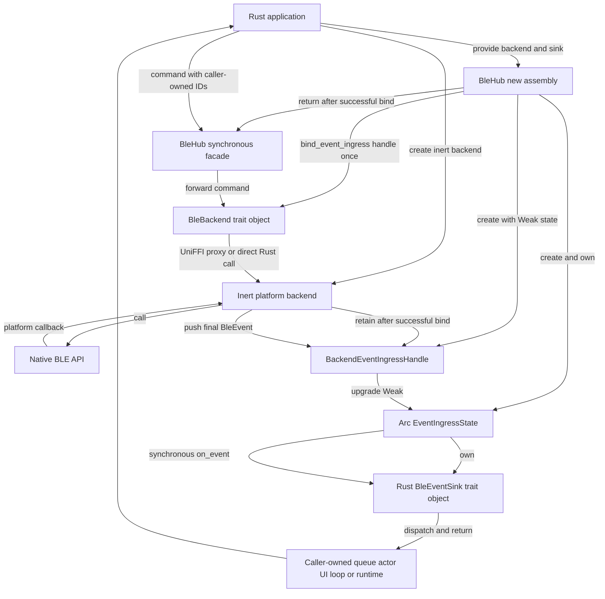
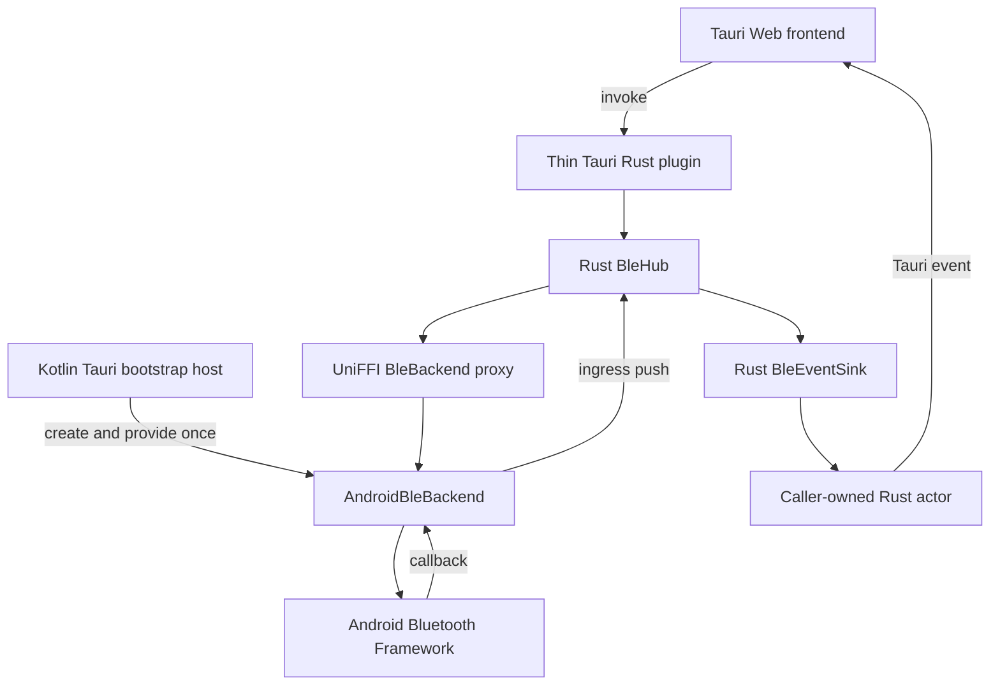
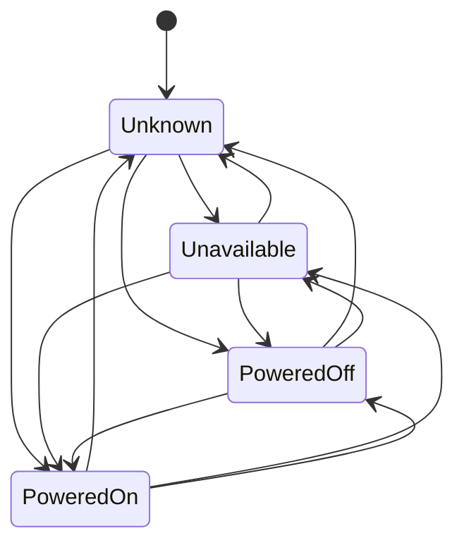
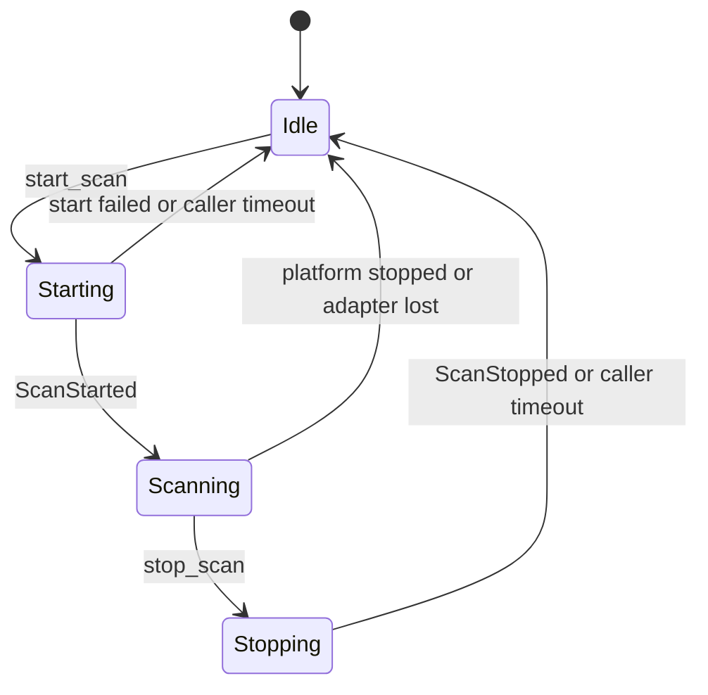
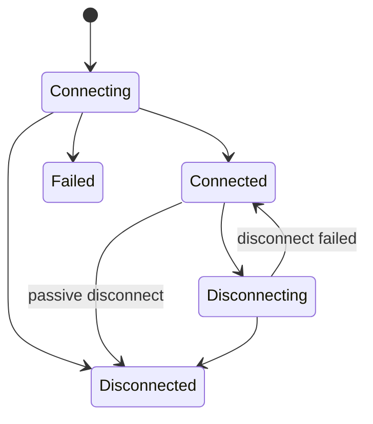
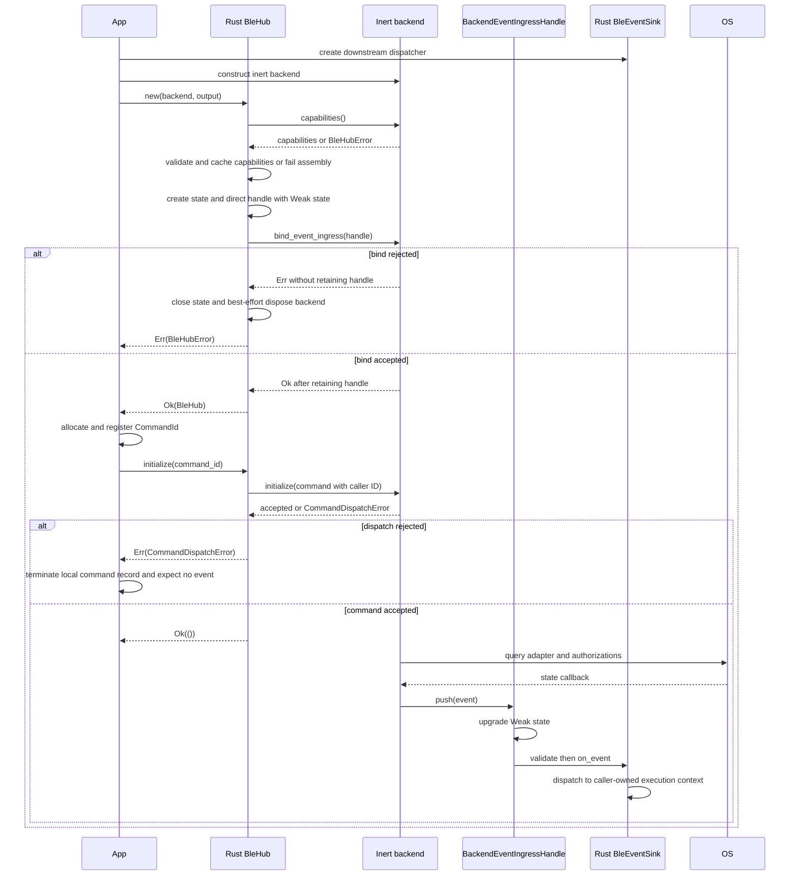
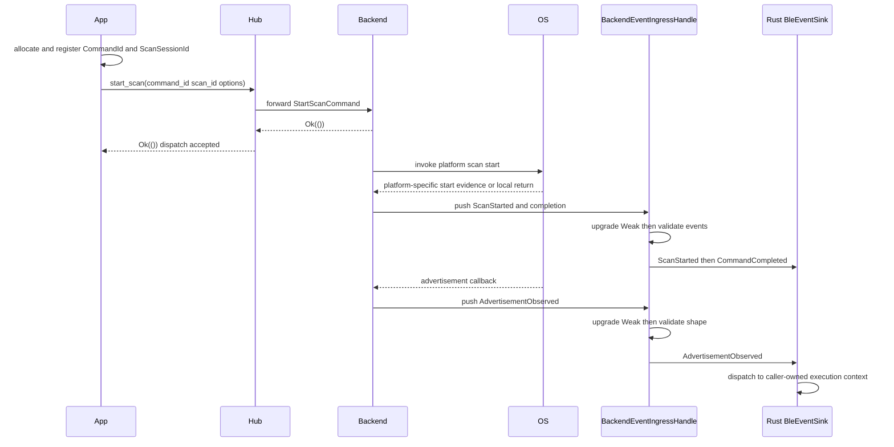
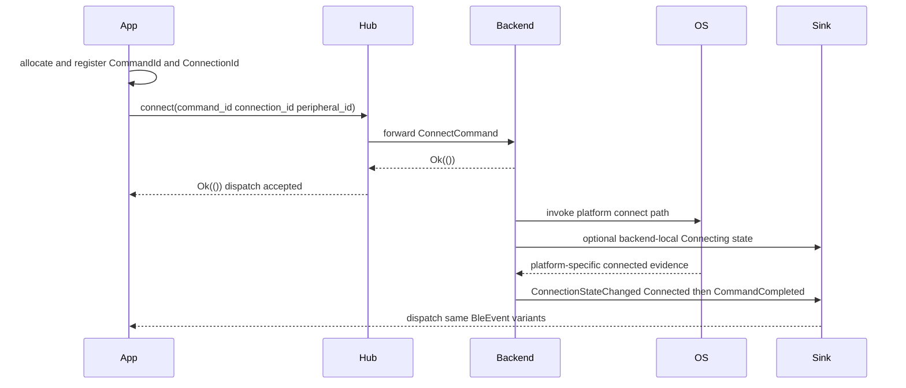
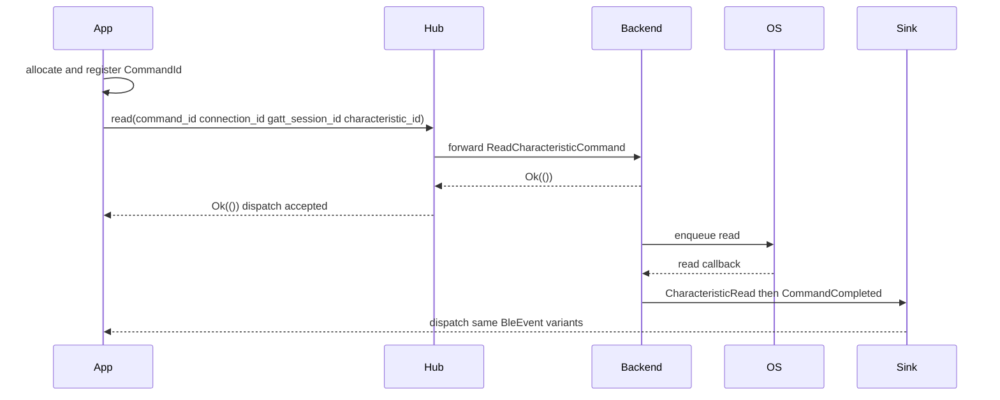
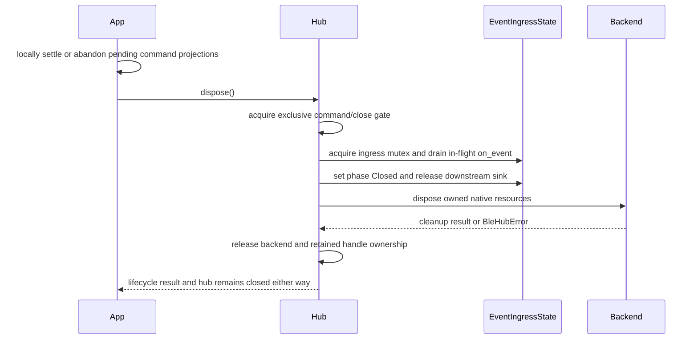

# BleHub 项目计划

**状态：已批准**

**日期：2026-08-30**

**当前阶段：Phase 0、Phase 1与Phase 2已完成；public ABI仍未冻结。当前active implementation lane按执行host选择：macOS（包括通过Mutagen同步到Mac mini的checkout）优先推进Phase 5中的macOS-first Apple thread；Windows优先推进Phase 3 Android backend，随后进入Phase 4 Windows + Android v0.1。**

**硬件状态：2026-08-30已在HONOR 90 GT创建、lint/build、通过Android CLI部署并启动项目管理的Kotlin BLE Peripheral fixture；设备端确认`blehub-android-basic-gatt-v1` service注册且进入`ADVERTISING`，显式notification/indication和ADB控制已实现。2026-08-31 production `WindowsBackend`已通过真实RF初始化、扫描/filter/advertisement/stop、连接、私有uncached GATT service probe、公开uncached GATT service/characteristic/descriptor discovery与统一database mapping，以及主动logical disconnect开发smoke。同期项目管理的QEMU Debian 13 + BlueZ 5.82 + BLESS 0.3.0 Linux Peripheral VM已使用WinUSB独占TP-Link UB500完成固定镜像provision、USB hotplug、guest doctor、profile advertising/readiness、Windows scan/connect/GATT discovery，以及一次fixture stop、USB detach、VM rebuild/start、reattach恢复；随后稳定镜像、独立fixture环境、独立source/scenario三层部署已落地并重新通过空fixture doctor、显式环境安装、无网络source sync、readiness及Windows scan/connect/GATT discovery RF smoke；WHPX已请求启用但仍需重启后验证，本轮使用TCG。公开characteristic read、write with response和write without response已通过项目Android fixture真实RF及确定payload回读。一次notification smoke因Android与QEMU同时广播同一旧service UUID而选中QEMU，未形成notification通过或失败证据；随后Android与QEMU fixture已拆分为语义对齐但profile ID、local name和advertised/root service UUID不同的JSON，分别使用`FFF0...`与`FFE0...`。在两个fixture并行广播时，provider-specific service filter已分别命中Android与QEMU；production `WindowsBackend`随后通过Android fixture完成`PlatformDefault` Notification与严格Indication的enable、确定payload delivery、disable和post-disable stale-route silence真实RF smoke，见[notification/indication报告](../docs/testing/reports/2026-08-31-windows-android-notification-smoke.md)。production `WindowsBackend`随后也通过QEMU/BLESS的scan/connect/public GATT discovery、read/write确定性回读、`PlatformDefault` Notification、严格Indication、disable后stale-route silence，以及connected RSSI accepted后`NotSupported` terminal。一次仅停止BLESS service的被动断连触发实验未产生Windows disconnect event，不构成backend通过或失败证据；改用guest-owned UB500 detach后收到`command_id=None`的被动`Disconnected`，随后的USB reattach、guest doctor、fixture restart和新run readiness通过，见[QEMU/BLESS完整smoke报告](../docs/testing/reports/2026-08-31-windows-qemu-bless-full-smoke.md)。Android真机在2026-08-31该轮复测时未连接ADB，因此没有把旧Android证据冒充为当时candidate复跑。2026-09-01当前hardened candidate完成private initialization/scan/GATT模块重构并通过28项Windows测试、103项workspace测试及完整静态检查后，已连接Android真机复跑scan/connect/GATT/read/write/Notification/Indication；app级`BluetoothGattServer.cancelConnection()`不是有效device-loss trigger，而整机radio `STATE_OFF`立即产生`command_id=None`被动`Disconnected`，radio与fixture恢复通过，见[当前candidate Android报告](../docs/testing/reports/2026-09-01-windows-android-current-candidate-smoke.md)。BlueZ daemon/guest/host reboot恢复、重复USB fault和WHPX重启后验证仍未记录为通过；10-cycle soak与正常dispose资源记账在后续candidate通过。此前LightBlue只保留2026-08-29的基础手工fallback证据；nRF52840尚未采购或记录为通过。真实macOS/iOS production-candidate runtime/package与RF测试尚未执行；macOS host可按host-selected lane先启动macOS production工作，但不得把同步源码或macOS证据推断为iOS通过。随后Windows backend完成两阶段detached native cleanup、connection/GATT物理模块拆分、caller-ID历史tombstone移除和HIL runner hardening，34项Windows非RF测试通过；该后续candidate已重跑并通过QEMU/BLESS非破坏性scan/connect/public GATT/read/write/`PlatformDefault` Notification/严格Indication矩阵，见[当前hardened candidate QEMU报告](../docs/testing/reports/2026-09-01-windows-hardened-cleanup-qemu-rf.md)。Android复跑因手机端USB安装审批阻塞而未执行，旧Android报告不得自动重标为该candidate通过；被动断连fault、重复恢复和soak也未重跑。**

**本次修订：Phase 1统一薄契约、共享conformance、同candidate Rust/Kotlin/Swift reviewed API snapshot gate及desktop Kotlin/JVM、Windows Swift、Android真机ART/AAR consumer runtime/package矩阵已通过；公共contract version固定为5。同时固定测试Peripheral分层和ownership：`tests/peripherals/android`承载近期Android真机开发fixture，QEMU Linux VM + BlueZ/BLESS继续作为确定性故障注入与soak基线，未来`tests/peripherals/nrf52840`可承载独立硬件参考固件；provider profile共享角色、属性和初始值语义，但每个可并行运行的provider必须使用独立profile ID、local name和advertised/root service UUID，不能依靠RSSI或发现顺序区分。Tauri集成形态已批准为薄Rust plugin加Kotlin bootstrap host：Rust `BleHub`始终保留并拥有统一command/event路径，Kotlin Tauri plugin只创建普通`AndroidBleBackend`、完成权限/lifecycle glue并通过一次性UniFFI assembly入口交给Rust；Android最终包只允许一个承载BleHub symbols的Tauri Rust image。Apple production-candidate runtime/package与真实RF仍未记录为通过；macOS host可优先推进macOS-first Apple thread，但production ABI尚未冻结，冻结后必须对适用Apple gate重跑。**

**2026-09-01 Phase 2更新：最新candidate通过39项Windows测试、114项workspace测试、QEMU/BLESS完整非破坏性矩阵，以及OnePlus 11 Android fixture的scan/connect/GATT/read/write/Notification和独立重跑的严格Indication矩阵。Standard Cargo staged archives、Cargo metadata source-isolation、offline locked Windows artifact-only consumer和`examples/windows-central`静态gate通过，见[当前candidate RF与packaging汇总](../docs/testing/reports/2026-09-01-windows-current-candidate-rf-packaging-summary.md)。随后使用release HIL、20-byte payload对Android与QEMU各执行三次200-operation read/write/Notification正式矩阵，并补跑fixture callback ledger矩阵：QEMU read、callback-confirmed write-with-response、write-without-response WinRT terminal、write-without-response Peripheral callback和lossless Notification中位数分别为17.9、16.7、1,263.6、91.8、85.1 ops/s，Android分别为8.3、8.3、1,262.4、844.7、820.0 ops/s；每个写批次均达到200/200 unique fixture callbacks且missing/duplicate/out-of-order/out-of-range/foreign/malformed为零。WinRT no-response terminal仍只表示local/native progress，不得重标为remote throughput。QEMU HCI trace确认write阶段connection interval为30 ms、20-byte ATT Write Request间隔中位数54.732 ms，说明response低速主要来自真实ATT往返与连接调度而非Rust dispatch。QEMU零pacing Notification曾只到达183/200，正式结果使用最快连续稳定的0.5 ms requested guest pacing并以burst ID/sequence证明零missing/duplicate/order violation；Android按`onNotificationSent` callback自然背压。完整原始值、边界和限制见[Android/QEMU吞吐矩阵](../docs/testing/reports/2026-09-01-windows-android-qemu-throughput-matrix.md)。callback/native-handle leak accounting和10-cycle soak随后已完成；重复fault/recovery和最新candidate破坏性passive-disconnect在当时仍未完成。**

**2026-09-02 Phase 2更新：后续candidate通过Android/QEMU各三次破坏性fault/recovery、四个同步到已进入WinRT read/write/CCCD/value callback的fault race，以及双provider、双严格mode各1,000包的长delivery soak；所有正式delivery均为零missing/duplicate/out-of-order，disable后无stale route，最终资源精确归零。QEMU provisioned image已刷新；BlueZ restart通过，TCG guest reboot在当时controller下完成guest shutdown与SSH/controller/fixture/doctor/Windows scan恢复。后续controller增加Linux boot ID变化硬断言但未重跑TCG RF。QEMU 11.1.0/WHPX同进程guest reboot在guest shutdown后因`Unexpected VP exit code 4`进入QMP `paused`，但新WHPX进程可完整恢复UB500、BlueZ/BLESS、doctor与Windows scan，因此将同进程WHPX reboot记为fixture infrastructure限制，支持路径为fresh-process restart，不记作`WindowsBackend`失败或通过。Windows提权脚本、Zadig与USB rollback已完成TOCTOU/identity hardening并通过静态检查；因会改变当前USB绑定，UAC路径未执行。真实Windows host reboot也未执行。统一证据见[Phase 2 fault/soak/reboot/hardening报告](../docs/testing/reports/2026-09-02-windows-phase2-fault-soak-reboot-hardening.md)。Phase 2功能、packaging、managed-fixture、资源与破坏性HIL证据已覆盖退出条件；2026-09-02显式exit review结论为PASS，见[Phase 2退出审查](../docs/testing/reports/2026-09-02-windows-phase2-exit-review.md)，Phase 2正式完成。未执行边界仍不得推断为通过。**

本文件是BleHub唯一规划来源。Phase 0已完成框架选择、production FFI迁移、最小scan/connect contract/bridge和Windows/Android真实runtime gate；Phase 1已完成平台无关公共契约、共享conformance、reviewed API snapshots和完整candidate runtime复核；Phase 2已完成项目Android开发Peripheral、managed QEMU/BLESS fixture与production Windows backend的退出审查。后续实现优先级按执行host选择，但阶段完成、ABI冻结和各平台证据保持独立。本文同时作为未来架构文档、API文档和平台接入文档的来源。

---

## 1. 项目目标

BleHub 是一个以 Rust 为核心、支持 Windows、Android、iOS、macOS 和 Linux 的 BLE Central 抽象层。

上层应用只使用统一的 adapter、扫描、peripheral handle、连接、GATT、命令和事件基础模型；平台差异通过 capability、optional 字段和结构化平台错误表达，不伪造完全一致的行为。BleHub 是轻量协议适配层，不是设备管理框架。

基线依赖与发布顺序：

1. **Windows**：第一开发平台、参考实现和主要测试宿主；Phase 2已完成。
2. **Android**：验证 Stable UniFFI 跨语言 backend 抽象，与 Windows 一起组成 v0.1并在Phase 4冻结该production ABI。
3. **macOS/iOS**：复用统一契约接入 Swift CoreBluetooth；macOS先行，iOS保持独立验证。
4. **Linux**：复用稳定契约接入 BlueZ D-Bus。

active implementation lane按实际执行host选择：

- 在macOS上，包括从Windows主checkout通过Mutagen同步到Mac mini的工作副本，优先推进Phase 5的macOS-first Apple thread。Phase 4冻结前只能消费当前未冻结candidate；冻结后必须对适用的Apple generation、runtime、package、lifecycle和RF gate重跑。
- 在Windows上，优先推进Phase 3 Android backend，再完成Phase 4 Windows + Android v0.1。
- host选择只决定开发优先级，不改变数值阶段的退出状态，不冻结ABI，也不转移平台证据；macOS不证明iOS，Windows不证明Android，源码同步不证明任一平台build/runtime/RF通过。

### 1.1 v0.1 必须支持

- adapter 可用性、开关和权限/授权状态
- 开始扫描、停止扫描和持续 advertisement 更新
- service UUID、设备名、manufacturer data 等基础扫描条件
- 连接、主动断开和被动断连
- GATT service、characteristic、descriptor 基础发现
- characteristic read
- write with response / without response
- notification / indication 开启、数据和关闭
- RSSI 读取
- 命令成功、失败、平台确认的超时/取消、caller deadline、重复和过期/晚到事件的统一 contract 与下游 reference handling（BleHub core 不内建 command tracker）
- 平台 capability 查询
- 幂等且线程安全的资源关闭
- Windows 与 Android 共享行为测试和真实外设闭环
- Windows/Android 独立、只消费 staged/release artifact 的 clean consumer；它们是 v0.1 packaging gate

### 1.2 设计时预留，但不阻塞 v0.1

- 以 Tauri Rust core 作为真实 downstream 的跨平台 Central reference app；已批准的接入形态是repository-owned、`publish = false`的薄Tauri Rust plugin加Kotlin bootstrap host：Rust plugin持有`BleHub`、command adapter、caller-owned event channel/projection，Android host只创建普通`AndroidBleBackend`并完成权限/lifecycle/backend assembly；首个showcase target为Windows/Android，但只在assembly spike获得Go后实施，spike未完成或结果为No-Go均不替代clean consumer，也不阻塞production ABI
- 按已经验证的真实产品需求增加Kotlin/Swift native application consumer facade；它必须是现有Rust-first `BleHub`之外的独立薄适配层，不替换Rust API、不把当前`BleEventSink`直接升级为foreign trait，也不迫使BleHub core拥有queue/runtime
- Android MTU request / MTU changed
- Android PHY 和 connection priority
- service changed 与 GATT cache invalidation
- pairing / bonding
- background scan / background connection
- Linux 多 adapter
- 持久化设备身份恢复

### 1.3 明确不做

- 把 BLE Peripheral / GATT Server 作为 BleHub 发布给下游的产品能力；`tests/peripherals/` 中仅服务于 Central 验证的项目测试 fixture 不受此限制
- Classic Bluetooth
- 用 MAC 地址承诺跨平台、跨安装或长期稳定的设备身份
- 把所有平台错误压扁成字符串
- 在公共 API 暴露 WinRT、Android、CoreBluetooth 或 D-Bus 对象
- 在 backend trait 中暴露 `Future`、Rust stream 或平台 async 类型
- BleHub core 自建 Tokio/async executor、后台线程池或事件循环
- 设备选择、排序、收藏、分组、持久化 inventory 和跨进程身份恢复
- 自动连接、自动重连、重试退避、连接保活和业务 session orchestration
- 固件升级、业务协议、产品设备模型、fleet management 和云端同步
- 多应用订阅合并、后台任务调度和复杂资源仲裁
- 通用异步 `ShutdownCommand`；四个平台都没有统一的整体 BLE shutdown completion，v0.1 只提供本地幂等 `dispose/close`
- 等所有平台完整后才发布第一个版本
- 用 Tauri mobile plugin 的 JSON command/event bridge 替代统一 `BleBackend`、UniFFI foreign trait object 或 backend event ingress
- 在 v0.1 发布通用 `tauri-plugin-blehub`；首版只在spike/reference app内部保留repository-owned、`publish = false`的薄适配plugin，是否提取到`integrations/`并作为通用插件发布须按多个真实项目的复用需求另行评审

---

## 2. 已确定技术方案

| 领域 | 决策 |
|---|---|
| 核心语言 | Rust 2024 edition |
| FFI | Stable UniFFI `0.32.0` proc-macro interface；Rust crates、bindgen与language runtime必须精确锁定并随contract lockstep；相邻源码checkout只用于审计，不参与production构建/生成 |
| backend | Rust 定义 `BleBackend: Send + Sync` trait object |
| backend 方法 | 普通同步 `fn`，不使用 `async fn` |
| 调用模型 | fire-and-forget：同步 `Result` 表示即时校验/投递是否成功；`Ok` 后的平台 operation 结果通过事件完成 |
| 事件上行 | 平台 callback 经 backend 映射为统一 `BleEvent`；backend retain Rust exported `BackendEventIngressHandle` 并调用 `handle.push(event)`，handle只持`Weak<EventIngressState>`，upgrade后进入bridge，再调用Rust downstream `BleEventSink` trait object；无token、无process-local registry、无free push function |
| 事件落点 | 下游 `BleEventSink` 自行投递到 channel、Handler、actor、UI loop 或自选 runtime |
| 执行模型 | BleHub core 无 mailbox、无 pump、无 executor、无线程、无自有事件循环 |
| 状态归属 | 调用方拥有业务/command/session 状态；backend 拥有 native handle 状态；BleHub 不维护 canonical BLE state |
| Windows | Rust + `windows-rs` |
| Android | Kotlin + Android BLE API + Stable UniFFI foreign trait；稳定Kotlin binding使用JNA，已接受其相对JNI开销并保留final-ABI性能回归gate |
| Apple | Swift + CoreBluetooth + Stable UniFFI foreign trait |
| Linux | Rust + `dbus-rs` + BlueZ D-Bus |
| Consumer validation | 每个平台使用独立、只消费 staged/release artifact 的 clean consumer；不允许源码路径、Gradle project dependency 或未打包本地产物掩盖 packaging 问题 |
| 跨平台展示 | Tauri 2 reference app；薄Rust plugin直接依赖并持有`BleHub`，Web frontend只通过Rust adapter发command、收projection/event；Android `@TauriPlugin` host只做Kotlin backend bootstrap、权限与lifecycle，不能承载逐BLE-operation协议；Tauri不进入BleHub core或backend contract |
| Rust 依赖 | Cargo |
| 外部工具 | Pixi |
| 项目 recipes | 根 Justfile；Just 由 Pixi 提供 |
| 标准入口 | `pixi run just <recipe>` |

### 2.1 选择性参考（非架构基线）

#### `btleplus`

CodeGraph 检查当前 `espkit/crates/std/btleplus` 后，BleHub 只借鉴少量领域语义：

- `PeripheralSnapshot` 中 local name、advertised services、manufacturer data、service data、RSSI、connectable 等 advertisement 字段。
- scan-time observation 与较稳定 device identity 分离；同一 peripheral 可以持续产生新 observation。
- GAP / GATT 的术语边界，以及 duplicate UUID instance 不能被简单 UUID map 覆盖的教训。

BleHub 不依赖或照搬 `btleplus` 代码。当前 `btleplus` 没有适合直接复用的 backend trait/event bridge；其 `AdapterRuntime`、Tokio timeout、canonical state、device/connection registry、GATT cache、phase wrapper ownership 和 UUID-only characteristic lookup 都不适合本项目的无 runtime、FFI-first 薄桥。BleHub 的 opaque GATT instance ID、caller-owned session ID 和 fire-and-forget event contract 独立设计。

数据结构也不是逐字段复制：`btleplus` 的平台 `id: String` 在 BleHub 中改为 backend opaque `PeripheralId`；`service_data` 使用 FFI 友好的 record list 而不是 map；`connectable` 使用 `Option<bool>` 表达平台缺失。将来若 `btleplus` 变化，不驱动 BleHub 公共 ABI 自动变化。

#### SimpleBLE

本地审计 SimpleBLE `1.1.1` revision `ceb2f295a2cca0d38d19a5a30946e8997ffc2f61` 后，BleHub 把它作为 Windows、Android、Apple 和 Linux 平台细节与失败模式的参考；完整证据见 [`docs/research/simpleble-cross-platform-api-assessment.md`](../docs/research/simpleble-cross-platform-api-assessment.md)。规范性借鉴限定为：backend-private persistent native identity/handle record 与 scan-session observation 分离；同一 backend ownership domain 内一个 native identity 只有一个 owning record；callback payload 在离开 native frame、跨线程或跨 FFI 前转成 owned DTO；accepted 前失败必须 failure-atomic rollback；cleanup 先切断 callback/correlation，再按 child-to-parent 释放 native handle；release artifact 同时做内容断言和 artifact-only consumer 验证。

BleHub 不依赖或照搬 SimpleBLE 的统一 C++ object model、blocking `scan_for/connect/read/write/subscribe`、shared mutable `Peripheral`、address/hash/raw-pointer identity、UUID-only GATT addressing、process-global runtime/cache/config、message-only error 或 fixed payload buffer。该参考不改变已审平台语言：Windows/Linux 仍为 Rust，Android 仍为 Kotlin，Apple 仍为 Swift；统一的是 Rust contract 和可观察语义，不是 backend 实现语言。

### 2.2 术语

核心与事件术语：

- **Thin Bridge**：Rust 中无 executor、无线程、无领域状态机的同步桥；只持有 backend、`EventIngressState`、command/close synchronization gate 和最小 lifecycle state。
- **Backend**：实现 `BleBackend` 的平台适配对象，负责把同步 command 投递给 WinRT、Android BLE、CoreBluetooth 或 BlueZ。
- **Ingress Phase**：`EventIngressState` mutex内部的`Binding | Active | Closed`单向lifecycle phase；它不是event tag。`Binding`拒绝并记录过早push，`Active`允许串行delivery，`Closed`拒绝close后callback。
- **Command/Close Gate**：保护 backend ownership 的读写同步边界；command 取得 shared/read guard，close 取得 exclusive/write guard，防止 backend method 执行期间释放 backend。
- **Event Tag**：`BleEvent` tagged union 中标识 payload variant 的判别值；结构校验检查 tag 与 payload 是否匹配，与 Hub 是否 closed 无关。
- **Command Dispatch / 命令投递**：public method 的短同步阶段。backend 在自己的串行执行边界内原子完成“登记 correlation、取得 cleanup ownership、提交到执行路径”时，command 线性化为 accepted。`Ok(())` 只确认该事实；它不表示 native API、OS/BLE operation 或外设业务已成功。
- **Dispatch Rejection / 投递拒绝**：accepted 线性化点之前的同步 `Err(CommandDispatchError)`；backend 此时不得创建 callback source、保留 correlation/cleanup ownership或 emit event，因此该 `CommandId` 后续严格无事件。
- **Operation Completion / 操作完成**：accepted command 后由平台 callback/async result、D-Bus reply或明确定义的 backend-local completion point提供证据。到达该点后，backend 对需要公开状态/数据结果的 operation 先尝试一次 domain event（若有），再必须且至多一次尝试发送 terminal `CommandCompleted`；这不是 sink delivery guarantee。`CommandCompleted { error: None }`的强度按command/platform逐项定义，绝不统一解释为“外设已处理”。
- **Backend Event Ingress**：backend 把最终 `BleEvent` 送回 Rust 的受控入口。v0.1 是 backend retain 的 UniFFI exported `BackendEventIngressHandle`；handle只持`Weak<EventIngressState>`并暴露`push(event)`。它不是 downstream sink trait object，也不需要opaque token、全局registry或free push function。
- **Downstream Event Sink**：Rust application 实现并传给 BleHub 的 `BleEventSink: Send + Sync` trait object；它不是 UniFFI foreign trait object。Rust bridge 完成最小结构校验后同步调用 `on_event(BleEvent) -> Result<(), EventSinkError>`。
- **Event Dispatch**：`BleEventSink` 的实现只负责按调用方策略接纳事件，例如放入 Rust channel、actor 或自选 runtime，并立即返回。`Ok(())` 表示 sink 已按自己的策略接纳事件，`Err(EventSinkError)` 表示未接纳。
- **Caller State**：command terminal、active scan/connection/GATT/subscription、timeout/retry 和业务状态均由调用方维护。
- **Backend State**：native adapter/device/GATT object、callback token、pending correlation 和 opaque public handle 映射由每个平台 backend 私有维护；只有 backend 的 command implementation 与 platform callback handler 访问，BleHub 不查询、不复制也不对外暴露这些状态。
- **Application Policy**：设备选择、排序、自动重连、retry、业务 session 等上层策略，不属于 BleHub。

BLE 与测试硬件术语：

- **Host**：运行 BLE host stack 的操作系统，例如 Windows Bluetooth stack 或 Linux BlueZ。
- **Controller**：真实蓝牙芯片/USB 蓝牙棒中的 HCI controller 和 radio。
- **Adapter**：操作系统/backend 对 controller 的软件表示，例如 BlueZ `Adapter1`；文档谈物理硬件时优先使用 controller。
- **Central**：扫描并发起连接的一侧，是 BleHub 支持的产品角色。
- **Peripheral**：广播并提供 GATT Server 的一侧。项目测试中的实现可以是Android真机fixture、Linux VM + BlueZ/BLESS或运行项目fixture固件的nRF52840。
- **Managed Peripheral / 受控测试外设**：由项目管理profile、启动/停止、数据触发和telemetry的测试Peripheral；“managed”描述可控性，不限定Android、Linux或嵌入式实现。
- **Android Development Peripheral**：运行`tests/peripherals/android` Kotlin应用的Android真机；用于Windows日常真实RF smoke和显式notification/indication，不作为异常时序与长时间soak的唯一证据。
- **BLESS Managed Peripheral**：Linux Peripheral VM、BlueZ/BLESS和独占USB controller组成的确定性基线；承担可编程时序、故障注入、重连与soak。
- **Hardware Reference Peripheral / 硬件参考外设**：运行独立fixture固件的真实设备，例如nRF52840；用于交叉验证Android Framework和BlueZ/BLESS之外的第三种GATT Server/controller实现，避免只适配单一测试栈。
- **Central Controller（C-Controller）**：被测 Central 使用的物理蓝牙 controller。
- **Peripheral Controller（P-Controller）**：Linux Peripheral VM独占并由BlueZ驱动的物理HCI controller。运行standalone Peripheral固件的nRF52840是完整外设fixture，不称为P-Controller；只有另行刷写并验证HCI controller固件、交由BlueZ管理时才属于该角色。
- **DUT（Device Under Test）**：当前被测的 BleHub Central 平台实现，例如 Windows 或 Android。
- **TPE（Test Peripheral Environment）**：BLESS基线中的Linux Peripheral VM、P-Controller、BlueZ、BLESS、scenario和telemetry整体。Android和nRF fixture属于并列的managed/reference Peripheral provider，不冒充TPE。

文档不使用“主蓝牙棒/从蓝牙棒”作为正式术语。BLE 当前角色应写 Central/Peripheral；“主/从”还可能与 Host/Controller 层级混淆。

### 2.3 Rust 生态复用策略

原则是优先复用维护良好、语义匹配的 Rust 生态，依赖数量和 crate 数量本身不是优化目标。选择依据是维护质量、目标平台支持、FFI/ABI 影响、编译成本和能否减少自研错误；只有当依赖会把不属于 BleHub 的 runtime/state policy 强塞进 core 时才拒绝。

| 依赖/能力 | v0.1 决策 |
|---|---|
| `uniffi` | 必需并精确锁定`0.32.0`；公共DTO、foreign trait、Rust object handle和Kotlin/Swift binding；只使用stable Kotlin/JNA backend，不以experimental JNI作为v0.1基础 |
| `uuid` | 建议复用；Rust 内部解析、校验和规范化 BLE UUID；FFI wire 首版仍使用 canonical string |
| `windows` (`windows-rs`) | Windows backend 必需，不能泄漏到公共 DTO |
| `dbus` (`dbus-rs`) | Linux Phase 6 backend 使用，不进入 Windows/Android 首批依赖图 |
| `serde` / `serde_json` | test scenario、BLESS 控制面和日志 fixture 使用；不是 BleHub 事件运行时依赖 |
| `proptest` | dev-dependency 候选，用于 command result、duplicate/stale/orphan 和 close race 的状态序列测试 |
| `loom` | Phase 0 dev-dependency候选，用于枚举纯Rust ingress phase mutex、RwLock与Arc/Weak interleaving；不替代真实Stable UniFFI Kotlin/JNA和Swift runtime stress，引入前按local-first规则固定版本并检查源码 |
| `thiserror` | Rust error统一优先使用；public callable error已验证可同时派生`thiserror::Error + uniffi::Error`，event-data error可组合`thiserror::Error + uniffi::Record`，Rust-only error只需`thiserror::Error`。`thiserror`只生成`Display`/`std::error::Error`，不定义FFI wire；每次升级仍须重跑Kotlin/Swift error generation和runtime consumer，不得把typed error降级成字符串 |
| `derive_more` / `delegate` / `getset` | 可在确实减少重复样板时引入；不为一两个显然的getter/delegation增加宏。任何进入UniFFI exported type或impl的attribute macro都必须先通过binding generation验证，不得遮蔽ownership、validation、FFI或lifecycle语义 |
| 同步与并发生态 | per-Hub command/close gate与ingress delivery mutex优先`std`；direct handle删除process-local registry，因此不引入`arc-swap`/concurrent map；core不自建channel，但downstream adapter可直接复用`crossbeam`/`flume`/Tokio channel |
| `slotmap`/generational arena | Phase 1评估backend opaque discovery handle生命周期；若满足UniFFI `u64` wire与不复用规则，优先复用而不是手写generation/arena |
| Tokio/async runtime | 不进入 core/backend trait；具体 backend 可使用平台已有 callback context 或调用方注入执行器 |
| `bitflags` | 可用于 Rust/backend 内部 property flags；FFI public shape 首版使用生成语言更清晰的 bool record 或显式整数 mask |
| `tracing` | 建议用于 structured diagnostics、command/session correlation 和 HIL 日志；subscriber 由调用方安装 |
| `insta` | dev-dependency 候选，用于稳定 event scenario/FFI shape snapshot；若普通断言更清晰则不强制 |

FFI payload首版使用Stable UniFFI支持的primitive、`String`、`Vec<u8>`、`Option`、record和data-carrying enum。callable `Result<T, E>`只作为抛错通道；event内成功/失败互斥值固定使用语义等价的显式data enum，不尝试导出nested Rust `Result`，也不退回互相约束的tag加多个`Option`。backend或downstream内部可以使用`bytes`、channel、actor等成熟生态并在边界转换。原则不是“能手写就不依赖”，而是“不让依赖改变已确定的薄层职责”。

### 2.4 官方平台 API 证据库

公共 command/event contract 不只依赖经验判断。项目把与 BLE Central 语义直接相关的官方资料固定在 `docs/platform-api-reference/`，并通过以下唯一入口更新：

```text
pixi run just docs-update
```

当前来源与缓存策略：

- Windows：Microsoft `winrt-api` 固定 commit，包含 Bluetooth adapter/radio/access、advertisement watcher、device 和 GATT API。
- Android：Google 官方 Android 36 SDK Sources `source-36_r01.zip`，后端实现语言仍是 Kotlin；Java Framework source/Javadocs 是 Kotlin 所调用 API 的权威语义来源。
- Apple：Apple CoreBluetooth 官方 Markdown live snapshot。
- Linux：BlueZ 官方 D-Bus RST 固定 commit。
- Pooch 缓存 Android/Windows/BlueZ 的不可变 artifact 并校验已知 hash；Hishel 对 Apple live docs 使用 RFC HTTP cache、ETag/Last-Modified 条件重验证。
- `sources.lock.json` 记录 revision、URL、SHA-256、抓取时间和 upstream terms；更新过程使用临时目录并在全部成功后原子安装。

[`docs/research/cross-platform-command-event-contract.md`](../docs/research/cross-platform-command-event-contract.md)的跨平台operation matrix以这些snapshot为事实证据，Plan 7.1只保留审定后的规范性成功语义。实现发现API语义变化时，先更新snapshot/lock与research matrix，再显式评审是否需要修改Plan公共契约；生成文件不手工编辑。

---

## 3. 设计原则

1. **命令与事件分离**：命令方法立即返回，BLE 结果只能通过事件表达。
2. **BleHub 不做状态真源**：调用方维护 command/session/业务状态，backend 维护 native handle；BleHub 只转发 command，并对 backend 已构造的统一 `BleEvent` 做最小结构校验和直接交付。
3. **ID 所有权显式**：command/scan/connection/GATT session/subscription ID 由调用方提供；discovery handle 由 backend 生成且保持 opaque。
4. **扫描快照不等于设备身份**：同一设备可持续产生新的 observation。
5. **不伪造平台一致性**：用 capability、optional 字段和平台错误表达差异。
6. **允许 backend 同步 callback**：调用 backend 时不持有领域/protocol 状态锁；仅可持有 ingress 不会获取的 command/close lifecycle guard，因此 backend 可在 trait method 返回前调用 ingress sink。这不表示 downstream `on_event` 可以同步重入 BleHub。
7. **事件可关联**：命令结果原样回显调用方提供的 `CommandId`；平台主动变化可没有 command ID。
8. **显式 session 隔离**：domain/state/data event 回显其适用的 caller-owned scan/connection/GATT/subscription ID；`CommandCompleted`只回显全 lifecycle 唯一的`CommandId`，调用方从调用前登记的command record解析target。调用方据此忽略旧session，不依赖BleHub隐式generation。
9. **显式关闭**：不依赖 Rust Drop、JVM GC 或 Swift ARC 的精确时机。
10. **Windows-first，但不 Windows-shaped**：核心模型不得包含 WinRT 专属类型和假设。
11. **先 contract，再平台**：事件序列和异常组合先由纯 Rust FakeBackend/conformance harness 固定；状态机是契约参考，不是 BleHub 内部实现。
12. **调用方拥有运行时和事件队列**：BleHub core 不创建 mailbox、executor、线程池或事件循环；下游 sink 决定事件进入哪个线程、channel、Looper 或 DispatchQueue。
13. **成熟生态优先、按职责拆 crate**：优先复用经过验证的 Rust crate，不以最少依赖为目标；共享 contract/bridge、可复用 testkit 和各平台 backend 按依赖与发布边界拆分，但不把某个 async runtime 固化为公共 API。
14. **Ingress state 最小化**：`EventIngressState`只保留ingress phase、bind-push违约标记、downstream ownership和统一用于delivery/close-drain的mutex；Hub另有command/close gate。两者都不保留command/device/connection/GATT registry。

---

## 4. 总体架构

事件路径有两个方向相反、所有者不同的端点，必须先区分：

| 端点 | 创建或实现方 | 持有并调用方 | 作用 |
|---|---|---|---|
| `BackendEventIngressHandle` UniFFI object | BleHub/Rust 创建，内部只持 `Weak<EventIngressState>` | platform backend retain并调用 | backend 调用 `handle.push(event)` 时进入对应Rust ingress state |
| `BleEventSink` Rust trait object | Rust application 实现并传给 BleHub | Rust bridge | bridge 把已校验的 `BleEvent` 交给调用方自己的队列或运行时 |

`BackendEventIngressHandle`不是downstream trait object，也不直接持有应用sink。backend只能调用handle公开的`push`；handle先upgrade私有`Weak<EventIngressState>`，再由state执行close gate、结构校验和delivery serialization。BleHub production contract和project-authored routing code不形成`Hub -> backend -> handle -> state -> sink`强引用环，也不引入raw pointer、整数化`Arc`、token allocator、process-local `token -> Weak` registry或free push function；UniFFI generated opaque object handle和foreign callback handle map是framework-managed实现细节，必须纳入lifecycle counter。



Windows/Linux的`BackendApi`与`BackendImpl`通常是同一个Rust object；Android/Apple则由Stable UniFFI foreign-trait proxy把command调用转到Kotlin/Swift `BackendImpl`。OS callback只进入backend implementation/delegate handler，再调用retained `BackendEventIngressHandle::push`；它不回调`BleBackend` command trait或其vtable。
Windows/Linux的`BleBackend`通常是Rust object；Android/Apple则是Kotlin/Swift object经UniFFI foreign trait进入Rust。BleHub downstream固定为Rust application实现的普通Rust trait object：Android/Apple event在`handle.push(event)`时发生一次native→Rust FFI crossing；`Weak` upgrade后`EventIngressState::push -> BleEventSink::on_event`都是Rust内部调用。

### 4.1 命令下行

1. 调用方先登记自己的 `CommandId`/session IDs，再把完整 FFI-safe request 交给 `BleHub`。
2. `BleHub` 只检查本地 lifecycle/wire 前置条件，并把 request 原样转发给 `BleBackend`；它不分配 ID、不查询 BLE protocol state。
3. backend 将命令投递到自己的平台执行位置：Android `Handler/Executor`、Apple serial queue、Windows/Linux OS callback context 或注入的 driver。thread-affine native object 不离开该位置。
4. method 立即返回 `Result<(), CommandDispatchError>`：
   - `Ok(())`：backend 已接受 command 并负责后续事件结果，不表示 OS/BLE operation 成功；
   - `Err(...)`：command 未进入事件生命周期，该 `CommandId` 后续必须零事件。
5. accepted command 的成功、失败、实际取消或平台 timeout 只通过 `BleEvent` 表达。

`BleBackend: Send + Sync` 允许 Hub ownership 跨线程移动并允许多个 caller thread 通过 `&self` 发令；它不允许任意线程直接操作 thread-affine native object，也不要求 BleHub 创建 worker 或串行执行器。

### 4.2 事件上行

装配时：

1. Rust application 实现 `BleEventSink: Send + Sync`。
2. platform factory 在 Kotlin/Swift/Rust 本地构造不含 ingress、尚未启动 BLE 工作且不会产生 callback 的 inert backend。
3. application调用`BleHub::new(backend, event_sink)`；constructor创建并强持有`Arc<EventIngressState>`，把Rust sink保存到state，再创建只含`Weak<EventIngressState>`的`Arc<BackendEventIngressHandle>`。
4. constructor调用一次`backend.bind_event_ingress(handle)`。backend必须保持inert且bind期间不得调用`handle.push`；`Err`必须表示未retain handle，`Ok`必须表示已retain唯一handle。
5. bind成功后constructor直接返回完整Hub；没有registration、process-global write或第二个可失败的routing步骤。
6. bind失败时constructor先关闭并排空state，再best-effort `dispose` backend，释放local handle/backend ownership并返回`BleHubError`。application拿不到半初始化Hub。
7. close先把state切到`Closed`并排空，再dispose并释放backend；dispose中或之后的迟到callback要么看到closed phase，要么在Hub/state释放后因`Weak` upgrade失败而返回`Closed`。

Stable UniFFI `0.32.0`的representative direct-object fixture已经在Android ART/AAR与Apple Swift/XCFramework/SPM验证框架机制；production candidate进一步在Windows Kotlin/JVM、Windows Swift、Android 16 arm64真机与x86_64模拟器验证最终`Weak<EventIngressState> -> Rust BleEventSink`对象图、binding phase、constructor rollback、backend dispose主动释放root handle、close drain、Rust downstream panic containment和10,000次lifecycle。真实macOS production candidate与最终Apple package、完整event wire和性能/package gate仍未完成。BoltFFI #869/#872和token-ACK只作为历史比较证据，不进入production contract。

平台 callback 到达时：

1. backend 用自己的 native handle/correlation state 构造最终统一 `BleEvent`。event 由关联字段和 public FFI-safe payload 组成：既可携带 caller-owned IDs/backend opaque handles，也可携带 advertisement 数据、adapter/connection 状态、GATT hierarchy、characteristic/notification bytes、RSSI 和统一错误等公共 DTO。禁止跨边界的是 WinRT/`BluetoothGatt`/`CBPeripheral`/D-Bus proxy 等 native object，以及只对 backend 有意义的 private key/token。诊断和 ingress delivery failure 使用 out-of-band structured tracing，不占用 public `BleEvent` variant。
2. backend调用retained `BackendEventIngressHandle::push(event)`。
3. handle upgrade其`Weak<EventIngressState>`；upgrade失败返回`Closed`，成功后通过state的ingress mutex原子检查phase并串行化同一hub的delivery attempt，再校验唯一variant/body、ID/wire value和size guard。它不做ID映射、stale/duplicate判断或状态归约。
4. state在当前callback线程同步调用`BleEventSink::on_event(event)`。
5. downstream sink只按调用方策略把事件接纳到Rust channel、actor或runtime，然后尽快返回typed `Result`。

`Delivered`只表示`on_event`返回`Ok(())`，不表示downstream业务已处理。`InvalidEvent`/`DownstreamFailed`消费当前attempt：backend记录诊断但不得解析message、重试同一event或把它当BLE failure；它仍提交terminal/correlation cleanup并继续后续event，只有`Closed`才停止push。`BleEventSink` contract要求实现不得panic，所有预期失败走typed `Result`。Kotlin/Swift exception边界在foreign backend method与exported ingress wrapper，`downstream.on_event`本身不跨FFI。

### 4.3 并发、同步 callback 与 close

BleHub每实例只需要两个互不嵌套的lifecycle/delivery同步边界。Direct handle只做一次`Weak` upgrade，不存在process-local registry、全局锁或RCU write：

| 机制 | 保护什么 | 不保护什么 |
|---|---|---|
| command/close gate | backend ownership；command使用shared guard，close使用exclusive guard | 不保存command table，不参与event ingress |
| `EventIngressState.inner` mutex | `Binding | Active | Closed` phase、bind期间push违约标记、`Option<Box<dyn BleEventSink>>` ownership、串行`validation -> on_event`、close排空in-flight delivery | 不等待downstream业务处理，不保护BLE protocol state，不拥有downstream queue |

state初始为`Binding`。backend bind期间的任何`push`只记录违约并返回`Closed`，不进入sink；bind返回`Ok`后只有未发生该违约时才能原子切换为`Active`，否则constructor close/drain、dispose backend并返回`FfiContract`。close在持有exclusive command/close gate后取得ingress mutex；该锁会等待已经进入的`on_event`返回，然后close把phase改为`Closed`、`take()`并释放downstream sink，再dispose并释放backend。后续`push`要么upgrade到state后观察`Closed`，要么在Hub/state释放后upgrade失败，因此不会在close排空后开始新的delivery。

由此得到以下约束：

- backend 可以在 command method 返回前同步 `push`；ingress 不获取 command/close gate，因此不会因这条路径自锁。
- event 可能先于公共 method 的 `Ok(())` 到达 downstream。request/event 必须自带完整关联 ID；backend 一旦为该 command 发出任何事件，就不得再返回 `Err`。
- downstream `on_event`在`EventIngressState.inner` mutex的delivery临界区内被调用，所以只能快速dispatch，不能同步重入同一个`BleHub`；后续命令必须在downstream自己的执行位置发出。
- close先阻止新command，在ingress mutex下把phase切换为`Closed`、排空已经进入的callback并释放downstream sink，再dispose/release backend；`close()`返回后没有活跃或可新开始的downstream callback。晚到callback因closed phase或weak upgrade failure返回`Closed`。
- BleHub 没有 protocol state lock、线程、mailbox、pump 或 executor。callback 从哪个线程进入，`on_event` 就在哪个线程被同步调用；业务线程由 downstream 决定。

详细 ownership graph、linearization point、竞态矩阵、备选方案与 Phase 0 验证方法见 [`docs/research/ffi-lifecycle-concurrency.md`](../docs/research/ffi-lifecycle-concurrency.md)。该调研记录证据与推荐，不替代本 Plan 的已审决策。

---

## 5. 组件职责

### 5.1 `BleHub`

概念对象形状：

```rust
pub struct BleHub {
    // 同时是 backend ownership slot 和 command/close gate。
    backend: RwLock<Option<Arc<dyn BleBackend>>>,
    // Constructor 从 inert backend 读取并校验一次，之后不再跨 FFI 查询。
    capabilities: BackendCapabilities,
    ingress: Arc<EventIngressState>,
}
```

`BleHub`不再另设一份closed flag：command path在backend slot中观察`None`，event path在`EventIngressState.inner` mutex下观察`Binding | Active | Closed` phase。字段声明顺序不承担lifecycle协议；显式`dispose/close`和Rust `Drop` fallback必须走8.12的同一幂等关闭逻辑。

**拥有：**

- 一个`Arc<dyn BleBackend>`；Rust backend与UniFFI foreign backend使用同一ownership shape；
- constructor从backend读取并校验后缓存的一份`BackendCapabilities`静态metadata；
- 强引用`Arc<EventIngressState>`；state以单个mutex原子保护ingress phase、bind-push违约标记和`Option<Box<dyn BleEventSink>>`；
- command/close gate和backend ownership。

**负责：**

- 在`BleHub::new`内从inert backend读取并校验静态capabilities，再创建`EventIngressState`和只持其`Weak`的`BackendEventIngressHandle`，一次性绑定backend，只在bind成功后向application返回完整Hub；
- 同步接收 command，只执行context-free wire/shape/hard-limit校验和command/close gate检查，再原样转发caller-owned IDs与backend dispatch `Result`；
- 按 4.2 将 ingress event 交给 downstream sink；
- 执行幂等 close，并切断后续 event delivery。

**不负责：**分配 ID、维护 command/device/connection/GATT 状态、timeout/retry、事件队列、线程、executor 或业务策略。

### 5.2 `BleBackend`

**输入：**`BleHub`转发的FFI-safe command，以及装配阶段交付的`Arc<BackendEventIngressHandle>`。

**负责：**

- 按平台线程模型投递 command，并准确返回即时 accepted/rejected；
- 管理 native BLE object、callback token、串行 GATT operation 和最小 callback correlation；
- 把平台callback转为最终`BleEvent`，回显caller-owned IDs，再通过retained `BackendEventIngressHandle::push(event)`上送；
- 按 lifecycle/session 回收平台资源并通过共享 conformance contract；
- `dispose()`在返回前（包括cleanup error路径）必须先永久标记backend closed、detach/invalidate native callbacks与correlation，再原子取走backend保存的root `BackendEventIngressHandle`，显式释放Kotlin generated wrapper或Swift strong reference，然后继续其余best-effort cleanup；不得恢复ingress或callback delivery。已排队/在途closure可以暂时保留自己的handle并安全收到`Closed`。

**不得：**直接调用 downstream `BleEventSink`、让 native object 跨公共边界、把平台状态复制成 BleHub canonical registry，或依赖 BleHub 修正 backend 发出的跨事件语义。

Rust实现的backend不得panic；BleHub不对backend trait call使用项目级`catch_unwind`，也不把Rust panic降级成`BleHubError`/`CommandDispatchError` fallback。Kotlin/Swift声明内及未声明exception由Stable UniFFI callback error channel转换为对应typed `Result`；Rust panic若到达exported UniFFI scaffolding只能按framework的ABI containment处理，仍是阻塞gate的实现bug，不具有可恢复语义。该决策不影响`BackendEventIngressHandle::push`对Rust downstream sink panic的专用containment，因为后者必须同步向foreign backend返回`EventIngressStatus`并保护ABI。

accepted transaction不整体上提到BleHub：correlation登记、cleanup ownership、native handle lookup和平台执行位置提交必须在同一个backend串行边界内完成，否则core与backend会各保存一份pending状态，却仍无法原子覆盖native queue/callback注册。accepted线性化点前任一步失败时，backend必须撤销已经建立的callback source、correlation、queue entry和cleanup owner，再返回`Err`；不得留下稍后emit的路径。accepted后任何native失败都只走event。BleHub只统一无状态validation、close gate和trait转发；所有command通过同一个crate-private `with_backend`持有command-gate read guard直到trait call返回，避免重复poison/closed映射并保证dispose的write guard不能在dispatch中途移除backend。accepted/rejected、terminal attempt和cleanup不变量由公共contract与共享conformance tests固定。Rust backend可以复用crate-private dispatch helper，Kotlin/Swift backend也可以各自封装同构helper，但helper不得成为第二套public状态机或改变线性化点。

backend-private 状态及释放边界：

| 状态 | 规模与释放 |
|---|---|
| native adapter/manager/dispatcher | 每 backend O(1)，`dispose/close` 释放 |
| `PeripheralId -> native object/reopen token` | O(本 lifecycle 发现的不同 peripheral)；优先只保留轻量 reopen key，native 重对象在平台允许时尽早释放 |
| `ConnectionId -> native connection` | O(active/closing connection)，disconnect 或 `dispose/close` 释放 |
| GATT opaque ID -> native service/characteristic/descriptor | O(active GATT session attributes)，rediscover/disconnect 时整 session 释放 |
| pending platform callback correlation | O(in-flight command)，只保存回显 caller IDs 所需的最小 operation metadata |
| callback registration token / Android GATT operation queue | O(active callback/in-flight operation)，平台完成、取消、断连或 `dispose/close` 时释放 |

这些状态是 backend-private routing/correlation state，不是供 BleHub 查询的 repository，也不是 BleHub domain state。下行时，BleHub 只把携带 public IDs 的 command 原样转发，backend 自己用 ID 查找 native object/reopen token 并调用平台 API；上行时，backend callback handler 自己把 native object/pending operation 反查为 public IDs 和 caller `CommandId`，构造完整 `BleEvent` 后 push。BleHub 不读取这些 map、不请求 snapshot，也不通过 facade 暴露查询接口；唯一例外是装配时固定的 `BackendCapabilities` metadata，它不包含动态 adapter/device/connection/GATT 状态。

Android callback 不直接携带 caller `CommandId`，WinRT/CoreBluetooth/BlueZ native object 也不能跨 FFI，因此上述映射只能由 backend 保存并按 session 回收。`PeripheralId` map 是唯一可能随长期扫描增长的部分；它用于后续 command 以 `PeripheralId` 路由到 native object/reopen token，不是供 Hub 枚举设备。v0.1 soak 记录 entry 数和内存，优先使用轻量 reopen token，只有真实数据证明必要时才另行设计 eviction。

同一 backend/adapter ownership domain 内，同一平台 native identity 只能对应一个 owning record；scan callback 产生的是独立 immutable observation snapshot，不创建会竞争 native callback registration 的第二个 owner。native object 必须重建时，backend-private generation/correlation随之失效或前进，旧 callback只能匹配旧record并被安全消费/丢弃，不能完成新command。该不变量不允许升级成process-global canonical device cache。

所有disconnect、GATT session replacement、subscription cleanup和backend dispose路径都先停止/解除本owner的callback delivery并使pending correlation失效，再best-effort停止notification/native operation，释放child GATT handle，最后释放parent connection/device/manager。可能同步触发、等待或重入callback的native `Cancel`/event-token removal/`Close`不得在backend event-delivery serialization锁内执行：backend先在锁内detach ownership并设置最小cleanup gate，释放锁后执行native teardown，再仅为按序event attempt重新进入delivery边界。任一步native teardown失败只形成typed cleanup result或structured diagnostic，不恢复callback delivery，也不跳过后续可安全释放的ownership。

### 5.3 `EventIngressState` 与 direct ingress handle

v0.1保留最小私有state，并通过Stable UniFFI exported object直接把只含`Weak`的handle交给backend：

```rust
enum EventIngressPhase {
    Binding { push_attempted: bool },
    Active,
    Closed,
}


struct EventIngressInner {
    phase: EventIngressPhase,
    downstream: Option<Box<dyn BleEventSink>>,
}

struct EventIngressState {
    inner: Mutex<EventIngressInner>,
}

#[derive(uniffi::Enum)]
pub enum EventIngressStatus {
    Delivered,
    Closed,
    InvalidEvent { message: String },
    DownstreamFailed { message: String },
}

impl EventIngressState {
    fn activate(&self) -> Result<(), &'static str> {
        let mut inner = self
            .inner
            .lock()
            .unwrap_or_else(std::sync::PoisonError::into_inner);
        match inner.phase {
            EventIngressPhase::Binding {
                push_attempted: false,
            } => {
                inner.phase = EventIngressPhase::Active;
                Ok(())
            }
            EventIngressPhase::Binding {
                push_attempted: true,
            } => Err("backend attempted to push an event while binding ingress"),
            EventIngressPhase::Active => Err("event ingress is already active"),
            EventIngressPhase::Closed => Err("event ingress is closed"),
        }
    }

    fn push(&self, event: BleEvent) -> EventIngressStatus {
        let mut inner = match self.inner.lock() {
            Ok(inner) => inner,
            Err(error) => {
                return EventIngressStatus::DownstreamFailed {
                    message: error.to_string(),
                };
            }
        };

        match &mut inner.phase {
            EventIngressPhase::Binding { push_attempted } => {
                *push_attempted = true;
                return EventIngressStatus::Closed;
            }
            EventIngressPhase::Closed => return EventIngressStatus::Closed,
            EventIngressPhase::Active => {}
        }

        let Some(downstream) = inner.downstream.as_deref() else {
            return EventIngressStatus::Closed;
        };


        match std::panic::catch_unwind(std::panic::AssertUnwindSafe(|| {
            downstream.on_event(event)
        })) {
            Ok(Ok(())) => EventIngressStatus::Delivered,
            Ok(Err(error)) => EventIngressStatus::DownstreamFailed {
                message: error.to_string(),
            },
            Err(_) => {
                trace_downstream_panic();
                EventIngressStatus::DownstreamFailed {
                    message: "downstream panicked while handling an event".into(),
                }
            }
        }
    }

    /// Waits for any admitted delivery and releases the sink before returning.
    fn close(&self) {
        let mut inner = self
            .inner
            .lock()
            .unwrap_or_else(std::sync::PoisonError::into_inner);
        inner.phase = EventIngressPhase::Closed;
        inner.downstream.take();
    }
}

#[derive(uniffi::Object)]
pub struct BackendEventIngressHandle {
    state: Weak<EventIngressState>,
}

impl BackendEventIngressHandle {
    fn new(state: Weak<EventIngressState>) -> Self {
        Self { state }
    }
}

#[uniffi::export]
impl BackendEventIngressHandle {
    pub fn push(&self, event: BleEvent) -> EventIngressStatus {
        self.state
            .upgrade()
            .map_or(EventIngressStatus::Closed, |state| state.push(event))
    }
}
```

ownership 链：

```text
downstream creates Box<dyn BleEventSink>
-> BleHub owns Arc<EventIngressState>
-> EventIngressState owns downstream sink
-> BleHub owns Arc<dyn BleBackend>
-> backend retains Arc<BackendEventIngressHandle>
-> BackendEventIngressHandle owns only Weak<EventIngressState>
```

`Mutex<EventIngressInner>`有四个明确用途：在bind完成前阻止sink delivery并记录过早push、串行化同一hub的`on_event`、让close等待in-flight delivery返回、让close通过`take()`确定性释放downstream。它不是额外trait abstraction。`BleEvent`直接使用UniFFI data enum，variant/body合法性由类型系统和generated lifting保证；ingress只在完整DTO落地后校验契约明确规定、类型系统无法表达的wire invariant，不设置任意diagnostic字符串长度上限。`downstream.on_event(event)`是普通Rust trait调用，所有可预期失败由typed `Result`表达；它不得panic。项目代码唯一的显式panic guard只包围这次sink调用：sink panic仍是contract violation，先通过out-of-band structured trace与普通sink rejection区分，再向foreign backend返回`DownstreamFailed`，同时不poison ingress mutex；不得扩大guard去吞掉或误标内部ingress bug。UniFFI generated scaffolding只作其他意外panic不跨ABI的defense-in-depth。

- `Delivered`：同步 `downstream.on_event` 返回 `Ok(())`；表示 sink 已按自己的策略接纳，不表示 downstream 业务已处理事件。
- `Closed`：weak upgrade失败、state仍处于`Binding`、phase已变为`Closed`或downstream已被close取走；bind期间push会额外记录违约并阻止constructor activation，迟到handle安全no-op。
- `InvalidEvent { message }`：完整DTO中契约明确规定、但类型系统无法表达的wire invariant非法时使用，属于backend contract violation；当前attempt被消费，message不能用于stale/duplicate判断。不得用无平台依据的任意字符串或collection长度上限制造invalid event。
- `DownstreamFailed { message }`：downstream返回`Err(EventSinkError)`、ingress mutex poison/failure，或最外层FFI trampoline containment了downstream panic；当前attempt被消费且不重试，backend照常清理correlation并继续后续event。message只供structured diagnostic，不是稳定机器协议。panic仍是downstream contract violation，不是`EventSinkError`；out-of-band trace必须把它与普通sink rejection区分。Stable UniFFI scaffolding与最外层Rust实现必须共同保证panic不越过ABI；Phase 0以真实生成binding/runtime验证。`close`必须恢复poisoned ingress mutex、等待已接纳的delivery返回、切换`Closed`、`take()`并释放sink，然后继续其余cleanup。
- `BackendEventIngressHandle`是同进程可信backend使用的capability object，不是native object ID、认证credential或不受信任plugin sandbox。它只暴露`push`，不暴露state或downstream。
- `EventIngressState`不实现自定义`Drop`：in-flight `push`持有upgrade所得临时强`Arc`，所以state只能在这些调用返回后析构；strong count归零后所有晚到handle都无法upgrade，字段析构也会自动释放sink。逻辑关闭与`ingress close -> backend dispose`顺序仍由`BleHub::dispose`显式执行，并由`BleHub::Drop`调用同一路径兜底，不能推迟到state析构。
- handle只持`Weak<EventIngressState>`；backend或迟到native callback持有handle不会延长Hub/downstream生命周期，也不会形成强引用环。Hub存在但closed时返回`Closed`；Hub/state已释放时`Weak` upgrade失败并返回`Closed`。
- bind成功必须由backend retain唯一handle并保持inert，随后Rust constructor调用`activate()`；bind期间任何push返回`Closed`且使activation失败。bind `Err`按contract不得retain，但rollback仍必须处理恶意/错误backend先retain再返回`Err`的路径。repeated bind、bind rollback、backend release、handle create/drop counters、跨线程push、close drain和late callback由shared runtime tests固定。
- direct handle没有process-global mutable state、token allocator、registry registration failure或unregister race；pure Rust tests可直接构造state/handle，不需要替换global。
- `BackendEventIngressHandle::push`不调用reducer，不判断stale/duplicate，也不拥有queue。

### 5.4 Thin bridge state

BleHub 仅保留：

- `Arc<dyn BleBackend>` ownership。
- constructor校验后缓存的`BackendCapabilities`静态metadata。
- `Arc<EventIngressState>` ownership；state内部以单个mutex持有phase、bind-push违约标记和可在close时取走的downstream sink。
- command/close synchronization gate，防止本地`close()`与正在下发的同步backend method发生资源释放竞争；它不序列化所有BLE command，也不保存command数据。

backend retain的`BackendEventIngressHandle`只持有`Weak<EventIngressState>`；因此backend或晚到callback不会延长Hub/downstream生命周期。state的ingress mutex同时负责binding activation、串行delivery与close drain，不再增加closed atomic、bridge trait、另一把delivery lock或process-global registry。

BleHub 明确不保留：

- command pending/terminal table。
- device/peripheral registry。
- connection registry。
- GATT database/cache/revision registry。
- notification subscription registry。
- canonical snapshot 或 state revision。
- timeout/deadline/clock。
- event sequence、duplicate set、stale/orphan filter 或 event history。

因此 BleHub 自身状态是固定 O(1)，不会随扫描设备数、连接数、GATT attribute 数或 command 数增长。跨事件正确性通过 caller-owned typed IDs、backend-private native handle map、下游状态机和共享 conformance tests 保证。

### 5.5 Downstream event sink

```rust
#[derive(Debug, thiserror::Error)]
#[error("downstream rejected the event: {message}")]
pub struct EventSinkError {
    pub message: String,
}

pub trait BleEventSink: Send + Sync {
    fn on_event(&self, event: BleEvent) -> Result<(), EventSinkError>;
}
```

- sink trait object由Rust application实现并传给`BleHub::new`；它保留`Send + Sync`，因为callback虽由state的ingress mutex串行，但调用线程可能来自WinRT/JVM/Swift/BlueZ callback context。
- `BleEventSink`是普通Rust trait，不使用`#[uniffi::export]`；Kotlin/Swift backend只能调用exported `BackendEventIngressHandle`，不能实现或持有downstream sink。v0.1不提供native application consumer API或native sink adapter；若当前下游项目需要向Kotlin/Swift暴露事件，由该项目在BleHub之外自行使用UniFFI或其他FFI包装其Rust application/sink。未来repository-owned native consumer facade必须按5.6单独评审，不能静默改变本trait。
- BleHub 不保存 public event queue，不提供 pump/stream，也不决定 backpressure policy。
- `on_event`可从平台callback thread进入Rust后被同步调用；`EventIngressState.inner` mutex保证同一hub的event callback串行；下游可在自己的queue中编号。
- sink 实现必须快速 dispatch 并返回，不执行长业务逻辑，不同步重入 BleHub，并且不得 panic；所有可预期失败必须返回 `Err(EventSinkError)`。
- `Ok(())`表示sink已按自身queue/drop/coalesce策略接纳该delivery attempt；`Err(EventSinkError)`表示未接纳。BleHub返回`DownstreamFailed { message }`；当前attempt不重试，backend继续后续event并照常清理terminal/correlation，只有`Closed`停止push。
- `EventSinkError.message` 和 ingress status message 都只是简短 UTF-8 diagnostic，不是稳定错误码，不得包含 secret，也不得由 backend 解析成控制流；结构化分类由 `EventIngressStatus` variant 提供。
- Tauri reference app 是该 contract 的一个真实 downstream：Tauri Rust core 实现 sink，`on_event` 只可靠接纳到 caller-owned channel 并立即返回；后续 Rust task/actor 负责 command tracker、stale/duplicate/orphan projection、序列化和 `AppHandle::emit`，不得在平台 callback thread 内直接执行 WebView/UI 业务或同步重入 `BleHub`。
- Tauri frontend `invoke` 的返回值只映射 command 的同步 dispatch acknowledgement；实际 BLE 成功、失败、数据和平台主动变化继续通过 `BleEvent` 异步到达。Android/iOS Tauri native glue 只负责 package 引用、backend assembly、权限配置和 app lifecycle，不得为每个 BLE operation 建立第二套 `run_mobile_plugin` JSON command/event 协议。

#### 5.5.1 Tauri 薄适配器装配



- reference app内部使用repository-owned、`publish = false`的薄Tauri Rust plugin；它直接依赖并持有`BleHub`，统一实现Web command adapter、Rust sink、caller-owned channel/projection和Tauri event emission。Windows直接装配Rust `WindowsBackend`；Android通过同一plugin的mobile host装配Kotlin backend。
- Android `@TauriPlugin` class是宿主而不是第二套BLE backend contract。它以composition创建只持有`applicationContext`及backend-private native state的普通`AndroidBleBackend`；Activity-dependent permission/lifecycle能力留在host或可更新的窄provider中，不让长期backend持有stale Activity。除内部bootstrap、permission和必要lifecycle glue外，host不暴露scan/connect/GATT/read/write/notification等逐operation `@Command`。
- Rust adapter先登记有界、一次性assembly ticket，再通过内部`run_mobile_plugin` bootstrap command请求host创建backend；host调用adapter随最终Rust image导出的UniFFI `provide_android_backend(ticket, backend)`，只把`Arc<dyn BleBackend>`非阻塞交给等待方并立即返回。该Kotlin到Rust调用栈内不得执行`BleHub::new`或同步回调backend；mobile command返回后Rust移除ticket，再调用`BleHub::new(backend, sink)`，避免Kotlin -> Rust -> Kotlin嵌套装配重入。timeout、重复ticket、late provide和任一步失败必须移除slot并确定性dispose尚未被Hub接管的backend。
- Android最终包只允许一个包含BleHub/UniFFI symbols的Rust native image：Tauri最终`libapp.so`静态包含`blehub`与薄adapter；Tauri消费的Android backend Gradle variant只提供Kotlin backend、同candidate generated binding、JNA依赖和manifest/consumer rules，不携带第二份`libblehub.so`。普通native Android consumer仍使用包含自身native library的production AAR/variant；具体Gradle module/variant命名在Phase 3 packaging实现时固定。
- Tauri使用的generated Kotlin binding必须指向最终Tauri Rust library basename并在首次UniFFI初始化前完成配置；优先生成期固定`cdylib_name`，runtime `uniffi.component.<component>.libraryOverride`只可作为受测装配机制，不得依赖不确定class-init顺序。package gate必须解包APK/AAB并拒绝重复BleHub native entry/symbol owner，不能用Gradle `pickFirst`或静默exclude掩盖双image。
- WebView reload只重建listener/projection订阅，不自动重建或dispose process-owned Hub/backend；Activity recreation不得使Rust继续持有旧host/Activity。app close仍由Rust显式调用`BleHub::dispose`，沿既定close/drain -> Kotlin backend dispose/release ingress顺序清理。

### 5.6 Consumer 拓扑与未来 facade

UniFFI导出是Rust API之上的附加语言边界，不会替换或削弱原有Rust调用方式。一个method或object增加`#[uniffi::export]`后，Rust consumer仍直接调用普通Rust API，不经generated Kotlin/Swift binding。是否导出consumer facade与是否保留Rust API是两个独立决策。

BleHub区分以下consumer拓扑：

| Consumer拓扑 | v0.1路径 | 事件最终交付 | BleHub core是否增加queue/runtime |
|---|---|---|---|
| Rust application | 直接构造并持有`BleHub`，实现Rust `BleEventSink` | sink投递到caller-owned channel/actor/UI runtime | 否 |
| Tauri/Web UI等Rust-hosted application | 产品Rust adapter持有`BleHub`并实现sink | adapter在自己的runtime中投影并转发 | 否 |
| Kotlin/Swift native-only application | v0.1不提供通用入口；有真实需求后增加独立consumer facade | 由单独评审的native event adapter交给调用方执行位置 | 否 |

未来native consumer facade遵守以下规则：

1. 保留现有Rust `BleHub`与Rust-only `BleEventSink`作为基础API；不得要求Rust consumer通过generated binding，也不得为共享代码制造两套BLE语义。
2. facade是围绕同一inner hub/contract的附加适配层，命令继续返回同步dispatch acknowledgement，最终结果继续使用同一`BleEvent`；不得另造平台专属command/event模型。
3. 不直接给当前`BleEventSink`增加`#[uniffi::export(foreign)]`。native callback、native executor adapter或其他交付方式必须作为独立边界设计，避免把backend ingress与application egress混成一个trait。
4. 设计前必须固定callback线程、是否允许同步重入、异常/失败映射、对象retain/release、close drain、晚到callback、backpressure以及事件是否发生第二次FFI crossing；这些语义必须有lifecycle/concurrency测试和artifact-only clean consumer证据。
5. facade不得为了跨语言易用性在BleHub core中新增mailbox、public event queue、worker、timer或executor。若某种native API需要buffer、dispatch queue、Kotlin `Flow`/`Channel`或Swift `AsyncStream`，由consumer adapter或最终调用方拥有并明确容量与drop/backpressure策略。
6. facade及generated binding采用独立、可版本化的public surface和API snapshot。它可以与core contract同包发布，但其稳定性、语言命名和package gate不得反向阻塞不使用它的Rust consumer；任何共享DTO变更仍遵守统一contract/ABI审计。
7. 每种正式支持的consumer拓扑都必须有独立、只消费staged/release artifact的clean consumer。示例应用或in-repository源码直连不能替代package验证。

因此，当前Phase 2继续以Rust application拥有`BleHub`和sink、Kotlin/Swift只实现platform backend为基线。native-only consumer是未来按需求启动的产品能力，不是当前Windows backend的前置条件。

---

## 6. 公共契约数据结构

6.1–6.16只列会进入command/event/error/capability ABI的production DTO；不为downstream materialized state定义public`*Record`。6.17单独给出非API projection示例。准确derive、UniFFI attribute和字段类型在实现时按生成器限制调整。

### 6.1 ID 与作用域

```rust
pub struct CommandId(pub u64);
pub struct ScanSessionId(pub u64);
pub struct PeripheralId(pub u64);
pub struct ConnectionId(pub u64);
pub struct GattSessionId(pub u64);
pub struct GattServiceId(pub u64);
pub struct GattCharacteristicId(pub u64);
pub struct GattDescriptorId(pub u64);
pub struct SubscriptionId(pub u64);
```

ID 所有权：

| ID | 生成方 | 作用域 |
|---|---|---|
| `CommandId` | 调用方 | 同一 hub/backend lifecycle 内唯一且不得复用 |
| `ScanSessionId` | 调用方 | 一次 start -> stop/fail scan lifecycle |
| `ConnectionId` | 调用方 | 一次 connect -> disconnect lifecycle |
| `GattSessionId` | 调用方 | 一次 discover request 及其结果生命周期 |
| `SubscriptionId` | 调用方 | 一次 enable -> disable/disconnect lifecycle |
| `PeripheralId` | backend | backend instance/lifecycle 内的 opaque discovered peripheral handle |
| `GattServiceId` | backend | `ConnectionId + GattSessionId` 内有效 |
| `GattCharacteristicId` | backend | `ConnectionId + GattSessionId` 内有效 |
| `GattDescriptorId` | backend | `ConnectionId + GattSessionId` 内有效 |

规则：

- BleHub 不分配或登记 caller-owned ID，也不检查重复；调用方 allocator 是其 runtime/application 的一部分。
- typed ID 使用完整 `u64` 值域，包含 `0`；缺失值通过 `Option<Id>` 表达，不保留数值哨兵。caller-owned `CommandId` 和各类 session ID 必须在调用 BleHub 前分配。
- caller-owned ID 在同一 hub/backend lifecycle 内不得复用于另一个 command 或 session；最简单的实现是调用方维护单调递增 allocator。
- backend 提供的每个 `BleEvent` 必须原样回显相关 caller-owned ID。
- backend-generated `PeripheralId` 及 GATT ID 在同一 backend lifecycle 内不得复用于不同 native object；GATT ID 还必须遵守表中声明的 session 作用域。
- ID 不复用使晚到 callback 与新 command/session 始终可区分；调用方通过比较显式 ID 忽略 stale event，BleHub 不隐式判断“当前 session”。
- backend 生成的 discovery ID 是 FFI-safe opaque handle，不是 MAC、native pointer 或平台对象。
- `PeripheralId` 不承诺跨 backend restart、应用重启或重新安装稳定。
- backend 私有 map 负责 `PeripheralId/GATT ID -> native object`；WinRT device ID、Android address/object、CoreBluetooth UUID/object 和 BlueZ object path 不跨公共边界。
- typed `u64`是首版wire shape；如UniFFI目标语言生成质量要求调整，可改为record/string token，但所有权语义不变。

### 6.2 Caller-owned command envelope

每个 command request 显式携带 caller-owned correlation IDs。v0.1 production command DTO 完整集合如下；后续章节只解释语义，不重复定义：

```rust
pub struct InitializeCommand {
    pub command_id: CommandId,
}

pub struct StartScanCommand {
    pub command_id: CommandId,
    pub scan_session_id: ScanSessionId,
    pub options: ScanOptions,
}

pub struct StopScanCommand {
    pub command_id: CommandId,
    pub scan_session_id: ScanSessionId,
}

pub struct ConnectCommand {
    pub command_id: CommandId,
    pub connection_id: ConnectionId,
    pub peripheral_id: PeripheralId,
}

pub struct DisconnectCommand {
    pub command_id: CommandId,
    pub connection_id: ConnectionId,
}

pub struct DiscoverGattCommand {
    pub command_id: CommandId,
    pub connection_id: ConnectionId,
    pub gatt_session_id: GattSessionId,
}

pub struct ReadCharacteristicCommand {
    pub command_id: CommandId,
    pub connection_id: ConnectionId,
    pub gatt_session_id: GattSessionId,
    pub characteristic_id: GattCharacteristicId,
}

pub struct WriteCharacteristicCommand {
    pub command_id: CommandId,
    pub connection_id: ConnectionId,
    pub gatt_session_id: GattSessionId,
    pub characteristic_id: GattCharacteristicId,
    pub value: Vec<u8>,
    pub write_type: WriteType,
}

pub enum NotificationMode {
    Notification,
    Indication,
}

pub enum NotificationModeRequest {
    PlatformDefault,
    RequireNotification,
    RequireIndication,
}

pub enum NotificationAction {
    Enable { mode: NotificationModeRequest },
    Disable,
}

pub struct SetNotificationsCommand {
    pub command_id: CommandId,
    pub connection_id: ConnectionId,
    pub gatt_session_id: GattSessionId,
    pub subscription_id: SubscriptionId,
    pub characteristic_id: GattCharacteristicId,
    pub action: NotificationAction,
}

pub struct ReadRssiCommand {
    pub command_id: CommandId,
    pub connection_id: ConnectionId,
}
```

不定义携带上述DTO的公共`BleCommand` data enum，也不把backend收缩成单个`dispatch(BleCommand)`。统一payload enum只会把typed method的重复转移到每个平台的exhaustive match，并暗示BleHub拥有queue/mailbox/command bus；这些都不属于薄core。各command保留独立record和独立typed backend method；无payload的`CommandKind`与typed backend method一一对应，只用于事件、测试、diagnostic与conformance分类。`SetNotifications`的enable/disable intent只由`NotificationAction`表达，不在`CommandKind`复制第二份真值。

只有存在实际wire invariant或规范化需求的command DTO才在Rust core内提供crate-private validation helper，不为typed ID或纯字段转发增加空校验。`StartScanCommand::validated(self)`在进入backend前校验名称并把`BluetoothUuid.value`规范化为canonical lowercase hyphenated 128-bit；`WriteCharacteristicCommand::validate(&self)`执行512-byte hard guard。校验失败直接返回现有`CommandDispatchError::InvalidRequest`，不增加只有单一消费者的中间validation error类型。非法command必须在获取backend command gate和进入foreign trait前被拒绝；helper跟随对应record定义放在`contract/commands.rs`，不得在每个Hub delegation或平台backend中复制基础wire校验。

`NotificationModeRequest::PlatformDefault` 允许平台按 characteristic capability和自身 API选择；成功事件在 backend 能证明时返回 `actual_mode=Some(...)`，BlueZ 等不能证明时为 `None`。`RequireNotification`/`RequireIndication` 是严格要求：backend 只有能证明满足时才可成功，否则 terminal `NotSupported`，不得静默替换。disable 只通过原 `SubscriptionId` 识别已建立的 subscription，不要求 caller 重复 mode；disable成功事件固定使用`NotificationState::Disabled`，类型上不携带`actual_mode`。`NotificationAction` 是概念语义 shape，其 complex enum生成必须在 Phase 0 验证；必要时降为无重复真值的 tagged record。operation completion证据见[`cross-platform-command-event-contract.md`](../docs/research/cross-platform-command-event-contract.md#49-setnotifications)，平台控制能力、actual-mode信息损失与兼容处理见[`platform-abstraction-and-compatibility.md`](../docs/research/platform-abstraction-and-compatibility.md#5-notification-与-indication)。

概念上的 backend trait：

```rust
#[uniffi::export(foreign)]
pub trait BleBackend: Send + Sync {
    fn bind_event_ingress(
        &self,
        ingress: Arc<BackendEventIngressHandle>,
    ) -> Result<(), BleHubError>;
    fn capabilities(&self) -> Result<BackendCapabilities, BleHubError>;
    fn initialize(&self, command: InitializeCommand) -> Result<(), CommandDispatchError>;
    fn start_scan(&self, command: StartScanCommand) -> Result<(), CommandDispatchError>;
    fn stop_scan(&self, command: StopScanCommand) -> Result<(), CommandDispatchError>;
    fn connect(&self, command: ConnectCommand) -> Result<(), CommandDispatchError>;
    fn disconnect(&self, command: DisconnectCommand) -> Result<(), CommandDispatchError>;
    fn discover_gatt(&self, command: DiscoverGattCommand) -> Result<(), CommandDispatchError>;
    fn read_characteristic(&self, command: ReadCharacteristicCommand) -> Result<(), CommandDispatchError>;
    fn write_characteristic(&self, command: WriteCharacteristicCommand) -> Result<(), CommandDispatchError>;
    fn set_notifications(&self, command: SetNotificationsCommand) -> Result<(), CommandDispatchError>;
    fn read_rssi(&self, command: ReadRssiCommand) -> Result<(), CommandDispatchError>;
    fn dispose(&self) -> Result<(), BleHubError>;
}
```

边界规则：

- backend 必须以 inert 状态构造：没有 ingress，不启动 BLE 工作，不注册会产生 domain event 的 callback，也不接受 command。
- `capabilities`是constructor在bind前调用一次的side-effect-free assembly query，不是BLE command：无`CommandId`、不创建callback source、不emit event。它返回`Result<BackendCapabilities, BleHubError>`以覆盖foreign invocation/DTO conversion failure；成功值由Hub校验并缓存，public `BleHub::capabilities()`不再调用backend。
- `bind_event_ingress`是`BleHub::new`内部调用的一次性lifecycle assembly method，不是BLE command：第一次成功后backend retain唯一`Arc<BackendEventIngressHandle>`，但仍保持无callback source的inert状态；重复bind必须返回typed `BleHubError`；bind期间不得执行BLE operation、调用`handle.push`或emit event。
- `bind_event_ingress`返回`Err`时，backend保证未retain传入handle；constructor随后关闭state、best-effort dispose backend并返回错误。application在constructor成功前拿不到Hub，因此不存在公开的unbound command状态。
- direct handle只持`Weak<EventIngressState>`并通过受控exported method进入bridge；不编码raw pointer，不暴露downstream，也不使用token、registry或free function。
- BLE command method 返回 `Result<(), CommandDispatchError>`。backend 在自己的串行执行边界内原子完成 correlation登记、cleanup ownership取得和执行路径提交时，command线性化为 accepted并必须返回 `Ok(())`；这里的“原子”是协议上的单一线性化点，各平台可以用direct call、serial queue、dispatcher或D-Bus request等不同机制实现。此前可返回 `Err`，但不得创建 callback source、保留该 command状态或 emit event。
- accepted 后调用 native API得到的 `false`、Android non-success status、HRESULT/exception或D-Bus error，无论发生得多快，都必须成为 terminal failure；不能反悔返回 `Err`。若 backend 在 trait method 返回前同步 emit 任一事件，method必须返回 `Ok(())`。
- `initialize` 是每 backend lifecycle 唯一一次的 command。bind 后、initialize terminal success前，backend只接受`initialize`和`dispose`；public `BleHub::capabilities()`只读取constructor缓存，不再次进入backend。其他 command同步返回 `InvalidState`。`Unknown`/`PoweredOff`/`Unavailable` adapter state或任一`NotDetermined`/`Denied`/`Restricted` authorization不等于 initialize失败；只要初始监听和snapshot建立成功，initialize即可成功。accepted initialize若因setup contract失败而terminal failed，该backend不可重试，caller应dispose并重建；并发或重复 initialize同步返回 `InvalidState`。
- `dispose` 不是 BLE command：没有 `CommandId`、没有 `CommandCompleted`，只执行本 backend 的本地 best-effort quiesce/resource release并返回同步 lifecycle result。即使返回 `Err`，对象也进入closed状态，不能继续发令；dispose线性化后撤销尚未到达completion point的terminal发送义务。

### 6.3 Hub 装配接口

v0.1 不提供通用 `BleHubConfig`。唯一公开构造入口接收 inert backend 与 Rust downstream sink，并在内部完成一次性绑定：

```rust
impl BleHub {
    pub fn new(
        backend: Arc<dyn BleBackend>,
        event_sink: Box<dyn BleEventSink>,
    ) -> Result<BleHub, BleHubError>;

    pub fn capabilities(&self) -> BackendCapabilities;

    pub fn initialize(&self, command: InitializeCommand) -> Result<(), CommandDispatchError>;
    pub fn start_scan(&self, command: StartScanCommand) -> Result<(), CommandDispatchError>;
    pub fn stop_scan(&self, command: StopScanCommand) -> Result<(), CommandDispatchError>;
    pub fn connect(&self, command: ConnectCommand) -> Result<(), CommandDispatchError>;
    pub fn disconnect(&self, command: DisconnectCommand) -> Result<(), CommandDispatchError>;
    pub fn discover_gatt(&self, command: DiscoverGattCommand) -> Result<(), CommandDispatchError>;
    pub fn read_characteristic(&self, command: ReadCharacteristicCommand) -> Result<(), CommandDispatchError>;
    pub fn write_characteristic(&self, command: WriteCharacteristicCommand) -> Result<(), CommandDispatchError>;
    pub fn set_notifications(&self, command: SetNotificationsCommand) -> Result<(), CommandDispatchError>;
    pub fn read_rssi(&self, command: ReadRssiCommand) -> Result<(), CommandDispatchError>;
    pub fn dispose(&self) -> Result<(), BleHubError>;
}
```

每个公开command方法采用固定顺序：先调用具体DTO的`command.validate()?`，再通过私有`with_backend`取得command-gate读锁并在backend调用返回前持续持有，最后调用同名typed `BleBackend` method。`with_backend`只统一closed/poisoned gate处理和dispose互斥，不做命令分类、排队、重试或状态投影。这样公共API保持可发现和强类型，同时避免每个delegation重复锁与closed检查。

平台 backend crate/package 负责提供构造 inert backend 的 factory，并在构造阶段接收只有该平台需要的依赖，例如 Android `Context`/`Handler`、Apple dispatch queue policy 或 Windows adapter selector；factory 在 trait object 交给 `BleHub::new` 前完成同 physical adapter 的 active-owner 仲裁并以 `BleHubError::ResourceBusy`拒绝冲突。具体factory函数签名在对应平台Phase按真实构建系统确定，不进入统一`BleBackend` trait，也不引入第二套backend abstraction。Android AAR与未来Apple package在v0.1提供的是供Rust application integration使用的backend产物，不是BleHub native application consumer API；clean consumer 或 Tauri showcase 若有 Kotlin/Swift/Web UI，必须由各自产品 Rust adapter 暴露所需方法和 event projection，native UI/glue 不直接持有 downstream sink。未来若按5.6增加repository-owned native consumer facade，它作为独立适配层和package surface交付，不改变platform backend factory或Rust `BleHub::new`的ownership。

概念上的 constructor 实现如下；准确 error conversion、foreign ownership transfer 与 best-effort cleanup 次序必须由 Phase 0 固定：

```rust
impl BleHub {
    pub fn new(
        backend: Arc<dyn BleBackend>,
        downstream: Box<dyn BleEventSink>,
    ) -> Result<Self, BleHubError> {
        let capabilities = match backend
            .capabilities()
            .and_then(BackendCapabilities::validated)
        {
            Ok(capabilities) => capabilities,
            Err(error) => {
                let _ = backend.dispose();
                return Err(error);
            }
        };
        let ingress = Arc::new(EventIngressState::new(downstream));
        let ingress_handle = Arc::new(BackendEventIngressHandle::new(
            Arc::downgrade(&ingress),
        ));

        if let Err(error) = backend.bind_event_ingress(ingress_handle) {
            ingress.close();
            let _ = backend.dispose();
            return Err(error);
        }

        Ok(Self {
            backend: RwLock::new(Some(backend)),
            capabilities,
            ingress,
        })
    }
}
```

这里依赖明确的backend contract：`capabilities`在bind前无副作用且只调用一次；读取/校验失败时constructor best-effort dispose inert backend并返回`BleHubError`。`bind_event_ingress`返回`Err`时没有retain handle；返回`Ok`时已retain唯一handle，但仍不启动callback source，且bind过程中没有event。public facade不重解释backend的command返回值：它只在本地closed/wire validation失败时直接返回`CommandDispatchError`，否则原样返回backend的dispatch `Result`。所有command request均按value传递并携带caller-owned IDs。`dispose()`是单独的本地lifecycle API，不进入command/event contract；准确导出名和generated object release顺序须在Phase 0 final-candidate runtime consumer固定。

原则：

- 平台执行上下文、权限宿主和平台专属配置在创建 native backend 时提供，不塞入通用 Hub config。
- `BleBackend`/`BleEventSink` trait 自身已经声明 `Send + Sync`，所以 `Box<dyn Trait>` 自动保留这些约束，无需在每个使用点重复 `+ Send + Sync`。
- event queue、容量、drop/coalesce 和 backpressure 由下游 sink 配置。
- timeout scheduler 由下游拥有；BleHub 不维护 clock/timer。
- BleHub没有recent command retention、public ID allocator、BLE domain registry或process-local ingress registry。direct handle对象图每Hub固定O(1)，不需要用户配置。

### 6.4 Platform 与 capabilities

```rust
pub enum Platform {
    Windows,
    Android,
    Apple,
    Linux,
    Test,
}

pub const BLEHUB_CONTRACT_VERSION: u32 = 5;

pub struct BackendCapabilities {
    pub platform: Platform,
    /// Diagnostic/packaging metadata for the lockstep candidate. It does not
    /// make an already ABI-incompatible foreign trait safe to construct.
    pub contract_version: u32,
    pub supports_duplicate_scan_results: bool,
    pub supports_connectable_flag: bool,
    pub supports_read_rssi: bool,
    pub supports_required_notification: bool,
    pub supports_required_indication: bool,
    pub reports_actual_notification_mode: bool,
}
```

contract revision 4将单字段`BleEvent { payload }` envelope扁平化为直接的`BleEvent` data enum，因此与revision 3生成binding不兼容；revision 5进一步固定当前Phase 1完整command/event/error、advertisement/GATT DTO和wire guard candidate，因此与revision 4生成binding不兼容。capability 表示当前 public command/event contract 可实际消费的 backend 能力，不表示 adapter 当前可用。`BackendCapabilities.platform`是成功装配后整个`BleHub`的唯一平台身份来源；同一Hub内的adapter snapshot、普通event和其他domain DTO不得重复携带该静态字段。backend assembly query在`BleHub::new`内执行一次并返回typed`Result`；Hub必须先验证`contract_version == BLEHUB_CONTRACT_VERSION`及其他metadata，再缓存并执行ingress bind。public `BleHub::capabilities()`只是同步返回缓存的静态metadata，无`CommandId`、无event、无foreign backend调用。`contract_version`用于同一lockstep candidate的诊断、manifest与装配校验，不能让一个已经ABI不兼容的foreign trait object变得安全；若未来允许backend独立升级，必须在构造trait object前增加factory-level handshake。动态状态通过adapter snapshot event表达。MTU、connection priority、PHY、pairing和multiple-adapter尚无对应v0.1 command/event，不提前占用稳定 capability字段；它们随未来contract版本一起增加。

v0.1 connected one-shot RSSI capability 固定为：Windows `false`、Android `true`、Apple `true`、BlueZ/Linux `false`。Windows `RawSignalStrengthInDBm` 与 BlueZ `Device1.RSSI` 都是 advertisement/inquiry observation，不满足 `ReadRssiCommand` 语义。

### 6.5 Adapter 与授权

```rust
pub enum AdapterState {
    Unknown,
    Unavailable,
    PoweredOff,
    PoweredOn,
}

pub enum AuthorizationState {
    NotRequired,
    NotDetermined,
    Denied,
    Restricted,
    Authorized,
}

pub struct AdapterSnapshot {
    pub state: AdapterState,
    pub scan_authorization: AuthorizationState,
    pub connection_authorization: AuthorizationState,
    pub name: Option<String>,
}
```

adapter state 与 authorization 是正交维度：`AdapterState`只表达adapter/central能力是否存在以及当前电源状态，不能用`Unauthorized`重复编码授权。`scan_authorization`覆盖start/stop scan及advertisement observation；`connection_authorization`覆盖connect/disconnect、GATT discovery/read/write/notification和connected RSSI。对应operation可执行的正常组合是`PoweredOn + (Authorized | NotRequired)`；一个authorization group未允许不得阻止另一个已允许group的operation，具体command仍须在执行时重新检查，snapshot不替代operation error。snapshot只在initialize建立初始监听后发布，因此两个authorization字段都必须映射为五个确定值；`NotDetermined`只表示平台确认尚未作出授权决定，无法读取或转换状态属于setup/operation error，不以长期`Unknown`占位。

平台映射固定为：Windows无default adapter或无LE central能力时为`Unavailable`，`RadioState::Unknown/On/Off/Disabled`分别映射为`Unknown/PoweredOn/PoweredOff/PoweredOff`，v0.1不请求radio control consent且两个authorization都使用`NotRequired`；Android adapter缺失或不支持BLE central时为`Unavailable`，稳定ON/OFF映射为`PoweredOn/PoweredOff`，turning状态映射为`Unknown`，Android 12+ `BLUETOOTH_SCAN`与旧版scan/location要求映射到`scan_authorization`，`BLUETOOTH_CONNECT`映射到`connection_authorization`；Apple poweredOn/poweredOff/unsupported/unknown或resetting分别映射为`PoweredOn/PoweredOff/Unavailable/Unknown`，全局`CBManagerAuthorization`同时映射到两个authorization字段，native unauthorized且不透露电源状态时adapter state为`Unknown`；BlueZ adapter缺失为`Unavailable`，`Powered`映射为`PoweredOn/PoweredOff`且两个authorization都使用`NotRequired`。Windows package capability、Android operation-time permission变化及BlueZ D-Bus policy等仍按具体operation报告错误。逐平台事实、压缩掉的信息和`NotRequired`边界见[`platform-abstraction-and-compatibility.md`](../docs/research/platform-abstraction-and-compatibility.md#3-adapterstate-与-authorizationstate)。

### 6.6 扫描配置

```rust
pub struct BluetoothUuid {
    pub value: String,
}

pub struct ScanOptions {
    pub service_uuids: Vec<BluetoothUuid>,
    pub name_prefix: Option<String>,
    pub company_id: Option<u16>,
    pub allow_duplicates: bool,
}
```

规则：

- `service_uuids`为空vector表示无service约束；每个`BluetoothUuid.value`（包括空字符串）都必须在accepted前成功解析，否则返回`InvalidRequest`且零event。v0.1接受4位16-bit、8位32-bit、32位simple 128-bit和36位hyphenated 128-bit文本；BleHub在进入backend前统一规范化为lowercase hyphenated 128-bit，不接受`0x`前缀、brace、URN或隐式trim。重复canonical UUID不改变语义；规范化后的列表做**any-of**匹配。service filtering是公共contract保证，不设置“是否支持”capability；平台不能native pushdown时由backend callback mapping补做。`name_prefix=None`表示无名称约束；`Some("")`是accepted前`InvalidRequest`，其他值按mapped UTF-8 local name做大小写敏感的精确prefix匹配。`company_id`只匹配任意`ManufacturerData.company_id`是否存在，不匹配payload。
- service、name和company三类已指定条件之间固定使用**AND**；`service_uuids`列表内部固定为any-of。某类条件未指定时该类为true；已指定时，只有native filter对完全相同predicate提供positive evidence，或mapped observation字段本身匹配，才为true。缺少被要求字段时不匹配，不以unknown伪装成功。`allow_duplicates`不参与predicate。
- 过滤职责固定在backend：backend保存本scan session不可避免的`ScanOptions`/correlation，尽量把条件下推给OS，并在native callback mapping后补做OS未完整覆盖的公共predicate；只有满足predicate的observation才能emit `AdvertisementObserved`。BleHub facade只做accepted前wire校验和UUID规范化，不保存active options、不二次过滤，也不会把一个backend event变成零/多个output。
- v0.1不定义通用boolean expression、任意predicate、address filter、RSSI阈值或payload mask。空`ScanOptions`请求平台当前可观察到的最宽scan stream；调用方应只把“必须满足”的硬条件放入`ScanOptions`，并在downstream对已上行结果增加产品级软过滤、排序、聚合和选择。downstream不得承担公共`ScanOptions`的必要过滤。
- `allow_duplicates`是请求平台报告重复/变化observation的hint，不承诺跨平台完全相同；BleHub和backend不为此维护长期duplicate set。downstream用`PeripheralId + ScanSessionId`决定是否合并。
- v0.1不为`service_uuids`另设数量或原始文本长度上限；每项必须符合前述四种文本形态，因此有效文本最长为36 ASCII bytes。`name_prefix`以Bluetooth名称上界限制为至多248 UTF-8 bytes，不表示单个advertisement一定能承载同等长度；超限在accepted前返回`InvalidRequest`且零event。
- Rust core使用无状态纯函数规范化command UUID，所有backend收到的`ScanOptions.service_uuids`都已canonical。backend仍须把native observation中的UUID映射为同一`BluetoothUuid`形态并执行单条observation predicate；Windows/Linux可直接复用Rust helper，Kotlin/Swift由共享conformance fixtures证明相同native输入得到相同canonical值和predicate结果。平台支持度、信息损失和兼容处理见[`platform-abstraction-and-compatibility.md`](../docs/research/platform-abstraction-and-compatibility.md)。
- 平台无法提供的字段使用optional data/capability表达，不为“统一”伪造值。

### 6.7 Advertisement 数据

```rust
pub struct ManufacturerData {
    pub company_id: u16,
    pub payload: Vec<u8>,
}

pub struct ServiceData {
    pub service_uuid: BluetoothUuid,
    pub payload: Vec<u8>,
}

pub struct AdvertisementObservation {
    pub scan_session_id: ScanSessionId,
    pub peripheral_id: PeripheralId,
    pub local_name: Option<String>,
    pub advertised_services: Vec<BluetoothUuid>,
    pub manufacturer_data: Vec<ManufacturerData>,
    pub service_data: Vec<ServiceData>,
    pub rssi: Option<i16>,
    pub connectable: Option<bool>,
}

```

`connectable` 是 `Option<bool>`，因为不是每个平台和每次 advertisement 都能可靠提供。`AdvertisementObservation` 就是 v0.1 对外的基础 peripheral scan-properties DTO；不再额外定义容易暗示“canonical/latest state”的 production `PeripheralProperties`。`PeripheralEntry`、merged latest properties、observation cache 和设备列表属于 downstream projection，不由 BleHub 定义或保存。

`AdvertisementObservation`是**platform-normalized observation**，不是原始RF packet，也不是某个peripheral的canonical/latest state。一个observation中的字段可能来自平台对advertisement与scan response的合并视图，不保证来自同一个物理packet；空vector或`None`只表示该次mapped observation没有相应证据，不表示该peripheral永久不存在该字段。平台API可能合并或覆盖重复manufacturer/service-data AD structure，v0.1保留平台能提供的mapped entries但不承诺恢复原始结构边界。v0.1不导出platform timestamp、scan-response标记、Android data completeness、PHY/SID、TX power或raw advertisement bytes；这些信息损失不得由backend伪造。逐字段平台来源与压缩边界见[`platform-abstraction-and-compatibility.md`](../docs/research/platform-abstraction-and-compatibility.md)。

### 6.8 Scan session

public contract不定义`ScanPhase`或`ScanSession` record：`ScanStarted`/`ScanStopped` event variant已经表达backend观察到的事实，caller再按自己的intent、deadline和late-event policy投影`Starting/Scanning/Stopping/Stopped/Failed`等本地phase。这样不会把某一种application状态机误冻结成BleHub ABI。`ScanStopReason`与nested `Result` shape在6.15第一次完整定义。

v0.1 conformance profile 规定每个 backend instance 同一时刻只执行一个 physical scan；BleHub 不保存 active scan，也不负责执行该限制。调用方负责串行化 scan session；backend 对冲突请求用相应 `CommandId/ScanSessionId` 发出明确 terminal failure。共享扫描、多逻辑订阅和订阅合并属于上层资源管理策略，不进入 BleHub v0.1。

### 6.9 连接模型

`ConnectionStateChanged`表达backend观察到的connection lifecycle事实，其`ConnectionState`与失败case在6.15第一次完整定义。public contract不定义`ConnectionRecord`；caller若建立materialized connection record，把当前`state`与时间、重试、业务session等字段放在自己的record中是合理的。connect timeout、自动重连、retry和backoff完全由上层应用决定。

### 6.10 GATT database

```rust
pub struct CharacteristicProperties {
    pub readable: bool,
    pub writable_with_response: bool,
    pub writable_without_response: bool,
    pub notifiable: bool,
    pub indicatable: bool,
}
```

backend 发现 GATT database 时生成 opaque public GATT handle，并回显 caller-owned `GattSessionId`：

```rust
pub struct GattDatabase {
    pub connection_id: ConnectionId,
    pub gatt_session_id: GattSessionId,
    pub services: Vec<GattService>,
}

pub struct GattService {
    pub id: GattServiceId,
    pub uuid: BluetoothUuid,
    pub primary: Option<bool>,
    pub characteristics: Vec<GattCharacteristic>,
}

pub struct GattCharacteristic {
    pub id: GattCharacteristicId,
    pub uuid: BluetoothUuid,
    pub properties: CharacteristicProperties,
    pub descriptors: Vec<GattDescriptor>,
}

pub struct GattDescriptor {
    pub id: GattDescriptorId,
    pub uuid: BluetoothUuid,
}
```

backend 自己维护上述 opaque ID 到 native object 的私有 map。BleHub 不接触 backend key，不保存 GATT database；调用方若需要 cache，消费 `GattDiscovered` 后自行保存。duplicate UUID instance 通过不同 GATT ID 保留，service、characteristic和descriptor都不得按UUID去重或以UUID作为唯一operation key。

v0.1的GATT database明确是`service -> characteristic -> descriptor`的flat traversal scope。`GattService.primary`只表达平台能够提供的primary/secondary分类：Android、Apple与BlueZ直接映射native分类，Windows device-level root service映射为`Some(true)`；无法可靠分类时为`None`。它不表达included-service topology。v0.1不遍历或导出included-service graph，也不增加`included_service_ids`；因此“完整GATT database”只表示在该flat scope内完成全部service、characteristic和descriptor枚举。

GATT discovery采用all-or-error：只有flat scope全部成功映射后才emit一个`GattDiscovered`；任一必要层级发现或映射失败时不得发送partial database，按accepted command failure结束。native service-changed/cache invalidation event仍按1.2延后，不进入v0.1 ABI；但backend观察到native invalidation后必须立即使旧native GATT map失效，旧callback不得关联到新`GattSessionId`，使用旧GATT ID的command必须显式失败，且不得用`BackendError`伪装成invalidation event。v0.1允许downstream直到下一次operation failure才观察到该事实。

### 6.11 GATT command

```rust
pub enum WriteType {
    WithResponse,
    WithoutResponse,
}
```

完整 read/write command DTO 已在 6.2 定义。调用方把 backend 先前返回的 public characteristic ID 与 caller-owned connection/GATT session ID 一起传回。BleHub 原样转发；backend 校验 handle 是否属于该 connection/GATT session，并解析 native object。v0.1 `WriteCharacteristicCommand.value` wire hard guard为至多512 bytes，超限在accepted前返回`InvalidRequest`且零event；该上限是ATT attribute/public FFI边界，不代表当前negotiated MTU，实际operation可写长度仍由backend/OS判断并在accepted后以terminal event表达。`WithResponse` 的成功最多表示 ATT/GATT write response 或平台等价确认，不表示业务处理完成；`WithoutResponse` 的成功只表示平台接受/完成本地发送尝试，不存在跨平台 remote acknowledgement。

### 6.12 Notification

public contract不定义`NotificationPhase`或`NotificationRecord`。command request用`NotificationAction`表达intent，6.15的`NotificationState::Enabled { actual_mode } | Disabled`表达backend确认的配置结果，持续`NotificationReceived`表达data；caller可据此在自己的subscription record中投影`Enabling/Enabled/Disabling/Disabled/Failed`。

notification callback 必须携带 caller-owned connection/GATT/subscription ID 和 backend 生成的 public characteristic ID。BleHub 不映射；下游按显式 ID 判断 subscription 是否仍属于当前 session。

### 6.13 命令模型

```rust
pub enum CommandKind {
    Initialize,
    StartScan,
    StopScan,
    Connect,
    Disconnect,
    DiscoverGatt,
    ReadCharacteristic,
    WriteCharacteristic,
    SetNotifications,
    ReadRssi,
}
```

`CommandKind`是production DTO；6.15的`CommandCompleted.error: Option<BleEventError>`只描述**已经被接受的command**最终完成为成功或失败：`None`是成功，`Some(error)`是失败。平台/backend确认的timeout和实际cancel分别使用`error.category = Timeout | Cancelled`；普通失败使用其他稳定category。`None`所表示的成功证据强度不是全局统一的：可能是native callback/async result，也可能是没有native completion时backend完成了明确定义的本地提交动作；逐项定义见7.1。

public contract不定义`CommandRecord`、`CommandTarget`或`ProjectedCommandPhase`。caller在调用前创建自己的pending record，再根据同步`Err(CommandDispatchError)`或异步`CommandCompleted.error`投影`Succeeded/Failed/TimedOut/Cancelled/Superseded/AbandonedByDispose`等本地phase。`TimedOut`既可能来自backend-confirmed `BleErrorCategory::Timeout`，也可能是caller deadline产生的本地结果；两者必须在caller telemetry中保持来源可区分。`Cancelled`同理：backend只有取得实际取消证据时才可发送`BleErrorCategory::Cancelled`，caller仍可按自己的policy本地取消等待。`Pending`、`Superseded`和`AbandonedByDispose`不由backend伪造。dispatch rejection与accepted后的completion failure必须在caller record中保持互斥，但具体record shape、timestamp和target索引属于application policy。

只有返回`Ok(())`的command才进入backend event lifecycle。同步返回只表达accepted/rejected，不表达BLE operation完成。accepted后，backend通常在native callback、async result或D-Bus reply中取得completion evidence；没有native completion callback的operation只能使用7.1逐项定义的backend-local completion point。到达该点后，backend必须且至多一次尝试发送terminal `CommandCompleted { command_id, error }`；它终结caller-owned command record，但不终结由该command建立的scan/connection/subscription session，也不是sink delivery guarantee。native callback可能永久缺失的operation可保持pending并由caller deadline终结；dispose线性化后撤销尚未到达completion point的义务。同步`Err`不得伴随或跟随任何该`CommandId`的event；一旦已emit任一event，即使callback或backend-local completion同步发生在method返回前，也必须返回`Ok(())`。调用方负责检测duplicate/orphan/late result。

### 6.14 错误模型

同步 FFI 调用错误与异步 BLE operation 错误分开：

| 类型 | 发生阶段 | 传递方式 |
|---|---|---|
| `BleHubError` | Hub/backend 装配、配置、资源仲裁、dispose、FFI lifecycle | 同步 `Result` |
| `CommandDispatchError` | command 到达 accepted 线性化点之前 | command method 的同步 `Result` |
| `Option<BleEventError>` | accepted command terminal；`None`成功，`Some(error)`失败 | `CommandCompleted.error` data |
| `ScanStopResult` / `ConnectionStateResult` | scan/connection event中的正常data/state或失败data互斥 | UniFFI data enum；不是callable error channel |
| `BleEventError` | accepted command failure、passive domain failure或unscoped backend fault的统一稳定event详情 | 只作为`BleEvent`直接或间接嵌套data |
| `EventSinkError` | Rust downstream 拒绝一次 event delivery attempt | Rust-only `BleEventSink::on_event` result |
| `PlatformErrorDetails` | 对同步public error或`BleEventError`补充native code/name/message | 嵌套diagnostic DTO，不独立控制流程 |

```rust
#[derive(Clone, Debug, thiserror::Error, uniffi::Error)]
pub enum BleHubError {
    #[error("backend assembly failed: {detail}")]
    BackendAssembly { detail: String },
    #[error("backend cleanup failed: {detail}")]
    BackendCleanup {
        detail: String,
        platform_details: Option<PlatformErrorDetails>,
    },
    #[error("backend resource is busy: {detail}")]
    ResourceBusy { detail: String },
    #[error("invalid configuration `{field}`: {detail}")]
    InvalidConfiguration { field: String, detail: String },
    #[error("FFI contract error: {detail}")]
    FfiContract { detail: String },
}

#[derive(Clone, Debug, thiserror::Error, uniffi::Error)]
pub enum CommandDispatchError {
    #[error("BleHub is closed; cannot dispatch command")]
    Closed,

    #[error("invalid command request: {detail}")]
    InvalidRequest { detail: String },

    #[error("invalid backend state: {detail}")]
    InvalidState { detail: String },

    #[error("backend unavailable for command dispatch: {detail}")]
    BackendUnavailable {
        detail: String,
        platform_details: Option<PlatformErrorDetails>,
    },

    #[error("unexpected foreign backend exception: {detail}")]
    FfiContract { detail: String },
}

#[derive(uniffi::Enum)]
pub enum BleErrorCategory {
    Permission,
    AdapterUnavailable,
    InvalidState,
    NotFound,
    Timeout,
    Cancelled,
    Connection,
    Gatt,
    Protocol,
    NotSupported,
    Backend,
    Internal,
}

#[derive(uniffi::Record)]
pub struct PlatformErrorDetails {
    pub platform: Platform,
    pub code: Option<String>,
    pub name: Option<String>,
    pub message: Option<String>,
}

#[derive(
    Clone,
    Debug,
    PartialEq,
    Eq,
    thiserror::Error,
    uniffi::Record,
)]
#[error("{category:?}: {message}")]
pub struct BleEventError {
    pub category: BleErrorCategory,
    pub message: String,
    pub platform_details: Option<PlatformErrorDetails>,
}
```

`BleEventError`的名字表明它是event中携带的BLE/backend error data。它实现`std::error::Error`方便Rust downstream组合，但只导出为UniFFI record，不派生`uniffi::Error`，因此出现在event data enum中时不是callable抛错通道。`platform_details`是可选的自描述native诊断，不是另一份Hub平台身份；它保留`platform`是因为constructor/bind/cleanup等错误可能发生在Hub成功装配前，而且native code/name必须带平台命名空间才能解释。

边界规则：

- Rust error类型`BleHubError`、`CommandDispatchError`、`BleEventError`和Rust-only `EventSinkError`实现`std::error::Error`；callable error另外派生`uniffi::Error`，event error只派生`uniffi::Record`。`PlatformErrorDetails`只是嵌入同步public error或`BleEventError`的FFI-safe diagnostic DTO，不独立参与`Result`控制流。
- `thiserror::Error`只负责Rust `Display/Error/source`，UniFFI derive定义FFI role。Stable UniFFI `0.32.0` fixture已实际生成并运行同时派生`thiserror::Error + uniffi::Error`的fielded callable error，因此不再需要BoltFFI时期的`derive_more`/handwritten error workaround；event-data `BleEventError`则组合`thiserror::Error + uniffi::Record`。callable return/callback return的`Result<T, E>`使用error channel，其中`E`必须是UniFFI error；Stable UniFFI不把nested Rust `Result<T, E>`作为普通data field导出，因此event中的成功/失败互斥值使用显式`ScanStopResult`/`ConnectionStateResult` data enum。`BleEventError`不能派生`uniffi::Error`后再被误当成callable error channel。
- `BleHubError`只用于constructor capabilities/bind assembly、platform factory的physical-adapter resource arbitration、config、dispose和FFI lifecycle这类同步失败；同一physical adapter已有active owner时返回`ResourceBusy`，不把资源竞争伪装成BLE command结果。backend dispose/cleanup失败使用`BackendCleanup`；即使返回该错误，Hub也已关闭且必须继续完成其余best-effort cleanup。
- `CommandDispatchError`只用于accepted线性化点前的提交拒绝：Hub已关闭、request无法通过基础wire/shape校验、backend lifecycle为`InvalidState`，或dispatcher无法原子接管该command。它不表达扫描、连接、GATT等operation的最终结果。各variant不重复携带`CommandKind`：被调用的方法与caller在调用前登记的command record是operation的唯一权威；detached diagnostic需要operation时由调用侧structured tracing补充。
- permission denied、adapter off/unavailable、already scanning、unknown/stale BLE handle、connection/GATT status等属于operation/domain结果；一旦command已被接受，其terminal failure必须通过event `CommandCompleted { error: Some(error) }`表达，不能再降格为dispatch `Err`。没有command的passive scan/connection failure使用相应result-like data enum的`Err { error }` case，不为error复制`CommandKind`。
- command method返回`Result<(), CommandDispatchError>`。`Ok(())`是“已投递/已接受”的acknowledgement，不是operation completion；completion通常由backend在native callback/async result/D-Bus reply中产生，没有native callback时才使用逐项定义的backend-local completion point。即使completion同步发生在method返回前，它仍走event ingress。不能删除该同步边界并让所有调用固定返回成功：closed/invalid wire/未进入backend/FFI invocation failure没有合法completion可发，也会让caller无法区分“从未接管”与“已接管但callback缺失”。
- `BleEventError`是唯一event failure DTO，承载稳定category/message和可选`platform_details`诊断，只直接或间接嵌套于`BleEvent`。单独的`Option<BleEventError>`、result-like data enum与`NotificationState`通过互斥case表达terminal/result/state，不再使用discriminator + `Option<error>`或额外operation-error包装。
- `BackendError { error }`只报告无法归入具体command、scan、connection或其他domain状态变化的被动backend fault。能用具体domain event表达时必须优先使用具体event；它不是日志通道。downstream rejection和invalid ingress event分别通过`EventIngressStatus::DownstreamFailed`与`InvalidEvent`返回，绝不能递归生成`BackendError`。
- `EventSinkError`是Rust-only downstream sink对单次delivery attempt的拒绝struct，不导出到UniFFI，不表达BLE operation结果，也不规定queue/backpressure策略。其message通过`DownstreamFailed { message }`供backend诊断，但不是稳定机器协议。
- 同一调用只能走一个边界：立即`Err(CommandDispatchError)`后不得有该ID的event；一旦backend emit任一该ID的event，就必须返回`Ok(())`，后续terminal使用`CommandCompleted.error`。
- Stable UniFFI `0.32.0`代表性fixture已经验证fielded callable error、declared/undeclared foreign callback error和`UnexpectedUniFFICallbackError`转换。完整`BleEvent`与本节result-like data enum仍须作为final ABI candidate重新生成并运行desktop Kotlin/JVM、Android ART/AAR、Windows Swift与macOS Swift/package consumer，不能沿用简化fixture证据。以后升级任一macro、runtime或bindgen同样必须重跑兼容性检查。
- UniFFI foreign callback若抛出声明类型之外的Kotlin/Swift exception，`BleHubError`和`CommandDispatchError`必须实现`From<uniffi::UnexpectedUniFFICallbackError>`并稳定映射到`FfiContract`，不能让exception穿越FFI、panic或随意映射成某个BLE domain error。Android与Apple runtime gate已证明该机制；完整candidate仍必须重跑。
- 顶层`uniffi::Error` variant的自由文本字段统一命名为`detail`；event data中的`BleEventError.message`和`PlatformErrorDetails.message`保留`message`。本地collision fixture已证明Stable UniFFI Kotlin对error字段名`message`/`cause`同样存在生成冲突，因此不得放宽。字段都只用于诊断，不是稳定机器分支协议。`CommandDispatchError::Closed`不增加自由文本；所有dispatch variant都由正在调用的方法与caller command record确定operation。`FfiContract.detail`只记录foreign exception，不复制operation。
- 平台错误映射必须保留原始code/name，同时给出稳定category，方便业务决策与诊断；native exception不得直接穿过Rust FFI栈。
- 删除`CommandOutcome`/operation-error wrapper、移除dispatch error中的operation，并引入`BleEventError`与显式result-like data enum会改变FFI wire shape；实施该修订时必须递增`BLEHUB_CONTRACT_VERSION`，旧生成binding/native library不得与新candidate混用。ABI尚未冻结不等于可以静默复用旧contract version。
- capability为false的可选command（v0.1主要是Windows/BlueZ connected RSSI）若仍被调用，backend接受后使用`BleErrorCategory::NotSupported` terminal failure；不得用cached advertisement RSSI伪装成功。
- 公共错误不提供`retryable`、recommended backoff或user-facing action等策略字段；retry、提示、降级和结果优先级由downstream根据operation/category/platform context决定。

### 6.15 Unified event payload

backend直接构造最终统一事件。`BleEvent`本身是按“发生了什么可观察事实”组织的UniFFI data enum，而不是单字段record再包装一层payload，也不是把整个event stream全局拆成success/error：advertisement、notification和被动状态变化本身都不是command success。其variant分为domain/state/data事实、终结accepted command的`CommandCompleted`，以及无法归入具体domain事实的`BackendError`。`CommandCompleted.error: Option<BleEventError>`以`None | Some(error)`直接保证unit terminal成功/失败互斥；scan和connection在成功侧携带数据，因此使用UniFFI可导出的result-like data enum，notification用领域enum消除互相约束的字段组合。command/session/opaque IDs只出现在拥有其语义的variant/case中。若Stable UniFFI对完整complex enum的目标语言质量不满足要求，可以把`BleEvent`降为explicit tagged record，但tag和每个ID仍只能有一个权威位置，不能退回额外discriminator + 多个互相约束的`Option`；`CommandCompleted.error`是唯一判别值，不存在第二个outcome字段。

```rust
#[derive(uniffi::Enum)]
pub enum ScanStopReason {
    /// A stop command ended the active scan successfully.
    Requested {
        command_id: CommandId,
    },
    /// The platform suspended scanning without a stop command or BLE error.
    SystemSuspended,
}

#[derive(uniffi::Enum)]
pub enum ConnectionState {
    Connecting,
    Connected,
    Disconnecting,
    /// The connection lifecycle ended without a BLE failure.
    Disconnected,
}

#[derive(uniffi::Enum)]
pub enum ScanStopResult {
    Ok { reason: ScanStopReason },
    Err { error: BleEventError },
}

#[derive(uniffi::Enum)]
pub enum ConnectionStateResult {
    Ok { state: ConnectionState },
    Err { error: BleEventError },
}

#[derive(uniffi::Enum)]
pub enum NotificationState {
    /// Notifications are enabled; the actual mode is absent only when the
    /// platform cannot report whether notification or indication was chosen.
    Enabled {
        actual_mode: Option<NotificationMode>,
    },
    /// Notifications are disabled; no actual mode exists in this state.
    Disabled,
}

#[derive(uniffi::Enum)]
pub enum BleEvent {
    AdapterSnapshotChanged {
        command_id: Option<CommandId>,
        snapshot: AdapterSnapshot,
    },
    ScanStarted {
        command_id: CommandId,
        scan_id: ScanSessionId,
    },
    AdvertisementObserved {
        advertisement: AdvertisementObservation,
    },
    ScanStopped {
        scan_id: ScanSessionId,
        /// Ok carries a non-failing reason; Err is an abnormal passive stop.
        result: ScanStopResult,
    },
    ConnectionStateChanged {
        command_id: Option<CommandId>,
        connection_id: ConnectionId,
        /// Ok carries the observed state; Err means the lifecycle failed.
        result: ConnectionStateResult,
    },
    GattDiscovered {
        command_id: CommandId,
        database: GattDatabase,
    },
    CharacteristicRead {
        command_id: CommandId,
        connection_id: ConnectionId,
        gatt_session_id: GattSessionId,
        characteristic_id: GattCharacteristicId,
        value: Vec<u8>,
    },
    CharacteristicWritten {
        command_id: CommandId,
        connection_id: ConnectionId,
        gatt_session_id: GattSessionId,
        characteristic_id: GattCharacteristicId,
    },
    NotificationStateChanged {
        command_id: CommandId,
        connection_id: ConnectionId,
        gatt_session_id: GattSessionId,
        subscription_id: SubscriptionId,
        characteristic_id: GattCharacteristicId,
        state: NotificationState,
    },
    NotificationReceived {
        connection_id: ConnectionId,
        gatt_session_id: GattSessionId,
        subscription_id: SubscriptionId,
        characteristic_id: GattCharacteristicId,
        value: Vec<u8>,
    },
    RssiRead {
        command_id: CommandId,
        connection_id: ConnectionId,
        rssi: i16,
    },
    /// The only terminal event for an accepted command.
    /// It is emitted from the backend completion path, usually after a native
    /// callback/async result and after any command-associated domain event.
    /// It ends the command record, not a scan/connection/subscription session.
    CommandCompleted {
        command_id: CommandId,
        /// None is terminal success; Some(error) is terminal failure.
        error: Option<BleEventError>,
    },
    /// A passive backend fault that cannot be represented by a command result
    /// or a more specific domain/state event. This is not a logging channel and
    /// must not represent downstream rejection or ingress validation failure.
    BackendError {
        error: BleEventError,
    },
}
```

### 6.16 Public event

v0.1统一调用`BackendEventIngressHandle::push(event)`进入Rust state。`BleEvent` enum形状由类型系统和generated lifting保证；bridge只校验完整DTO中契约明确规定、类型系统无法表达的wire invariant，不设置任意diagnostic字符串长度上限。bridge把同一个语义值传给downstream，不维护第二套IDs或kind。

一次backend `push`严格对应一次downstream `on_event` attempt，bridge不推导、复制或合成额外domain event。成功command需要表达lifecycle/data update时，backend按顺序尝试两个带同一IDs的事件：先domain event，再`CommandCompleted { error: None }`；失败默认只尝试`CommandCompleted { error: Some(error) }`，真实state也变化时才先发携带同值`BleEventError`的state event。passive OS event不发`CommandCompleted`。caller-local`Pending/Superseded/AbandonedByDispose`不是backend result。

`CommandCompleted`是该`CommandId`唯一的terminal event，而不是所有后续session event的结束标记。例如`StartScan`在`ScanStarted -> CommandCompleted`后已经结束，但同一`ScanSessionId`仍持续产生advertisement；enable notification在state event与completion后结束，但同一`SubscriptionId`仍持续产生notification。其直接触发源通常是native callback/async result/D-Bus reply；无callback的平台才使用规范定义的backend-local completion point。无论completion是在method返回后异步发生，还是同步发生在返回前，都必须通过event ingress表达，不能改写成dispatch success/failure。

6.15代码中的result-like data enum和其他enum case就是规范性error shape，conformance tests直接从这些可构造值派生，不再维护另一张组合校验表。`CommandCompleted`只携带`CommandId + Option<BleEventError>`；operation和target由caller调用前登记的command record确定。同一command-associated error若按failure state event后terminal failed形成一组有序attempt，两个event中的`BleEventError`值必须相等；它们分别更新domain projection与command projection。state/cause/category是稳定机器语义，message和`PlatformErrorDetails`只补充诊断。

### 6.17 Downstream projection（非 BleHub API）

本文的`record`不是Rust语言构造，而是调用方把事件归约后保存的一条**当前状态聚合**，也称materialized projection。需要snapshot、设备列表或command history的应用，可以在自己的runtime中消费`BleEvent`并建立projection。例如：

```rust
pub struct ExamplePeripheralProjection {
    pub peripheral_id: PeripheralId,
    pub latest: AdvertisementObservation,
    pub observation_count: u64,
}

pub struct ExampleConnectionProjection {
    pub connection_id: ConnectionId,
    pub peripheral_id: PeripheralId,
    pub state: Result<ConnectionState, BleEventError>,
    pub gatt_session_id: Option<GattSessionId>,
}

pub struct ExampleApplicationBleState {
    pub adapter: Option<AdapterSnapshot>,
    pub active_scan: Option<ScanSessionId>,
    pub peripherals: Vec<ExamplePeripheralProjection>,
    pub connections: Vec<ExampleConnectionProjection>,
    pub gatt_sessions: Vec<GattSessionId>,
    pub subscriptions: Vec<SubscriptionId>,
}
```

该结构只是文档示例，不由BleHub导出或保存。`phase`放在这种downstream materialized record中是合理的：它表示caller消费event后归约出的当前视图，不是backend额外发送的canonical record。持久化、淘汰、排序、历史和并发模型全部由调用方决定。

---

## 7. Backend 可观察契约与 Rust downstream projection 参考

本章将跨平台backend必须满足的可观察契约与Rust application可选的downstream projection严格分开。`7.1`是Kotlin Android、Swift Apple、Rust Windows和Rust BlueZ backend的规范性要求，并由共享conformance tests验证；`7.2`仅给出caller如何消费同一事件流的参考模型。

### 7.1 Backend 可观察契约（规范性）

本节只规定backend和BleHub边界外可观察的行为，不规定任何backend内部状态机。backend可以按平台需要组织native handle、callback correlation与串行队列，但下列accepted/rejected、ID、event、terminal、sink和delivery规则必须一致。

**Accepted/rejected与terminal attempt**

- backend在其串行执行边界内原子登记correlation、取得cleanup ownership并提交执行路径时，command线性化为accepted。此前任一步失败必须完整rollback已建立的callback source、correlation、queue entry和cleanup owner，再返回`Err(CommandDispatchError)`；不得保留该command状态或emit event。此后必须返回`Ok(())`，所有native结果都走event。
- backend若在method返回前同步emit任一event，必须返回`Ok(())`；`event -> Err`与`Err -> later event`都是contract violation。立即`Err(CommandDispatchError)`不是`BleEvent`，也不产生`CommandCompleted`。
- 到达operation/platform定义的completion point后，backend必须且至多一次**尝试**发送terminal；`Delivered`不是该义务的一部分。completion evidence通常来自native callback、async result或D-Bus reply；无callback的operation只能使用下表明确列出的backend-local completion point。native callback长期缺失时BleHub不启动timer；backend后来取得completion evidence时仍作该唯一terminal attempt。
- 成功且有domain data/state的command固定按`domain event -> CommandCompleted { error: None }`作两个有序attempt。失败默认只作`CommandCompleted { error: Some(error) }` attempt；可观察state确有变化时才先作携带同值`BleEventError`的failure state event attempt。平台/backend确认timeout或实际取消时仍使用`Some(error)`，并分别把`error.category`设为`Timeout`或`Cancelled`；不得再增加第二个outcome discriminator。
- backend不得为同一`CommandId`尝试第二个terminal。passive adapter、advertisement、notification和disconnect event没有command lifecycle，不合成`CommandCompleted`。

**ID、session与handle validation**

- domain/state/data event必须回显其适用的caller-owned target/session IDs；target与event IDs不一致属于contract violation。`CommandCompleted`只回显同一backend lifecycle内唯一且不复用的`CommandId`，caller从调用前登记的command record解析target，不在terminal中复制target IDs。晚到callback必须保留原command/session IDs，不得改挂到当前session。unknown或错误`CommandId`是orphan/contract violation；terminal不重复target字段本身不是错误。
- v0.1同一时间最多支持一个active scan。第二个scan command若已accepted，应以`InvalidState` terminal failure结束；只有尚未accepted时才返回`Err(CommandDispatchError)`。
- `StartScan`以`ScanStarted` domain event后terminal `error: None`；scan session继续存在并产生advertisement。`StopScan`使用新的`CommandId`并携带原`ScanSessionId`。主动stop成功使用`ScanStopped { result: ScanStopResult::Ok { reason: ScanStopReason::Requested { command_id: stop_command } } }`；被动挂起使用`Ok { reason: SystemSuspended }`，被动失败使用`Err { error }`；后二者不携带stop command，也不为已完成的start command生成第二个terminal。
- `AdvertisementObserved.scan_session_id`必须回显start request的scan ID；stop/failed后晚到advertisement仍携带旧ID。同一backend lifecycle中，同一平台peripheral的duplicate advertisement必须复用`PeripheralId`。
- 每个connect intent使用新的`ConnectionId`。v0.1同一peripheral最多一个active connection；违规请求在accepted前可同步拒绝，accepted后必须以`InvalidState` terminal failure结束。`Connected`回显connect `CommandId + ConnectionId`；被动断连可以没有command ID，但必须携带`ConnectionId`。
- discover request携带`ConnectionId + GattSessionId`，每个discover intent使用新的`GattSessionId`；非连接状态同样按accepted边界同步拒绝或terminal failure。duplicate UUID合法，backend必须生成不同GATT ID，不得按UUID去重。
- backend必须校验read/write/notify的characteristic handle属于request指定的connection/GATT session。enable notification前必须校验notify/indicate capability；callback必须回显connection/GATT session/subscription/characteristic typed IDs。enable command与持续notification data分开；对已移除/unknown subscription的重复disable在accepted前同步返回`InvalidState`且零event，不重复native side effect。`dispose/close`单独保持幂等成功。
- 同一characteristic的explicit read与subscription lifecycle不得重叠：enable pending、active subscription或disable in-flight时，`ReadCharacteristic`必须在accepted前返回`InvalidState`且零event；pending read存在时，enable notification同样返回`InvalidState`且零event。不得用“pending read消费下一条value callback”等heuristic分类Apple/BlueZ共享value callback。disable完成后的late value由backend runtime隔离；若平台不能证明后续read callback可安全分类，backend可在该`GattSessionId`剩余生命周期内继续保守拒绝该characteristic的read。
- adapter非`PoweredOn`或当前operation group的authorization不是`Authorized | NotRequired`时不得把operation伪装成成功：request若可accepted，应通过terminal failure报告adapter/authorization state；只有无法进入异步完成通道时才返回`Err(CommandDispatchError)`。adapter离开`PoweredOn`或相关authorization变为不可用时，应在相关`ScanStopped.result`或`ConnectionStateChanged.result`中emit `Err { error }`；由此导致的accepted command失败必须在terminal回显对应`CommandId`。另一authorization group不参与本operation的可用性判断；BleHub不预先维护这些snapshot状态。

**Sink status与delivery order**

- `InvalidEvent`或`DownstreamFailed`消费当前emission attempt：backend不重试同一event，仍提交terminal/correlation cleanup并继续后续event；只有`Closed`才停止向该ingress push。backend不得通过同一失败sink递归发送diagnostic。
- `EventIngressState.inner` mutex只保证同一BleHub的`on_event`调用不并发。多个native callback线程并发push时，mutex取得顺序就是实际delivery-attempt顺序，但BleHub不宣称它是平台因果总序。
- backend必须保持同一command的`domain -> terminal`以及同一session teardown相关事件的程序顺序；不同command/source之间不保证全序。v0.1不携带统一platform timestamp；需要时间线的caller在接纳event时使用自己的clock记录。
- v0.1不分配event sequence，也不提供sink拒绝造成的gap检测。未来增加sequence属于public ABI变更，不能暗示v0.1已有gap语义。
- conformance harness必须验证：相同caller-owned IDs、相同backend attempt order和相同sink acceptance结果产生相同的可观察delivery结果；并覆盖本节全部accepted/rejected、ID回显、domain/terminal、terminal attempt、sink status、delivery order、session/handle validation、completion semantics和平台约束。

backend与BleHub obligation固定如下，不混入caller projection policy：

| 情况 | backend obligation | BleHub obligation |
|---|---|---|
| 立即提交拒绝 | 返回`Err(CommandDispatchError)`，不得emit该`CommandId`的任何event | 原样返回`Err`，不合成event |
| accepted command成功 | 返回`Ok(())`；到达completion point后必要时先attempt domain event，再作唯一`CommandCompleted { error: None }` attempt | 对每个attempt返回ingress status，不跟踪command |
| accepted command后续失败 | 返回`Ok(())`；作唯一`CommandCompleted { error: Some(error) }` attempt；真实state变化时可先attempt携带同值`BleEventError`的failure state event | 对每个attempt返回ingress status，不合成错误 |
| 平台/backend确认timeout | 作唯一`CommandCompleted { error: Some(error) }` terminal，`error.category = Timeout` | 不启动timer |
| 平台/backend确认实际取消 | 原operation才可作唯一`CommandCompleted { error: Some(error) }` terminal，`error.category = Cancelled`；stop scan、disconnect、disable notification等cleanup operation使用各自的新`CommandId` | 不合成取消结果 |
| 可归入domain的passive failure | 在对应scan/connection或其他具体domain event中发送显式`Failed { error }` case | 对wire-valid event直接转发 |
| 无法归入domain的passive backend fault | 发送`BackendError { error }`；不得把它当日志通道 | 对wire-valid event直接转发，不合成command结果 |
| passive或晚到event | 保留原有IDs并翻译平台事实 | 对所有wire-valid `BleEvent`一视同仁，不过滤stale/orphan/duplicate |
| duplicate terminal attempt | contract violation | wire-valid时仍转发，不在bridge内修复 |

**v0.1 operation completion semantics**

所有完成点都发生在backend accepted command之后；trait method的同步`Ok(())`仍只表示backend接管。平台API在backend执行上下文中返回`false`、非success status、HRESULT/exception或D-Bus error时，backend发送terminal failure，不把它重新解释成先前trait调用的同步`Err`。

四个平台逐项调用链、官方证据、completion source、不能声称的更强语义、liveness缺口和待验证项只在[`docs/research/cross-platform-command-event-contract.md`](../docs/research/cross-platform-command-event-contract.md)维护；research解释证据但不覆盖本表的规范性决策。

| BleHub operation | v0.1 terminal success语义 |
|---|---|
| `Initialize` | 初始`AdapterSnapshotChanged`已先尝试交付；snapshot不要求`PoweredOn`或任一authorization已允许，关闭、不可用或未授权状态同样可以成功初始化。 |
| `StartScan` | 平台有positive确认时使用该确认；无completion的平台以“native start call已执行且本`ScanSessionId`已建立”为backend-local成功点。 |
| `StopScan` | 本scan session的主动stop已按平台最强可用证据完成；被动stop使用`Ok(ScanStopReason::SystemSuspended)`或`Err(error)`，不改写已完成的start command。 |
| `Connect` | 本`ConnectionId`已确认进入Connected；不顺带表示完整GATT已发现。 |
| `Disconnect` | 本`ConnectionId`的BleHub logical lifecycle已结束；不承诺系统物理链路立即消失。 |
| `DiscoverGatt` | v0.1 traversal scope内的完整`GattDatabase`已构造；失败不发布partial database。 |
| `ReadCharacteristic` | `CharacteristicRead(value)`已先尝试交付。 |
| `WriteCharacteristic(WithResponse)` | 平台/ATT等价write response成功；不表示peripheral业务层处理完成。 |
| `WriteCharacteristic(WithoutResponse)` | 平台接受/完成本地发送尝试；绝不表示remote acknowledgement或业务处理。 |
| `SetNotifications(enable)` | 本subscription routing/config按default或strict request成功；event报告可知的`actual_mode`，后续value是passive event。 |
| `SetNotifications(disable)` | 本`SubscriptionId`已关闭并报告`NotificationState::Disabled`；不要求平台全局notification状态为false。 |
| `ReadRssi` | connected one-shot RSSI已取得；capability false的平台accepted后以`NotSupported` terminal failure结束。 |
| `dispose/close` | 不是command；同步关闭本backend lifecycle，不发event，不保证等待所有无线操作完成。 |

平台特例与实现约束：

1. Windows initialize不调用`Radio.RequestAccessAsync()`；该权限只用于改变radio state，枚举和读取state不需要。v0.1不提供打开/关闭系统Bluetooth的command。
2. Windows `ScanStarted`不是OS started callback；`BluetoothLEAdvertisementWatcher::Start()`成功本地返回表示scan request已提交，backend据此尝试`ScanStarted -> CommandCompleted`。不得把紧随`Start()`的同步`Status()`读取作为额外完成gate：2026-08-31实测该读取仍可为`Created`，后续失败、abort或suspend继续由`Stopped`表达。对应开发RF证据见[`2026-08-31 Windows/Android scan smoke`](../docs/testing/reports/2026-08-31-windows-android-scan-smoke.md)。
3. Android scan callback固定在main Looper；GATT callback使用调用方提供的`Handler`，未提供时是unspecified background thread。backend应显式提供Handler以固定串行上下文。
4. Android API 33+ style characteristic/descriptor write的`Int SUCCESS`是immediate API acceptance；GATT completion status是另一层，不能混用。
5. Android backend写CCCD时必须显式选择notification/indication：`PlatformDefault`由backend按characteristic capability选择，strict request必须按请求选择或失败；`setCharacteristicNotification`不是CCCD completion，`onCharacteristicChanged`也不是enable completion。
6. Apple connect不自动timeout；write without response的ready callback是背压解除，不是某个write completion。
7. BlueZ method reply/error是D-Bus operation result，不是“先accepted、稍后另有通用completion”；Linux backend把异步D-Bus reply映射为BleHub terminal event。
8. `CommandCompleted { error: None }`必须按上表对应行解释，不得在公共文档中笼统定义成OS、controller、peripheral和业务应用全部完成。

### 7.2 Rust downstream projection（非 BleHub API）

本节只是一种Rust application reference projection，**非规范性**。这些状态、transition、event disposition和command tracker都不是public DTO，不由BleHub保存，也不是Kotlin/Swift/Rust backend内部状态机的实现蓝图；caller可以使用actor、channel、UI loop或其他runtime形成不同但等价的业务视图。

**Adapter projection**



adapter state与两个operation-group authorization在snapshot中分开；application按`PoweredOn + (Authorized | NotRequired)`分别判断scan和connection操作组当前是否可用，也可以把`Denied | Restricted`组合投影为未授权UI状态。

**Scan projection**



**Connection projection**



**GATT projection**

```text
Unknown -> Discovering -> Ready
                    \-> Invalidated/Failed
Ready -> Discovering    rediscover
Ready -> Invalidated    service changed or disconnect
```

**Notification projection**

```text
Disabled -> Enabling -> Enabled -> Disabling -> Disabled
                    \-> Failed          \-> Failed
Enabled -> Disabled on disconnect or GATT invalidation
```

**Command projection**

```text
Pending -> Succeeded
Pending -> Failed
Pending -> TimedOut
Pending -> Cancelled
Pending -> Superseded
Pending -> AbandonedByDispose
```

参考caller policy如下：

- caller在调用public command method前分配并登记`CommandId`，以关联method返回前同步到达的callback；同步`Err(CommandDispatchError)`使本地record立即按dispatch rejected终结。
- caller维护当前active scan、connection、GATT session和subscription IDs，并遵守v0.1同一时间最多一个active scan、同一peripheral最多一个active connection的约束。新session发布后不再使用旧session的GATT ID；disconnect、rediscover或GATT invalidation使关联session/subscription projection失效。旧ID event不得应用到新session。
- caller deadline与backend result竞争时，先被caller state machine接受的terminal outcome获胜。deadline可先把projection终结为`TimedOut`；原operation的晚到event仍按原ID识别为late，不改写既有outcome。
- v0.1不提供伪通用`cancel(command_id)`。caller可本地标记`Cancelled`，并按需要发出使用新`CommandId`的stop scan、disconnect或disable notification等operation-specific cleanup command；不可取消operation只在本地终结并忽略late result。
- retry是新的intent：caller分配新的`CommandId`，并在创建新scan、connection或GATT session时分配相应的新session ID；旧attempt的结果保持late/stale，不迁移到retry。
- `Superseded`表示caller用新intent替代旧pending intent；`AbandonedByDispose`表示caller在本地dispose/runtime shutdown时放弃等待。二者都只是projection outcome，不作为backend `CommandCompleted`发送。
- 需要可靠terminal的application sink应先可靠入队再返回成功。下游只能对成功接纳的event自行编号并维护state revision，不能依赖v0.1不存在的global sequence或gap detection。

event disposition参考表只描述application消费策略，不反向要求BleHub内建tracker或过滤：

| 输入/情况 | reference disposition | caller参考行为 |
|---|---|---|
| 首次匹配的domain/terminal event | `Accepted` | 按同一command的delivery order归约；terminal仅在record仍pending时终结，`CommandCompleted { error: Some(error) }`保存其`BleEventError` |
| caller deadline | local `TimedOut` | 可发operation-specific cleanup；后续原ID completion按late处理 |
| duplicate observation | `Accepted`或application-defined coalesce | 决定保留、合并或丢弃，不把正常重复视为backend违规 |
| duplicate terminal | `Duplicate` / `ContractViolation` | terminal set保持第一次已接受outcome，并记录backend violation |
| 旧command/session ID | `Stale` | 忽略业务更新，可保留telemetry |
| caller table未知ID | `Orphan` | 忽略或记录backend/lifecycle diagnostic |
| command target与event IDs不一致 | `ContractViolation` | 不应用业务更新，记录contract diagnostic |

测试支持代码可以定义`ExampleEventDisposition::{Accepted, Duplicate, Stale, Orphan, ContractViolation}`和reference command tracker，用于conformance/proptest；它们不是BleHub production API或运行时状态。

---

## 8. 详细协议流程

以下流程描述 caller/backend/event contract，不表示 BleHub 内部保存状态。所有 command/session ID 在调用前由 caller runtime 创建并登记；BleHub 方法同步转发并立即返回 `Result<(), CommandDispatchError>`。图中的正常路径使用 `Ok(())`：它仅确认 command 已被接受，不确认 BLE operation 完成。通用 `Err` 分支是“无 event，caller 立即终结本地 record”；accepted command 的最终结果才由事件表达。backend 允许在 `Ok` 返回前同步 emit，因此 caller 不能等 method 返回后才登记 ID。

### 8.1 构造与初始化



初始化规则：

- platform factory只构造inert backend；backend在`bind_event_ingress`成功前不启动BLE工作、不接受command、不调用`handle.push`。
- `BleHub::new`先调用一次side-effect-free `backend.capabilities()`并校验/cache结果，再创建direct handle并执行唯一一次bind；全部assembly步骤成功才返回完整Hub。capabilities/bind任一步失败都best-effort dispose backend并返回typed`BleHubError`，不暴露半初始化Hub；bind `Err`必须表示backend未retain handle，重复bind必须被backend拒绝。
- initialize是该backend lifecycle唯一一次attempt；它成功建立初始监听并按`AdapterSnapshotChanged(command_id=Some(...)) -> CommandCompleted { error: None }`尝试交付。初始snapshot不要求`PoweredOn`或任一authorization已允许；关闭、不可用或未授权状态仍可成功初始化。initialize成功前其他BLE command同步`InvalidState`；并发/重复initialize同样拒绝；accepted setup failure后backend必须dispose/recreate。
- 应用提供的`BleEventSink`是dispatch adapter，不应在callback栈中执行长业务逻辑。
- `on_event` 可能在公共 command method 返回前同步发生，因此 caller 必须在调用前分配并登记 ID，事件只依赖自身携带的 ID/payload。
- 下游负责把事件送到自己的 channel/Handler/actor，并在那里维护 UI 或业务状态。
- BleHub 不提供 snapshot/command history；下游若需要可观测状态，由其消费事件后自行建立。

### 8.2 扫描开始与结果



处理 advertisement：

1. backend 在 event 中回显 caller-owned `ScanSessionId`。
2. backend 为新发现的平台 peripheral 生成 opaque `PeripheralId`，duplicate observation 复用该 ID。
3. backend执行6.6定义的公共scan predicate：能下推的条件交给平台，未下推但可由当前observation判断的条件必须在单条callback mapping中补做；不匹配的observation不得emit。downstream只能增加业务过滤。Android/Apple没有scan-start success callback，其`ScanStarted`使用7.1定义的backend-local completion；后续平台失败作为被动`ScanStopped`或仍pending start的terminal failure。
4. bridge 只校验 payload shape，并把同一个 `BleEvent` 调用 downstream sink；不添加序号或其他字段。
5. 下游比较 active `ScanSessionId`，忽略旧 session event。
6. 下游决定是否缓存、合并、排序或丢弃 duplicate observation。

### 8.3 停止扫描

1. caller 分配新的 stop `CommandId`，调用 `stop_scan(command_id, scan_session_id)`。
2. BleHub 原样转发。
3. backend 停止 watcher 并解除 callback token。
4. 成功且scan lifecycle确实从active转为stopped时，backend发送`ScanStopped { scan_id, result: ScanStopResult::Ok { reason: ScanStopReason::Requested { command_id: stop_command } } }`，随后发送同一command的`CommandCompleted { error: None }`。
5. 若scan已经stopped/aborted，重复stop幂等terminal `error: None`，但不伪造第二个`ScanStopped`状态变化。
6. 平台因system suspend被动停止时发送`result: ScanStopResult::Ok { reason: ScanStopReason::SystemSuspended }`；因adapter lost、scan authorization revoked、platform error或其他异常停止时发送`result: ScanStopResult::Err { error }`。两者都没有stop command，也不为已完成的start command再发completion。
7. 后续晚到 advertisement 仍携带旧 scan ID，由下游忽略。

### 8.4 建立连接



连接规则：

- caller 只能使用 backend 先前 advertisement event 给出的 `PeripheralId`。
- backend 使用自己的 private map 查找或创建 native device handle。
- backend 以 caller-provided `ConnectionId` 标记该 native connection lifecycle。
- `Connecting` 可以是 backend-local command lifecycle state；Windows 没有文档化的 connecting callback，不能声称每个平台都由 OS 产生该事件。
- connect成功按`ConnectionStateChanged { result: ConnectionStateResult::Ok { state: ConnectionState::Connected } } -> CommandCompleted { error: None }`交付；Windows不能把`BluetoothLEDevice.FromIdAsync` object创建当成Connected。
- connect failure必须回显同一`CommandId + ConnectionId`；若连接projection确实进入失败state，按`ConnectionStateChanged { result: ConnectionStateResult::Err { error } } -> CommandCompleted { error: Some(error) }`交付，并保证两个event中的`BleEventError`值相等；否则只发terminal failure。
- connect timeout、晚到 Connected 接受/忽略和是否主动 disconnect 都由 caller runtime/state policy 决定。

#### 主动断开

1. caller为disconnect分配新的`CommandId`，并传入当前`ConnectionId`。backend仍拥有active或connecting lifecycle、且能在当前dispatch边界原子取得logical teardown与cleanup ownership时才可accept；已移除/unknown connection返回`InvalidState`，dispatcher/ownership无法接管时返回`BackendUnavailable`，两者都发生在accepted前且该disconnect ID零event，因此重复调用不会产生第二次native side effect或状态事件。
2. connected lifecycle成功断开时，backend先尝试`ConnectionStateChanged { command_id: Some(disconnect_command), result: ConnectionStateResult::Ok { state: ConnectionState::Disconnected }, ... }`，再尝试`CommandCompleted { command_id: disconnect_command, error: None }`。成功只表示BleHub logical connection lifecycle与owned resources已结束，不承诺系统物理链路立即消失。
3. disconnect针对仍pending的connect时，backend分别保留两个correlation。平台能确认原connect**由该disconnect实际取消**时，原connect command先作唯一`CommandCompleted { error: Some(error), ... }`且`error.category = Cancelled`的attempt，再按上一条完成disconnect；若平台返回的是独立connect failure，则按原证据terminal failed而不是cancelled。Windows等不能确认native connect cancellation的平台不得伪造`Cancelled`：backend可在logical lifecycle与owned resources结束后完成disconnect，原connect仍按其既有completion evidence/liveness规则等待；caller deadline可先终结projection，任何晚到结果保留原connect IDs。
4. passive disconnect与已accepted disconnect竞争时，只emit一次`Disconnected`状态变化；只要disconnect目标已经按7.1语义达到，disconnect terminal succeeded。若平台拒绝且logical lifecycle仍未结束，disconnect terminal failed；真实state同时变化时才先发对应state event。
5. disconnect完成后backend释放active connection/GATT/subscription native object；若native pending connect不能取消，只保留将晚到callback关联到原IDs所必需的最小correlation，直到native completion或Hub dispose，且不得让晚到callback重新成为当前logical connection。caller projection按旧IDs忽略该结果。

### 8.5 GATT discovery

1. caller 分配 `CommandId + GattSessionId`，调用 `discover_gatt(command_id, connection_id, gatt_session_id)`。
2. BleHub 原样转发。
3. backend 校验 native connection 状态并枚举 service、characteristic、descriptor。
4. backend 为每个实例生成 public opaque GATT ID，并保存到 native object 的 private map。
5. backend emit `GattDiscovered { command_id, database: GattDatabase { connection_id, gatt_session_id, services } }`，随后emit`CommandCompleted { error: None }`；connection/GATT session ID只在database中保留一份。
6. bridge 按输入顺序逐个直接交付。
7. caller 决定是否替换自己的 GATT cache，并使旧 GATT session/subscription projection 失效；失败时只消费 terminal failure，不替换 cache。

发现结果必须保留重复 UUID instance，不能使用 UUID map 覆盖。发现采用all-or-error：只在v0.1 `service -> characteristic -> descriptor` flat traversal全部成功后发送一个database；included-service graph不在本阶段遍历或导出。

### 8.6 Characteristic read

同一characteristic存在enable pending、active subscription或disable in-flight时，read在accepted前同步返回`InvalidState`且零event。该限制是公共contract，不是caller可选择的优化：Apple和BlueZ共享value callback无法可靠区分explicit read与notification，backend不得使用pending-read/next-callback heuristic。



read成功按`CharacteristicRead -> CommandCompleted { error: None }`交付；失败默认只发`CommandCompleted { error: Some(error) }`。result必须由backend回显command/connection/GATT session/characteristic ID；BleHub不保存command record。

### 8.7 Characteristic write

1. caller 分配 command ID，并传 connection/GATT session/characteristic ID、bytes 和 `WriteType`。
2. BleHub 原样转发，不建立 command record，也不合成 validation event。
3. backend 校验 payload size、handle scope/properties；MTU 最终约束由 backend/OS 决定，失败通过 terminal event 表达。
4. backend 串行或按平台要求调度 write。
5. with response 在平台/ATT 等价确认后成功，但仍不等于业务层处理完成。
6. without response 的“成功”定义为平台接受或完成本地发送尝试，不是 peripheral acknowledgement/receipt/processing。
7. Apple without-response 在 `canSendWriteWithoutResponse == false` 时由 backend 私有队列等待 readiness；ready callback 只解除背压，不完成某个 write。
8. Android characteristic write 使用两阶段结果：`BluetoothStatusCodes.SUCCESS` 只接受请求，`onCharacteristicWrite` 才是 framework completion；两种 write mode 共用 GATT operation queue。
9. backend上报`CharacteristicWritten`后显式上报terminal `CommandCompleted`；失败时只上报`CommandCompleted { error: Some(error) }`，均回显caller-owned ID。

Windows 与 Android conformance 文档必须明确两种 write 的成功语义；Apple 和 BlueZ mapping tests 也必须验证 without-response 不被命名为 peer acknowledgement。

### 8.8 开启 notification

1. caller分配`CommandId + SubscriptionId`，并传connection/GATT session/characteristic ID和`NotificationAction::Enable { mode }`或`Disable`。
2. backend校验handle/property；同一characteristic存在pending read时，enable在accepted前同步返回`InvalidState`且零event。strict request只有能证明满足时才继续，否则terminal `NotSupported`。`PlatformDefault`允许native API选择，成功event尽可能报告`actual_mode`。
3. Android enable固定为：先`setCharacteristicNotification(true)`注册local routing，再按request写对应CCCD；CCCD失败时best-effort回滚local routing。
4. Android disable 固定为：先写 disable CCCD并等待成功，再关闭 local routing；远端已 disabled 但 local unregister 失败时报告 partial failure，不能伪造完整成功。
5. Windows enable 先注册 `ValueChanged` handler 再写 CCCD，避免早到 value 丢失；disable 在 CCCD 成功后撤销 handler。
6. enable成功按`NotificationStateChanged { state: NotificationState::Enabled { actual_mode }, ... } -> CommandCompleted { error: None }`尝试交付并回显enable command与subscription ID；strict request无法证明满足时不得成功，失败默认只发terminal failure。disable成功对应`NotificationState::Disabled`。
7. 后续 `NotificationReceived` 不需要原 enable command ID，但必须携带 connection/GATT session/subscription/characteristic ID，且不产生 command completion；启用/关闭进行中的 value 处理由 conformance scenario 固定，首个 value 绝不是 enable completion。
8. disable使用新的command ID和原subscription ID；active subscription成功时按`NotificationStateChanged { state: NotificationState::Disabled, ... } -> CommandCompleted { error: None }`交付，并从backend active routing中移除该subscription。
9. 已成功disable、因disconnect/GATT session replacement而移除或unknown的subscription再次disable时，backend在accepted前同步返回`InvalidState`且零event；不保留只为重复成功服务的长期subscription tombstone，也不伪造第二个state event。
10. disconnect、GATT session replacement或dispose/close后，caller将相关subscription视为失效；backend停止native callback。
11. read与enable/active/disable-in-flight subscription在同一characteristic上始终互斥。disable完成后的late value必须保留旧subscription/session correlation并不得完成后续read；Apple/BlueZ backend若无法证明安全分类，可在该`GattSessionId`剩余生命周期内继续对该characteristic的read返回`InvalidState`。

### 8.9 RSSI read

- RSSI read 是单次 command，不等于 advertisement RSSI。
- backend 不支持时 capability 为 false；若仍收到 command，backend emit 明确 `NotSupported` 类失败并回显 command ID。
- 成功按`RssiRead(rssi: i16) -> CommandCompleted { error: None }`交付；成功事件不使用optional RSSI，无法得到值就是failure。
- Android 与 Apple 支持 connected one-shot RSSI；Windows 与 BlueZ v0.1 capability 为 false。advertisement RSSI 始终只属于 `AdvertisementObservation.rssi`。

### 8.10 被动断连

1. 平台产生可无 command ID、但必须带 `ConnectionId` 的 Disconnected callback。
2. 正常或远端正常结束时，backend emit统一`ConnectionStateChanged { command_id: None, result: ConnectionStateResult::Ok { state: ConnectionState::Disconnected }, ... }`；link loss或其他异常终止使用`result: ConnectionStateResult::Err { error }`。
3. bridge 直接交付。
4. caller 比较当前 connection ID；旧 session event 可忽略。
5. caller projection 使对应 GATT session/subscription 失效。
6. backend 负责释放该 connection 的 native GATT/subscription object，并按 contract 终结其已接受但未完成的 command。

### 8.11 Timeout

BleHub 不拥有 clock、timer、watchdog、deadline、线程或调度器，也不提供 `expire_command`。

- 平台API自己产生timeout时，backend可以emit`CommandCompleted { error: Some(error) }`，其中`error.category = Timeout`；caller deadline不是backend result。
- application-level deadline 由 caller runtime 维护；到期后 caller 在自己的 command table 中标记 terminal，并按 operation 选择 `stop_scan`、`disconnect` 或只忽略晚到结果。
- 晚到 `BleEvent` 仍携带原 `CommandId` 和 session IDs，caller 可确定性识别。
- v0.1 取消遵循 7.2：优先 operation-specific cleanup command；不可取消 operation 由 caller 本地标记 `Cancelled` 并忽略 late result，不在 BleHub 内启动 timer 或伪造 backend acknowledgement。

### 8.12 本地 dispose/close

四个平台都没有统一的“关闭整个 BLE Central backend并异步回调完成”API：Windows/Android 是同步 object close/release，CoreBluetooth 没有整体 shutdown，BlueZ 也没有关闭 daemon/client 的统一方法。因此 v0.1 不定义 `ShutdownCommand`，避免 backend 伪造不可比较的 terminal event。



概念实现只保留`dispose()`这一份Hub关闭算法；`Drop`直接调用它：

```rust
impl BleHub {
    pub fn dispose(&self) -> Result<(), BleHubError> {
        // Acquire the exclusive gate and recover a poisoned guard if needed;
        // after this linearization point, never return before best-effort cleanup.
        let mut backend_slot = self.backend.write_recovering_poison();
        let Some(backend) = backend_slot.take() else {
            return Ok(());
        };

        self.ingress.close();
        let backend_result = backend.dispose();
        drop(backend);
        backend_result
    }
}

impl Drop for BleHub {
    fn drop(&mut self) {
        if let Err(error) = self.dispose() {
            trace_dispose_failure(error);
        }
    }
}
```

`write_recovering_poison`和`trace_dispose_failure`只是意图占位：实现必须在取得close线性化点后继续释放所有可安全释放的ownership，不能因lock poison或backend dispose `Err`提前`?`返回。显式`dispose`把第一个/聚合cleanup error返回caller；`Drop`没有错误返回通道，只能记录。constructor rollback时Hub尚未构造完成，因此直接best-effort调用同一个`backend.dispose()`并保留原assembly error，随后正常drop trait object。

生命周期不变量：

- `dispose/close` 是本地 lifecycle operation，不是 BLE command：不创建 `CommandId`、不产生 domain event 或 `CommandCompleted`。
- caller在调用前把pending command projection标记为`AbandonedByDispose`；BleHub不替它批量生成`Cancelled`。dispose取得exclusive command/close gate是本地关闭线性化点，此后撤销尚未到达completion point的backend terminal义务，backend只做correlation/native resource cleanup。
- Hub先阻止新command，再取得ingress mutex；该锁等待已经进入的`on_event`返回，随后Hub把phase切换为`Closed`并`take()`/释放sink，再要求backend best-effort stop scan、取消/断开本backend连接、撤销native callback registration并释放native handles及retained ingress handle。close只drain正在执行的sink调用，不drain downstream自己的queue；dispose前已被接纳的event仍可能在业务层晚于dispose处理。close期间和之后的callback因closed phase或`Weak` upgrade失败返回`Closed`。
- backend `dispose` 的同步 `Err(BleHubError)` 只报告清理异常；Hub 仍进入 closed 状态并释放可安全释放的 ownership，不能继续发令。
- `dispose/close`幂等；重复调用返回`Ok(())`。Rust`Drop`直接调用public`dispose()`并只能structured-log其cleanup error，不再增加private同义wrapper或第二份清理顺序。`BleHub`本身保持Rust-owned，不存在需要Kotlin/Swift关闭的generated Hub wrapper；产品/Tauri若另行导出application wrapper，其lifecycle在BleHub contract之外。
- close 成功表示 BleHub/backend 持有的逻辑 lifecycle 和 native ownership 已结束，不保证 Windows/Apple 的系统物理链路立即断开，也不关闭 BlueZ daemon 或系统 Bluetooth radio。
- 每个平台`BleBackend::dispose`本身必须幂等。它在返回前（包括cleanup error路径）必须按顺序：标记backend closed；detach/invalidate native callbacks与correlation；原子取走并显式释放root retained ingress wrapper/strong reference；继续其余best-effort native cleanup；永久禁止恢复ingress。即使application另持有一个backend `Arc`，root ingress也必须已经释放。已排队/在途closure可短暂保留自己的handle并安全收到`Closed`。Rust backend的`Drop`或Swift backend的`deinit`可调用同一个`dispose`兜底；Kotlin不能依赖GC/finalizer。Phase 0必须验证Kotlin destroy/Cleaner与Swift ARC的generated handle release、double-release防护，以及caller保留额外backend owner时的root-handle释放。

---

## 9. 事件契约、错误与背压

### 9.1 Bridge 结构校验与 conformance 校验

Rust bridge 对 backend 提供的每个统一 `BleEvent` 只检查：

1. bridge 是否处于`Active` phase；closing/closed时不交付。
2. 完整DTO中契约明确规定、但UniFFI类型系统无法表达的wire invariant是否合法；caller-owned ID使用完整`u64`值域，不额外禁止零值。
3. 通过`EventIngressState.inner` mutex原子完成phase检查并直接串行尝试交付。

`BleEvent` enum的variant/body合法性由Rust类型系统与generated lifting保证。没有平台或协议依据的bytes/string/collection长度不设置任意hard cap；确有协议上限的command输入仍在accepted前按对应契约校验。

Rust bridge不检查 command 是否 pending、哪个 scan/connection 是 current、state transition 是否允许，也不维护 backend key mapping。

共享 backend conformance tests 检查：

- accepted command 是否回显相同 caller-owned IDs。
- 每个accepted command是否至多作一次terminal push attempt；对scenario中到达completion point的operation是否恰好作一次attempt，并正确处理sink拒绝。
- immediate dispatch `Err` 是否严格不产生 event；已同步产生 event 的调用是否必定返回 `Ok(())`。
- advertisement/notification/passive disconnect 是否携带正确 session IDs。
- GATT opaque handle 是否只在声明的 connection/GATT session 中使用。
- close后backend是否停止emit，或其晚到callback是否因weak upgrade/closed phase被安全拒绝；`close()`返回后是否不存在活跃downstream callback。

运行时的 duplicate/orphan/stale/timeout 决策由 downstream state machine 使用显式 ID 完成。

### 9.2 Out-of-band diagnostics

v0.1 不定义 public `Diagnostic` event。invalid event shape/wire value、late callback after close、sink rejection 和 backend contract violation 都不属于 BLE domain state，也没有可移植的 application handling 语义；它们通过 backend/bridge 的 structured tracing、test assertion 和 HIL telemetry 记录。这样也避免 ingress 或 sink 已失败时递归尝试通过同一 event stream 报告失败。

诊断必须携带可关联的 operation/command/session context（若可用），但默认日志需要限长并按 12.4 redact。contract violation 在 debug/test 中应容易暴露；release 中不能因单个坏 callback 破坏进程安全。未来若出现明确、可操作且跨平台的 consumer use case，再作为 ABI 变更单独评审 public diagnostic DTO，而不是先冻结通用 message event。

### 9.3 背压

BleHub 没有 queue，因此不实现 backpressure。直接调用链是 `backend -> Rust bridge -> downstream sink`：

- downstream sink 必须快速 dispatch，不能阻塞 Android callback、WinRT watcher 或 CoreBluetooth delegate。
- critical event是否使用可靠queue、notification是否允许drop、advertisement如何coalesce，全由downstream runtime决定。需要terminal不丢失的sink必须为terminal提供可靠接纳路径；BleHub不提供delivery guarantee。
- downstream返回`Err`只拒绝当前attempt。bridge返回`DownstreamFailed`；backend不重试、不把它变成BLE failure、不停止其他event，仍完成本地terminal/correlation cleanup并继续push，直到看到`Closed`。
- downstream queue应有明确容量/try-send/overflow telemetry；这些配置不是BleHub API。sink delivery failure只能由backend structured log记录，不能通过同一sink递归发送替代 `BleEvent`。
- 如果sink阻塞，平台callback会被阻塞；这是contract violation，可由测试sink注入延迟检测。
- 如果未来需要标准 queue helper，作为独立 optional adapter/helper 提供，不进入 BleHub core。

### 9.4 Panic 与 native exception

- Rust FFI导出边界不得让panic穿过FFI；Kotlin/Swift exception/error同样不得越过UniFFI boundary。
- Kotlin/Swift backend method 在 command 被接受/投递前抛出的 exception/error 转换为同步 `Err(CommandDispatchError)`，不得为该 `CommandId` emit event。
- command已被接受后，平台调用或callback completion中发生的exception/error转换为event `CommandCompleted { error: Some(error) }`；若此前已经发出domain event，也必须保持method返回`Ok(())`。
- backend callback数据转换失败时：若对应accepted command，产生terminal `CommandCompleted { error: Some(error) }`；若是passive callback且能映射到具体domain failure，在对应domain event的显式result-like data enum中发送`Failed { error }`；无法归入具体domain但仍能安全构造诊断时发送`BackendError { error }`。无法安全构造wire-valid event时只记录out-of-band structured diagnostic，不发送伪造payload。
- downstream返回`Err(EventSinkError)`或mutex poison映射为`DownstreamFailed { message }`。当前attempt被消费且不得重试；backend继续后续event并正常清理correlation，只有`Closed`才停止push。Rust sink panic是contract violation；`EventIngressState::push`必须只在`downstream.on_event(event)`这个最窄边界使用`catch_unwind`，先记录可区分于普通sink rejection的out-of-band violation trace，再返回固定、限长的`DownstreamFailed`。catch发生在ingress mutex guard内部，panic不得向外展开并poison ingress mutex，后续event仍可尝试交付；不得用包围整个exported `BackendEventIngressHandle::push`的catch把内部ingress bug误标为downstream panic。UniFFI generated scaffolding只作其他意外panic不跨ABI的defense-in-depth；runtime与subprocess tests必须证明sink panic不越过ABI、不伪装成`Delivered`且后续push仍可用。

---

## 10. 仓库、文件与模块组织

本节描述 Review 通过并明确批准实施后拟采用的目录与职责边界。当前仓库中的规划文档、研究、官方 API snapshot、测试指南、工具或 spike 不表示 Rust workspace、公共 API、FFI binding 或平台 backend 已获实施批准；实际目录只在对应 Phase 启动时创建，并可在不改变本 Plan 架构职责的前提下按构建与发布需要收敛。

### 10.1 计划目录

```text
blehub/
├── AGENTS.md
├── Cargo.toml                          # 批准实施后创建的 Rust workspace
├── Cargo.lock                          # 锁定 Rust/UniFFI 依赖
├── uniffi.toml                         # Kotlin/Swift binding配置与命名
├── pixi.toml
├── pixi.lock
├── justfile
├── package.json                        # 仅文档 Mermaid 校验
├── package-lock.json
│
├── crates/
│   ├── blehub/                         # 公共 contract、ingress 与薄 facade
│   │   ├── Cargo.toml
│   │   └── src/
│   │       ├── lib.rs                  # 只重导出审定的公共 API
│   │       ├── types.rs                # Rust-facing 公共 DTO re-export namespace；定义仍在 contract/ingress
│   │       ├── contract/
│   │       │   ├── mod.rs
│   │       │   ├── ids.rs             # typed/opaque IDs 与作用域规则
│   │       │   ├── commands.rs        # command DTO
│   │       │   ├── events.rs          # BleEvent 与 event shape
│   │       │   ├── errors.rs          # 公共 error 与诊断 DTO
│   │       │   └── capabilities.rs    # typed backend capabilities
│   │       ├── backend.rs              # BleBackend contract
│   │       ├── hub.rs                  # BleHub 装配、dispatch 与 close-once
│   │       └── ingress/
│   │           ├── mod.rs              # status与审定re-export
│   │           ├── state.rs            # close/downstream串行投递
│   │           └── handle.rs           # UniFFI direct handle；只持Weak state
│   │
│   ├── blehub-testkit/                 # production crate 不依赖
│   │   ├── Cargo.toml
│   │   └── src/
│   │       ├── lib.rs
│   │       ├── fake_backend.rs         # 真实 BleBackend contract 的 fake
│   │       ├── scenario.rs             # EventScenario 驱动与断言
│   │       ├── recording_sink.rs       # 可观察 Rust downstream sink
│   │       └── projection.rs           # 非规范性的 reference projection
│   │
│   ├── blehub-windows/                 # Rust + windows-rs production backend
│   │   ├── Cargo.toml
│   │   └── src/
│   │       ├── lib.rs
│   │       ├── backend.rs              # shared state、BleBackend、process lease与dispose
│   │       ├── connection.rs           # connect/probe/status callback与child-before-parent cleanup
│   │       ├── initialization.rs       # adapter/radio初始化与callback drain
│   │       ├── scan.rs                 # watcher/session/filter/stop ownership
│   │       ├── gatt.rs                 # connection-scoped GATT state、lookup与invalidation orchestration
│   │       ├── gatt/
│   │       │   ├── discovery.rs        # all-or-error uncached discovery traversal
│   │       │   ├── io.rs               # FIFO read/write/CCCD与notification lifecycle
│   │       │   └── tests.rs            # private GATT state-machine tests
│   │       ├── mapping.rs              # private native observation -> BleEvent
│   │       └── error.rs                # private WinRT/error mapping helper
│   │
│   └── blehub-linux/                   # Phase 6：Rust + dbus-rs/BlueZ
│       ├── Cargo.toml
│       └── src/
│           ├── lib.rs
│           ├── backend.rs              # LinuxBackend 直接实现 BleBackend
│           ├── scan.rs
│           ├── connection.rs
│           ├── gatt.rs
│           └── mapping.rs
│
├── platforms/
│   ├── android/
│   │   ├── settings.gradle.kts
│   │   ├── build.gradle.kts
│   │   ├── gradle/                     # wrapper、version catalog 与 verification
│   │   └── library/                    # Android production Gradle library；native AAR与无BleHub native image的Tauri消费variant
│   │       ├── build.gradle.kts
│   │       └── src/
│   │           ├── main/kotlin/<package>/
│   │           │   ├── AndroidBleBackend.kt
│   │           │   ├── ScanController.kt
│   │           │   ├── GattConnection.kt
│   │           │   ├── GattOperationQueue.kt
│   │           │   └── AndroidEventMapper.kt
│   │           ├── test/               # JVM/fake-binding tests
│   │           └── androidTest/         # emulator/device integration tests
│   │
│   └── apple/
│       ├── Package.swift               # production Swift Package
│       ├── Sources/BleHubApple/
│       │   ├── AppleBleBackend.swift
│       │   ├── CentralManagerDelegate.swift
│       │   ├── GattSession.swift
│       │   └── AppleEventMapper.swift
│       └── Tests/BleHubAppleTests/
│
├── tests/
│   ├── conformance/
│   │   ├── scenarios/                  # 跨 backend 与测试Peripheral共享的行为/profile输入
│   │   └── fixtures/                   # wire/mapping fixture，不复制 contract
│   ├── peripherals/                    # 只用于Central验证的项目测试Peripheral
│   │   ├── README.md                   # provider能力、共享profile与验证强度
│   │   ├── android/                    # Kotlin + Android Framework GATT Server开发fixture
│   │   │   ├── settings.gradle.kts
│   │   │   ├── build.gradle.kts
│   │   │   └── app/src/                # UI、GATT server、CCCD、ADB control与tests
│   │   ├── bless/                      # Phase 2：BLESS server/scenario glue；VM配置不在此
│   │   ├── nrf52840/                   # 可选后续硬件参考Peripheral固件；技术栈另行评审
│   ├── hil/                            # 显式运行的真实RF/HIL runner；不进入普通workspace测试
│   │   └── windows/                    # standalone Cargo smoke/fault/soak runner crate
│   └── consumers/                      # 独立 artifact-only clean consumers
│       ├── windows/                    # 独立 Cargo console consumer
│       ├── android/                    # 独立 Gradle app + 最小产品 Rust adapter
│       ├── apple/
│       │   ├── ios/                    # 独立 iOS package consumer
│       │   │   └── rust/               # iOS 最小产品 Rust adapter/build graph
│       │   └── macos/                  # 独立 macOS package consumer
│       │       └── rust/               # macOS 最小产品 Rust adapter/build graph
│       └── linux/                      # Phase 6：独立 Cargo console consumer
│
├── examples/
│   ├── windows-central/                # Phase 2 Rust-first caller-owned channel/deadline示例
│   └── tauri-central/                  # product-shaped 跨平台 downstream showcase
│       ├── package.json
│       ├── package-lock.json
│       ├── src/                        # Web frontend；不直接调用 native backend
│       └── src-tauri/
│           ├── Cargo.toml
│           ├── capabilities/
│           ├── plugins/blehub/         # repository-owned publish=false薄adapter；Go后才从spike提升
│           │   ├── Cargo.toml
│           │   ├── build.rs
│           │   ├── src/                # Rust commands、sink、projection、one-shot assembly
│           │   └── android/            # Kotlin bootstrap host；不复制BLE operation协议
│           ├── src/                    # product wiring
│           └── gen/
│               ├── android/            # Tauri CLI 管理的 app/bootstrap project
│               └── apple/              # Tauri CLI 管理的 app/bootstrap project
│
├── just/                               # Rust式recipe module tree；mod.just为namespace facade
│   ├── binding/mod.just
│   ├── peripheral/                     # Android与QEMU/BLESS provider子模块
│   ├── spike/mod.just
│   ├── test/mod.just
│   └── windows/                        # backend、consumer、example与HIL子模块
│
├── blehub.local.example.toml             # 入库的本机路径配置示例
├── blehub.local.toml                     # ignored；开发机实际路径
├── tools/
│   ├── local_config.py                   # env/local TOML/fallback 路径解析
│   ├── update_platform_docs.py           # 官方 API snapshot 更新
│   ├── swift_toolchain.py                # Windows Swift host lane bootstrap/doctor
│   ├── android_toolchain.py              # Phase 3：显式 bootstrap/doctor
│   ├── check_mermaid.mjs                 # authored Markdown Mermaid 校验
│   └── peripheral_fixture/               # host-side受控外设编排，不实现GATT profile
│       ├── android.py                    # ADB install/start/notify/indicate/status
│       └── bless.py                      # Phase 2：BLESS VM/provider编排
│
├── vm/
│   ├── linux-peripheral/                # 跨平台 HIL managed Peripheral VM
│   └── linux-central/                   # Phase 6 才创建的 Central/dev VM
├── spikes/                              # 最小 FFI/packaging/Tauri assembly 探针
├── docs/
│   ├── research/                        # durable evidence、结论与建议
│   ├── testing/                         # 可演进的测试/spike 执行指南
│   └── platform-api-reference/          # 生成的官方 API snapshot 与 lock
└── .plan/
    └── PLAN.md                          # 唯一规范性架构与验收 Plan
```

这是一张 **ownership map**，不是必须一次性创建的文件清单。上述内部文件名与拆分均为暂定：对应 Phase 只创建已有真实职责和调用点的模块，不创建空壳、预留 interface 或单实现 factory；可以合并过小模块，但不得改变本节职责边界或公共 contract。平台 helper 默认保持 crate/package private；尤其不得预先引入第二套 `WindowsPlatform`/platform-backend trait，只有实际 native 调用点证明有必要时，才增加最窄的 crate-private adapter。

初期不机械拆分 `blehub-core` 与 `blehub-ffi`：公共 contract 与 generated ABI 需要 lockstep 演进。`blehub-testkit` 从 Phase 0 起独立，防止 fake、property-test、fixture 和 reference projection 进入 production dependency。平台 production package、项目源码RF/HIL runner、artifact-only clean consumer 与 product-shaped showcase分开管理：`tests/hil/<platform>`承载显式运行的smoke/fault/soak基础设施，`tests/consumers/<platform>`承载只消费staged artifact的packaging gate，`examples/`只承载fixture-independent、面向真实下游的产品形态展示；跨平台展示当前只计划保留`examples/tauri-central/`。

### 10.2 Production、平台与测试模块边界

- `crates/blehub` 只拥有统一公共契约、`BleBackend`、FFI/event ingress、薄 facade 和本地 lifecycle；不得拥有平台 API、业务状态、runtime、timer、queue、worker 或测试 fake。
- `crates/blehub-windows` 与 Phase 6 的 `crates/blehub-linux` 是 Rust production backend，只依赖各自平台 API，并直接实现统一 `BleBackend`；平台 native 类型不得泄漏到公共 DTO。
- `platforms/android` 与 `platforms/apple` 分别拥有 Kotlin/Swift production backend、generated binding 消费集成和平台 package；Gradle、SwiftPM/Xcode 的构建图不进入 Rust core。Android packaging必须从同一candidate产出普通native consumer所需的完整AAR/variant，以及Tauri Rust image consumer所需的不携带BleHub native library的Kotlin/backend variant；二者复用同一`AndroidBleBackend`与contract，不复制实现。
- `blehub-testkit`、`tests/conformance` 和平台 private mapping fixture 共同复用一套可观察 contract，不得复制第二套 command、event、error 或 backend lifecycle。
- `tests/hil/<platform>`承载项目源码RF/HIL runner，可为测试当前实现使用workspace/path source，但必须作为独立build graph从根workspace排除，并只由Just的显式硬件lane调用；普通workspace测试不得执行或因非目标平台而编译这些runner。涉及radio、USB passthrough或其他破坏性故障注入的case必须独占资源并保存可追踪报告。HIL runner不替代`tests/consumers/<platform>`的artifact-only packaging gate，也不作为用户示例发布。
- `tests/peripherals`只实现Central验证所需的GATT Server测试行为，不进入BleHub发布物，也不依赖production Android Central backend或UniFFI generated binding。Android、BLESS和可选nRF52840 provider的JSON profile必须在`tests/conformance/scenarios/`中共享schema、角色、properties和初始值语义，不能在实现代码中手写漂移；每个可能并行广播的provider必须拥有独立profile ID、local name和advertised/root service UUID，Central smoke必须按目标provider的service UUID过滤，不能依赖RSSI、发现顺序或人工猜测。provider特有控制能力可以扩展，但不能改变共享场景语义。
- `tests/consumers/<platform>` 是发布与 packaging gate，不是共享实现：每个 consumer 有独立 manifest/lock/build graph，只消费 recipe staged 的 crate/AAR/XCFramework/Swift Package 等产物，不得引用 `crates/`、`platforms/` 或 `generated/` 源码路径，不得使用 Gradle `project(...)` 依赖，也不得依赖 workspace feature unification。嵌套 Cargo consumer 必须从根 workspace 排除或声明独立 workspace。
- `examples/tauri-central` 是真实 downstream showcase，不是 clean consumer，也不替代任何平台 consumer gate。它可以为仓库内开发使用 workspace/path dependency，但 release smoke 必须能切换到同一批 staged candidate；其`src-tauri/plugins/blehub`是repository-owned、`publish = false`的薄adapter，Rust侧拥有Hub、runtime/channel/projection，Android Kotlin host只做backend bootstrap、权限和lifecycle，Tauri Web/native层不改变BleHub contract。
- 每个 Tauri 平台 target 在提升为 example 前，须按对应 Phase 在 `spikes/tauri-downstream` 验证该平台 package、native symbol/loading、backend assembly、app suspend/reload/close 和高频 event 路径；Windows/Android 与 Apple target 分别按 Phase 3、Phase 5 推进，Linux target 到 Phase 6。Android spike固定验证一次性ticket handoff、Kotlin-only backend variant、最终Tauri Rust image的UniFFI symbol retention、单一BleHub native image、Activity/WebView recreation和late provide/dispose。获得Go后只把已验证的薄adapter提升到reference app；只有多个真实项目证明integration glue值得复用时，才单独评审提取并发布`integrations/tauri-plugin-blehub`，只有该插件成为发布物后才增加`tests/consumers/tauri`，二者都不预先创建。
- `tests/peripherals`、`tools/peripheral_fixture`与`vm/linux-peripheral`是测试基础设施，不是BleHub Peripheral产品能力：前者拥有外设实现，host工具只做ADB/SSH/provider编排，VM目录只拥有guest provisioning与USB passthrough。`vm/linux-central`和`blehub-linux`到Phase 6才启动。
- `spikes/` 保存可复现的能力探针，不作为 production API 或长期兼容层。Durable 结论写入 `docs/research/`，规范性变化仍须回到本 Plan 评审。
- `docs/research/` 保存证据与建议，`docs/testing/` 保存会随 runner、fixture、provider 和报告格式演进的执行指南，`docs/platform-api-reference/` 保存生成的官方证据；三者都不形成第二份 Plan。

### 10.3 依赖与工具 ownership

- Cargo管理Rust dependency、feature、workspace build graph和`Cargo.lock`；Stable UniFFI crate、bindgen及language runtime compatibility随lockstep ABI固定。`uniffi.toml`只保存binding配置，不替代lock与artifact manifest。
- Pixi管理Rust、Just、Python、JDK、LLVM、Node.js、RTK、sccache、Packer和BLESS等外部开发工具与可复现环境；Windows QEMU portable binary及guest image仍由入库URL/hash显式固定；`pixi.lock`入库，不要求全局安装Just、Python、Ruff、RTK、sccache或Node.js。Just的Cargo/Gradle test recipe使用RTK压缩成功日志并保留失败详情与原始exit code；RTK只优化工具输出，不改变测试选择或通过条件。普通Rust编译和明确支持的C/C++ glue使用Pixi-managed sccache，并关闭Cargo incremental，避免`target` incremental与sccache双份缓存；sccache只减少重复编译，不减少最终库/包必需产物，Swift/Kotlin编译不走sccache。UniFFI scaffolding由锁定的proc macro随普通Cargo build生成；Kotlin/Swift source/header/modulemap由锁定bindgen从同一candidate library生成，不保留BoltFFI metadata专用target或绕过sccache的特殊路径。
- 根 npm manifest/lock 只管理 Mermaid 文档校验依赖；`examples/tauri-central` 使用自己的 `package.json`/`package-lock.json` 锁定 showcase frontend，不能污染根工具依赖。Node.js 和 `node_modules` 不进入 BleHub core/backend runtime 或发布物；Tauri 只打包构建后的 frontend assets。
- Tauri CLI/Rust crate 与 frontend dependency 在 example 自己的 Cargo/npm lock 中固定，并由 Pixi + Just recipe 调用；Tauri 不是 BleHub core、platform backend 或 clean consumer 的依赖。
- 本机工具链根目录按 `BLEHUB_<TOOL>_ROOT` 环境变量、ignored `blehub.local.toml` 的 `[toolchains].<tool>_root`、`~/.cache/blehub/toolchains/<tool>` fallback 顺序解析；CI使用环境变量，开发者可从入库的 `blehub.local.example.toml` 复制本地配置。local TOML只保存机器本地路径和endpoint，不保存版本、URL、hash或license状态；这些可复现输入继续固定在入库脚本与lock中。`pixi run just toolchain-paths`报告最终值及来源。
- Mutagen是可选的开发源码传输层，不进入BleHub build/runtime/package，也不由普通recipe静默下载。用户提供的executable、host、user、remote path与session name按显式Just参数、`BLEHUB_MUTAGEN_*`、ignored `blehub.local.toml`、非敏感内建默认值的顺序解析，其中host无内建默认值。Just调用官方project orchestration；项目脚本读取入库`.gitignore`并生成ignored `.work/mutagen/mutagen.yml`，额外排除`NUL`和VCS metadata，因为Mutagen本身不会自动读取`.gitignore`。同步模式固定为`two-way-safe`，不得用自动winner语义掩盖冲突。
- Windows主checkout保留Git ownership；当前Mac mini同步副本故意排除`.git`、`.pixi`、`.work`、`blehub.local.toml`和build/cache/generated output。远端macOS只提供Apple开发执行host；提交与push仍在Windows主checkout完成。Mutagen同步成功只证明文件传输，不构成macOS/iOS build、runtime、package或RF证据。
- Gradle Wrapper 管理 Android build graph，由 Just 调用；版本、distribution hash、集中仓库、dependency verification/lock 和国内镜像策略在 Phase 3 固定。Android SDK/NDK bootstrap脚本使用上述`android_root`，显式检查所需版本并按用户主动调用安装；普通 build/test 不静默安装 SDK/NDK 或接受 license。
- Windows Swift host lane由入库脚本固定版本、官方package和hash，并使用上述`swift_root`执行显式bootstrap/doctor；SwiftPM/Xcode管理Apple build/package graph，并只在受支持的macOS runner完成最终Apple构建。
- 目标 OS 提供 WinRT、Android Bluetooth Framework、CoreBluetooth、BlueZ/D-Bus 等 BLE service/runtime；项目 `doctor` recipe 只检查环境。

### 10.4 Recipe 与执行文档边界

所有项目入口统一经 Pixi 调用：

```text
pixi run just <recipe>
pixi run -e android just <android-recipe>
```

- 当前规划/文档阶段保留`docs-update`、`docs-install`、`docs-check-mermaid`、`fmt`、`lint`等recipe；`docs-install`通过lockfile显式安装文档检查依赖，普通`docs-check-mermaid`不得隐式安装、访问网络或改动依赖树。
- 根Justfile只保留`fmt`、`check`、`lint`、`verify`、`docs-*`、通用toolchain doctor/bootstrap等跨域入口；binding生成/API snapshot、测试、active spike与Peripheral provider分别使用`binding`、`test`、`spike`、`peripheral`子命令模块。模块不得依赖兄弟模块，跨域聚合只由根recipe向下依赖；复杂下载、hash、原子安装、环境检查和报告逻辑放在项目脚本或平台build system中。
- Android production backend/package recipe只在Phase 3创建；`tests/peripherals/android`的build/install/start/stop/notify/indicate/status recipe可在Phase 2 Windows RF开发开始前创建，两者使用不同Gradle工程和命名，测试fixture不得被production AAR依赖。Apple package recipe只在Phase 5创建；Linux Central build/test/VM recipe只在Phase 6创建。
- 无硬件测试、共享conformance、Android development peripheral、BLESS managed peripheral、可选nRF52840 reference peripheral与HIL recipe在相应模块和Phase中按需创建。具体测试层、CI lane、runner、provider command、case和报告路径归[`docs/testing/README.md`](../docs/testing/README.md)演进，不在Plan固定详细矩阵。

---

## 11. 平台实现约束

### 11.1 Windows / `windows-rs`

- initialize 使用 `BluetoothAdapter.GetDefaultAsync`、`IsLowEnergySupported`、`IsCentralRoleSupported`、`GetRadioAsync`、`Radio.StateChanged`；先订阅 state event 再读取当前 state，避免注册窗口丢变化。
- v0.1 不调用 `Radio.RequestAccessAsync()`，因为它只用于控制 radio state；BleHub 不替应用打开/关闭系统 Bluetooth。
- 使用 `BluetoothLEAdvertisementWatcher` 扫描；`Start()`同步成功本地返回即表示start request已提交，按第7.1节不得再用紧随其后的同步`Status`读取作为completion gate；后续abort/error/suspend与stop completion使用`Stopped` event表达，并支持无command的被动stop。
- 使用 WinRT BLE device/GATT API 连接、发现和操作；`BluetoothLEDevice.FromIdAsync` 只创建 object，不单独构成 connect success。
- connect的uncached GATT probe确认真实可用并进入`Connected`后，v0.1 Windows backend best-effort请求`BluetoothLEPreferredConnectionParameters::ThroughputOptimized()`；API/driver不支持、status拒绝或查询失败只做限长debug tracing，不把已成功连接改写为失败。该默认策略以更高功耗换取更低延迟，实测显著提升response-based吞吐；未来若公共contract需要balanced/power/throughput选择，必须作为新的显式版本决策，而不是平台私有参数泄漏。
- GATT discovery/read 使用明确的 uncached 语义，所有 `IAsyncOperation` 完成后还必须检查 `GattCommunicationStatus`/result status。
- backend保留后续operation所需的WinRT service/characteristic/descriptor/session对象和event token；disconnect/GATT replacement/dispose先在`delivery -> state`边界内invalidate correlation、detach native ownership并设置connection/GATT cleanup gate，释放锁后revoke callback、取消operation、释放child GATT对象并关闭parent device/session，最后重新进入delivery边界尝试prepared events并drain deferred disconnect/services-changed。WinRT `Cancel`、`Remove*`与`Close`不得在delivery锁内调用。mapping tests区分logical disconnect、native disconnect confirmation与不可证明的physical link teardown，并验证`RSSI == -127`等synthetic observation是否应过滤，不能直接照搬第三方策略。
- notification enable 先注册 `ValueChanged` handler 再写 CCCD；disable 成功后撤销 token。
- Windows 没有 connected one-shot RSSI，`supports_read_rssi=false`；advertisement RSSI 只进入 observation。
- `BluetoothLEDevice.Close`/`GattSession.Close` 只关闭本 backend 的逻辑 ownership，不能承诺系统物理链路断开。
- WinRT async operation 只存在于 Windows platform/backend 内部。
- BleHub core 不创建 worker/runtime；Windows backend 可使用 WinRT completion callback、OS thread pool 或调用方注入的执行上下文，trait method 只投递任务。
- callback 注册 token 在 stop/dispose 路径解除。
- HRESULT 保留并映射为标准 error category。
- 明确 unpackaged desktop 与 packaged app 的 capability/permission 差异，并检查 native target architecture，避免 Win32 架构不匹配导致 `GetRadioAsync` 看不到 radio。
- 第一套完整 backend 和 conformance 参考实现。

### 11.2 Android / Kotlin

进入production backend前，必须按[`docs/testing/ffi-spikes.md`](../docs/testing/ffi-spikes.md)关闭Stable UniFFI Kotlin/JNA lane的foreign trait长期持有、caller/callback thread attach、direct-handle bind/push、exception、close、晚到callback和对象释放blocker。representative fixture已通过；完整ABI candidate仍按12.5重跑。该执行清单不在Plan重复；规范性对象图、Rust-only downstream与production blocker不变。

真实 backend：

- 只保存 `applicationContext`，不泄漏 Activity。
- 使用 `BluetoothLeScanner` 和 `BluetoothGatt`；Framework API 由 Kotlin 直接调用，Android 36 Java source/Javadocs 作为行为证据。
- 使用 application 提供的专用 `Handler/Looper` 固定 GATT callback 上下文；scan callback 由 Framework 投到 main Looper。若接入 coroutine dispatcher，它只属于 Android backend/application，不进入 BleHub core。
- 每个 connection 严格串行化 GATT read/write/descriptor operation，并保存最小 pending correlation；correlation至少包含caller `CommandId`、operation kind、target instance ID和backend-private generation，timeout/close后的late callback不得通过可复用boolean flag完成下一条operation。RSSI 至少限制同 connection 单 pending，避免 callback 无 request ID 无法关联。
- characteristic/descriptor write 优先使用返回 `BluetoothStatusCodes` 的新 API；旧 Android 版本使用 Boolean overload adapter，但统一成“immediate acceptance + callback completion”内部模型。
- `ScanCallback.onScanFailed`必须终结仍pending的start或产生被动`ScanStopped`，不能只更新local `scanning` bool；adapter/peripheral/GATT wrapper使用显式dispose与scoped opaque allocation，不使用address hash、raw pointer或process-lifetime native cache作为public handle。
- notification enable/disable 按 7.1 的 local routing + CCCD 两阶段组合，显式区分 notification/indication。
- Android 12+ `BLUETOOTH_SCAN`与旧版本location/scan要求映射到`scan_authorization`，`BLUETOOTH_CONNECT`映射到`connection_authorization`；准确minSdk与API 33 compatibility wrapper在Phase 3固定。
- `BluetoothGattCallback` 只做 native object lookup、最小 correlation、DTO 转换和事件 push，不运行上层业务。
- dispose先解除scanner/GATT callback owner并invalidate pending correlation，再调用`BluetoothGatt.close()`、停止scanner callback并释放Handler/执行scope；所有路径幂等，Android没有close completion event。
- 复用 Windows 已固定的 command/event/conformance 语义。

Android执行层、emulator定位、真机HIL和报告方式由[`docs/testing/README.md`](../docs/testing/README.md)及Phase 3创建的Android测试文档维护。Plan只固定：emulator不能作为真实BLE/RF验收；第15节要求的两档API真机必须通过真实RF连接同一managed peripheral，BLE数据面不得由ADB或控制面伪造。

### 11.3 iOS/macOS / Swift

进入CoreBluetooth production backend前，必须按[`docs/testing/ffi-spikes.md`](../docs/testing/ffi-spikes.md)关闭Stable UniFFI Swift lane的generated protocol、foreign object长期持有、direct-handle bind/push、serial queue、ARC、exception、close与晚到callback blocker。representative Apple runtime/XCFramework/SPM gate已通过；完整ABI candidate仍须重跑。该执行清单不在Plan重复。

真实 backend：

- `CBCentralManager` 和 delegate 使用 application 提供或 backend 配置选择的 serial `DispatchQueue`；BleHub core 不创建 queue。
- initialize 以首次 `centralManagerDidUpdateState` 作为初始 snapshot 证据；`PoweredOff`或authorization未允许仍可完成initialize，不等于`PoweredOn`且两个authorization均为`Authorized | NotRequired`。
- scan start/stop 没有 native completion，使用 7.1 定义的 backend-local completion；connect/cancel、GATT、with-response write、notification 和 RSSI 使用 delegate completion。
- without-response write 遵守 `canSendWriteWithoutResponse`/ready callback 背压，实际调用后只报告平台接受发送尝试。
- 使用 CoreBluetooth peripheral identity，不假设 MAC；service/characteristic/descriptor以native instance-backed opaque ID表示，不用UUID-keyed operation dictionary合并duplicate instance。
- CoreBluetooth的`didUpdateValueFor`同时承载explicit read与notification，native callback本身不提供source discriminator；因此同一characteristic的read与enable/active/disable-in-flight subscription按7.1在accepted前互斥并返回`InvalidState`，不得把pending read或“下一条value”当作分类heuristic。disable后的late delegate value必须保持旧correlation；若无法证明后续read可安全分类，可在该`GattSessionId`剩余生命周期内保守拒绝该characteristic的read。
- authorization、state restoration 和 background mode 分阶段支持。
- CoreBluetooth 无整体 shutdown；dispose在同一serial queue/lifecycle gate上先detach delegate/event delivery并invalidate correlation，再组合stop/cancel和child-to-parent ARC reference release，不生成command event。从delegate queue或callback中重入command的case必须进入mapping/runtime tests。
- 输出 XCFramework + Swift Package。
- Apple 构建只在 macOS runner 完成。

Apple执行层、simulator定位、签名和设备HIL由[`docs/testing/README.md`](../docs/testing/README.md)及Phase 5创建的Apple测试文档维护。Plan只固定：simulator不能作为真实CoreBluetooth/RF验收；iPhone/iPad/真实Mac复用同一managed peripheral，最终build/sign使用macOS/Xcode官方工具链。

Impactor 评估：

- `CLARATION/Impactor` 是跨平台 iOS 应用签名、provisioning 和侧载工具，可在已有 IPA 的前提下帮助 Windows/Linux 开发机把测试应用安装到物理 iPhone/iPad。
- 它不能替代 macOS/Xcode 编译 Swift、生成 XCFramework、运行 iOS Simulator，也不能模拟 CoreBluetooth/BLE RF。
- 它仍需要 Apple ID、certificate/provisioning profile、设备 trust/pairing；免费账户通常还有短周期签名和应用数量限制。
- 当前仓库主要定位是终端用户侧载应用，并含 GUI 与 signing 组件；尚不把其 CLI/API 稳定性视为 BleHub 自动化测试契约。
- v0.1 不把 Impactor 加入 Pixi 或 CI 必需依赖。Apple 阶段可以做独立 spike：若能够稳定、非交互地安装 macOS CI 产出的已签名 IPA，可作为 Windows/Linux 控制机到 iOS 真机的可选部署器；失败则回到 Xcode/devicectl 官方链路。
- 使用 Impactor 时必须单独评估 Apple 凭据存储、网络访问、证书生命周期、设备 pairing 文件和 CI secret 风险，不能把个人 Apple ID 明文放入仓库或 recipe。

### 11.4 Linux / `dbus-rs`

- 对接 BlueZ system bus。
- 使用 ObjectManager、Adapter1、Device1、GattService1、GattCharacteristic1。
- 扫描事件来自 `InterfacesAdded` / `PropertiesChanged`；`StartDiscovery/StopDiscovery` reply 只管理本 D-Bus client 的 discovery session，不要求全局 `Discovering` 必然出现边沿。
- `Connect` D-Bus reply 与 `ServicesResolved` 分层；GATT discovery 通过 `ServicesResolved=true` 后枚举 object tree，不虚构 BlueZ discover method。每个BlueZ object path在一个backend ownership domain内只有一个owning wrapper，避免重复owner竞争或清除callback。
- read/write/notify 以 D-Bus method reply/error 作为 operation result；成功read也可能引发与notification共用的`Value.PropertiesChanged`，该signal不用于read/write command correlation。同一characteristic的read与enable/active/disable-in-flight subscription按7.1在accepted前互斥并返回`InvalidState`，不得用pending read或下一条property change分类source。pending D-Bus call timeout/cancel后先cancel或invalidate其correlation，再释放completion context；late reply或property change不得完成新command。
- BlueZ 只有 inquiry/advertising RSSI，`supports_read_rssi=false`；没有全局 shutdown，不通过 `Powered=false` 关闭系统 adapter。
- Linux 集成方提供/选择 D-Bus connection driver、poll loop 或 worker；BleHub core 不创建线程。trait method 只投递任务并立即返回。
- 区分 BlueZ daemon、D-Bus permission、adapter capability、transport 和 BLE protocol error。
- adapter 必须可显式配置；只有恰好一个可用 adapter 时才允许 `OnlyAvailable` convenience selection。
- 不依赖 BlueZ enumeration order，也不把 `hci0` 当成跨重启稳定 identity。
- backend session 启动时解析 adapter selector 并固定本次 lifecycle 使用的 BlueZ object path。
- adapter 消失、BlueZ daemon restart 或 object path 失效时，发出标准 adapter/command failure event；不静默切换到另一 controller。
- BlueZ `StartNotify`无法证明notification/indication mode时按capability和平台语义报告，不伪造区分；`Battery1`等convenience interface不默认合成为GATT database。
- Linux VM 原生构建 target 首选 `x86_64-unknown-linux-gnu`。
- Linux backend 必须依次通过 D-Bus mapping、scripted object-manager、real BlueZ integration 和双 controller HIL。

### 11.5 平台测试环境边界

不存在能够跨Android/iOS/desktop并可信覆盖真实controller、平台BLE stack、权限、后台行为和RF的通用模拟器。跨平台确定性行为由`FakeBackend`与共享conformance覆盖；真实蓝牙验收由各平台真机/真实host通过RF连接使用同一共享profile的项目测试Peripheral完成。仅有一台Windows电脑和一台Android手机时，开发期按DUT轮换Peripheral角色：Windows Central连接Android Kotlin fixture；Android Central可在后续spike通过后连接Windows原生WinRT/BLESS fixture。两个角色不得在同一controller上同时运行，切换前必须停止原角色并执行fixture preflight。Windows WinRT/BLESS只提供快速开发smoke，不替代Linux VM + BlueZ/BLESS的确定性故障注入和soak；nRF52840等独立硬件参考Peripheral继续提供跨GATT Server/controller实现的互操作交叉验证。emulator、simulator、RootCanal、Android-x86或设备农场的具体采用与case归[`docs/testing/`](../docs/testing/README.md)阶段性评审，不进入公共架构或替代第15节HIL。

---

## 12. FFI 与生命周期

### 12.1 装配

不变的架构contract是单入口装配：backend先以inert状态构造，application调用`BleHub::new(backend, rust_sink)`；constructor先执行一次typed capabilities query并缓存结果，再执行一次性direct-ingress bind，只在完整可用后返回Hub。UniFFI只负责foreign backend、exported ingress object和DTO/error如何跨FFI，不改变Rust application API、Rust-only downstream、Weak ownership、close drain或command/event语义。

**v0.1实施方案（Stable UniFFI `0.32.0`）：**

```text
BleHub::new
  -> backend.capabilities() -> validate and cache static metadata
  -> create Arc<EventIngressState>
  -> create Arc<BackendEventIngressHandle> with Weak<EventIngressState>
  -> backend.bind_event_ingress(handle) exactly once while state is Binding
  -> activate state only if bind succeeded with zero push attempts
  -> return usable BleHub

native callback
  -> retained handle.push(event)
  -> upgrade Weak<EventIngressState>
  -> EventIngressState::push(event)
```

BleHub project-authored routing没有全局registry、token allocator、registration guard、free push function、raw pointer或整数化`Arc`。UniFFI generated opaque object handle与foreign callback handle map仍是framework-managed实现细节并纳入lifecycle gate。backend通过Stable UniFFI generated wrapper retain exported Rust object；handle只持`Weak`，所以`Hub -> backend -> handle -> state`不形成强引用环。bind `Err`按contract不得retain handle，但rollback必须安全处理retain-before-error违约；bind `Ok`必须retain唯一handle且仍保持inert。state在bind完成前保持`Binding`，任何过早push只返回`Closed`并使activation失败；只有成功bind且零push attempt才切到`Active`。close顺序是phase `Closed`/drain -> backend dispose/release -> backend ownership drop；closed phase或weak upgrade failure统一返回`Closed`。

上述无registry/token约束针对BleHub core、backend contract和运行期event ingress。批准的Tauri Android薄adapter可以在core之外使用有界、一次性assembly ticket registry，仅用于把Tauri创建的Kotlin `AndroidBleBackend`交给等待中的Rust adapter；ticket不是event ingress capability、command ID或长期backend lookup key。slot必须在成功take、timeout、mobile bootstrap failure、app close和late provide路径中确定性移除，不能在`BleHub::new`成功后继续参与command/event路由，也不能进入BleHub public ABI。

representative UniFFI direct-object mechanism fixture已经在Windows Swift host、Android ART/AAR和真实macOS Swift/XCFramework/SPM运行；权威Apple证据为GitHub Actions run `33249751300`。依赖production `blehub` crate的candidate又在Windows Kotlin/JVM、Windows Swift `6.3.3`、Android 16 arm64真机与x86_64模拟器实际覆盖`Weak<EventIngressState> -> Rust BleEventSink`、capabilities/version、binding phase、constructor rollback、retain-before-error、backend root release、close drain、panic containment和10,000次lifecycle，并由Android published-AAR consumer加载。真实macOS production candidate、最终Apple package、完整event wire和性能/package gate仍未完成。完整结论、Windows JNA checksum carrier约束与Android JNA性能取舍见[`docs/research/ffi-lifecycle-concurrency.md`](../docs/research/ffi-lifecycle-concurrency.md)和[`docs/research/uniffi-vs-boltffi-for-blehub.md`](../docs/research/uniffi-vs-boltffi-for-blehub.md)。

BoltFFI token、#869 direct-handle probe、#872 unchecked-exception与token-ACK fixture保留在`spikes/`和research中作为迁移历史、benchmark与rollback evidence，不再定义production contract，也不得与UniFFI入口并存。迁移实施必须一次性协调Rust annotations、generated Kotlin/Swift bindings、Android AAR、Apple package、consumer与contract version，防止event重复上送或新旧产物混装。

logical `dispose()`与UniFFI wrapper/native handle release是两层lifecycle，必须各自幂等并按顺序验证。Kotlin不能依赖GC/finalizer，Swift不能只依赖ARC时机；领域command/event协议不受装配实现变化影响。

### 12.2 所有权

- `BleHub`强持有backend trait object、constructor-cached`BackendCapabilities`和唯一的`Arc<EventIngressState>` owner。
- `EventIngressState`强持有downstream `BleEventSink`，并与phase和bind-push违约标记一起由ingress mutex保护，直到close在该mutex下切换`Closed`并将sink `take()`。
- backend retain `Arc<BackendEventIngressHandle>`；handle只持有`Weak<EventIngressState>`，不反向延长Hub/downstream生命周期。handle是同进程可信backend的capability object，不是认证、sandbox或不受信任plugin隔离边界；BleHub v0.1只接受同进程可信backend。
- Rust application强持有Rust-owned `BleHub`，直到自行把pending command projection标记为`AbandonedByDispose`，再显式调用本地`dispose/close`。UniFFI不导出`BleHub`本身；它只生成foreign backend callback-interface handle和exported ingress-object wrapper。Kotlin/Swift backend分别以确定性destroy/release或ARC强引用管理其root ingress wrapper。
- 一个backend对象只能绑定一个Hub。v0.1不承诺同一进程中多个backend安全共享同一physical adapter；platform backend factory必须串行化/拒绝冲突生命周期，默认第二个active owner返回`BleHubError::ResourceBusy { detail }`。若未来支持共享，process-scoped coordinator、scan/connection/notification仲裁和dispose引用计数必须在core之外单独评审。OS其他进程造成的共享及BlueZ设备级`Disconnect()`副作用无法由Hub隔离，需平台文档明确提示。
- `dispose/close`通过exclusive command/close gate阻止新发令，在ingress mutex下排空callback、切换phase为`Closed`并释放sink，然后调用backend local dispose并释放backend/retained-handle ownership；不等待或生成command completion。
- 由于 sink 禁止同步重入同一个 BleHub，close 等待 delivery mutex 不会形成合法路径上的自锁。
- close后platform callback仍可能短暂到达；closed phase或weak upgrade failure必须使其返回`Closed`，不访问已释放sink。

### 12.3 线程安全

- Rust-owned `BleHub`、foreign `BleBackend` trait object、exported `BackendEventIngressHandle`与Rust `BleEventSink` trait object均以可跨线程使用为目标；Rust API声明`Send + Sync`。UniFFI只负责foreign backend callback interface、ingress object和公共DTO/error的Kotlin/Swift生成与生命周期；Rust Hub/sink的线程安全由Rust类型系统和contract tests验证。
- exported ingress method使用 `&self + interior mutability`；`BleHub`无需为了native backend装配而导出。
- 不采用 `single_threaded` 逃避线程安全，除非平台强约束且有验证。
- backend trait implementation 在调用方进入 BleHub command 的线程被同步调用；BleHub 不指定或创建调用线程。
- `BackendEventIngressHandle::push(event)`可以从WinRT callback、JVM callback、DispatchQueue和D-Bus callback context调用；handle在同一线程upgrade `Weak`并进入per-Hub state。
- downstream sink 接受同一 callback context 的同步调用，并负责立即 dispatch；同一 hub 的 delivery 由 backend/bridge contract 串行化。

### 12.4 FFI 数据约束

- 只跨 FFI 传 primitives、String、Vec、Option、data record 和受支持 enum。
- 不跨 FFI 传借用、native pointer、Mutex guard 或 Rust lifetime。
- UUID wire shape初版使用规范字符串；只有Stable UniFFI custom type mapping在Kotlin/Swift均通过generated API snapshot与runtime consumer后，才可映射为native UUID。
- bytes使用`Vec<u8>`/native byte array。一次`WriteCharacteristicCommand`对应一次native characteristic write；BleHub/backend不做隐式应用层分片、重组或long-write业务协议。超过公共wire hard limit在accepted前返回`InvalidRequest`；wire合法但超过当前connection/platform有效write limit，在accepted后terminal `Gatt/Protocol` failure。
- native callback中的borrowed buffer、`NSData`、JNA/JNI byte array、WinRT buffer或D-Bus message view必须在其native frame/lifetime结束前复制或移动为owned payload，再跨线程、排队或调用Rust ingress；禁止以original length描述已截断的fixed buffer。payload ownership、边界长度与callback返回后的可读性必须有跨语言runtime test。
- ATT attribute上限、negotiated MTU和with/without-response有效write length是不同概念。v0.1不提供MTU command；实现阶段必须按operation固定bytes/string/collection/GATT-tree hard guard常量和boundary tests，避免超大FFI allocation，但这些guard不能被描述成negotiated MTU。
- native pointer、WinRT object、Android object/address policy、CoreBluetooth object和BlueZ object path留在backend private map；公共边界只传typed opaque ID。公开error和默认structured tracing必须限制长度并redact raw device address、object path和完整advertisement/GATT payload；原始业务bytes只交付给显式downstream，不默认写日志。
- v0.1采用lockstep packaging：Rust core、Stable UniFFI generated bindings、Kotlin/Swift backend和public DTO/closed enum必须来自同一contract/ABI major。trait method、DTO字段或closed-enum variant变化均提升ABI major并整体重新生成，禁止新旧产物混装。若未来需要backend独立升级，必须在构造foreign trait object之前增加factory-level version handshake；仅在`BackendCapabilities`增加version字段不能保护trait ABI。
- 每个平台package recipe必须断言artifact中的expected native library/architecture或ABI目录、contract ABI major、generator/runtime revision和manifest，拒绝missing/duplicate native entry与重复symbol/library；解包检查之后仍必须由artifact-only clean consumer实际运行backend assembly、一次callback ingress和显式close，不能以文件存在代替可消费性。
- Tauri Android assembly必须把`blehub`与薄Rust adapter链接进最终Tauri Rust image，并让Kotlin/JNA binding解析到该同一image；Tauri消费的backend artifact不得再携带另一份BleHub native library。验证必须同时检查APK/AAB native entries、实际UniFFI symbol owner、checksum/contract初始化、backend handoff和callback ingress；`pickFirst`、静默exclude或仅“应用可启动”均不能证明单image正确。

### 12.5 需要 spike 验证

Stable UniFFI `0.32.0` representative direct-object mechanism已通过desktop Kotlin/JVM、Windows Swift host、Android ART/AAR与macOS Swift/XCFramework/SPM gate。production candidate又在Windows Kotlin/JVM、Windows Swift、Android ART真机/模拟器和published AAR consumer通过最终BleHub weak-ingress对象图的适用Phase 0 gate。Windows Kotlin/JNA因C `uint16_t` checksum carrier高位未可靠清零，仅该配置使用`omit_checksums = true`，并以未省略checksum的参考binding独立验证全部17个低16位checksum和两个精确contract version；Android与Swift保留normal generated checksum checks。当前结果不冻结完整production ABI，也不替代真实macOS production candidate、最终public DTO/event payload、performance与package验证。

v0.1在Phase 4 production ABI freeze前必须以desktop Kotlin/JVM、Android ART/AAR与macOS Swift **isolated FFI packaging spike consumer** 对**完整ABI candidate**重新证明：

- capabilities成功、typed/undeclared failure、invalid `contract_version`/metadata，以及只查询一次并在bind前校验；
- inert backend的一次性bind、bind期间零push、成功retain唯一handle、typed/undeclared bind failure、repeated bind，以及“先retain再返回error”的对抗路径；
- rollback先close/drain再best-effort dispose，cleanup failure不覆盖原assembly error；
- handle只持`Weak<EventIngressState>`，native callback完整到达Rust-only downstream，并以state/sink/handle/wrapper计数证明没有隐藏强环；
- backend `dispose()`在所有返回路径主动释放root ingress，即使caller另持有backend `Arc`；queued/in-flight closure只可暂存自己的handle并在close后收到`Closed`；
- command/close、push/close、root-release/queued-callback race，close drain、late callback与10,000次重复lifecycle；
- sink rejection、mutex poison恢复和Rust downstream panic containment；panic必须产生独立out-of-band violation trace并向foreign backend返回`DownstreamFailed`；
- callable error、`Option<BleEventError>`、`ScanStopResult`、`ConnectionStateResult`、`NotificationState`和完整`BleEvent`的generated API/runtime round-trip；
- foreign callback frame结束后的payload ownership、绝对throughput、payload/tail/close latency、package size和artifact-only packaging。

Stable Kotlin/JNA相对direct JNI的已知开销已作为框架选择取舍接受，但final candidate仍须防止绝对性能退化到不适合BLE workload。这些consumer位于对应`spikes/`树，只验证FFI mechanism/package isolation，不替代Phase 2–6的`tests/consumers/<platform>` release consumer。

任一crash、UAF、double free、永久死锁、stale-event误投、handle/reference泄漏，未声明native exception或Rust panic穿越ABI/伪装为成功，invalid contract metadata被接受，bind failure暴露半成品Hub，backend dispose后仍拥有root ingress，close后仍接纳callback，cleanup/final-free执行多次，完整data enum/error无法无歧义生成，或isolated FFI packaging spike consumer无法仅从产物构建运行，均阻塞production ABI。完整case、计数器、性能门槛、language lane与historical BoltFFI comparison见[`docs/testing/ffi-spikes.md`](../docs/testing/ffi-spikes.md)。

---

## 13. 测试与 spike 执行边界

- 本 Plan 是架构、公共契约、backend obligation、阶段退出条件和 v0.1 验收的唯一规范性来源。[测试执行指南](../docs/testing/README.md) 及其平台/spike 文档只说明 fixture、runner、lane、provider、case 和报告如何执行；它们可随实施演进，但不得形成第二份 Plan 或削弱本 Plan。
- 测试必须先完成 contract/thin bridge、`FakeBackend`/共享 conformance、平台 mapping 与 scripted integration 等确定性层，再以 HIL 补充真实 OS、controller、driver、RF 和外设互操作证据。较高层不得替代较低层对失败、重复、乱序、stale、orphan 和 lifecycle race 的覆盖。
- HIL 使用独占资源且默认不阻塞普通 PR；普通 PR 必须通过其适用的无硬件确定性层。达到各阶段退出条件或 release candidate/v0.1 验收时，本 Plan 要求的 HIL smoke、soak、真机和参考外设证据必须执行并保存；skip 或 infrastructure failure 不得记为通过。
- 任何依赖真实 BLE Peripheral/RF 的测试在开始前都必须先向用户说明 DUT、所需 fixture 配置、预计时长和独占资源，并等待用户明确确认外设已准备完成；不得静默启动或把“未准备 fixture”记为测试失败。平台 real-RF lane 落地时统一由 Pixi-managed `just` recipe 启动，并在业务场景前执行 fixture preflight，核对可发现性以及当前场景所需的 advertisement/GATT shape；不满足前置条件应报告 fixture unavailable/misconfigured，不得伪装成 DUT 功能失败。项目Android Peripheral完成前，Windows开发期RF smoke仍可由用户在Android真机LightBlue中人工配置临时fixture；该路径只覆盖实际执行的互操作smoke，编辑value不等同主动notification且不得记为managed Android/BLESS fixture、自动化fault injection或soak证据。项目Android Peripheral完成后，它取代LightBlue成为日常开发fixture，但不提升为BLESS异常时序/soak证据。
- 每次 spike/HIL 结果先保留原始日志、生成 API、计数器、环境身份与结构化报告，再将 durable 结论写入 `docs/research/`，明确区分 verified、inferred 与 unresolved。只有涉及规范性 contract、gate、表示、依赖或迁移条件的结果，才通过明确 Review 提升回本 Plan。

确定性Managed Peripheral的权威基线是项目管理的 **QEMU Linux Peripheral VM + BlueZ/BLESS + 独占 USB BLE controller**。这是可编程GATT外设环境，不是纯软件BLE模拟：controller、firmware、HCI、BlueZ、Central平台栈、USB passthrough与RF链路都是真实路径。2026-08-31 Windows host + QEMU 11.1.0 + Debian 13 generic image + WinUSB独占TP-Link UB500的首轮spike已验证固定资产provision、XHCI/`usb-host` hotplug、BlueZ/BLESS advertising/readiness、Windows真实RF scan/connect/公开GATT discovery，以及一次stop/detach/rebuild/start/reattach恢复；随后Packer 1.16.0 + official QEMU plugin 1.1.6替换自制cloud-init ISO/build lifecycle后，重新完成镜像构建、USB attach、doctor、BLESS readiness与Windows scan/connect/GATT discovery RF smoke；这只提升上述已执行场景，不能替代尚未完成的read/write、notification、passive disconnect、USB/controller reset、BlueZ/guest/host reboot、fault injection和soak。WHPX需在Windows重启后另行验证，本轮通过TCG。若后续reset/reboot/soak证明Windows QEMU不稳定，首选在Linux host上使用QEMU/KVM承载同一Peripheral VM；VMware Workstation可作为经capture、自动化、许可与可复现性评估后的本地Windows fallback，但不是并行维护的默认基线。

Linux Peripheral VM采用稳定provisioned image、可重置runtime overlay和独立fixture部署三层：Packer QEMU builder负责build qcow2、启动/SSH/file+shell provisioner和干净关机；Packer原生生成的`CIDATA` VFAT与cloud-init NoCloud只负责创建build-time SSH入口，Debian/BlueZ/D-Bus/Pixi/systemd/权限等低频系统provision由跟踪的Packer输入与guest脚本完成。构建路径不得另行维护自制ISO writer或第二套VM lifecycle，也不得继续把频繁变化的BLESS Python源码、共享scenario或fixture lock作为镜像重建条件。runtime QMP wire/session由Pixi精确锁定的官方`qemu.qmp`库承担，项目Python只保留USB命令、重试和诊断策略。fixture源码与scenario通过既有SSH/SCP控制通道白名单同步、校验并原子激活；fixture Pixi manifest/lock变化通过显式guest environment install处理，普通`vm-start`、测试和source sync不得静默解析或下载依赖。该三层实现已于2026-08-31通过新镜像空fixture doctor、环境/source独立部署、UB500 attach、BLESS readiness及Windows scan/connect/GATT discovery RF复验。具体fingerprint、命令、失败回滚和验收要求见[`docs/testing/managed-peripheral.md`](../docs/testing/managed-peripheral.md)。

`tests/peripherals/android`是近期开发Managed Peripheral：纯Kotlin/Android Framework GATT Server，不含Rust、UniFFI或production Central backend依赖。它从`android-basic-gatt-peripheral.json`构造service/characteristic/CCCD，使用Android专属`FFF0...` advertised/root service，提供前台UI和ADB控制的start/stop、notification、indication、disconnect与status，用于Windows真实RF快速回归。QEMU/BLESS从语义对齐的`qemu-basic-gatt-peripheral.json`加载`FFE0...` advertised/root service；两者可并行广播而不会命中同一service filter。首版不引入Compose、通用provider框架或foreground service；长时间soak确有需要时再评审后台保活。测试Android Central时不得让同一台手机同时承担DUT与Peripheral，必须改用Windows WinRT/BLESS、Linux VM/BLESS、nRF52840或第二台手机。

Phase 3 Android backend开始真实RF前增加一个窄的Windows原生BLESS spike：使用BLESS的WinRT backend和Windows `GattServiceProvider`运行语义对齐但拥有独立广播service UUID的provider-specific profile，不创建Linux VM。spike必须由Pixi锁定Python、BLESS及Windows附加依赖，验证当前Windows adapter/driver能够创建GATT Server、connectable advertising、Android发现与连接、完整service discovery、read、write with/without response、notification、indication以及stop/start清理恢复。任一关键能力不可靠时不得提升为日常provider，回退到Linux VM/BLESS、nRF52840或第二台手机。即使spike通过，Windows WinRT/BLESS也只作为单电脑单手机条件下的Android开发fixture和独立Windows GATT Server互操作证据，不承担BLESS Linux基线的异常时序、controller隔离、fault injection、telemetry或soak退出条件。

nRF52840默认对应 **Hardware Reference Peripheral** 方案：设备运行项目管理的standalone GATT Peripheral固件，复用同一profile并通过USB串口/控制端点触发数据。它直接满足“非BLESS独立参考外设”类别，并可补充稳定notification、重启和真实controller互操作；但在实现等价的故障脚本、telemetry、恢复控制和soak能力前，不替代BLESS authoritative gate。若把nRF52840另行刷成HCI controller固件并USB passthrough给Linux VM，它才是P-Controller候选；该模式与standalone fixture是两套互斥固件/验证路径，须先验证BlueZ advertising/GATT能力、reset和USB稳定性，不默认采用。

执行细节索引：

- [共享测试层与 CI 责任](../docs/testing/README.md)
- [Windows mapping、scripted integration 与 HIL](../docs/testing/windows.md)
- [Managed Peripheral、provider 与硬件 spike](../docs/testing/managed-peripheral.md)
- [Linux Phase 6 开发、双 VM 与 HIL](../docs/testing/linux.md)
- [FFI direct-handle 与历史框架对比 spike catalog](../docs/testing/ffi-spikes.md)

---

## 14. 实施路线图

### Phase 0：Windows-first 工具链、FFI mechanism 与测试骨架

**状态：完成（Windows/Android mechanism Go）。** Apple production-candidate runtime/package未在Phase 0执行；这不表示Apple通过，也不冻结ABI。

工作：

- 在现有Pixi/Just/官方文档更新工具与Cargo workspace基础上锁定Stable UniFFI `0.32.0`和binding配置；先迁移当前BoltFFI annotations/build，再继续扩展contract。
- 建立最小`BleBackend`、只持`Weak<EventIngressState>`的exported `BackendEventIngressHandle`、Rust downstream `BleEventSink`与`BleHub`闭环；删除production token、registry、registration guard和free push function，不保留双入口。
- 建立独立 `blehub-testkit` crate，提供 FakeBackend、EventScenario builder、recording sink 和 reference projection；最小 scan/connect scenario 必须经真实 ingress/bridge 注入。
- 已按[`docs/testing/ffi-spikes.md`](../docs/testing/ffi-spikes.md)完成BoltFFI/UniFFI representative comparison；Stable UniFFI representative fixture在Android ART/AAR与macOS Swift/XCFramework/SPM通过机制gate。最终BleHub对象图candidate已在desktop Kotlin/JVM、Windows Swift、Android真机与模拟器重跑`Weak<EventIngressState> -> Rust BleEventSink`、capabilities、binding phase、rollback、root-handle release、close drain和Rust panic containment。Apple production candidate recipe/CI step已准备但延后执行；历史BoltFFI probe只作rollback/benchmark evidence。
- 建立 Windows-first doctor、fmt、check、clippy、test recipes，并按[共享测试执行指南](../docs/testing/README.md)建立 contract/bridge 与 portability lane。

退出条件：

- Windows 上一条命令运行全部 contract/bridge 检查，最小扫描和连接 scenario 可执行；conformance 证明 immediate `Err` 后零 event、event 后只能 `Ok`、accepted command 的最终成功/失败只走 event。
- Phase 0 minimal callable error、event-data error和scan/connect event enum在Rust、desktop Kotlin/JVM、Android ART/AAR和Windows Swift完成generation/runtime验证；完整`Option<BleEventError>`、`ScanStopResult`、`ConnectionStateResult`、`NotificationState`、`BackendError`与统一event字段集属于Phase 1 ABI candidate。Apple runtime/package未在Phase 0执行，production ABI尚未冻结。
- production direct-handle assembly/push路径已在desktop Kotlin/JVM、Android ART/AAR consumer和Windows Swift生成运行；`BackendCapabilities.contract_version`、capabilities、bind、retain-before-error、failure-atomic command/assembly rollback、close、跨线程callback、late handle与push/close race符合Phase 0适用case。Apple production candidate和完整artifact manifest/package gate未在Phase 0执行，不记为已通过。
- backend `dispose()`在typed/undeclared cleanup failure与caller额外保留backend `Arc`时仍主动释放root ingress；queued/in-flight closure只暂存自己的handle并在close后得到`Closed`。
- 10,000次lifecycle后backend、ingress handle、state、sink和wrapper计数回到baseline，close排空in-flight downstream callback且晚到event安全返回`Closed`。
- 未声明Kotlin/Swift exception和Rust panic不得越过ABI或伪装为command success/`Delivered`。Phase 0通过只表示Stable UniFFI direct-handle/object-graph mechanism Go；任何mechanism blocker必须在进入Phase 1前修复或触发方案重审，完整catalog仍须对Phase 1后的ABI candidate重跑。

### Phase 1：平台无关薄契约与 FFI bridge

**状态：完成。** `pixi run just verify`固定长期platform-independent contract/conformance与reviewed Rust/Kotlin/Swift API snapshot gate；同一production candidate已通过desktop Kotlin/JVM、Windows Swift和Android真机ART/AAR clean consumer runtime/package矩阵。Apple runtime/package按既定决定延后，不记为已通过且不阻塞Phase 1。

工作：

- 定义 caller-owned 与 backend-owned ID、6.2 完整 command、event、error 和 capability DTO，包括 optional-command passive `ScanStopped`、`NotificationMode` 与 `NotSupported`。
- 实现只持有backend、constructor-cached`BackendCapabilities`、`Arc<EventIngressState>`和command/close gate的薄`BleHub`；state以单个`Mutex<{ Binding | Active | Closed, bind violation, downstream }>`统一承担assembly activation、lifecycle、串行delivery、close drain和sink release，backend handle只持有`Weak`。实现无`CommandId`/无event的幂等local dispose，不实现`ShutdownCommand`。
- 所有 public command 同步接收完整 request、原样调用 backend 并返回 `Result<(), CommandDispatchError>`；`Ok` 仅表示 accepted，`Err` 表示未进入事件生命周期。
- backend提供的统一`BleEvent`只有一层variant/IDs；bridge校验唯一variant/body、ID/wire/size后直接交给downstream sink，不合成domain event、不增加sequence，也不为dispatch `Err`生成事件。Stable UniFFI目标语言生成质量需要fallback时只把这一层降为tagged record。
- 建立测试用 downstream projection，验证 caller 调用前登记 ID、immediate rejection、backend at-most-one terminal、accepted-and-resolved scenario terminal、caller exactly-one outcome、stale、duplicate、orphan 和 timeout race；projection 不进入 BleHub crate 的 production state。
- 完成 adapter、scan、connection、GATT 和 notification conformance scenario，包括platform-normalized advertisement fixture及其缺失字段语义、同native identity跨scan复用opaque ID、duplicate GATT instance不合并、flat traversal scope与all-or-error discovery、同characteristic read/subscription冲突在accepted前返回`InvalidState`且零event、event-before-command-return、timeout后late callback不命中新operation、native invalidation使旧map失效且旧callback不命中新session、subscription rollback与callback-first cleanup。
- 固定共享 backend conformance 场景和 caller responsibility 文档。

退出条件：

- 无 Windows API 和硬件也能覆盖主要 BLE event contract 组合。
- BleHub production code 无 domain registry/reducer/snapshot/timer/queue/worker。
- caller-owned IDs 端到端原样回显，backend opaque handles 不泄露 native object。
- public API无平台类型和async trait；同步dispatch acknowledgement与异步operation completion的边界通过共享tests固定。
- 6.1–6.16全部public method、DTO、closed enum、event/error invariant和wire hard guard已进入一份完整ABI candidate；advertisement/GATT fixture固定四平台映射后的observation语义、duplicate instance、flat all-or-error discovery、read/subscription互斥及native invalidation isolation；Rust/Kotlin/Swift generated API snapshot与conformance fixture来自同一candidate，但此时仍不发布或承诺production ABI稳定。

### Phase 2：Windows backend

**状态：完成（2026-09-02 exit review PASS）。** 规范性退出条件与保留边界见[Phase 2退出审查](../docs/testing/reports/2026-09-02-windows-phase2-exit-review.md)。

工作：

- 让 `WindowsBackend` 直接实现 `BleBackend`，建立 private mapping fixtures；只有真实调用点需要时才增加窄 native adapter，不复制第二套 backend trait。
- 接入 `windows-rs` adapter/radio、scan、logical connect/disconnect、GATT 和 notify；connected RSSI 明确 capability false 并以 `NotSupported` 完成，不伪造实现。
- 完成 HRESULT/error mapping、本地幂等 dispose、必要WinRT child handle retention、callback-first/child-to-parent清理和 `tests/consumers/windows` 独立 Cargo console consumer；consumer 只使用 staged crate，不以 workspace/path dependency 代替 packaging 验证。mapping覆盖logical/native disconnect evidence、duplicate GATT instance和synthetic scan observation。仅在 WinRT seam 证明必要时使用 OS callback/thread pool 或调用方注入的执行上下文，BleHub core 不创建 worker/runtime。
- Phase 2真实RF开发开始时创建`tests/peripherals/android`：使用已具备的Android真机运行Kotlin GATT Server，从`android-basic-gatt-peripheral.json`构造广告/GATT profile，实现CCCD状态、read、write with/without response、显式notification/indication、断连、可观察日志和最小UI；随后增加ADB install/start/stop/notify/indicate/status控制。QEMU/BLESS使用语义对齐但advertised/root service不同的`qemu-basic-gatt-peripheral.json`，避免两个provider并行广播时串扰。Android fixture不依赖production Android Central backend、Rust或UniFFI。
- USB适配器到货前按[Windows测试指南](../docs/testing/windows.md)完成共享conformance、mapping、scripted integration、package，并以项目Android Peripheral完成Windows扫描/广告、连接、GATT discovery、read、write with/without response、subscribe/unsubscribe和确定payload的notification/indication真实backend smoke。项目fixture完成前LightBlue只作人工fallback，不把编辑value记为notification delivery。
- 2026-08-31项目Android Peripheral与production `WindowsBackend`的初始化、扫描、service predicate、统一`AdvertisementObserved`和主动停止开发RF smoke已通过并保存[扫描报告](../docs/testing/reports/2026-08-31-windows-android-scan-smoke.md)；同日真实连接、私有uncached GATT service probe和主动logical disconnect开发RF smoke也已通过并保存[连接报告](../docs/testing/reports/2026-08-31-windows-android-connect-smoke.md)。随后公开`DiscoverGattCommand`完成uncached service/characteristic/descriptor flat traversal，统一database映射准确验证项目fixture的四个characteristic、properties与CCCD，并保存[GATT discovery报告](../docs/testing/reports/2026-08-31-windows-android-gatt-discovery-smoke.md)；public characteristic read、write with response和write without response继续通过确定payload回读，保存[read/write报告](../docs/testing/reports/2026-08-31-windows-android-read-write-smoke.md)。Android/QEMU provider profile隔离后，两个fixture并行广播时分别通过`FFF0...`与`FFE0...` service filter确定命中；production backend进一步通过`PlatformDefault` Notification与严格Indication的enable、`DE AD BE EF` value delivery、disable及caller-owned post-disable观察窗口内无stale route，并保存[notification/indication报告](../docs/testing/reports/2026-08-31-windows-android-notification-smoke.md)。最初旧共享service下选中QEMU的尝试仍不构成notification通过或失败证据。
- 2026-08-31同一production candidate进一步通过QEMU/BLESS `FFE0...` provider的scan/connect/public GATT discovery、characteristic read/write-with-response/write-without-response确定性回读、`PlatformDefault` Notification和严格Indication的`DE AD BE EF` delivery、disable后stale-route silence，以及connected `ReadRssiCommand` accepted后单一`NotSupported` terminal。仅停止BLESS service没有造成Windows connection-status断开，不作为backend证据；改用guest-owned UB500 detach后收到`command_id=None`的被动`Disconnected`，随后USB reattach、guest doctor、fixture restart和新run readiness通过，保存[QEMU/BLESS完整smoke报告](../docs/testing/reports/2026-08-31-windows-qemu-bless-full-smoke.md)。这仍不表示active subscription/in-flight callback被动断连race、并发/高频FIFO RF、BlueZ/guest/host reboot fault、重复recovery、soak或完整release HIL通过；本轮Android真机未连接ADB，因此未形成当前candidate的Android复跑证据。
- 2026-09-01 production Windows crate在不改变公共API和可观察语义的前提下完成职责拆分：`backend.rs`保留共享状态、connection lifecycle、`BleBackend`与dispose，adapter/radio initialization及callback drain进入`initialization.rs`，watcher/session/filter/stop资源进入`scan.rs`，GATT提升为顶层私有模块；六个项目专用RF/HIL runner已迁入standalone `tests/hil/windows` crate，共享support位于`tests/hil/windows/src/support`，production `blehub-windows`不再承载项目fixture examples。`WindowsBackend`仍是唯一Windows公开导出，不引入runtime、worker、timer、mailbox、retry或第二套platform trait。该candidate通过28项Windows测试、103项workspace测试、Clippy、Ruff、rustfmt与profile isolation，并用已连接HONOR真机复跑scan/connect/public GATT/read/write/Notification/Indication。Android app级`BluetoothGattServer.cancelConnection()`虽产生`status=0 state=0`，但在connect-only和保留public-discovery native GATT objects两种情况下均未产生WinRT device-level disconnect，因此只记录为无效device-loss trigger；关闭同一手机Bluetooth radio并等待`STATE_OFF`后立即收到`command_id=None`的被动`Disconnected`，随后radio enable、`STATE_ON`及fixture restart恢复通过，保存[当前candidate Android报告](../docs/testing/reports/2026-09-01-windows-android-current-candidate-smoke.md)。这证明当前native passive callback路径，但仍不替代active subscription/in-flight callback race、重复fault recovery、soak、leak与release HIL gate。
- 随后Windows backend进一步完成两阶段detached cleanup hardening：connection/GATT live correlation先在delivery/state边界内失效，native `Cancel`/callback removal/`Close`在锁外执行，prepared event随后按序尝试；cleanup窗口以最小connection identity reservation、GATT cleanup gate及`Revoking`/`DisabledPendingRevoke` subscription phase阻止新command越过，并按disconnect优先于services-changed drain deferred callback。`backend.rs`收敛为shared state/trait/dispose，connection state machine进入`connection.rs`；GATT拆为父协调模块、`gatt/discovery.rs`、保留notification与CCCD FIFO共同不变量的`gatt/io.rs`及`gatt/tests.rs`。caller-owned ID历史tombstone按第6.1节调用方不复用义务移除，只检查live active/pending collision并依赖backend-private generation隔离stale callback；默认scan日志不再输出原始Bluetooth address。standalone Windows HIL runner统一bounded fixture subprocess与scenario/dispose/recovery failure aggregation，binary继续由显式`[[bin]]`直接指向`src/*.rs`。该candidate通过34项Windows非RF测试、109项workspace测试、strict Clippy、Ruff、rustfmt与profile isolation；随后使用QEMU/BLESS `FFE0...` provider重跑并通过非破坏性scan/connect/public GATT/read/write、`PlatformDefault` Notification、严格Indication、disable后stale-route silence及connected RSSI `NotSupported`矩阵，保存[当前hardened candidate QEMU报告](../docs/testing/reports/2026-09-01-windows-hardened-cleanup-qemu-rf.md)。Android复跑因APK传输后等待手机端USB安装审批而未执行，旧Android报告不得重标为该candidate证据；本轮也未执行被动断连fault、重复恢复或soak。
- 最新candidate通过39项Windows测试、114项workspace测试，并在上述QEMU/BLESS非破坏性证据之外，使用OnePlus 11项目Android fixture通过scan/connect/public GATT/read/write/`PlatformDefault` Notification；combined runner在严格Indication附近被host orchestration中断，因此严格Indication另行独立重跑并完整通过actual-mode、确定payload、disable和stale-route silence，不从中断推断成功。Standard Cargo staged archives、Cargo metadata source-isolation及offline locked `tests/consumers/windows` artifact-only consumer通过；`examples/windows-central`提供独立于consumer/HIL的Rust caller-owned channel/deadline/event-loop示例并通过strict Clippy。完整边界见[当前candidate RF与packaging汇总](../docs/testing/reports/2026-09-01-windows-current-candidate-rf-packaging-summary.md)。随后standalone release HIL使用20-byte payload对Android/QEMU各执行三次200-operation uncached read、write-with-response、write-without-response terminal与严格sequence Notification矩阵。最新fixture-ledger rerun的QEMU read/callback-confirmed response/no-response WinRT terminal/no-response Peripheral callback中位数为17.9/16.7/1,263.6/91.8 ops/s，Android为8.3/8.3/1,262.4/844.7 ops/s；每轮每种write mode均为200/200 unique callbacks且全部sequence violation计数为零。先前lossless Notification中位数仍为QEMU 85.1、Android 820.0 ops/s；no-response WinRT terminal与Peripheral callback吞吐保持分列，不把local/native progress重标为remote completion。QEMU HCI trace观测write阶段30 ms connection interval及54.732 ms ATT Write Request间隔中位数；零pacing BLESS burst曾丢17/200，正式0.5 ms requested guest pacing三轮均零missing/duplicate/order violation。完整证据见[Android/QEMU吞吐矩阵](../docs/testing/reports/2026-09-01-windows-android-qemu-throughput-matrix.md)。这些结果关闭Phase 2 packaging consumer与no-response fixture callback accounting gate，并补充双provider双向吞吐证据，但不关闭leak、10-cycle soak、重复fault/recovery或最新candidate破坏性passive-disconnect gate。
- 随后的resource-accounting candidate在不改变BleHub/UniFFI公共ABI的前提下，为全部10类WinRT async completion delegate与6类event delegate增加feature-gated RAII lifetime ledger，并让HIL通过具体`Arc<WindowsBackend>`读取ingress、初始化operation、adapter/radio、radio token、watcher、connection与process lease逻辑root快照。QEMU/BLESS的10-cycle scan/connect和10-cycle完整活动图（radio + watcher + connection + GATT + subscription）soak均通过：每一轮第一次与幂等第二次dispose后，全部逻辑root和16类callback delegate都精确归零；完整活动图的process handle在cycle 3后从225到224、settled max 225，scan/connect从223到228、settled max 229，process指标只作辅助趋势，不替代精确ledger。证据见[Windows资源记账与10-cycle soak报告](../docs/testing/reports/2026-09-01-windows-resource-accounting-qemu-soak.md)。这关闭Phase 2正常dispose路径的10-cycle与callback/native-resource accounting gate；破坏性被动断连、active-subscription/in-flight GATT race、重复fault/recovery、reboot与长notification soak仍保持开放。
- 2026-09-02同一candidate进一步通过OnePlus 11整机Bluetooth radio disable与QEMU guest-owned UB500 detach的`subscribed`被动断连gate。两个provider均在fault前保留公开GATT和活动Notification subscription，随后收到`command_id=None`的被动`Disconnected`；resource ledger在`dispose`前确认connection/GATT/subscription逻辑root和delegate均已释放，在`dispose`后确认全部backend root与16类callback delegate精确归零，Android radio/fixture及QEMU USB/BlueZ/fixture均恢复ready。首轮Android因OnePlus ROM不提供`bluetooth_manager wait-for-state`、首轮QEMU因QMP/lsusb完成后BlueZ controller枚举存在延迟而只形成infrastructure failure；控制脚本分别改为有界`dumpsys`状态轮询和BlueZ controller轮询后完整重跑通过。证据见[active-subscription被动断连与恢复报告](../docs/testing/reports/2026-09-02-windows-passive-disconnect-resource-recovery.md)。这关闭最新candidate的单次Android/QEMU破坏性passive-disconnect、active-subscription cleanup及对应pre-dispose资源释放gate；重复fault/recovery、故意同步到in-flight GATT completion/value callback的fault、BlueZ/guest/Windows reboot、WHPX和长notification/indication soak仍开放。
- 后续Phase 2 fault/soak/reboot收口为Windows-only HIL增加不改变公共BleHub/UniFFI ABI的generation-scoped callback gate，并通过Android radio fault进入read completion、QEMU controller teardown进入write completion、Android radio fault进入CCCD completion、QEMU controller teardown进入notification value callback四条确定性race；每条路径都验证fault前callback已进入、fault后无stale success/value、被动disconnect使用`command_id=None`、pre-dispose connection/GATT/subscription释放及post-dispose全部root/delegate归零。双provider各完成3次破坏性active-subscription fault/recovery；双provider的strict Notification/Indication各完成1,000包长soak且零missing/duplicate/out-of-order、actual mode匹配、disable后无stale route。刷新QEMU镜像后BlueZ restart通过；TCG guest reboot在当时controller下完成guest shutdown、SSH/controller/fixture/doctor及Windows scan恢复。后续controller增加Linux boot ID变化硬断言但未重跑TCG RF，因此不把该新增断言标为已通过；WHPX同进程guest reboot因QEMU 11.1.0 `Unexpected VP exit code 4`进入`paused`，新WHPX进程则完整恢复fixture与Windows scan，因此支持fresh-process restart并把同进程reboot归类为infrastructure限制。Windows UAC跨界脚本、Zadig protected copy和USB rollback identity recheck完成source/static hardening，但改变driver binding的提权路径与真实Windows host reboot均未执行。统一证据见[Phase 2 fault/soak/reboot/hardening报告](../docs/testing/reports/2026-09-02-windows-phase2-fault-soak-reboot-hardening.md)。这些结果覆盖Phase 2功能、managed-fixture、资源、破坏性恢复与长delivery gate；2026-09-02显式exit review已逐项确认四个规范性退出条件为PASS。新增TCG boot-ID断言、真实Windows host reboot和改变driver binding的UAC执行仍未通过，也不阻塞已批准的Phase 2边界。
- USB适配器到货后按[Managed Peripheral指南](../docs/testing/managed-peripheral.md)完成Windows QEMU USB passthrough实机spike，再执行BLESS HIL smoke、至少10次扫描/连接soak和至少一个与BLESS/BlueZ独立的参考外设smoke；provider fallback遵循第13节。项目Android Peripheral可满足近期独立参考smoke，未来运行standalone fixture固件的nRF52840是更稳定的推荐参考实现；两者都不自动替代BLESS fault/soak退出条件。

退出条件：

- Windows 完成 v0.1 闭环并成为 conformance 参考实现。
- `tests/consumers/windows` 只使用 staged Windows/core crate candidate 构建运行，不依赖 workspace/path source 或 feature unification。
- 无已知 callback token/native handle 泄漏。
- Android development peripheral可由Just构建、安装和触发确定payload的notification/indication；BLESS managed peripheral环境可由Just启停并产生可追踪测试报告。对应硬件未就绪时各自保持明确blocker，不把一个provider通过或另一个provider skip记为等价通过。

2026-09-02 exit review逐项确认以上四项均满足，结论为**PASS**。WHPX同进程guest reboot作为已接受的QEMU 11.1.0/WHPX基础设施限制，支持路径为fresh-process restart；保留的未执行边界不被改写为通过。Phase 2完成不冻结public ABI。

### Phase 3：Android backend（Windows host active lane）

在Windows执行host上，Phase 2退出后优先推进本阶段。macOS host可同时优先推进Phase 5的macOS-first thread；这不自动完成或跳过本阶段。

工作：

- 在Phase 0 Stable UniFFI证据基础上完成Android Runtime、Handler/Looper、JNA native library装载和callback thread生命周期验证；未声明exception伪装成功仍是production blocker。
- 建立显式 `android-bootstrap <sdk-root>` 与 `android-doctor`，固定并验证 Android SDK/NDK、Rust targets、Gradle Wrapper/AGP/Kotlin、国内镜像、checksum、dependency verification/lock 和 license 流程；普通 build/test 不静默下载安装。
- 创建Android Gradle production library；Kotlin实现`BleBackend`并retain唯一`BackendEventIngressHandle`，真实`ScanCallback`/`BluetoothGattCallback`通过`handle.push`上送；实现permission、scan failure、connect、带generation correlation的per-connection串行GATT、read/write、failure-atomic notification/indication、connected RSSI和explicit idempotent dispose。
- 使用Stable UniFFI生成Kotlin/JNA binding，运行共享conformance，并组装可被独立Rust-application integration consumer使用的debug与release/minified AAR；package recipe断言ABI目录、native entry、contract/generator/runtime manifest、JNA传递依赖、R8/consumer rules和无duplicate library/symbol，并重跑final performance/package-size gate。`tests/consumers/android`使用独立Gradle build和最小产品Rust adapter，只消费同一candidate中staged的BleHub Rust crate与Android AAR，不使用workspace/path、`project(...)`或源码树产物，并实际运行assembly、callback ingress和close。其Kotlin UI只调用consumer自己的产品Rust adapter，不把Rust-only `BleEventSink`扩展成BleHub native consumer API。
- 非production-ABI gate：Android clean consumer通过后，在`spikes/tauri-downstream`按5.5.1批准形态验证Tauri Windows/Android薄adapter。Rust plugin直接依赖并持有`BleHub`；Android `@TauriPlugin` host以composition创建普通`AndroidBleBackend`，通过有界一次性ticket和同一最终Rust image导出的UniFFI assembly函数交给Rust，mobile command返回后才执行`BleHub::new`。spike必须覆盖Kotlin-only backend artifact、最终Rust image的symbol retention/JNA loading、APK/AAB单一BleHub native image、ticket success/timeout/duplicate/late provide、Activity/Context、permission、reload/suspend/close、late callback与WebView event throughput；不得用逐BLE-operation Tauri mobile JSON command/event替代统一contract，也不得用`pickFirst`或静默exclude掩盖双image。机制获得Go后才把`publish = false`薄adapter提升到`examples/tauri-central`的Windows/Android target。
- 按[共享测试执行指南](../docs/testing/README.md)先完成JVM/Android deterministic、emulator fake-backend与packaging层；随后执行第13节Windows原生WinRT/BLESS开发fixture spike，在当前单Windows电脑+单Android手机条件下为Android Central提供快速真实RF回归。最终仍须让Android真机DUT通过真实RF连接[项目managed peripheral](../docs/testing/managed-peripheral.md)完成第15节要求的HIL；权威Peripheral使用Linux VM/BLESS、nRF52840或第二台Android设备，不能与DUT是同一台手机。Windows WinRT/BLESS smoke不得记为Linux VM/BLESS fault/soak通过，模拟器不作为真实BLE验收。

退出条件：

- Android 不修改核心领域语义即可完成 v0.1 闭环。
- JVM/ART thread、lifetime、exception 和 close 验证通过。
- AAR 与同一 candidate 的 BleHub Rust crate 可被 `tests/consumers/android` 的独立 Rust-application integration consumer 引用；consumer 不依赖源码树或未打包本地产物。
- 第15节要求的Android真机HIL已执行并保存可追踪证据。
- Windows+Android完整ABI candidate已具备Phase 4审计条件，但在Phase 4退出前不冻结production ABI。

### Phase 4：Windows + Android v0.1

工作：

- 对齐 timeout、stop、disconnect、notification 和 close。
- 完善 capability matrix、structured tracing 和平台差异文档。
- 执行长扫描、高频 notification 和反复重连 stress。
- 审计 panic、native exception、队列溢出和内存所有权。
- 验证并执行12.4的lockstep semver/ABI策略和完整consumer packaging，不允许core/generated backend混装。
- 生成Windows crate和Android AAR release candidate；以同一批 candidate 重跑两个 artifact-only clean consumers；在退出条件全部通过前不发布、不冻结production ABI。
- 非 production-ABI gate：若 Tauri spike 已获得 Go，则以同一批 candidate 构建 Windows/Android reference app；若 spike 未完成或为 No-Go，则记录证据并延后 showcase，不改变或阻塞公共 ABI。
- Phase 4冻结只由本阶段Windows/Android退出条件决定。此前在macOS host上开展的Apple工作继续视为基于未冻结candidate的前置实现；冻结后必须对受最终contract/artifact影响的Apple gate重跑，不能把早期通过直接继承到冻结candidate。

退出条件：

- 第15节全部Windows/Android验收项通过；硬件skip、infrastructure failure或未执行项不得记为通过。
- 对完整Windows/Android ABI candidate重跑12.5与[`docs/testing/ffi-spikes.md`](../docs/testing/ffi-spikes.md)全部当前适用case；Kotlin/JVM、Windows Swift补充host、Android ART/AAR、isolated FFI spike-consumer和两个platform release clean-consumer evidence齐全，零未关闭Windows/Android production blocker。真实macOS production candidate/package不阻塞本阶段，必须在Phase 5开始实现CoreBluetooth前补跑。
- Windows crate与Android AAR分别由 `tests/consumers/windows` 和 `tests/consumers/android` 验证；它们不依赖源码树，core、generated binding、backend package的ABI major、generator/runtime revision和artifact manifest lockstep一致，混装被确定性拒绝。
- panic/native exception containment、failure-atomic assembly、close drain、10,000次lifecycle、长扫描、高频notification、反复重连和第15节HIL/stress报告均可追踪。
- 仅在以上条件全部满足后冻结Windows+Android v0.1 production ABI、发布candidate并进入release流程。

### Phase 5：macOS-first Apple backend，随后iOS

在macOS执行host上，包括Mutagen同步到Mac mini的工作副本，本阶段的macOS thread是优先active lane，可在Phase 3/4完成前开始。该并行顺序不表示Phase 3/4完成，也不冻结public ABI；iOS仍是独立平台工作，不能由macOS结果推断。

- Phase 4冻结前，Apple backend消费当前未冻结core candidate并优先完成macOS CoreBluetooth、Stable UniFFI Swift lifecycle和package开发；若修改trait、DTO、error或closed enum，必须回到统一Plan与受影响平台共同审计，不能形成Apple私有contract。
- Phase 4冻结后，Apple backend消费已冻结core contract与同一Stable UniFFI major；对冻结candidate重跑此前适用的真实macOS Stable UniFFI Swift lifecycle、ARC、queue、exception、XCFramework/SPM packaging及CoreBluetooth/RF gate。若冻结后仍需为Apple修改contract，必须重新打开ABI audit、提升contract/ABI version并重跑受影响的Windows/Android/Apple candidate gate。
- representative direct-handle Apple gate已通过，但不替代production candidate，也不替代CoreBluetooth、签名、设备安装或BLE/RF gate。Mutagen只传输源码，不改变这些证据要求。
- 实现CoreBluetooth backend，保持统一contract与caller-owned execution model；delegate/ARC state固定在serial queue，GATT使用native instance-backed opaque ID，read与notification严格分离，并验证callback-first teardown、delegate queue重入和late callback。
- 按[共享测试执行指南](../docs/testing/README.md)先通过 Swift/shared conformance、mapping、scripted 与 simulator fake-backend 层，再使用真实 iPhone/iPad/Mac 和[同一 managed peripheral](../docs/testing/managed-peripheral.md)完成 HIL；simulator 不作为真实 CoreBluetooth/RF 验收。
- 输出XCFramework + Swift Package；package recipe断言slice/architecture、native entry、contract/generator/runtime manifest和无duplicate library/symbol。`tests/consumers/apple/ios`与`tests/consumers/apple/macos`各自拥有独立产品Rust adapter、manifest、lock和build graph，并仅从同一批staged Rust/Apple artifacts实际运行assembly、callback ingress和close。
- 非Apple artifact release gate：Apple clean consumers通过后可扩展`spikes/tauri-downstream`的macOS/iOS assembly与lifecycle证据；Go时为`examples/tauri-central`增加Apple target，仍使用Swift/CoreBluetooth backend + Stable UniFFI，不发布通用Tauri plugin，也不把Windows上可编译的纯Swift误当作CoreBluetooth/Apple packaging证据。

退出条件：

- CoreBluetooth backend 不修改核心领域语义即可通过 Apple shared conformance、mapping、scripted、simulator 与要求的真实设备/HIL 验证。
- `tests/consumers/apple/ios` 与 `tests/consumers/apple/macos` 分别只使用同一批 staged Rust/Apple candidate 构建运行；任一 consumer 失败都阻塞对应 Apple artifact 发布。
- Stable UniFFI Swift lifecycle、ARC、queue、exception、close与packaging blocker全部关闭；Tauri spike/showcase状态不阻塞Apple artifact release。

### Phase 6：Linux

Phase 6 是完整 Linux backend 的产品化阶段。Windows host在Phase 2后优先进入Android，macOS host可优先进入macOS-first Apple thread；两条active lane都不提前启动Linux Central产品化。Phase 6前只保留普通hosted Linux pure-core portability tests，以及已经用于Windows/Android HIL的Linux Peripheral VM，不提前实现Linux Central backend、development VM或Central recipe。

工作：

- 实现BlueZ system D-Bus backend，并接入集成方选择的D-Bus driver/poll loop/worker，保持fire-and-forget command dispatch；一个object path只有一个owning wrapper，pending call取消/失效后late reply不误关联，callback-first cleanup，且不默认合成`Battery1` GATT service；BleHub core不创建运行时。
- 实现显式 adapter selection；仅单 adapter 环境允许 convenience default。
- 以 `tests/consumers/linux` 的独立 Cargo console consumer 验证 staged Linux crate；完成后再为 `examples/tauri-central` 增加 Linux target，不让 Tauri runtime 进入 BleHub core 或 BlueZ backend。
- 按 [Linux 开发与测试指南](../docs/testing/linux.md)完成 guest-native build、共享 conformance、D-Bus mapping、scripted ObjectManager、real BlueZ integration、默认双 VM/双 controller HIL 和非 BLESS 参考外设 smoke；复用 managed peripheral scenario/telemetry，单 VM 双 controller 仅作资源节省备选。

退出条件：

- Linux backend 不修改核心领域语义即可完成 scan/connect/GATT/read/write/notify/disconnect 闭环。
- Linux 产物由 Pixi + Just 在目标 guest 可复现构建和运行。
- `tests/consumers/linux` 只使用 staged Linux/core crate candidate 构建运行，不依赖 workspace/path source 或 feature unification；失败阻塞 Linux artifact 发布，但 Tauri Linux target 不属于该 gate。
- 多 adapter 环境不会因 enumeration order 误用 controller。
- hardware HIL 缺失时有明确 skip/environment report；硬件具备后默认双 VM、双 controller HIL 通过。

### 后续 Consumer facade：按产品需求启动

该工作不是新的platform backend Phase，也不阻塞Windows/Android v0.1。只有出现明确的Kotlin-only、Swift-only或其他非Rust-hosted application需求，并能说明为什么产品Rust adapter不足时才启动：

- 先记录目标语言、应用ownership、事件执行位置、package形态和需要避免的额外FFI crossing；
- 在不改动Rust-first contract的前提下比较foreign callback、native executor adapter等方案，明确拒绝BleHub-owned polling queue/runtime；
- 为选定facade补充API snapshot、exception/panic containment、callback线程、重入、backpressure、close drain、late callback和lifecycle计数测试；
- 为每种正式支持的语言建立artifact-only clean consumer，再决定其semver/ABI承诺和发布节奏；
- 若实现需要修改共享command/event/DTO或`BleBackend`，按ABI reopening流程重新审计所有已发布平台，而不是把consumer convenience静默写入core。

详细架构约束以5.6为准。任何UniFFI export只增加跨语言入口；现有Rust consumer始终保留直接Rust调用路径。

---

## 15. v0.1 验收标准

Windows 和 Android 均需在真实 BLE 外设上完成：

1. 初始化并通过`AdapterSnapshotChanged`报告adapter、scan authorization和connection authorization状态。
2. 扫描只emit满足6.6公共predicate的目标设备并持续收到更新；service any-of、跨category AND、name prefix和manufacturer ID由共享fixture验证，至少一个Windows/Android HIL case使用组合filter。
3. 停止扫描后不接受旧 session 结果。
4. 连接并发现 GATT database。
5. 完成 read 和两种 write 中平台支持的行为验证。
6. 开启 notification、收到数据并关闭 notification。
7. 主动断开并处理被动断连；验证成功是BleHub logical connection lifecycle结束，不误承诺系统物理链路立即消失。pending connect场景必须覆盖：有明确取消证据时原connect terminal cancelled；Windows等无取消证据时disconnect可按logical语义成功，但不得伪造原connect cancelled，晚到结果保持原IDs且不能恢复为当前connection。
8. Android connected RSSI 成功；Windows `supports_read_rssi=false` 且调用得到 `NotSupported` terminal failure，advertisement RSSI 不被冒充。
9. public command 的同步 `Result` 只表达是否接受/投递：immediate `Err` 后零 event，任一同步 event 后只能返回 `Ok(())`。
10. caller projection对已接纳terminal保持唯一outcome；到达completion point的backend operation必须且至多作一次terminal push attempt，sink拒绝时不重试并继续后续event。
11. 晚到旧连接/GATT event 不污染新状态。
12. 主动与被动 scan stop 可区分；无 stop command 的 abort/suspend 不伪造 `CommandId`。
13. 重复stop对同一已停止scan terminal succeeded且不重复`ScanStopped`；已移除connection的重复disconnect和已移除subscription的重复disable同步返回`InvalidState`且零event；重复dispose返回`Ok(())`。
14. Windows和Android通过同一批conformance scenario，符合Plan 7.1的统一成功语义，并按cross-platform research matrix验证各自completion evidence。
15. 没有已知 use-after-free、double-free、引用环泄漏或锁死。
16. 至少一台 Windows 主机和两档 Android API 真机通过 HIL smoke。
17. Windows使用项目管理的BLESS managed peripheral完成至少10次扫描/连接soak；QEMU是默认provider，但验收不绑定未经实机验证的Windows USB passthrough实现。Android或nRF52840 fixture在具备等价故障脚本、telemetry与恢复控制前不得替代本项。
18. Windows使用至少一个与BLESS/BlueZ实现独立的真实参考外设通过smoke，避免只适配测试栈。项目Android Peripheral可以满足该类别；运行项目standalone fixture固件的nRF52840是推荐的长期硬件参考外设，但不作为v0.1必须采购的指定型号。LightBlue只有在实际操作证据完整时才算其覆盖的普通互操作smoke，不能替代项目fixture的确定notification gate。
19. `tests/consumers/windows` 与 `tests/consumers/android` 只使用同一批 staged/release candidate 构建运行，不依赖源码路径、Gradle project dependency、未打包本地产物或 workspace feature unification。

Tauri showcase 是非 v0.1 gate 的跟踪项：downstream spike 应记录 Windows/Android native loading、backend assembly、reload/suspend/close、late callback 和 event throughput 结论；Go 时 `examples/tauri-central` 完成 Rust-owned command/state/event 闭环，且不以Tauri JSON mobile bridge替代`BleBackend`/UniFFI。spike 未完成或 No-Go 不阻塞 production ABI，也不得通过修改公共 contract 掩盖；须保存证据并延后 showcase。

---

## 16. 主要风险

| 风险 | 处理方式 |
|---|---|
| 核心被设计成 Windows 专属模型 | pure Rust core + 低成本 hosted Linux portability CI + Android conformance；不提前建设 Linux backend |
| backend在command返回前同步callback导致死锁 | ingress不获取command/close gate；state ingress mutex串行delivery，downstream sink不同步重入BleHub |
| 晚到 callback 污染调用方新状态 | event 回显 caller-owned scan/connection/GATT/subscription ID；调用方 projection 比较 ID 后忽略 |
| 高频事件或慢 downstream sink 阻塞平台 callback | sink contract 要求只做快速 dispatch；queue 容量、try-send、drop/coalesce 和 telemetry 由下游实现并测试 |
| Android GATT 并发不稳定 | 每connection严格串行operation queue；correlation包含command/operation/target/generation，late callback不能完成下一条operation |
| duplicate native wrapper竞争callback或被另一owner清理 | 同一backend/adapter ownership domain内一个native identity只有一个owning record；重建使旧correlation失效 |
| 平台身份差异 | backend生成session-scoped opaque`PeripheralId`/GATT handle并私有映射native object，不承诺MAC或跨重启稳定 |
| UniFFI长期对象生命周期 | Android/Apple接入前及完整ABI freeze前分别重跑foreign backend + direct handle + Rust sink runtime；未声明exception不得伪装成功 |
| direct handle形成引用环或晚到callback访问已释放state | handle只持`Weak<EventIngressState>`；explicit close/drain、backend release、10,000次lifecycle与race tests |
| Stable UniFFI Kotlin/JNA性能或包体开销 | 已接受representative benchmark中的相对JNI开销；final candidate记录绝对throughput/latency、AAR体积和高频notification结果，超过BLE workload门槛时先优化payload/call frequency，不切experimental JNI或恢复双框架 |
| 工具链不可复现 | Pixi lock + Just 单入口 + doctor + CI |
| Windows提权工具存在校验后替换（TOCTOU）窗口 | 独立Phase 2 tooling security任务：Zadig与提权PowerShell改用唯一临时路径；提权侧在执行前复核固定hash/content，执行后清理；修复前不把普通用户可写`.work`脚本的非提权预检当作安全边界 |
| clean consumer 与源码树耦合导致假通过 | 独立manifest/lock/build graph，只消费staged artifact；package先断言native entry/ABI/revision/manifest/duplicate，再实际运行assembly、callback和close；禁止path/project dependency |
| Tauri mobile bridge演变成第二套BLE协议 | Tauri Rust core才是downstream；native plugin/glue只做assembly/lifecycle，所有BLE command/event继续走统一`BleBackend`、UniFFI与ingress |
| WebView/event 序列化阻塞平台 callback | sink 只可靠入队；projection、序列化和 `AppHandle::emit` 在 Tauri-owned task/runtime 执行，并单独压测 queue/throughput |
| Tauri mobile 打包产生重复 native library/symbol 或生命周期泄漏 | `spikes/tauri-downstream` 先验证同一 Rust image、AAR/XCFramework loading、reload/suspend/close 和 late callback；失败不反向修改 core contract |
| Apple 只能在 macOS 构建 | 独立 macOS CI，不跨平台最终打包 |
| QEMU USB passthrough 在 Windows 不稳定 | Phase 2 先做 spike；按物理 USB 端口绑定；失败时把同一 Linux Peripheral VM 移到 Linux/KVM host，保持 guest/harness 不变 |
| USB BLE adapter 不支持 peripheral/advertising | guest doctor 检查 BlueZ GATT/advertising manager 和 controller capabilities |
| Android开发Peripheral受厂商后台限制或保存配置时重建GATT Server | 首版保持前台和亮屏、显式记录server/advertiser lifecycle；notification必须调用Framework发送API并等待completion callback，不以value编辑或UI状态推定成功 |
| nRF52840角色混淆或固件与共享profile漂移 | standalone Peripheral固件与HCI P-Controller固件分开命名/报告；构建时消费或校验同一profile，记录firmware revision，未实现BLESS等价控制前只计reference smoke |
| Linux Central 与 BLESS 误用同一 controller | 自包含 RF HIL 强制双 controller doctor；一个 controller 时明确 skip 或改用外部 peripheral |
| 多 adapter 枚举顺序变化导致角色交换 | 显式 selector + object path/address/USB topology 解析；每次 scenario 记录最终绑定 |
| Windows 交叉编译 Linux 缺 linker/sysroot/native dependency | 首版在 Linux guest 原生构建；cross compilation 作为后续独立能力验证 |
| 单 BlueZ daemon 管理双 adapter 不稳定 | 首选明确绑定；必要时切换双 VM、每 VM 单 controller 的隔离拓扑 |
| 只用 BLESS 造成兼容性盲区 | scripted tests 覆盖异常时序，release 再跑至少一个非 BLESS 参考外设 |
