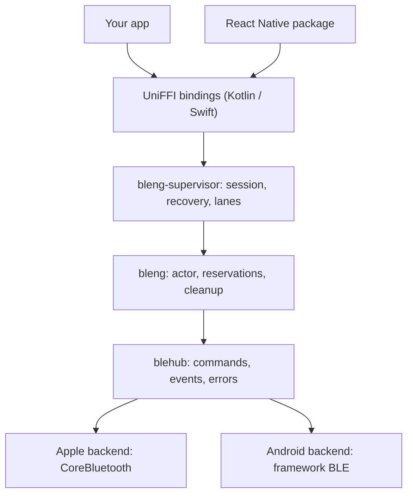

# BLEngine

[English](README.md) · [简体中文](README.zh-CN.md)

BLEngine is a BLE stack for native apps: one canonical contract, one async runtime, real platform
backends and thin generated bindings. App code talks in commands, events and typed errors, while each
platform keeps the callbacks, handles and threading it actually has.

> **Status: pre-release.** The API/ABI is not frozen, nothing is published, and no release gate has
> passed. Build and unit evidence never substitute for radio evidence; each candidate run is recorded
> on its own under [`docs/testing/reports/`](docs/testing/reports/).

## Why another BLE stack

Most BLE libraries put platform callbacks directly in front of the app. Every consumer then carries
the union of every platform's quirks: which thread a callback arrives on, whether a cancelled
operation can still deliver a result, what "connected but not discovered" means, and which failures
are local submission versus remote acknowledgement.

BLEngine decides those questions once:

- **One contract.** Commands, DTOs, events and errors live in `crates/blehub`. Nothing there owns a
  runtime, worker, timer, mailbox or canonical BLE state.
- **One runtime.** `crates/bleng` is a single actor with per-command reservations: each command keeps
  its own dispatch acceptance, buffered callbacks, terminal result and cancellation evidence.
- **One session authority.** `crates/bleng-supervisor` owns owner lifecycle and recovery and hands out
  bounded observation lanes. It never invents a second runtime.
- **Platform-owned native work.** Backends under `platforms/` own native handles, callback
  correlation, serialized I/O and watchdogs. Native submission is not remote delivery, and platform
  cancellation is not rollback.
- **Generated bindings.** Each package line ships one Stable UniFFI image, so Kotlin and Swift see the
  same shapes as Rust instead of a hand-maintained parallel API.



## Repository layout

| Path | Responsibility |
|---|---|
| `crates/blehub` | Canonical contract, `BleHub` assembly and the `BleBackend` trait. |
| `crates/bleng` | Async runtime: actor, command reservations, waiter delivery, cleanup. |
| `crates/bleng-supervisor` | Session/owner lifecycle, recovery policy, bounded observation lanes. |
| `crates/blehub-uniffi`, `crates/bleng-uniffi` | One Stable UniFFI image per package line. |
| `platforms/apple`, `platforms/android` | Production backends: CoreBluetooth, Android framework BLE. |
| `integrations/react-native-bleng` | The React Native (Nitro) package and its pinned specs. |
| `api-snapshots/` | Reviewed public API shape; the mechanical stand-in for a freeze. |
| `tests/` | Conformance, FFI/package consumers, HIL lanes, peripheral fixtures, shared support. |
| `tools/` | Host tooling: builds, evidence capture, device and radio leases. |
| `docs/` | Architecture, research, testing guides and dated reports. |
| `.plan/PLAN.md` | The single approved architecture plan and phase gates. |

## Naming

The project name, the repository and the npm package use **BLEngine / `blengine`**. The two internal
layers keep their own names because they mean specific things:

| Name | What it is |
|---|---|
| `BLEngine` / `blengine` | Product, repository and package identity. |
| `BleHub` / `blehub` | The canonical BLE contract and core crate. |
| `BLeng` / `bleng` | The async runtime crate. |
| `bleng-supervisor` | Session and recovery orchestration crate. |
| `@blengine/react-native-bleng` | The React Native package. |

## Getting started

The toolchain is owned by [pixi](https://pixi.sh): Rust, Python and `just` come from the lockfile. Pixi
does not install SDKs, Xcode, Android platform tools or vendor debuggers.

```bash
pixi install

pixi run just check     # cargo check --workspace
pixi run just test      # cargo test --workspace
pixi run just lint      # rustfmt, clippy -D warnings, ruff, just --fmt
pixi run just verify    # check + lint + tests + reviewed API snapshot check
```

No recipe silently installs a toolchain, accepts a license, flashes firmware, toggles a radio or
closes a foreign app. Signing, keychain access and `sudo` are human-only steps.

### Bindings and packages

```bash
pixi run just binding snapshot-check         # BleHub public API shape
pixi run just binding bleng-snapshot-check   # BLeng + supervisor public API shape
pixi run just binding freeze-inventory       # regenerate the ABI freeze inventory

pixi run just ffi android-bleng-build        # stage the Android AAR (static build only)
pixi run just react-native formal-host-check # RN package typecheck + autolinking
pixi run just react-native api-site          # generate the TypeDoc site
```

`android-bleng-build` never selects, installs on or starts a device. Device and radio work is always a
separate, explicitly leased step.

## Tests and evidence

| Layer | What it proves |
|---|---|
| `cargo test --workspace` | Contract, runtime, supervisor policy and fake-backend conformance. |
| `cargo test -p bleng-supervisor --features ffi` | The exported FFI surface itself, which only compiles under that feature. |
| `tests/consumers/` | A published artifact compiles and links in a clean host. |
| Native UI scenes | In-process XCTest / instrumented scenes drive the real App and return one receipt. |
| RF lanes | The real radio, peer and fixture, per run, under an explicit lease. |

Evidence is layered on purpose. A passing build, a unit test or a simulator run is not a device result,
and a device result is not a general RF claim. Dated reports in
[`docs/testing/reports/`](docs/testing/reports/) keep their original verdicts; a later candidate is
recorded separately instead of rewriting an earlier one.

## Platform status

- **Apple** (CoreBluetooth) and **Android** (framework BLE) are the active production lanes.
- **Windows**, the Tauri plugin, BLESS/QEMU fixtures, the Android peripheral lane and the Appium host
  are archived or historical. They live under `archive/` directories and are not active gates.

## Documentation

- Product and phase authority: [`.plan/PLAN.md`](.plan/PLAN.md)
- Working rules and evidence navigation: [`AGENTS.md`](AGENTS.md)
- Documentation map: [`docs/README.md`](docs/README.md)
- Recovery architecture: [`docs/architecture/bleng-recovery.md`](docs/architecture/bleng-recovery.md)
- Test execution: [`docs/testing/README.md`](docs/testing/README.md)
- Evidence ledger policy: [`docs/testing/reports/README.md`](docs/testing/reports/README.md)
- React Native API reference: [`API.md`](integrations/react-native-bleng/API.md) ·
  [`API.zh.md`](integrations/react-native-bleng/API.zh.md)
- Generated TypeDoc site and its rules:
  [`docs/research/react-native/typedoc-site.md`](docs/research/react-native/typedoc-site.md)

## Contributing

Start with [`AGENTS.md`](AGENTS.md). In short: change code in its owning repository, keep identity,
lease, deadline, permission, timeout, rollback and cleanup contracts intact rather than weakening them
to make a test pass, and do not treat an archived lane as a current gate without re-admitting it in the
plan.

## Status and non-claims

- The ABI is unfrozen. `api-snapshots/` is a review gate, not a published contract.
- No release has been cut and no release or freeze gate is implied by this README.
- Anything recorded in this repository is scoped to the artifact, host, fixture and run that produced
  it.
