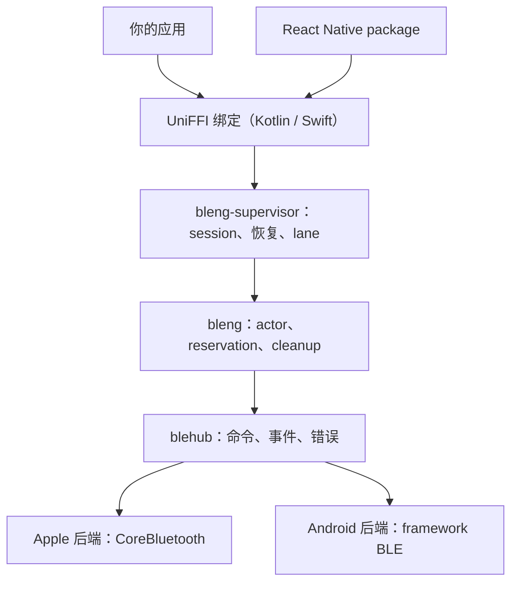

# BLEngine

[English](README.md) · [简体中文](README.zh-CN.md)

BLEngine 是面向原生应用的 BLE 栈：一份 canonical 契约、一个 async runtime、真实的平台后端，以及薄的生成绑定。
应用代码只面对命令、事件和带类型的错误，平台自身的回调、句柄和线程模型留在平台后端里。

> **状态：pre-release。** API/ABI 尚未冻结，没有任何产物发布，也没有通过 release gate。构建与单测证据不能替代
> 射频证据；每一次候选运行都单独记录在 [`docs/testing/reports/`](docs/testing/reports/)。

## 为什么再造一个 BLE 栈

多数 BLE 库把平台回调直接摆在应用面前。于是每个使用方都要承担所有平台怪癖的并集：回调落在哪个线程、
已取消的操作是否还会交付结果、「已连接但未发现 GATT」到底意味着什么、哪些失败只是本地提交失败而不是远端确认。

BLEngine 把这些判断一次性定下来：

- **一份契约。** 命令、DTO、事件和错误都在 `crates/blehub`。这里不拥有 runtime、worker、定时器、mailbox
  或 canonical BLE 状态。
- **一个 runtime。** `crates/bleng` 是单一 actor，每条命令各自持有 reservation：派发是否被接受、缓冲的回调、
  终态结果和取消证据都分开保存。
- **一个 session 权威。** `crates/bleng-supervisor` 负责 owner 生命周期与恢复，并发放有界观察 lane；
  它不会另造第二个 runtime。
- **原生工作归平台所有。** `platforms/` 下的后端拥有原生句柄、回调关联、串行化 I/O 和 watchdog。
  原生提交不等于远端送达，平台取消也不等于回滚。
- **生成绑定。** 每条 package line 只产出一份 Stable UniFFI image，Kotlin/Swift 看到的形状与 Rust 一致，
  而不是手工维护的平行 API。



## 仓库结构

| 路径 | 职责 |
|---|---|
| `crates/blehub` | canonical 契约、`BleHub` 组装和 `BleBackend` trait。 |
| `crates/bleng` | async runtime：actor、命令 reservation、waiter 交付、cleanup。 |
| `crates/bleng-supervisor` | session/owner 生命周期、恢复策略、有界观察 lane。 |
| `crates/blehub-uniffi`、`crates/bleng-uniffi` | 每条 package line 一份 Stable UniFFI image。 |
| `platforms/apple`、`platforms/android` | 生产后端：CoreBluetooth、Android framework BLE。 |
| `integrations/react-native-bleng` | React Native（Nitro）包及其固定 specs。 |
| `api-snapshots/` | 经评审的公共 API 形状，是冻结的机械替身。 |
| `tests/` | conformance、FFI/产物消费者、HIL lane、外设 fixture、共享支持。 |
| `tools/` | host 工具：构建、证据采集、设备与射频 lease。 |
| `docs/` | 架构、研究、测试指南和带日期的报告。 |
| `.plan/PLAN.md` | 唯一获批的架构计划与阶段门。 |

## 命名

项目名、仓库和 npm 包使用 **BLEngine / `blengine`**。两个内部层级保留自己的名字，因为它们各自指代明确的东西：

| 名称 | 含义 |
|---|---|
| `BLEngine` / `blengine` | 产品、仓库与包身份。 |
| `BleHub` / `blehub` | canonical BLE 契约与核心 crate。 |
| `BLeng` / `bleng` | async runtime crate。 |
| `bleng-supervisor` | session 与恢复编排 crate。 |
| `@blengine/react-native-bleng` | React Native 包。 |

## 快速开始

工具链由 [pixi](https://pixi.sh) 管理：Rust、Python 和 `just` 来自 lockfile。Pixi 不安装 SDK、Xcode、
Android platform tools 或厂商调试器。

```bash
pixi install

pixi run just check     # cargo check --workspace
pixi run just test      # cargo test --workspace
pixi run just lint      # rustfmt、clippy -D warnings、ruff、just --fmt
pixi run just verify    # check + lint + 测试 + 已评审 API snapshot 校验
```

任何 recipe 都不会偷偷安装工具链、接受许可证、刷写固件、切换射频或关闭别人的 App。签名、钥匙串访问和 `sudo`
都是只能由人完成的步骤。

### 绑定与产物

```bash
pixi run just binding snapshot-check         # BleHub 公共 API 形状
pixi run just binding bleng-snapshot-check   # BLeng + supervisor 公共 API 形状
pixi run just binding freeze-inventory       # 重新生成 ABI freeze inventory

pixi run just ffi android-bleng-build        # 暂存 Android AAR（仅静态构建）
pixi run just react-native formal-host-check # RN 包 typecheck + autolinking
pixi run just react-native api-site          # 生成 TypeDoc 站点
```

`android-bleng-build` 从不选择、安装或启动设备。设备与射频工作永远是单独且显式 lease 的步骤。

## 测试与证据

| 层级 | 证明什么 |
|---|---|
| `cargo test --workspace` | 契约、runtime、supervisor 策略与 fake backend conformance。 |
| `cargo test -p bleng-supervisor --features ffi` | 导出的 FFI 表面本身，它只在该 feature 下编译。 |
| `tests/consumers/` | 已发布产物能在干净宿主中编译并链接。 |
| 原生 UI 场景 | 进程内 XCTest / instrumented 场景驱动真实 App，并回传一份回执。 |
| RF lane | 真实射频、对端和 fixture，逐次运行，并在显式 lease 下进行。 |

证据是分层记录的。构建通过、单测通过或模拟器运行都不是设备结果；一次设备结果也不是通用的射频结论。
[`docs/testing/reports/`](docs/testing/reports/) 里的历史报告保留当时的判定，新的候选另写一份，而不是改写旧的。

## 平台状态

- **Apple**（CoreBluetooth）和 **Android**（framework BLE）是活跃的生产 lane。
- **Windows**、Tauri plugin、BLESS/QEMU fixture、Android peripheral lane 和 Appium host 已归档或成为历史。
  它们位于各 `archive/` 目录下，不是当前门禁。

## 文档

- 产品与阶段权威：[`.plan/PLAN.md`](.plan/PLAN.md)
- 工作规则与证据导航：[`AGENTS.md`](AGENTS.md)
- 文档地图：[`docs/README.md`](docs/README.md)
- 恢复架构：[`docs/architecture/bleng-recovery.md`](docs/architecture/bleng-recovery.md)
- 测试执行：[`docs/testing/README.md`](docs/testing/README.md)
- 证据账本策略：[`docs/testing/reports/README.md`](docs/testing/reports/README.md)
- React Native API 参考：[`API.md`](integrations/react-native-bleng/API.md) ·
  [`API.zh.md`](integrations/react-native-bleng/API.zh.md)
- 生成的 TypeDoc 站点及其规则：
  [`docs/research/react-native/typedoc-site.md`](docs/research/react-native/typedoc-site.md)

## 参与贡献

先从 [`AGENTS.md`](AGENTS.md) 读起。简而言之：在代码所属的仓库里修改；保持身份、lease、deadline、权限、
超时、回滚与 cleanup 契约不被削弱，不要为了让测试变绿而放松它们；未在计划中重新启用的归档 lane 不得当作当前门禁。

## 状态与不做承诺的部分

- ABI 尚未冻结。`api-snapshots/` 是评审门，不是已发布的契约。
- 尚未发布任何版本，本 README 不暗示任何 release 或冻结门已经通过。
- 本仓库记录的任何结论都限定在产生它的产物、宿主、fixture 和运行范围内。
