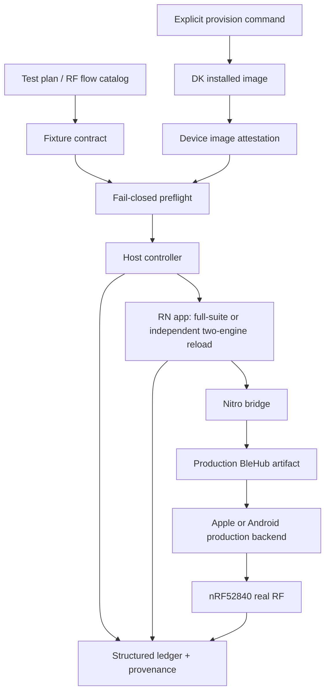

# （已退休）RN 真机 RF Lab 测试架构与差距评估

> **状态：2026-11-22 已退休，仅作历史记录。**
>
> 本文描述的 `run_rf_lab_full` / `rf_scenario_runner` / `pending_read_reload_runner` /
> `run_ios_adapter_startup` / `rf_evidence_bundle` 及 nRF52840 BTP coordination 模拟器已全部物理删除：
> 它们没有任何维护中的 Just 入口（`--coordination-mode` 无 live recipe 传递），正式证据由
> `run_bleng_*_scan --scene ...` / `formal-host-*` 生成。删除记录与验证见
> [RN internal consumer 退休报告](../../testing/reports/2026-11-22-react-native-internal-retirement.md)。
> 文中引用的路径已不存在；不要据此恢复入口或把历史 pass 当作当前证据。


更新：2026-10-19。本文描述当前架构及既有证据边界；各次硬件操作、artifact hashes、失败尝试与软件测试阶段数由具名报告保存，不在架构文档重复累积流水。

## 结论

普通 App 启动进入 `rf-workbench`，不创建 Probe、不 dispatch BLE。推荐的 **host 验证计划**是一次启动的 **`full-suite`：基础十项（含 native cancellation/watchdog）→ physical-clean/canonical readback → begin 双 ACK → strict 恢复十轮**，不是浏览页面即自动执行。同一 App 页面/mount、JS nonce、native boot、fixture lease/BTP/session，不把两段历史 pass 拼成组合 pass。

现行入口为 [`run_rf_lab_full.py`](../../../tools/react_native/run_rf_lab_full.py)，由 [`rf_scenario_runner.py`](../../../tools/react_native/rf_scenario_runner.py) 编排。原 `run_android_rf_lab_suite.py` / `run_ios_rf_lab_suite.py` 已删除，不再作为 standalone continuous10 或兼容入口。独立 strict 十轮使用 [`run_rf_recovery_ten.py`](../../../tools/react_native/run_rf_recovery_ten.py)，不是已删除的 `run_ios_rf_scan --recovery-ten`。

Android/iOS pending-read reload 是**独立 two-engine scenario**：同 App PID，两个 native owner/JS nonce；真实 DK `WAITING` 后才请求 reload，旧 owner cleanup barrier 完成后新代才 initialize。它不是 continuous10 第 11 项，也不能塞入 same-runtime full-suite。旧 local-HEX iOS pending CLI 已归档到 [`tools/archive/react_native/`](../../../tools/archive/react_native/README.md)，不代表现行 live-attested gate。

长期 fixture 是 **A/B 各自 multifunction image**：同 code/settings/capabilities，不同编译 profile identity/UUID/hash，**不是 bit-identical HEX**。每块板的 normal/watchdog 不再切换固件；未 ARM 时普通 I/O；v2 的 ARM/HELD 上限为 10s/20s，场景可以使用更短预算，STATUS 不续期。production native watchdog 自 2026-11-19 起为 **30 s**（ATT 事务上界），所以 20 s 的 firmware HELD 会先到期，场景仍要把窗口做短而不是拖到上界。

核心规则：

> `provision` 改变 DK；`assert` 证明 DK；`run` 只执行测试。普通测试永远不隐式刷机。

默认流程：选择计划 → 校验 contract/capabilities → 取得独占租约 → 设备即时回读 attestation → preflight 通过后安装冻结 App/运行 flow → owned cleanup → 归档 evidence。image 不匹配时拒绝并提示显式 provision，不自动修复。

Host 工具/support 所有权与既有软件回归记录见 [RN host tooling 架构](react-native-host-tooling-architecture.md)。软件测试不是 RF、native/package gate 或最终同候选全门禁结果。

## 当前入口与所有权

| 场景/层 | 入口/实现 | 不可混淆的边界 |
|---|---|---|
| 默认总计划 | `run_rf_lab_full` → `rf_scenario_runner`；Just `host-android-rf-lab-suite` / `host-ios-device-rf-lab-suite` | 一个 runtime 连续基础十项与恢复十轮 |
| 独立恢复十轮 | `run_rf_recovery_ten` → 同一 scenario runner；Just `host-android-rf-recovery-ten` / `host-ios-device-rf-recovery-ten` | 十个 fresh Probe/Hub，不是同一个 Hub 重用十次 |
| 独立 response-write REJECT | `run_rf_write_reject` → 同一 scenario runner；Just `host-android-rf-write-reject` / `host-ios-device-rf-write-reject` | `rf-write-reject`；HELD/REJECT、未提交、同连接正常恢复与双层零资源，不加入 full-suite；执行状态见[具名报告](../../testing/reports/2026-10-19-rn-response-write-reject.md) |
| 独立 CCC enable REJECT | `run_rf_ccc_enable_reject` → 同一 scenario runner；Just `host-android-rf-ccc-enable-reject` / `host-ios-device-rf-ccc-enable-reject` | flow 11 只作 control discriminator；未提交、fresh subscription 恢复通知及有界 post-disable silence，不加入 full-suite，见[报告](../../testing/reports/2026-10-19-rn-ccc-enable-reject.md) |
| 独立 CCC disable REJECT | `run_rf_ccc_disable_reject` → 同一 scenario runner；Just `host-android-rf-ccc-disable-reject` / `host-ios-device-rf-ccc-disable-reject` | flow 12 是 control discriminator；必须在原 subscription 上继续收到值，不隐式 re-enable；Android/iPhone 的实际结果与缺口见[报告](../../testing/reports/2026-10-19-rn-ccc-disable-reject.md) |
| 独立 pending reload | `run_android_pending_read_reload` / `run_ios_pending_read_reload_gate` → `pending_read_reload_runner` | 同 PID、两个 engine；不是普通 App relaunch |
| Android adapter transition | `run_android_adapter_transition`，`startup-off`（默认）或 `active-loss` | 显式 opt-in；总计划不修改 radio/permission。两模式已有各自 RF 证据，不跨 APK/session 继承 |
| Android permission transition | `run_android_permission_transition` → permission capture/ledger；Just `host-android-rf-permission-transition` | 同一 workbench，denied/active/restored 三个 fresh process；已有 root-controlled Android API 36 真机通过与 reason 8 证明，范围绑定具名 APK/session |
| iOS authorization-only（非 RF） | 正式 App 的 UI 测试目标：`formal-host-ios-permission-authorization` → `run_bleng_ios_permission_ui` | fresh-install deny/allow：每阶段卸载/重装以产生真实系统弹窗，xcresult 必须 1 passed/0 failed/0 skipped；不作为 RF、live revoke 或 radio pass |
| 单项定位 | `run_android_rf` / `run_ios_rf_scan`、multi-DK runner、`run_rf_watchdog` | 保留单项/不同 fixture 边界；不恢复已删除 standalone suite |
| 采集与校验 | `capture_io` / `capture_transport`、场景 capture/ledger、`rf_evidence_bundle` | SDK/流机制不制造场景事实；offline integrity 不重新授权 RF |

标准 recipe 接收显式设备与 contract/profile；recipe 可以先构建 App，runner 只消费冻结产物，不刷 DK：

```text
pixi run just react-native host-android-rf-lab-suite <android-serial> <multifunction-contract.json> <multifunction-profile.json>
pixi run just react-native host-ios-device-rf-lab-suite <ios-udid> <team> <multifunction-contract.json> <multifunction-profile.json>
pixi run just react-native host-android-rf-write-reject <android-serial> <multifunction-contract.json> <multifunction-profile.json>
pixi run just react-native host-ios-device-rf-write-reject <ios-udid> <team> <multifunction-contract.json> <multifunction-profile.json>
pixi run just react-native host-android-rf-ccc-enable-reject <android-serial> <multifunction-contract.json> <multifunction-profile.json>
pixi run just react-native host-ios-device-rf-ccc-enable-reject <ios-udid> <team> <multifunction-contract.json> <multifunction-profile.json>
pixi run just react-native host-android-rf-ccc-disable-reject <android-serial> <multifunction-contract.json> <multifunction-profile.json>
pixi run just react-native host-ios-device-rf-ccc-disable-reject <ios-udid> <team> <multifunction-contract.json> <multifunction-profile.json>
pixi run just react-native host-android-pending-read-reload <android-serial> <multifunction-contract.json> <multifunction-profile.json>
pixi run just react-native host-ios-device-pending-read-reload <ios-udid> <team> <multifunction-contract.json> <multifunction-profile.json>
pixi run just react-native host-android-rf-adapter-transition <android-serial> <multifunction-contract.json> <multifunction-profile.json> [startup-off|active-loss]
pixi run just react-native host-android-rf-permission-transition <android-serial> <multifunction-contract.json> <multifunction-profile.json>
```

## RN 页面信息层级与职责

整个测试页面使用 [`rf_lab_workbench.tsx`](../../../tests/consumers/react-native-internal/src/rf_lab_workbench.tsx) 的 **Tests → Current run → Evidence**，不是给新场景另建 App 或导航框架：

| 层级 | 展示与操作边界 |
|---|---|
| Tests | 分类 → 具体场景 → setup，展示平台支持、fixture 与现行 recipe。选择只浏览，不执行 host 命令；planned 与当前平台 unsupported 分开标示。 |
| Current run | 仅一个 mounted scenario，显示其进度与 App checks。切换视图仅隐藏触摸/accessibility，不卸载、不重启、不清空执行；host launch 直接进入此处并固定原场景。 |
| Evidence | 集中 mode/session/service 技术身份、首个 App failure、覆盖边界与 recipe。App 收不到 host 最终 physical/cleanup/bundle verdict，不能用 App Passed 冒充 host-gate Passed。 |

[`rf_lab_catalog.ts`](../../../tests/consumers/react-native-internal/src/rf_lab_catalog.ts) 只拥有静态场景元数据：分类、准确 runtime/discriminator、平台、`interactive` / `host` / `planned`、`none` / `single-DK` / `two-DK`、现行 recipe 与限制。分类覆盖 full validation、能力诊断、lifecycle/fault recovery、multi-Peripheral 和 host-only ABI runtime；supported 是维护入口，不是硬件验证通过记录。Recipe 缺项不推导命令；permission transition 已有 Android runtime/recipe 和具名 root-controlled 真机证据，但目录可用不代表当前 session 通过；Android adapter/permission 场景在 iOS 不支持。

身份不能仅靠 runtime 名称或 recipe 前缀推断：

- `rf-lab-suite` + `rfRecoveryRunId !== undefined` 才是 full-suite；未提供时为 legacy flow-only（十项或 `rfLabSuiteFlow` 单项），无恢复十轮、无 standalone maintained recipe，目录不列其卡片但仍能识别 host launch。
- `rf-adapter-transition` + `rfAdapterMode` 区分 `startup-off` 与 `active-loss`；省略只表示前者，不能升级为后者。Just recipe 末尾可选同名 mode，默认 `startup-off`。
- `rf-permission-transition` + `rfPermissionRunId` / `rfPermissionPhase` 选择 Android denied/active/restored。每阶段是独立 fresh process；撤权后旧 Probe 不伪造 terminal、close 或 17 项零。Host 必须证明旧进程匹配的 OS reason 8，并在释放 phone lease 前恢复原 grants。完整 root-controlled 真机通过、前四次失败与修复边界见 [权限门禁报告](../../testing/reports/2026-10-17-rn-android-permission-transition.md)。
- `rf-reload` 的 subscribed RF gate 仅有 iOS recipe；host-only `reload` 和 pending-read two-engine reload 则各有 Android/iOS 入口，不能混为一种 coverage。

[`App.tsx`](../../../tests/consumers/react-native-internal/src/App.tsx) 仍是唯一执行路由，原有 scenario runner 继续拥有 Probe/Hub、listener、取消和 cleanup 生命周期。Workbench 不启动第二个 scenario；非 host workbench 仅在提供 service UUID 后可打开现有 `rf-lab` 交互诊断，显式 Run 才 dispatch，fixture 仍须 host 准备。显式 `basic` 保留 ABI smoke，Apple smoke/XCUITest 使用 `--blehub-nitro-basic`，不再依赖普通启动默认值。

[`rf_lab_session.tsx`](../../../tests/consumers/react-native-internal/src/rf_lab_session.tsx) 是有界 UI 投影，不是第二套 BLE 状态机：只接受 existing reporter 的受识别进度/结果或 existing owner 的 computed status，保存 state/phase/计数与最多 320 字符首错；忽略 raw `:event:`、`:resources:`、`:native:` 记录。Failure sticky，后续 pass/进度不能覆盖；只有显式 manual begin 可重开摘要。它不新增 core/runtime/mailbox/backend canonical state 责任，也不接管 host RF/control/evidence。切页保留当前内存 session，不承诺 engine reload/process restart 后的历史。

## 目标架构



### 1. Test plan / flow catalog

Host 执行计划是可审查声明，不由页面选中卡片授权；声明 fixture role、image identity/hash、board/profile/service/capabilities、runtime mode、flow 顺序、预算、cleanup 和必需 domain/terminal/silence/recovery marker。UI catalog 只引用现行入口和边界，不替代 fixture contract 或 checker。

基础 continuous10 是同一个 RN page/JS runtime、一次 App mount 下的九项基础 RF 加 watchdog：flow 8 cancellation、flow 9 watchdog，同 session、不同 token，各有 physical evidence。Flow 可以创建/关闭自己的 Probe/Hub 和连接，不能关闭/重启 App。Full-suite 在这十项完成后，保持同 capture/runtime/session 继续恢复十轮；十项不同 flow 不等于十次 recovery。

### 2. Fixture contract

tracked contract 是 expected build 输入，不能从本机历史状态推断 installed identity。当前前向维护 v2，A/B 已构建导出；DK-B 的安装与独立双手机 full-suite 证据见[具名报告](../../testing/reports/2026-10-18-v2-dk-b-mobile-full-suite.md)。这不是当前设备状态、DK-A 安装或新场景通过的证明：

- A：[contract](../../../tests/peripherals/nrf52840/firmware/contracts/multifunction-rf-v2-a.json)、[declaration](../../../tests/peripherals/nrf52840/firmware/images/multifunction-rf-v2-a.json)、[profile](../../../tests/peripherals/nrf52840/firmware/profiles/multifunction-rf-v2-a.json)。
- B：[contract](../../../tests/peripherals/nrf52840/firmware/contracts/multifunction-rf-v2-b.json)、[declaration](../../../tests/peripherals/nrf52840/firmware/images/multifunction-rf-v2-b.json)、[profile](../../../tests/peripherals/nrf52840/firmware/profiles/multifunction-rf-v2-b.json)。
- 解析和绑定由 [`fixture_contract.py`](../../../tests/peripherals/nrf52840/fixture_contract.py) 拥有，严格拒绝未知字段、重复 capability、非法 UUID/hash 和缺少 image hash；local profile 的 profile/service/local name 必须精确匹配。

JSON 使用 snake_case，绑定 image ID/version/hash、board、profile ID、service UUID/local name 和 capability 集合。Image declaration 拥有 identity/version、board、profile ID、capabilities/settings；UUID/local name 从 canonical profile 派生，不复制到 declaration。

Multifunction v2 保留正常 RF 五项能力，新增统一 READ/write/CCC fault、precommit-defer 与 10s ARM / 20s HELD 上限，exact11 capabilities 见[固件架构](../peripheral/nrf52840-fault-firmware-v2.md)。Canonical profile 不请求 authorization，未 ARM 时普通读正常。App 在 connected+discovered barrier 等待 host ARM 后才下发目标 read；断连后用 exact ticket 查询 retained STATUS，不再先 RELEASE 才能处理 disconnect。Central cancellation 是 production backend/BLeng 能力，不是 DK capability。

历史 v1 normal/multifunction、diagnostic pending-read 与 watchdog contract 只描述各自证据，保留原文件位置以维持报告链接，不是运行兼容层。当前 recipes 和 family admission 不得回退旧集合或根据“以前刷过”启动；现有历史 pass 不转移到 v2。

### 3. Installed-image attestation

本地 HEX、build manifest 或“以前刷过”都不是 installed proof。设备控制面必须返回 image ID/version/normalized hash、board、profile/service/local name 和 capabilities，由 [`fixture_attestation.py`](../../../tests/peripherals/nrf52840/fixture_attestation.py) 严格比较。

BleHub-owned `vendor/0xff/opcode=0x01/index=0xff` 只读扩展及 strict binary codec 见 [`fixture_attestation_wire.py`](../../../tests/peripherals/nrf52840/fixture_attestation_wire.py)。它不是标准 BTP image identity 命令。Normalized image digest 对完整 `zephyr.bin` 计算 SHA-256 前，将唯一 `BLEHUB_ATTESTATION_SHA256_SLOT_V1` 后的 64 字节 hash slot 归零；它不是原始 HEX 文件 SHA-256。

只读 capture：

```text
pixi run just peripheral nrf52840-attestation <probe-serial> .work/peripheral/nrf52840/installed-attestation.json
```

要求显式 J-Link serial、唯一且独占的 BTP VCOM，读取前后复核 probe identity；不刷机、不 reset、不启动 RF provider。成功输出 strict attestation 与 `.provenance.json` sidecar，unknown command/身份漂移等失败不伪造结果。

`diagnostic/device.py` 的 J-Link/BTP helper 仍被 attestation 与 diagnostic doctor 使用，`diagnostic/read_hold.py` 仍支持 multifunction；不能因旧 local-HEX CLI 归档而删除整个 diagnostic 子树。

### 4. Hardcoding policy

| 数据 | 唯一来源 | 代码中的合法形式 |
|---|---|---|
| BTP service/opcode、AD type、wire tag | 协议 wrapper | 集中的命名常量，不在 flow 重复裸写 |
| image identity/version、board、capabilities/settings | tracked declaration | loader 解析后的值 |
| service/local name、normalized hash 与 expected identity | canonical profile / validated build 导出的 contract | runner 不再复制一份 |
| DK serial/VCOM、Android serial、iOS UDID、路径 | CLI、ignored local config、环境变量 | 不允许“第一个设备” fallback |
| 边界值与模拟日志 identity | test source/support | 不参与真实硬件选择 |

J-Link serial 只规范化十进制前导零，不放宽 USB/PID/location 边界；协议 `0xff`/`0x01` 不是设备身份硬编码。

### 5. Host preflight 与 session proof

[`rf_fixture.py`](../../../tools/react_native/rf_fixture.py) 拥有 host preflight/guard，真实 authority 仍是 provider 和 [`fixture_session.py`](../../../tests/peripherals/nrf52840/fixture_session.py)：

1. Host 建立 UUID 隔离 attempt，冻结 contract/profile，请求绑定两份快照 hash、session UUID、service、port 和 canonical physical serial。
2. 新 fixture child 取得物理租约，核对 port/serial，在同一 BTP session 回读 installed identity。Wrong image、缺 capability 或 unknown command 必须在 GATT/GAP mutation、广告和 READY 前拒绝。
3. Live receipt 绑定 request UUID/hash、物理/installed identity、child PID/PGID，原子且不覆盖发布。历史 attestation JSON 至多是 expected baseline，不能授权新 session。
4. Host 只采用 startup 返回的唯一 PID/PGID，App 安装、启动和最终成功前校验同 receipt/owner；运行中有界检查 fixture，不等待整个 suite 超时才发现失效。
5. Artifact 冻结/identity 检查与 live proof 通过后才安装 attempt 内 APK/`.app`；Android 必须显式提供 APK，不复用未 fingerprint 的 installed App。Bundle 建立前的硬件/参数拒绝不保证有 manifest，建立后的 partial failure 保留已有材料。

当前 cancellation 必须 live-attested multifunction；旧 unattested 开发路径不授权 gate。早期 `_wait_for_suite` / `_suite_logcat` 轮询已删除，现行流式 capture 不依赖它们。

### 6. 显式 provisioning 与共享租约

Provision 校验 contract/manifest/board/hash/toolchain provenance，在 flash 前后复核 probe identity；program + verify + reset 后必须真实 BTP readback/assert，一致才成功。Programmer 消费 attempt-owned 私有只读 HEX/manifest 快照，不重新打开可能被下一次 build 覆盖的 canonical 文件。刷写确认参数使用 manifest 中的 **HEX artifact hash**，不是 normalized image digest；build/export/check contract 本身不证明物理安装。

物理锁唯一 authority 是 nrftest 的 `host/nrftest/resource_lease.py`；BleHub [`resource_lease.py`](../../../tests/peripherals/nrf52840/resource_lease.py) 通过有界 Pixi 子进程 broker 持有，不在本 Python 进程导入另一仓库源码。锁 key 是物理 USB serial，不是 VCOM；provider、provision、capture、doctor、直接 BTP/AutoPTS 使用同命名空间。AutoPTS 全局锁另有职责，不替代物理锁。

租约覆盖 flash/readback/assert 或整个 session；冲突必须在串口打开/flash 前拒绝。借用只能是本进程 active lease，不提供 skip-lock/token；broker EOF 释放，异常 cleanup 仍关闭 session/串口/broker。这防协作工具抢占与重建消费竞态，不是恶意 same-UID 或不遵守租约的外部工具安全模型。macOS/POSIX 已有软件验证，Windows broker 后代清理与 parent-death EOF 未验证。

### 7. Host controller、capture 与 RN runtime

Host 拥有设备/fixture/App 生命周期和 evidence；RN 页面执行真实 BleHub flow 并显示状态，不能成为硬件控制面的唯一真相。完成依赖 structured marker、fixture ACK、terminal 和 silence window，不以固定 sleep 冒充；cleanup 必须 bounded、owned、failure-atomic，不能杀另一轮 fixture。

Cancellation 由 [`cancellation_control.py`](../../../tests/peripherals/nrf52840/cancellation_control.py)、[`rf_signal.ts`](../../../tests/consumers/react-native-internal/src/rf_signal.ts) 和 [`rf_control_relay.py`](../../../tools/react_native/rf_control_relay.py) 绑定 session/token、receipt 与真实 ARM/WAITING/release。Host signal 不伪造 BLE event；iOS bootstrap/process 与 native+JS ACK 另行校验。Bootstrap 45s、signal ACK hard 2s，不因 CLI timeout floor 放宽外层预算。

[`continuous_watchdog.py`](../../../tests/peripherals/nrf52840/continuous_watchdog.py) 在 cancellation physical close 后，于无 peer 边界恢复 canonical values/readback，保留 ATT handles/BTP session，复用 watchdog experiment 而不重新 launch App。成功 release 要求同 generation，release-request→RELEASED 严格小于 3s、ARM→RELEASED 严格小于 24s；unexpected peer/generation drift/cleanup failure 均拒绝。恢复读普通 `updates` 的 `00`，不能拿需重新 ARM 的诊断 read 当普通恢复读。

**RELEASED 只证明 Peripheral callback 已释放，不证明晚 BluetoothGattCallback/CoreBluetooth callback 已上达。** Central 隔离依赖 exactly-once terminal、无 old-domain event、release/旧 peer disconnect 后的 host silence 和新连接恢复读；synthetic old-handoff CLOSED 也不是实际晚 native callback/Rust ingress 观察。

Two-engine pending reload 的 native dispatch acceptance 不等于 pending entry，必须等 DK WAITING。Android 实际 beforeDestroy hook、iOS 实际 module invalidate 负责合格首 close；旧 owner dispose/handoff drain/逻辑资源门禁完成才放行新代。Same PID 不等于 same JS runtime，Swift barrier 已实现并实机验证，不再是 Android-only stub；也不因此推断所有 API parity、Hermes destructor 或真实晚 callback。

Android `active-loss` 在有界审计修复、APK 重建后已完成**新的真实 RF pass**，详见 [候选绑定报告](../../testing/reports/2026-10-16-rn-android-active-read-radio-loss.md)。Host/provider 在 attested held ATT read 与 queued read 的握手后控制手机 OFF；本场 `disconnect-first` 为两条 read 各一次 `connection` terminal，再出现无 commandId 的 passive disconnect。旧连接 pre-close retirement 时连接/GATT/I/O/watchdog/routes 归零而 Hub/listener 等仍活，随后两个 Probe close 各 17 项全零；ON 后 fresh Probe 的 `rf-io` 另行 readback `00/10/AB`。不是 same-Hub 恢复，也不覆盖 in-flight write/CCCD、permission 或 iOS。OFF 使用实际 4s deadline，不宣称与 WAITING 原子同刻；watchdog-first 拒绝。首个 logcat 4096 字节截断 attempt 仍保留 failed，不回写。

修复仅作用于审计输出：[`rf_adapter_transition.tsx`](../../../tests/consumers/react-native-internal/src/rf_adapter_transition.tsx) 的显式 `active-gatt-canonical-v1` 保留完整 canonical service 子树（实例 ID、属性与 descriptors）和全库 service/characteristic/descriptor counts，省略非 canonical service 的详细列表；本场全库总数 **4/22/3**、保留子树 **1/5/2**。含 `BLEHUB_NITRO_RUNTIME` 前缀的输出上限为 3500 UTF-8 字节，超限 fail closed，不输出截断 JSON。原始 runtime event 不变。[Provider 的 `ActiveReadFacts`](../../../tests/peripherals/nrf52840/adapter_transition.py) 与 host ledger 验证该 schema；这不是完整 native GATT replay，RF pass 来自新实机 attempt，不来自 synthetic 大拓扑测试。

### 8. Evidence provenance

[`rf_evidence_bundle.py`](../../../tools/react_native/rf_evidence_bundle.py) 与 [`test_rf_evidence_bundle.py`](../../../tools/tests/react_native/test_rf_evidence_bundle.py) 分别拥有真实 bundle 实现和 synthetic 回归。Scenario 区分 `full-suite` / `continuous10` / `pending-read-reload` / `recovery-ten` / `adapter-transition`；旧 v1 缺 scenario 只读解释为 continuous10，历史 bytes 不变、不 backfill，pending 缺 scenario 拒绝。

- **冻结安装输入**：复制 APK/完整 `.app` 到 `attempt/candidate/`，比较前后 source fingerprint/stat signature 与 snapshot fingerprint，安装/复核只消费快照。Android 保存 pinned `aapt2 dump badging` 原文和 package/activity identity；iOS 核对 Info.plist、Mach-O 与 JS。
- **完整指纹**：APK 全 archive 与 ZIP items、JS/DEX/native ABI；iOS 完整 tree 的 bytes/modes、canonical inventory，含 debug dylib/framework Mach-O。xattrs/timestamps 不属于内容 fingerprint；stat drift check 不是全文件系统等价证明。
- **有界读取**：ZIP case-sensitive，合法大小写资源可共存；拒绝 exact duplicate、路径冲突/traversal、symlink/special/encrypted entry 和越界。iOS tree 拒绝 symlink/special。入口最多 20,000、单文件 1 GiB、累计 2 GiB−1 B，文档/日志另设上限，不宣称防恶意 same-UID 篡改。
- **Manifest/raw lineage**：run UUID、host/git HEAD/dirty、Central/artifact、raw hash inventory、runtime/request/receipt、scenario physical hashrefs。Bundle UUID 与 fixture/native-JS session runId 不混用；continuous10 保存每 flow source/status/range/raw hash，pending 关联两代与专项 ledger/physical evidence。Raw CRLF/LF 字节独立 hash；full-suite LF projection 只允许逐行 terminal CRLF→LF 转换，不能冒充原 bytes 相同。
- **收尾发布**：owned cleanup 后原子发布；completion、primary/cleanup/evidence errors、artifact/必需引用/scenario 结构任一不满足都不能 pass。Secondary failure 不覆盖 primary；partial failure 保留缺失与已有 raw，发布本身失败只能 best-effort。

**离线 `verify_bundle` 只复核 hash/inventory/引用与 flow 结构，不重做 BLE 语义断言、不重新授权 RF。** 现有专项 ledger 不等于每 flow 统一 typed semantic ledger/native BLE replay。Manifest 无签名信任链；host 安装快照 fingerprint 不是设备 installed binary byte hash、signing/security proof 或 source-to-build attestation。

RN/Jest、fake fixture marker、工具 unittest 只能验证软件边界；RF 必须追溯 `RN/Nitro → production BleHub → production backend → phone radio → nRF`。不同 candidate/image/provider 不能拼成一个 pass。

## 已有硬件证据与剩余差距

下表是**具名候选证据索引**，结果绑定各自 manifest/APK/session，不能自动继承给后续 dirty 工作树。机器 serial、PID、完整 hashes、失败尝试和当轮软件测试数留在报告，不作为通用默认值。

| 边界 | 已记录证据 | 限制 / 来源 |
|---|---|---|
| 正式 normal A/B provision/readback | 两板 installed proof；DK-A Android/iOS REAL 9/9 | normal B 不推断 RF；无统一 bundle 的旧轮次不 backfill；[normal 报告](../../testing/reports/2026-10-13-normal-attested-rn-rf-lab.md) |
| Multifunction A/B 与首轮 continuous10 | 各自 provision/readback；两端单次真实 10/10、kept-open，同 lease/BTP/runtime | development provenance，不是 clean locked release；optional localName 只在出现时校验，不放宽 service/identity；[multifunction](../../testing/reports/2026-10-14-multifunction-nrf-rn-rf.md)、[continuous10](../../testing/reports/2026-10-14-rn-continuous10-rf.md) |
| 统一 bundle 初轮 | Android `e811…` / iOS `f0c851…` 各自新跑 10/10、host/bundle/离线复核 passed | private Nitro 修改前 artifact，不继承给后续实现；[bundle 报告](../../testing/reports/2026-10-14-rn-rf-evidence-bundle.md) |
| Android pending + 当轮两端 continuous10 回归 | pending `10b368…` 同 PID/两代；Android `731743…`、iOS 重建签名 `7fedcc…` 各自完整 10/10/host/bundle/offline passed | 同当轮 private Nitro/shared RN source，不是最终同候选全矩阵；当时 iOS stub 未被 continuous10 调用；[Android reload 报告](../../testing/reports/2026-10-14-android-pending-read-reload.md) |
| 独立 strict recovery-ten | Android `77cd4b…` / iOS `0d2c06…` 真机 10/10、host/physical/bundle passed | 50 native snapshots，closed 17 项逻辑资源零；不是同一个 Hub 十次，也非 OS heap proof；[recovery 报告](../../testing/reports/2026-10-15-rn-recovery-ten.md) |
| 单次启动 full-suite | Android `52d56d…` / iOS `b0ed76…` 完整基础十项 + 恢复十轮、host/physical/bundle/offline passed、kept-open | 同 capture/runtime/session 的真实组合，不沿用独立两段结果；失败 attempt 不回写；[组合报告](../../testing/reports/2026-10-15-rn-full-suite.md) |
| iOS 实际 pending reload 与同 artifact full-suite | pending `01580b…` 同 PID、两 owner/nonce，sequence 37 WAITING 后实际 invalidate 首 close，sequence 38 fresh read `00`；随后同 frozen App 新跑 full-suite `b108c1…`，两场景均 passed/离线复核/kept-open | 新场景/新 PID，不沿用旧结果；旧 owner 注销前 lifecycleOwners=1、其余 16 项零但未存逐项快照；不证明 Hermes destructor/晚 CB callback；[iOS reload 报告](../../testing/reports/2026-10-15-ios-pending-read-engine-reload.md) |
| Android 初始 OFF→ON | `dc2b86…` OFF snapshot/scan error，ON 后 fresh Probe 真实 GATT I/O，两个 closed 17 项零、final ON/physical/bundle/offline passed | 不是活动连接 radio-loss，不覆盖 permission revoke/restore 或 iOS；[transition 报告](../../testing/reports/2026-10-16-rn-android-adapter-transition.md) |
| Android active-read radio loss 首次功能 pass | `9f5ae4…`，bundle `bbc0277d…`；held + queued read `disconnect-first`、pre-close retirement、两个 closed-zero、两对 GAP、fresh-Probe I/O；host/physical/state/bundle/offline passed | compact 修复后重建 APK `2fd59e…` 新跑，首个 failed attempt 保留；不是最终同 APK 候选；[active-loss 报告](../../testing/reports/2026-10-16-rn-android-active-read-radio-loss.md) |
| Android root-controlled permission transition | `107ccb…`，APK `18ba7a…`；denied → active held + queued read → exact old-process OS reason 8 → restored fresh-App RF I/O；三对 GAP、三份 alive-Probe closed-zero、host/physical/control/bundle/offline passed | rooted API 36；dead active Probe close/zero 为 null，不证明 same-Hub、active write/CCCD、非 root/API-tier、iOS 或 ABI freeze；前四次 failed 保留；[permission 报告](../../testing/reports/2026-10-17-rn-android-permission-transition.md) |
| iOS 完整 authorization-only | 新 `permission-authorization-20261017-05`；自动拒绝/允许、NotDetermined/Denied/Authorized native 读回、三个 fresh audit Probes close-zero，XCTest/host passed，kept-open | 非 RF；consent-staging process 不断言 close/zero；不证明 live revoke、same-Hub、radio 或 ABI freeze；[iOS authorization 报告](../../testing/reports/2026-10-17-rn-ios-permission-authorization.md) |
| RF Lab workbench 最终 Android 同 APK 三门禁 | APK `3cff6d…`；active `33c1dc…`、startup `ec419b…`、full `85a866…` 各自重新 passed/offline verified；full 自身同 runtime 十项 + 十轮 | 三场各有独立 session/PID，不跨 APK 继承；完成后的 Current run → Tests → Evidence → Current run 真机导航、截图与结果保留已通过，不外推运行中导航，非 iOS/native/package 全矩阵；[最终报告](../../testing/reports/2026-10-16-rn-rf-lab-workbench.md) |
| RF Lab workbench 当前 iOS 独立 full-suite | Debug device App tree `c69989…af29`；首次 `8ea0bb…`、UI runner 阻塞后新跑 `e3e217…`，两场各自十项 + 十轮、host/physical/bundle/offline passed、kept-open；完整 artifact fingerprint 一致 | 两场独立 session/PID，不是连续二十轮；历史 XCUITest 初始化认证阻塞后，10-17 操作者启用 Mac developer policies，预编译 smoke UI 用例实际 1 passed，覆盖两轮 5/5 和 Tests → Evidence → Current run 结果保留；不外推运行中 RF 导航；[iOS 报告](../../testing/reports/2026-10-16-rn-ios-workbench-rf.md) |

独立 watchdog 专用 image 的历史边界、post-release host silence 与失败记录见 [watchdog 报告](../../testing/reports/2026-10-13-rn-native-watchdog-rf.md)；当前默认长期策略仍是 multifunction，不用旧专用 image 的结果替代新 session proof。

### 当前覆盖与缺口优先级

核心前台 RF 与若干关键故障链已有较完整的具名证据，但不能据此判断“没有大的缺口”或已可冻结 ABI。下表区分既有证据、v0.1 必要 gate 与可后置能力；它记录审查结论，不修改 [approved Plan](../../../.plan/PLAN.md)。Plan 中较早的未完成快照由后续报告补充候选证据，不因此改变阶段退出条件。

**当前执行边界：** **`IOS-RADIO-GATE` startup-off candidate 已通过，broader exit 仍 pending**：Settings ON→OFF→ON、OFF rejection 与 ON 后 fresh-Probe RF 等证据见 [10-22 fixed3 报告](../../testing/reports/2026-10-22-rn-ios-radio-gate-fixed3.md)；不证明 active-loss/same-Hub recovery、持续结果页可见性或最终 ABI/Phase exit。[早期控制失败/诊断](../../testing/reports/2026-10-17-rn-ios-radio-control-feasibility.md) 保留历史范围，不再作为控制路径始终未 ready 的当前结论。任何后续 radio mutation 仍须明确授权和 fresh evidence，不与固件/CCC RF 并跑。约定的外围工程与适用最小 native 检查已有 Android/macOS/iPhone 证据，见 [10-25 native 矩阵](../../testing/reports/2026-10-25-native-matrix-validation.md)；外围证据本身不足以交接核心 review：下一步按 [Plan §1.4](../../../.plan/PLAN.md) 做 BleHub/BLeng 需求—实现—测试映射并补齐既定功能，当前缺项与红绿证据见 [功能收敛审计](../../testing/reports/2026-10-25-core-functional-convergence.md)。不默认扩展设备矩阵，不以 low-level RN RF 代替 BLeng 验收，也不宣称 Phase exit。

| 优先级 / 定位 | 当前判断与来源 |
|---|---|
| 已有证据：核心前台 RF / 故障 | 两端 full-suite 已覆盖基础十项（含 cancellation/watchdog）与 fresh-Probe 恢复十轮；两端 pending-read engine reload、Android 同 APK startup-off/active-read loss 也各有独立 pass，不能跨 artifact/session 拼成全矩阵。见上表及 [Android 最终报告](../../testing/reports/2026-10-16-rn-rf-lab-workbench.md)、[iOS 最终报告](../../testing/reports/2026-10-16-rn-ios-workbench-rf.md)。 |
| P0：v0.1 同候选 native / ABI / package | macOS Swift、Android ART、staged AAR/XCFramework clean consumers、iPhone artifact-only runtime、binding/version 与 single-image 已有各自候选证据，见 [10-25 host/package](../../testing/reports/2026-10-25-candidate-host-gates.md)、[device runtime](../../testing/reports/2026-10-25-candidate-device-runtime.md)；适用最小原生 HIL 见 [native 矩阵](../../testing/reports/2026-10-25-native-matrix-validation.md)。这些不是最终同一 candidate 全矩阵通过，production ABI/private Nitro contract 未冻结；最终适用 gate 仍按 Plan §12.5、Phase 5 核对。RN consumer gate 独立约束其交付，不替代或自动阻塞 native ABI freeze。 |
| 发布前：v0.1 lifecycle / 后置长稳 | 当前 RN 短周期证据不证明最终 ABI 的 10,000 次 lifecycle 或长扫描/高频 notification/反复重连 stress 已齐全；逻辑资源归零不等于 OS heap 无泄漏。Plan §12.5、Phase 5 保留最终适用 gate，但用户已批准按 §14 在整体功能、人工 review 与稳定候选收敛后再做长期 stress；当前不建设长 soak 框架，也不将它作为开始 BLeng review 的门槛。未固定“多小时”时长，不自行追加时长或拿十轮恢复替代长稳。 |
| P1：已承诺操作的未验证故障边界 | Android root-controlled API 36 的 denied/revoke/process-death/fresh-App restore 已独立通过（见 [permission 报告](../../testing/reports/2026-10-17-rn-android-permission-transition.md)），不能外推其他 API/非 root 路径；[iOS 非 RF authorization checkpoint](../../testing/reports/2026-10-17-rn-ios-permission-authorization.md) 已有自动 deny/allow + fresh audit 通过，[startup-off radio](../../testing/reports/2026-10-22-rn-ios-radio-gate-fixed3.md) 也已有候选通过，但不证明 iOS 活动权限撤销及其 RF 恢复、active radio-loss/same-Hub recovery。两端 in-flight write/CCCD radio/permission loss 的真实系统/RF 行为仍未验证；Android active-loss 与 permission loss 目前只覆盖 held + queued read，恢复后的正常写入或独立 ATT REJECT 不等于操作中系统 loss 覆盖。授权/adapter 映射单测不替代系统 transition，same-Hub 恢复也未证实；应验证安全结算/退役/隔离，而非要求平台不支持的 native cancel、远端回滚或由 BleHub 控制系统 radio/权限。见 [架构边界](#目标架构)、[active-loss 报告](../../testing/reports/2026-10-16-rn-android-active-read-radio-loss.md) 与 Plan §1.1、§16.1。 |
| 可后置：非 v0.1 必补功能 | background scan/connection、pairing/bonding、service-changed/cache invalidation、restoration/跨进程身份恢复不因缺少 RF 证据而成为必须补实现的功能；按 Plan §1.2–1.3 保持后置或明确非目标。现有 same-PID engine reload 不证明 OS process death、后台挂起或恢复；未来承诺相应能力时再单独评审 gate。 |

**F15 按 owner 分层判定：**不能把“真实系统/RF 未验证”写成“算法尚未实现”。Apple capacity wait/expiry、混合 write/CCC 退役已有 controller/registry 机制；unavailable 退役由 backend 使用同一次 state/authorization 采样，负责取消所属 watchdog、保留旧 callback barrier，不重置 native ownership。BLeng 对 canonical loss 证据的 same-owner 显式重连模型不证明 backend 真正产生那些事件；Android 单条 SecurityException 也不自动等于全局撤权或完整 connection retirement。当前生产漏接线修复、模型回归、backend timer/native-object 接线与真实系统 gap 的细分见 [平台 loss 审计](../../testing/reports/2026-10-26-platform-loss-functional-convergence.md)，不以这些软件结果关闭 RF 或已测 iOS continuity 失败。

**Android 设备范围：** 2026-10-25 用户批准移除多版本/两档 API 真机的当前强制门槛，详见 [Plan §11.2/§15](../../../.plan/PLAN.md)。适用的 runtime/native HIL/RF 继续使用现有一台 Android 真机；其他版本/OEM 属于未验证兼容范围，不是当前 P0 blocker，也不因移除门槛而成为已通过。历史报告中的 API-tier 缺口描述保留其当时事实。

两端 write/CCCD 中断的初始缺口见 [首轮审查](../../testing/reports/2026-10-18-gatt-interruption-coverage.md)，后续实现与新候选验证见 [GATT 生命周期加固](../../testing/reports/2026-10-18-gatt-lifecycle-hardening.md)：命令 terminal 与 native lane drain 必须分开，尤其 Android no-response local success 后仍保留 native head/watchdog；CCCD 失败只补偿本地注册，不声称远端 rollback；Apple pre-native capacity wait 使用现有 watchdog 有界恢复，仍可 queued-cancel，不伪造 native callback ownership。生产 lifecycle/端口测试、Apple controller/registry 测试、干净消费者与两端 full-suite 各有独立证明范围。新整组 Android consumer 已修正版本比较及失败清理并重新通过，旧 failed 证据不回写；新 full-suite 也不替代独立故障证明。后续 response-write/CCC enable REJECT 已有 [iOS fixed3 候选通过](../../testing/reports/2026-10-24-rn-ios-reject-fixed3-v2-b.md)，[Android CCC disable REJECT 已通过](../../testing/reports/2026-10-19-rn-ccc-disable-reject.md)；iOS rejected-disable 后继续值缺失在 RN 与 [production Native HIL](../../testing/reports/2026-10-24-ios-native-hil-ccc-disable-reject.md) 均已定界，continuity gap 仍 open。先前 RN sniffer 与 Native HIL 是独立 session，不拼成同-run 空口证明；不合成事件、改固件、放宽 continuity 或仅为重确认重复 RF。上述 REJECT 不关闭 in-flight write/CCCD radio/permission loss 或永久 capacity stall 的真实缺口。

Android 已通过的是完成后三视图导航与结果保留，不是运行中切页。iOS 的历史 runner authentication timeout 在 10-17 操作者启用 Mac developer policies 后已有独立 XCUITest 通过证据：1 passed / 0 failed / 0 skipped，验证两轮 ABI smoke 与完成后的三视图导航；不升级为新的 RF pass、运行中切页或 permission/radio transition。见 [iOS evidence 与边界](../../testing/reports/2026-10-16-rn-ios-workbench-rf.md)。

[nRF52840 Multifunction Fault v2](../peripheral/nrf52840-fault-firmware-v2.md) 的统一非阻塞 READ/response-write/CCC fault engine 已有显式 provision、installed-image readback 与 [v2-B 双手机 full-suite](../../testing/reports/2026-10-18-v2-dk-b-mobile-full-suite.md) 证据；write/CCC REJECT 的通过与 iOS continuity 失败边界见上述具名报告，不能再统称 provision/正常 RF/write-CCC RF 均未完成。后续 Android/macOS/iPhone 的适用最小 native IO/notification 实证见 [10-25 native 矩阵](../../testing/reports/2026-10-25-native-matrix-validation.md)，各 artifact/session 独立，不合成最终同候选通过。Linux/BabbleSim 尚未执行的 scheduling/protocol/resource-failure 断言仍为缺口，不是开始真实 RF 或核心 review 的前置条件；普通 run 不隐式 provision，继续复用同一 workbench/host ownership，不自动把独立故障矩阵加入 full-suite 或授权新的 radio mutation。

证据工程仍缺每 flow 统一 typed semantic ledger/native BLE replay，以及 source-to-build cryptographic proof、设备 installed binary byte attestation；online checker、offline integrity、HEAD/dirty 与 frozen fingerprint 不替代这些。它们与 Plan 已要求的 clean release/package gate 分开记录，不新增未经批准的冻结条件。

## 软件验证与审查范围

RN 无设备测试归 `tools/tests/react_native/`；RN-only support、共享协议样本、Peripheral emulator 分别归 `tools/tests/react_native/support/`、`tests/support/rf_lab/`、`tests/peripherals/nrf52840/support/`，不能由 live runner/provider 导入 synthetic support。Diagnostic build/image 测试共用的纯 synthetic HEX `record` 已迁至 Peripheral support 的 `intel_hex.py`，两者不再互相导入；现有 layout 规则递归覆盖 diagnostic，且移除已删除 suite 名称，不新增包装测试。

可复核的软件边界包括 [catalog discriminator](../../../tests/consumers/react-native-internal/src/rf_lab_catalog.test.ts)、[三层导航/零 dispatch](../../../tests/consumers/react-native-internal/src/rf_lab_workbench.test.tsx)、[full-suite mount 保留](../../../tests/consumers/react-native-internal/src/App.full-ui.test.tsx) 和 [active-loss 有界审计投影](../../../tests/consumers/react-native-internal/src/rf_adapter_transition.test.tsx)。既有 Android workbench 阶段日志为 **Jest 301 tests / 12 suites passed**、**Python combined 734 tests / 49.438s / OK**，不猜 RN/provider 分项，也不跨层相加；当前 iOS 记录无 JS 修改，不新增或推测 Jest 数量。TS/release build/既有 fmt/lint 与三个 RF manifest 见 [最终报告](../../testing/reports/2026-10-16-rn-rf-lab-workbench.md)，工具的当前职责、发现入口和清理边界见 [host tooling](react-native-host-tooling-architecture.md)，不在架构页维护易过期的文件/行数统计。当前 iOS Debug device build、两场独立 RF、历史 native UI 认证阻塞及 10-17 独立 XCUITest pass 分别记录于 [iOS 报告](../../testing/reports/2026-10-16-rn-ios-workbench-rf.md)，不升级为完整 native/package 矩阵或 ABI freeze。本次覆盖审查仅更新证据索引与优先级，并做文档静态校验，不重跑 bundle integrity、App/build/native/package/RF；既有 fmt/lint 结果保留各报告范围，iOS native 导航已由报告中的 10-17 XCUITest smoke 用例独立验证通过，仍须遵守该具名场景与候选的证据边界。

## 不采用的方案

- 为 normal/watchdog 反复换 image、每 flow 刷机，或 mismatch 时自动刷机修复。
- 只看 service UUID/local name、host HEX hash 或历史 capture 推断当前 installed image。
- 自动选择“第一个 DK”，或以固定 sleep/fake marker 证明 RF 完成。
- 把独立 normal/watchdog/recovery 拼为同 runtime full-suite，把 two-engine reload 当 same JS runtime。
- 把文件数下降、软件测试通过、签名或单项 RF 扩展为 clean release、全门禁或 ABI freeze。
