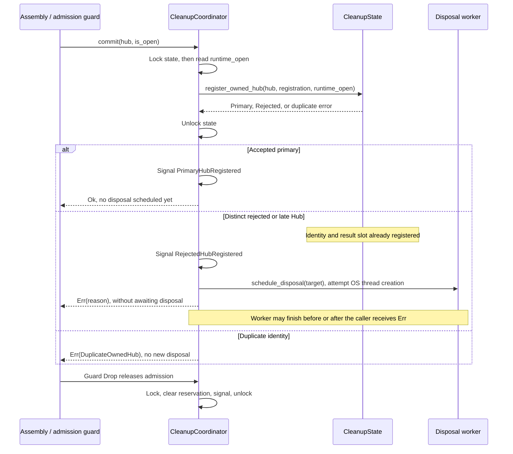
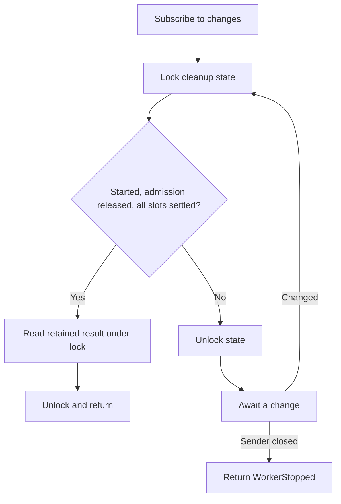

# BLeng cleanup ownership, locking, and completion

English | [简体中文](bleng-cleanup-design-2026-10-07.zh-CN.md)

Both language versions describe the same implementation. Keep them aligned when
ownership, locking, completion, or failure policy changes.

## Status and scope

This is a design record of the current implementation in
[`crates/bleng/src/cleanup.rs`](../../crates/bleng/src/cleanup.rs), not a new
architecture proposal or a stronger native BLE shutdown guarantee.

The cleanup module owns **Hub admission, cleanup ownership, disposal scheduling,
and retained disposal results**. It does not own BLE command reservations,
connection state, subscriptions, or actor shutdown. Those remain in the runtime;
caller-facing operation delivery is described separately in the
[waiter design](bleng-waiter-design-2026-10-06.md).

## Design mnemonic: a five-step loop

> **Register under lock → schedule outside lock → execute in the background →
> account under lock → complete from state.**

1. **Register under lock:** establish identity, acquire ownership, and allocate
   the result slot before cleanup responsibility can be overlooked.
2. **Schedule outside lock:** release the state lock before arranging a worker;
   thread creation is not a shared-state decision.
3. **Execute in the background:** native dispose and root destruction can block,
   reenter, or panic; do not perform them while holding the state lock.
4. **Account under lock:** store success or failure in the right slot, then wake
   waiters. Background execution must not mean untracked responsibility.
5. **Complete from state:** acquire the lock and check the full terminal
   condition; observing a notification never proves completion by itself.

Three supporting rules make the boundary memorable:

> **Locks protect state, not the whole job. Notifications prompt a check, not a
> conclusion. Execution may detach; responsibility must not disappear.**

This is a useful design practice for shared lifecycle state plus background
blocking cleanup, not the uniquely best solution for every concurrency problem.
It shortens critical sections, isolates reentrancy, and connects detached work to
observable result accounting. It does not guarantee contention-free locking,
interruptible native calls, or successful cleanup.

All implementation claims below are grounded in the linked local source.
The failure policies are BLeng choices, not platform guarantees.

## 1. Responsibilities and ownership

| Structure | Responsibility | Lifetime/ownership |
|---|---|---|
| `HubCleanup` | Admission entry points, primary dispatch access, cleanup start, completion wait | Facade over a shared coordinator; `Drop` starts cleanup but cannot await it |
| `AssemblyAdmission` | RAII reservation covering foreign assembly through commit/rollback | Retains the coordinator; `Drop` releases the reservation |
| `CleanupCoordinator` | Mutex, notifications, background scheduling, result publication | Shared by the facade, admission guard, and workers; independent of the Tokio runtime |
| `CleanupState` | Registration decisions, dispatch gate, cleanup accounting and result selection | Accessed under the coordinator's `std::sync::Mutex` |
| `PrimaryRegistration` | The only dispatchable Hub, its identity and disposal result | Strong Hub root is moved out when cleanup starts; identity/result remain |
| `RejectedHub` | Identity and disposal result for a distinct rejected/late Hub | Never dispatchable; stored in an append-only vector |
| `DisposalTarget` | Pair one owned Hub with its result slot | Moves from registration/start to a disposal worker |
| `DisposalSlot` | Select primary result or one rejected result | `Primary` or `Rejected(index)`; rejected entries are not removed/reused |
| `CleanupSignal` | Wakeup reason and trace diagnostic | A `watch` value, not a reliable sequence of events |

### Primary and rejected Hubs are not peers

One BLeng instance has one primary backend slot. Keeping rejected Hubs for cleanup
is not multi-backend support and does not permit replacement of the primary.

- An accepted primary is retained for dispatch. Its disposal is scheduled by
  `start_cleanup()`, not immediately at registration.
- A distinct rejected/late Hub must still be disposed. Its identity and result
  slot are registered first; the coordinator then schedules disposal immediately.
- A duplicate identity is an alias of an already registered Hub. It creates no
  new slot and schedules no second disposal. The existing registration retains
  the cleanup duty; disposing the alias could close a live primary.

`Weak<BleHub>` preserves allocation identity after the strong root moves to a
worker. It does not keep the Hub value alive. This allows duplicate checks to
remain valid after cleanup starts without retaining an extra strong Hub root.

## 2. Locking rules

The lock discussed here is exclusively `CleanupCoordinator.state`. The native
backend and canonical `BleHub` may use their own synchronization internally.

| Operation | Under the cleanup state lock | After releasing the lock |
|---|---|---|
| `begin_admission()` | Read runtime-open predicate; validate and reserve admission | Notify on acceptance; return guard |
| `register_owned_hub()` | Read predicate; check identity; register primary or rejected slot | Match outcome; notify; schedule rejected target; return acceptance/rejection |
| `start_cleanup()` | Mark started once; take the primary disposal target | Notify on first start; schedule primary if present |
| `hub_for_dispatch()` | Check cleanup gate; clone the primary root if dispatchable | Use the returned root through runtime command handling |
| `release_admission()` | Clear reservation; notify | Return from guard destruction |
| `record_disposal_result()` | Store result by slot; notify | Return from worker/failure handler |
| `wait_for_completion()` | Check all completion conditions; read retained result if settled | Return result, or await a change and recheck |

Foreign assembly, thread creation, native disposal, worker execution, and async
waiting occur **without** the cleanup state lock. The module never joins its
workers. Small synchronous notification calls can occur under the lock; they
wake waiters rather than invoking backend code or waiting for disposal.

A standard mutex is appropriate for these short synchronous state operations.
It does not make lock acquisition nonblocking: another thread can briefly hold
it. The important property is that the protected section does not perform native
work or suspend across `.await`.

There is also a cross-lock constraint: `record_disposal_result()` and
`release_admission()` publish while holding state, so their actual order is
**state Mutex → watch write lock**. A `watch::Receiver::wait_for` predicate must
not acquire the ledger mutex: Tokio invokes that predicate under the watch read
lock, producing the inverse order and a possible deadlock. The completion wait
below deliberately keeps its explicit loop.

### Why `is_open` is a closure outside, but a bool inside

The runtime's `RuntimePhase::Open` means the runtime still accepts work. It does
not mean Bluetooth is powered on, a connection exists, or the backend slot is
free. See [`runtime/lifecycle.rs`](../../crates/bleng/src/runtime/lifecycle.rs).

The outer APIs receive `is_open: impl FnOnce() -> bool` so they can acquire the
cleanup lock **before** reading runtime state. Passing an already evaluated bool
from the external caller would carry a pre-lock snapshot through lock contention.

After locking, the coordinator/facade evaluates the predicate and passes
`runtime_open: bool` into `CleanupState`. State methods do not call back out to
read runtime state. The production predicate is a small atomic phase read; it
must not reenter cleanup or perform foreign/blocking work while the lock is held.

This timing avoids a pre-lock snapshot, but is not an atomic transaction spanning
the runtime atomic and cleanup mutex. Runtime phase can still change after the
read. Cleanup's locked ownership transitions ensure that a Hub already registered
as primary is subsequently taken for cleanup, or a late commit is registered as
rejected and scheduled for cleanup. A successful commit does not promise that
the runtime will remain open afterward.

## 3. Assembly, registration, and immediate rejected cleanup

The caller path is implemented by
[`BackendPort::assemble_backend()`](../../crates/bleng/src/runtime/backend_port.rs):
reserve admission, perform foreign assembly without the cleanup lock, then commit
the resulting canonical Hub. Admission remains held until the commit path has
registered ownership and attempted any required rejected disposal scheduling.

`BackendPort` combines the former assembly port and event bridge because both
need only the actor handle and shared lifecycle controller. Assembly passes a
clone of the same `Arc<BackendPort>` to the Hub as `Arc<dyn BleEventSink>`; no
second bridge object is constructed. Backend callbacks receive only the sink
interface. The port never retains `RuntimeOwner`.
[`runtime/messages.rs`](../../crates/bleng/src/runtime/messages.rs) unifies the
mailbox protocol; BackendPort imports `IngressEvent` directly from it. Its two
ingress/dispatch-result handlers only forward to the actor's restricted processing
entries, while Begin handlers retain explicit admission through actor methods.
State coordination remains encapsulated in
[`runtime/actor.rs`](../../crates/bleng/src/runtime/actor.rs), with private fields
and helpers; admission and disposal accounting remain in cleanup. This source
organization changes neither the public ABI nor processing order.



`register_rejected_hub()` is called by `CleanupState::register_owned_hub()`.
It returns `Rejected { disposal, reason }`; it does not call upward into the
coordinator or create a thread. The coordinator matches that returned outcome
**after unlocking** and calls `schedule_disposal()`.

A normal admission attempt is rejected before foreign assembly if the slot is
already occupied. The distinct rejected/late registration path still matters
when cleanup starts during an already admitted assembly. Tests also use a direct
registration bypass to isolate duplicate and secondary-Hub accounting behavior;
that bypass is not a production multi-Hub API.

The registration outcome is not just a caller-facing error:

- `disposal` transfers a Hub and its result slot to cleanup scheduling.
- `reason` is returned to the assembly caller (`Closed` or `AdditionalHubRejected`).

A duplicate is the separate `Err` path because this call did not acquire a new
cleanup obligation. This is why replacing the entire outcome with a plain error
would lose important ownership information.

## 4. Cleanup start and the shared worker path

`start_cleanup()` is idempotent. Under the lock it marks cleanup started and takes
the primary Hub root, if present. The primary registration's identity and result
remain in state. The root is scheduled only after unlocking.

Rejected Hubs use the same worker path but are scheduled at registration, even
before explicit cleanup starts. Scheduling is fire-and-forget from the caller's
perspective; completion and errors are still accounted for in state.

```text
primary:  start_cleanup() -> [lock] mark started, take target -> [unlock] --+
                                                                         |
rejected: commit() -> [lock] register identity + result slot -> [unlock] --+
                                                                         v
                                                    schedule_disposal(target)
                                                      no cleanup state lock
                                                                         |
                                                                         v
                                                   independent OS thread
                                                   dispose_owned_hub(hub)
                                                      no cleanup state lock
                                                                         |
                                                                         v
                                               record_disposal_result(slot, result)
                                               [lock] store result; signal [unlock]
```

Disposal uses `std::thread`, not the owner runtime's blocking pool. A cancelled
assembly waiter does not necessarily interrupt foreign assembly; a late Hub can
arrive after `RuntimeOwner::Drop` has shut down the Tokio runtime. The cleanup
coordinator and admission guard must still be able to dispose that Hub.

The worker only needs an owned Hub and the shared coordinator. It executes
synchronous native disposal and publishes through `Mutex`/`watch`; it does not
need a Tokio runtime context. A backend must not assume its synchronous `dispose`
is invoked on a Tokio worker or on the UI thread.

### Independent threads versus the Tokio blocking pool

A second rule summarizes executor selection:

> **Workload determines pooling; lifetime determines dependencies. Cleanup that
> may arrive after a runtime cannot rely solely on that runtime for scheduling.**

| Concern | Tokio `spawn_blocking` | Current independent OS thread |
|---|---|---|
| Scheduling dependency | The runtime's blocking pool must still accept and execute work | Independent of the owner runtime, but OS thread creation must succeed |
| Workload and cost | Pool reuse suits short-lived, bounded blocking work while the runtime is available | One thread per disposal suits current low-volume lifecycle work, not high-volume jobs |
| Runtime shutdown | Started blocking tasks are not forcibly interrupted; ordinary shutdown may wait, and background shutdown does not prove completion | Scheduling/execution are not tied to the owner runtime; a late Hub can still be handled after shutdown |
| Blocked native calls | Cannot forcibly interrupt started native blocking work | Cannot forcibly interrupt it either |
| Completion | Obtaining a task handle does not prove resource release | Successful thread creation does not prove successful disposal; slots remain authoritative |

This does not mean `spawn_blocking` is inferior or that runtime shutdown cancels
all running blocking tasks. **The deciding requirement is the ability to
schedule new cleanup for a late Hub after the owner runtime has shut down.**

Independent threads prioritize that lifecycle requirement, at the cost of
per-disposal thread creation and failure handling. If cleanup becomes frequent
or highly concurrent, reassess a shared cleanup facility independent of the
owner runtime rather than keeping one thread per Hub unconditionally.

Threads do not outlive process termination, and native disposal is not forced to
finish within a deadline by this module.

## 5. Why admission must survive an overlapping close

Admission reservation and cleanup-started are independent facts, not mutually
exclusive phases. The significant race is:

1. Assembly reserves admission and enters synchronous foreign code.
2. Close starts cleanup while no primary Hub exists yet.
3. Cleanup cannot report completion because admission is still reserved.
4. Foreign assembly returns a Hub. Commit sees cleanup started, records a
   rejected/late slot, and schedules disposal after releasing the lock.
5. The admission guard drops and releases the reservation.
6. Completion remains pending until the late Hub's result slot settles.

If foreign assembly fails without producing a Hub for commit, its canonical
construction/rollback path owns the corresponding native rollback; the guard
still releases admission. Cleanup does not invent a disposal slot for a Hub it
never registered. See
[`BleHub` construction/disposal](../../crates/blehub/src/hub.rs) and the
[canonical assembly implementation](../../crates/blehub/src/assembly.rs).

The reservation prevents close from returning between steps 2 and 4. Holding
the cleanup mutex through foreign assembly is not necessary and would instead
introduce blocking/reentrancy hazards.

## 6. Notifications, completion, and retained results

`notify` in the source diagrams means `signal(CleanupSignal::...)`, implemented
with `watch::Sender::send_replace()`. It does not notify the backend, start native
disposal, or assert that cleanup is complete.

For example, `RejectedHubRegistered` means a new cleanup slot exists, whereas
`DisposalCompleted` means a result was recorded. A slot can settle with an error;
"completed" is not synonymous with "resources successfully released."

`watch` can coalesce changes. Signals are diagnostic wakeups, so waiters never
require a particular signal or a complete signal history to progress.



Subscribing before checking state avoids missing a change between the check and
the subsequent await. The mutex guard is released before waiting; notifications
sent while the waiter checks or is about to await remain observable through the
receiver's change tracking. Cancelling one waiter drops only its receiver, not
admission, a running disposal worker, or the retained result.

**Keep `wait_for_completion()` as subscribe → check the Mutex ledger → unlock →
`changed().await` → recheck.** `CleanupSignal` carries wakeups, not the terminal
result. Replacing this with `watch.wait_for(predicate_that_locks_the_ledger)`
would invert the producer lock order verified in
[`cleanup.rs`](../../crates/bleng/src/cleanup.rs):

```text
producer: record_disposal_result / release_admission
  holds state Mutex -> send_replace waits for watch write lock
hypothetical wait_for predicate:
  holds watch read lock -> waits for state Mutex
=> deadlock when both overlap
```

The locally cached `tokio-1.53.1/src/sync/watch.rs` confirms that `wait_for`
executes the predicate while holding the watch value's read lock. The source
now comments this constraint. In contrast, owner close can use
`shutdown_result_rx.wait_for(Option::is_some)` because its predicate inspects
only the channel value, not this external ledger.

The terminal conjunction is:

```text
started
AND NOT admission_reserved
AND (no primary OR primary.result is present)
AND every rejected_hub.result is present
```

Results remain available for later waits. Error precedence is the primary Hub's
error, then the first rejected-Hub error in registration order, otherwise `Ok`.
There is no permanent cached "finished" flag in `CleanupState`: if an internal
late registration occurs after a previous successful wait, a later wait checks
the new slot. Normal production admission cannot begin after cleanup starts;
this late-registration behavior is also exercised by the test bypass.

## 7. Failure policy and its limits

### Thread creation fails

`DisposalTarget::into_worker()` wraps the owned Hub root in `ManuallyDrop`.
Only executing the returned closure unwraps it. If thread creation fails, Rust
drops the unstarted closure without dropping the protected Hub root.

This deliberately leaks that root. The scheduling caller records
`CleanupError::WorkerStopped` in the already registered slot and wakes waiters.
The policy favors a reported cleanup failure over unexpectedly running blocking
`BleHub::drop()`/`dispose()` on the calling thread. It does not guarantee resource
release or silently count the slot as successful.

Keeping an ordinary extra `Arc` only until `spawn` returns would not be enough:
a fast worker could finish first, leaving the caller to perform the final root
destruction. The `ManuallyDrop` handoff puts ownership of this particular root's
dispose/drop sequence entirely in the executing worker. Other external Hub aliases
are not controlled by this module.

### Native disposal or destruction fails

`dispose_owned_hub()` separates synchronous disposal from dropping its root:

- An ordinary backend error becomes `CleanupError::Backend`.
- An unwinding panic from `hub.dispose()` becomes `WorkerStopped`; the Hub root
  is forgotten because retrying its `Drop` could wait forever on a lifecycle left
  in `Closing`.
- An unwinding panic while dropping the root after disposal becomes
  `WorkerStopped`, allowing the worker to record a failure instead of abandoning
  its result slot.

`catch_unwind` does not catch process aborts, terminate a blocked native function,
or impose a timeout. A permanently blocked disposal or foreign assembly can keep
completion pending. A caller can stop waiting, but that is not cancellation of
native cleanup. Process shutdown and allocation failure that aborts the process
are outside the recoverable result protocol.

## 8. Runtime integration and evidence

### Private runtime and caller runtime

Each `Bleng::new()` creates one private `RuntimeOwner`, whose constructor builds
`Builder::new_multi_thread().enable_time().build()`. The owner retains that
runtime, the actor, and the event receiver. This is one runtime per BLeng
instance, not per operation, not process-global, and not borrowed from the caller.
The low-level `BleHub` still owns no runtime.

[`api.rs`](../../crates/bleng/src/api.rs) uses `spawn_on_runtime()` to submit
operation futures through the owner's explicit `Handle`. Declaring an API
`async` alone would not select that runtime: the owner needs its own executor
context to create and drive timeout/deadline timers. Swift/Kotlin callers need
not supply Tokio; a Rust caller may already have its own Tokio runtime.

```text
caller executor (Tokio or foreign async integration)
  polls the facade future and awaits AbortOnDropHandle wrapping its JoinHandle
                         |
                         | explicit owner.handle().spawn(operation)
                         v
BLeng private Tokio runtime
  drives operation futures, timers, and actor orchestration
                         |
                         +-- result wakes the caller's waiter
```

Two Tokio runtimes can coexist here. The caller polls the facade/JoinHandle while
the operation is scheduled on BLeng's runtime. This path does not call `block_on`
inside the caller's async task, replace the caller's runtime, or require its
timers to be enabled. It creates a Tokio task, not a new OS thread per API call.
The actor, rather than this task boundary, serializes operation state changes.

The boundary still has costs and limits:

- Each BLeng instance adds a runtime worker pool and task handoffs. Reusing an
  instance avoids repeatedly paying that setup cost; independence is not free.
- Do not introduce nested blocking `block_on` calls or synchronous cross-runtime
  waits. A custom backend waiting on caller-runtime work can deadlock if that
  caller is itself blocked awaiting the backend. Normal async waiting is the
  intended integration.
- This is not a guarantee that arbitrary timer/socket futures bound to one
  runtime can be moved to another. BLeng's private wrapper accepts its own
  operation futures, not a public executor-injection API. A custom backend owns
  any executor-bound resources and their lifetimes.
- `shutdown()` awaits logical actor/Hub cleanup; the runtime object remains
  owned until the last `Arc<RuntimeOwner>` is released. Its `Drop` uses
  `shutdown_background()`, avoiding blocking runtime destruction in an async
  caller. This does not make detached native cleanup instantly complete.
- Each spawned facade operation retains an owner clone. The former local
  `AbortOnDrop` type is removed; `spawn_on_runtime()` now awaits
  `tokio_util::task::AbortOnDropHandle::new(private_handle.spawn(future))`.
  Releasing the outer future requests abort of this local facade task, because
  dropping a bare JoinHandle would detach it. It neither guarantees immediate
  task/capture destruction nor cancels dispatched native BLE work, a started
  blocking task, or a synchronous foreign call already executing.

The API regression
[`private_runtime_timers_work_with_timerless_caller_runtimes`](../../crates/bleng/src/tests/api_tests.rs)
checks current-thread and multithreaded caller runtimes without timers. BLeng's
`next_event()` still times out, shutdown succeeds, dropping BLeng inside the
async caller does not panic, and that caller can still run a task afterward.
This is deterministic Rust coexistence evidence, not an additional Swift/Kotlin
or platform RF gate.

The new API regression
[`dropping_facade_waiter_aborts_private_task_and_releases_its_capture`](../../crates/bleng/src/tests/api_tests.rs)
is reported passing: after observing private-task entry, it drops the facade
future and waits within a bounded test window for capture release. This is not
an immediate-destruction or native-cancellation guarantee. Exact dependency pins,
minimal features, offline lock resolution, and the local cached `Future`/`Drop`
audit are recorded in the [waiter reuse table](bleng-waiter-design-2026-10-06.md#simplification-and-ecosystem-assessment).

### Logical shutdown and cleanup integration

[`RuntimeOwner::new()`](../../crates/bleng/src/runtime/owner.rs) constructs a Kameo
`PreparedActor`, clones its `ActorRef`, and spawns it on the private runtime.
The returned actor-task `JoinHandle` is retained by one inline shutdown task in
`new()`'s `runtime.handle().spawn` block. That block clones `actor`, `lifecycle`,
and `shutdown_result_tx` without retaining `RuntimeOwner`. There is no first-close
atomic or pair of shutdown watchers, and no close caller owns the shutdown future.

```text
inline shutdown task in new: select actor task completion / lifecycle leaves Open
  lifecycle branch -> start_cleanup -> stop_gracefully -> join actual actor task
  consume task outcome -> explicitly drop returned actor on success
  -> start_cleanup -> wait_for_cleanup -> publish shared shutdown result
close -> subscribe -> close runtime gate + start_cleanup
  -> shutdown_result_rx.wait_for(Option::is_some) -> clone retained result
```

The coordinator consumes an actor task even if it unexpectedly completes while
the lifecycle is Open. Dropping the returned `BlengActor` then faults the lifecycle
and retires remaining waiters rather than leaving a live gate with no actor.
On task-join or Kameo lifecycle error, it faults lifecycle, waits for cleanup,
and only then publishes `CleanupError::WorkerStopped`. Successful actor-task
teardown returns the cleanup result itself: runtime `Faulted` does not by itself
mean disposal failed or force close to return `WorkerStopped`.

Mailbox closure is an earlier boundary, not actor teardown. Verified against the
locally locked Kameo 0.22.2 source: `kameo-0.22.2/src/actor/actor_ref.rs`
implements `ActorRef::wait_for_shutdown()` as `mailbox_sender.closed().await`;
`kameo-0.22.2/src/actor/spawn.rs` runs shutdown hooks and unregisters the actor
before returning it by value through `PreparedActor::spawn()`'s task handle.
Joining that task is therefore necessary, but the returned actor must also be
explicitly dropped to release its state and run BLeng's Drop policy before
cleanup waiting and shared-result publication.

[`RuntimeOwner::close()`](../../crates/bleng/src/runtime/owner.rs) subscribes to the
shared result, closes the runtime gate, starts cleanup, and awaits the same
retained outcome through `shutdown_result_rx.wait_for(Option::is_some)`, replacing
the manual watch loop. The returned result is cloned; channel closure errors map
to `CleanupError::WorkerStopped`. This predicate checks only the channel's
`Option`, with no external ledger lock; it is not a template for cleanup's
`wait_for_completion()` loop. Cancelling a close wait does not cancel the
coordinator; repeated close can still observe cleanup errors. Cleanup's completion
wait alone does not wait for actor teardown or individual BLE operations, and
native disposal may already be running while the actor stops.
`RuntimeOwner::Drop` remains a non-awaiting fallback: close the gate, start cleanup,
`actor.kill()`, then `runtime.shutdown_background()`. Independent cleanup threads
remain executor-independent and may outlive that runtime; Drop does not promise
observable completion. Explicit async close is the completion/error boundary.

[`RuntimeLifecycle`](../../crates/bleng/src/runtime/lifecycle.rs) is the shared
lifecycle controller, not merely a status snapshot. It owns the phase gate,
phase-change notification, and one private `HubCleanup`. Its `fault()` starts
cleanup directly even when the actor or mailbox is unavailable. Ingress, actor,
assembly, and detached dispatch paths retain the same controller rather than
separate cleanup owners. `is_open()` queries its existing atomic phase; the
snapshot neither reserves admission nor prevents concurrent close/fault. Paths
that distinguish `Faulted` from `Closed` still use phase.

Runtime callers use the lifecycle controller's admission, dispatch-Hub lookup,
cleanup start, and `wait_for_cleanup()` operations; no cleanup `Arc` getter is
exposed. `with_admission()` binds the Open-phase policy itself rather than
accepting a caller-supplied predicate. It passes that check as a closure so
cleanup evaluates the phase after acquiring its lock. The other production
cleanup operations are direct delegates. Assembly commit still rechecks the
phase because foreign work may overlap a close or fault after admission.
The shutdown coordinator retains the lifecycle controller while awaiting cleanup.
`phase_tx` wakes operation/event readers when work must stop, whereas the
cleanup module's notifier wakes disposal-completion waiters. A closed runtime
gate does not mean native cleanup has finished. Disposal scheduling and result
accounting remain responsibilities of `HubCleanup`. `CancellationToken` cannot
replace the error-bearing `Closed` / `Faulted` phases or retained success/error
results, and cannot schedule late disposal after runtime shutdown. Independent
OS cleanup workers are retained, not moved to the owner's Tokio runtime.

Operation-local state remains actor-confined. `WaiterRegistry` stays on the
actor so admission and settlement are serialized without another lock; it is
not part of shared `RuntimeLifecycle`. The actor's `event_tx` publishes BLE
events to the owner's FIFO for `next_event()`, independently of lifecycle phase
notifications and per-command oneshot results. Initialization is represented by
one `InitializationState` (`NotStarted`, `Pending`, `Ready`, `Rejected`):
timeout/cancellation retains Pending for late callbacks, and success releases
completed evidence only after waiter settlement. Dispatch rejection releases
pending evidence and retains only its command ID in Rejected. Clean rejection
starts cleanup without faulting; a later correlated callback faults before public
publication instead of being buffered as if dispatch were unresolved. These boundaries are detailed in the
[waiter design](bleng-waiter-design-2026-10-06.md).

Operation durations in owner are named `timeout`. Its private
`run_operation(timeout, make_message)` performs Hub preflight and creates one absolute
deadline. `make_message: FnOnce(BeginHandoff) -> M` is a synchronous message factory,
not an ask future: owner invokes it, snapshots lightweight `M::Correlation` IDs
through `message.correlation()` before Kameo consumes the message, and centrally
performs `actor.ask(message)` under `timeout_at(deadline, ...)`. Ticket
`wait_until(deadline)` uses that same deadline. After a successful wait, owner
calls `M::decode_success(correlation, reply.resource, success)`; errors skip
success decoding. All 11 `Begin*` types implement the private
[`OperationResult`](../../crates/bleng/src/runtime/messages.rs) interface with
`Resource`, `Output`, `Correlation`, `correlation(&self)`, and `decode_success`.
The existing variant and ID checks are preserved. A mismatch returns `None`;
owner faults the lifecycle and returns `TransportFault`, while decoding itself
has no lifecycle dependency.

This replaces per-call result-mapping closures, including in test fixtures,
which implement the same interface. It clones neither message nor payload,
adds no boxing or execution layer, and leaves `WaiterSuccess` a data enum.
`From` cannot express this fallible decoding with expected IDs supplied by the
request and reply. See the [operation flow](bleng-waiter-design-2026-10-06.md#end-to-end-flow)
for the per-operation checks. Begin protection uses `scopeguard::guard`, not
the superseded custom guard/armed bool: its closure captures only lifecycle,
abandons the atomic token, and faults on a prior claim. Timeout explicitly drops
the guard before phase/error classification; receiving `BeginReply` uses
`drop(ScopeGuard::into_inner(handoff))` to release lifecycle/token before evidence
waiting. `WaiterTicket` retains domain-specific retirement, not a generic guard.
These caller deadlines neither bound native disposal nor replace the shutdown
coordinator. The cleanup module does not turn a runtime fault into a successful
BLE command or promise cancellation of already dispatched work.

Local regression evidence is in
[`cleanup_tests.rs`](../../crates/bleng/src/tests/cleanup_tests.rs) and the
[runtime assembly tests](../../crates/bleng/src/runtime/tests/assembly.rs):

- Rejected registration before primary acceptance keeps result slots independent.
- Duplicate identity does not dispose a live primary backend.
- Blocking disposal does not block cleanup start or the async runtime.
- Secondary/late disposal errors remain observable across repeated waits.
- Attach racing close and cancelled waiters preserve cleanup accounting.
- Discarding an unstarted worker preserves the Hub root rather than disposing
  inline; recording failure then settles repeated completion waits.
- Runtime assembly/close tests cover admission retained across foreign work.
- [`runtime/tests/lifecycle.rs`](../../crates/bleng/src/runtime/tests/lifecycle.rs)
  adds `close_waits_for_actor_teardown_after_mailbox_closes`: it blocks Kameo
  unregister, observes mailbox closure and completed cleanup, and verifies close
  stays pending until actual actor teardown can finish.
- The same file's
  `waiter_deadline_retirement_mailbox_overflow_reports_transport_fault_in_both_paths`
  verifies full-mailbox waiter retirement returns `TransportFault` for both
  preexpired and timer deadlines; its faulted runtime can still close successfully
  after actor release because disposal itself did not fail.

The unstarted-worker regression drops the real worker closure deliberately; it
does not exhaust OS thread resources or force a real `Builder::spawn` failure.
Current refactor validation reports both new lifecycle regressions passing and
115 runtime actor tests passing; the new facade-drop API regression is also
reported passing. Full main validation of the current candidate remains pending.
These are reported implementation results, not tests rerun by this docs-only
update, and claim neither fresh platform RF evidence nor ABI freeze.
