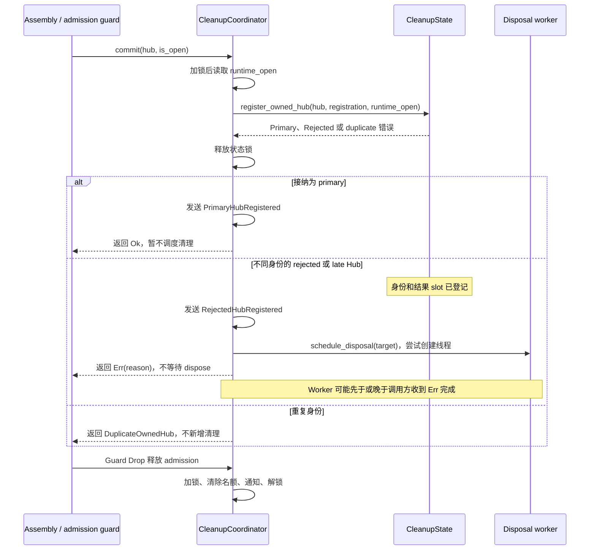
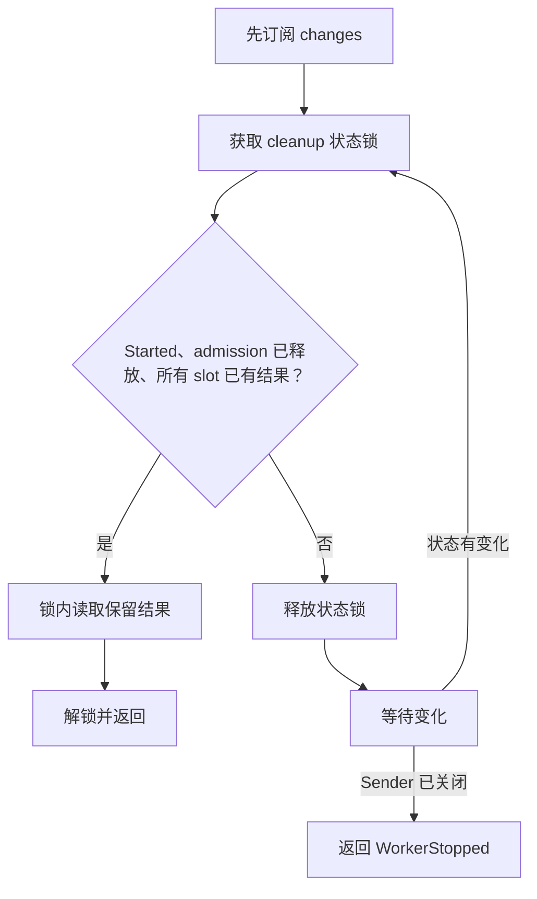

# BLeng cleanup：所有权、锁与完成语义

[English](bleng-cleanup-design-2026-10-07.md) | 简体中文

中英文版本描述同一份实现。后续调整所有权、锁、完成条件或异常策略时，应同步更新两个版本。

## 状态与范围

本文记录 [`crates/bleng/src/cleanup.rs`](../../crates/bleng/src/cleanup.rs) 当前实现的设计，不提出新的架构方案，也不赋予原生 BLE 关闭操作比平台实际能力更强的保证。

cleanup 模块负责 **Hub 的接纳、清理所有权、dispose 调度和清理结果保存**。它不负责 BLE 命令的 reservation、连接状态、订阅状态或 actor 关闭；这些仍属于 runtime。面向调用方的操作结果交付另见 [waiter 设计](bleng-waiter-design-2026-10-06.md)。

## 设计口诀：五步闭环

> **锁内登记 → 锁外调度 → 后台执行 → 锁内记账 → 按状态完成。**

1. **锁内登记**：先确定身份、接管所有权、建立结果 slot，保证清理责任有据可查。
2. **锁外调度**：释放状态锁后再安排 worker；创建线程不属于共享状态决策。
3. **后台执行**：原生 dispose 和根引用释放可能阻塞、重入或 panic，不占着状态锁执行。
4. **锁内记账**：成功和失败都要写回对应 slot，然后通知等待方；后台执行不等于无人负责。
5. **按状态完成**：等待方拿锁检查完整完成条件，不能因为收到某条通知就宣告完成。

再记三句边界：

> **锁保护状态，不包办工作；通知只催检查，不证明完成；执行可以分离，责任不能丢失。**

这是一种适用于“共享生命周期状态 + 后台阻塞清理”的设计实践，不是所有并发问题唯一的最佳方案。它的价值在于缩短临界区、隔离重入风险，并把异步执行与可观察的结果记账连起来；不保证无锁等待、原生调用可中断或清理必定成功。

下文的实现结论以链接的本地源码为依据。异常处理策略属于 BLeng 的设计选择，不是操作系统或 BLE 平台的保证。

## 1. 核心结构与所有权

| 结构 | 职责 | 生命周期与所有权 |
|---|---|---|
| `HubCleanup` | 提供 admission 入口、primary dispatch 访问、清理启动和完成等待 | 持有共享 coordinator；`Drop` 启动清理，但不能异步等待 |
| `AssemblyAdmission` | 用 RAII 保留从 foreign assembly 到提交或回滚的接纳名额 | 持有 coordinator；`Drop` 释放名额 |
| `CleanupCoordinator` | 管理互斥锁、通知、后台调度和结果发布 | 由 facade、admission guard 和 worker 共享；不依赖 Tokio runtime 存活 |
| `CleanupState` | 做注册决策，控制 dispatch gate，记录清理状态并选择最终结果 | 受 coordinator 的 `std::sync::Mutex` 保护 |
| `PrimaryRegistration` | 保存唯一可用于 dispatch 的 Hub、身份和清理结果 | 清理开始时移出 Hub 强引用，身份和结果仍保留 |
| `RejectedHub` | 保存一个不同的 rejected/late Hub 的身份和清理结果 | 永远不可 dispatch；保存在只追加的 vector 中 |
| `DisposalTarget` | 把一份待清理 Hub 和它的结果 slot 绑定起来 | 从注册或清理启动路径移交给 worker |
| `DisposalSlot` | 定位 primary 或某个 rejected 的清理结果 | `Primary` 或 `Rejected(index)`；rejected 项不删除、不复用 |
| `CleanupSignal` | 唤醒等待方，并提供 trace 诊断信息 | 是 `watch` 的当前值，不是保证逐条交付的事件队列 |

### Primary 与 rejected 并不对等

一个 BLeng 实例只有一个 primary backend slot。保存 rejected Hub 是为了履行清理责任，不代表支持多个 backend，也不代表允许替换 primary。

- **被接纳的 primary**：保留供正常 dispatch 使用；到 `start_cleanup()` 时才调度 dispose，不在注册时立即清理。
- **不同身份的 rejected/late Hub**：仍然必须 dispose。先登记身份和结果 slot，再由 coordinator 立即调度清理。
- **重复身份**：只是已经登记过的 Hub 的另一个引用，不分配新 slot，也不重复调度 dispose。原登记继续承担清理责任，否则可能误关正在使用的 primary。

`Weak<BleHub>` 用于在强引用移交给 worker 后继续识别同一份分配，不会使 Hub 值本身继续存活。这样，清理开始后仍能做 duplicate 检查，而不必为了身份检查额外保留强引用。

## 2. 锁的使用规则

本文所说的锁专指 `CleanupCoordinator.state`。原生 backend 和 canonical `BleHub` 内部可能还有自己的同步机制，不应与这把锁混为一谈。

| 操作 | cleanup 锁内做什么 | 解锁后做什么 |
|---|---|---|
| `begin_admission()` | 读取 runtime-open 条件；检查并保留 admission 名额 | 接纳成功时发通知，返回 guard |
| `register_owned_hub()` | 读取条件；检查身份；登记 primary 或 rejected slot | 匹配返回结果，发通知，调度 rejected 清理，返回接纳或拒绝 |
| `start_cleanup()` | 首次标记 started；取出 primary 的待清理对象 | 首次启动时发通知，有 primary 时调度清理 |
| `hub_for_dispatch()` | 检查 cleanup gate，允许时克隆 primary 根引用 | runtime 使用返回的引用处理命令 |
| `release_admission()` | 清除 reservation 并发通知 | 结束 guard 析构 |
| `record_disposal_result()` | 按 slot 写入结果并发通知 | 结束 worker 或失败处理 |
| `wait_for_completion()` | 检查所有完成条件；满足时读取保留结果 | 返回结果，或等待变化后重新检查 |

**foreign assembly、创建线程、原生 dispose、worker 的清理工作以及异步等待，都不持 cleanup 状态锁。** 模块不会通过 `join()` 等待 worker。少量同步通知可以在锁内发送；它们只是唤醒等待方，不会调用 backend，也不会等待 dispose。

这里使用标准互斥锁，是因为临界区只做短小、同步的状态操作。它不代表“获取锁绝不阻塞”：其他线程持锁时，调用方仍可能短暂等待。真正重要的约束是：**锁内不执行原生耗时工作，不跨 `.await` 持锁。**

### 为什么外层传闭包，内层传 bool

runtime 的 `RuntimePhase::Open` 表示 runtime 仍接受工作，不表示蓝牙已开启、连接已建立，也不表示 backend slot 空闲。定义见 [`runtime/lifecycle.rs`](../../crates/bleng/src/runtime/lifecycle.rs)。

外层接收 `is_open: impl FnOnce() -> bool`，是为了先获得 cleanup 锁，再读取 runtime 状态。如果外部调用方提前计算并传入 bool，这个快照可能在等待锁期间过期。

拿锁之后，coordinator 或 facade 调用一次闭包，把得到的 `runtime_open: bool` 传给 `CleanupState`。状态层只做决策，不再回调外部读取状态。生产路径的闭包只是一次轻量的原子状态读取；它不应在持锁期间重入 cleanup 或执行 foreign、阻塞工作。

这避免了使用拿锁前的快照，但**并没有把 runtime 的原子变量和 cleanup 的 mutex 变成同一个原子事务**。读取后 runtime 仍可能改变。cleanup 通过锁内所有权转换保证：已经登记为 primary 的 Hub 随后会被清理路径取走；晚到的 commit 则登记为 rejected 并调度清理。commit 成功不保证 runtime 此后一直保持开放。

## 3. Assembly、注册与 rejected 的立即清理

调用路径见 [`BackendPort::assemble_backend()`](../../crates/bleng/src/runtime/backend_port.rs)：先保留 admission 名额，再在不持 cleanup 锁的情况下执行 foreign assembly，最后提交得到的 canonical Hub。

直到 commit 完成所有权登记，并尝试调度必要的 rejected 清理之后，admission guard 才释放名额。

`BackendPort` 合并了原来的 assembly port 和 event bridge，因为它们都只需要 actor handle 与共享 lifecycle。assembly 将同一个 `Arc<BackendPort>` 的克隆作为 `Arc<dyn BleEventSink>` 交给 Hub，不再构造第二个 bridge 对象。backend 回调只获得 sink 接口。端口不持有 `RuntimeOwner`；事件协调仍归 `runtime/events.rs`，admission 与 disposal 记账仍归 cleanup。



准确的调用关系是：

```text
CleanupCoordinator::register_owned_hub()
  持锁调用 CleanupState::register_owned_hub()
    拒绝分支调用 register_rejected_hub()
      登记身份和结果 slot
      返回 Rejected { disposal, reason }
  释放锁
  匹配返回的 outcome
    Primary  -> 保留正常使用，暂不调度
    Rejected -> schedule_disposal(disposal)，然后返回 Err(reason)
    duplicate 错误 -> 不新增 slot，不重复调度
```

**`register_rejected_hub()` 不会向上调用 coordinator，也不创建线程。** 它返回注册结果；coordinator 在解锁之后处理该结果并调度清理。

正常的 admission 尝试会在发现 backend slot 已占用时、进入 foreign assembly 之前被拒绝。rejected/late 注册路径仍然必要，因为已经获得 admission 的 assembly 可能与 cleanup 并发。测试另外提供了直接注册的 bypass，用于独立验证 duplicate 和第二个 Hub 的清理记账；这不是生产环境的多 Hub API。

注册结果不仅是“一个错误”：

- `disposal` 携带 Hub 和对应 slot，移交给清理调度。
- `reason` 是返回给 assembly 调用方的拒绝原因：`Closed` 或 `AdditionalHubRejected`。

duplicate 单独走 `Err` 路径，是因为本次没有接管新的清理责任。若把整个 outcome 简化为普通错误，就会丢失待清理对象的所有权信息。

## 4. 清理启动与共用 worker 路径

`start_cleanup()` 是幂等操作。它在锁内标记 started，并取出 primary Hub 强引用；primary 的身份和结果仍保留在 state 中。释放锁之后才调度这个引用的清理。

rejected 使用同一套 worker 路径，但在注册时就调度，不必等待显式 cleanup 开始。从调用方看，调度是 fire-and-forget；但是否完成、发生什么错误，仍然有完整记账。

```text
primary：  start_cleanup() -> [加锁] 标记 started，取出 target -> [解锁] --+
                                                                        |
rejected： commit() -> [加锁] 登记身份和结果 slot -> [解锁] ---------------+
                                                                        v
                                                  schedule_disposal(target)
                                                      不持 cleanup 锁
                                                                        |
                                                                        v
                                                     独立 OS 线程
                                                  dispose_owned_hub(hub)
                                                      不持 cleanup 锁
                                                                        |
                                                                        v
                                          record_disposal_result(slot, result)
                                          [加锁] 保存结果并通知 [解锁]
```

这里使用 `std::thread`，而不是 owner runtime 的 blocking pool。取消 assembly 的等待方，并不一定中断同步 foreign assembly；一个晚到的 Hub 可能在 `RuntimeOwner::Drop` 已关闭 Tokio runtime 后才出现。此时 coordinator 和 admission guard 仍必须能够安排清理。

worker 只需要持有 Hub 和共享 coordinator，执行同步 dispose，再通过 `Mutex`/`watch` 发布结果，不需要进入 Tokio runtime 上下文。backend 不能假设同步 `dispose()` 一定在 Tokio worker 或 UI 线程中运行。

### 独立线程与 Tokio blocking pool 的取舍

线程选择也可以用一句话记住：

> **工作量决定是否池化，生命周期决定依赖谁；清理可能晚于 runtime，就不能只依赖这个 runtime 调度。**

| 比较项 | Tokio `spawn_blocking` | 当前独立 OS 线程 |
|---|---|---|
| 调度依赖 | 依赖对应 runtime 的 blocking pool 仍能接受并执行任务 | 不依赖 owner runtime 存活，但依赖 OS 成功创建线程 |
| 工作量与开销 | 可以复用线程，适合 runtime 存活期间的短期、有界阻塞工作 | 每次 disposal 创建线程，适合当前少量生命周期清理；并非高频、大量任务方案 |
| Runtime 关闭 | 已开始的 blocking task 不会因此被强制中断；普通关闭可能等待它，后台关闭也不代表它已完成 | 清理的调度与执行不绑在 owner runtime 上；可处理 shutdown 后才返回的 Hub |
| 原生调用阻塞 | 不能强行中断已经开始的原生阻塞工作 | 同样不能强行中断 |
| 完成判断 | 拿到 task handle 不等于原生资源已经释放 | 创建线程成功不等于 dispose 成功；仍以 slot 结果为准 |

这里不是认为 `spawn_blocking` 不好，也不是认为 runtime 关闭会取消所有已经运行的 blocking task。**真正的区别是：runtime 关闭后，能否继续为晚到的 Hub 调度新的清理。**

当前选择独立线程，是优先满足这条生命周期要求，接受每次创建线程的开销和失败处理成本。如果将来清理变成高频、大量并发工作，应重新评估独立于 owner runtime 的共享清理设施，而不是无条件坚持一 Hub 一线程。

独立线程不能在进程终止后继续执行；cleanup 模块也不会强制原生 dispose 在某个 deadline 内结束。

## 5. Admission 为什么必须覆盖与 close 重叠的 assembly

“admission 已保留”和“cleanup 已开始”是两个独立事实，不是互斥状态。关键竞态如下：

1. Assembly 保留 admission，进入同步 foreign 代码。
2. Close 开始 cleanup，此时还没有 primary Hub。
3. 因为 admission 尚未释放，cleanup 不能报告完成。
4. Foreign assembly 返回 Hub。commit 发现 cleanup 已开始，登记 rejected/late slot，解锁后调度 dispose。
5. Admission guard 析构，释放名额。
6. 直到这个晚到 Hub 的结果 slot 有结果，cleanup 才能完成。

如果 foreign assembly 失败，没有产生可供 commit 的 Hub，相关原生回滚由 canonical 构造/回滚路径负责；admission guard 仍会释放名额。cleanup 不会给一个从未登记的 Hub 凭空创建 slot。相关源码见 [`BleHub` 构造与 disposal](../../crates/blehub/src/hub.rs) 和 [canonical assembly](../../crates/blehub/src/assembly.rs)。

reservation 防止 close 在第 2 步和第 4 步之间过早返回。没有必要在整个 foreign assembly 期间持有 cleanup mutex；那反而会引入阻塞和重入风险。

## 6. Notify、完成条件与结果保留

代码流程图中的 `notify` 指 `signal(CleanupSignal::...)`，内部使用 `watch::Sender::send_replace()`。它不是通知 backend 开始清理，也不是声明“清理已完成”。

例如：

- `RejectedHubRegistered`：新增了一项必须清理的登记。
- `DisposalCompleted`：某个 slot 已记录结果，结果可能是成功，也可能是失败。

因此，**notify 只让 `wait_for_completion()` 醒来重新检查；“完成”不等于“全部资源释放成功”。**

`watch` 可能合并多次变化。Signal 是诊断信息和唤醒手段，等待方不依赖某一种 signal，也不要求观察到完整历史。



先订阅再检查，可以避免漏掉“检查之后、开始等待之前”的变化。等待之前必须释放 mutex guard。即使变化发生在检查期间或即将 await 时，receiver 的变化跟踪仍能使这次更新被观察到。

取消某个等待方，只会丢弃它的 receiver，不会取消 admission、正在运行的 worker 或已经保存的结果。

最终完成条件是：

```text
started
AND NOT admission_reserved
AND（没有 primary，或者 primary.result 已存在）
AND 每个 rejected_hub.result 都已存在
```

结果会保留，后续等待可以继续读取。错误优先级为：primary Hub 错误优先，其次是按登记顺序找到的第一个 rejected Hub 错误；都没有错误则返回 `Ok`。

`CleanupState` 没有永久缓存的“已结束”标记。如果内部晚到登记发生在先前一次等待已成功返回之后，下一次等待仍会检查新增 slot。正常生产 admission 不能在 cleanup 开始后新建；这类 late registration 行为也由测试 bypass 覆盖。

## 7. 异常处理策略及边界

### 线程创建失败

`DisposalTarget::into_worker()` 用 `ManuallyDrop` 包住 Hub 根引用，只有真正执行返回的闭包时才取出。如果线程创建失败，Rust 丢弃未执行的闭包时，不会同时析构被保护的 Hub 根引用。

这是**有意泄漏这一份根引用**。调度调用方把已登记的 slot 记为 `CleanupError::WorkerStopped` 并唤醒等待方。这个策略宁可明确报告清理失败，也不让 `BleHub::drop()`/`dispose()` 意外回到调用线程执行阻塞工作。它不保证资源释放，更不会把失败 slot 算成成功。

仅仅在 `spawn` 返回前额外持有一个普通 `Arc` 并不足够：worker 可能执行得很快，先于调用方释放引用，导致最后一次析构仍落在调用线程。`ManuallyDrop` 交接保证这一份根引用的 dispose/drop 序列由执行中的 worker 负责；模块不能控制外部持有的其他 Hub 别名。

### 原生 dispose 或析构失败

`dispose_owned_hub()` 分开处理同步 dispose 和随后释放根引用：

- 普通 backend 错误映射为 `CleanupError::Backend`。
- `hub.dispose()` 发生可展开的 panic 时，返回 `WorkerStopped` 并 `forget` 根引用，因为此时 Hub 的 lifecycle 可能停在 `Closing`，再次由 `Drop` 重试可能永久等待。
- dispose 后释放根引用时发生可展开的 panic，也返回 `WorkerStopped`，让 worker 能记录失败，而不是遗留一个永远没有结果的 slot。

`catch_unwind` 不能捕获进程 abort，不能中断卡住的原生函数，也不会施加 timeout。永久阻塞的 dispose 或 foreign assembly 可能使完成等待一直 pending。调用方可以停止等待，但这不是取消原生 cleanup。进程退出，以及导致进程直接 abort 的分配失败，不属于这套可恢复结果协议。

## 8. Runtime 集成与验证证据

### 私有 runtime 与调用方 runtime

每次 `Bleng::new()` 都创建一个私有 `RuntimeOwner`，由它的构造函数执行 `Builder::new_multi_thread().enable_time().build()`，并持有 runtime、actor 和事件接收端。这里是**每个 BLeng 实例一份 runtime**，不是每个操作一份，不是进程全局共享，也不是借用调用方的 runtime。底层 `BleHub` 仍不拥有 runtime。

[`api.rs`](../../crates/bleng/src/api.rs) 的 `spawn_on_runtime()` 通过 owner 的明确 `Handle` 提交操作 future。仅仅声明 API 为 `async` 并不会自动选择执行器；owner 需要自己的执行上下文来创建和驱动 timeout/deadline。Swift/Kotlin 调用方不必提供 Tokio，Rust 调用方则可以已有自己的 Tokio runtime。

```text
调用方执行器（Tokio 或 foreign async 集成）
  poll facade future，await 对应 JoinHandle
                       |
                       | 明确调用 owner.handle().spawn(operation)
                       v
BLeng 私有 Tokio runtime
  驱动操作 future、timer 和 actor 协作
                       |
                       +-- 结果唤醒调用方的等待任务
```

**两份 Tokio runtime 可以这样共存，不会因为同时存在就发生冲突。** 调用方负责 poll facade/JoinHandle，BLeng runtime 负责调度内部操作。该路径不会在调用方的 async task 中嵌套 `block_on()`，不会替换调用方的 runtime，也不要求调用方启用 timer。每次 API 创建的是 Tokio task，不是一个新的 OS 线程；操作状态的串行化仍由 actor 负责。

这个边界也有成本和限制：

- 每个 BLeng 实例都会增加 runtime worker pool 和 task 交接成本。复用实例可避免反复创建 runtime；独立性不是零成本。
- 不应引入嵌套阻塞的 `block_on()` 或同步跨 runtime 等待。自定义 backend 若同步等待调用方 runtime 的工作，而调用方又被阻塞着等待 backend，就可能死锁。正常集成方式是异步等待。
- 这里不保证可以随意迁移已经绑定某个 runtime 的 timer/socket future。BLeng 的私有包装只接收自身的操作 future，不是向外暴露的执行器注入 API；自定义 backend 必须管理自己依赖的执行设施、资源和生命周期。
- `shutdown()` 等待的是 actor/Hub 的逻辑关闭；runtime 对象仍由 owner 持有，直到最后一个 `Arc<RuntimeOwner>` 释放。其 `Drop` 使用 `shutdown_background()`，避免在 async 调用方执行阻塞的 runtime 析构，但不表示分离的原生清理瞬间完成。
- 每个 facade 操作任务都会保留一份 owner 引用。外层 future 被丢弃时，`AbortOnDrop` 请求取消这个任务，因为仅丢弃 JoinHandle 默认会使任务分离继续执行。它仍不等于取消已经 dispatch 的原生 BLE 工作，也不会中断已经执行中的同步 foreign 调用。

API 回归测试 [`private_runtime_timers_work_with_timerless_caller_runtimes`](../../crates/bleng/src/tests/api_tests.rs) 使用**未启用 timer 的单线程和多线程调用方 runtime**：验证 BLeng 的 `next_event()` 仍能超时，shutdown 成功，在 async 调用方中释放 BLeng 不会 panic，调用方随后仍能继续执行任务。这是确定性的 Rust 共存证据，不是新增 Swift/Kotlin 或平台 RF 验证。

### 逻辑关闭与 cleanup 集成

[`RuntimeOwner::close()`](../../crates/bleng/src/runtime/owner.rs) 关闭 runtime gate、启动 cleanup，并协调 actor 关闭，然后发布共享 close 结果。cleanup 的完成等待只是其中一环，它本身不等待 actor 终止，也不逐项等待 BLE 操作。

`RuntimeOwner::Drop` 会启动 cleanup 并执行不能 await 的 runtime 关闭，因此显式异步 close 才是调用方可观察完成与错误的边界。

[`RuntimeLifecycle`](../../crates/bleng/src/runtime/lifecycle.rs) 是共享的生命周期控制对象，而不只是状态快照。它拥有 phase gate、phase 变化通知和唯一的私有 `HubCleanup`。`fault()` 会直接启动 cleanup，即使 actor 或 mailbox 已不可用也不依赖它们完成清理触发。ingress、actor、assembly 和分离的 dispatch 路径持有同一个 lifecycle，而不是各自创建 cleanup owner。

runtime 调用方通过 lifecycle 的方法执行 admission、取得可派发 Hub、启动 cleanup 和 `wait_for_cleanup()`，不再通过 getter 取得 cleanup 的 `Arc`。其中 `with_admission()` 自己绑定 Open-phase 策略，不接受调用方提供门禁判断；它仍将检查作为闭包传给 cleanup，保证取得锁后再读取 phase。其余生产 cleanup 操作直接代理转发。assembly commit 仍需再次检查 phase，因为 admission 之后的 foreign 工作可能与 close 或 fault 并发。shutdown coordinator 持有 lifecycle 来等待清理。`phase_changed` 用于唤醒应该停止工作的操作/事件读取方；cleanup 内部的通知则唤醒 disposal 完成等待方。runtime gate 已关闭不表示原生清理已经完成。disposal 调度与结果记账仍由 `HubCleanup` 负责。

cleanup 不会把 runtime fault 变成成功的 BLE 命令，也不保证取消已经 dispatch 的操作。

本地回归证据位于 [`cleanup_tests.rs`](../../crates/bleng/src/tests/cleanup_tests.rs) 和 [runtime assembly 测试](../../crates/bleng/src/runtime/tests/assembly.rs)，覆盖：

- primary 接纳前已有 rejected 登记时，两者的结果 slot 仍独立。
- duplicate 身份不会清理仍在使用的 primary backend。
- 阻塞 dispose 不会阻塞 cleanup start 或 async runtime。
- secondary/late 清理错误在重复等待中仍可观察。
- attach 与 close 竞争，以及等待方取消，不会丢失清理记账。
- 丢弃未执行 worker 时保留根引用，不在当前线程隐式 dispose；记录失败后，重复完成等待均能返回错误。
- runtime assembly/close 测试覆盖 admission 在 foreign 工作期间持续保留的情况。

未执行 worker 的回归测试主动丢弃真正的 worker 闭包，不会耗尽 OS 线程资源，也没有强制触发真实 `Builder::spawn` 失败。这些是确定性的 Rust 生命周期测试，不是新增的平台 RF 证据。
