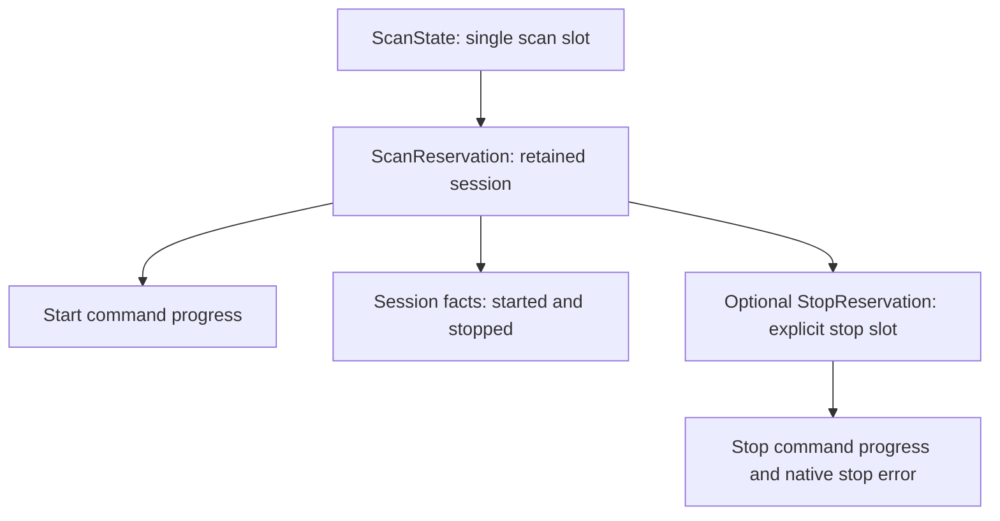

# BLeng scan reservations: session facts and stop command evidence

Date: 2026-10-09

[中文版本](bleng-scan-reservations-design-2026-10-09.zh-CN.md)

## Scope and evidence

This note explains the current internal design, not a new public contract or a native-platform guarantee. It is verified against [scan reservations](../../crates/bleng/src/runtime/reservations/scan.rs), [command progress](../../crates/bleng/src/runtime/reservations/dispatch.rs), and [scan regression tests](../../crates/bleng/src/runtime/tests/scan.rs). See the broader [actor/reservation design](bleng-actor-reservations-design-2026-10-07.zh-CN.md) and [waiter design](bleng-waiter-design-2026-10-06.md) for runtime coordination.

The central distinction is:

> A scan session ending is not the same as an explicit stop command successfully completing. Retiring the caller's waiter is neither of those events.

## Ownership, not three competing state machines

- `ScanState` privately represents `Idle` or `Reserved`. `Reserved` includes starting, running, stopping, and stopped-but-unsettled sessions; it does not mean native scanning is necessarily active. Its gate selects the retained session; `ScanReservation::gate_event()` owns start-before-stop buffer routing.
- `ScanReservation` retains session identity, explicitly named `start_progress`, and observed session facts.
- `StopReservation` occupies the session's single explicit stop command slot. It exists only after an admitted stop operation claims the caller handoff; it has its own command ID and progress, but no independent scan session.
- The actor owns caller waiter delivery separately. A reservation does not own its caller's future.

Nesting expresses ownership. The name `Reservation` expresses slot occupancy and retained correlation/evidence, not a requirement that the object exist independently. This is consistent with connection-owned `DisconnectReservation`, `RssiReservation`, and characteristic I/O reservations.

## Why `stopped` and `stop` are separate

Both represent evidence, at different levels:

| Member | Meaning | Owner |
|---|---|---|
| `started` | The matching `ScanStarted` was observed. | Scan session |
| `stopped` | Valid native session-end evidence was observed. | Scan session |
| `stop: Option<StopReservation>` | An explicit stop command's slot and evidence are retained. | Scan session, through a child reservation |

The four `stopped`/`stop` combinations are meaningful:

| `stopped` | `stop` | Meaning |
|---|---|---|
| `false` | `None` | No observed session end and no explicit stop command. Start may still be incomplete. |
| `false` | `Some` | Stop is reserved, but valid session-end evidence has not arrived. |
| `true` | `None` | Session end was observed without a retained explicit stop command. Start evidence may still need settlement. |
| `true` | `Some` | Session end was observed and stop command evidence remains retained, for example while its terminal is missing. |

`started` and `stopped` are independent observed facts, not exclusive phases. Session-end evidence can be processed before the start's matching domain event or terminal. A late `ScanStarted` does not mean the ended session restarted.

Moving `stopped` into the optional child would make passive teardown unrepresentable when no explicit stop exists. Adding another wrapper around both would not remove any independent fact or decision. The existing parent/child composition already groups them under one owner.

## Recording responsibilities

`ScanReservation::record_event()` first correlates the event with the session. For a matching `ScanStopped`:

1. If a child stop exists, call its private `record_stop_result()` to retain native stop failure. Successful results do not erase an observed error.
2. Native scan error or `SystemSuspended` establishes `stopped = true`, even without a child stop.
3. `Requested` establishes `stopped = true` only if `StopReservation::confirms_requested_stop()` confirms the command ID and accepted dispatch.

The child receives a typed `ScanStopResult`; it does not repeat the parent's session check. It owns its command-specific error and correlation policy. The parent owns the session-end fact. Neither path resets `stopped` to `false` within a retained session.

Native scan error proves teardown; a failed stop command terminal or rejected stop dispatch alone does not.

## Success, failure, and retirement are different decisions

### Success

Start success requires accepted dispatch, a successful terminal, and matching `ScanStarted` evidence.

Explicit stop success requires accepted dispatch, a successful terminal, valid session-end evidence, and no recorded native stop error. Session end may be a matching requested stop or system suspension; it need not prove the stop command caused the end.

`confirms_requested_stop()` validates requested teardown; it does not prove terminal success or settle the waiter itself. The parent's `start_failed()` refers specifically to the start command's terminal failure, not stop failure.

### One stop completion policy

`StopReservation::is_complete(stopped)` is the shared, allocation-free readiness check used by waiter result construction and session retirement. It does not inspect whether a caller still has a waiter, and does not mutate or retire state.

| Evidence | Complete? |
|---|---|
| Dispatch unresolved | No, regardless of other evidence. |
| Dispatch accepted, native stop error recorded | Yes, failure; terminal is not required. |
| Dispatch accepted, failed terminal | Yes, failure; session end is not required. |
| Dispatch accepted, successful terminal and session end | Yes, success unless a native stop error takes precedence. |
| Other combinations | No. |

`ScanReservation::is_retirable()` checks complete start evidence first, then complete stop evidence if a child exists, then whether start failed or the session ended. It no longer interprets the child's terminal/error fields itself. Completed stop evidence without session end can fail the stop waiter but cannot retire the scan session.

### Failure and retirement

- No waiter result is deliverable while the relevant dispatch result is unresolved.
- After stop dispatch acceptance, a native stop error fails the stop waiter even if its terminal is absent. It also proves teardown, allowing session retirement after waiter settlement without waiting for that terminal.
- An accepted stop's failed terminal, without session end, fails the waiter and releases only the stop slot. `StopReservation::can_retire_after_failure()` owns this accepted-terminal-failure check; the parent removes the child only after considering whole-session retirement. The scan session remains available for another stop attempt.
- System suspension without an explicit stop can retire the session once start evidence is complete. If start domain/terminal evidence is still missing, retain the session until the start waiter can be settled.
- Waiter timeout or cancellation alone does not release native reservations or promise native cancellation. Late evidence still updates state and can permit retirement.

The actor settles waiters before `ScanState::retire_completed()` removes either the session or a failed stop child. A successful start releases its initiating waiter, not the ongoing scan slot.

## Early callbacks and dispatch rejection

Callbacks can reach the actor before the native dispatch result is processed. This is not a promise of any particular native callback order.

- `should_buffer_start_event()` combines unresolved start dispatch with correlation of command callbacks and same-session observations, including advertisements and native stop. It decides whether buffering is needed now, not whether start succeeded.
- `StopReservation::should_buffer_event()` likewise combines unresolved stop dispatch with related terminals and same-session stop observations. `gate_event()` uses these decisions without separately repeating dispatch timing checks.
- Accepted dispatch transfers buffered events for ordered actor replay.
- Rejected start releases the slot; any correlated buffered callback is contradictory evidence and requests a runtime fault.
- `StopReservation::resolve_dispatch()` owns the stop rejection classification: buffered system suspension or native scan error can replay as independent teardown; the rejected command's terminal is discarded. Buffered requested-stop evidence conflicts with rejection and requests a fault. `ScanState` only routes the command result and releases the child on rejection.

The actor settles `DispatchRejected` before replay. A passive end must not convert the rejected stop into a success.

## Examples

| Observation sequence | Consequence |
|---|---|
| Running scan, no stop command, then system suspension | Set `stopped`; no stop child is invented. Retire after required start settlement. |
| Accepted stop, requested end, then successful terminal | Record session end, wait for terminal, settle success, then retire. |
| Accepted stop, native scan error, terminal absent | Record session end and child error; settle failure and retire without that terminal. |
| Accepted stop, failed terminal, no session end | Settle failure, discard stop child, retain session for retry. |
| Stop waiter times out, then valid completion evidence arrives | Caller remains timed out; retained native state is reconciled and retired when safe. |

## Review and regression guidance

Review `gate_event()` and `resolve_dispatch()` before `record_event()`, then `waiter_result()`, `is_retirable()`, and `retire_failed_stop()`. Buffer correlation, success evidence, caller delivery, and native retirement answer different questions.

The scan tests cover start evidence arriving after native end, stop domain/terminal order, native errors, failed/rejected stops, passive end during rejection, stale session evidence, and installation admission. [Reconciliation tests](../../crates/bleng/src/runtime/tests/reconciliation.rs) also cover buffering and rejected-event replay policy.

Do not simplify this design by making `stopped` equivalent to `stop.is_some()`, treating every terminal failure as native teardown, or tying reservation lifetime to a live waiter.
