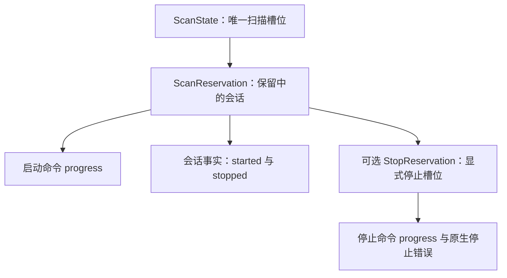

# BLeng 扫描 reservation：会话事实与停止命令证据

日期：2026-10-09

[English version](bleng-scan-reservations-design-2026-10-09.md)

## 范围与证据

本文解释当前内部实现，不提出新的公共契约，也不把 BLeng 策略当作原生平台保证。依据为 [scan reservations](../../crates/bleng/src/runtime/reservations/scan.rs)、[command progress](../../crates/bleng/src/runtime/reservations/dispatch.rs) 和 [scan 回归测试](../../crates/bleng/src/runtime/tests/scan.rs)。运行时协调另见 [actor/reservation 设计](bleng-actor-reservations-design-2026-10-07.zh-CN.md) 与 [waiter 设计](bleng-waiter-design-2026-10-06.md)。

最重要的区别是：

> 扫描会话结束，不等于显式停止命令成功完成；调用方 waiter 退休，也不等于前两者中的任何一个。

## 所有权层次，不是三套竞争的状态机

- `ScanState` 私有表达 `Idle` 或 `Reserved`。后者覆盖启动中、扫描中、停止中和已停止但尚未结算的会话，不代表原生一定还在扫描。其 gate 只选择保留中的会话；start 优先于 stop 的缓冲路由由 `ScanReservation::gate_event()` 负责。
- `ScanReservation` 保留会话身份、明确命名为 `start_progress` 的启动命令进度和已观察到的会话事实。
- `StopReservation` 占据会话内唯一的显式停止命令槽位。只有停止操作通过准入并认领调用方 handoff 后才安装；它有自己的 command ID 和 progress，但没有独立的扫描会话。
- actor 单独管理调用方 waiter 的交付。reservation 不拥有调用方的 future。

嵌套关系描述所有权；`Reservation` 命名描述槽位占用和关联证据保留，不要求该对象能够独立存在。这与 connection 内的 `DisconnectReservation`、`RssiReservation` 和特征 I/O reservation 一致。

## 为什么 `stopped` 与 `stop` 分开

两者都记录证据，只是层次不同：

| 成员 | 含义 | 所有者 |
|---|---|---|
| `started` | 已观察到匹配的 `ScanStarted`。 | 扫描会话 |
| `stopped` | 已观察到有效的原生会话结束证据。 | 扫描会话 |
| `stop: Option<StopReservation>` | 仍保留某次显式停止命令的槽位与证据。 | 扫描会话，通过子 reservation 持有 |

`stopped` 与 `stop` 的四种组合都有意义：

| `stopped` | `stop` | 含义 |
|---|---|---|
| `false` | `None` | 尚未观察到会话结束，也没有显式停止命令；start 可能仍未完成。 |
| `false` | `Some` | 已登记 stop，但有效的会话结束证据尚未到达。 |
| `true` | `None` | 已观察到会话结束，没有保留中的显式 stop；start 的证据仍可能需要结算。 |
| `true` | `Some` | 已观察到会话结束，stop 命令证据仍保留，例如 terminal 尚未到达。 |

`started` 与 `stopped` 是独立的已观察事实，不是互斥阶段。会话结束证据可能先于 start 的匹配 domain 或 terminal 被处理；晚到的 `ScanStarted` 不代表已结束的会话重新启动。

这也是 scan 不需要像 connection 那样增加 `start_error` 的原因：`ScanStopped::Err` 不携带 command ID，可能描述 start 前后发生的被动会话结束；把它归给 start 会凭空制造错误关联。只有存在显式 stop reservation 时，子结构才为 stop waiter 保留该错误；否则父结构只记录会话结束事实。

把 `stopped` 收进可选子结构，会导致没有显式 stop 时无法表达被动结束。再加一层结构包住两者，也不会减少任何独立事实或判断。当前父子组合已经将它们打包在同一个所有者之下。

## 证据记录的职责

`ScanReservation::record_event()` 先检查事件与会话的关联。对于匹配的 `ScanStopped`：

1. 若存在 stop 子结构，调用其私有 `record_stop_result()` 记录原生停止错误；成功结果不会抹除已观察到的错误。
2. 原生扫描错误或 `SystemSuspended` 直接建立 `stopped = true`，即使没有 stop 子结构。
3. `Requested` 只有在 `StopReservation::confirms_requested_stop()` 确认 command ID 匹配且 dispatch 已接受后，才建立 `stopped = true`。

子结构接收类型化的 `ScanStopResult`，不重复父结构的 session 检查；它负责命令自身的错误与关联策略，父结构负责会话结束事实。在同一份保留中的会话内，这些路径都不会将 `stopped` 改回 `false`。

原生扫描错误证明会话已结束；stop 命令的失败 terminal 或 dispatch 拒绝本身则不能证明这一点。

## 成功、失败与回收是不同判断

### 成功

Start 成功需要：dispatch 已接受、成功 terminal、匹配的 `ScanStarted`。

显式 stop 成功需要：dispatch 已接受、成功 terminal、有效的会话结束证据，且没有已记录的原生停止错误。结束证据可以是匹配的 Requested stop，也可以是系统暂停；它不必证明停止命令导致了会话结束。

`confirms_requested_stop()` 只确认 Requested 结束证据有效，不证明 terminal 成功，也不自行结算 waiter。父结构的 `start_failed()` 明确只指启动命令的 terminal 失败，不指 stop 失败。

### 唯一的 stop 完成策略

`StopReservation::is_complete(stopped)` 是 waiter 结果构造和会话退休共同使用的无分配就绪判断。它不查询调用方 waiter 是否仍存在，也不修改或回收状态。

| 证据 | 是否完整 |
|---|---|
| dispatch 未决 | 否，无论其他证据是否存在。 |
| dispatch 已接受，已记录原生停止错误 | 是，按失败完成，不要求 terminal。 |
| dispatch 已接受，terminal 失败 | 是，按失败完成，不要求会话结束。 |
| dispatch 已接受，terminal 成功且会话已结束 | 是；若同时有原生停止错误，则错误优先，否则成功。 |
| 其他组合 | 否。 |

`ScanReservation::is_retirable()` 先检查 start 证据完整，再检查存在的 stop 子结构证据完整，最后判断启动失败或会话已结束；它不再自行解释子结构的 terminal/error 字段。stop 证据完整但会话尚未结束，可以使 stop waiter 失败，却不能使扫描会话退休。

### 失败与回收

- 相关 dispatch 结果尚未确定时，不交付 waiter 结果。
- stop dispatch 接受后，原生停止错误即使没有 terminal 也可以使 stop waiter 失败。它同时证明会话结束，因此先结算 waiter 后可以回收会话，不必等待该 terminal。
- stop dispatch 接受后，若 terminal 失败但没有会话结束证据，则结算失败，仅释放 stop 槽位。`StopReservation::can_retire_after_failure()` 负责已接受且 terminal 失败的判断，父结构先考虑整个会话的退休，再实际移除子结构；保留扫描会话，允许重试停止。
- 没有显式 stop 时，系统暂停也可以结束会话，但必须等 start 证据足以结算后才能回收。若 start 的 domain/terminal 尚缺失，继续保留会话。
- waiter 超时或取消本身不释放原生 reservation，也不承诺取消原生命令。晚到证据仍需记账，并可能使 reservation 满足回收条件。

actor 先结算 waiter，再由 `ScanState::retire_completed()` 移除整个会话或失败的 stop 子结构。Start 成功完成的是启动 waiter，不是持续扫描槽位的生命周期。

## 提前回调与 dispatch 拒绝

回调可能先于原生 dispatch 结果的 actor 处理到达。这里描述的是需要容忍的交错，不是对原生 callback 顺序的保证。

- `should_buffer_start_event()` 同时检查 start dispatch 未决与事件关联，范围覆盖命令回调和同会话观察，包括 advertisement 与原生停止。它判断当前是否需要缓冲，不表示启动成功证据。
- `StopReservation::should_buffer_event()` 同样组合 stop dispatch 未决与相关 terminal、同会话停止观察。`gate_event()` 直接使用缓冲决策，不在调用处重复拼接 dispatch 时机检查。
- dispatch 接受后，将缓冲事件交给 actor 按顺序回放。
- start dispatch 拒绝会释放槽位；任何关联的已缓冲回调都是矛盾证据，要求 runtime fault。
- `StopReservation::resolve_dispatch()` 负责 stop 拒绝后的分类策略：已缓冲的系统暂停或原生扫描错误可作为独立结束事实回放；被拒绝命令的 terminal 丢弃。已缓冲的 Requested stop 证据与拒绝矛盾，要求 fault。`ScanState` 只负责命令结果路由，并在拒绝时释放子结构。

actor 先交付 `DispatchRejected`，再回放事件。被动结束不能把已拒绝的 stop 改成成功。

## 例子

| 观察顺序 | 处理结果 |
|---|---|
| 正在扫描，没有 stop 命令，随后系统暂停 | 设置 `stopped`，不凭空创建 stop 子结构；满足 start 结算条件后回收。 |
| stop 已接受，先 Requested 结束，后成功 terminal | 记录会话结束，等待 terminal，结算成功，再回收。 |
| stop 已接受，原生扫描错误，terminal 未到 | 记录会话结束和子结构错误；结算失败，不必等该 terminal 即可回收。 |
| stop 已接受，失败 terminal，没有会话结束 | 结算失败，移除 stop 子结构，保留会话以允许重试。 |
| stop waiter 超时，随后有效完成证据到达 | 调用方结果仍为超时；继续归并原生状态，并在安全时回收。 |

## Review 与回归要点

先看 `gate_event()`、`resolve_dispatch()`，再看 `record_event()`、`waiter_result()`、`is_retirable()` 和 `retire_failed_stop()`。缓冲关联、成功证据、调用方交付和原生资源回收回答的是不同问题。

Scan 测试覆盖原生结束后才到达 start 证据、stop domain/terminal 两种顺序、原生错误、失败或拒绝的 stop、拒绝期间的被动结束、旧 session 证据和安装准入。[Reconciliation 测试](../../crates/bleng/src/runtime/tests/reconciliation.rs) 另外覆盖缓冲与拒绝后的事件回放策略。

不要把 `stopped` 简化成 `stop.is_some()`，不要把每一种 terminal 失败都当成原生结束，也不要让 reservation 的生命周期依赖 waiter 是否仍存在。
