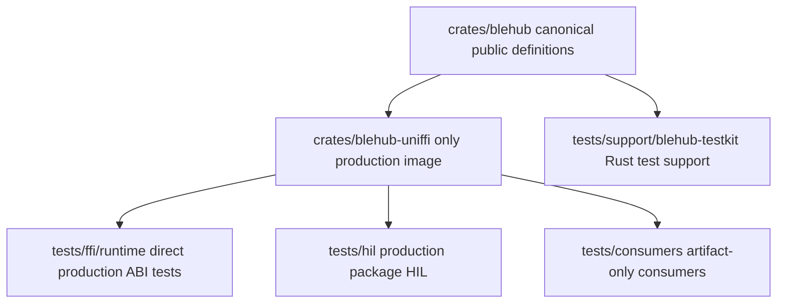
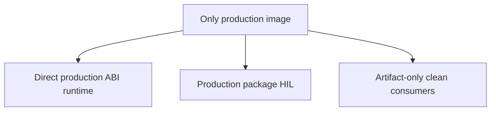

# BleHub 分层测试：职责、执行选择与证据边界

## 中文总览

本文回答三个问题：**一个问题应该在哪层测、当前设备能测什么、一次通过到底证明了什么。** 下文的技术细节继续维护同一套边界，不另建一份测试计划。

[Plan](../../../.plan/PLAN.md) 是唯一验收来源；本说明不新增发布门槛。执行入口见 [测试指南](../../testing/README.md)，候选运行事实与失败保存在 [测试报告](../../testing/reports/)。本文不是“全部已通过”的状态清单。

### 1. 核心原则

- **大量组合在低层确定性验证，真实平台边界用真机确认。** 不把所有错误、乱序、并发组合都搬到手机上，也不靠 mock 宣称系统 BLE 行为已验证。
- **按责任分层，不要求每层复制全部场景。** 打包、FFI、原生 BLE、RN 和物理外设分别保留可诊断的证据；它们不是一次通过就逐级自动继承的阶梯。
- **选代表性设备，但如实限定兼容范围。** 当前 Android 多版本/API-tier 真机 matrix 已按用户批准从强制门槛移除；不是测过一台就宣布所有版本/OEM 通过，也不是只支持该手机的 API。
- **测试数量不等于覆盖深度。** Jest 数量、十轮恢复、10,000 次 fake-backend lifecycle 和长期真实 BLE 负载，证明的是不同事情。
- **失败不能被另一层的成功冲掉。** App 显示 Passed 不等于 host bundle Passed；空口发出数据不等于系统 delegate 或应用已收到。

### 2. 分层职责表

以下编号仅用于阅读，不是新建目录、runner 或强制执行顺序。共享 testkit、conformance 数据是复用基础，不另算一层“已通过”。

| 层 | 主要验证什么 | 环境与现有 owner | 不能据此宣称什么 |
|---|---|---|---|
| L1 契约与调用方逻辑 | dispatch/event 边界、ID/wire 校验、ingress、并发与 close；BLeng 单独验证其调度、取消和 owner 生命周期；RN 纯逻辑验证场景状态和投影 | Rust tests、`tests/support/blehub-testkit`、`crates/bleng`、RN TypeScript/Jest | 真实 FFI、Framework callback、无线链路已通过；不能把 BLeng/Probe 的状态职责移入薄 core |
| L2 原生 backend 确定性测试 | native mapping、GATT 串行 lane、watchdog、callback correlation、退役、rollback 与 teardown | `platforms/apple/Tests`、`platforms/android/library` 的窄 native seam/受控 callback | 真实系统调度、权限变化、远端交付或设备释放时延已验证 |
| L3 production FFI/runtime | 生成的 Swift/Kotlin API、唯一生产 native image、foreign backend/sink、线程、错误与内存所有权 | `tests/ffi/runtime`；真实 Mac Swift、Android ART；适用的非 RF instrumentation 可用模拟器 | 使用 test backend 的 runtime 通过，不代表 production BLE backend 或 RF 通过 |
| L4 package 与 clean consumer | 架构/symbol/header/metadata 完整；下游仅凭 staged AAR/XCFramework/npm artifact 构建、加载及小范围 runtime | production packaging tools、`tests/consumers` 的独立构建图 | 静态 build 通过不等于真机运行；能运行不等于全量 GATT/故障/长稳覆盖 |
| L5 production native HIL | 不经过 RN 的生产 Hub → backend → OS → Peripheral → ingress → sink；按具名场景验证真实扫描、连接、I/O、订阅和恢复 | `tests/hil`、现有 Android artifact consumer 的 opt-in native smoke、真机与 managed nRF52840 v2 provider | RN/Nitro、其他 OS/设备、独立 clean consumer 或 ABI freeze 已通过；非 RF 初始化也不能冒充 RF |
| L6 RN workbench 端到端 | JS/Nitro/native 接入、事件交付、运行与页面生命周期、受控 RF 场景，以及 host/provider/cleanup 证据闭环 | 同一个 RN App：Tests → Current run → Evidence；现有 mobile runners | Jest 或 App Passed 替代真实运行/host verdict；RN 覆盖替代独立 native HIL |
| L7 长期压力与资源观察 | 在已通过的链路上持续施加扫描、notification 或重连负载，观察错误、逻辑资源与系统资源趋势 | 整体功能、人工 review 与稳定候选收敛后，再复用对应 native/RN lane；当前后置，不建设长 soak 框架 | 简单增加循环数等于 soak；逻辑计数为零等于 OS heap 无泄漏；一个平台压力通过覆盖其他平台 |

L4 是发布交付的独立维度；L7 是施加在对应链路上的负载维度，不是另一个产品 App。分层不意味着建设七套测试体系。

**Host/controller 工具测试横跨各层：** `tools/tests/react_native/` 验证安装/启动边界、身份关联、deadline、采集、ledger、bundle 和失败清理。Synthetic tests 必须 mock 实际 SDK/install 调用边界，placeholder identity 不得进入真实设备命令；这些测试证明主机判定与安全机制，不证明任何 RF 已发生。固件构建、contract/attestation 校验与 provider synthetic tests 同理，不等于固件已安装或无线场景已通过。

### 2.1 正式 RN consumer 的具体责任落点

同一个 App 不等于一个测试执行器负责所有层。正式 consumer 的日常软件检查、原生 bridge、UI 与 RF 按以下边界选择；不增加发布门槛，也不删除既有正式 scan/full-suite 的跨页、同 owner、原始错误或最终 Evidence 断言。

| 责任 | 现有 owner／入口 | 应留在这一层的事实 |
|---|---|---|
| JS 呈现与交互逻辑 | `tests/consumers/react-native-bleng/src/*.test.tsx`；`formal-host-test` | pending/失败显示、跨页保留、输入约束、浏览零命令；package boundary mock 不证明 Nitro |
| 类型与 source consumer 接线 | `formal-host-check` | TypeScript 和正式 Android autolinking；不安装依赖、不 build、不操作手机 |
| 原生桥与 artifact 边界 | 正式 App native test targets、`tests/ffi/runtime` 和独立 artifact consumers | Nitro Promise、Rust/foreign mapping、唯一 image 与来源；不重复 UI 点击流程 |
| host/controller 安全机制 | `tools/tests/react_native/`，以及该 owner 的 `support/` | SDK/install 真实调用边界的隔离、原身份/lease/deadline、失败与 cleanup；不从 synthetic facts 推导设备通过 |
| 真实 RN UI 集成 | 现有 shared Appium scene 与 managed platform owner | 用户操作、真实 JS/Nitro/UI 串联、页面可见与同 owner；不以 click/idle/日志 marker 充当 BLE terminal |
| 物理 BLE 与最终证据 | named RF runner、live provider、scenario ledger/bundle | exact candidate/session、真实 Peripheral、响应/故障/恢复及收尾；UI 工具不拥有 firmware/permission/radio 策略 |

依赖准备使用显式 `formal-host-install`。首次 setup、lock 变化和干净候选任务先执行它，再执行 check/test/build；日常 check/build 不隐式 `npm ci`。组件 Jest discovery 只收 `src/**/*.test.[jt]s?(x)`，未来设备 E2E bootstrap 必须独立 discovery，不能混进组件测试进程。离线样本、emulator、Just dry-run helper 归 `support/`；测试模块不作为其他测试的 fixture API，support 不继承/实例化 `TestCase`，live owner 不导入 synthetic support。

2026-11-22 Maestro 已移除（从未参与门禁，重试不可控）；2026-11-08 用户允许评估 Detox/Maestro，当前 maintained UI driver 未切换。候选评估只比较 UI 层；未验证的 RN/Nitro 兼容性、iPhone 真机支持、helper/权限/收尾不能由“框架自动同步”或 YAML 简洁性代替。采用前提及明确未执行项见[职责整理与工具评估](../../testing/reports/2026-11-08-rn-test-responsibilities-and-ui-tool-evaluation.md)。这不是新增第二套默认框架或取消现有 gate。

### 3. 当前设备怎么分工

| 资源 | 当前职责 | 使用边界 |
|---|---|---|
| 真实 Mac mini | 本机控制器；Swift/Xcode/runtime/package；独立 macOS CoreBluetooth Central HIL | macOS 不能替代 iPhone；不引入 hosted macOS 或 RN macOS gate |
| 现有一台 Android 真机 | ART、AAR consumer、production Android BLE 和 RN/Nitro 真机验证 | 记录实际型号/API/ABI；不要求第二台，不将未测版本/OEM 标成通过 |
| 现有 iPhone | iOS artifact runtime、production CoreBluetooth native HIL、RN/Nitro 和适用 XCUITest | 签名与授权按 Apple 安全规则；不从 Mac 或 Android 结果推导 iOS 通过 |
| 两块 nRF52840 DK | managed Multifunction Fault v2 Peripheral；正常/故障场景，及明确需要时的多设备场景 | 单 DK 场景不默认占用两块；必须在 lease 下匹配 live receipt、contract/profile；普通运行不自动刷写或重置 |
| 独立 nRF52840 Dongle | 被动抓包，辅助区分空口、系统 callback 与应用交付边界 | 不是 Peripheral、DK identity 或独立 RF verdict；不是每次测试的必备步骤 |
| 模拟器与注入 fixture | 适用的安装、UI、非 RF runtime，以及可控错误/版本分支检查 | 不作为当前真实 BLE/RF 验收替身；不会因有模拟器而宣称其他 API 的真机兼容性通过 |

设备 serial、UDID、端口、地址与 installed-image 身份来自本地配置、显式选择和 live discovery/receipt；本文不提供永久硬编码值，也不允许歧义时随机选设备。具体运行身份保存在候选报告与原始回执中。

多版本兼容性未来可以按实际用户分布与风险增加代表性系统/厂商设备，或在确认能力后采用外部设备服务；不默认云真机能够连接本地 DK、执行故障注入或提供本项目需要的物理证据。当前不采购、不接入外部服务、不新增版本测试 gate。范围依据见 [Plan §11.2/§15](../../../.plan/PLAN.md)。

### 4. 改了什么，就从哪层开始测

下面是选测方法，不替代 Plan 的适用退出条件。每次从最小相关回归开始；准备发布/冻结时，再核对最终同候选矩阵。

| 改动 | 优先检查 | 何时向上补证据 |
|---|---|---|
| Rust 契约、FFI DTO、ingress/close 或公共 ABI | L1、API snapshots、L3 | 涉及 native/generated artifact 时补 L4；影响 backend/RF 行为时补相应 L5/L6，不能继承旧 ABI 结果 |
| Apple/Android backend correlation、I/O lane、watchdog、mapping | L2 的边界/故障回归及受影响构建 | 在对应平台补适用 native runtime/HIL；若改变 RN 可观察行为，再补受影响的 RN gate |
| BLeng owner、超时或调度 | BLeng 自身确定性/并发测试 | 补其正式 package/runtime 与受影响 consumer；不把这些责任或测试 API 下沉到 core |
| RN 场景、bridge、listener、reload 或页面生命周期 | typecheck/Jest、host/controller 定向回归 | 补适用 clean-artifact runtime、真机导航/reload；只有依赖真实 BLE 的断言才进入 RF |
| provider、采集、SDK/install、ledger 或 evidence checker | owner-local synthetic tests 与 canonical tooling discovery | 若设备控制/证据语义改变，按安全前置补具名真实验证；已有日志离线校验不能冒充一次新 RF |
| 打包或依赖解析 | artifact 完整性、泄漏/provenance/single-image 检查 | 补 artifact-only consumer build/runtime；不先跑整套 RF 来寻找缺 header/依赖问题 |
| 仅文档 | fmt、lint、UTF-8/链接/围栏、适用 Mermaid 检查 | 不因此安装 App、切换系统状态或重跑 RF |

执行前先查看现有 [Just 入口与 lane](../../testing/README.md)，复用 owner；不要为每个故障新建 App、固件或通用 runner。RF 继续遵守 **provision changes / assert proves / run tests**；只有获准的物理操作才能执行，不能为“完整回归”自动开关蓝牙、撤权、刷写或重试破坏性场景。

### 5. 一次结果怎样才说得清楚

每份证据至少区分以下维度，沿用对应 runner/bundle 的实际 schema，不另造通用结果协议：

1. **对象**：source/candidate 与 artifact 身份、绑定/包来源；是否冻结。
2. **环境**：真实执行的 host、设备型号、系统/API、ABI；RF 另有 Peripheral、profile、live installed-image receipt。
3. **路径**：fake backend 还是 production backend；静态 build、非 RF runtime、native HIL、RN RF 或 stress。
4. **运行**：命令、run/session、所需的 process/boot/control 身份、deadline 与原始日志。
5. **结论**：实际断言、host verdict、物理证据与 cleanup；失败、未执行和不在当前门槛内分别说明，不互相改写。
6. **局限**：哪些平台/模式/资源尚未证明，不能从本次通过推导。

例如：

- “Android ART 上 production ABI + test backend 的 10,000 lifecycle 通过”不能写成“真实 BLE 10,000 次连接通过”。
- “RN lifecycle 8 cycles 通过”不能写成“多小时 stress 通过”；长期负载需先定义持续时间、速率/重连节奏、资源 baseline、增长阈值、失败预算与停止/cleanup 判据，具体值按评审确定，不在本文新增固定小时数。
- “系统进程已死亡”不能证明旧 Probe 执行了 close 或资源计数归零；“逻辑资源归零”也不能替代 OS 内存趋势观察。
- iOS CCC disable REJECT：历史 RN sniffer 证据确认空口 continued value，而独立 Native HIL 也缺失 continued-value callback；两次运行不能拼成同 session 证据。保留 CoreBluetooth callback gap，不能合成事件、修改固件或放宽 continuity，也不为重确认已知边界反复 RF。见 [Native HIL 报告](../../testing/reports/2026-10-24-ios-native-hil-ccc-disable-reject.md)。

当前证据入口：[native 当前矩阵与 review 前置](../../testing/reports/2026-10-25-native-matrix-validation.md)、[外围收口与 review 准备](../../testing/reports/2026-10-25-perimeter-review-readiness.md)、[host/package checkpoint](../../testing/reports/2026-10-25-candidate-host-gates.md)、[device runtime checkpoint](../../testing/reports/2026-10-25-candidate-device-runtime.md)、[RN RF 架构与缺口](../archive/react-native-rf-lab-test-architecture.md)。具体 candidate、计数与失败只在报告维护，本文不复制逐次执行日志。

### 6. 外围可 review，不等于项目可发布

按用户批准的 [Plan §14](../../../.plan/PLAN.md)，当前工作先收口外围平台和测试接线；用户主控 `crates/blehub`、`crates/bleng` 的人工 review/打磨。agent 不为外围测试方便擅自修改这两个 crate。

- **开始人工 review 所需：** 各层 owner 和责任清楚，日常测试能可靠发现维护中的用例，产物隔离/最小平台路径可验证，已知失败和剩余硬件验证有明确去处。未关闭的发布专项不能被写成通过，但不应把所有专项都变成开始读代码的门槛。
- **日常执行：** 优先定向检查与增量构建。RN `host-test` 为统一 Jest discovery；`tools-test` 是 combined `tools-fixture-test` 的子集，不要求二者连续跑。Android `android-candidate-build` 是显式干净重建，不是普通 backend 检查的默认前置；执行分档见 [测试指南](../../testing/README.md#日常功能与候选验证分档)。
- **当前按用户选择先收外围，再做核心 review：** 先闭合已接入的最小 native 路径与适用设备验证，再交给用户读 BLeng；不继续催其并行 review。代码/编译完成但真机 smoke 尚未执行时，必须如实保留未证明；权限同意等必要人工设置也不能被隐式 grant 绕过。不得因此新造第二套 App、复制 RN 故障矩阵，或把长期压力追加成外围前置。
- **最后才做：** 整体功能与人工 review 收敛后的稳定同候选终验、长期负载、最终 ABI/package freeze。长期压力仍是发布前适用要求，但不是当前外围收口或开始 BLeng review 的条件，不擅自规定必须几小时。

## Technical reference

### Status and purpose

This document defines what each BleHub test layer proves and, equally importantly, what it cannot prove. It applies to all platforms; Apple examples describe the current unfrozen Phase 3 candidate.

No single test binary should prove contract behavior, foreign-language transport, native backend behavior, packaging isolation, and RF correctness at once. Those concerns have different dependencies and failure boundaries and must remain independently diagnosable.

The normative repository ownership and dependency rules are in [`.plan/PLAN.md`](../../../.plan/PLAN.md). This document explains how the test layers apply those rules.

## Single production artifact

BleHub has one canonical definition owner and one production UniFFI native-image owner:



`crates/blehub` defines and exports the production `BleHub` object, foreign `BleBackend`, foreign `BleEventSink`, direct ingress, commands, events, and errors. Rust consumers can use those definitions directly.

`crates/blehub-uniffi` remains deliberately thin. It owns only the final `staticlib`/`cdylib`, the locked bindgen entry, and production package staging. It does not define another API or test component. Runtime test behavior lives in Swift/Kotlin implementations or Rust-only test support, never in a second UniFFI native image.

Maintained Apple Swift runtime, package, backend, and HIL layers execute on the project real Mac mini through local Pixi + Just. The `apple-ci` label is a Pixi environment name only. BleHub does not maintain a Windows Swift lane, Windows-managed Swift root/bootstrap, or GitHub-hosted macOS workflow. Earlier Windows Swift and GitHub Actions runs remain historical, non-maintained evidence and do not define Phase 5 gates; Phase 5 requires macOS/iOS Swift evidence from the Mac mini.

## Layer matrix

| Layer | Location | Primary subject | What it proves | What it does not replace |
|---|---|---|---|---|
| Rust core unit and concurrency | `crates/blehub` | `BleHub`, contract validation, ingress and disposal | Rust API behavior, command gate, serialized sink delivery, lifecycle and concurrency invariants | Stable UniFFI runtime, native platform behavior, packaging or RF |
| Shared Rust test support | `tests/support/blehub-testkit` | Fake backend, scenarios, recording sink and reference projection | Reusable test behavior against the canonical contract | A shipped crate, language binding or platform backend |
| Shared conformance data | `tests/conformance` | Cross-platform DTO/event semantics and provider profiles | Backends and Peripheral providers use the same normalized scenario meaning | Native callback ordering, device runtime or RF |
| Foreign-language runtime | `tests/ffi/runtime` | Production generated Swift/Kotlin APIs, exported Hub, foreign backend/sink, JNA/ARC and callbacks | Swift on the real Mac mini and Kotlin test backend/sink objects exercise the production ABI directly; ownership, errors, threads, event wire and lifecycle survive the real image | Clean-consumer isolation, CoreBluetooth/Android BLE or RF |
| Backend deterministic tests | `platforms/apple/Tests`; `platforms/android/library` tests; archived Windows backend tests | Platform mapping and backend-private state machines | Exact correlation, serialization, rollback, stale callback handling and teardown without RF | OS authorization, signing, real callback timing or radio behavior |
| Production-package platform HIL | `tests/hil/<platform>` | Staged production package plus real OS backend/device path | End-to-end command/event behavior through production Hub, FFI, backend, sink and OS/device paths | Independent clean-consumer isolation or ABI freeze |
| Production packaging gate | Owner-specific packaging scripts | Produced release-shaped artifacts | Expected architectures, components, symbols, headers, module maps and metadata | A clean downstream build or RF behavior |
| Production artifact-only consumer | `tests/consumers/<platform>` | Downstream integration from staged production artifacts only | No source-tree path, project dependency, test export or workspace fallback masks a broken package | Full backend behavior or RF matrix |
| Peripheral fixtures | `tests/peripherals/nrf52840` | Active managed nRF52840 Multifunction Fault v2 + BTP; Android/BLESS remain historical providers | A controlled Central test peer implements the named provider profile; build/contract checks alone do not prove installation or RF | Any BleHub Central implementation |
| RF/fault/soak HIL | Explicit provider-specific Just recipes | Real Central, Peripheral and radio boundary | The named advertisement, connection, GATT, I/O, subscription, fault or throughput workflow actually passed | Other platforms, providers, modes or frozen-ABI reruns |
| Historical capability probes | `spikes/archive` | Superseded mechanism experiments | Reproducible historical evidence and rejected alternatives | Production source, long-lived tests or current acceptance gates |

## FFI runtime versus production consumers

`tests/ffi/runtime` and `tests/consumers/<platform>` both use production artifacts, but prove different boundaries. Runtime tests deliberately provide synthetic Swift/Kotlin backend and sink implementations so they can force callback, error, race, and lifecycle cases against the exported production `BleHub`. They validate the production ABI directly, but remain repository-owned white-box tests.

Production consumers are independent downstream build graphs. They prove that staged release-shaped artifacts can be consumed without source-tree paths, project dependencies, generated-source fallback, or implicit native-library lookup.



## What the Apple HIL probe calls

The Apple HIL probe is not a Swift-only backend unit test. It uses the staged production package and the public Swift API:

```text
iOS/macOS probe application
  -> production Swift package and generated Stable UniFFI module
  -> exported production BleHub
  -> Swift AppleBleBackend foreign-trait object
  -> CoreBluetooth
  -> BackendEventIngressHandle
  -> direct Swift BleEventSink foreign-trait object
  -> caller-owned Swift ledger and result output
```

The probe implements `BleEventSink` directly in Swift, constructs the production `BleHub` with the production Apple backend, and invokes only public Hub commands. Events must return through the real ingress and foreign sink callback. This covers the actual package, Hub, backend, ingress, sink, and dispose path; it does not bypass the Hub or substitute test exports.

The HIL target must consume the staged production XCFramework/Swift package. It must not compile a replacement Rust image, inject test-only UniFFI symbols, or fall back to source-generated bindings. Repository-specific Swift ledger code remains test code outside the production image.

## Why production clean consumers remain separate

Production-package HIL uses repository orchestration and test-specific application code to collect precise runtime/RF evidence. Even though it consumes the staged production package, it can still miss independent-consumer failures, including:

- an accidental source-tree package dependency;
- a missing XCFramework architecture;
- a missing Swift source, header, module map or privacy manifest;
- generated bindings that exist only in the development checkout;
- a library search path inherited from the workspace;
- duplicate or mismatched native symbol owners;
- test-only exports accidentally shipped in production.

A clean consumer must therefore have an independent manifest, lock and build graph, consume only staged production artifacts, and run offline where practical. It should prove assembly, build, launch and a small lifecycle smoke. It should not duplicate the entire RF matrix.

For Apple Phase 3, the iPhone production-package probe establishes signing, installation, CoreBluetooth runtime and later RF. A separately isolated artifact-only Apple consumer remains an independent exit gate.

## Dependency rules

Allowed dependency directions:

- `crates/blehub-uniffi` depends on and re-exports the canonical component from `crates/blehub`;
- production platform packages consume the production bindings/artifacts assembled by `crates/blehub-uniffi`;
- `blehub-testkit` may depend on `blehub` for Rust-only tests;
- `tests/ffi/runtime` consumes the production image/package and implements test backend/sink objects in Swift/Kotlin;
- Apple HIL and production consumers consume staged production artifacts;
- HIL may use controlled providers from `tests/peripherals`.

Forbidden dependency directions:

- no production module may depend on `tests/` or `spikes/`;
- `blehub-uniffi` may not depend on `blehub-testkit` or any test implementation;
- runtime tests may not build, link, or generate a second UniFFI component/native image;
- Apple HIL may not use source replacement or test-only bindings instead of the production package;
- artifact-only consumers may not reference `crates/`, `platforms/`, runtime-generated test paths, or workspace paths;
- no long-lived test or production workflow may depend on an active or archived spike;
- every final graph must have exactly one BleHub UniFFI symbol owner: `crates/blehub-uniffi`.

## Python and native-device tooling boundary

BleHub does not implement Apple device protocols in Python. Project Python code owns only orchestration specific to BleHub evidence:

- select exactly one connected physical iOS device;
- choose an explicitly configured or unambiguous Xcode development team;
- generate the test project from tracked XcodeGen YAML;
- invoke `xcodebuild` for automatic development signing;
- invoke `xcrun devicectl` through its JSON interface for install, launch and app-container result retrieval;
- validate a unique run ID and required result markers;
- keep successful output concise and preserve complete failure logs under `.work`.

Third-party device stacks would duplicate or bypass the authoritative Xcode/device path and are not part of the Phase 3 baseline. Fastlane or App Store Connect tooling may become appropriate for release distribution, certificate rotation or store automation, but is not required for a local development-signed HIL app.

## Keychain policy

Ordinary build, test and RF recipes must never request, accept, store or pass a login password. They only verify that the login keychain is already available to noninteractive code signing and fail before device work when it is not.

A separate, explicitly human-invoked Just recipe may run `security unlock-keychain` and `security set-key-partition-list` without accepting a password argument. The password is entered directly into the local macOS security prompts and is never visible to BleHub tooling. The latter grants the Apple signing tools access to the signing-key partition; it does not export or store the password. This interactive helper is not a dependency of ordinary automation or tests; Apple gates remain local to the project real Mac mini rather than a hosted runner.

## Evidence naming rules

Every platform result must state:

1. the exact candidate and whether its ABI is frozen;
2. the host/device platform actually executed;
3. the Central DUT and Peripheral provider;
4. whether the test is deterministic, runtime-only, RF, fault, soak, packaging or clean-consumer evidence;
5. the command and terminal semantics actually observed;
6. any mode that remains unproven.

A macOS pass never proves iOS, an iPhone production-package HIL pass never proves independent clean-consumer isolation, and a dual notify/indicate characteristic selecting Notification never proves strict Indication.
