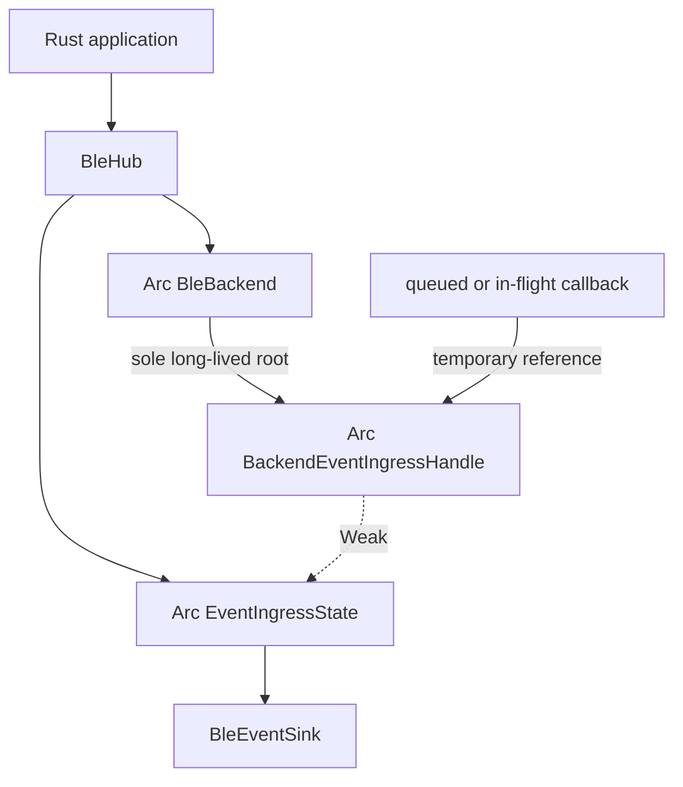

# Direct ingress handle 为什么必须使用 `Arc`

- 状态：架构证据与实现说明；规范性约束以 [`.plan/PLAN.md`](../../.plan/PLAN.md) 为准
- 日期：2026-08-29
- 适用范围：Stable UniFFI `0.32.0`、`BleBackend::bind_event_ingress`、`BackendEventIngressHandle`、callback/close 生命周期
- 相关调研：[FFI 生命周期与并发竞态设计](ffi-lifecycle-concurrency.md)、[UniFFI 与 BoltFFI 技术评估](uniffi-vs-boltffi-for-blehub.md)

## 1. 决策摘要

BleHub direct ingress 使用以下形状：

```rust
#[derive(uniffi::Object)]
pub struct BackendEventIngressHandle {
    state: Weak<EventIngressState>,
}

#[uniffi::export(foreign)]
pub trait BleBackend: Send + Sync {
    fn bind_event_ingress(
        &self,
        ingress: Arc<BackendEventIngressHandle>,
    ) -> Result<(), BleHubError>;
}
```

这里有两个不同的生命周期：

- 外层 `Arc<BackendEventIngressHandle>` 保证可调用的FFI object在backend、queued callback和in-flight callback使用期间有效；
- handle内部的 `Weak<EventIngressState>` 保证backend或迟到callback不会延长Hub、state和downstream sink的生命周期。

`Arc`不表示Hub与backend必须长期共享handle。production constructor创建唯一root `Arc`后，按值move给backend；backend是唯一长期root owner。其他strong reference只能是queued或in-flight callback的临时引用。

```rust
let ingress_handle = Arc::new(BackendEventIngressHandle::new(
    Arc::downgrade(&ingress),
));

// Move the sole root Arc. BleHub does not retain the handle.
backend.bind_event_ingress(ingress_handle)?;
```

该模型可以概括为：

> 唯一root ownership transfer，callback期间允许临时共享。

## 2. 为什么不是 `Box<BackendEventIngressHandle>`

如果只观察constructor把handle交给backend的瞬间，`Box`确实更强地表达唯一ownership：

```rust
fn bind_event_ingress(
    &self,
    ingress: Box<BackendEventIngressHandle>,
) -> Result<(), BleHubError>;
```

但完整生命周期还包含平台callback排队、callback与dispose并发、迟到callback和跨语言wrapper释放。`Box`只表达初次交付，不解决这些运行期引用。

### 2.1 Stable UniFFI object ABI基于`Arc`

Stable UniFFI `0.32.0`为exported object生成`FfiConverterArc`。Rust object lower把一个owned `Arc<Self>`转换为opaque handle，foreign wrapper最终调用object-specific free function释放该strong reference：

- object macro与`FfiConverterArc`：[`uniffi_macros/src/object.rs`](../../../contrib/uniffi-rs/uniffi_macros/src/object.rs)
- opaque handle的`Arc::into_raw`/`Arc::from_raw`实现：[`uniffi_core/src/ffi/handle.rs`](../../../contrib/uniffi-rs/uniffi_core/src/ffi/handle.rs)
- Swift object wrapper的clone/free：[`ObjectTemplate.swift`](../../../contrib/uniffi-rs/uniffi_bindgen/src/bindings/swift/templates/ObjectTemplate.swift)

Stable metadata、Kotlin generator和Swift generator没有可用于public object参数的`Weak<T>`或`Box<T>` ownership类型。`ArcOrOwned<T>`只用于基于`uniffi_parse_rs`的experimental Kotlin/JNI bindgen返回object，不是Stable UniFFI foreign-trait object输入contract；见[`uniffi_core/src/arc_or_owned.rs`](../../../contrib/uniffi-rs/uniffi_core/src/arc_or_owned.rs)。

因此以下形式不是Stable UniFFI `0.32.0`支持的统一contract：

```rust
fn bind_event_ingress(&self, ingress: Box<BackendEventIngressHandle>);
fn bind_event_ingress(&self, ingress: Weak<BackendEventIngressHandle>);
```

### 2.2 Kotlin和Swift不提供Rust式线性ownership

即使手写FFI把唯一裸指针交给native backend，Kotlin和Swift的class reference仍可被赋给多个字段、局部变量或closure。类型系统不能保证“只能move一次且之后原变量不可使用”。

因此跨语言边界能可靠执行的是引用型object contract：

- backend保存一个长期root wrapper；
- callback可以持有临时wrapper reference；
- backend在dispose中确定性释放root wrapper；
- UniFFI generated free函数在Rust侧减少`Arc` strong count；
- lifecycle counter验证最终引用归零。

唯一root是BleHub/backend的逻辑contract，而不是Kotlin/Swift类型系统提供的线性保证。

### 2.3 `Box`要求callback在backend锁内借用

Rust-only backend可以把`Box<Handle>`放进`Mutex<Option<_>>`，并让每个callback在锁内借用：

```rust
let slot = self.ingress.lock().unwrap();
if let Some(handle) = slot.as_ref() {
    handle.push(event);
}
```

这样dispose取走Box时会等待callback释放锁，但代价是：

- backend锁跨越整个FFI `push`和同步downstream dispatch；
- callback、platform cleanup和dispose的锁顺序更复杂；
- `'static` queued closure不能安全保存对Box内容的普通借用；
- 多个独立callback source若要脱离backend锁排队，只能捕获backend、使用raw pointer、手写引用计数或重新引入`Arc`；
- native backend无法用Stable UniFFI表达这个Box ownership。

因此Box并未消除共享生命周期，只是把共享和drain责任转移到backend锁或手写FFI中。

## 3. `Arc`在这里不表示Hub/backend共同持有

production对象图是：



长期strong ownership为：

```text
BleHub
├── Arc<dyn BleBackend>
└── Arc<EventIngressState>
    └── BleEventSink

BleBackend
└── Arc<BackendEventIngressHandle>
```

handle不反向强持有state：

```text
BackendEventIngressHandle --Weak--> EventIngressState
```

所以不存在`Hub -> backend -> handle -> state -> Hub`强引用环。backend或callback可以让handle object暂时晚于Hub析构，但不能让state或sink继续存活。

## 4. callback为什么需要临时引用

“多个callback并行”不表示创建多个不同的ingress handle，而是多个执行路径同时调用同一个handle：

```text
scan callback -----------\
notification callback ----+--> BackendEventIngressHandle::push
connection callback ------/
```

更普遍且必须防守的是callback与dispose并发：

```text
T1 callback: 从backend字段取得handle
T2 dispose:  取走并释放backend root handle
T1 callback: 调用handle.push(event)
```

若T1只有raw pointer或短借用，T2可能在T1调用期间释放object。临时strong reference使handle至少活到本次调用结束：

```rust
let handle = self
    .ingress
    .lock()
    .unwrap_or_else(std::sync::PoisonError::into_inner)
    .clone();

if let Some(handle) = handle {
    let status = handle.push(event);
}
```

此时dispose可以释放backend root，而不在跨FFI调用期间持有backend锁：

```text
backend root Arc:          dispose中释放
callback temporary Arc:    push返回后释放
```

在Kotlin/Swift中，局部变量或queued closure对generated wrapper的strong reference承担同样职责。它们可能映射为generated handle clone，也可能由native wrapper本身保持可达；具体实现由UniFFI管理，BleHub contract只要求wrapper在调用期间有效且dispose释放backend root。

## 5. 各平台为什么都需要callback/close安全

callback彼此是否并行可以由backend策略缩小，但callback与caller线程上的dispose竞争在所有平台都可能出现。

| 平台 | callback执行特点 | BleHub必须防守的边界 |
|---|---|---|
| Windows | WinRT advertisement、connection与GATT event/completion没有BleHub可以依赖的统一串行保证 | 不同callback source以及callback与dispose竞争 |
| Android | scan callback由Framework Handler投递；`BluetoothGatt`有Handler时post，无Handler时可在Binder callback context直接执行 | scan/GATT上下文可能不同；即使统一Handler，仍与Rust caller的dispose竞争 |
| iOS/macOS | CoreBluetooth允许指定delegate dispatch queue，backend应选serial queue | delegate callback可串行，但dispose可能从其他caller线程进入 |
| Linux | D-Bus callback通常由选定的connection processing context驱动，backend可以串行化 | D-Bus processing与caller线程dispose仍需同步 |

本地Android 36 Framework源码证据：

- `BluetoothLeScanner`把scan result post到`mHandler`：[`BluetoothLeScanner.java`](../platform-api-reference/android/BluetoothLeScanner.java)
- `BluetoothGatt.runOrQueueCallback`在有Handler时post，没有Handler时立即执行：[`BluetoothGatt.java`](../platform-api-reference/android/BluetoothGatt.java)

本地Apple快照确认`CBCentralManager`由调用方指定delegate dispatch queue：[`cbcentralmanager.md`](../platform-api-reference/apple/cbcentralmanager.md)。

BleHub不应把“某个平台通常串行”提升为统一contract。`BleBackend: Send + Sync`与direct handle必须容纳跨平台最强并发边界；具体backend仍应尽量使用平台serial context管理thread-affine native object和GATT operation。

## 6. close与迟到callback

handle内部使用`Weak<EventIngressState>`后，push/close race有三种合法结果。

### 6.1 callback已经admission

```text
callback: Weak upgrade成功并进入delivery临界区
dispose:  state标记closed并等待downstream mutex
callback: 完成on_event并返回
dispose:  drain完成并take/drop sink
```

`Weak::upgrade()`得到的临时`Arc<EventIngressState>`保证本次callback期间state有效；closed flag和downstream mutex决定逻辑admission与drain。

### 6.2 state存在但已经closed

```text
Weak upgrade -> Some(closed state)
push -> Closed
```

不会进入downstream。

### 6.3 Hub/state已经释放

```text
Weak upgrade -> None
push -> Closed
```

queued callback仍可安全持有handle object，但不能访问已释放state或sink。

`Weak`解决内存所有权，closed flag与delivery mutex解决逻辑关闭和in-flight drain；三者不能互相替代。

## 7. bind与dispose ownership contract

### 7.1 bind成功

`BleHub::new`把唯一root `Arc<BackendEventIngressHandle>`按值move到`bind_event_ingress`：

```text
Ok(())
  -> backend已retain唯一长期root wrapper
  -> Hub不保存handle
  -> backend仍inert，bind期间零push
```

Rust backend应直接move到slot，不需要clone：

```rust
*self.ingress.lock().unwrap() = Some(ingress);
```

### 7.2 bind失败

```text
Err(error)
  -> backend不得retain传入handle
  -> UniFFI callback frame/wrapper释放传入ownership
  -> constructor close state
  -> constructor best-effort dispose inert backend
```

函数签名无法表达“成功时retain、失败时不得retain”，因此必须用对抗fixture验证retain-before-error、重复bind和bind期间违规push。

### 7.3 dispose

backend在`dispose()`返回前必须：

1. 永久标记自身closed；
2. detach/invalidate native callback与correlation；
3. 原子取走root ingress wrapper；
4. 确定性释放root wrapper，即使后续cleanup返回error；
5. 不得恢复ingress或重新接纳callback。

已排队或在途callback可以暂时保留自己的handle reference。它们在state closed或released后调用`push`，只得到`Closed`；最后一个临时引用释放后，Rust handle object才最终drop。

## 8. 为什么不把`Arc<EventIngressState>`直接交给backend

让handle强持有state虽然也能通过closed flag拒绝event，但会使backend或queued callback延长整个state/sink生命周期：

```text
backend -> Arc<Handle> -> Arc<EventIngressState> -> BleEventSink
```

如果native backend晚释放或泄漏wrapper，downstream sink也被拖住。使用private weak indirection后：

```text
backend -> Arc<Handle> -Weak-> EventIngressState
```

foreign backend只持有受控capability，不控制Rust application sink的内存生命周期，也看不到state内部结构。

## 9. 成本与取舍

该方案增加：

- 一个`BackendEventIngressHandle` Arc allocation；
- state上的一个weak count；
- 每次push一次`Weak::upgrade()`；
- queued/in-flight callback可能产生临时handle reference。

对BLE event volume，这些Rust原子操作和一次小对象allocation不是主要成本。Android stable UniFFI/JNA crossing、DTO转换和native callback调度远高于一次`Weak::upgrade()`。该设计换取的是：

- 无raw pointer和UAF；
- 无process-global token registry；
- 不在FFI push期间持有backend ownership锁；
- late callback安全失败；
- backend handle泄漏不拖住Hub/downstream；
- Windows、Android、Apple和Linux统一ownership contract。

## 10. 实现与验证要求

production实现和final-candidate consumer必须验证：

1. constructor只创建一个长期root handle并按值move给backend；
2. Hub不保存`Arc<BackendEventIngressHandle>`；
3. handle只持`Weak<EventIngressState>`；
4. bind `Ok`后backend retain root，bind `Err`后不retain；
5. bind期间无push且backend保持inert；
6. callback从多个线程/queue安全调用同一handle；
7. callback与dispose竞争不发生UAF、double free或死锁；
8. close排空已admission callback，late callback返回`Closed`；
9. backend dispose主动释放root wrapper；
10. Kotlin generated wrapper、Swift ARC与Rust handle计数回到baseline；
11. downstream panic不穿越FFI边界；
12. 10,000次重复assembly/dispose无handle、foreign object或sink泄漏。

已归档的`spikes/archive/uniffi-lifecycle/`是representative mechanism fixture。它为了读取事件和控制阻塞测试，在`Phase0Fixture`中额外保存了一份`Arc<BackendEventIngressHandle>`；这不是production ownership图，不能照抄。production constructor必须move唯一root给backend，仅强持有`Arc<EventIngressState>`。
