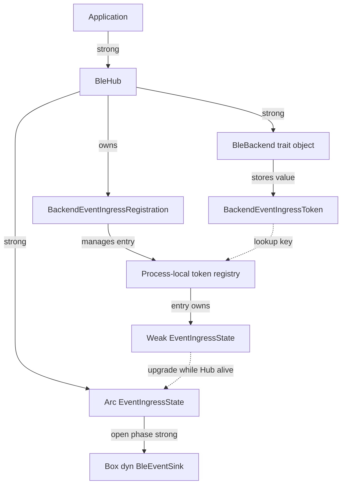

# BleHub FFI 生命周期与并发竞态设计

- 状态：架构调研与推荐；最终约束以 [`.plan/PLAN.md`](../../.plan/PLAN.md) 为准
- 日期：2026-08-28
- 适用范围：`BleHub`、foreign `BleBackend`、Rust `BleEventSink`、v0.1 token ingress 与未来 exported `BackendEventIngressHandle` 的并发和 FFI 生命周期
- 本地 BoltFFI 源码：workspace `D:\projects\contrib\boltffi`
- 相关调研：[BoltFFI 原生后端与 Rust 直连平台 API 的技术评估](boltffi-vs-rust-native-ble-backends.md)

## 1. 结论摘要

BleHub v0.1 推荐使用两个互不嵌套的同步边界和一个单向原子标记：

1. `RwLock<Option<Box<dyn BleBackend>>>` 作为 command/close gate 与 backend ownership slot；
2. `Mutex<Option<Box<dyn BleEventSink>>>` 作为 downstream ownership、事件串行交付和 close drain 边界；
3. `AtomicBool` 作为 ingress closed flag，在 close 等待 in-flight callback 前阻止新 callback admission；
4. `BleHub` 强持有 `Arc<EventIngressState>`；v0.1 process-local registry entry 只持有 `Weak<EventIngressState>`，backend 只保存永不复用的 opaque token。BoltFFI #869 修复后由 direct handle 直接持有同一个 `Weak`。

推荐对象形状：

```rust
pub struct BleHub {
    backend: RwLock<Option<Box<dyn BleBackend>>>,
    capabilities: BackendCapabilities,
    ingress: Arc<EventIngressState>,
    ingress_registration: BackendEventIngressRegistration,
}

struct EventIngressState {
    closed: AtomicBool,
    downstream: Mutex<Option<Box<dyn BleEventSink>>>,
}

pub struct BackendEventIngressToken {
    pub value: u64,
}

// process-local registry entry:
// token -> Weak<EventIngressState>
```

`BackendCapabilities`由constructor通过typed backend query读取、校验并缓存一次，是O(1) immutable metadata，不参与上述同步边界。其余结构不是一个通用并发框架，也不引入runtime、actor、worker、mailbox或lock-free reclamation。设计目标是用标准ownership和同步原语表达最小、可测试的生命周期不变量。

推荐从 `RwLock` gate 开始，而不是预先实现自定义 in-flight counter/condition variable。command method 的 foreign call 被限制为短同步 dispatch；ingress callback 不获取 command/close gate；Rust downstream sink 不同步重入 Hub。移动端只有 `BleHub -> foreign backend` 和 `foreign backend -> push_backend_event(token, event)` 跨 FFI；registry 通过 `ArcSwap` immutable snapshot lock-free lookup，并在进入 state 前释放 snapshot guard；`EventIngressState::push -> BleEventSink::on_event` 始终是 Rust 内部调用。若 Phase 0 证明确有不可控 re-entry 或持锁跨 FFI 的问题，再升级为 RAII operation lease + in-flight counter + condition variable。token workaround 的完整设计和 direct-handle 迁移见 [BoltFFI event ingress workaround](boltffi-event-ingress-workaround.md)。

## 2. 问题边界

BleHub 同时存在以下执行来源：

- Rust、Kotlin、Swift 或其他调用线程进入同步 command API；
- Windows/Android/Apple/Linux 平台 callback thread；
- native backend 自己的 Handler、serial queue 或 OS callback context；
- downstream 自己的 channel、actor、UI loop 或 runtime；
- 显式 `dispose/close`、BoltFFI wrapper release、Rust `Drop` 和 foreign GC/ARC release。

需要处理的不是单一“线程安全”，而是三个层次：

| 层次 | 典型问题 | 责任方 |
|---|---|---|
| FFI handle 内存安全 | retain/release、最后引用释放、wrapper double-close | BoltFFI 生成代码 |
| BleHub 语义生命周期 | command 与 close、push 与 close、callback drain、bind/registration failure | BleHub |
| BLE/业务状态 | stale、duplicate、timeout、retry、当前 session | backend 与 downstream caller |

Rust safe code能防止普通 Rust data race，但不能自动证明跨 FFI 的逻辑竞态、死锁、错误 close 顺序或 foreign object graph 能完全释放。

## 3. 本地证据与可信度

### 3.1 已由本地 BoltFFI 源码验证

BoltFFI exported class handle 的宏实现在：

```text
D:\projects\contrib\boltffi\boltffi_macros\src\expansion\wrapper\class.rs
```

该实现生成：

- `AtomicUsize` reference count；
- `AtomicBool` released marker；
- retain 时对 released/reference count 的原子检查；
- release 时减少 reference count；
- 最后一个 reference 释放时回收 boxed Rust class value。

本地 Java/Kotlin 生成测试与产物还验证 generated class wrapper 使用 `AutoCloseable` 和原子 closed marker，重复 `close()` 不会重复调用 native free。相关证据位于：

```text
boltffi_backend/tests/java.rs
benchmarks/harnesses/kotlin-jvm-bench/
```

这些证据支持以下结论：BoltFFI 已提供 exported class handle 的底层引用计数与 wrapper release 机制。

### 3.2 本地证据不能证明的内容

BoltFFI 不知道 BleHub 的领域与生命周期语义，因此上述机制不能证明：

- close 是否等待正在调用 backend 的 command；
- callback 是否能在 close 后进入 downstream；
- downstream callback 是否已经排空；
- backend dispose 与 native callback 的顺序；
- v0.1 foreign backend 长期保存 token、registry 长期保存 `Weak` 的完整对象图能否释放；
- Kotlin/Swift exception 与 Rust panic 在该完整嵌套路径中的最终行为。

这些仍须由 BleHub 设计并在 Phase 0 实测。

### 3.3 当前 BleHub spike 的证据边界

`spikes/boltffi-lifecycle/` 当前同时提供 Rust tests 与 Windows Kotlin/JVM runtime tests，已经验证：

- `RwLock<Option<Box<dyn BleBackend>>>` command/close gate；
- `Arc<EventIngressState>` + exported class 内部 `Weak<EventIngressState>`；
- command 返回前同步 callback、JVM worker thread callback、Rust-created thread attach JVM 后 callback；
- concurrent push serialization；
- dispose 等待 in-flight sink callback、幂等 cleanup、late callback 返回 `Closed`；
- 旧 spike 中 Rust 长期保存 foreign backend/sink，backend 长期保存 Rust ingress wrapper；该 foreign sink 和 builder assembly 不是最终 BleHub contract；
- declared typed error、10,000 次 assembly/dispose、20/244/1024-byte payload 各 1,000 次持续 push；
- LLVM-MinGW 生成的 Rust GNU DLL 与 JNI glue 可由 Gradle/Kotlin consumer 实际加载。

`spikes/boltffi-class-handle-callback-param/` 固定了当前 BoltFFI `0.30.1` 的生成能力缺口：foreign trait method 不能接收 exported Rust class handle，宏报 `unsupported expansion: callback method parameter shape`；上游由 [issue #869](https://github.com/boltffi/boltffi/issues/869) 跟踪。v0.1 因此采用 `BackendEventIngressToken` + process-local `token -> Weak<EventIngressState>` registry + exported free push，并保留单一 `BleHub::new`。旧 builder spike 只证明 class wrapper retain/release、跨线程 push 与 close race 的部分性质，不证明 token assembly、最终 Rust-only downstream 或未来 direct-handle bind。

旧 JVM spike 的 exception 边界发现一个 **No-Go blocker**：generated JNI glue 在 foreign callback 抛未声明 Kotlin exception 时调用 `ExceptionClear` 并返回零值/void，command 可能被静默报告为成功。旧 foreign sink 的 exception 结果不是最终 Rust-only downstream 路径的证据，但 backend command/bind exception 被伪装成功的问题仍须由 generator/runtime 修复或生成端可强制的 catch-all typed mapping 关闭，才能冻结生产 ABI。

### 3.4 官方平台 close 不能替代 BleHub ingress close

本地 Android 36 `BluetoothGatt.close()` 源码会 unregister client、清理 callback 引用并进入 closed state：

```text
docs/platform-api-reference/android/BluetoothGatt.java
```

但这不能提升为“调用后绝无已在途 callback”的跨平台保证。WinRT、CoreBluetooth 和 BlueZ 也没有一个与 BleHub 整体 Hub 生命周期完全等价的统一 quiescence contract。因此 BleHub 必须让 late callback 即使到达也只能安全返回 `Closed`。

## 4. 必须成立的不变量

### 4.1 Construction 与 token binding

1. backend 以 inert 状态构造，不含 ingress、不启动 BLE operation/callback source；
2. constructor 创建 `Arc<EventIngressState>` 并分配非零、进程生命周期内永不复用的 token；
3. `bind_event_ingress(token)` 在 Hub 暴露前只调用一次，bind 期间不得 push；
4. bind `Err` 表示 backend 未保存 token；constructor close state、best-effort dispose 并返回错误；
5. bind `Ok` 后 constructor 注册 `token -> Weak<EventIngressState>`，registration 成功后才返回 Hub；
6. registration failure 同样 close/dispose；该 token 不复用；
7. close 顺序是 state close/drain、backend dispose、token unregister；
8. registry entry 只持有 `Weak`，backend 只持有 token；
9. missing/stale/unregistered token 统一返回 `Closed`；
10. BoltFFI #869 修复后的 direct-handle 迁移不得改变上述构造和 rollback 语义。

### 4.2 Backend ownership

1. backend 只由 `BleHub` 强持有；
2. command 调用期间 backend 不得被 dispose/drop；
3. close 开始后不得有新 command 获得 backend；
4. close 必须等待已进入的同步 backend method 返回；
5. backend `dispose()` 即使返回错误，backend slot 仍进入永久 closed/`None`。

### 4.3 Event ingress ownership

1. `BleHub` 是 `Arc<EventIngressState>` 的唯一架构级强 owner；
2. `EventIngressState` 在 open 阶段强持有 downstream sink；
3. v0.1 process-local registry entry 只持有 `Weak<EventIngressState>`，backend 只持有 opaque token；
4. registry 使用 `ArcSwap` immutable snapshot lock-free lookup；snapshot guard 在 upgrade、validation、downstream call 或 close wait 前释放；
5. backend、stale token、registry entry 或 late callback不得延长 Hub/downstream 生命周期；
6. close 必须排空 in-flight `on_event`，再释放 downstream sink；
7. close 返回后没有活跃或可新开始的 downstream callback。

### 4.4 Callback 与 command 语义

1. backend 可以在 command method 返回前同步 push；
2. ingress callback 不获取 command/close gate；
3. downstream `on_event` 不同步重入同一个 Hub；
4. backend 一旦为某 command 发出事件，该 method 不得返回 dispatch `Err`；
5. immediate dispatch `Err` 后该 `CommandId` 严格零事件。

### 4.5 FFI 边界

1. foreign backend 的 Kotlin unchecked exception/Swift error 不穿越 FFI；
2. Rust downstream 的所有预期失败必须返回 typed `Result`，不得 panic；通用 panic containment 若需要，属于最外层 FFI trampoline；
3. wrapper release 与 callback 竞争不产生 UAF/double free；
4. `Delivered` 只表示同步 downstream `on_event` 返回 `Ok(())`，不表示 downstream 业务已处理；
5. `Closed`、`InvalidEvent`、`DownstreamFailed` 都不是 BLE operation result。

## 5. Ownership graph



禁止的边：

- registry entry 或未来 ingress handle 强持有 state；
- state 强持有 backend 或 Hub facade；
- backend 直接持有 downstream sink；
- downstream sink 强回指 Hub 并在 callback 栈内同步调用 Hub。

如果应用 sink 需要引用 Hub，应使用应用侧 weak reference 或把后续 command dispatch 到应用自己的执行位置。

## 6. Command/close gate

### 6.1 推荐实现

```rust
struct BleHub {
    backend: RwLock<Option<Box<dyn BleBackend>>>,
    capabilities: BackendCapabilities,
    ingress: Arc<EventIngressState>,
    ingress_registration: BackendEventIngressRegistration,
}
```

command 取得 shared/read guard，并在调用 backend 的短同步 dispatch 期间持有：

```rust
fn dispatch(
    &self,
    request: Command,
) -> Result<(), CommandDispatchError> {
    let slot = self.backend.read().map_err(map_lock_failure)?;
    let backend = slot.as_ref().ok_or(CommandDispatchError::Closed)?;
    backend.dispatch(request)
}
```

close取得exclusive/write guard。清理算法直接实现在public`dispose`中，`Drop`调用它，不增加同义private wrapper：

```rust
impl BleHub {
    pub fn dispose(&self) -> Result<(), BleHubError> {
        let mut slot = self.backend.write_recovering_poison();
        let Some(backend) = slot.take() else {
            return Ok(());
        };

        self.ingress.close_and_drain();
        let backend_result = backend.dispose();
        self.ingress_registration.unregister();
        drop(backend);
        backend_result
    }
}

impl Drop for BleHub {
    fn drop(&mut self) {
        if let Err(error) = self.dispose() {
            trace_dispose_failure(error);
        }
    }
}
```

准确方法名、borrow shape、poison diagnostic聚合在实现时调整。关键是取得write guard后不因poison/backend `Err`提前退出，所有路径继续close ingress、调用backend cleanup、注销registration并释放ownership。第一次显式`dispose`可返回cleanup error；对象仍closed。重复调用和显式dispose后的`Drop`观察到`None`并返回`Ok(())`。

constructor rollback发生在Hub完整形成前，因此best-effort调用同一个backend trait `dispose`，保留原assembly error，再drop trait object。每个平台backend的trait `dispose`本身必须幂等；Rust`Drop`/Swift`deinit`可直接调用它兜底，Kotlin不能依赖不确定的GC/finalizer。

### 6.2 Linearization

| 操作 | 线性化点 |
|---|---|
| command 获得 backend 使用权 | 成功取得 read guard 并观察到 `Some(backend)` |
| Hub 开始排他 close | 成功取得 write guard |
| command 被本地拒绝为 closed | read guard 下观察到 `None` |
| backend ownership 释放 | write guard 下 `slot.take()` |

### 6.3 为什么允许持 read guard 调 foreign backend

通常不应持任意状态锁调用 foreign code。这里是一个受限的 lifecycle lease：

- backend method 必须是短同步 dispatch；
- read guard 只保护 backend lifetime，不保护领域状态；
- ingress callback 不获取该 gate；
- backend 不获得 Hub command facade；
- downstream 被禁止同步重入 Hub。

因此预期 callback-before-return 路径不会形成锁环。

Phase 0 必须验证这一假设。如果 foreign backend 存在不可控同步 re-entry，或 method 无法保持短同步，则改用第 11.2 节的 operation lease 备选，而不是继续扩大锁范围。

## 7. Event ingress 与 close drain

### 7.1 推荐 state

```rust
struct EventIngressState {
    closed: AtomicBool,
    downstream: Mutex<Option<Box<dyn BleEventSink>>>,
}
```

`closed` 是 one-way lifecycle flag，不是 event tag：

```text
false Open -> true Closed
```

`downstream` mutex 同时负责：

- 串行化同一 Hub 的 `validation -> on_event`；
- 保护 sink ownership；
- close 等待 in-flight callback；
- close 通过 `Option::take()` 确定性释放 sink。

### 7.2 Push 算法

推荐概念实现：

```rust
impl EventIngressState {
    fn push(&self, event: BleEvent) -> EventIngressStatus {
        if self.closed.load(Ordering::Acquire) {
            return EventIngressStatus::Closed;
        }

        let downstream = match self.downstream.lock() {
            Ok(downstream) => downstream,
            Err(error) => {
                return EventIngressStatus::DownstreamFailed {
                    message: error.to_string(),
                };
            }
        };

        // close may have started while this push was waiting for the mutex.
        if self.closed.load(Ordering::Acquire) {
            return EventIngressStatus::Closed;
        }

        let Some(downstream) = downstream.as_deref() else {
            return EventIngressStatus::Closed;
        };

        if let Err(error) = event.validate_shape() {
            return EventIngressStatus::InvalidEvent {
                message: error.to_string(),
            };
        }

        match downstream.on_event(event) {
            Ok(()) => EventIngressStatus::Delivered,
            Err(error) => EventIngressStatus::DownstreamFailed {
                message: error.to_string(),
            },
        }
    }
}
```

`BleEvent::validate_shape`是私有、无状态校验：data enum路径检查ID/wire value/size，tagged-record fallback再检查唯一tag/body。`downstream.on_event(event)`是普通Rust trait调用，不发生第二次FFI crossing；它返回Rust-only `Result<(), EventSinkError>`，并由contract要求不得panic。validation与sink error文本分别进入`InvalidEvent`与`DownstreamFailed`供backend记录；message不是稳定机器协议。两种failure都消费当前attempt：不retry同一event，backend照常提交terminal/correlation cleanup并继续后续event，只有`Closed`停止push。若BoltFFI wrapper未统一阻止Rust unwind穿越ABI，v0.1只在最外层`push_backend_event` trampoline增加panic guard；未来direct-handle路径对应放在`BackendEventIngressHandle::push` trampoline。该防线处理contract violation，不属于正常delivery语义，也不伪装成`EventSinkError`。

执行顺序：

1. weak upgrade 失败则在 handle 层返回 `Closed`；
2. 在加锁前 acquire-load closed flag，已关闭则快速返回 `Closed`；
3. 获取 downstream mutex，lock poisoning/failure 映射为带 diagnostic message 的 `DownstreamFailed`；
4. 在锁内再次 acquire-load closed flag；
5. downstream 已被取走则返回 `Closed`；
6. 校验唯一event variant/body、ID/wire value和size guard；
7. 在 mutex guard 生命周期内同步调用 Rust `on_event`；
8. `Ok(())` 返回 `Delivered`；typed `Err` 或 mutex failure 返回 `DownstreamFailed { message }`；panic 是单独处理的 contract violation。

双重 closed 检查处理以下竞态：

```text
push observes Open
close stores Closed
push acquires downstream mutex later
```

第二次检查保证该 push 不会在 close admission point 后进入 downstream。

### 7.3 Close-and-drain 算法

概念顺序：

1. 在 command/close write guard 下将 closed flag release-store 为 `true`；
2. 获取 downstream mutex；
3. 等待任何已经持锁的 `on_event` 返回；
4. `take()` downstream sink；
5. 释放 mutex；
6. 调用 backend local dispose；
7. `take()` backend ownership；
8. 返回 lifecycle result。

close 设置 flag 后，新 callback 在 mutex 外快速返回；已经通过第一次检查但尚未获取 mutex 的 callback，会在锁内第二次检查时返回。close 获得 mutex 时，所有更早进入临界区的 callback 已完成。

### 7.4 Close 后保证

`close()` 返回后：

- Hub 不接受新 command；
- downstream sink ownership 已释放；
- 没有 active `on_event`；
- late callback weak upgrade 失败或观察到 closed，并返回 `Closed`；
- backend native cleanup 已至少被调用一次；
- backend cleanup 即使失败，Hub 也不会重新打开。

该保证不表示系统 Bluetooth radio 被关闭，也不表示 OS 物理链路已经立即消失。

## 8. Lock order 与非重入

唯一允许的 close 顺序：

```text
command/close write guard
-> closed flag store
-> downstream mutex drain/take
-> release downstream mutex
-> backend.dispose
-> backend slot take
```

普通 push 只访问：

```text
Weak upgrade
-> closed flag
-> downstream mutex
```

普通 command 只访问：

```text
command/close read guard
-> backend method
```

没有合法路径从 downstream mutex 反向获取 command/close gate。为保持该无环关系：

- downstream sink 只能 dispatch 并返回；
- downstream 不得同步调用同一个 Hub；
- backend callback v0.1 只调用 `push_backend_event(token, event)`，未来只调用 ingress handle；两者都不回调 `BleBackend` command vtable；
- backend `dispose` 期间的 callback 因 closed flag 直接返回，不进入 downstream mutex 的 delivery 路径。

## 9. 竞态矩阵

| 竞态 | 期望结果 | 主要机制 |
|---|---|---|
| command 先于 close 获得 read guard | close 等待 command method 返回 | `RwLock` read/write exclusion |
| close 先获得 write guard | 后续 command 观察 `None/Closed` | backend ownership slot |
| backend 在 command 返回前同步 push | event 可先于 `Ok` 到达，无自锁 | ingress 不取 command gate |
| 多 callback thread 同时 push | 同一 Hub 的 `on_event` 串行 | downstream mutex |
| push 与 close 同时发生 | in-flight 完成；未进入 delivery 的 push 返回 `Closed` | closed flag + mutex double-check |
| callback 晚于 Hub drop | token lookup miss 或 weak upgrade 失败，返回 `Closed` | registration removal + weak registry entry |
| 重复 close | 后续调用观察 backend `None`，返回 `Ok` | `Option::take()` |
| bind 或 registry registration 中途失败 | state closed，backend best-effort disposed，token 不复用 | constructor rollback |
| push lookup 与 token unregister 并发 | closed state 或 missing token，均返回 `Closed` | ArcSwap snapshot + RCU replacement + closed flag |
| backend dispose 返回错误 | Hub 仍 closed，backend ownership 仍释放 | close is terminal |
| Rust downstream 返回 `Err(EventSinkError)` | `DownstreamFailed { message }`；当前attempt不重试，backend清理correlation并继续后续event | typed result + ingress status policy |
| Rust downstream 违反 contract 并 panic | 不得 unwind 穿越 ingress FFI；不伪装成普通 rejection | 最外层 FFI trampoline + Phase 0 fault injection |
| token unregister 与 callback lookup 竞争 | closed state 或 missing token，均返回 `Closed` | ArcSwap snapshot + RCU replacement + state closed flag |
| 未来 wrapper close 与 callback handle retain 竞争 | 无 UAF/double free | BoltFFI handle atomics + direct-handle lifecycle spike |
| sink 同步重入 Hub | contract violation；测试必须暴露 | lock-order invariant |

## 10. Rust 生态最佳实践

### 10.1 生产原语

首选标准、安全原语：

- `Arc`/`Weak`：共享与非拥有 callback capability；
- `RwLock<Option<T>>`：共享使用与排他 close；
- `Mutex<Option<T>>`：串行 delivery、drain 与 ownership transfer；
- `AtomicBool`：单向、独立的 closed admission flag；
- RAII guards 与 `Option::take()`：确保所有返回路径释放 guard/ownership；
- explicit idempotent close + `Drop` best-effort fallback。

`std::sync` 与 `parking_lot` 的最终选择留到 Phase 0：需要比较 poison policy、目标平台支持、代码复杂度和压力测试结果。无论选择哪一个，不能通过忽略 poison/panic 来伪造恢复。

### 10.2 验证工具候选

- `loom`：候选 dev-dependency，用于枚举纯 Rust closed flag、mutex、RwLock、Arc/Weak interleaving；它不验证真实 JNI/Swift runtime。
- `proptest`：生成 command/push/close/drop 操作序列，并与 reference lifecycle model 比较。
- deterministic barriers：用 barrier/latch 明确停在 read guard、mutex、close flag 等位置，避免依赖 `sleep`。
- randomized stress：多 command thread、多 callback thread 与 concurrent close 循环。
- AddressSanitizer/ThreadSanitizer：在支持的目标和工具链上检查 UAF/double free/native data race。
- Miri：检查可运行的纯 Rust unsafe/ownership 路径；不能替代真实 JNI/Swift 测试。

`loom` 当前不在 workspace。真正加入依赖前，应按项目 local-first 规则固定版本并检查源码、维护状态和目标平台兼容性。

### 10.3 人工分析仍然不可省略

库和工具只能验证给定模型，不能替项目选择语义。必须人工写清：

- ownership graph；
- Open/Closing/Closed 状态；
-每个操作的 linearization point；
- lock order；
- callback re-entry policy；
- close 返回后的保证；
-异常是否可恢复、丢弃还是使对象永久关闭。

最佳实践不是“只靠脑内分析”，而是“先定义不变量，再用标准原语编码，并用模型检查、故障注入和真实 FFI 压力测试反证”。

## 11. 备选方案与采用条件

### 11.1 Actor/mailbox

把 command、callback 和 close 全部送入单线程 actor 可以显著简化竞态，但会让 BleHub core 拥有 queue、worker/runtime、backpressure 和 shutdown protocol，违反 caller-owned execution model。它适合作为 downstream adapter，不进入 core。

### 11.2 RAII operation lease + in-flight counter

若 Phase 0 证明不能安全持有 read guard 调用 foreign backend，可改为：

```text
begin_command:
  lock lifecycle state
  reject if closing/closed
  increment in_flight
  unlock

foreign backend call

CommandLease::drop:
  lock lifecycle state
  decrement in_flight
  notify close waiter

close:
  set closing
  wait until in_flight == 0
  dispose backend
```

优点是 foreign call 期间不持 Rust lock；缺点是自定义状态、condition variable、RAII lease 和异常路径更多。它是证据驱动的备选，不是默认实现。

### 11.3 `Arc<dyn BleBackend>` clone 后解锁

只把 backend 放入 `Arc` 并在 command 前 clone，能避免持锁调用 foreign code，但 close 无法知道 clone owner 是否仍在执行，也不能安全决定何时调用 backend dispose。若再增加 in-flight drain，最终等价于 11.2，不能单独解决问题。

### 11.4 Lock-free/epoch/`ArcSwap`

这些方案能优化读取或内存回收，但不能自动提供 close drain、backend dispose result 和 foreign callback quiescence。对 v0.1 的低频 command path 没有足够收益，复杂度与验证成本更高，不采用。

### 11.5 直接把 downstream sink 交给 backend

这会让 backend 绕过 ingress lifecycle、结构校验、close drain 和串行 delivery，并把应用对象直接暴露给平台 backend，不采用。

## 12. Phase 0 验证计划

### 12.1 Pure Rust deterministic tests

至少覆盖：

1. command 持有 read guard 时 close 阻塞；
2. close 获得 write guard 后新 command 返回 closed；
3. command method 内同步 push 不死锁；
4. 16 个 callback thread 的 `on_event` 最大并发为 1；
5. callback 停在 downstream mutex 内时 close 等待；
6. close 设置 flag 后未进入 mutex 的 push 返回 closed；
7. close 返回后 active callback count 为 0；
8. weak handle 不延长 state/sink 生命周期；
9. duplicate close 只执行一次 backend cleanup；
10. backend dispose error 后对象仍 closed。

### 12.2 Model/state-sequence tests

使用 reference model 生成和验证：

```text
allocate_token
bind_begin
bind_ok
register_token
command_begin
sync_push
command_return_ok
async_push
close_begin
late_push
backend_dispose
unregister_token
close_return
wrapper_release
```

关键断言：

- dispatch `Err` 后零事件；
- event 已出现时 command 只能返回 `Ok`；
- close 返回后零 downstream callback；
- handle/sink/backend drop counter 回到 baseline；
-没有非法状态重新打开。

### 12.3 Kotlin/JVM、Android 与 Swift tests

完整对象图必须覆盖：

- foreign backend 长期持有 opaque ingress token，并从 generated top-level function push；
- process-local registry 长期持有 `token -> Weak<EventIngressState>`，对应 Hub 持有 registration guard；
- Rust 长期持有 foreign backend 与 Rust-only downstream trait object；
- command-before-return callback；
-多个 native callback thread；
- explicit close、token unregister 与 wrapper release；
- callback/close/unregister/release 多方竞争；
- foreign backend Kotlin unchecked exception/Swift error、Rust downstream typed `Err`，以及 contract-violation panic fault injection；
- 至少 10,000 次 assembly/close/release 循环；
- token 不复用、stale token 不误投、registry entry 回到 baseline；
-生成 wrapper/native handle/drop counter 回到 baseline。

桌面 Kotlin/JVM spike 验证共通 JNI/object graph；Android ART/Handler/Looper 和 AAR consumer 在 Android 阶段验证。Swift host runtime 用于验证 ARC/queue/object graph，iOS 真机 BLE 行为后续验证。

### 12.4 Go/No-Go

只有同时满足以下条件才能冻结公共 ABI：

- 无 crash、UAF、double free、永久 deadlock 或引用泄漏；
- command/close 与 push/close 的不变量全部通过；
- close 返回后无 active downstream callback；
- token unregister、wrapper release 与 late callback 有确定行为；
- foreign exception/Rust panic 不穿越 FFI，也不能被清除后伪装成 success/`Delivered`；
-真实 payload 压力下 close latency 与 callback latency 可接受；
-干净 Kotlin/Android/Swift consumer 能编译、运行和释放；
- `bind_event_ingress(BackendEventIngressToken)` 与 `push_backend_event(token, event)` 的生成 API 可维护。

## 13. 推荐决策

v0.1 采用本文第 1 节的 `RwLock<Option<Backend>>` + `Arc/Weak<EventIngressState>` + closed flag + downstream mutex，并以 [token workaround](boltffi-event-ingress-workaround.md) 完成当前 BoltFFI 上的 FFI ingress routing。

这是当前约束下的最佳折中：

- 不引入 runtime；
- 不复制 domain state；
- 使用成熟 Rust ownership/synchronization primitive；
- command 可以并发；
-同步 callback 有明确无锁回路；
- close 有可测试的 drain 保证；
- late foreign callback 不延长对象生命周期；
- token 永不复用，stale callback 不能误投新 Hub；
- registry lookup lock-free，ArcSwap snapshot guard 不进入 downstream delivery；
- 仍保留未来 direct-handle 删除 registry 的明确边界；
-复杂度明显低于自定义 operation counter、raw pointer 或 lock-free reclamation。

该推荐中，BoltFFI handle refcount 和 direct-handle #869 缺口是本地源码已验证证据；旧 Kotlin/JVM spike 验证了 exported class 的长期持有、`EventIngressStatus` return shape、Rust/JVM callback thread attach 和 callback/close race，但不是 token registry 最终对象图。Phase 0 必须新增 Kotlin/JVM 与 Swift token runtime fixture；Android ART/Handler/Looper 在 Android lane 验证。未声明 JVM backend callback exception 被清除并伪装成功仍是明确 No-Go blocker，必须先修复并加入回归测试。#869 阻塞未来删除 registry，不阻塞 v0.1 token 路径。
