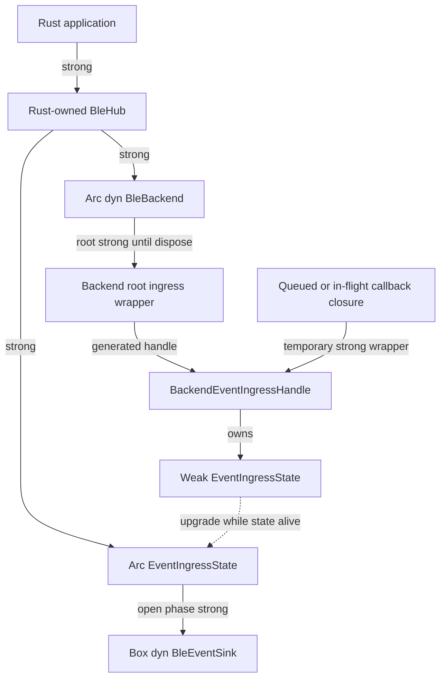

# BleHub FFI 生命周期与并发竞态设计

- 状态：架构调研与推荐；最终约束以 [`.plan/PLAN.md`](../../../.plan/PLAN.md) 为准
- 日期：2026-08-29
- 适用范围：Rust-owned `BleHub`、foreign `BleBackend`、exported `BackendEventIngressHandle`、Rust-only `BleEventSink` 的并发与 FFI 生命周期
- FFI 选择证据：[UniFFI 与 BoltFFI 技术评估](uniffi-vs-boltffi-for-blehub.md)
- Direct handle ownership：[为什么必须使用 `Arc`](direct-ingress-handle-ownership.md)
- 历史 workaround：[BoltFFI event ingress workaround](boltffi-event-ingress-workaround.md)

## 1. 结论摘要

BleHub v0.1 推荐使用 Stable UniFFI `0.32.0` 的 retained direct ingress object，并保留两个互不嵌套的同步边界：

1. `RwLock<Option<Arc<dyn BleBackend>>>` 是 command/close gate 与 backend ownership slot；
2. 一个 `Mutex<EventIngressInner>` 原子保护 ingress 的 `Binding | Active | Closed` phase、bind期间push违约标记、downstream ownership、串行交付和close drain；
3. `BleHub` 强持有 `Arc<EventIngressState>`；backend 强持有exported `BackendEventIngressHandle`，handle只持有`Weak<EventIngressState>`。

Phase 0 production candidate的实际对象形状：

```rust
pub struct BleHub {
    backend: RwLock<Option<Arc<dyn BleBackend>>>,
    capabilities: BackendCapabilities,
    ingress: Arc<EventIngressState>,
}

enum EventIngressPhase {
    Binding { push_attempted: bool },
    Active,
    Closed,
}


struct EventIngressInner {
    phase: EventIngressPhase,
    downstream: Option<Box<dyn BleEventSink>>,
}

struct EventIngressState {
    inner: Mutex<EventIngressInner>,
}

#[derive(uniffi::Object)]
pub struct BackendEventIngressHandle {
    state: Weak<EventIngressState>,
}
```

这删除了 BleHub 自建的 `BackendEventIngressToken`、token allocator、process-local registry、`ArcSwap` snapshot、registration guard和free `push_backend_event`。UniFFI generated opaque object handle与foreign callback handle map仍然存在，但它们是framework-managed实现细节，不是BleHub领域路由层。

没有被删除的是核心生命周期语义：

- Rust-owned downstream sink；
- `Weak<EventIngressState>`；
- command/close排他；
- callback串行化与close drain；
- inert backend、一次capabilities query与一次bind；
- failure-atomic rollback；
- backend主动释放root ingress；
- late callback安全返回`Closed`；
- Rust panic与foreign exception containment。

## 2. 问题边界

BleHub 同时存在以下执行来源：

- Rust application线程进入同步command API；
- Windows/Android/Apple/Linux平台callback线程；
- native backend的Handler、serial queue或OS callback context；
- downstream自己的channel、actor、UI loop或runtime；
- 显式`dispose/close`、Rust `Drop`、Kotlin generated-wrapper destroy/Cleaner与Swift ARC release。

三个层次必须分开：

| 层次 | 典型问题 | 责任方 |
|---|---|---|
| FFI handle内存安全 | generated retain/release、最后引用释放、double release | UniFFI runtime/generated bindings + BleHub runtime gate |
| BleHub语义生命周期 | command/close、push/close、drain、bind/rollback、backend root release | BleHub与backend contract |
| BLE/业务状态 | stale、duplicate、timeout、retry、当前session | backend与downstream caller |

Rust safe code不能自动证明foreign wrapper graph、逻辑竞态、close顺序或exception边界；必须用生成binding的真实runtime test验证。

## 3. 证据与边界

### 3.1 已验证的框架与production对象图机制

已归档的`spikes/archive/uniffi-lifecycle/`及其Android/Apple consumer先验证了Stable UniFFI的representative retention、callback、error、race与package机制。随后已归档的`spikes/archive/uniffi-production-candidate/`直接依赖production `blehub` crate，并在Windows Kotlin/JVM、Windows Swift `6.3.3`、Android 16 arm64真机和Android 16 x86_64模拟器上验证：

- Rust `BleHub`保存foreign `BleBackend`，foreign backend保存唯一长期exported ingress root；
- native callback通过`BackendEventIngressHandle { Weak<EventIngressState> }`到达Rust-only `BleEventSink`；
- `Binding -> Active -> Closed` gate拒绝bind期间push，且不让该event到达sink；
- capabilities/version校验、typed/undeclared capabilities与bind failure、retain-before-bind-error rollback；
- declared/undeclared command failure后零event；
- close排空已进入sink的callback，backend dispose期间与late callback得到`Closed`；
- typed/undeclared dispose failure仍先释放root ingress；
- invalid event、sink rejection和Rust sink panic在exported ingress路径内被转换为bounded status，其中panic guard只包围Rust sink调用；
- Kotlin、Swift、ART真机与ART模拟器各完成10,000次production fixture/state/sink lifecycle并回到可观察baseline；
- Android AAR/POM包含arm64-v8a与x86_64产物，并由无project dependency的consumer实际加载两个UniFFI component。

Windows Kotlin/JNA还暴露Stable UniFFI `0.32.0`的`uint16_t` checksum return-carrier问题：C ABI低16位正确，但JNA direct mapping读取的Kotlin `Int`高位未可靠清零。workaround只在Windows Kotlin candidate配置中设置`omit_checksums = true`；独立脚本使用未省略checksum的参考binding逐一比较17个DLL checksum符号的低16位，并精确比较两个`uint32_t` contract-version符号。Android与Swift保留并成功执行generated checksum checks，generated source没有手改。

representative Apple fixture的权威证据仍是GitHub Actions run [`33249751300`](https://github.com/VIDLG/blehub/actions/runs/33249751300)。

### 3.2 尚不能从本轮结果推定的内容

本轮关闭的是Phase 0 production-object-graph mechanism gate，仍不能证明：

- production candidate在真实macOS/Xcode下的ARC、XCFramework和SPM artifact-only结果；Darwin runtime recipe与CI step已准备，但本Windows session无法执行；
- Phase 1完成后的完整`BleEvent`、所有data enum与owned payload边界；
- rollback cleanup failure的secondary diagnostic、完整生成式state sequence和所有catalog race；
- final release/minified package、artifact manifest、绝对性能、close latency与包体阈值；
- 任何Windows/Android Framework BLE、CoreBluetooth、权限、RF或硬件行为。

这些保留为Phase 0剩余package evidence或Phase 1/Phase 5 ABI candidate gate，不能由当前minimal scan/connect fixture外推。

### 3.3 历史BoltFFI证据的角色

BoltFFI源码与`spikes/boltffi-*`验证过token workaround、direct JNI性能、部分lifecycle和#869/#872能力缺口。迁移到UniFFI后，这些只作为历史、rollback与benchmark evidence。它们不再定义v0.1对象图，也不授权production同时保留token和direct-handle入口。

### 3.4 平台close不能替代BleHub ingress close

本地Android 36 `BluetoothGatt.close()`会unregister client并清理callback引用，但不能提升为“调用后绝无已在途callback”的跨平台保证。WinRT、CoreBluetooth和BlueZ同样没有与整个Hub生命周期等价的统一quiescence contract。因此late callback即使到达，也必须只得到`Closed`，不能访问已释放sink。

## 4. 必须成立的不变量

### 4.1 Construction与direct bind

1. backend以inert状态构造，不含ingress，不启动BLE operation/callback source；
2. constructor调用一次`capabilities()`；
3. `contract_version`必须等于`BLEHUB_CONTRACT_VERSION`，其他metadata也必须合法；
4. constructor创建`Arc<EventIngressState>`以及只含其`Weak`的`Arc<BackendEventIngressHandle>`；
5. `bind_event_ingress(handle)`在Hub暴露前只调用一次，bind期间不得push；
6. bind `Ok`表示backend已retain唯一root handle且仍保持inert；
7. bind `Err`表示backend未retain handle；
8. capabilities/bind任一步失败时，constructor先close/drain state，再best-effort dispose backend并释放local ownership；
9. rollback cleanup失败不得覆盖原assembly error，cleanup failure另行structured diagnostic；
10. application永远拿不到半初始化Hub。

对抗性测试仍要覆盖“backend违反contract，先retain再返回`Err`”。这不能成为合法语义，但rollback必须通过backend `dispose()`释放root handle，不能泄漏或暴露Hub。

### 4.2 Backend ownership与dispose

1. Hub持有一个backend `Arc`；command期间backend不得被dispose/drop；
2. close开始后不得有新command获得backend；
3. close等待已经进入的同步backend method返回；
4. backend `dispose()`必须幂等并永久关闭backend；
5. `dispose()`返回前，包括cleanup error路径，backend必须：
   - 标记closed；
   - detach/invalidate native callbacks和correlation；
   - 原子取走root retained ingress；
   - 显式destroy/release Kotlin wrapper或Swift strong reference；
   - 继续其余best-effort native cleanup；
   - 不恢复ingress或callback delivery；
6. 即使application另持有backend `Arc`，root ingress也必须在Hub dispose返回前释放；
7. 已排队或在途closure可以暂时保留自己的handle，但随后push只能得到`Closed`。

### 4.3 Event ingress ownership

1. `BleHub`是`Arc<EventIngressState>`唯一架构级强owner；
2. state在open阶段强持有Rust downstream sink；
3. ingress handle只持`Weak<EventIngressState>`；
4. backend、generated wrapper或late callback不得延长state/sink生命周期；
5. close必须排空in-flight `on_event`，再释放sink；
6. close返回后没有活跃或可新开始的downstream callback。

### 4.4 Command与callback语义

1. backend可以在command method返回前同步push；
2. ingress不获取command/close gate；
3. downstream不得在callback栈内同步重入同一Hub；
4. backend一旦为command emit任一event，该method不得返回dispatch `Err`；
5. immediate dispatch `Err`后该`CommandId`严格零event。

### 4.5 FFI failure边界

1. undeclared Kotlin/Swift exception不得穿越FFI或伪装成成功；
2. Rust backend实现不得panic；Hub不以项目级`catch_unwind`把backend panic降级成typed fallback，若其到达exported UniFFI scaffolding只能依赖framework ABI containment，仍按不可恢复实现bug处理；
3. Rust downstream预期失败使用typed `Result`，不得panic；
4. `EventIngressState::push`必须只在`downstream.on_event`调用边界contain Rust sink panic，不得用更外层guard误标内部ingress panic；
5. sink panic先记录独立out-of-band violation trace，再向foreign backend返回固定、限长的`DownstreamFailed`，且不得poison ingress mutex；
6. panic仍是contract violation，不是普通`EventSinkError`；
7. wrapper release与callback竞争不得产生UAF/double free；
8. `Delivered`只表示同步sink返回`Ok(())`。

## 5. Ownership graph



禁止的边：

- ingress handle强持有state；
- state强持有backend或Hub；
- backend直接持有downstream sink；
- sink强回指Hub并在callback栈内同步调用Hub；
- project-authoredglobal token registry参与routing。

## 6. Command/close gate

command取得shared/read guard，并在短同步dispatch期间持有：

```rust
fn dispatch(&self, request: Command) -> Result<(), CommandDispatchError> {
    let slot = self.backend.read_recovering_poison();
    let backend = slot.as_ref().ok_or(CommandDispatchError::Closed)?;
    backend.dispatch(request)
}
```

close取得exclusive/write guard，等待已进入的command返回并取走backend slot后立即释放guard；后续ingress drain与native cleanup不再持有Hub ownership锁：

```rust
pub fn dispose(&self) -> Result<(), BleHubError> {
    let backend = {
        let mut slot = self.backend.write_recovering_poison();
        let Some(backend) = slot.take() else {
            return Ok(());
        };
        backend
    };

    self.ingress.close();
    let backend_result = backend.dispose();
    drop(backend);
    backend_result
}
```

关键不是准确helper名，而是取得close线性化点后不能因poison或backend cleanup error提前跳过安全释放。slot一旦在write guard下变为`None`，新command只能返回`Closed`，因此必须在等待ingress或调用foreign/native cleanup前释放guard；这避免command/close ownership锁与callback drain或backend内部锁形成AB/BA。重复dispose和`Drop`观察到`None`并返回/记录结果。

| 操作 | 线性化点 |
|---|---|
| command获得backend使用权 | read guard下观察到`Some` |
| Hub开始排他close | 取得write guard |
| command被拒绝为closed | read guard下观察到`None` |
| Hub释放backend ownership | write guard下`slot.take()` |

持read guard调用foreign code只在以下受限contract下成立：backend method是短同步dispatch；ingress不取该gate；backend不获得Hub command facade；sink不得同步重入Hub。若真实证据否定该假设，再评审RAII operation lease，而不是扩大锁范围。

## 7. Event ingress与panic guard

概念实现：

```rust
impl EventIngressState {
    fn activate(&self) -> Result<(), &'static str> {
        let mut inner = self.inner.lock_recovering_poison();
        match inner.phase {
            EventIngressPhase::Binding {
                push_attempted: false,
            } => {
                inner.phase = EventIngressPhase::Active;
                Ok(())
            }
            EventIngressPhase::Binding {
                push_attempted: true,
            } => Err("backend attempted to push an event while binding ingress"),
            EventIngressPhase::Active => Err("event ingress is already active"),
            EventIngressPhase::Closed => Err("event ingress is closed"),
        }
    }

    fn push(&self, event: BleEvent) -> EventIngressStatus {
        let mut inner = match self.inner.lock() {
            Ok(inner) => inner,
            Err(error) => return downstream_failed(error.to_string()),
        };

        match &mut inner.phase {
            EventIngressPhase::Binding { push_attempted } => {
                *push_attempted = true;
                return EventIngressStatus::Closed;
            }
            EventIngressPhase::Closed => return EventIngressStatus::Closed,
            EventIngressPhase::Active => {}
        }

        let Some(downstream) = inner.downstream.as_deref() else {
            return EventIngressStatus::Closed;
        };

        match std::panic::catch_unwind(std::panic::AssertUnwindSafe(|| {
            downstream.on_event(event)
        })) {
            Ok(Ok(())) => EventIngressStatus::Delivered,
            Ok(Err(error)) => downstream_failed(error.to_string()),
            Err(_) => {
                trace_downstream_panic();
                downstream_failed("downstream panicked while handling an event".into())
            }
        }
    }

    /// Waits for any admitted delivery and releases the sink before returning.
    fn close(&self) {
        let mut inner = self.inner.lock_recovering_poison();
        inner.phase = EventIngressPhase::Closed;
        inner.downstream.take();
    }
}

#[uniffi::export]
impl BackendEventIngressHandle {
    pub fn push(&self, event: BleEvent) -> EventIngressStatus {
        self.state
            .upgrade()
            .map_or(EventIngressStatus::Closed, |state| state.push(event))
    }
}
```

执行顺序：

1. handle层weak upgrade失败返回`Closed`；
2. state取得唯一ingress mutex；该mutex同时是phase linearization、delivery serialization和drain边界；
3. `Binding`期间push只记录违约并返回`Closed`，成功bind后的`activate()`因此失败，constructor rollback；
4. `Closed`或sink已被take时返回`Closed`；
5. `Active`下仅校验完整DTO明确规定、且UniFFI类型系统无法表达的wire invariant；当前最小event enum没有额外内容校验；
6. 在同一mutex guard内同步调用Rust sink，并只在`downstream.on_event`最窄边界contain sink panic；因此sink panic不会poison ingress mutex，内部ingress panic也不会被误标成downstream panic；
7. typed sink failure或sink panic返回`DownstreamFailed`，只消费当前attempt，后续event仍可尝试交付；
8. sink-call-only `catch_unwind`把contract-violation sink panic转换为独立诊断加`DownstreamFailed`；catch在mutex guard内完成，因此不会poison ingress mutex，后续push仍可尝试交付。

phase与sink在同一个mutex内线性化，所以不再需要mutex外原子flag和双重closed检查。close取得该mutex即自然等待已经进入的sink callback；将phase改为`Closed`并`take()` sink后，任何后续push只能返回`Closed`。这同时消除了“bind成功返回前已发生sink delivery”的半组装窗口。

## 8. Close-and-drain顺序

唯一允许的顺序：

```text
command/close write guard
-> backend slot take
-> release command/close write guard
-> ingress mutex acquisition waits for admitted delivery
-> phase = Closed; downstream.take()
-> release downstream sink
-> backend.dispose
   -> backend closed
   -> detach/invalidate callbacks and correlation
   -> take/release root ingress wrapper
   -> remaining best-effort native cleanup
-> release local backend Arc ownership
```

close返回后保证：

- Hub不接受新command；
- downstream sink ownership已释放；
- active `on_event`为零；
- root backend ingress已经释放；
- late callback看到closed或weak upgrade失败；
- backend cleanup失败也不会重新打开。

它不保证系统radio关闭或物理链路即时消失。

## 9. 竞态矩阵

| 竞态 | 期望结果 | 主要机制 |
|---|---|---|
| command先获得read guard | close等待command返回 | `RwLock` exclusion |
| close先获得write guard并取走slot | 释放write guard后新command取得read guard并返回`Closed` | backend slot |
| command返回前同步push | event可先于`Ok`到达，无自锁 | ingress不取command gate |
| 多callback thread push | 同一Hub sink串行 | downstream mutex |
| push与close | 已admit delivery完成，其他返回`Closed` | ingress phase + single mutex linearization |
| callback晚于Hub drop | weak upgrade失败 | weak handle |
| 重复close | cleanup只执行一次 | `Option::take()` |
| bind失败 | state closed，backend best-effort dispose，无Hub | constructor rollback |
| rollback cleanup失败 | 原assembly error保持primary | separate diagnostic |
| backend额外owner存活 | backend object可活，但root ingress已释放 | dispose obligation |
| root release与queued callback | closure可暂存handle，push返回`Closed` | closed state + weak |
| sink typed failure | 当前attempt为`DownstreamFailed`且不重试 | typed result |
| sink panic | trace violation并返回`DownstreamFailed`，不poison ingress mutex，后续push仍可用 | sink-call-only panic guard |
| wrapper release与callback retain | 无UAF/double free | UniFFI runtime + stress gate |

## 10. 验证计划

完整case以[`docs/testing/ffi-runtime.md`](../../testing/ffi-runtime.md)为执行目录。2026-08-29 production candidate已通过pure Rust、Windows Kotlin/JVM、Windows Swift、Android 16 arm64真机、Android 16 x86_64模拟器和Android AAR consumer的适用对象图case；macOS production candidate、完整event wire、final performance/package与少数扩展catalog case仍未完成。至少包括：

- pure Rust deterministic barrier tests；
- generated desktop Kotlin/JVM、Android ART/AAR和Swift runtime tests；
- capabilities、bind、retain-before-error与rollback cleanup failure；
- backend dispose释放root ingress，即使另有backend `Arc`；
- command/close、push/close、root-release/queued-callback race；
- sink rejection、poison、panic subprocess；
- 10,000 lifecycle及wrapper/state/sink/backend counters；
- artifact-only clean consumers；
- final event data enum与payload ownership；
- absoluteperformance、latency和package-size回归。

任何crash、UAF、double free、永久死锁、late misdelivery、handle leak、panic/exception穿越ABI或伪装成功、partial Hub exposure、root ingress未释放、ambiguous event wire或artifact-only consumer失败，都阻塞production ABI。

## 11. 备选方案

### 11.1 Actor/mailbox

可以简化部分竞态，但会让core拥有queue、worker/runtime、backpressure和shutdown protocol，违反caller-owned execution model。不采用；可作为downstream adapter。

### 11.2 RAII operation lease + in-flight counter

如果Phase 0证明不能安全持read guard调用foreign backend，可用显式in-flight counter与condition variable避免持锁跨FFI。它引入更多状态和异常路径，只按证据升级。

### 11.3 Clone backend `Arc`后解锁

单纯clone后解锁无法告诉close何时可以安全dispose；加入drain后本质上回到operation lease。不能单独解决问题。

### 11.4 Project-authored registry、raw pointer或lock-free reclamation

UniFFI direct object已经满足对象参数与retention需求。重新增加token registry、raw pointer、`ArcSwap` routing或epoch reclamation没有收益，反而扩大unsafe/lifecycle gate，不采用。

## 12. 推荐决策

v0.1采用：

```text
RwLock<Option<Arc<dyn BleBackend>>>
+ Arc/Weak<EventIngressState>
+ exported BackendEventIngressHandle
+ Mutex<{ Binding | Active | Closed, bind violation, downstream }>
```

这不是“把生命周期交给UniFFI”。UniFFI只消除了BoltFFI能力缺口造成的项目自建路由；BleHub仍必须明确并验证construction rollback、backend root-handle release、close drain、late callback、panic/exception和generated wrapper final-free。
