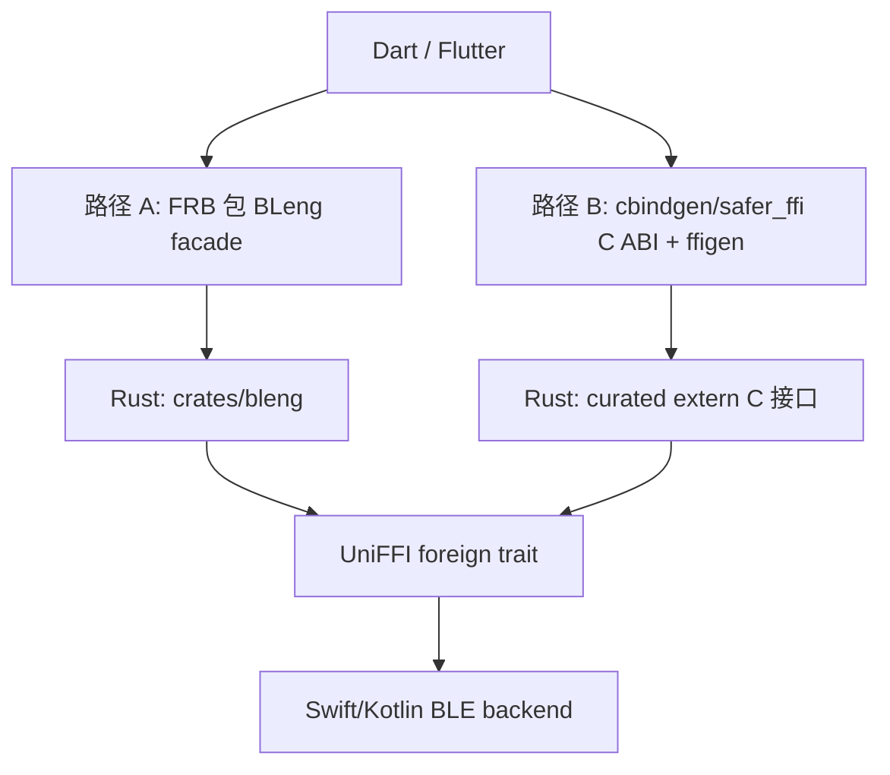

# Flutter 集成可行性评估（探索，2026-11-27）

- 状态：**探索完成，暂缓实施**（future only）。本文件是研究记录，不是 Plan 变更、产品承诺或 ABI 决策。
- 范围：以 **mobile（iOS/Android）** 为目标，评估 Flutter 作为新的 host framework 接入 BleHub/BLeng 的可行性与成本。
- 结论摘要：**机制上可行，但不是"便宜"路径。** 真正的成本不在 Dart FFI，而在"如何让 Dart 绑定同一套 Rust 引擎，且不引入漂移的第二套 BLE 契约"；而 UniFFI 的第三方 Dart 生成器目前**不支持 foreign callbacks**，正好卡住本项目的 `BleBackend`/`BleEventSink` 架构。

## 1. 问题

用户设想的接入方式是 Flutter（主要目的为 mobile）直接调用 Rust 引擎，不经过 platform channel。需要回答：

1. 最新 Dart/Flutter 的 FFI 是否强到可以不用 platform channel？
2. UniFFI 是否支持 Dart？
3. 除 UniFFI / `ffigen` 外还有哪些 FFI 方案（如 BoltFFI）？
4. 对本项目，哪一种最现实？

## 2. 证据与版本（2026-11-27 官方文档）

- Dart 文档页脚：**Dart 3.14**；Flutter 文档页脚：**Flutter 3.50**。
- `dart:ffi` 仅适用于 **Dart Native**（mobile / CLI / server），web 不可用。对 mobile 无影响。
- **Build hooks**（原 native assets）：Dart **3.10** 引入，可编译/下载原生资产（明确提到 Rust）；**Link hooks + tree-shaking**：Dart **3.13**。
- Flutter **3.38 起推荐 `package_ffi` 模板 + build hooks** 做 C 互操作；但官方同时说明 legacy `plugin_ffi` 模板仍需保留的场景包括 **iOS/macOS 静态链接**、Flutter Plugin API、Android Google Play services runtime。
- 链接约束：**iOS/macOS 可静态链接**（`DynamicLibrary.process()`/`executable`），**Android 只能动态 `.so`**。

来源：
- <https://dart.dev/interop/c-interop>
- <https://dart.dev/tools/hooks>
- <https://docs.flutter.dev/platform-integration/ios/c-interop>

## 3. ffigen 是什么

`ffigen` 是 **Dart/Flutter 官方工具**：读取 C 头文件（clang AST），生成 `dart:ffi` 绑定（`Struct`、`Pointer`、`union`、`asFunction`、`@Native` 等）。Flutter 的 `plugin_ffi` 模板即用它生成 Dart 侧绑定。

它**不是** Rust FFI 框架，也不理解 UniFFI。它只消费 **C ABI**：给它一个 header，它产出 Dart 绑定。

## 4. UniFFI 的 Dart 支持

- **官方内建生成器**：Kotlin、Swift、Python、Ruby。
- **第三方绑定**：官方 README 列出 Dart（`NiallBunting/uniffi-rs-dart`）、C、C++、C#、Go、Java、Zig、Lua、JS/RN、Node 等。
- **阻塞点**：`uniffi-rs-dart` 的 README 明确写着：
  - "This is a work in progress and **should not be trusted**."
  - "**foreign callbacks are not fully supported in dart yet as we can't return a value.**"

本项目 ABI 的核心正是 **foreign trait（`BleBackend` 由 Swift/Kotlin 实现、Rust 调用）+ foreign callback（`BleEventSink`）+ async**。缺少 foreign callback 返回语义，等于**直接不可用**，不是"功能略缺"。

来源：
- <https://github.com/mozilla/uniffi-rs>（third-party bindings 列表）
- <https://github.com/NiallBunting/uniffi-rs-dart>（missing features）

## 5. 其他 FFI 方案

| 方案 | Dart 支持 | 机制 | 对本项目的判断 |
|---|---|---|---|
| `flutter_rust_bridge`（FRB） | 一等公民 | 独立的 Rust↔Dart 代码生成（内部也用 ffigen） | 最成熟的 Dart 路线；属**第二套 ABI**，需评审 |
| `ffigen` + 自建 C ABI（`cbindgen` / `safer_ffi`） | 支持 | 自定义 `extern "C"` 接口，ffigen 绑定；回调用 `NativeCallable` | 可控、无 FRB 依赖；工作量大；也是第二 ABI |
| `ffigen` 直接绑 UniFFI 的 C header | 有限 | 绑的是 UniFFI **scaffolding ABI** | 脆弱、非官方支持，不建议 |
| `uniffi-rs-dart` | WIP | 第三方 UniFFI 生成器 | **foreign callback 不支持 → 不可用** |
| BoltFFI | 不支持 | crates.io `boltffi` 0.32.1；CLI 生成 **Swift/Kotlin/WASM**，bindgen 生成 **Swift/Kotlin/TypeScript** | **不生成 Dart**；且本项目已从 BoltFFI 迁到 UniFFI，重新引入=第二 ABI |
| Diplomat / Interoptopus | 不支持（C/C++/C# 方向） | Rust FFI 生成器 | 不覆盖 Dart |

补充事实：
- FRB 最新稳定 **2.13.0**（2026-08-23），Dart SDK `>=3.9.2`；2.14.0-beta 在进行中。
- BoltFFI 最新 **0.32.1**，描述为高性能 FFI 生成器，但目标语言不含 Dart。

来源：
- <https://crates.io/crates/boltffi>
- <https://pub.dev/packages/flutter_rust_bridge>

## 6. 两条现实路径

### 路径 A：FRB 包一个薄 `bleng` facade（推荐先试）

- Dart 边界用 FRB；Rust↔native backend 仍用现有 UniFFI。
- FRB 只暴露 **BLeng curated 操作/事件**（`initialize`、`startScan`、`nextEvent` 等），不把 `BleHub` 原始 command/event 直接给 Dart。
- 两个机制服务**不同边界**（Dart↔Rust 与 Rust↔Swift/Kotlin），不是给同一 BLE contract 做两套。
- 仍需新增薄 wrapper crate，并加"wrapper 只调用 canonical API、不复制语义"的防漂移守卫；属第二套生成绑定，须单独评审。

### 路径 B：自建 C ABI + ffigen

- 自己定义 `extern "C"` 的 BLeng 接口，`cbindgen`/`safer_ffi` 出 header，`ffigen` 生成 Dart；回调用 `NativeCallable.listener`。
- 完全可控、不依赖 FRB 代码生成，但工作量大，且同样是新的 ABI 面。

### 不成立的路

- `uniffi-rs-dart`：foreign callbacks 缺返回语义，卡死 `BleBackend`/`BleEventSink`。
- BoltFFI：不生成 Dart，且是历史回退。

## 7. mobile 的额外成本（与 FFI 机制无关）

即使走通 Dart↔Rust，仍需：

- **iOS 静态链接 + 签名 + Xcode/podspec**（build hooks 不替代静态链接）；
- Android 多 ABI `.so`；
- 原生 BLE 后端仍是 CoreBluetooth / Android BLE（现有 `platforms/apple`、`platforms/android` 复用）；
- 生命周期/权限/后台（iOS `UIBackgroundModes: bluetooth-central`、Android 前台服务）；
- 新的 UI 测试驱动与真机 RF/HIL、artifact-only consumer、packaging gate。

## 8. 结论与建议

1. **暂缓**。Flutter 保持 `future only`，与 PLAN `§10.1`（`integrations/flutter-*` 产品评审前不得创建）和 `§10.2`（仅产品需求 + 独立评审后启动）一致。
2. 若未来启动，先做**限时 spike**，回答唯一决定性问题：**"Dart 如何在不引入第二 BLE 契约的前提下绑定同一 `bleng` 引擎？"**
   - 首选 **路径 A**：FRB 包一个最小 BLeng facade（`initialize`/`startScan`/`nextEvent`），配 fake backend；同时验证 Rust→Swift/Kotlin 的 UniFFI backend 回调仍正常，并在一台真实 iPhone/Android 上跑通最小链路。
   - 对照 **路径 B** 的成本。
3. 命名对齐：若启动，target 应为 **BLeng**，目录用 `integrations/flutter-bleng`（而不是旧的 `flutter-blehub`）。
4. 不以"FFI 增强"为由低估它：真正的门槛是 ABI 绑定与生命周期/测试 lane，不是 platform channel。

## 9. 本文件不做什么

- 不实施任何 Flutter 代码、crate 或 recipe。
- 不修改 `.plan/PLAN.md` 的阶段、ABI 或验收条件。
- 不把 FRB/自定义 C ABI 采纳为正式机制；任何第二 ABI 都须单独评审。

## 参考

- Dart C interop：<https://dart.dev/interop/c-interop>
- Dart hooks：<https://dart.dev/tools/hooks>
- Flutter iOS C interop：<https://docs.flutter.dev/platform-integration/ios/c-interop>
- UniFFI：<https://github.com/mozilla/uniffi-rs>
- uniffi-rs-dart：<https://github.com/NiallBunting/uniffi-rs-dart>
- flutter_rust_bridge：<https://pub.dev/packages/flutter_rust_bridge>
- BoltFFI：<https://crates.io/crates/boltffi>
