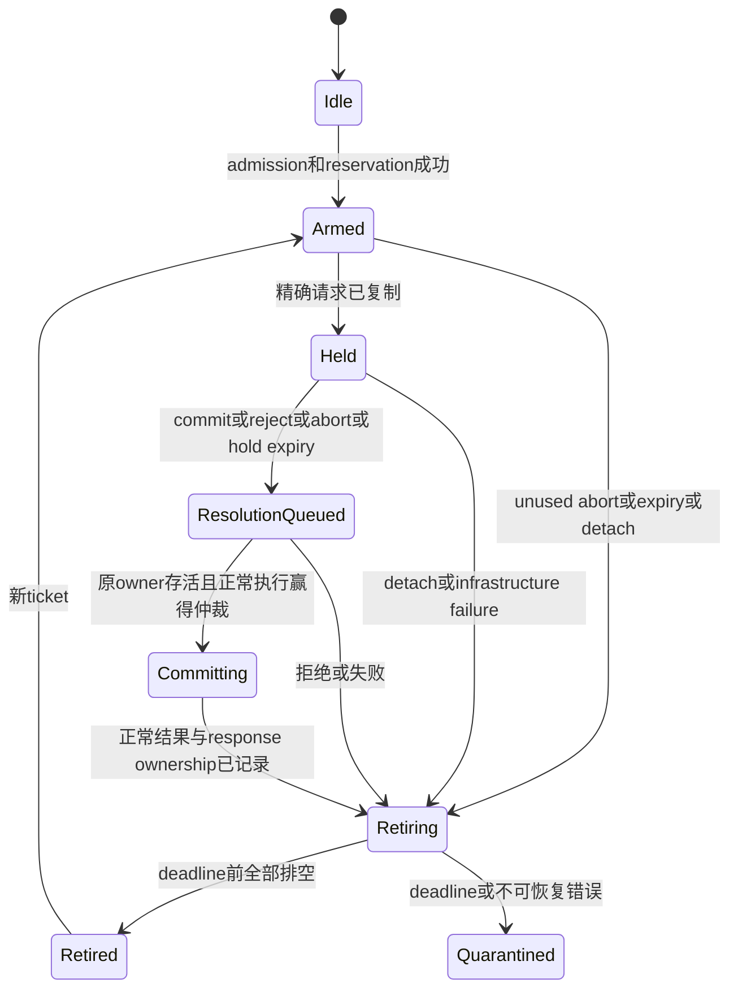

# nRF52840 Multifunction Fault v2：统一非阻塞 ATT 故障控制

状态：**前向实现；通知 TX 观测 B 候选已显式安装到 DK-B。Android CCC disable 与 full-suite 通过；iPhone CCC continuity 仍缺 delegate/App delivery，另有 RecoveryTen stop-advertising 失败。** 详见[观测候选与实际 RF](../../testing/reports/2026-10-19-nrf-notification-observation.md)。[旧 getter-candidate](../../testing/reports/2026-10-19-rn-ccc-disable-reject.md)的双端 full-suite、write/CCC enable REJECT 只适用于其记录的候选，不转移到新 image；A 仅构建未安装，Linux/BabbleSim 未证明。用户授权修改实际 Zephyr clone 并本地提交，不维护 v1 运行兼容。唯一排期归 [Plan](../../../.plan/PLAN.md)；[首轮实现](../../testing/reports/2026-10-18-nrf-fault-firmware-v2.md)与[机制/策略分离](../../testing/reports/2026-10-18-nrf-fault-mechanism-policy.md)保留其各自候选范围。`IOS-RADIO-GATE` 已重新开放，排在当前 firmware/CCC 工作之后，不并行执行。

## 1. 一个固件家族、一个故障引擎

READ、response-write、managed CCC Write Request 共用一个非阻塞 ATT slot。正常 RF、notification/indication、被动断连与故障测试不再反复更换专用镜像。v1 semaphore read-hold、GATT service `0x02` opcodes `0x24–0x27` 不再是 maintained protocol；原始报告和身份文件仅保留为历史证据，不授权当前执行。

| 责任 | 实现边界 |
|---|---|
| 捕获真实请求 | 在 ATT RX dispatch 前复制有界请求，不先调用目标 callback，不保留 borrowed RX bytes |
| 非阻塞 hold | 返回 RX owner，断连不依赖先 RELEASE/ABORT，不等待 UART、信号量或 host ACK |
| 正常执行 | COMMIT 回到原 `perform_write` / `read_cb` / `att_chan_read` 路径，保留 permission、authorization 和 change-awareness 行为 |
| 证据 | 分开记录请求、callback、目标快照、commit、response admission、TX observer 和资源排空 |
| 测试承载 | 同一个 RN workbench：Tests → Current run → Evidence；不新增 App 或公开 BleHub API |

Without-response Write Command 没有可延迟的 ATT response，不制造远端 ACK；signed/command/prepare/execute/long-write 不领取 fault arm。针对目标的冲突 mutation 会使活跃 attempt 失败并隔离连接，而不是变成受支持的 no-response fault。

初版明确限制 **basic ATT bearer、单连接、单 live slot、最多 20-byte value**。`CONFIG_BTTESTER_ATT_FAULT=y` 选择默认关闭的 host hook `CONFIG_BT_TESTING_ATT_FAULT` 和 image attestation，要求 `CONFIG_BT_MAX_CONN=1`、`CONFIG_BT_EATT=n`。`CONFIG_BT_TESTING_ATT_FAULT_REGRESSION` 仅用于测试注入，正式候选必须关闭。

## 2. 所有权与线性化

### 机制与策略的分界

| 层 | 机制 | 不承担的策略 |
|---|---|---|
| Zephyr ATT / Tester | 精确target/request捕获、COMMIT/REJECT/ABORT、原生callback、buffer/pin、deadline、receipt、隔离与退役；attestation编码显式声明的metadata | RN case名称、Android/iOS预期错误、重试次数、恢复十轮、测试顺序、固定镜像family/capability集合 |
| nrftest | 有界声明解析、源码/工具链pin、两遍构建、snapshot、显式programming、租约内readback | 通用builder不要求BleHub A/B；BleHub专用export/provision准入放在具名 `blehub_fixture_policy.py`，不混入通用renderer |
| BleHub host / runner | 选择target、before/request bytes、预算和动作时机；校验family、CCC场景前提、Central ledger、cleanup与最终verdict | 不接管ATT对象寿命、不伪造远端ACK或解除firmware quarantine |
| RN App | 真实production BLE命令、既有control barrier与可观察结果 | 不拥有UART、physical lease或host gate verdict |

固件不再限制CCC只能enable/disable，也不要求固定11项capability；本产品的精确family由声明与上层准入验证。未来新增no-op、模式切换或不同capability组合，不必因此再改ATT engine。Protocol codec只校验字段/布局，不把某个场景矩阵的转换白名单当wire约束。

安全上限不是可上移的场景策略：单slot、20-byte storage、fixed bearer、最大deadline、buffer reservation、旧ticket失权和quarantine仍由底层强制执行。Host可以在上限内选budget，不能命令固件无限等待或提前释放owner。当前REJECT机制仍固定使用安全的 `0x0e`；不宣称已支持任意错误注入、EATT、多slot或任意ATT opcode。

不预建脚本VM、通用fault graph或动态registry。出现实际新需求时扩展具名mechanism和能力声明，并补真实ATT/lifetime回归；未知version/opcode/flag继续fail closed，不以“未来兼容”静默接受。AutoPTS当前不复制第二套v2 codec；若未来有真实typed调用方，再迁移唯一纯codec或增加薄raw transport适配，场景编排不下沉。

### Owner与资源

ACL RX、ARM admission、resolution、数据库控制交给同一 Bluetooth RX workqueue。BTP command thread 只做有界 copied handoff，不执行属性 callback；超时且未开始的控制不能晚执行。锁只保护有界 metadata，不跨 callback、UART、阻塞分配或 native send。

| 资源 | 生命周期约束 |
|---|---|
| RX payload | 接收返回前复制，立即释放原 RX buffer |
| connection | 显式 ref/unref，绑定 connection epoch |
| ATT context / channel | 分别 pin storage；detach 先逻辑失效，reset/released 最后回收；generation 不能代替 pin |
| response | ARM 时 `K_NO_WAIT` 预留；正常、validation error、REJECT、ABORT、expiry 全部使用这一个 reservation |
| receipt | 提交前已有固定空间，复制 before/request/after，不在提交后临时分配证据 |
| UART | reply、异步 GATT completion、event 复制到九块静态 slab 与八项 pointer queue；仅 TX thread 可等待 UART，in-flight frame 仍算 pending；生产者/worker 不在调用栈保存整帧 |
| retirement | buffer destruction、TX completion、evidence、resolver、pins 排空才可复用；超期隔离，不提前释放 |

Server reset、增删 service/attribute、host value mutation 等在 slot 或证据仍 busy 时直接拒绝，不占住唯一 control thread 排队等待；GAP disconnect 保持可执行。预期 before-state 在 ARM、capture、COMMIT 前重查，只读取已知 Tester value/managed CCC 元数据，不调用任意 attribute read callback。每个 CCC descriptor 拥有独立 managed configuration，不包装替换 `bt_gatt_attr_write_ccc`。

Fail-closed disconnect 使用一次非阻塞 HCI submission。提交不证明断连；HCI allocation/command completion 缺失时继续 pin 原 owner，禁止后续 Request 或目标 Command 穿透隔离，最终进入 quarantine。

### Response ordering 不等于 observer drain

原 response outstanding 时，同 bearer 第二个 ATT Request 不得执行 callback 或产生 response，否则无 handle 的 WRITE_RSP 可能冒充第一条完成。该连接 fail closed；confirmation、notification、合法非冲突 command 不被一刀切阻断。

Fixed-bearer **L2CAP FIFO admission** 是本实现的 answer-ordered 点，先于可能合法到来的下一 Request。达到该顺序点后，即使旧 TX observer 还未排空，也允许正常后续 I/O；但新 fault ARM 仍须等待旧 bookkeeping 全部排空。TX completion 是本地 stack/controller 事实，不是 Central/application delivery。

## 3. 状态、deadline 与事实归属



- ARM budget **100–10,000ms**，HELD budget **100–20,000ms**；resolution **2,000ms**、retirement **5,000ms** 为固定 firmware 上限。20s hold 容纳现有 10s backend watchdog，不修改 backend 默认值。
- 全部使用绝对单调 deadline；STATUS、readiness、重复请求不续期，`now >= deadline` 时 expiry 胜出。Host boundary 也有独立绝对预算。
- `RESOLVE(COMMIT)` ACK 只表示受理，不证明 callback、commit 或 peer delivery。READ 成功记录 callback 和 `NORMAL_NO_COMMIT`，不是 mutation commit。
- Write commit 需要 callback 返回与精确目标 after-snapshot 共同证明；`perform_write()==0` 本身不够。无 callback 的正常返回保留 `NORMAL_NO_COMMIT`，不伪造提交。
- REJECT、已 HELD 的 ABORT/expiry 不执行目标 callback，使用固定 ATT Unlikely Error `0x0e`；unused ARM ABORT/expiry 不发 ATT response，并立即放弃 traffic interception。
- Disconnect 先胜出记 `DISCONNECTED_UNCOMMITTED`；COMMIT 已胜出则不能宣称 rollback。后续普通 I/O 的资源错误只能追加 infrastructure facts，不能覆盖原 winner/commit outcome。
- Retirement 在发布 rearmable 前先裁决 deadline；晚 completion 可安全释放资源，但不能消除 quarantine 或恢复 rearm。错误通知只消费一次，不通过自排队使 cooperative RX 饿死 TX cleanup。

STATUS 只保留当前或最后一份 copied receipt。断连后仍可用精确 ticket 读取，但旧 ticket 无 RESOLVE/ABORT 权限；新 ARM 覆盖旧 receipt，不维护无界 history。Cleanup pass 需要 `RETIRED + rearmable + 六项计数全零 + 无 infrastructure error`，并结合 Central ledger、peer detach 和 lease 证据，不能只看 firmware phase。

GET_LIMITS 的 aggregate BUSY 还包含普通 Tester reply/GAP event 的 evidence TX，并不单独证明存在外来 fault owner。Full-suite 可显式传递已验证退休的同 session watchdog ticket，逐次只读 STATUS 区分已归零的五类 fault owner 与第六类 transport evidence；仅后者可在原预算内排空。推进仍要求六项全零和 fresh limits=idle；stale ticket、活动 owner、quarantine 或 infrastructure error 不能等待成通过。无 ticket 的 standalone 路径不据此放宽 `require_idle()`。

## 4. 私有 vendor wire

唯一 vendor handler table 使用 service/index **`0xff/0xff`**；attestation 保持 opcode **`0x01` / schema 1**。新 fault protocol 为 **version 2**，整数 little-endian，nonce 为 opaque bytes，逐字段编码而非 memcpy 带 padding 的 C struct。

| Opcode | 命令 | 请求 body（version 后） |
|---|---|---|
| `0x10` | GET_LIMITS | 空 |
| `0x11` | ARM_WRITE | common + before-length/value + expected-length/value |
| `0x12` | ARM_CCC | common + expected-before:u16 + requested:u16 |
| `0x13` | RESOLVE | ticket + decision（1 COMMIT、2 REJECT） |
| `0x14` | ABORT | ticket |
| `0x15` | STATUS | ticket |
| `0x16` | ARM_READ | common + before-length/value |

Common **含 version 共 62 bytes**：`version:u8 + boot_nonce[16] + owner_nonce[16] + expected_connection_epoch:u32 + expected_bearer_epoch:u32 + expected_database_epoch:u32 + peer[7] + handle:u16 + arm_budget_ms:u32 + hold_budget_ms:u32`。Owner nonce 使用 run UUID canonical bytes，boot nonce 不使用常量 entropy 兜底。Peer 使用现有 GAP wire encoding，不重复反转 bytes。

Ticket **55 bytes**：`boot_nonce[16] + owner_nonce[16] + sequence:u64 + connection_epoch:u32 + bearer_epoch:u32 + database_epoch:u32 + operation:u8 + handle:u16`。Operation：1=response-write、2=CCC-write、3=read；supported-operation mask=7。Sequence 非零、不回绕复用。CCC before/requested分别是精确u16；机制允许no-op、模式切换和任意exact请求字节，COMMIT时仍由原managed CCC路径决定正常结果。具体enable/disable专项必须由host证明起始状态，不能把no-op冒充in-flight disable。

全部新 reply 为 `version:u8 + result:u8` 开头；非零 result 精确 **2 bytes**，成功 GET_LIMITS **61 bytes**，ARM/RESOLVE/ABORT **58 bytes**，STATUS 最大 **162 bytes**。ARM_WRITE 最大 104、ARM_CCC 66、ARM_READ 83 bytes。

Result：0 OK、1 BUSY、2 BAD_STATE、3 STALE_TICKET、4 MISMATCH、5 RESOURCE_EXHAUSTED、6 INVALID_ARGUMENT、7 NOT_READY、8 UNSUPPORTED_PROTOCOL、9 TOO_LATE。未知 enum、保留位、尾随 bytes、错误长度全部 fail closed。

GET_LIMITS body：`boot_nonce[16], supported_operations:u8, bearer_policy:u8, max_connections:u8, max_live_slots:u8, max_value_length:u8, engine_flags:u16, arm_max_ms:u32, hold_max_ms:u32, resolution_max_ms:u32, retirement_max_ms:u32, peer_present:u8, peer[7], connection_epoch:u32, bearer_epoch:u32, database_epoch:u32`。Bearer policy 只允许 fixed=0；engine flags 只用 bit0=quarantined、bit2=busy，bit1 保留为零。无 peer 时 peer/epochs 为零，不能 ARM。

STATUS body：`ticket[55], phase:u8, winner:u8, flags:u16, request_opcode:u8, derived_write_flags:u8, offset:u16, peer[7], normal_att_result:u8, callback_result:i16, observed_length:u8, observed_bytes, before_length:u8, before_bytes, after_length:u8, after_bytes, conn_refs:u8, bearer_pins:u8, response_buffers:u8, resolver_work:u8, tx_pending:u8, evidence_pending:u8, arm_remaining_ms:u32, hold_remaining_ms:u32, resolution_remaining_ms:u32, retirement_remaining_ms:u32, outcome:u8, infrastructure_error:u8`。三段 value 各最多20 bytes。

- Phase：0 IDLE、1 ARMED、2 HELD、3 RESOLUTION_QUEUED、4 COMMITTING、5 RETIRING、6 RETIRED、7 QUARANTINED。
- Winner：0 NONE、1 COMMIT、2 REJECT、3 ABORT、4 ARM_EXPIRE、5 HOLD_EXPIRE、6 DISCONNECT、7 PROTOCOL_FAILURE、8 RESOURCE_FAILURE。
- Flags bits0–9：captured、callback invoked、commit observed、response queued、TX completed、TX failed、infrastructure failed、rearmable、normal path evaluated、answer ordered；其余为零。
- Outcome：0 PENDING、1 ARM_CANCELLED、2 ARM_EXPIRED、3 INJECTED_REJECT、4 HOLD_EXPIRED_UNCOMMITTED、5 DISCONNECTED_UNCOMMITTED、6 NORMAL_VALIDATION_FAILED、7 COMMITTED、8 NORMAL_NO_COMMIT、9 PROTOCOL_FAILURE、10 RESOURCE_FAILURE。
- Infrastructure error：0 NONE、1 CONFLICTING_TRAFFIC、2 PRECONDITION_CHANGED、3 RESPONSE_ADMISSION_TIMEOUT、4 RESPONSE_SEND_FAILED、5 RETIREMENT_TIMEOUT、6 EVIDENCE_OVERFLOW、7 OWNERSHIP_INVARIANT。

Host 实现与严格解析见 [`fault_control.py`](../../../tests/peripherals/nrf52840/fault_control.py)。原始请求事实、callback 结果和 Central exactly-once terminal 独立绑定，不从 payload 相同推导业务 command ID。

## 5. 唯一 maintained identity 与构建所有权

| 字段 | A | B |
|---|---|---|
| image_id | `nrf-multifunction-rf-v2-a` | `nrf-multifunction-rf-v2-b` |
| image_version / fixture_role | `"2"` / `multifunction-rf` | `"2"` / `multifunction-rf` |
| profile_id | `blehub-nrf52840-multifunction-v2-a` | `blehub-nrf52840-multifunction-v2-b` |
| local name | `BleHubMultiRfV2DKA` | `BleHubMultiRfV2DKB` |
| service UUID | `fd600000-0000-4000-8000-000000000000` | `fd700000-0000-4000-8000-000000000000` |

BleHub host 与具名 admission 只接受两个 reviewed exact ordered variants：以下 base11；或 base11 后仅追加 `notification-tx-observation-v1`。不接受任意 prefix/superset/reordering 授权；这不是底层 encoder 的固定集合：

```text
normal-rf
gatt-reset
notification
indication
passive-disconnect
att-read-fault-v2
att-write-fault-v2
att-ccc-fault-v2
att-precommit-defer-v2
att-fault-arm-timeout-10000
att-fault-hold-timeout-20000
```

观测 variant 要求显式 `CONFIG_BTTESTER_NOTIFY_OBSERVATION=y`、`CONFIG_BT_GATT_NOTIFY_MULTIPLE=y`、`CONFIG_BT_GATT_NOTIFY_MULTIPLE_FLUSH_MS=1`；两遍实际 config 还须证明私有 host hook 已启用。基础 variant 保持可用，不因 nrftest 新 pin 推定设备已更新。

Attestation schema1 的 TLV 含义不变。BTP MTU=1024、header=5，所以 payload≤**1019 bytes**，不是1024。若五文本 UTF-8 长度总和为T、capability数量N、名字长度和S：`payload = 75 + T + N + S`。Renderer最多16 slots、单名≤32 bytes、五文本合计≤320 bytes，拒绝超限、不截断；base11 A/B 为370 bytes，追加观测能力的 variant 另加一个 TLV length byte 与30-byte名字。不能用通用decoder可读历史schema1推导当前family获准执行。

BleHub 拥有 [`firmware/images/`](../../../tests/peripherals/nrf52840/firmware/images)、[`firmware/profiles/`](../../../tests/peripherals/nrf52840/firmware/profiles)、expected contracts、host controls与场景。Zephyr fork commit拥有整个ATT hook及Tester实现，nrftest lock固定该commit和West/SDK版本；**不新增独立builder、patch staging或dirty allowlist**。实际builder输入由ignored本机配置解析，工作区与configured build clone必须核对到相同受测commit，不能仅凭路径或文件名推断。改动在所属仓库提交并由lock固定；不把ignored草稿或未提交patch当长期源码来源。

复用 nrftest two-pass normalized-slot builder：

1. 通用builder校验显式caller-owned声明、支持的board、受限settings和wire预算，不硬编码BleHub A/B；安全配置不可被任意Kconfig透传绕过。拒绝不匹配revision、dirty/untracked source、错误West pins或linked输入。
2. Schema2 source audit保存Tester、Bluetooth host和公共Bluetooth headers的逐文件inventory/hash/archive，并记录board config/overlay、declaration/profile和lock bytes。
3. 两遍之间及发布前验证输入未漂移；实际compile command与dependency检查证明消费了锁定ATT source/header。
4. 第二遍normalized digest必须稳定，最后发布manifest；失败先撤销旧manifest授权。
5. BleHub专用export/provision通过具名family policy后，从真实artifact导出expected contract；通用构建成功不授权未知family进入RF。export/check不证明安装，provision必须显式授权且另取得live installed receipt。
6. 从选定提交树导出builder源码进行验证/重放；独立receipt绑定nrftest commit/tree、外部pins、调用方输入、命令和产物hash，不能把完整脏工作区的test数量贴给精选commit。

该inventory是有界scoped source证据，不是完整Zephyr/SDK/compiler dependency closure或密码学installed binary证明。

## 6. Host / RN 集成与剩余运行门禁

Host继续拥有physical lease、installed-image proof、peer/ticket、动作、cleanup与最终verdict。App在connected+discovered后进入既有control barrier，host核验limits并ARM，确认后才放行read；不再pre-launch ARM。复用同一runtime/session，不因切页重启、取消或清空测试。

已迁移的read-fault路径包括full-suite cancellation/watchdog/RecoveryTen handoff、pending engine reload、独立cancellation/watchdog和适用adapter/permission入口。断连后只读retained STATUS，不对旧owner RELEASE/RESOLVE；普通teardown不偷偷reset GATT。系统 radio 门禁仍按各自身份独立执行；`IOS-RADIO-GATE` 已重新开放并排在当前 firmware/CCC 工作之后。

| 新故障专项 | 必须同时证明 |
|---|---|
| Response write REJECT | 精确HELD、无commit；App failure；同连接queued read读回旧值，后续正常写入可完成 |
| CCC enable REJECT | 正确descriptor与目标值；App failure；后续enable/value/disable可完成，不把无notification当本地补偿证明 |
| CCC disable REJECT | 起始确已启用；reject后远端保留原配置；旧subscription仍可收值，不承诺remote rollback |
| HELD watchdog | firmware20s内发生native10s watchdog；target/sibling分类、物理detach、新route recovery独立结算 |
| HELD passive disconnect | 不先COMMIT/REJECT/ABORT，RX仍可推进detach，旧ticket未提交退役 |
| Stale route/token | 旧control无权作用新route，latecallback/expiry隔离，资源排空 |

Response-write 与 CCC enable REJECT 已有 Android/iPhone 独立 RF，CCC disable REJECT 仍为 Android pass / iPhone gap，见[write](../../testing/reports/2026-10-19-rn-response-write-reject.md)、[CCC enable](../../testing/reports/2026-10-19-rn-ccc-enable-reject.md)、[CCC disable](../../testing/reports/2026-10-19-rn-ccc-disable-reject.md)各自精确候选。新 observer 候选的独立 RF、Android pass 与 iPhone CCC/RecoveryTen 缺口见[新报告](../../testing/reports/2026-10-19-nrf-notification-observation.md)，不继承旧 pass。Android/iOS 独立 artifact/session 取证，继续使用同一 workbench；REJECT 专项保持独立 opt-in，不为减少命令而并入 full-suite。

### 可选普通通知观测

固件只提供有界 receipt 与关联机制：分开记录 SET_VALUE storage、CCC gate、subscriber selection、GATT admission、ATT queue、L2CAP submission、buffer release 和独立 TX callback。后两者不是 Central delegate/JS delivery；wire 由 Zephyr typed header 唯一定义，Python 使用单一严格 codec。编译/runtime 默认 OFF，不改变原 batching 策略；owner 只能 OFF 轮转，旧 numeric cookies 只能更新原 retained receipt 或记 unmatched，不能串到新 owner。

Host 通过现有 physical lease/BTP session 显式启用并采集，只包围原有 stimulus；poll 避开 HELD fault，FINAL 在 physical cleanup 前尝试。原错误与诊断/cleanup 错误分别保留，无 sidecar 的历史 bundle 不变。RN 仍使用原 App、subscription 与严格 App-delivery 条件；不以重新 enable 或本地 TX completion 绕过 continuity gap。精确 wire、源码、构建与测试限制见[观测候选报告](../../testing/reports/2026-10-19-nrf-notification-observation.md)。

### 真实 Central 主线与分层验证

用户确认以**Mac控制真实DK Peripheral + Android/iPhone Central**推进RN RF。macOS原生Swift/CoreBluetooth Central可作为独立Apple backend/HIL开发与回归辅线；不新增RN macOS App，不以Mac通过替代iOS/Android，也不让Mac与手机同时竞争单连接DK或同一fixture owner。当前native Apple RF入口尚缺完整v2会话/live-proof/owned-cleanup桥；Mac入口已在外部动作前fail closed，native iOS旧快捷入口仍有同源风险、不得执行，其修复candidate保留待审阅。不能把旧profile参数或已广播设备当准入。

Linux/BabbleSim不再是真机RF启动前置条件，不默认安装Linux环境。显式provision后仍须同physical lease取得新live receipt，先正常RF，再按named opt-in专项推进，不把已构建当已安装。现有软件与仿真测试保留独立价值，未运行的断言不计通过，普通RF不能豁免native/package/lifecycle/长稳或Phase退出要求。

| 断言 | 当前取证方式/限制 |
|---|---|
| 真实phone stack、RN桥接、普通IO/notification/indication | 手机→真实DK；各平台独立artifact/session/ledger |
| 精确请求HELD、REJECT未提交、正常readback与恢复 | 同一固件ticket/status + Central terminal/domain + before/after/readback，不能只看App Passed |
| native watchdog先于firmware expiry、HELD时物理断连、旧route隔离 | 手机与DK双端证据、绝对预算、GAP detach和资源收尾；不先release解开RX |
| Mac CoreBluetooth行为 | 独立native Mac HIL会话，待v2host桥接完成后执行，不借用手机session或结果 |
| 第二outstanding ATT Request、精确observer延迟、pool耗尽、缺失/晚到TX/HCI completion、UART饱和、deadline equality | 保留真实ATT/BabbleSim或目标上受控fault-injection回归需求；手机/Mac的CoreBluetooth/Framework API不能保证制造这些内部交错，当前未获等价运行证据 |

Mac ARM编译只证明源码可编译链接，不执行peer role。标准 Ztest 的真实 host runtime 仍有平台限制；Mac standalone source-inclusion 回归不证明真实 kernel/controller 调度，历史限制见[当时的Linux runtime前置检查](../../testing/reports/2026-10-18-nrf-linux-runtime-preflight.md)；该历史记录不再要求先配置Linux才能推进真机。改用目标上回归补覆盖时必须逐项审查其真实执行断言，不能改名即视为等价。设备预检与native桥接缺口见[真实 Central 预检](../../testing/reports/2026-10-18-real-central-rf-preflight.md)；早期target-init失败见[原始执行报告](../../testing/reports/2026-10-18-dk-b-v2-provision-attempt.md)，后续保护诊断、恢复、修复后的installed proof及双手机RF见[当前候选报告](../../testing/reports/2026-10-18-v2-dk-b-mobile-full-suite.md)。
