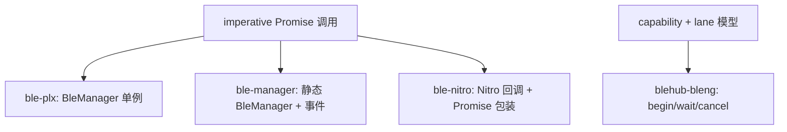

# `@blengine/react-native-bleng` 与竞品 BLE 库的 API 对比

本文对比本仓库的 React Native BLE API 与 workspace 内三个主流/新兴竞品的**公开 API 设计**，回答三个问题：

1. 我们做得好的地方是什么；
2. 我们有问题、需要改进的地方是什么；
3. 还需要补充什么能力。

结论按证据强度标注：**已验证**＝直接读源码/类型定义；**推断**＝由源码行为或平台文档推导；**未验证**＝需要真机或上游确认。

## 1. 范围与方法

| 库 | 版本 | 证据来源 |
|---|---|---|
| `@blengine/react-native-bleng`（本仓库） | `0.0.0`，ABI **未冻结** | `integrations/react-native-bleng/specs/*.nitro.ts`、`src/index.ts`、`API.md` |
| `react-native-ble-plx` | 3.5.1 | `contrib/react-native-ble-plx/src/index.d.ts`、`BleManager.js` |
| `react-native-ble-manager` | 12.5.3 | `contrib/react-native-ble-manager/src/index.ts`、`docs/methods.markdown` |
| `react-native-ble-nitro` | 1.15.1 | `contrib/react-native-ble-nitro/src/manager.ts`、`src/specs/NativeBleNitro.nitro.ts` |

本文只比较**对外 API 形状与语义**，不比较性能、二进制体积或 CI 覆盖。没有做任何真机 RF 或配对操作，因此不构成设备证据。

## 2. 心智模型对比

- **ble-plx**：`new BleManager(options)` 单例式命令式 API。每个操作返回 `Promise`，可传 `transactionId`，再用 `cancelTransaction(transactionId)` 取消。通知用 RxJS `Observable`。错误是 `BleError`，带 `errorCode`、`attErrorCode`、`iosErrorCode`、`androidErrorCode`、`reason`。（已验证）
- **ble-manager**：一个静态 `BleManager` 对象，方法返回 `Promise`，另配一套 `onXxx` 事件回调。错误基本是带字符串 `message` 的普通 `Error`。绑定/缓存刷新等不少能力是 **Android only**。（已验证）
- **ble-nitro**：Nitro 支撑的 `BleNitroManager`，原生层是回调，JS 层包成 `Promise` + 可选超时（`BleTimeoutError`）。能力覆盖较新但较窄：**没有 descriptor 读写、没有绑定、没有解绑**。（已验证）
- **本仓库（bleng）**：没有"管理器单例 + 一堆方法"。每个能力是 Rust 创建、携带精确 owner/connection/session 的 **HybridObject 能力对象**；所有有界操作都是 `begin*()` → `wait(ms)` / `cancel()`，`begin*` 要么返回能力、要么返回类型化失败。事件是 **lane**（`nextEvent`），且有 retained end。JS 从不持有 raw ID/句柄。（已验证）

## 3. 功能矩阵

图例：✅ 有且语义清晰；⚠️ 有但受限/仅单平台/语义较弱；❌ 无。

| 能力 | bleng（本仓库） | ble-plx 3.5.1 | ble-manager 12.5.3 | ble-nitro 1.15.1 |
|---|---|---|---|---|
| 适配器状态/初始化 | ✅ `initialize()` + adapter observation lane | ✅ `state()` / `onStateChange` | ✅ `start` / `checkState` / `onDidUpdateState` | ✅ `state` / `subscribeToStateChange` |
| 打开/关闭蓝牙 | ✅ `owner.beginAdapterControl(enabled)`（Android；Apple `not_supported`） | ⚠️ `enable/disable`（Android；iOS 不支持） | ⚠️ `enableBluetooth`（Android） | ⚠️ `requestBluetoothEnable`（Android） |
| 扫描 | ✅ | ✅ | ✅ | ✅ |
| 扫描过滤 | ✅ serviceUuids / namePrefix / exactName / companyId / minRssi / manufacturerData（前缀或掩码） | ✅ serviceUUIDs / allowDuplicates | ✅ 原生过滤很深（scanMode/phy/legacy/manufacturerData/reportDelay…） | ✅ serviceUUIDs / rssiThreshold / allowDuplicates / androidScanMode |
| Android 扫描调参（scanMode/phy/reportDelay/legacy） | ✅ `android`（Android；Apple `not_supported`） | ❌ | ✅ | ✅ `androidScanMode` |
| 连接/断开 | ✅ | ✅ | ✅ | ✅ |
| `autoConnect` | ✅ `peripheral.beginAutoConnect()`（Android；Apple `not_supported`） | ❌（推断） | ✅ `autoconnect`（Android） | ✅ `autoConnectAndroid` |
| 连接结束保留终态 | ✅ `awaitEnd`（可重复读） | ⚠️ `onDisconnected` 事件 | ⚠️ `onDisconnectPeripheral` 事件 | ⚠️ 断开回调 |
| 连接状态查询 | ✅ `connection.isConnected()`（该连接自己的 lane） | ✅ `device.isConnected()` | ✅ `isPeripheralConnected` | ⚠️ 回调推断 |
| 扫描状态查询 | ✅ `scan.isScanning()`（该 lane 自己的认知） | ⚠️ 无独立查询 | ⚠️ 无独立查询 | ⚠️ 无独立查询 |
| GATT 发现 | ✅ | ✅ | ✅ `retrieveServices` | ✅ `discoverServices*` |
| characteristic 读/写 | ✅ `beginRead/beginWrite(value, type)` | ✅ | ✅ `read` / `write*` | ✅ `readCharacteristic` / `writeCharacteristic` |
| 通知/指示 | ✅ notify+indicate，回报 `actual_mode`，独立 lane | ✅ `monitor`（RxJS） | ✅ `startNotification` | ✅ `subscribeToCharacteristic` |
| descriptor 读写 | ✅ `descriptor.beginRead/beginWrite` | ✅ | ✅ `readDescriptor` / `writeDescriptor` | ❌ |
| RSSI | ✅ | ✅ | ✅ | ✅ |
| MTU 查询/请求 | ✅ query+request（Apple 仅查询，请求 `not_supported`） | ⚠️ `requestMTUForDevice`（Android；iOS 受限） | ⚠️ `requestMTU`（Android only） | ⚠️ `requestMTU`（Android） |
| 连接优先级 | ✅（Android 应用；Apple `not_supported`） | ✅ `requestConnectionPriorityForDevice`（Android） | ⚠️ `requestConnectionPriority`（Android only） | ✅ `requestConnectionPriority`（Android） |
| 写长度查询 | ✅ 通过 `MtuInfo.maximumWriteWith/WithoutResponse` | ❌ 无独立查询 | ✅（iOS only `getMaximumWriteValueLengthFor*`） | ❌ |
| 创建绑定 | ✅（Android；Apple `not_supported`） | ❌ | ⚠️ `createBond`（Android only） | ❌ |
| 绑定进度 | ✅ `bond.nextState(ms)`（有界、fail-closed；终态回执仍在 `wait`） | ❌ | ⚠️ 仅终态事件 | ❌ |
| 解绑 | ✅ `beginRemoveBond()`（Android；Apple `not_supported`） | ❌ | ✅ `removeBond`（Android only） | ❌ |
| 已绑定设备列表 | ✅ `owner.beginDeviceQuery('bonded', [])`（Android；Apple `not_supported`；只读） | ❌ | ✅ `getBondedPeripherals`（Android only） | ❌ |
| 配对 PIN/确认 | ⚠️ 数字 PIN（`beginBond(pin)`，Android）；确认/Passkey 留给系统 UI；Apple `not_supported` | ❌ | ⚠️ `createBond(id, pin)`（Android） | ❌ |
| 已连接设备枚举 | ✅ `owner.beginDeviceQuery('connected', serviceUuids)`（只读；Apple 需 service UUID，返回系统已连接） | ✅ `connectedDevices` | ✅ `getConnectedPeripherals` | ✅ `getConnectedDevices` |
| 缓存刷新/service changed | ✅ `connection.beginGattCacheRefresh()`（Android；Apple `not_supported`） | ❌ | ✅ `refreshCache`（Android） | ❌ |
| iOS 状态恢复/后台 | ⚠️ 后台挂起已真机通过；冷启动恢复：后端 `restoreIdentifier` + `willRestoreState` + 显式 `adoptPeripheral(key)`（无真机证据） | ✅ `restoreStateIdentifier` | ✅ `restoreIdentifierKey` | ✅ `restoreIdentifier` |
| Android companion 关联 | ✅ `owner.beginDeviceQuery('companion', [])`（只读清单，API 26+，真机验证）+ ✅ `owner.beginCompanionAssociation(..., notifyOnDeviceNearby?)`（真实系统选择器，API 33+，Android 16 真机验证，`deviceProfile` 由宿主传入，库不声明权限；Apple `not_supported`）+ ✅ `owner.beginCompanionPresence()`（presence lane，Android 16 真机：真实广播 DK 的 appear + 平台模拟 disappear，需宿主 opt-in 与 `REQUEST_OBSERVE_COMPANION_DEVICE_PRESENCE`）；companion 驱动的后台扫描属于宿主策略 | ❌ | ✅ `companionScan` / `getAssociatedPeripherals`（API 26+） | ❌ |
| 取消 | ✅ 每个能力独立 `cancel()` 回执 | ✅ `transactionId` + `cancelTransaction` | ❌ 基本无 | ❌（回调式） |
| 错误模型 | ✅ 封闭类型化枚举 + 稳定 `code` + 平台细节 + `not_supported` | ✅ 丰富错误码（errorCode/att/ios/android/reason） | ❌ 普通 `Error` 字符串 | ❌ 普通 `Error` / `BleTimeoutError` |
| 多消费者共享一条流 | ✅ `shareLane` | ⚠️ 事件广播 / RxJS | ⚠️ 事件广播 | ⚠️ 回调广播 |
| 原始句柄/ID 是否跨 JS | ✅ 不跨（opaque 能力对象） | ⚠️ string id | ⚠️ string id | ⚠️ string id |
| React 生命周期集成 | ✅ `BlengProvider` + 挂载惰性 | ❌ 手动 `destroy()` | ❌ 手动 | ❌ 手动 |
| 重发现/过期安全 | ✅ 过期能力失败，不会误指新 session | ⚠️ id 重新解析 | ⚠️ id 重新解析 | ⚠️ id 重新解析 |

## 4. 我们做得好的地方

1. **平台差异诚实**（已验证）：MTU/优先级/绑定/解绑/autoConnect 都明确区分"Android 会做、Apple 只读或拒绝"，拒绝是类型化的 `bleng.dispatch_rejected.not_supported`，而不是静默 no-op 或静默退化。竞品的同类调用在 iOS 上常常"看起来成功"或行为不一致。
2. **封闭、可编程的错误契约**：`BlengFailureInfo.code` 是唯一可做控制流的字段，`message` 只用于展示，另有 `domain`/`platform` 细节。ble-manager/ble-nitro 只给字符串，无法稳定分支。
3. **不泄漏 raw 句柄/ID**：能力对象携带 owner/connection/session 身份，重发现后旧能力会失败而不是指向新拓扑。竞品普遍传 string UUID/id，很容易在重连/重发现后静默指错。
4. **有界、独立的回执语义**：`begin*` 成功≠射频送达，`wait(ms)` 的 deadline 是调用方自己的界，`cancel()` 只记录请求、不是回滚。这些都被显式写进契约，竞品大多把"Promise resolve"当成完成。
5. **lane 是单挂起拉取 + 可共享**：`nextEvent` 单消费者、`shareLane` 多消费者、`overflow` 只结束该 lane（fail-closed），避免了 ble-nitro 那种有界队列被事件洪峰打满的问题。
6. **查询也是"诚实观察"**：`isConnected()` / `isScanning()` 报告的是该能力自己 lane 的事实，而不是再去探测一次平台；`false` 不会伪称"链路已断/扫描已停"。这比竞品的同步布尔更可解释。
7. **扫描过滤在引擎里统一**：`exactName` / `minRssi` / `manufacturerData`（前缀或按位掩码）由两个平台一致的固定谓词应用，不依赖原生 offload，也不承诺 offload。
8. **React 生命周期安全**：`BlengProvider` 挂载/卸载不 start/close，导航和 Fast Refresh 不会拆掉活着的 BLE 工作；竞品需要手动 `destroy()`。
9. **派生 await 层不新增语义**：`pendingOperation` 只包一层 `wait/cancel`（可选 `AbortSignal` 绑到同一个 cancel），不会偷偷加超时或重试。
10. **companion presence 是显式 opt-in 的观察**：`notifyOnDeviceNearby` 让宿主自己声明权限与意图，缺权限在选择器之前就类型化失败；presence 是边沿触发的关联事实（`present` 从不冒充“已连接”），用与清单一致的 owner 作用域 key，Apple 直接 `not_supported`。竞品要么没有 presence，要么把它混进扫描/连接语义。

## 5. 我们的问题与差距

### 5.1 查询/状态类 API 仍然偏弱（易用性）

已补：`connection.isConnected()`、`scan.isScanning()`、`owner.beginDeviceQuery(kind, serviceUuids)`
（Android connected+bonded+companion；Apple 仅 connected，需 service UUID；均为**只读清单**，不产生可连接能力）、
`peripheral.localName()`、`connection.localName()`（来自提交 connect 的 peripheral 广告名；adopt 清单 key 时为
`undefined`）。查询/状态类现在没有已知的便利读取缺口。

这里仍需权衡：我们的 peripheral/connection 身份是 owner 作用域内的 opaque 能力，系统级清单故意
不提供可寻址的平台身份；如果以后要让清单项能直接连接，应另设一个显式“adopt this inventory key”的
能力，而不是让 inventory 变成隐式句柄。

### 5.2 平台能力缺口

- **iOS 状态恢复/后台**（三者都有）：后台挂起已真机通过。冷启动恢复已补：`CBCentralManagerOptionRestoreIdentifierKey` + `willRestoreState` 保留恢复的 `CBPeripheral`，`owner.adoptPeripheral(key)` 把恢复的设备重新变成可连接能力；仍需真机冷启动证据，且宿主需要 `bluetooth-central` 后台模式。
- **Android 适配器 `enable/disable`**：已补（`owner.beginAdapterControl(enabled)`；只给回执，状态仍走 adapter lane；targetSdk 33+ 可能必须用户确认；Apple `not_supported`）。
- ~~Android companion device / association~~：只读关联清单（API 26+，无权限、真机验证）与 `associate()` 请求（API 33+，系统选择器，宿主传入 `deviceProfile`、库不声明权限）均已补齐。presence 观察也已补：库随包提供平台绑定的 `CompanionDeviceService`，宿主以 `notifyOnDeviceNearby: true` opt-in 并声明 `REQUEST_OBSERVE_COMPANION_DEVICE_PRESENCE`，RN 侧通过 `beginCompanionPresence()` 读取边沿触发的变化。Android 16 真机上用 CDM 自己的 `simulate-device-appeared/disappeared` 验证了完整路径（service → broker → backend → engine → lane，同一 key 的 appear/disappear）。剩余只是**真实周边设备的 RF presence**（物理进出）与宿主自己的“presence 触发后台扫描”策略，不是 API 缺口。
- **配对 PIN / 配对确认**：数字 PIN 已补（Android `beginBond(pin)`，公开 `setPin` API，PIN 不落日志、用完即丢）；Passkey/数字比较确认仍由系统 UI 负责（普通 App 无 privileged 权限），Apple 仍 `not_supported`。
- **缓存刷新 / service changed**：已补 `connection.beginGattCacheRefresh()`（Android；Apple `not_supported`；成功后旧拓扑显式失效）。
- **Android 扫描调参**已补（`android.scanMode` / `phy` / `reportDelayMs` / `legacy`，Apple `not_supported`）；companion 清单、`associate()` 请求与 presence 观察也已补。presence 的 opt-in 是显式的（关联时 `notifyOnDeviceNearby` + 宿主权限），缺权限会在弹选择器之前就以类型化失败拒绝，而不会留下一条永远静默的 lane。

### 5.3 易用性/心智负担

- `begin*` → `wait`/`cancel` 比一行 `await` 啰嗦；但 `pendingOperation(...)` 已经把这个模型压成一个
  `{ result, cancel }`，不需要再新增会隐藏 cancel 的 `readOnce()`。保留显式 cancel 是设计决定。
- 命名 `bleng`/`Bleng` 对不熟悉本仓库的人是黑盒；文档密度大。

### 5.4 可观测性

- 绑定进度：已补 `bond.nextState(ms)`（平台报告的 `bonding`/终态，有界、fail-closed）；终态回执仍在 `wait`。
- 没有独立的“当前连接状态/已发现拓扑”快照查询（只有 retained connection end 与一次性 discovery）。

### 5.5 发布/生态

- `0.0.0`、ABI 未冻结；typedoc 站点已可从 specs 生成（`pixi run just react-native::api-site`，输出在 gitignored 的
  `integrations/react-native-bleng/site/api`），并已有 CI（`docs-checks.yml` 门禁 + `docs-pages.yml` 构建/发布）；
  托管暂时被 **Free 组织 + 私有仓库**的 GitHub Pages 权限挡住，详见
  `docs/research/react-native/typedoc-site.md`。
- 失败已有稳定 `code` + 派生的 `reason`（`BlengOperationError.reason` / `failureReason()`）；
  `reason` 只用于展示，未知 `code` 回退到 `message`。

## 6. 需要补充什么（按优先级）

> 原则：平台不支持的必须 `not_supported`，不能"看起来跨平台"。需要设备证据的（后台/配对/恢复）不能靠合成测试宣称通过。

**已完成（本轮）**
- descriptor 读/写全链路。
- `createBond` + `removeBond`（Android；Apple `not_supported`）。
- 扫描过滤扩展：`exactName`、`minRssi`、`manufacturerData`（前缀/掩码）。
- Android 扫描调参：`android.scanMode` / `phy` / `reportDelayMs` / `legacy`（Android；Apple `not_supported`）。
- 适配器电源请求：`owner.beginAdapterControl(enabled)`（Android；Apple `not_supported`）。
- `connection.isConnected()`、`scan.isScanning()`。
- `autoConnect`（Android；Apple `not_supported`）。
- 只读设备清单：`owner.beginDeviceQuery('connected' | 'bonded' | 'companion', serviceUuids)`（Android 三者；Apple `connected` 需 service UUID、`bonded`/`companion` `not_supported`）。
- GATT 缓存刷新：`connection.beginGattCacheRefresh()`（Android；Apple `not_supported`；成功后旧拓扑失效）。
- legacy 配对 PIN：`connection.beginBond(pin)`（Android；Apple `not_supported`；Passkey/确认仍由系统 UI）。
- iOS 冷启动状态恢复：后端 `restoreIdentifier` + `willRestoreState` + `owner.adoptPeripheral(key)`（需真机验证）。

**P0（真实 App 会卡住）**
1. **iOS 状态恢复/后台恢复**：后台挂起已真机通过；冷启动恢复已实现后端 `restoreIdentifier` + `willRestoreState` + 显式 `adoptPeripheral(key)`，**还差真机冷启动证据**。
2. **配对 PIN**：数字 PIN 已实现（Android；需真机验证）；Passkey/确认交由系统 UI；Apple `not_supported`。

**P1（常用能力）**
3. ~~Android companion device / association~~ —— 只读清单已真机验证；`associate()` 请求已在 **Android 16 真机**上通过真实系统选择器验证（API 33+，`deviceProfile` 宿主传入），并在同一次 run 里验证了真实广播外设的 presence appear（同一 key）与平台模拟的 disappear。presence 的完整回调/映射/lane 路径另有 CDM 调试钩子测试。顺带修复了关联请求的 LE 过滤 bug（见 §9）。

**P2（打磨）**
4. ~~绑定进度的一等 lane~~ —— 已加 `BlengBond.nextState(timeoutMs)`（`ForeignBondProgress`，有界 8、溢出/退休/掉线 fail-closed；终态回执仍在 `wait`）。
5. ~~常见操作薄封装~~ —— 由 `pendingOperation(...)` 的 `{ result, cancel }` 满足；不再新增隐藏 cancel 的 `readOnce()`。
6. ~~人类可读的 `reason`~~ —— 已加 `BlengOperationError.reason` 与 `failureReason()`（由稳定 `code` 派生，未知 code 回退到 `message`）。
7. ~~typedoc~~ / 迁移指南 / 与竞品 API 对照的 cookbook —— 迁移对照已在 API.md/API.zh.md（scan/connect/读写/通知/断开/平台差异，以及 ID→adopt 的模型差异）。typedoc 站点已落地为**从 specs 生成的本地站点**（入口 `src/index.ts`，`--emit none --treatWarningsAsErrors` 作为检查，零告警），并已有 CI 与 Pages 发布 workflow；只差 Pages 权限（Free 组织 + 私有仓库）才会真正上线。尚未托管，也没有 cookbook。

## 7. 结论

- **设计上我们更"正确"**：类型化错误、能力身份、平台诚实、有界回执、React 生命周期安全——这些是竞品普遍欠缺的，也是我们最大的差异化优势。
- **能力面在收窄差距**：descriptor、解绑、扫描过滤、查询、autoConnect、Android 扫描调参、适配器电源、只读设备清单（含 companion 关联、`associate()` 与 presence 观察）、GATT 缓存刷新、数字 PIN、`peripheral.localName()` 已补齐；仍落后的是**冷启动恢复真机证据**与 **companion 真实 RF presence 证据**。
- **取舍建议**：保持"一个能力 = 一个 HybridObject、无 raw ID、平台差异类型化"的核心不妥协；在上面补齐 P0/P1，尤其 **iOS 后台恢复** 与 **已连接/已绑定枚举** 是最影响真实采用的短板。

## 8. 证据边界

- 竞品结论来自其上表所列版本的源码/类型定义（已验证）；性能、二进制、CI 未比较。
- 本仓库结论来自当前 `specs/` 与 `API.md`（已验证）。
- 本轮未做任何真机 RF 或配对操作；`createBond` / `removeBond` / `autoConnect` / Android 扫描调参只有编译/合成测试证据，iOS 侧是 `not_supported`，均不构成真机通过。

## 9. 本轮编译/构建验证（2026-11-25，无 RF）

以下都是**编译 / 合成 / 离线**证据，不构成 RF 或真机结论：

- Rust：`cargo test --workspace` 606 passed、`test::supervisor` 173 passed、`lint-common`（clippy `-D warnings` + ruff + peripheral profiles）通过。
- API 快照：`binding::snapshot-check` 校验 3 份、`binding::bleng-snapshot-check` 校验 6 份（含 32 个组件测试）；`freeze-inventory` 及单测通过。
- Android：`ffi::android-backend-build`（真实编译 `platforms/android`）通过；`ffi::android-bleng-build` 产出 AAR、通过 ELF 单镜像审计并完成 consumer APK 构建。
- Apple（Rust 后端）：`swift test --package-path platforms/apple` 99/99 通过。
- RN：`npm run typecheck`、`react-native::bleng-android-unit-test`、`quickstart-typecheck`、`formal-host-check`、`formal-host-ios-build`（含 Pods 刷新与模拟器构建）通过。

**Companion presence / association 补充（同一 2026-11-25；真实 appear + 真实 disappear，仍非物理距离变化）**

- Rust：`cargo test --workspace` 625 passed（含新增 presence lane 的纯存储测试与 lane 分发测试）；`lint-common` 通过（clippy `-D warnings`）。
- API 快照：`binding::snapshot-check`（3 份）与 `binding::bleng-snapshot-check`（6 份 + 32 个组件测试）均重新生成并校验通过；新增 `SupervisedCompanionPresenceObservation` / `ForeignCompanionPresence*` / `CompanionPresenceDeliveryError`。
- Android：`ffi::android-bleng-build` 重新出版 `dev.blehub:bleng:0.0.0`（含新 presence 类型，ELF 单镜像审计通过）；`ffi::android-backend-publish` 重新编译并出版 `blehub-android`（含 `BleHubCompanionDeviceService`、manifest 声明、broker 与 `CompanionPresenceChanged` 事件）。
- RN：`npm run generate` 生成 `BlengCompanionPresence` 等 28 个 HybridObject；`formal-host-android-build` 编译 App + 测试 APK 通过；`stage-apple-bleng` 后 `bleng_ios_consumer --refresh-pods` 的 iOS 原生测试构建 `** TEST BUILD SUCCEEDED **`。
- 证据边界：presence 已在 Android 16（SDK 36）真机上通过 CDM 自己的 `cmd companiondevice associate` + `simulate-device-appeared/disappeared` 验证：真实 `onDevicePresenceEvent` → 真实 `BleHubCompanionDeviceService` → broker → 真实后端 → 引擎 → supervisor lane，appear/disappear 使用同一个 owner 作用域 key（`BlengCompanionPresenceInstrumentedTest`，`just react-native::formal-host-android-companion-presence`）。测试自己用与后端相同的 `startObservingDevicePresence` 调用 arm 平台订阅，因此验证的是 service/映射/lane 全链路。
- 真实选择器已于同一日验证（`BlengCompanionAssociationInstrumentedTest#chooserAssociationArmsPresenceAndReportsTheAdvertisingPeer`，`just react-native::formal-host-android-companion-association`）：`beginCompanionAssociation(..., notifyOnDeviceNearby=true)` → 真实系统 chooser → 关联 id 与设备 MAC 一致 → 后端 arm → **真实广播的 nRF52840 DK appear 到达 lane（`realAppear=1`）**；disappear 用 CDM 钩子保持有界。测试先证明手机能扫到该 service，再自动选中行（ColorOS chooser 无 accessibility 节点，用 DPAD/DPAD_CENTER）。
- 真实“peer leaves”也已自动通过（`...#realDisappearanceAfterThePeerLeaves`，`just react-native::formal-host-android-companion-peer-leaves`）：真实 appear 后停止 DK 广播，lane 收到**真实的 disappears** 且 key 相同（`WALK_AWAY_NOW key=1` → stopped → `present=false`，同一 key）。同一个测试也可由人拿着 DK 走远完成；那只是更接近“距离变化”的重复验证，不是尚未实现的能力。
- 顺带修复：关联请求使用的是 **classic `BluetoothDeviceFilter`**，BLE-only 外设永远不会出现在 chooser（一直“寻找设备”）；已改为 `BluetoothLeDeviceFilter` + `ScanFilter.setServiceUuid`。
- 顺带补齐：`connection.localName()`（来自提交 connect 的 peripheral 广告名；adopt 清单 key 时为 `undefined`）。

本轮顺带修复的、此前从未真正编译暴露的缺陷：

- `AndroidScanPhy` 的 PHY 常量应为 `BluetoothDevice.PHY_LE_*`（不是 `ScanSettings.*`）。
- iOS 的 `math.h` 把 `OVERFLOW` 定义成宏，和 Nitro 生成的 C++ 枚举成员冲突。JS 观测终态字面量因此由 `'overflow'` 改为 `'overflowed'`；Rust 的 `ForeignScanEndReason::Overflow` 不变，只改 JS 字面量与生成名。
- podspec 的 `source_files` 漏列 4 个新 bridge 文件；`Data`/`ArrayBuffer` 与 `await` 桥接错误；多个测试 double 缺少新 foreign trait 方法。

已知未通过 / 仍未做：

- `tests/consumers/react-native-bleng` 的 `Notifications.test.tsx` 仍有 10 个此前已存在的 UI 测试失败，与本次 API 变更无关，未作为通过证据。
- 任何真机 RF、配对、**冷启动状态恢复**验证都未做（后台挂起已有真机证据）；新增的 `adoptPeripheral`、恢复回调与数字 PIN 只有编译/合成测试证据。Companion 只读清单已真机验证；`associate()` 已在 Android 16 真机上通过真实系统选择器验证，并观察到真实广播 DK 的 appear；presence 的消失仍用平台钩子模拟。
