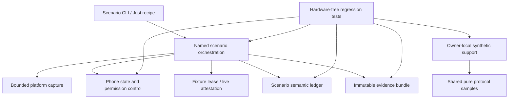

# RN host tooling：职责、复用与清理边界

更新：2026-11-09。本文保存当前职责和维护规则，不改变生产 BLE 架构、公开 ABI、RF 场景协议或 evidence schema。候选 hashes、测试计数、失败尝试与执行日志放在具名报告，不在本页维护易过期的文件/行数排行榜。

## 结论

工具应服务 BLE/native/RN 验证，不作为独立产品继续扩建。复用的是流、SDK、身份、租约和错误保存机制；不能把不同场景的事实、完成条件或 destructive control 混成一个万能 runner。一个 RN App/workbench 不意味着所有 host gate 必须处于同一 runtime。

RN 使用 **Tests → Current run → Evidence**；浏览不执行 BLE，切页不卸载当前场景。App checks 与 host physical/cleanup/bundle verdict 分开。页面与证据层级见下文；原 RF Lab 协议文档已退休，保留在 [历史归档](../archive/react-native-rf-lab-test-architecture.md)。

## 入口与职责



这表达依赖方向，不要求为每个文件建立嵌套 package，不新增插件 registry、通用 Driver 或 cleanup pipeline。

| Owner / 入口 | 当前职责 | 不应接管的职责 |
|---|---|---|
| `run_bleng_android_scan` / `run_bleng_ios_scan` → `bleng_scan_runner` + `bleng_*_scan` | 正式 managed 场景（scan / notification / indication / io / disconnect / connect-failure / CCC 与 write reject / recovery / recovery-ten / passive-disconnect / background / multi-link）的 scene 描述符与证据接线 | 不复制 App 内业务逻辑；不把 submission 当 delivery；不以 UI 结果替代 host physical/cleanup verdict |
| `run_bleng_android_adapter_transition` / `bleng_android_adapter_transition` | 正式 App 的 Android adapter OFF→ON 真机场景（Kotlin instrumented test + host 编排） | 不再有 BTP coordination mode；不隐式启动夹具或改固件 |
| `run_bleng_android_permission_transition` / `bleng_android_permission_transition` | 正式 App 的权限撤销 → 进程死亡 reason 8 → fresh-App 恢复场景 | 不自动 grant；不伪造进程终止证据 |
| `run_bleng_ios_permission_ui` / `bleng_ios_permission_ui` | 正式 App 的 iOS 系统授权 UI（deny/allow、fresh install 每阶段卸载） | 不是 RF；不把 xcresult 通过升级为 bundle verdict |
| `run_bleng_ios_scenes` / `run_bleng_ios_multi_link` / `run_bleng_ios_device_test_build` / `bleng_ios_candidate` / `bleng_ios_consumer` | iOS 正式 App 的场景编排、设备测试构建与候选目录 | 不 build 未授权产物、不自签、不冒充 RF 通过 |
| `ios_radio_lease` / `ios_radio_restoration` / `ios_radio_control` | 安装前 phone owner、radio 恢复校验、UI 控制观察的步骤词汇与严格审计 | 不 build/flash、不自动重试 radio、不收集密码；lease released ≠ RF 或 bundle pass |
| `run_bleng_ui` / `bleng_automation` / `bleng_android_automation` / `android_appium_transport` | 共享 Appium owner、attach-only session 与分平台回调；场景 UI 驱动复用同一路径 | 未知 session 不采用、不盲目 DELETE；不把 App Passed 当 host gate Passed |
| `bleng_lifecycle_evidence` / `bleng_scan_evidence` / `bleng_multi_link_contract` / `bleng_multi_link_fault` | 各场景 facts、ACK/阶段预算、native event 与 multi-link 隔离契约 | 偷用别的场景成功标志、只信 `status=passed` |
| `ccc_disable_reject_ledger`（Apple native HIL Flow 12） | host 侧 runtime 校验：portable schema v2、双平台、多通道 | 不拥有设备端 relay；不改 firmware |
| runtime / artifact consumer / offline verify | 非 RF ABI/runtime、干净产物消费、single-image 清单 | 把构建、Jest 或 integrity 结果升级为 RF |
| `fault_control` / provider-local 场景 coordinator | 单一 leased BTP session 上的 v2 typed controls、ARM barrier、精确 ticket 与 retained receipt | 第二份 serial/lease、App 内 UART control、把 firmware receipt 当 native terminal |
| `DirectFixture` | 共享 BTP/资源生命周期、GATT/GAP 物理操作与 coordination 服务端 | 场景迁移不创建第二份 fixture、兼容 dispatcher 或通用 registry |
| `rf_fixture` / `host_paths` | preflight、startup PID/PGID、guard、APK 身份与公共路径 | 第二份 attestation/lease authority |
| `capture_io` | 有界流、UTF-8/threadtime、local child teardown | scenario facts、ACK policy 或 recovery state |
| `evidence_io` | 只读 host 文件/流机制：拒符号链接、大小上限、打开后校验身份、读中变更检测、严格 JSON | artifact 策略、场景词汇或发布 |
| `run_ios_rf_scan` | 单流 iOS 诊断入口；`native_hil` 复用其进程锁 | 默认必跑套件；替代独立证据 |

## 软件检查、fixture 与候选 UI 工具

正式 consumer 的 `formal-host-install` 只负责显式 lockfile 安装；`formal-host-check` 与 build 使用已安装依赖，不隐式重装。组件 Jest 仅发现 `src/**/*.test.[jt]s?(x)`，设备 E2E bootstrap 不混入同一 Jest 进程。完整职责映射见[分层指南](../cross-cutting/testing-layer-responsibilities.md#21-正式-rn-consumer-的具体责任落点)。

Synthetic fixture/emulator 与可复用的只读 Just expansion 属于 owner-local `support/`，不属于某个 `TestCase` 的公共方法库。调用方显式管理临时目录/context；support 不导入测试模块，不继承或实例化 `TestCase`。原 SDK/install mock、wire 字节和独有失败断言保持；生产/live provider 不依赖 synthetic support。跨层 Peripheral 样本仍由 Peripheral support 拥有，不能为了 RN 目录整齐搬入 host。

Maestro 已于 2026-11-22 移除（仅 opt-in 对比、从未门禁、重试不可控）；用户允许评估 Detox 不等于已批准正式替换。候选先做版本/真机支持、设备端 setup/teardown 与隔离审计，再考虑一个有界 non-RF UI 对照；不得直接把 stock CLI 的自动安装/reset/permission/default retry 当作项目 authority 或 cleanup。不给每个框架增加一套 BLE runner/ledger，也不预建通用 driver registry。当前 maintained Appium 路径与正式 scan/full-suite 验收不变；具体官方来源、受限候选实验结果和采用条件见[评估报告](../../testing/reports/2026-11-08-rn-test-responsibilities-and-ui-tool-evaluation.md)。

Android App 生命周期身份与 UI transport/session authority 分开：[`AndroidCandidateOwner.inspect_running_identity`](../../../tools/react_native/bleng_android_candidate.py) 在现有 phone lease、冻结 APK/managed receipts 和不延长的 checkpoint deadline 下，重新读取该 owner **原启动身份**。它只用于已 launch、未退休的运行期 checkpoint，不重新选择/认领已有 App，不绑定 WebDriver，也不证明 foreground、UI、BLE terminal 或资源零。UI/session guard 仍由具体自动化 owner 执行；该入口不改变 Appium `bind` 的一次绑定或 capability 检查，也不提供可绕过清理规则的公共 cleanup 模式。预算耗尽本身允许原身份的独立限时清理；其他身份/transport/ownership/provenance 失败粘性失权，之后不因设备暂时恢复而重新获得 authority。可选 `record_command` 仅通过共享 SDK read hook 被动记录 checkpoint 命令，不复制 live identity codec。该 host-tool 接口不是生产 BLE ABI，不使任何 UI 工具自动获得 session authority。

## 正式 Android managed lifecycle：非 RF 的完整入口

`formal-host-android-managed-lifecycle` 的薄 CLI 仅解析显式参数并调用
[`run_android_lifecycle`](../../../tools/react_native/bleng_android_lifecycle.py)，不复制 owner 或 UI 场景。
它消费已构建 APK/hash、三个明确 helper hashes 和安装/helper settings 授权；不隐式构建、安装
helper APK、grant DUT BLE 权限、切换 radio 或准备固件。旧 `formal-host-ui` 保持 attach-only 语义，
不能用新入口存在来绕过其 owning handoff 拒绝。

runner 按职责组合冻结 APK、phone lease、临时 helper scope、具体 platform owner、candidate 与
`ScanAutomationOwner`。复用 `exercise_lifecycle`，不创建第二套按钮场景；拒绝旧运行 App/session，
不认领未知进程。收尾为 automation（DELETE/server/platform/helper）→ App → prepared evidence →
phone journal → sealed bundle。App 场景成功后保留 Evidence，不能因其他收尾失败擅自关页。

[`bleng_lifecycle_evidence`](../../../tools/react_native/bleng_lifecycle_evidence.py) 保存并重放此非 RF
scope 的文件完整性、身份与状态约束；只有 path/stat/ZIP 等机械检查与 RF bundle 共享，不借用或放宽
RF verdict。managed CLI 发布后复验，独立 `formal-host-lifecycle-verify` 仅离线读取。
`status`、`scenario_status`、`session_status`、`phone_status` 和 `host_gate_status` 不合并；成功 lifecycle
仍是 `host_gate_status=pending`、`rf=not_run`，忠实记录的失败 bundle 也可通过离线完整性校验。
新入口的软件通过不继承旧 one-shot 真机通过，见[当前候选及限制](../../testing/reports/2026-11-04-formal-android-managed-runner.md)。

## 正式 Android managed scan：具体外层 producer

`formal-host-android-managed-scan` → `run_android_scan` 消费预构建 APK、三个 reviewed helper hashes、
物理 phone 与明确 fixture port/resource identity/contract/profile。它与 lifecycle 共用
`AndroidManagedHost` 的具体准备阶段，不复制 UI 场景，不新增通用 registry、第二 App 或 raw Probe API。
本地准入和 APK 冻结先于设备命令；phone scope 与物理 lease 建立后，由同进程实际 `DirectFixture`
取得本轮 installed-image proof，才允许 profile setup/advertising 以及 App 安装/启动。
`--authorize-fixture-start` 是独立显式授权，不隐式 provision/reset 固件、grant DUT BLE 或切 radio。

准备失败和 handoff 拒绝仍由 producer 清理已持有的具体 scope。`PreparedScanHandoff` 仅记录同进程
明确准入和实际 cleanup deadline，不是 authority/readiness token：只有 prepared runner 成功创建
独占结果目录后才确认交接，不能由目录现在存在推断。准入与后续初始化在清理保护内；交接后 producer
读取已经发布的 inner 终态，保留中断和所有 cleanup 事实，不重复 session/App/fixture/phone 收尾。
外层借用物理 lease 独立释放；如果 phone 已正常释放后 broker release 才失败，记录 outer failed，
不重新认领 phone 或伪造其 quarantine。inner 与 outer completion 共用一个 cleanup deadline，
broker 退休仍使用其独立固定预算；超时不能发布成功 bundle。

Provider 的显式 deadline startup 将 wire read/write/碎片读取限制在同一截止时间内；失败仅退休资源，
不 fallback 到 legacy disconnect/reset。constructor/acquire 中断和独立 unwind 错误必须保留，
构造清理未确认由 typed failure 明确告知 producer。`close_resources()` 不发送 BTP 命令，也不证明
advertising inactive；正常收尾仍要求原 `stop_advertising_and_close` 的真实被动读回。

`bleng_scan_evidence` 独立重放正式 scan scope，复用 bounded path/hash/ZIP/JSON 机制，而不放宽 lifecycle
layout 或借用 legacy RF verdict。它校验 inner trace/session、canonical fixture inputs/attestation、
outer lease、passive close、App/helper/HANS/phone receipts，并保留 prepared primary/cleanup 错误。
provider 的 live receipt verifier 仍检查真实请求时间和当前时间；offline 只复用 canonical 内容校验，
不因复制文件的 mtime 变化否决原字节，也不能将 offline replay 用作新 RF 授权。
成功仍为 `host_gate_status=pending`、`rf=scan-ui-observation`，不宣称 native RF/资源零/ABI exit。
具体软件证据与未通过项见[managed scan 候选](../../testing/reports/2026-11-08-formal-android-managed-scan.md)。

## 正式 typed scan：准备交接与执行阶段

[`bleng_scan_runner.run_prepared_scan`](../../../tools/react_native/bleng_scan_runner.py) 仅消费已准备
的 candidate、受 [`ScanAutomationOwner`](../../../tools/react_native/bleng_automation.py) 管理的
attach-only WebDriver session、活动 attested `DirectFixture` 和同 run phone lease。
调用方必须先完成真实设备选择、平台预检、leased fixture proof、受控安装/启动及自动化准备；本函数
不创建第二份 provider、隐式安装 helper、build/sign WDA 或开放一个绕过准备条件的 CLI。
当前 handoff 要求同一进程中的实际 `DirectFixture`，并用该进程 PID/PGID 验证 live receipt；
独立 `provider direct-start` 子进程的 PID/readiness 不能冒充这个对象或转移其 lease authority。
外层 producer 必须按实际所有权组合，不为目录对称新增 remote proxy/通用 runner。

准入拒绝时资源仍归调用方；独占结果目录创建后才转交该阶段的收尾责任。两端 candidate 必须匹配
同 phone 对象、run/App 身份且尚未 bind；bind 把自身剩余预算收窄到 runner 的绝对 deadline，
不能把更长 candidate deadline 带入较短场景。driver 必须明确禁止 autoLaunch、forceAppLaunch、
quit-time App termination 和 reset，并有有限 HTTP timeout。

检查有两个频率，不缓存先前 native identity 来冒充当前证明：

- 每个远端 UI 读写前后：检查 phone/fixture lease、冻结 receipt、candidate 本地 authority、driver
  身份与剩余 HTTP/deadline 预算。Android 使用 App-only observation，不隐式调用 radio initial ON。
- 场景入口/出口、点击前后、操作完成点：重新执行完整 native boot/process/installed-candidate 检查。
  不让每次字段读取、元素可见性或轮询 guard 都重新跑完整 SDK snapshot。

阶段收尾明确串行：`automation.close → candidate.finalize → fixture passive close → prepared evidence →
phone finish → final result`。其中 automation.close 必须先关闭本轮 WebDriver session、回收本轮 local
Appium child，再执行已交接平台 owner 的 finalizer，并恢复显式转交的临时 Android helper scope；
parent 的 `require_closed()` 必须复验该 scope 的恢复证据。只有本地 server 退出，不足以释放 phone lease。
若明确启用了受限 ROM 的 HANS 策略，独立补偿也由共用 `ScanAutomationOwner.close` 负责，
不只依赖 lifecycle 外层或可能因 authority 失效而跳过的平台 finalizer。补偿仍核验实际 phone lease、
boot、ROM、installed helper UID/APK；成功不等于原 session DELETE/平台清理成功，失败保持 sticky。
正常 finalizer 已完成的补偿不重发命令，各场景不再各写一个恢复兜底。

> **历史（截至 2026-11-23）。** 上面这段属于 Appium/UiA2 lane：它有自己的 server 与 helper UID，
> 也才有"给某个 UID 临时加白并恢复"这件事。Appium 整体删除后，managed 场景跑在 App 自己的
> instrumentation 里，证据层直接拒绝 `platform/server-hans-*` receipt，HANS 豁免不再是一个可选项。
> 当时的 stall 主体、今天的覆盖方式与诊断顺序见
> [`2026-11-26-hans-rescope.md`](../../testing/reports/2026-11-26-hans-rescope.md)。

### 一次阻塞调用就能观测 run：不轮询日志

managed run 是人驱动的长流程（准备、安装、自动化 session、fixture、场景、收尾），因此**入口自己
叙事**，驱动者用一次阻塞调用拿到结论，不用 `sleep` + `tail` 轮询日志。轮询的成本不在文件大小
（一次 run 的 `appium.log` 只有几十 KB），而在轮询量化本身：`sleep N` 是纯空转、每次轮询都要重开
进程、把整段输出拉进上下文，于是只能保守地猜间隔，必然过冲。

叙事由通用的 [`ProgressReporter`](../../../tools/react_native/rf_runner.py) 承担，不新写第二套：

- `phase()` 给出阶段的 started/passed/failed 三态；失败带异常类型，不会把抛异常的阶段记成通过。
- 可选守护线程心跳在阶段打开期间按 `heartbeat_seconds` 重复一次，所以再长的准备阶段也不像卡死。
- 进度是观测、不是证据：`_emit` 只吞 `OSError`/`ValueError`，输出流坏掉不能改变 run 的判定。
- `run_prepared_scan` 的观察日志是 `ReportedObservations`：场景在边界 `append` 时顺带报出
  `since_previous=` 段耗时，一个接缝覆盖所有场景，场景不需要第二个 progress 参数。

`run_android_scan` / `run_ios_scan` 接受 keyword-only `progress=` 并在准备/收尾各阶段使用它；两个
CLI 入口以 `auto_heartbeat=True` 构造并用上下文管理器托管 ticker 生命周期。诊断入口不传 reporter
即保持静默，不为观测新增必填参数或全局状态。

### 场景预算：关键路径必须装进 backend native watchdog

production native watchdog 两端都是 **30 s**（2026-11-19 起，见下节与 `PLAN.md`）。因此场景里
「对端已被卡住 → 释放对端」之间的 host 往返时间是**这个 30 s 预算**，不是场景自己的 timeout。
`cancellation` 首次真机失败就是这条：从提交被 hold 的读到释放的 Appium 往返约 10–11 s，backend
到点退役整条连接，App 只能如实报 `operation.timeout`。

由此得到一条布局规则：该窗口内不放独立的 identity 检查点，也不放与判定无关的读。窗口里的每次
`hold.*` 动作前后都已跑完整 host-authority guard，`ui.click()` 在 dispatch 前也做
foreground+identity+guard，中间的重复证明只会吃掉 watchdog 预算。要新增检查时，先问它是否落在
这个预算内。

### identity 也分两档：观察边界查到底，点击边界只查归属

iOS 的完整 native identity 证明是 **6 条 CoreDevice 命令**（真机实测 4.45 s/次），而安全检查点
一多就同时撞上两件事：场景时间（旧 `cancellation` 一次真机跑 25 个检查点 = 126 s）和
### watchdog 的语义：防丢回调，不是防对端慢

watchdog 存在的理由是「native 回调可能永远不来」，从而防止 active operation 无限占用 driver lane
（`PLAN.md` 的 native safety watchdog 段）。它**不是**对端延迟预算：ATT 事务允许最长 30 s
（Core spec Vol 3 Part F 3.3.3），AOSP 也用同一上界退役 GATT 事务。比平台更短的 app 级计时不会
增加安全，只会把「对端合法地慢」变成「连接被退役」，而 caller 无法区分两者。

因此两端默认值都是 **30 s**，且不得低于平台自身的单事务上界。真机证据：`cancellation` 场景在旧
10 s 下两端都失败（Android `Android GATT I/O operation N exceeded the native callback watchdog`、
Apple `Apple GATT operation watchdog expired`，更早一轮 iOS 还看到连接已被退役后的
`connection_not_active`），而对端仅是被 fixture 卡住 10–25 s。

peer-held 窗口的预算是这个 30 s：`hold-release-in-window` 类的场景仍应把窗口做短
（2026-11-19 的 `cancellation` 实测 Android ~8 s、iOS ~21 s），不要把它当成可以随意拖到上界。
固件的 10 s ARM / 20 s HELD 上界先到，所以窗口真正的天花板是 firmware 的 HELD 预算。

同一规则适用于三项 fault reject：`hold` 现在是一个通用 seam——host 声明**精确请求**
（read / response-write / CCC u16），fixture 绑定当前值，host 用 peer 自己的决定（COMMIT 或
REJECT）解掉它。打字、切页等 UI 工作在 `hold.arm()` 之前完成，hold 窗口里只剩一次 click。

- **完整档**（`read_app_identity`，默认）：六条命令含一次新鲜 in-container challenge，
  证明“回答我的进程就是带本 run id 的那个”。用于场景入口/出口与每个观察边界的 `ui.identity()`。
- **pinned 档**（`pinned_only=True` + `expected_identity`）：一条进程 inventory + 已钉住的
  install/launch receipt，证明“本次启动的那个进程与安装还在”。用于 `ui.click()` 的 dispatch 前检查
  （`require_click_identity` → `IosAppBinding.require_pinned_current`）。

Android 没有第二档：它的检查点本来就是本地 adb 级的，`require_click_identity` 为 `None` 时
`click()` 回退到完整档，行为不变。

**点击边界用哪一档是实测出来的，不是拍定的**：iOS 一次 `click` 曾同时付 1.6 s 的 pinned 档和 **4.7 s** 的
完整档（单次点击 ≈ 9.4 s，占一步 UI 的大半），因为 `click` 派发后又跑了一次完整 `identity`。现在两次点击
证明都用点击档；peer-held 窗口内的点击可以 `verify_after=False` 跳过派发后那次（前派发证明不跳）。
完整档仍属于观察边界与场景入口/出口。

### preflight 只拦它读得到的东西，并把「怎么做」做成 recipe

任何**本地可读**的开跑前提都应在 preflight 里失败，而不是让它在一分钟后的场景里变成一个不透明超时：
`IosWdaOwner.verify_preconditions` 先读无特权可读的主机 automation-mode **认证要求**，只有
`requires-authentication` 拒跑并点名修法；读不到记 `unknown` 且不拦。

**证据要来自状态，不要来自它自己的文案**。`automationmodetool` 打印两行讲两件事：第一行是「当前模式」
（XCTest 按需开启，本机 r4–r10 成功启动 WDA 时它同样是 `disabled`，拿它做闸门会误杀正常 run）；
第二行才是认证要求。而第二行本身只是它对人话的复述，所以 preflight 以
`/var/db/com.apple.dt.automationmode/no-auth-required`（即 `enable-automationmode-without-authentication`
创建的标记文件，`/var/db` 目录只能由 root 写）为主证据，工具输出为交叉校验；**两者不一致时记 `unknown`
而不是任选一边**。这也是本轮的一个教训：只重复工具 stdout 的 agent 没有独立证据。设备侧那一半（iPhone
Settings > Developer > UI Automation）无法远程读，所以 detail 里写明这条限制，不假装查过。tunnel
registry 同理。

需要 root 或人工确认的修法必须有具名 recipe，错误信息只报 recipe 而不是让人背命令：
`pixi run just apple enable-automation-mode`（sudo，开主机侧）、`pixi run just apple unlock-login-keychain`
（交互解锁）、`pixi run just react-native::appium-ios-tunnel-script`（tunnel registry）。recipe 本身不隐式
提权，仍由人执行。

**锁着的 login 钥匙串不会让构建失败，它会挂住**：每次 `codesign` 在解锁提示前 0% CPU 等待，run 看起来
像卡死，被中断后还会留下半签名产物（`a sealed resource is missing or invalid`）。因此
`require_unlocked_keychain` 用有界（5 s）的 `security show-keychain-info` 探测：解锁时 ~30 ms 返回，
锁住时不返回——于是它变成一个可点名的前提（报 `pixi run just apple unlock-login-keychain`），而不是
一个无法归因的挂起。本机的锁来源是 `lock-on-sleep timeout=7200s`：休眠超过 2 小时就自锁，人得再输一次
密码（或把休眠自锁关掉，那是机器主人的安全取舍）。已经构建好的产物不需要重签，所以
`test-without-building` 那一步不弹窗；只有 `build` / `build-for-testing` 需要钥匙。

### Android 多机型 preflight：共同检查与 OEM 策略分离

复用同一个 `AndroidAutomationOwner`，不按一加、三星或其他厂商复制 runner、registry 或
手机租约。共同的 helper hash/UID、boot、进程、instrumentation、forward、权限/设置基线和
deadline/cleanup 契约不因品牌放宽。platform prepare、session admission、binding 和 finalizer
的既有 observation 边界额外读取固定五项 build properties：manufacturer、brand、model、
API level 与 opaque fingerprint；记录在 `prepared-owner.json` 的 `extra.device_profile`，
并按原基线复核，漂移或不可识别/缺失输出 fail closed，不接管 replacement。
它不是逐 UI 字段轮询，也不是新的手机 authority。helper 的显式临时准备仍由原 owner 独立
拥有；这些只读 observations 不代表整个 managed run 没有安装或 helper-settings mutation。

默认 `automation_policy=generic`，包括 Samsung、Google、未知厂商以及未授权 HANS 的 Oplus。
厂商/品牌仅用于标记 OEM family 和拒绝不适用的策略，不是 capability、ROM attestation、
UI 稳定性或验证通过证明；fingerprint 只作原字节身份比较，不解析为功能开关。
不从品牌推断后台限制已关闭、root 可用或需要加白，不自动修改厂商电源管理、系统权限或 radio。
三星和其他厂商可以经过同一通用路径，但仍需实际设备的 command/parser/helper/session/cleanup
证据才可声称 runtime 支持；目前没有三星/Galaxy 真机通过证据，也不增加第二台设备强制门槛。
不受支持的命令/输出应具体拒绝，而非假定成功或复用一加结果。

`automation_policy=oplus-hans-temporary` 只在显式 HANS 授权且 manufacturer/brand 属于 Oplus
family、reviewed ROM hash 与 debug eligibility 均匹配时准入；三星或未知厂商在读取 Oplus ROM
或发出 HANS 命令前拒绝，不能仅靠伪装 brand 选择策略。该标记只描述本次请求的策略，不证明
已加白；实际分类与恢复仍由下面的原 session-bound 事务及独立 receipts 证明。
新 session/apply 的拒绝和已发生变更的 compensation 必须区分：若只有这些 metadata 漂移，
原 phone lease、boot、受审 ROM 实际 hash、installed helper path/hash/UID 仍匹配，则继续精确
撤销本轮已加的唯一 UID 白名单并恢复 debug；之后普通 finalizer 仍因 profile 漂移拒绝释放。
不让普通 owner/proxy authority 失效阻断独立补偿，也不把补偿成功变成 session/phone pass。

HANS 默认采用显式 opt-in 的单 run 临时豁免，不在普通 preflight 中永久加白，也不全局关闭
HANS。`AndroidAutomationOwner.prepare` 与提交 session 前的 admission，先复用 idle inventory
核对 boot、installed helper path/hash/UID、无旧 instrumentation/session/forward 冲突，再在
授权 HANS 时只读检查 reviewed ROM hash 和 debug property 的可识别值；不支持或读取失败则在
session 请求前拒绝。该检查不证明当前分类为 WHITE，也不证明 runtime 稳定。当前受审 ROM 的
分类 dump 需要临时 debug-property scope，故实际 THIRD/WHITE 确认、单 UID 加白和 readback
必须留到绑定原 UiA2 PID/start ticks、host/device session 后的显式准备事务，不能伪装成只读
preflight；同一预算/lease 内执行，不逐 UI 字段扫描。原 THIRD 只恢复本轮临时更改；原 WHITE
保持不动，不能把观察到的预置状态当作本轮授权永久配置。未知分类、身份漂移或恢复失败拒绝放行。
现有 addwl/readback 证据不证明白名单跨重启或 ROM/helper 升级持久；若未来采用专用 DUT 长驻
配置，应另行授权 provisioning、记录来源和预期基线，普通运行只核验，不能静默接管未知旧配置。

失败不跳过独立资源收尾，primary、各 cleanup 与 phone journal 错误分开；
成功页面不因其他资源清理失败而自动关闭。App finalizer 的独立 cleanup deadline 不延长场景权限，
所有阶段共享该清理总预算。中断也先执行其他独立收尾、保存证据，再传播给调用方。

Provider 的 `stop_advertising_and_close` 是通用被动控制 primitive，不拥有 RN 策略：同一 live-attested
lease/session/boot，idle/no-peer，单次 stop advertising，验证 controller-info 的受支持 ADVERTISING
位清零；没有可靠读回则失败/明确 gap。无 disconnect/reset/flash，资源关闭错误不能吞掉；借用的
外层 lease 仍归其 owner。BTP inactive 不是空中 RF 静默或六类 firmware resource-zero 证明。

`prepared-result.json` 在 phone release 前写出，状态仍为 pending；最终 `result.json` 只在完整字节
关闭后独占发布，记录 journal hash、场景与 cleanup 的分别结果。阶段成功可以是
`session_status=passed`，但 `host_gate_status` 保持 `pending`，直到具体平台 owner 的真实准备/来源
证据、借用 lease 收尾、设备预检及完整 bundle 闭合。平台 guard/finalizer 是必填 trusted handoff，
不能替代真实 producer、设备预检或来源证明，也没有默认成功 callback。Android concrete producer
已有受限 lifecycle 设备证据，iOS concrete WDA/forwarder owner 仍待接入；此阶段结果不是旧 `rf_evidence_bundle` 的兼容替代，不能据此
删除 legacy reload/RF ledger 或声明正式 RF gate 通过。具体候选见 [prepared scan 报告](../../testing/reports/2026-11-04-formal-prepared-scan.md)。

### 自动化所有权不能由 readiness URL 代替

共享 `AppiumServer` 只拥有本轮 local child：独占日志、nonce base-path、明确 ready 布尔值及 child
存活，不能把旧端口可达当成本轮 server；readiness 的有限响应和 I/O 受同一绝对预算约束。
loopback bind probe 不是原子端口锁，nonce 不是恶意本地服务的身份认证。start/stop 均是单次生命周期，
启动失败仍由 caller finally stop；升级 KILL、reap 或中断失败不会被重复 stop 改写成成功。

`ScanAutomationOwner` 拥有该 server 和它创建的一个 WebDriver session。iOS 使用已有 WDA attach
路径。Android 手机已经 root，显式 helper provisioning 复用既有 root-aware installer；root 或
安装器人工确认不是架构阻塞，也不要求 Appium 的所有内部动作都完全只读。两个 skip 只跳过部分
准备，不能单独证明未知旧 session/process 或 settings/AppOps 收尾。managed Android 现在只接受
同 run 的 concrete `AndroidAutomationOwner`：自行 fresh prepare/提交、固定 owned endpoint/home/
forward 与 protected caps，绑定原 OS identity，并在已知 DELETE 后核对 idle/设置基线；不能用
helper 文件、root 或 JSON 代替 authority。首版只支持显式准备好的受限 profile，不自动修复；
受限 Android lifecycle 已有[真机候选](../../testing/reports/2026-11-04-formal-android-managed-lifecycle.md)，不推广为 scan/RF 或 iOS runtime；完整 driver/config provenance
与 outer bundle 仍待闭合。裸 CLI 无 owning handoff 仍被拒绝。继续复用 stock driver，不为未证实的需求 fork。
创建请求失败且没有可信 session ID 时保留 unknown，不枚举/认领其他 session，也不盲目 DELETE。
caller 必须在任何 start attempt 后调用 close；准入前拒绝没有接管平台资源，close 的本地返回不等于
`require_closed` 已获得平台收尾证明。

临时 helper 准备是独立的显式 owning scope，不是 ordinary run 的自动修复。host 创建
`AndroidHelperPreparation` 后，必须以 `android_preparation=scope` 交给 `ScanAutomationOwner`，
由 parent 统一负责 session/platform/helper 收尾；不能再由外层漏调或重复调 restore。
非空 scope 在首个 Popen/Remote 前匹配同一实际 phone/run/home、三个 helper hashes、port 和冻结
scenario deadline，运行中核对不可变 evidence。`None` 表示外部已 provision 的基线且没有转交
临时变更，不是 readiness JSON 或 legacy fallback。cleanup 使用独立总预算；未提交 session 的
失败可以恢复，unknown Remote 仍不因看似 idle 而通过。helper 恢复/publication/evidence 失败会
使 parent `require_closed()` 失败，阻止 prepared runner 释放 phone。见[交接候选与回归](../../testing/reports/2026-11-04-formal-ios-build-automation-handoff.md)。

Android 的准备阶段已有独立只读实现
[`inspect_prepared_android_automation`](../../../tools/react_native/bleng_android_automation.py)：同 lease
下固定显式 helper 候选、核对 installed path/hash/UID、注册、进程/forward 与 policy/scope，并反向
检查漂移。它只写 `inventory-verified`、保留 `automation_admission=pending`，不启动自动化、不改变
手机或代替 session owner；输出 JSON 不可用于绕过正式 guard。完整设备检查只属于准备/关键检查点，
不能塞进每次 UI read 的廉价 authority callback。active instrumentation 与 Settings services 由 concrete owner 的独立 OS observations 检查，
session/finalizer 的受限真机证据与临时 helper handoff 分别记录；inventory 函数本身仍不承担这些职责。
完整 driver resolution/provenance 和真实 scan/RF 仍 pending，见[准备阶段范围](../../testing/reports/2026-11-04-formal-android-automation-inventory.md)。

iOS 外部平台 owner 必须提供 `require_platform_owner(deadline)` 与 `finalize_platform_owner(deadline)`；
Android callbacks 则从 concrete owner 派生，禁止覆盖。前者查同一 scope，后者在 phone lease 内
完成该 scope 的收尾观察；Android requesting/binding/未确认 DELETE 不会靠 idle readback 洗成成功。
没有常量 ready 或 no-op 默认值。未知/失效身份不得因后来恢复字段而重新授权；local server 的独立
回收仍须执行。正常场景与 cleanup deadline 分开，必要时仅允许额外最多两秒回收本轮 local child，
这种逾期收尾仍为失败。`require_closed` 重验 start/close evidence，runner 在 phone release 前调用；
没有 managed automation owner 或未确认的 platform cleanup 不允许被当作释放证明。

iOS producer、完整平台工具来源与端到端设备行为仍须验证。Android concrete owner 的 SDK/HTTP
隔离集成测试也不证明 UiAutomator2/OEM runtime 或 RF；local server SIGTERM 可能触发 child 自己
的远端 shutdown handler，reap 本身不是 device cleanup proof。见 [automation ownership 报告](../../testing/reports/2026-11-04-formal-automation-ownership.md)。

### 成熟生态与项目安全边界

正常 UI 使用官方 Appium Python Client 的 `Remote`、平台 Options、locator 和 WebElement API，
由 stock UiAutomator2/XCUITest driver 执行；不自行实现 UI WebDriver 协议，也不通过 BLE snippet
绕开正式产品路径。Python Client 由 `pixi.toml`/`pixi.lock` 锁定；server、平台 driver 和 helper
APK 是独立候选，不能把 client 升级或软件 SDK 回归称为整个工具链升级、真机通过或停顿修复。

项目保留同 run 的租约、原身份核验、独占 child、总 deadline、失败不可洗白的 cleanup 和 evidence
verdict。通用库只有满足这些边界才替换现有 owner；不能因复用而隐式启动/重启共享 ADB daemon、
回退 shell 协议或扩大重试。正常运行可用 Appium 配套日志能力，但不能把故障后诊断完全挂到已阻塞
的同一个 session queue；当前 prepared profile 的 `skipLogcatCapture` 不因库升级而静默改变。

设备本地 PCAP 的格式解码复用已有 Scapy `RawPcapReader`，只读内存原字节，不重组 TCP/HTTP。
Scapy 容忍部分残缺文件，因此项目仍严格限制 legacy 格式、version/reserved fields、snaplen、
linktype、文件大小、record 数、timestamp fraction、capture/wire length 与完整结尾；拒绝 gzip/pcapng
自动转换，不把 snapshot 截断与损坏 record 混为一谈。文件可解析不是请求完成或 RF verdict。
版本、SDK 回归与历史 PCAP 重放见[生态复用候选](../../testing/reports/2026-11-07-formal-appium-ecosystem-reuse.md)。

## Multifunction v2：共享 fixture，不合并 gate

当前唯一维护的 nRF 故障镜像家族是 multifunction v2，普通 RF、非阻塞 read、response-write 和 managed CCC 共用同一镜像与单个 fault slot；不再维护 live v1 read-hold compatibility 或旧 wire fallback。维护入口及实际 A/B 输入见 [nRF52840 README](../../../tests/peripherals/nrf52840/README.md)：

- `tests/peripherals/nrf52840/firmware/images/multifunction-rf-v2-{a,b}.json` 定义镜像身份、精确 capability 序列（base11，或 base11 后追加 notification observer）和 fixed bearer / single-connection 配置；以本次 declaration/contract/live receipt 的精确匹配为准，不按旧数量放宽 admission。
- 同目录下 `firmware/profiles/` 是 canonical profile，`firmware/contracts/` 是实际 two-pass build 导出的 expected contract；不能拿 declaration、旧 conformance JSON 或历史 receipt 替代 installed-image proof。
- `nrftest` 提供迁移期既有 builder/toolchain 与 shared physical lease authority；BTP 运行期控制由 BleHub provider 拥有，不把外部仓库变成 production BLE dependency，也不新增第二个 builder。

Host 冻结输入、取得物理 lease 和唯一 BTP session，先读回 live image attestation，再允许 GATT mutation/advertising 与 App install/launch。**ARM barrier 必须在 connected + GATT-discovered exact route 之后**：核对唯一 peer、实际 ATT handle、预期 pre-state 和 ticket，确认 ARMED 后才允许 App dispatch；随后以 matching HELD receipt 证明请求确实到达且 target callback 尚未执行。不能预先 ARM 一个未来连接，也不从相同 payload 推断 native command identity。App 仍是同一个 Tests → Current run → Evidence；不把 typed UART controls 搬进 App 或新建故障专用 App。

Firmware ARM/HELD 上限分别为 10 s / **20 s**，resolution / retirement 分别为 2 s / 5 s；STATUS 不续期。Production native watchdog 为 **30 s**（ATT 事务上界，2026-11-19 起），所以 firmware 的 20 s HELD 会先到期：场景必须区分 native watchdog、firmware expiry 和 peer disconnect，不能把 30 s 的 backend 上界当成 firmware hold 预算，也不用旧专用 image 的 hold 语义解释 v2。Write/CCC 的 COMMIT 走普通 validation/callback，REJECT/held ABORT 不执行 target callback；read 正常完成是 `NORMAL_NO_COMMIT`。CCC disable 要先证明已启用，callback、远端 commit、response ordering/TX 与 Central terminal 分开记账；firmware capability 不等于对应 RN 场景已通过。

Disconnect 后保留精确 ticket 的 **retained receipt** 供 STATUS 收尾，旧 mutation controls 无权操作 retired owner。Firmware cleanup 要求 RETIRED + REARMABLE、无 infrastructure failure，以及 conn/bearer/buffer/work/TX/evidence 六类 owner 全零；晚 drain 不撤销 quarantine。Native close/resource-zero、旧事件隔离与 App ledger 是另一层独立证明，不能被 firmware zero、ACK 或 process death 代替。Recovery 只能在所属场景的双方 barrier 满足后开始，不把 fresh-Probe recovery 升级为 same-Hub 恢复证明。

连续场景的边界由各自 owner 闭合：flow 7 消费精确原连接/断连及恢复连接/断连，停止广播后，flow 8 才在无 peer、idle、同 boot/handle 下恢复并回读 RW 初值。准备证据嵌入 cancellation physical report，不能假设较早 rf-io 的 mutation 自动消失，也不能丢弃未归属的 GAP event。进行中证据为 running，异常先变为 failed，passed 仍由最终 close/resource-zero 决定。

Full-suite 向 RecoveryTen 显式交接其已验证退休的 watchdog ticket，仅作 STATUS 只读归属证明。Aggregate BUSY 可能来自普通 BTP TX；只有精确 retired/rearmable owner、五类 fault refs 全零时，第六类 evidence 可在原 deadline 内排空。成功仍须六项全零和 fresh limits=idle，不把 active/foreign owner 等待成通过；standalone 无 ticket 路径仍 fail closed。顺序采样依赖原有单 lease/BTP owner，诊断有界，不是完整历史。

独立 `write-reject` 复用同一 App、scenario runner、typed `ArmRequest(RESPONSE_WRITE)`、lease/BTP 与 evidence bundle，不加入 full-suite。Provider 拥有 ARM → HELD → REJECT → same-connection recovery 的物理策略；专属 capture/ledger 保留四阶段双 ACK、精确 native ATT error、独立 local/Central readback、retained ticket 与两层 resource-zero。App 投影只保留目标服务的完整 GATT 数据，完整拓扑仍由 App 校验；单条事件日志按 UTF-8 字节上限拒绝，不静默截断。平台执行状态及失败见 [write-reject 报告](../../testing/reports/2026-10-19-rn-response-write-reject.md)。

独立 `ccc-enable-reject` 使用同一 reject capture 机制与 `ArmRequest(CCC_WRITE)`；七阶段区分启用拒绝、fresh-subscription 正常启用、`ef` 的 App 实际接收、正常 disable 后 `f0` stimulus 的有界无通知。FFF1 的两次 native read 夹住不少于 1000ms 的 JS 观察，不能声称全局 native/OS/JS queue flush 或 Android local registration compensation 成功。原 installed candidate 的 Tester getter 对非普通 value userdata 存在 key-size 类型问题；启用拒绝专项由实际通知证明恢复、独立 per-peer read 证明 disabled `0000`，不把非零 ATT 结果归一成成功。其后已修复 getter 并经用户授权更新 DK-B；构建与安装/RF 证据分别见 [getter 报告](../../testing/reports/2026-10-19-nrf-gatt-local-getter.md) 与 [后续报告](../../testing/reports/2026-10-19-rn-ccc-disable-reject.md)，不追溯升级旧 candidate。拓扑仍用 actual inventory/唯一 value UUID/descriptor interval 与 native GATT 交叉绑定。

独立 `ccc-disable-reject` 复用 `ccc_common` 的 typed peer/topology/retirement/prefix 机制与 `rf_ccc_reject` 的有界执行器，但保留八阶段语义：同一个已启用 subscription 先收到 `ef`、精确禁用 REJECT 后必须收到 `e1`，才允许正常 retry-disable 与静默验证。ARM 前后独立 per-peer `0100` readback 必需，不允许隐式 re-enable 把失败变通过。Android disable 按批准 Plan 先远端 CCCD 成功再 local unregister；远端失败保留本地与逻辑路由，远端已 disabled/local unregister 失败必须报告 partial failure 而非成功。Apple 的逻辑 active route 与 `isNotifying` 都不能代替真实 value callback；默认关闭、有界 native stderr diagnostics 只定位边界，不制造 RF verdict。当前平台结果见具名报告，不以目录可执行推导双平台 pass。

`full-suite` 仍是 continuous10（含 cancellation/watchdog）后接 RecoveryTen，单 runtime/session；standalone watchdog、RecoveryTen、单项 RF 与 multi-DK 保留诊断价值。Pending reload 保留同 PID / 两 engine / invalidation 与 old-owner zero 的身份；adapter/permission gate 保留 OS mutation、cause-of-death 与 restoration 的独立语义，不为减少命令而合并进 full-suite。具体入口由上表 named runners 和 Just recipes 拥有，不恢复旧 launcher 参数别名。

新 lane 的三项 managed fault 场景（`write-reject` / `ccc-enable-reject` / `ccc-disable-reject`）**不接**上文旧 producer：它们跑在同一个 formal App 与同一个 fixed command surface 上，host 只通过一个通用 hold seam 声明精确请求（response-write / CCC u16）并用 peer 自己的决定（COMMIT / REJECT）解掉它。证据分三份且不可互相代替：firmware 的 retired receipt（无 callback、无 commit、after 仍等于 before）、App 自己的 phase 与 Evidence 回执（失败 wait 必须点名 peer 的 ATT status），以及场景自己的操作后观测（读回不变 / 订阅仍在投递）。因此「平台报了错」不是「peer 拒绝了」，而「订阅还在」也不是「CCC 没被改」；详见[本轮实现报告](../../testing/reports/2026-11-20-managed-fault-reject-scenes.md)。

**Built 不等于 installed。** Build/export/check 不刷机；显式 provision 才执行 programming + 租约内 readback/assert，普通 run 不隐式 flash/reset/unsecure。Debug protection 的 destructive recovery 需要另行明确授权、精确 debugger identity 和一次性同意；普通连接默认拒绝。下载 API 返回、可能缓存的 UICR 回读、独立安装身份、cold-boot persistence 和 RF 是不同证明。Linux/BabbleSim 内部断言不能由 ARM compile、旧 RF 报告或 App checks 消除。精确候选、构建限制、DK-B 恢复与双手机 full-suite 归[具名报告](../../testing/reports/2026-10-18-v2-dk-b-mobile-full-suite.md)，本页不维护机器安装状态或旧测试计数。

### 真实 Central 主线与 native Apple 辅线

Mac控制真实Android/iPhone Central与物理DK Peripheral，是RN当前执行主线；同一多功能固件承担正常RF与故障机制。Linux/BabbleSim不作为真机启动前置，未证明的内部调度/资源失败断言仍单列，不由普通RF补写为通过。

Mac作为原生Swift/CoreBluetooth Central可提供独立Apple backend回归，但不能替代手机RN或iOS原生证据。普通 native 现通过 `tools/apple/native_hil.py` / `apple rf-native-smoke` 在现有 Mac/iOS HIL App 上连接 v2 immutable request、contract/profile、live receipt 和 identity-bound cleanup，IO/notification 各为独立 session；无 build/provision fallback。旧 Mac快捷入口继续明确拒绝，旧 iOS unleased Just/CLI入口也在 build/SDK/provider 动作前拒绝，不能绕过新 owner 或使用全局 stop trap。新 owner的构建/软件回归不等于真实 RF 通过；当前设备前置与未验证边界见 [native 矩阵实际验证](../../testing/reports/2026-10-25-native-matrix-validation.md) 和 [Apple 指南](../../testing/apple.md)。历史风险依据仍见 [旧预检与范围](../../testing/reports/2026-10-18-real-central-rf-preflight.md)，不改写旧失败。此 native状态不改变RN入口或 `IOS-RADIO-GATE` 的状态，也不新增App或通用runner。

## 预检、系统授权与执行同意分离

三个边界不能合成一个永久 `ready=true`：**环境观察**（当前工具/产物/设备状态）、**OS 授权**（App 实际 TCC/adapter 状态）、**操作者同意**（本轮允许哪些安装、RF、退出或 mutation）。预检结果不是权限缓存，也不授予后续动作。

- [`ios_preflight`](../../../tools/apple/ios_preflight.py) 归现有 Apple tooling：`build-signing` 只观察构建工具、配置 Team 与可见匹配 identity，明确不证明私钥可用；`prebuilt` 观察实际 App hash、签名、Info、development profile/有效期及前后稳定性，不依赖 XcodeGen、配置 Team 或签名私钥解锁。只有显式 device 才做 profile membership 和只读 available/unlocked 查询。Just doctor 无 package/build/project-generation prerequisites；准备/签名/解锁仍是独立显式动作。详见 [Apple 预检](../../testing/apple.md#scoped-read-only-preflight)。
- 每项 observation 只有 `verified / blocked / not-checked`；整体 verified 只覆盖该 mode 的 required 项。设备可连接/解锁不证明 TCC、UI automation 或 RF。普通 native smoke 不重复运行 Settings/XCUITest 或 reset/grant 权限；App/backend 仍须在实际运行中报告授权和 adapter 状态。
- Native admitted attempt 的 `failure.stage` 与原 `primary_error` 并存，cleanup failures 单列；install/launch/runtime/result/fixture 阶段不是根因诊断，未知根因保持 unknown。发布 evidence 的 I/O 错误不能盖掉已经存在的主错误，也不能在没有有效结果文件时返回成功。
- `ios_adapter_handshake` 是显式 UI 专项的独立非 RF 预检，普通 native smoke 不依赖它。失败时保留原 xcresult，并尝试一次有界离线 summary 导出：只有同 device、唯一目标 runner 的明确初始化失败才报告 `ui-runner-initialization / test_body_started=false`；合法 live marker 证明方法开始，无 marker 且无确定 summary 时为 `null`，不能仅凭 timeout 推断测试体未开始或 TCC denied。导出和本机 cleanup 错误分别保留，不自动重试 UI。
- 场景间退出使用 native runner 的显式 `--success-app close-owned`，只允许关闭本次创建、经 fresh boot challenge 与当前 SDK PID/executable 校验的 iOS App。默认 `keep` 保留最后成功页；失败关闭不能冒充成功。每场 run/boot/fixture 仍独立，未知旧 App 仍拒绝接管；这不是新的通用 batch runner 或 stale-owner cleaner。
- 一次授权可明确涵盖指定设备/候选的 IO→notification 和中间本次 App 退出，但不能顺带授权 deny/restore、radio OFF/ON、Keychain 操作、固件 provision 或未知 owner 恢复。这些仍由下述具名 owner 及独立 opt-in 控制。Root Android 的既有 grant/revoke/restore 责任不因此改变，不新增 iOS/Android 通用权限 driver。

## Phone control：共享 ownership，不混用 mutation policy

[`tools/android/state_control.py`](../../../tools/android/state_control.py) 拥有显式 phone lease、radio journal、状态读取与释放：

- `finish_app_observation()` 属于正式 App-only lease：禁止已有 radio action/state，必填 owned finalizer；不读写 radio，失败 quarantine。它不代替下面两个已有路径。
- `finish()` 属于 radio-transition gate，要求 initial/off/on/final，失败时有自己的 bounded ON 恢复语义。
- `finish_observation()` 属于 permission gate 的只观察路径，只做 final ON readback 和 lease release，**即使失败也不切换 radio**。final ON 失败时允许 caller 在释放 lease 前停止其 owned App。
- [`permission_control.py`](../../../tools/android/permission_control.py) 拥有 grants、旧进程 identity/exit-history proof 及权限恢复。runner 必须先 finish permission，再 finish radio observation，再结束 fixture/bundle。

runner 不直接修改 controller 的 `_action/_release/_publish` 或 `finished/document` 来模拟 controller 收尾。普通 RF 的 `grant_bluetooth_permissions()` 不能替代 permission controller：前者会补 grant，后者必须保留 denied 状态、禁止 revoke→death-proof 窗口内的 host kill/relaunch，并证明 exact old-process OS reason 8。

Permission runner 复用现有 `has_root()` 判定，controller 在 initial journal 额外保存原始 root UID 回读，再按固定身份编码 permission mutation；失败后不切换身份重试。Offline ledger 同时绑定原始身份与实际命令，不把 rooted-device 证据外推为 stock/non-root API-tier 覆盖。root-controlled 真机 checkpoint、普通 shell 权限拒绝及软件修复见 [permission 报告](../../testing/reports/2026-10-17-rn-android-permission-transition.md)。

Permission capture 已复用 `CaptureTransport`、`PrefixStream`、首次 PID、fixture session/receipt/guard、同一 evidence bundle 和 provider active-read facts；其独立 capture/ledger/coordinator 保护的是不同层的事实，不因同属一个场景就合并。

iOS `permission-authorization` 是同一 workbench 中的 **non-RF XCTest gate**，系统 consent/reset/恢复归现有 UI target，不新增 Python phone controller。它与 Android OS reason 8 / held-read RF gate 身份不同；restoration-only 检查有独立 scope，不能升级为完整 deny/restore 通过。当前实现和失败/恢复证据见 [iOS authorization checkpoint](../../testing/reports/2026-10-17-rn-ios-permission-authorization.md)。后续 RF/radio 控制仍需单独满足 live attestation 与 evidence 边界，不因同一 App 引入万能跨平台控制框架。

**`IOS-RADIO-GATE` 的 non-RF Settings 控制和 fixed3 startup-off RF candidate 已通过，但整体 exit 仍待完成**，执行顺序以 [Plan](../../../.plan/PLAN.md) 为准。fixed3 证据覆盖 ON→OFF→ON、backend OFF rejection、same native PID/boot、fresh Probe RF I/O、disconnect、resource-zero、physical cleanup 与 fresh ON；不覆盖 active-loss/same-Hub recovery、最终 ABI/Phase exit 或 persistent result-page proof。旧失败与历史控制范围保留在[历史报告](../../testing/reports/2026-10-17-rn-ios-radio-control-feasibility.md)，本次 candidate 事实见[fixed3 报告](../../testing/reports/2026-10-22-rn-ios-radio-gate-fixed3.md)。

startup-off candidate 沿用同一 App/workbench：native launch identity → JS OFF/close/17-zero → native ready → JS UI request → native ON acceptance durable commit → Linking → fresh Probe 的 RF I/O transcript → 第二次 close/17-zero。Native session 不跨 lock 调用 Linking，不新增 BLE owner、公开 ABI 或第二个运行时。`ios_adapter_startup_journal` 仅拥有 strict envelope/UTF-8/256 records/1 MiB/每行 32768 bytes 与原始 hash；`ios_adapter_startup_ledger` 拥有只读场景语义，复用 `check_rf_scan` 而非复制 RF checker。Swift simulator 导出的原始 JSON 样本及 mutations 属于软件回归，不是 RF 证明。单次 XCUITest 窗口已编译、默认 opt-in skip 已验证；candidate capture 复用 `CaptureTransport`/`PrefixStream`，在 receipt/readiness/no-peer guard 与 exact PID 检查后才投递一次 ready，不用 `XCUIApplication.open` 假定同进程。Xcode `test-without-building` 仍可能安装 artifacts：staging 必须同时绑定 frozen App 的 `UITargetAppPath` 与 `DependentProductPaths`，安装属于未来 parent 的 artifact/phone ownership；没有显式 install 命令不代表无安装副作用。整体与 window deadline 在提交 SDK 命令前检查，primary/cleanup/publication 错误分别保留。`run_ios_adapter_startup` 已连接 named `IosRadioLease` 和 provider-local `IosAdapterStartup`：后者在 parent 进程内持有唯一 `DirectFixture`/physical lease/BTP session，不写全局 provider PID file；runner 不直接操作串口。OFF journal 在存活的 ready window 内复制并与 UI 身份交叉校验，provider 排空既有 GAP、证明 idle/no-peer 后才开放 ON；成功必须在 cleanup 前已有同一 peer 的完整连接/断连，cleanup 补出的断连不能凑成通过。

独立 bundle scenario 为 `ios-adapter-startup`，不移除既有 Android-only restrictions。`ios_adapter_startup_evidence` 重放 journal/control/physical，并绑定原始 XCTAttachment、summary、SDK receipts、staged test-run、phone release 与 candidate；完整合成 bundle、搬迁重放和 fixed3 signed candidate 的真实 bundle 均已验证。该 pass 只属于 recorded candidate/run/device/firmware receipt；iOS active-loss、same-Hub recovery、App catalog 的最终维护门槛仍未由此升级。候选入口仅接受显式 `authorize-radio`，不会随 full-suite 执行。

缺失或不可信的最终 ON 证据会 quarantine 并保留 phone lock，不凭 PID 退出、SDK 成功或先前状态释放，也没有自动 stale-adopt/clear 入口。此锁仅协调使用它的合作 runner，不是系统级全局排他；其他手工/Settings/XCTest 操作仍须独占。构建、普通授权专项与 native Apple lane 的责任不改变。原 no-password/no-terminal-input、physical control 与独立 RF/cleanup 责任不变。

显式恢复归原 owner 模块的 `ios_radio_lease.archive_phone_owner`，不是普通 runner 的自动 fallback，也不复活旧 lease。调用必须绑定原 run/device、owner/journal 原始 hash，显式选择原始 `quarantined` 或 `held` 状态，并明确授权 restoration-only；不自动把 held 改写成 quarantine。Quarantined 仍须有原 error 且 restoration 未确认；held 只接受尚未发布最终状态的 `error=null / restoration=unverified / released_monotonic=null`。

Orphaned-held 还必须绑定同设备/run、原 `running` capture 的路径/hash，并证明原 host PID、capture PID 和其独立进程组均不存在；查询失败或存活都阻止恢复，不发送终止信号。恢复分两步：同一 CLI 的 `--prepare-orphaned-held` 只写新的 `--orphaned-preflight` 检查记录，仍保留占用；在此之后才独占执行独立 Settings inspect-only。归档需要该记录的 hash，ON inspection 开始必须严格晚于检查记录的时间和 mtime。不能用“文件较旧 + 归档时进程已死”替代此先后顺序，因为旧执行者可能在 ON 观察之后才操作 radio 并退出。归档提交前重新检查原文件、检查记录和进程/进程组；原 capture 与 preflight 副本一并保存，不把进程退出当成 native close/resource-zero。

只读 `ios_radio_restoration` 从独立 inspection 的原 xcresult 重新导出同设备、唯一 inspect-only 方法的成功 summary/tests/attachments，验证真实 switch 与 child 的 ON、精确 opt-in、原始命令、候选产物/源证据稳定性；检查结果必须晚于原 owner（held 还须晚于 preflight）且距当前不超过一小时。提交前再次重放源/导出 inventory 与 freshness。原 owner PID 必须已不存在；源文件的类型、owner、inode、link count 与原始 bytes 都不能漂移。

维护入口仍为 `pixi run python -m tools.react_native.ios_radio_lease`，不增加清锁 recipe。两种状态都要求 `--original-status`、原 run/device/hash 和 `--authorize-restoration-only`。Held 额外要求 `--orphaned-capture` / `--orphaned-capture-sha256` / `--orphaned-preflight`；先以 `--prepare-orphaned-held` 保存检查记录，再于实际检查完成后以 `--orphaned-preflight-sha256` / `--inspection-input` 归档。`--output` 是独立、现有且空的导出目录，preflight 位于它和 lock root 之外。工具本身不启动 Settings、不切 radio、不运行 RF；现场检查与归档都需用户授权及独占窗口，观察为 OFF 则停止，不能自动切 ON。

恢复与新 acquire 共用 lock-root mutex。恢复先持久化原 owner/journal 副本和有条件 intent，再把原 owner 目录原样原子归档；只有 archive 的 inode/owner 与 intent 匹配才算释放提交，原 failed bundle/journal 不改写。归档前持久化的 `.restoration-pending` blocker 在 commit/rollback 失败时保留，普通 acquire 明确拒绝，不因 active 名称暂时为空而放行。成功归档落盘后才撤去 blocker；崩溃可能保守保留 blocker，但不授权自动清理。恢复仅证明本次独立 ON 观察允许解除资源占用，不证明 RF、原 test 恢复或同会话连续性。

startup-off 的实时控制 stdout 不能使用 `xcodebuild -quiet`：XCTest emitted output 可以仅进入事后 action log，不能假定 host 在窗口内收到。完整输出仍写 ignored raw log，交互只展示有界摘要。失败路径不先对后台 Settings 取截图；XCTest snapshot failure 不是可靠的 Swift throwing error，可能阻断 ON cleanup 和控制 attachment 发布。正常 Settings readback 的截图仍保留。修改控制通道后仍需独立非 RF 的实时握手验证，不能凭事后找回 marker 或软件测试重标 RF pass。现有 `ios_adapter_handshake`/`testAdapterReadyTransportWithoutRadio` 提供该窄预检：只运行显式 gated XCTest，验证 marker 在 XCTest 退出前进入 host raw stdout；它不打开 Settings、不启动 fixture/Probe、不授予 radio/RF verdict。iOS App executable identity 校验绑定 bundle App/executable 尾部并允许 XCTest 重装产生的 container UUID 变化；不同 App/executable、非法路径和 PID 替换仍 fail closed。

## 测试与 support 归属

| 路径 | 拥有内容 | 不应拥有的内容 |
|---|---|---|
| `tools/react_native/` | 真实执行实现与 host 入口 | TestCase、synthetic receipt、fake BTP/Harness |
| `tools/tests/react_native/` | RN host 无设备回归 | 供其他测试导入的 TestCase 工厂 |
| `tools/tests/react_native/support/` | RN-only capture/parent Harness、样本 | live authority、跨所有场景万能 Harness |
| `tools/android/test_*control.py` | permission/radio controller OS-readback、deadline、ownership 回归 | 真实系统 mutation 或 RF 结论 |
| `tests/support/rf_lab/` | 两侧确实共用的纯 marker/protocol 样本 | SDK 控制、RN-only Harness |
| `tests/peripherals/nrf52840/support/` | BTP/Peripheral emulator、synthetic fixture receipt、资源 mock | RN tooling-only Harness、真实 provider authority |
| `tests/peripherals/nrf52840/` 非测试模块 | 真实 fixture、lease、session、attestation | synthetic support、TestCase 依赖 |

真实 provider 即使位于 `tests/` 仍是运行期基础设施。Support 可以用真实 parser/checker 派生审计结果，但不能从被测 verifier 的私有步骤表生成“正确输入”，否则实现和测试可能一起漂移。

维护中的 iOS host runner 通过 `tools/react_native/ios_sdk.py` 构造 `devicectl`/`xcodebuild` 参数并提供一次性有界日志执行；`official_result` 统一 receipt 的 command/device schema，`ios_executables_match` 统一 XCTest 重装 UUID 归一化。`ios_device`、`ios_adapter_handshake`、`ios_adapter_startup_capture`、`capture_transport`、`full_suite_ledger`、`reject_capture` 和 evidence replay 复用这一 owner。该模块只负责命令形状、receipt/identity 和进程边界，不拥有 Settings、fixture、lease、scenario 或 RF verdict。维护路径不再保留 `rf_control_relay._ios_command_result` 兼容 facade；旧 archive/spike 命令不迁入此 API，避免把历史 lane 重新变成 active dependency。

Android 采用单向的两层命令边界，不共享实现：`tools/host_command.py` 拥有本仓库唯一的有界 host 进程边界（argv 形状之外的一切：有限预算、stderr 合并、启动失败类型、流式启动），`tools/android/adb.py` 在其上拥有 adb argv 形状（`-s <serial> …`）与 Android 传输错误词汇（`AdbError`），`tools/react_native/android_sdk.py` 只拥有「维护中的 Android lane 向设备要什么」——install、runtime PID/logcat receipt、permission OS readback——并把传输失败封成 `AndroidSdkError`。所有 active Android callers 都经 `adb.run_command`/`adb.start_command` 到达设备，没有第二个 `subprocess` 站点；`run_android_rf` 只保留 Android RF scenario orchestration/marker policy。iOS 同样由 `ios_sdk` 拥有 CoreDevice/XCTest command construction、official receipt validation、process identity 和 XCTest container normalization。两者只共享上层 scenario/ledger/evidence 机制，不共享跨平台 driver，也不把平台命令塞入另一端。原始 golden bytes、独立的 UI source sequence 与计算出的 ledger 分开；这些都不构成 RF 证据。不要实例化或导入其他 TestCase 取数据。按最小实际复用范围归属，不把所有 helper 集中到新公共层。

iOS startup 的 RN-only `ios_adapter_startup_samples` 只提供 source data、最小 fake artifact 和独立 control sequence，不创建 SDK、lease、完整 bundle 或最终 verdict。`StartupBundle` 留给 bundle/collector 的完整重放；`OfflineRun` 只创建编排测试实际需要的输入，不预先制造一套成功证据。固定 command IDs、精确 17-zero、wire/schema/阶段顺序及原始 hash 是应保留的契约断言；示例 PID、boot/nonce、service 与 device 则应允许独立变化，不绑定实际手机。

循环子场景应显式创建并在本轮结束时释放 scenario，不能反复调用 `TestCase.setUp()` 或让各轮临时资源累积到整个测试方法结束。完整套件成功路径集中在双平台组合测试中，保留精确 witness 和禁止 mutation 断言；mock base coordinator 的组合测试不替代真实 dispatcher、wire 或故障边界测试。

[`test_layout.py`](../../../tools/tests/react_native/test_layout.py) 覆盖 RN live、Android control 和递归 Peripheral 模块：live 不导入 synthetic/test，shared implementation 不反向依赖其 CLI，非 recovery capture 不继承 recovery state，跨层/provider support 不依赖 RN-only support。这是静态保护，不宣称能捕获任意动态 import。

测试自身的分层、约定（C1–C7）与守卫归 [`host-tooling-test-architecture.md`](host-tooling-test-architecture.md)；本节只讲生产职责。

## 统一无设备入口

```text
pixi run just react-native tools-test
pixi run just react-native tools-fixture-test
pixi run just peripheral nrf52840-test
```

- `tools-test` 用 `pytest tools/tests -n auto --dist loadfile`：**一个** discovery 根，硬件无关用例默认并行，`loadfile` 保证一个模块只落在一个 worker 上，所以计数与串行完全一致（本机 10 核实测 597 s → 159 s）。`-k` 只做定向回归。
- `tools-fixture-test` 仍在 `unittest discover` 下发现 RN tooling、Peripheral tests，并显式加载 Android state/permission/instrumentation controller tests：它包含 peripheral 树，pytest 会把 `test_` 命名的 helper 当用例收集并报出几百条假失败，所以这一条不能换 runner。
- `nrf52840-test` 发现当前 v2 provider/control 与现行 ledger 回归，不恢复已归档的 `nrf52840-att-hold-test`。这些无设备检查不是 Linux/BabbleSim scheduling 或 peer-ATT runtime pass。
- 旧 flat discovery `-s tools/react_native` 可能静默运行零项；不能将 `tools` 加到 sys.path 使 `tools/tests` 冒充顶级 `tests` package。
- **测试文件必须可达**：要么在 `tools/tests` 下，要么被某个 recipe 具名（`tools.android.test_run_instrumentation` 属后者）。`test_recipe_wiring.py::test_every_tool_test_file_is_reachable` 会失败于第三种情况；此前三个文件满足第三种，其中一个已经断言了不存在的 `clean_work` 策略行。

这些检查不安装 SDK、不访问蓝牙、不刷机；本机 subprocess/selector/reaping 测试也不是 RF。相关执行结果及限制见 [workbench 报告](../../testing/reports/2026-10-16-rn-rf-lab-workbench.md)、[permission attempts](../../testing/reports/2026-10-17-rn-android-permission-transition.md)。

## 清理决定与保留边界

- 无调用 `rf_fixture.verify_fixture()` 已删除；现行 runner 保留原有 `verify_receipt()`、guard 与 receipt bytes 不变检查，不为保留 wrapper 而反向改写调用方。
- 仅验证 transport close 直接委托的测试已删除；fragmentation、EOF、事件只消费一次、身份/lease/deadline、raw proof mutation 与独立 cleanup 顺序回归继续保留。
- `run_android_rf_lab_suite.py` / `run_ios_rf_lab_suite.py` 及旧 `_wait_for_suite` / `_suite_logcat` 已删除；不要恢复兼容入口。总计划用 `run_rf_lab_full`，strict 十轮用 `run_rf_recovery_ten`，不是已移除的 `run_ios_rf_scan --recovery-ten`。
- 旧 local-HEX iPhone pending CLI 和专属 refusal test 保存在 [`tools/archive/react_native/`](../../../tools/archive/react_native/README.md)，不进入 active recipes/discovery。现行 `host-ios-device-pending-read-reload` 不是其参数别名，不继承历史通过。
- 旧 `diagnostic/` read-hold 实现已归档到 [`tests/peripherals/archive/nrf_att_read_hold/`](../../../tests/peripherals/archive/nrf_att_read_hold/)，不再是 live multifunction 依赖。当前 attestation/doctor 与 `fault_control.py` 在 maintained provider 内；历史 JSON/报告可保留 evidence-only，但不得进入当前 recipes 或 runtime admission。
- `btp_transport` 的 socket transport 暂保留：虽无当前 serial provider 调用，approved plan 仍保留 serial/socket 控制子集；删除需先澄清该边界，而不是仅凭“未 import”宣告废弃。
- 本轮 CCC enable/disable REJECT 去重只归并了六组逐字相同的 host safety boundaries：缺失/foreign receipt、primary/cleanup 分离、capture identity/physical failure、ledger/publication downgrade、request/receipt drift、入口参数边界。它们现在由 `test_ccc_reject_common.py` 以显式 enable/disable matrix 执行；原有每个场景的 phases、错误 payload、subscription/silence、CLI 接线和独有证据攻击仍留在具名测试中。迁移前后保留 **64 条** platform/fault/scenario records 逐项等价，未用动态 TestCase 继承或通用 registry。
- CCC bundle 的七/八阶段 native identity attack 只提取了断言机制到 `support/ccc_reject_evidence_checks.py`，调用方仍分别提供自己的 phase sequence；不是把两个场景降级成一个样本。
- iOS restoration 增加了独立原始 inspect-only replay：`support/ios_radio_inspection/` 保存从真实 xcresult 导出的 note/tree/summary/tests 原始 bytes 和 provenance，不从 collector 的 `METHOD`/`NOTE` 常量生成成功输入；测试仍明确声明这是离线 parser/证据回放，不是 RF 证据。
- 没有其他可直接删除的整份 maintained CLI。没有调用的库 helper、人工诊断 CLI、归档历史和安全回归是不同类别。今后删除前都要核对 imports、Just/CLI、discovery、文档及手工用途。
- 本轮删除了 `tools/apple/run_ios_appium_settings_mutation_diagnostic.py`：文件自述是 spike，同类已有 `run_ios_appium_settings.py`（recipe 在用）与 `run_ios_radio_restore.py`，全仓零引用。

### `.work` 保留边界

盘上 54 GB 里此前**可回收 0 B**：run-window 只匹配 `run-` 前缀，而证据 run 是 UUID 目录，于是除两个 consumer 根外全部无界。现在是两条通则，不是逐 lane 枚举：

- 一个 `Path(".work/*")` 行：每个直接子目录各自是一个窗口，窗口单位是 **UUID 形态的子目录**（`child_prefix=""` 时按形状匹配）。装好的 toolchain、staged 包镜像、lease 记录都不会被当成 run，即使将来把某行路径放宽也一样。
- **被文档引用的 run 永不删除**：`build_plan` 读全树 authored Markdown（`*.md`、`.plan/`、`docs/`、consumer README），run 目录名出现在其中即受保护，不受 `keep_runs` 影响。报告引用 run id 是这棵树的证据纪律，删掉被引用的 run 等于制造失效引用。

实测：`report --keep-runs 3` 从 `cleanup_items=0 / reclaimable=0 B` 变成 **210 项 / 43.4 GiB**（逻辑大小；`.work` 里大量 APFS clone 使物理回收远小于此），执行后 `du .work` 54 GB → 47 GB。`cargo-target`（13 GB）与 Apple staged 产物仍留在 opt-in 之外：它们可复现但重建昂贵，且正在做 iOS lane。

停止为目录对称、减少文件数或测试数进行大规模重构。优先验证缺失的产品边界；保留 primary/cleanup 分离、租约所有权、原始证据与失败记录。下一次增加工具前，先找已有 owner，只有实际复用需求才提取机制；大型 ledger/bundle 不继续为“更小文件”拆分。当前 canonical `tools-fixture-test` 在这次收敛、非 RF handshake、startup preflight 和共享 iOS SDK command API 回归加入后为 **1187 tests**；数量下降本身不是目标，等价 matrix、独有故障边界和真实 RF 缺口才是验收依据。
