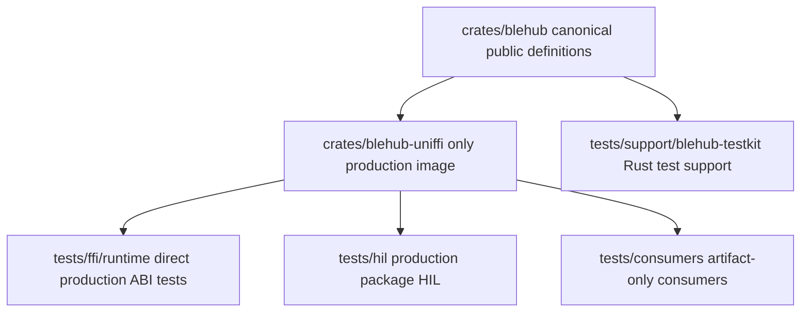
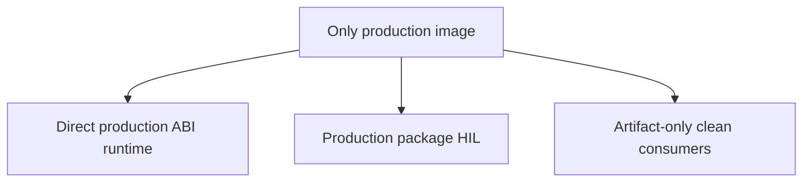

# BleHub test-layer responsibilities

## Status and purpose

This document defines what each BleHub test layer proves and, equally importantly, what it cannot prove. It applies to all platforms; Apple examples describe the current unfrozen Phase 3 candidate.

No single test binary should prove contract behavior, foreign-language transport, native backend behavior, packaging isolation, and RF correctness at once. Those concerns have different dependencies and failure boundaries and must remain independently diagnosable.

The normative repository ownership and dependency rules are in [`.plan/PLAN.md`](../../.plan/PLAN.md). This document explains how the test layers apply those rules.

## Single production artifact

BleHub has one canonical definition owner and one production UniFFI native-image owner:



`crates/blehub` defines and exports the production `BleHub` object, foreign `BleBackend`, foreign `BleEventSink`, direct ingress, commands, events, and errors. Rust consumers can use those definitions directly.

`crates/blehub-uniffi` remains deliberately thin. It owns only the final `staticlib`/`cdylib`, the locked bindgen entry, and production package staging. It does not define another API or test component. Runtime test behavior lives in Swift/Kotlin implementations or Rust-only test support, never in a second UniFFI native image.

Maintained Apple Swift runtime, package, backend, and HIL layers execute on the project real Mac mini through local Pixi + Just. The `apple-ci` label is a Pixi environment name only. BleHub does not maintain a Windows Swift lane, Windows-managed Swift root/bootstrap, or GitHub-hosted macOS workflow. Earlier Windows Swift and GitHub Actions runs remain historical, non-maintained evidence and do not define Phase 5 gates; Phase 5 requires macOS/iOS Swift evidence from the Mac mini.

## Layer matrix

| Layer | Location | Primary subject | What it proves | What it does not replace |
|---|---|---|---|---|
| Rust core unit and concurrency | `crates/blehub` | `BleHub`, contract validation, ingress and disposal | Rust API behavior, command gate, serialized sink delivery, lifecycle and concurrency invariants | Stable UniFFI runtime, native platform behavior, packaging or RF |
| Shared Rust test support | `tests/support/blehub-testkit` | Fake backend, scenarios, recording sink and reference projection | Reusable test behavior against the canonical contract | A shipped crate, language binding or platform backend |
| Shared conformance data | `tests/conformance` | Cross-platform DTO/event semantics and provider profiles | Backends and Peripheral providers use the same normalized scenario meaning | Native callback ordering, device runtime or RF |
| Foreign-language runtime | `tests/ffi/runtime` | Production generated Swift/Kotlin APIs, exported Hub, foreign backend/sink, JNA/ARC and callbacks | Swift on the real Mac mini and Kotlin test backend/sink objects exercise the production ABI directly; ownership, errors, threads, event wire and lifecycle survive the real image | Clean-consumer isolation, CoreBluetooth/Android BLE or RF |
| Backend deterministic tests | `platforms/apple/Tests`, Windows backend tests | Platform mapping and backend-private state machines | Exact correlation, serialization, rollback, stale callback handling and teardown without RF | OS authorization, signing, real callback timing or radio behavior |
| Production-package platform HIL | `tests/hil/<platform>` | Staged production package plus real OS backend/device path | End-to-end command/event behavior through production Hub, FFI, backend, sink and OS/device paths | Independent clean-consumer isolation or ABI freeze |
| Production packaging gate | Owner-specific packaging scripts | Produced release-shaped artifacts | Expected architectures, components, symbols, headers, module maps and metadata | A clean downstream build or RF behavior |
| Production artifact-only consumer | `tests/consumers/<platform>` | Downstream integration from staged production artifacts only | No source-tree path, project dependency, test export or workspace fallback masks a broken package | Full backend behavior or RF matrix |
| Peripheral fixtures | `tests/peripherals` | Android, BLESS and future hardware GATT servers | A controlled Central test peer implements the named provider profile | Any BleHub Central implementation |
| RF/fault/soak HIL | Explicit provider-specific Just recipes | Real Central, Peripheral and radio boundary | The named advertisement, connection, GATT, I/O, subscription, fault or throughput workflow actually passed | Other platforms, providers, modes or frozen-ABI reruns |
| Historical capability probes | `spikes/archive` | Superseded mechanism experiments | Reproducible historical evidence and rejected alternatives | Production source, long-lived tests or current acceptance gates |

## FFI runtime versus production consumers

`tests/ffi/runtime` and `tests/consumers/<platform>` both use production artifacts, but prove different boundaries. Runtime tests deliberately provide synthetic Swift/Kotlin backend and sink implementations so they can force callback, error, race, and lifecycle cases against the exported production `BleHub`. They validate the production ABI directly, but remain repository-owned white-box tests.

Production consumers are independent downstream build graphs. They prove that staged release-shaped artifacts can be consumed without source-tree paths, project dependencies, generated-source fallback, or implicit native-library lookup.



## What the Apple HIL probe calls

The Apple HIL probe is not a Swift-only backend unit test. It uses the staged production package and the public Swift API:

```text
iOS/macOS probe application
  -> production Swift package and generated Stable UniFFI module
  -> exported production BleHub
  -> Swift AppleBleBackend foreign-trait object
  -> CoreBluetooth
  -> BackendEventIngressHandle
  -> direct Swift BleEventSink foreign-trait object
  -> caller-owned Swift ledger and result output
```

The probe implements `BleEventSink` directly in Swift, constructs the production `BleHub` with the production Apple backend, and invokes only public Hub commands. Events must return through the real ingress and foreign sink callback. This covers the actual package, Hub, backend, ingress, sink, and dispose path; it does not bypass the Hub or substitute test exports.

The HIL target must consume the staged production XCFramework/Swift package. It must not compile a replacement Rust image, inject test-only UniFFI symbols, or fall back to source-generated bindings. Repository-specific Swift ledger code remains test code outside the production image.

## Why production clean consumers remain separate

Production-package HIL uses repository orchestration and test-specific application code to collect precise runtime/RF evidence. Even though it consumes the staged production package, it can still miss independent-consumer failures, including:

- an accidental source-tree package dependency;
- a missing XCFramework architecture;
- a missing Swift source, header, module map or privacy manifest;
- generated bindings that exist only in the development checkout;
- a library search path inherited from the workspace;
- duplicate or mismatched native symbol owners;
- test-only exports accidentally shipped in production.

A clean consumer must therefore have an independent manifest, lock and build graph, consume only staged production artifacts, and run offline where practical. It should prove assembly, build, launch and a small lifecycle smoke. It should not duplicate the entire RF matrix.

For Apple Phase 3, the iPhone production-package probe establishes signing, installation, CoreBluetooth runtime and later RF. A separately isolated artifact-only Apple consumer remains an independent exit gate.

## Dependency rules

Allowed dependency directions:

- `crates/blehub-uniffi` depends on and re-exports the canonical component from `crates/blehub`;
- production platform packages consume the production bindings/artifacts assembled by `crates/blehub-uniffi`;
- `blehub-testkit` may depend on `blehub` for Rust-only tests;
- `tests/ffi/runtime` consumes the production image/package and implements test backend/sink objects in Swift/Kotlin;
- Apple HIL and production consumers consume staged production artifacts;
- HIL may use controlled providers from `tests/peripherals`.

Forbidden dependency directions:

- no production module may depend on `tests/` or `spikes/`;
- `blehub-uniffi` may not depend on `blehub-testkit` or any test implementation;
- runtime tests may not build, link, or generate a second UniFFI component/native image;
- Apple HIL may not use source replacement or test-only bindings instead of the production package;
- artifact-only consumers may not reference `crates/`, `platforms/`, runtime-generated test paths, or workspace paths;
- no long-lived test or production workflow may depend on an active or archived spike;
- every final graph must have exactly one BleHub UniFFI symbol owner: `crates/blehub-uniffi`.

## Python and native-device tooling boundary

BleHub does not implement Apple device protocols in Python. Project Python code owns only orchestration specific to BleHub evidence:

- select exactly one connected physical iOS device;
- choose an explicitly configured or unambiguous Xcode development team;
- generate the test project from tracked XcodeGen YAML;
- invoke `xcodebuild` for automatic development signing;
- invoke `xcrun devicectl` through its JSON interface for install, launch and app-container result retrieval;
- validate a unique run ID and required result markers;
- keep successful output concise and preserve complete failure logs under `.work`.

Third-party device stacks would duplicate or bypass the authoritative Xcode/device path and are not part of the Phase 3 baseline. Fastlane or App Store Connect tooling may become appropriate for release distribution, certificate rotation or store automation, but is not required for a local development-signed HIL app.

## Keychain policy

Ordinary build, test and RF recipes must never request, accept, store or pass a login password. They only verify that the login keychain is already available to noninteractive code signing and fail before device work when it is not.

A separate, explicitly human-invoked Just recipe may run `security unlock-keychain` and `security set-key-partition-list` without accepting a password argument. The password is entered directly into the local macOS security prompts and is never visible to BleHub tooling. The latter grants the Apple signing tools access to the signing-key partition; it does not export or store the password. This interactive helper is not a dependency of ordinary automation or tests; Apple gates remain local to the project real Mac mini rather than a hosted runner.

## Evidence naming rules

Every platform result must state:

1. the exact candidate and whether its ABI is frozen;
2. the host/device platform actually executed;
3. the Central DUT and Peripheral provider;
4. whether the test is deterministic, runtime-only, RF, fault, soak, packaging or clean-consumer evidence;
5. the command and terminal semantics actually observed;
6. any mode that remains unproven.

A macOS pass never proves iOS, an iPhone production-package HIL pass never proves independent clean-consumer isolation, and a dual notify/indicate characteristic selecting Notification never proves strict Indication.
