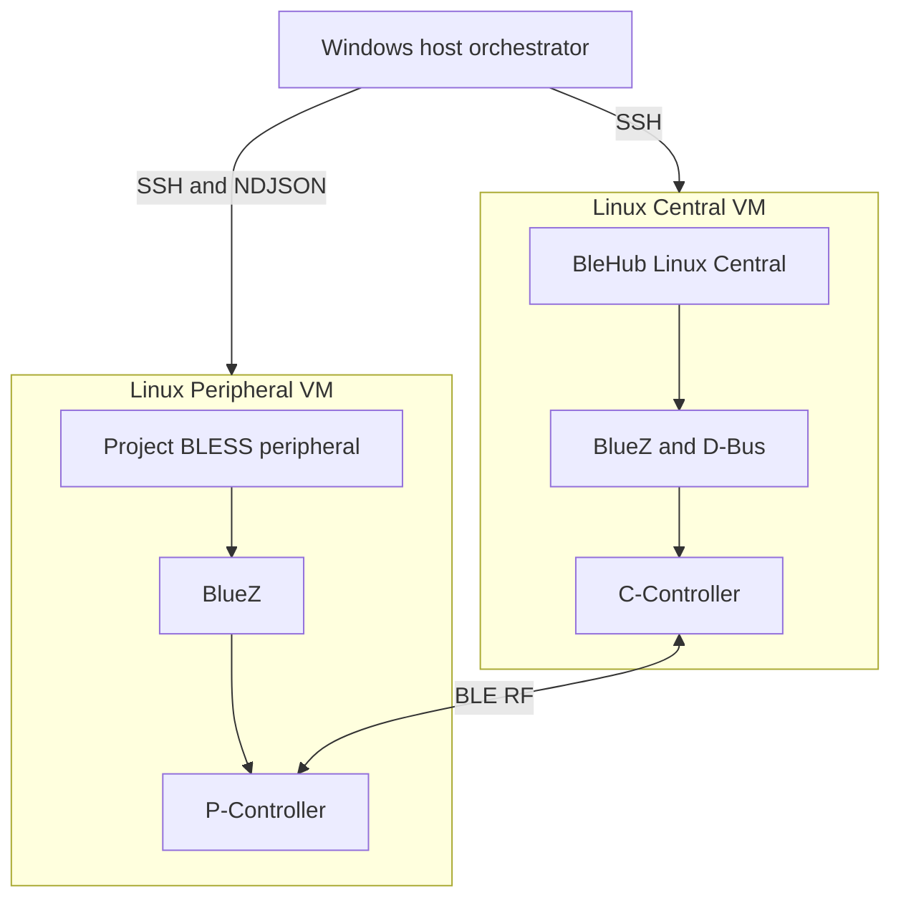

# Linux 开发与测试执行指南

本文依据 [`.plan/PLAN.md` 的 Phase 6](../../.plan/PLAN.md#phase-6linux) 与[第 13 节](../../.plan/PLAN.md#13-测试与-spike-执行边界)，说明未来如何执行 Linux Central 的开发和测试。架构、公共契约和阶段优先级仍以 Plan 为准；本文不是第二份架构 Plan，也不提前授权实现 Linux backend、Linux development VM 或相关 recipe。

## 1. 阶段边界

Linux Central/backend 的产品化固定在 **Phase 6**。当前主线仍是 Windows，然后是 Android；不得为了 Linux Central 提前并行建设以下内容：

- BleHub Linux Central backend；
- Linux Central/development VM；
- D-Bus mapping 或 scripted BlueZ backend tests；
- Linux Central RF HIL；
- `linux-vm-start`、`linux-test`、`linux-test-hil` 等 Linux Central recipe。

Phase 6 之前只允许两类 Linux 工作：

1. 在普通 hosted Linux runner 上重跑 pure core tests，防止公共核心被 Windows API 或 ABI 污染。该 portability job 不要求 QEMU、BlueZ 或蓝牙硬件，也不代表 Linux backend 已启动。
2. USB 蓝牙硬件到位且 Windows/Android HIL 确有需要时，建设项目管理的 **Linux Peripheral VM**。该 VM 只运行 BlueZ/BLESS 测试外设，不包含 BleHub Linux Central backend。

## 2. 两类 Linux VM 必须分开

| 环境 | 最早建设阶段 | 固定角色 | 用途 |
|---|---|---|---|
| Linux Peripheral VM | Phase 6 前仅在 Windows/Android HIL 硬件到位且需要时 | Peripheral/Advertiser | 承载项目管理的 BlueZ/BLESS 外设、共享 scenario、run ID、fixture 和 telemetry |
| Linux Central/development VM | Phase 6 | Central/DUT | 原生构建和运行 BleHub Linux backend、D-Bus 测试、real BlueZ integration 与 Linux Central HIL |

Linux Peripheral VM 是跨平台 HIL 基础设施，可依次被 Windows、Android、Apple 和未来 Linux Central 复用。复用它不等于开始实现 Linux Central backend。

两类 VM 应使用独立的 recipe/profile 和明确的角色命名。Peripheral VM 始终只承担 Peripheral 角色；Central VM 始终只承担 Central 角色。

## 3. 测试层级

### 3.1 层级 A：Linux 非 HIL

Phase 6 中先建立不依赖 USB adapter 或真实 BlueZ controller 的开发闭环：

```text
Windows host
└── QEMU Linux Central/development VM
    ├── Rust x86_64-unknown-linux-gnu toolchain
    ├── BleHub core tests
    ├── FakeBackend / EventScenario tests
    ├── Linux D-Bus DTO/mapping tests
    └── scripted/fake BlueZ ObjectManager tests
```

该层级验证：

- core 能在 Linux 编译和运行，公共模型不被 Windows API 或 ABI 污染；
- fire-and-forget command/event contract 在 Linux backend 上保持一致；
- BlueZ object path、interface/property 和 D-Bus error 的转换逻辑；
- `InterfacesAdded`、`InterfacesRemoved`、`PropertiesChanged` 的正常、重复、乱序、晚到和缺字段场景；
- Linux backend 的 D-Bus driver/signal loop 集成，以及 close、daemon restart 和 sink 生命周期；
- 执行上下文由集成方选择，不由 BleHub core 创建。

### 3.2 层级 B：Linux Central 真实 RF HIL

Linux Central HIL 必须走真实 controller、HCI、BlueZ、D-Bus 和 RF，覆盖端到端 scan、connect、GATT discovery、read、write、notify 和 disconnect。

默认拓扑是双 VM、每个 VM 独占一个 controller：



Central VM 只看到 C-Controller，Peripheral VM 只看到 P-Controller。每个 VM 的 BlueZ 实例只管理一个测试 adapter，从而隔离 D-Bus、adapter role、全局 daemon 状态和日志。

## 4. Controller 数量与可执行范围

### 4.1 没有 USB adapter

可以执行：

- pure core Linux portability tests；
- Phase 6 的 thin bridge、FakeBackend、D-Bus mapping 和 scripted BlueZ tests；
- 不要求 controller 的 real BlueZ/D-Bus service integration case。

不能执行真实 RF HIL。需要 controller 的 case 必须明确 skip 或报告 hardware unavailable，不能记为 BleHub regression。

### 4.2 只有一个可供 guest 使用的 USB adapter

可以执行：

- Windows 内置或独立 controller Central -> Linux Peripheral VM BLESS；
- Linux backend 的全部非 HIL 测试；
- Linux Central 使用该 adapter 连接独立真实外设，例如 nRF52 开发板、手机外设应用或量产设备。

不能在同一个 Linux guest 中，让一个 adapter 同时可靠承担 BleHub Central 和 BLESS Peripheral，形成自包含 RF HIL。一个 controller 不能作为可靠的 Central 与它自己提供的 Peripheral 建立自连接，也不能由两个未隔离角色和 adapter 的进程争抢。

### 4.3 两个独立 controller

Linux Central -> Linux BLESS 的自包含 RF HIL 要求两套独立 controller：

- C-Controller：BleHub Linux Central 独占；
- P-Controller：Linux Peripheral VM 的 BlueZ/BLESS 独占。

同一个 controller 不能同时被 host 和 guest 使用。可复现的默认实验室配置是两个独立外置 USB BLE adapter，每个 VM 一个。

笔记本内置蓝牙直通只作为实验选项：仅当 controller 作为可独立直通的 USB function 暴露并经稳定性验证后使用。直通后 Windows host 不能同时使用它；测试报告还必须记录物理 USB topology 和绑定结果。

## 5. 双 VM 默认拓扑与单 VM备选

### 5.1 双 VM：默认方案

未来 Linux 自包含 HIL 默认使用双 VM：

- Central VM 独占 C-Controller；
- Peripheral VM 独占 P-Controller；
- Windows host 通过 SSH 启停两个 guest、下发测试并汇总日志；
- Peripheral 控制面继续使用项目共享的 CLI/NDJSON contract；
- 复用`tests/peripherals/bless/`中的guest fixture、`tools/peripheral_fixture/`中的host编排、共享scenario、run ID、BLE fixture和telemetry assertion。

该方案资源占用和编排复杂度更高，但 adapter role、BlueZ/D-Bus 实例和日志边界最清楚。

### 5.2 单 VM、双 controller：资源节省备选

资源受限或诊断时，可以把两个 USB adapter 直通同一个 Linux VM：

- 一套 adapter 专用于 BleHub Linux Central；
- 另一套 adapter 专用于 BlueZ/BLESS Peripheral；
- 两套 adapter 均由 guest 独占；
- Central 和 Peripheral 都必须显式绑定各自 adapter；
- 每个 scenario 前确认 BlueZ object path、controller address 和逻辑职责没有交换。

`hci0` 为 Central、`hci1` 为 Peripheral 只能作为一次测试运行内的角色约定，不能作为跨重启、跨快照或跨机器的稳定身份。USB reset、重新枚举或 VM snapshot 可能改变 `hciN`；应按 USB topology、controller address 或 BlueZ object path 重新解析角色。

单 VM 的优点是 provision、日志采集、时间同步和网络控制更简单；主要风险是同一个系统级 BlueZ daemon 管理两个 adapter，可能导致 discovery 或 advertising 选错设备。若 BLESS/BlueZ backend 无法可靠选择 adapter，先增加项目内 adapter binding/启动封装；仍不可靠时回到双 VM 隔离。

## 6. 显式 adapter 选择

Linux backend 和 BLESS runner 都不得依赖“第一个 adapter”、枚举顺序或长期固定的 `hciN`。Linux backend 配置至少要表达以下语义；最终 production/FFI 形状仍由 Phase 6 实现和 BoltFFI 支持范围决定：

```rust
pub struct LinuxBackendConfig {
    /// BlueZ adapter object path or another unambiguous selector.
    pub adapter: LinuxAdapterSelector,
}

pub enum LinuxAdapterSelector {
    ObjectPath(String),
    ControllerName(String),
    Address(String),
    OnlyAvailable,
}
```

执行约束：

- `OnlyAvailable` 仅在恰好一个可用 adapter 时成功；多个 adapter 必须返回配置错误，不能静默选择第一个。
- 测试开始前解析并固定 Central 与 Peripheral 的逻辑角色。
- 测试报告记录最终 BlueZ adapter object path、controller name、address、driver 和 capability。
- adapter reset、USB 重新枚举或快照恢复后必须重新解析并核对角色。

## 7. Guest-native 构建与运行

Linux 产物首选在目标 guest 内以 `x86_64-unknown-linux-gnu` 原生构建和运行：

```text
Windows source/worktree
-> shared folder, source sync, or SSH checkout
-> QEMU Linux guest
-> pixi run just linux-build
-> cargo build --target x86_64-unknown-linux-gnu
-> run/test inside the same guest
```

选择 guest-native build 的原因：

- 完整产物不仅取决于 Rust target，还依赖 Linux linker、glibc ABI 和系统库；
- `dbus-rs` 的 feature 选择可能涉及 `libdbus-1`、`pkg-config` 和开发头文件；
- 即使使用纯 Rust transport，运行时仍依赖 system D-Bus、BlueZ 服务和权限；
- Windows 上执行 `rustup target add x86_64-unknown-linux-gnu` 不会自动提供 Linux linker、sysroot、glibc 和 D-Bus native dependencies；
- 在目标 guest 构建并运行可直接验证实际 BlueZ/D-Bus 环境，复现路径最短。

复制预构建产物到 guest 运行时，必须同时满足：

1. target architecture 与 guest 一致；
2. libc ABI 与目标环境兼容，不能把 Windows PE 产物复制到 Linux 运行；
3. 动态库、D-Bus/BlueZ runtime、权限和配置齐全；
4. BoltFFI 生成物与当前 crate/API 版本一致。

首版不要求 Windows -> Linux cross compilation。后续只有在 CI、发布或构建性能证明有价值时，才评估 `cargo-zigbuild`、容器化 sysroot 或专用 cross image；届时必须固定 linker/sysroot，并验证 D-Bus dependency feature，而不能只检查“编译成功”。

Linux 原生测试程序可直接实例化 Rust backend 和 BleHub，不需要 Kotlin/Swift native bridge。BoltFFI 仍需执行 binding generation/ABI smoke，确认公共边界没有泄漏 Linux-only 类型。

## 8. 从快到慢的测试层

| 层 | 测试 | 环境与依赖 | 执行要求 |
|---:|---|---|---|
| 1 | thin bridge tests | 无 D-Bus、无硬件 | 验证 DTO、caller-owned ID 透传、delivery order、direct sink 和 close；不得引入 state、timeout 或 queue |
| 2 | FakeBackend contract tests | 无 D-Bus、无硬件 | 运行共享 command/event conformance |
| 3 | D-Bus mapping unit tests | 无真实 daemon/controller | 验证 BlueZ object/interface/property/error 与内部 DTO/event 映射 |
| 4 | scripted BlueZ tests | fake transport 或受控 ObjectManager fixture | 注入 signal、daemon disappearance、adapter state change 和错误回复 |
| 5 | real BlueZ integration | Linux VM 的 system/session test bus；部分 case 需要 guest service 配置 | 验证调用方选择的 D-Bus driver/signal loop、ObjectManager、权限和 daemon 行为；无 controller 时明确跳过 controller case |
| 6 | two-controller RF HIL | 两个独立 controller；默认双 VM | 运行共享 `basic`、`notifications`、`passive_disconnect`/disconnect 和 `stress` scenario |
| 7 | reference peripheral smoke | 至少一个非 BLESS 外设 | 防止测试只适配 BlueZ-to-BlueZ 链路 |

前四层不依赖 USB adapter，Phase 6 的普通开发和 CI 必须运行。第五层依赖 guest service 配置，但不一定依赖真实 RF。第六、七层是串行 HIL；硬件未就绪时不阻塞普通 PR。

BLESS HIL 不能替代 FakeBackend 对 duplicate、orphan、stale 和任意乱序 callback 的覆盖，也不能替代 D-Bus mapping/scripted tests 或真实产品兼容性 smoke。

## 9. VM 编排

以下 recipe 名称是 Phase 6 的计划接口，当前不得据此假定它们已经存在：

- `just linux-vm-start`：启动通用 Linux Central/development VM；
- `just peripheral vm-start`：启动Linux Peripheral VM；该计划入口属于Peripheral provider，不与Linux Central VM混用；
- `just linux-test`：默认不要求硬件；
- `just linux-test-hil`：先运行 dual-controller doctor，再执行串行 HIL。

所有项目 recipe 都应通过 Pixi 调用，例如 `pixi run just linux-test`。

### 9.1 非 HIL 执行顺序

1. Windows host 启动 Linux Central/development VM。
2. 通过 shared folder、source sync 或 SSH checkout 将源码提供给 guest。
3. 在 guest 内运行环境检查，记录 VM image、kernel、BlueZ、D-Bus、工具链和依赖版本。
4. 在 guest 内原生构建。
5. 依次运行测试层 1–5 中当前环境可满足的 case。
6. 明确区分 passed、test failure、skipped 和 environment failure。
7. Windows host 只收集命令结果、测试报告和 guest 日志，不在 host 上执行 Linux binary。

### 9.2 RF HIL 执行顺序

1. 串行占用测试资源；一套 controller pair 同一时刻只运行一个 scenario。
2. 启动 Central VM 和独立 Peripheral VM。若明确选择单 VM备选，则启动对应双 adapter profile。
3. 运行 dual-controller doctor，确认两套物理 controller 都已进入预期 guest，未被 Windows host 占用。
4. 在 Peripheral 环境确认 `rfkill`、BlueZ daemon、system D-Bus、GATT manager、LE advertising manager、LE/peripheral capability，以及 BLESS register/start/stop/unregister 能力。
5. 解析并记录 Central 与 Peripheral adapter 的 object path、name、address、driver、capability 和物理 USB topology。
6. 生成唯一 `run_id`，加载共享 peripheral scenario；`run_id` 同时进入 manufacturer data，Central 按 service UUID + run ID 发现当前外设，不依赖固定 MAC 地址。
7. Windows host 通过 SSH/NDJSON 控制 scenario 并收集 Peripheral ground-truth telemetry。
8. 所有被测 BLE command 必须由 BleHub Linux Central 通过真实 RF 执行；控制面不得伪造 `BleEvent` 或直接调用 event ingress。
9. 对照 Central event/log 与 Peripheral telemetry，执行目标 scenario。
10. scenario 结束后停止 advertising、停止 server、清理连接并归档两侧日志。
11. guest reboot、BlueZ restart、USB reset 或 snapshot restore 后，重新运行 doctor 和 BLESS readiness handshake；不得复用旧的 HCI/adapter 假设。

### 9.3 失败分类与恢复

以下情况应报告为 environment/infrastructure failure，而不是 BleHub regression：

- controller 数量不足或直通到错误 guest；
- USB passthrough、driver/libusb 绑定或权限失败；
- `rfkill` 阻塞；
- BlueZ、D-Bus、GATT manager 或 advertising manager 不可用；
- BLESS 无法注册、启动或清理；
- adapter firmware 挂死，需要物理拔插或 USB power-cycle；
- VM snapshot 恢复后 adapter 身份或能力未重新确认。

硬件不足时，`linux-test-hil` 应清晰 skip 或报告 hardware unavailable。基础设施恢复后先重新绑定/重启，再运行 doctor；不能直接重试业务断言。

## 10. Phase 6 完成判据

执行结果应满足 Plan 中的 Linux 退出条件：

- Linux backend 不修改核心领域语义即可完成 scan/connect/GATT/read/write/notify/disconnect 闭环；
- Linux 产物可由 Pixi + Just 在目标 guest 中复现构建和运行；
- 多 adapter 环境不会因 enumeration order 误用 controller；
- HIL 硬件缺失时提供明确 skip/environment report；
- 两个 controller 到位后，默认双 VM HIL 通过；
- 共享 BLESS scenario/telemetry 得到复用，并由至少一个非 BLESS 外设完成兼容性 smoke。
