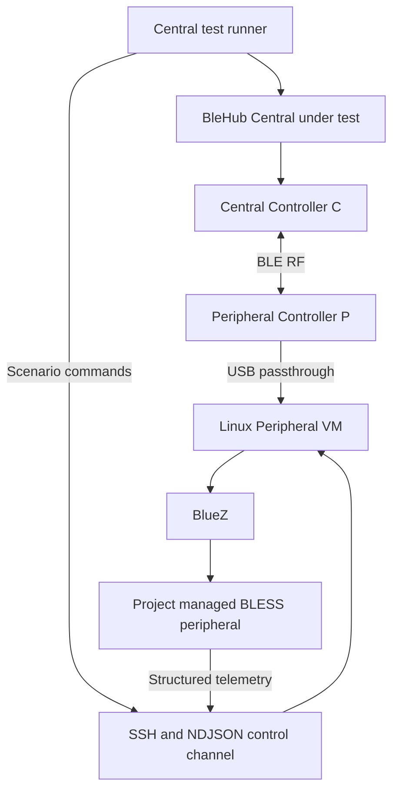
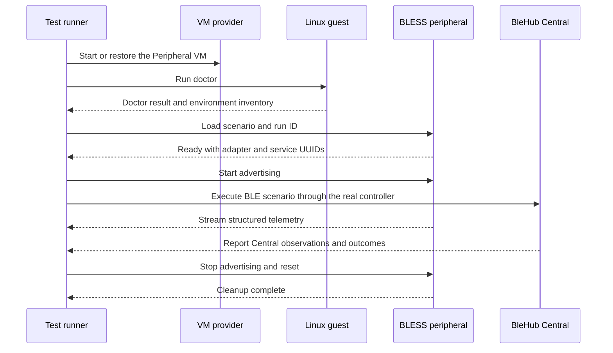

# Managed BLE Peripheral Test Environment

## Status and scope

This document provides evolving execution guidance for the managed-peripheral baseline and test boundaries defined in [Plan section 13](../../.plan/PLAN.md#13-测试与-spike-执行边界), the Windows work in [Phase 2](../../.plan/PLAN.md#phase-2windows-backend), and the HIL acceptance criteria in [section 15](../../.plan/PLAN.md#15-v01-验收标准).

It is **not normative architecture guidance** and does not replace the project Plan. The Plan remains the source of truth for reviewed architecture and delivery priorities. This document may evolve as hardware spikes establish which provider recipes are reliable in practice.

The intended environment is a project-managed BLESS GATT peripheral running with BlueZ inside a Linux VM. All Central implementations reuse the same peripheral scenarios, run identifiers, fixtures, and telemetry contract.

Key interpretation:

- QEMU is the default reproducible VM and provider baseline.
- This environment is not pure BLE simulation. BLESS supplies programmable GATT server behavior, but the controller, controller firmware, HCI path, BLE radio link, BlueZ, Central platform stack, and USB passthrough path are real.
- QEMU QEMU USB passthrough from a Windows host is not assumed to work reliably from configuration alone. It requires an actual controller, host capture/driver setup, libusb, QEMU, reset, and recovery spike on the intended machines.
- If QEMU passthrough on Windows is insufficiently stable, QEMU/KVM on a Linux host is the preferred fallback.
- VMware Workstation may be used as a local Windows HIL fallback after its capture, automation, licensing, and reproducibility constraints are evaluated.

Historical Windows-hosted bring-up reports record the original controller-specific QEMU/BLESS evidence; those reports remain unchanged as historical evidence. The maintained control plane is now provider-neutral and does not track a particular USB vendor, driver binding, or serial number. The next hardware-specific gate is nRF52840 Dongle HCI integration.

## Goals and boundaries

The environment provides a repeatable, programmable peripheral for end-to-end Central testing and soak runs while keeping the BLE data path real. It is intended to:

- run the same peripheral behavior for Windows, Android, Apple, and future Linux Central tests;
- provide scenario control and structured ground-truth telemetry independently of the BLE data path;
- make VM provisioning, peripheral fixtures, and test reports reproducible;
- classify infrastructure failures separately from BleHub regressions;
- support recovery between scenarios without claiming deterministic RF timing.

The authoritative managed BLESS peripheral runs inside a Linux VM. Do not run a separate BLESS harness directly on a Central DUT. The host OS or host machine carrying the VM may change, but the Linux Peripheral guest shape remains consistent. Standalone nRF hardware is a separate reference Peripheral, not a replacement for the programmable BLESS control plane.

The maintained Apple Central RF path uses the project Android Peripheral immediately and a standalone nRF52840 DK when available. It does not maintain native macOS BLESS or Mac QEMU + BLESS as an Apple provider. The Linux VM remains the Windows-hosted QEMU + BlueZ + BLESS control plane; its generic USB passthrough is retained for a future nRF52840 Dongle HCI firmware configuration.

## Topology



The topology has two deliberately separate paths:

1. **BLE data path:** BleHub Central → Central controller → real BLE RF → Peripheral controller → BlueZ → BLESS.
2. **Control and telemetry path:** test runner → SSH/NDJSON → managed peripheral process.

The control channel may arrange scenarios and collect ground truth. It must not fabricate `BleEvent` values, call BleHub event ingress, or bypass the real BLE data path for commands under test.

## Hardware requirements

Use two independent Bluetooth roles/controllers:

- **C-Controller:** owned by the Central DUT. Windows may use an internal Bluetooth controller or an external USB controller. Android, Apple, and future Linux DUTs use their own suitable Central controller.
- **P-Controller:** a USB BLE controller owned exclusively by the Linux Peripheral VM, or a standalone hardware Peripheral controller for cross-stack reference tests.

The following constraints apply:

- One controller cannot be used by host and guest simultaneously.
- The P-Controller must support Bluetooth LE, advertising, and peripheral role. A dongle that only supports scanning or Central role is insufficient.
- The VM should attach a VM-owned P-Controller through XHCI and `usb-host`, selecting it from ignored machine configuration or explicit environment values as appropriate for the provider recipe.
- Test reports must identify both controllers and record relevant firmware, driver, host, guest, BlueZ, BLESS, and provider versions.
- RF conditions and controller behavior remain physical variables. Do not assert completely deterministic RF timing or fixed RSSI.

## Provider baseline and selection

Provider choice is test infrastructure, not part of the BleHub product API. The control and telemetry contract must remain provider-neutral.

| Provider | Intended use | Current guidance |
|---|---|---|
| QEMU on Windows | Active Windows-hosted reproducible baseline | Guest enumeration, advertising, production Windows scan/connect/GATT/read/write/Notification/Indication, controller-loss passive disconnect, and recovery are covered by the existing historical evidence. The controller is now machine-configured; nRF52840 Dongle HCI integration is the next hardware-specific gate. |
| QEMU/KVM on Linux | Preferred fallback when Windows-hosted QEMU passthrough is unstable | Keep the same Linux Peripheral guest, fixtures, and contracts. Do not move BLESS onto the physical host. |
| VMware Workstation on Windows | Local HIL fallback | USB capture may be practical locally, but CI use depends on licensing, headless automation, and reproducibility validation. |
| VirtualBox | Optional spike only | USB 2/3 Extension Pack distribution, licensing, and automation require separate evaluation. It is not a default dependency. |
| Hyper-V | Not suitable as the baseline | General local USB Bluetooth-controller passthrough needed by this topology is not assumed available. RDP device redirection is not an HCI-controller substitute. |
| WSL2 with `usbipd-win` | Experimental option | Must prove BlueZ, systemd, kernel, USB reset, and peripheral advertising behavior. It is not the fixed Peripheral VM baseline. |

Maintain one provider recipe per purpose: Linux VM + BLESS for programmable fault/soak control, Android for immediate mobile RF development, and standalone nRF hardware for cross-stack reference tests. Avoid simultaneously maintaining additional VM products before there is a demonstrated need.

### Windows QEMU passthrough spike

The spike must use the actual P-Controller and intended Windows host configuration. A successful VM boot or one-time USB enumeration is not sufficient evidence. At minimum, verify:

1. the host releases the controller and the guest claims it consistently;
2. BlueZ can expose LE advertising and GATT manager capabilities;
3. BLESS can register, advertise, accept a Central connection, exchange GATT traffic, and unregister cleanly;
4. repeated VM boots and peripheral-process restarts recover without manual driver repair;
5. USB detach, attach, reset, BlueZ restart, and guest reboot behavior are observable and classifiable;
6. a representative connect, read, write, notification, disconnect loop can complete a soak run;
7. failures produce enough diagnostics to distinguish provider or hardware faults from BleHub behavior.

If these checks are not stable enough for routine execution, use QEMU/KVM on Linux as the preferred shared fallback. VMware may remain a local Windows fallback rather than becoming a second fully maintained project baseline.

## Guest doctor and readiness

Run the guest doctor before every HIL session and again after any VM snapshot restore, guest reboot, BlueZ restart, USB rebind, or controller reset.

The doctor must confirm:

- the USB adapter is visible inside the Linux guest and is not still owned by the host;
- `rfkill` does not block the adapter;
- the BlueZ daemon is running;
- system D-Bus can access BlueZ;
- the adapter exposes a GATT manager and LE advertising manager;
- the adapter supports LE and advertising/peripheral capabilities;
- BLESS can register a GATT application, start advertising, stop advertising, and unregister;
- the readiness handshake reports the current run identifier, adapter identity, and service UUIDs.

A failed doctor or readiness handshake is an **environment failure**, not a BleHub regression. Preserve doctor output and provider diagnostics in the test report.

## Managed peripheral project shape

Repository ownership is split by responsibility rather than placing guest behavior, host orchestration, and VM lifecycle in one package:

```text
tests/peripherals/bless/       # Guest BLESS fixture and profile behavior.
tools/peripheral_fixture/      # Host-side provider orchestration and diagnostics.
vm/linux-peripheral/           # Packer template, image locks, and guest provisioning inputs.
```

Shared GATT scenarios remain under `tests/conformance/scenarios/`; provider code consumes those project-owned fixtures instead of duplicating UUIDs, manufacturer data, or payload contracts.

### VM command namespace

The implemented interface is:

```sh
pixi run just peripheral vm-bootstrap
pixi run just peripheral vm-build
pixi run just peripheral vm-doctor
pixi run just peripheral vm-start
pixi run just peripheral vm-stop
pixi run just peripheral vm-reset
pixi run just peripheral vm-status
pixi run just peripheral vm-logs
pixi run just peripheral vm-clean
pixi run just peripheral vm-usb-status
pixi run just peripheral vm-usb-attach
pixi run just peripheral vm-usb-detach
pixi run just peripheral vm-fixture-install
pixi run just peripheral vm-fixture-sync
pixi run just peripheral vm-fixture-start
pixi run just peripheral vm-fixture-stop
pixi run just peripheral vm-fixture-status
pixi run just peripheral vm-fixture-update deadbeef
pixi run just peripheral vm-fixture-burst 0123456789abcdef 200 500
pixi run just peripheral vm-whpx-status
pixi run just peripheral vm-whpx-enable
```

The responsibility split is:

| Layer | Responsibility |
|---|---|
| Pixi | Pin Packer, the official `qemu.qmp` Python client, and other host tooling plus the guest BLESS/Python environment; provide the locked 7-Zip extractor. QEMU itself is pinned by tracked URL/hash because no Windows QEMU package is available in the configured Pixi channel. |
| Just | Expose the thin `peripheral vm-*` user-facing namespace and delegate lifecycle work. It must not contain image, QMP, SSH, USB, retry, or provisioning logic. |
| Packer | Create and resize the build qcow2, generate the `CIDATA` VFAT for minimal NoCloud SSH bootstrap, boot QEMU, wait for SSH, upload tracked image inputs, run provisioning, and shut down cleanly. The official QEMU plugin is fixed to `1.1.6` and is installed only by `vm-bootstrap`. |
| Python host orchestration | Download and verify pinned assets, invoke Packer for image builds, create mutable runtime overlays, automatically select WHPX when enabled on Windows and otherwise use TCG, use the official `qemu.qmp` client for runtime QMP sessions, manage SSH/SCP/PID/log lifecycle, select the USB controller, and produce actionable diagnostics. `BLEHUB_VM_ACCEL=tcg|whpx` remains an explicit override. The orchestration retains project-specific QMP command policy but does not implement the wire protocol, a second image builder, or an ISO writer. |
| Guest provisioning | Install and configure the stable Debian/BlueZ/D-Bus/Pixi/systemd runtime and udev/rfkill permissions from tracked image inputs. Frequently changing BLESS fixture source, environment, and scenarios are deployed separately and are not part of the stable-image target. |

### Fixed image and external fixture deployment

**Implemented and RF-verified on 2026-08-31:** the provisioned Linux image is stable, while the project-owned BLESS environment and fixture source are deployed independently into a running guest. Packer uploads only the pinned Pixi archive, `provision.sh`, and the generic systemd unit; it does not upload `bless_fixture.py`, the fixture manifest/lock, or a scenario. Cloud-Init only creates the build-time SSH entry.

Use three independently fingerprinted layers:

| Layer | Fingerprint inputs | Change action |
|---|---|---|
| Provisioned image | Debian/QEMU locks, Packer and minimal NoCloud templates, `provision.sh`, generic systemd runner, Pixi bootstrap, BlueZ/firmware and guest permission configuration | Explicit `vm-build`; rebuild the provisioned qcow2 through Packer |
| Fixture environment | `tests/peripherals/bless/pixi.toml` and `pixi.lock` | Explicit guest `pixi install --locked`; do not rebuild the image and do not install silently during `vm-start` or tests |
| Fixture source | `bless_fixture.py` and the selected shared scenario JSON | Copy through the existing SSH control channel, atomically activate, and restart the fixture service |

Prefer an allowlisted SSH/SCP or tar-over-SSH deployment over directly mounting a Windows host directory with QEMU 9p/virtiofs. The fixture contains only small files, while a direct host mount adds Windows path, permission, locking, virtiofsd availability, CI portability, and root-service trust concerns. Deployment must copy to a staging/release directory, verify the expected fingerprint, then atomically update `/opt/blehub/fixture/current`; a failed deployment must leave the previous release usable. The root service must never execute a partially copied tree or an arbitrary writable project-root mount.

Split the current host fingerprint implementation into the conceptual equivalents of:

```text
image_fingerprint()
fixture_environment_fingerprint()
fixture_fingerprint()
```

`build()` and both provisioned-image markers inspect only `image_fingerprint()`. `vm-start` does not reject a valid provisioned image merely because fixture source or a scenario changed. The guest records the image identity in `/var/lib/blehub/provisioned.json`; immutable environment and release directories carry their own JSON markers, reached through `current-environment` and `current`. `vm-doctor` and `vm-status` report all three active identities.

Add thin Just entry points backed by Python orchestration rather than shell logic:

```text
pixi run just peripheral vm-fixture-install  # sync manifest/lock and explicitly install
pixi run just peripheral vm-fixture-sync     # no-network source/scenario deployment
pixi run just peripheral vm-fixture-start    # sync source, verify environment, restart, await ready
```

`vm-fixture-start` may automatically perform the no-network source sync. If the fixture environment fingerprint differs, it must fail with an actionable instruction to run `vm-fixture-install`; it must not silently resolve or download guest dependencies. Resetting the runtime overlay must have a documented recovery path through explicit environment install plus source sync.

The implementation uses versioned directories and atomic symlink activation:

```text
/opt/blehub/fixture/
├── environments/<environment-fingerprint>/
├── releases/<fixture-fingerprint>/
├── current-environment -> environments/<environment-fingerprint>
└── current -> releases/<fixture-fingerprint>
```

Environment install completes in a staging directory before `current-environment` changes. Source sync copies only the allowlisted fixture and scenario, validates them with the active environment's Python, and only then changes `current`. A failed install or validation therefore leaves the prior symlink untouched. The systemd service executes the installed Python directly rather than `pixi run`, so service start cannot trigger dependency resolution.

Runtime acceptance on 2026-08-31 established:

- a fresh Packer image passed core doctor and USB/BlueZ doctor while environment and source both reported `missing`;
- `vm-fixture-start` failed with the explicit `vm-fixture-install` remediation and performed no install;
- explicit environment install, no-network source sync, atomic activation, service readiness, and repeated cached install/start passed;
- fixture deployment left `vm-build` cached;
- doctor/status reported image, environment, and source fingerprints;
- Generic USB controller attach, BlueZ/BLESS readiness, and Windows scan/connect/public GATT discovery RF smokes remain covered by the existing provider workflow; the next device-specific gate is nRF52840 Dongle HCI integration.

A deliberate interrupted-copy/invalid-source injection and runtime-overlay reset remain useful recovery gates; the activation order already prevents an unvalidated staging tree from becoming active.

`vm-bootstrap` is the only command allowed to perform explicit first-time host downloads or installation. `vm-fixture-install` is the explicit guest fixture-environment update command. Ordinary `vm-start`, tests, doctor, and source sync operations must fail with remediation guidance rather than silently changing toolchains, resolving dependencies, or accepting licenses.

Large base images, Packer caches/plugins, overlays, sockets, PID files, and runtime logs belong under ignored `.work/vm/linux-peripheral/`. Tracked metadata under `vm/linux-peripheral/` records immutable asset URLs, versions, cryptographic hashes, and provisioning inputs so an environment can be reproduced and reported without committing disk images.

VM automation can make provisioning and lifecycle repeatable, but it cannot make RF deterministic or guarantee that Windows has released the USB controller from its Bluetooth driver. The hardware spike must still establish host-driver ownership, passthrough, reset, detach/attach, and recovery behavior before these commands become a supported test provider.

## Control and telemetry contract

The initial control plane should use QEMU user networking plus SSH and a simple CLI/NDJSON stream. Do not introduce a web service unless execution evidence demonstrates a need.

### Commands

```text
load_scenario {name, run_id}
start_advertising
stop_advertising
set_value {characteristic, bytes}
emit_notification {characteristic, bytes}
emit_notification_burst {count, interval_ms, payload}
force_disconnect
reset
shutdown
```

### Telemetry

```text
ready {run_id, adapter, service_uuids}
central_connected
read {characteristic}
write {characteristic, bytes}
subscribed {characteristic}
unsubscribed {characteristic}
notification_sent {sequence}
disconnected
error {category, message}
```

Encode `run_id` in manufacturer data as well as the control session. Central tests discover the active peripheral by service UUID plus run ID rather than relying on a fixed Bluetooth address.

Telemetry is peripheral ground truth, not a replacement for Central observations. Correlate telemetry with BleHub events and test-run timestamps, but preserve both streams independently in reports.

## Initial GATT fixtures

The base fixture should provide:

- a Device Information-style read-only characteristic;
- a readable and writable byte characteristic;
- a write-without-response characteristic;
- a notify/indicate characteristic;
- deterministic counter and echo payloads for read, write, and notification consistency checks;
- optional scenario-control characteristic support, while retaining SSH as the initial control mechanism so control traffic does not pollute the GATT surface under test.

BLESS cannot precisely control RSSI. RSSI tests may verify that a value is readable and within a valid range, but must not assert a fixed value.

## Initial scenarios

| Scenario | Purpose |
|---|---|
| `basic` | Scan → connect → discover → read → write → disconnect. |
| `notifications` | Enable → send one notification → send a burst → disable. |
| `passive_disconnect` | Connect, then have the guest stop the server or disconnect the link. |
| `advertisement_update` | Restart advertising with a changed name or manufacturer payload. |
| `stress` | Repeat connection, read/write, notification, and disconnect operations. |
| `peripheral_restart` | Keep the Central test process alive while restarting the BLESS server, then verify recovery. |

Each scenario receives a unique run ID, starts from a successful doctor/readiness state, and ends with advertising, server, and connection cleanup.

## Capability limits and test-layer placement

The BLESS + BlueZ managed peripheral can cover:

- real scanning and advertisement payload handling;
- real connection establishment and passive disconnects;
- GATT discovery, reads, and writes;
- subscribe, unsubscribe, and notification bursts;
- stopping advertising, peripheral-process restarts, and basic recovery behavior.

It cannot replace:

- `FakeBackend` plus a test downstream projection for exhaustive duplicate, orphan, stale, and arbitrary callback-order cases;
- Windows mapping fixtures or a narrow native adapter for exact HRESULT mapping and WinRT callback-order tests;
- malformed ATT PDU testing, controller firmware defects, or precise connection parameter, PHY, and MTU behavior;
- all repeated-UUID, GATT-cache, or service-changed edge cases, because BLESS and BlueZ may constrain database shapes;
- compatibility testing against real production peripherals.

Keep the test layers in this order:

```text
contract and bridge
→ FakeBackend and downstream projection
→ platform scripted tests
→ managed BLESS and BlueZ peripheral in a Linux VM
→ smoke test against at least one real product or reference peripheral
```

The managed environment is an end-to-end HIL layer. It must not absorb deterministic contract cases that are cheaper and more complete in lower layers.

## Execution lifecycle

A normal scenario run follows this sequence:



Required lifecycle rules:

- Do not start the BLE scenario until doctor and readiness pass.
- Run only one scenario at a time for a controller pair. Parallel HIL is disabled by default.
- Stop advertising, stop the server, and clean up connections after every scenario.
- Preserve the scenario definition, run ID, control commands, telemetry, Central events, environment inventory, and recovery actions in the test artifact.
- A release-candidate HIL report should also record the Central OS version, Bluetooth controller and driver, peripheral implementation version, and VM/provider details.

## Failure classification and recovery

Use these classifications:

- **Test failure:** the environment is healthy, but observed BleHub behavior violates the scenario expectation.
- **Environment failure:** doctor/readiness fails, passthrough is lost, BlueZ or D-Bus is unavailable, the controller firmware hangs, or provider recovery cannot restore the test bed.
- **Capability skip:** the selected controller, provider, BLESS, or BlueZ combination does not expose a capability required by the scenario and the limitation is declared rather than inferred from a product failure.

Recovery order:

1. stop the current scenario and collect logs;
2. stop advertising and the BLESS server if they remain reachable;
3. retry BLESS registration and readiness;
4. restart BlueZ when the daemon or D-Bus registration is unhealthy;
5. rebind or reattach the USB controller to the guest;
6. reboot the guest and rerun the full doctor;
7. restart the VM provider when passthrough state remains invalid;
8. physically replug or USB power-cycle the adapter if controller firmware is unresponsive.

Record physical replug or power-cycle requirements as infrastructure failures. Never assume a VM snapshot preserves valid USB or HCI state; rerun doctor and the BLESS readiness handshake after every restore.

## Portability check

Core tests should also run once on a normal Linux CI runner to detect accidental Windows-shaped core behavior. That low-cost portability job requires neither QEMU nor BlueZ hardware and does not imply that Linux backend implementation has begun.
