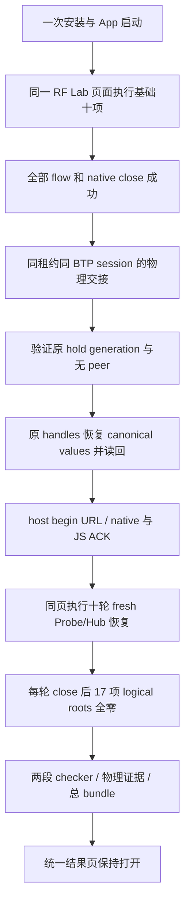

# 单次启动 RN RF Lab：基础十项 + 恢复十轮

日期：2026-10-15。

## 当前结论

**组合入口已实现；Android `52d56d…` 与 iOS `b0ed76…` 各自真实通过完整组合测试，host/physical/bundle 及离线复核 passed，App 均保持打开。后续新增 iOS reload 机制后，同 reload 冻结产物的完整组合回归 `b108c1…` 也真实通过并完成离线复核、App kept-open，详见末节。**

不是新的 App，也不是调用两个会重启 App 的 runner：同一个 `BleHubNitroHost`、同一个 RF Lab 页面/mount、一次启动、一个 native boot 和共享 JS boot nonce，先执行 continuous10，再在 physical-clean 边界自动进入 strict RecoveryTen。结果页保持打开，不需点击切段。

这是两组不同含义的测试：第一组十种 flow；第二组十轮 fresh Probe/Hub 恢复生命周期，不能称作二十种 flow 或一个 Hub 存活十轮。此前独立 [recovery-ten](2026-10-15-rn-recovery-ten.md) 的两端通过仍属于各自场景/候选，不继承为 iOS full-suite。

本轮没有改 production BLE contract/backend，没有刷机、换固件或修改 Zephyr。host、RN、native 启动/信号路由和 provider 测试基础设施发生变更，ABI 仍未冻结。

## 组合协议与实现



### RN / native

- [组合执行器](../../../tests/consumers/react-native-internal/src/rf_full.ts) 调用现有 `runRfLabSuite` 与 `runRfRecoveryTen`，不是复制 BLE flow 实现。
- [App](../../../tests/consumers/react-native-internal/src/App.tsx) 的 `rf-lab-suite` 在提供同 session 的 `rfRecoveryRunId` 时激活组合。第一段现在返回明确结果，native close 失败不可吞掉或继续进入 recovery。
- 两段和总 runtime marker 共用 module-scope JS boot nonce；UI 使用两组固定行/key、固定 latest/failure/summary，高频 event/resource 原始 console 仍完整，不逐条新增 UI 节点。
- Android [MainActivity](../../../tests/consumers/react-native-internal/android/app/src/main/java/com/blehubnitrohost/MainActivity.kt) 与 iOS [AppDelegate](../../../tests/consumers/react-native-internal/ios/BleHubNitroHost/AppDelegate.swift) 在唯一首次 launch 输出共享 native boot 的 control/recovery bootstrap。
- 首段 controls 全部完成后才允许一次 `blehub-rn-spike://recover/<session>/begin`；native 先记录精确身份 ACK，再交给 Linking。随后只允许原 strict recovery cycle URL，旧 control、重复 begin、提前或乱序 cycle 拒绝。
- 第一段失败或 close/handoff 失败，recovery 不启动；第二段失败保留首段独立结果，但总结果失败。

### Provider

[full_suite.py](../../../tests/peripherals/nrf52840/full_suite.py) 的新 `rf-lab-full-attested` mode 复用一次 DirectFixture start、同一 serial-based lease、BTP dispatcher、FixtureSession/live receipt 与原 ATT handles。

交接要求 cancellation/watchdog 两份物理报告已成功，fresh hold status 属于最后拥有的 watchdog generation 且 inactive，GAP 已断连、tracker 无 peer、队列 drain 到 idle、广告停止有确认。然后在原 handles 恢复 canonical values 并对 readable values 做读回，不 reset GATT、不重新 provision、不重开串口。进入 recovery 后不得再修改 RW 伪造远端 `00` read。

`full-suite-handoff.json` 只发布一次，保持 `status=ready`；最终结果单独存 `full-suite-physical.json`。根 abort 传播到 `recovery/abort`，未启动第二段的失败保留 blocked evidence。readiness 是物理证明，不是固定 sleep。

### Host / evidence

[run_rf_lab_full.py](../../../tools/react_native/run_rf_lab_full.py) 复用安装快照、live attestation、owned fixture cleanup 生命周期；[full_suite_capture.py](../../../tools/react_native/full_suite_capture.py) 使用通用化后的 recovery capture owner，同一 child/stream/PID 和命令 pump 跨越全部阶段，不重复安装/启动、不在 continuous10 summary 时提前 detach。

- 主 `full-suite-runtime.log` / `.raw.log` 保留整场控制台行文本；主日志投影统一使用 LF，原 `.raw.log` 的 CRLF/LF 字节保持不变并独立 hash；根 `coordination/runtime.log` 发布规范化全流。
- `recovery-ten-runtime.log` 是原始行的子集投影，`coordination/recovery/runtime.log` 是 provider 的规范化 projection；保留首次 bootstrap，不伪造新 launch。
- 原始 launch bootstrap deadline、native→JS control/begin/cycle ACK 的 hard 2s 预算和持续身份校验保留。host heartbeat 显示 base flow / handoff / recovery 阶段，不再在基础阶段一直显示 recovery boot。
- [full_suite_ledger.py](../../../tools/react_native/full_suite_ledger.py) 复用原十项 checker、cancel/watchdog physical checker 和 recovery ledger，绑定同 PID/boot/nonce/session、begin 双 ACK、物理交接和 raw line lineage。
- [bundle](../../../tools/react_native/rf_evidence_bundle.py) 新增 `scenario=full-suite`，复用两种子 index，保存准确主日志行范围/字节数/hash；最后一个 base flow 不吞入 recovery。总通过要求两子结构、50 快照/closed 全零、共享身份、阶段顺序、两子 ledger 与所有 required physical references 完整。
- Offline verifier 仅复核完整性/结构，不重新执行 BLE 断言或授权 RF；不回写历史 manifest。

## Android 最终候选：REAL PASSED

最终 attempt（在下述异常清理修复后完整重跑）：

```text
tests/consumers/react-native-internal/android/build/rf-full-suite-52d56dc74fd14f578b0cce69014f4804/
```

| 项目 | 实际值 |
|---|---|
| 手机 / DK-A | OnePlus 11 `3ac5cc09` / J-Link `1050252028` |
| Bundle UUID | `8909cf45-7d06-4a1f-8bc1-0302638dff22` |
| Fixture/native/JS session | `c5bccf46-a4b2-4f4b-831b-b6e912d638a0` |
| Native PID / boot | `21974` / `023ef6ac-53fa-4f36-ac3d-feadbda944e4` |
| JS boot nonce | `mv8vvaid-rglgk46h6s-w67tz0v5re` |
| Fixture PID / PGID | `94044` / `94044` |
| APK SHA-256 | `dc64f450acbcb254fa9b5478706d02bb5524568c470a90b2cfab03ad8621755e` |
| Installed multifunction image SHA-256 | `dd7dea99a325db32fa1fd66648d0a0814c8c7c442a77cf08998f2b91a1cc5b7a` |

该机器身份只记录证据，不是通用 runner 默认值。

实测与 host checker：

- 一个 App runtime、一个 capture child、同一个 live fixture session。
- 基础十项全部通过，含严格 Indication、native cancellation 和 native watchdog，七组 native/JS controls 完整。
- physical-clean 与 canonical readback 后 begin：native ACK 约 `111.7ms`、JS ACK 约 `176.4ms`，均相对同一原始 request 时间，未放宽 2s 上限。
- 第二段十轮全部通过：100 个 commands/terminals、260 events、10 个 `EF` Notification、10 次物理被动断连、10 次恢复远端 `00` read、50 个资源快照；20 次物理连接/断连，十个 closed snapshot 全部 17 项为零。
- 最终总 ledger、full physical、recovery physical、bundle 均 passed，cleanup/errors 无失败；runner 报告 `app=kept-open`，离线 bundle integrity check passed。

首轮通过 `b0ef20c320c44c2a8830ab343831426b` 保留其候选，不替代上述最终重跑。

## 本轮失败与加固

### Atomic snapshot 的 lstat/unlink 竞态

首个组合 attempt `cc90e09454e1468ca6bd0a5a4f305f6f` 到基础 flow 4 时，provider 误拒绝约 10 KiB 的正常 runtime snapshot。真实并发 atomic replace 在旧实现第 111 次 lstat 复现 `st_nlink=0`，没有创建硬链接。

[read_live_snapshot](../../../tests/peripherals/nrf52840/fixture_session.py) 仅允许前置 lstat 的 links 为 0/1；保留 O_NOFOLLOW、打开后独立 fstat regular/link/cap 校验及同 FD 内容稳定性检查。immutable `_read_bytes` 未放宽；错误诊断增加实际 mode/link/size/cap。修复后 20 轮共 100,000 次并发读取通过。失败 attempt 保留 failed，不重标。

### Foreign hold 的异常 cleanup 权限

独立 review 复现：旧 ContinuousExperiment 先拒绝 foreign hold generation，但父 cleanup 捕获后仍登记并 disconnect 新 GAP peer。现在整体 cleanup 将 generation/终态校验作为后续 mutation 的硬门槛；foreign hold 后不继续 GAP mutation/drain，不清空 tracker 冒充零，保留 unknown peer 状态。完整 cleanup 回归覆盖 foreign 初始空/非空 tracker、未拥有 hold、ABORT 后漂移、正常 owned cleanup及 primary error 保留。最终 Android attempt 在此修复后运行。

## iOS：解锁后完整组合 RF 通过

组合 physical Debug App 已重新构建/签名成功，native host/Signal 代码的 unsigned generic Simulator build-for-testing 也通过。

尝试目录：

```text
tests/consumers/react-native-internal/ios/build/rf-full-suite-3aa7fe348e8c45b1b522988d449bffc6/
```

该 attempt 的官方 preflight 返回 iPhone `00008110-000C61160C39401E` 锁定，保留原 blocked/failed 结果。用户解锁后，从完整基础十项重新执行，不跳过首段。

### CRLF 日志投影校验修复

解锁后首个 attempt `66d9f85b7f094b93a4db896906fac0e9` 的 App、两段 semantic checker、物理交接与清理均成功，但 bundle finalization 报 `full-suite one raw stream lineage drift`，因此整次仍保留 failed。核对发现 `devicectl` 原控制台的 753 条 marker 行使用 CRLF，capture 的 line-text projection 使用 LF；行内容、顺序和数量完全一致，原始文件 166,697 字节、投影 165,944 字节。

Bundle 现在精确验证原始逐行来源和仅 terminal CRLF→LF 的既有 capture 转换，不改日志头或 message bytes；原始 raw 文件保持不变，独立保存原字节 SHA-256，投影及各分段也分别 hash。两平台全 CRLF/混合 LF+CRLF 的回归通过，修改 message/header 仍被拒绝，离线验证不改写证据。本次仅修改 host bundle/checker 测试，未修改或重建 App。

### 新 attempt 的实际结果

```text
tests/consumers/react-native-internal/ios/build/rf-full-suite-b0ed7638c277486099f93d7e1c4202a6/
```

| 项目 | 实际值 |
|---|---|
| Bundle UUID | `500fd87d-2600-497e-a1d3-6fd2d2607cb2` |
| Fixture/native/JS session | `f23eee94-0cd6-4c5a-b3de-283dc2bd0c73` |
| Native PID / boot | `49865` / `62e9bae1-0211-40a6-9368-1b000935718e` |
| JS boot nonce | `mv97ofxt-4jlza835y96-bvgttu6vfa` |
| Fixture PID | `45679` |
| App tree SHA-256 | `7d6be5001b07443f03468e7113b0736c90f4acf492d7b20a161be0063cc2e74b` |

实测：一次 App launch/mount、一个 capture child、同一 native boot/JS nonce/fixture session；基础十项含 cancellation/watchdog 全 passed，七组 controls 完整；physical-clean/canonical readback 后 begin native/JS ACK 均约 `221.8ms`，在原 hard 2s 上限内。

恢复十轮有 100 commands/terminals、250 events、10 notifications、10 次被动断连、10 次恢复远端 read、50 个资源快照，十个 closed snapshot 的 17 项均为零。总 semantic ledger、两段 physical、cleanup 与 evidence bundle 全部 passed；devicectl console detach 后 host 确认原 PID/executable 存活，runner 报告 `app=kept-open`。新 iOS bundle 与既有 Android 最终 bundle 均通过更新后的离线完整性校验，未回写任何历史结果。

## 正式入口与兼容

原 `rf-lab-suite` Just 入口现在默认执行组合总计划，参数保持显式 device/team/contract/profile：

```text
pixi run just react-native host-android-rf-lab-suite <serial> <fixture-contract> <fixture-profile>
pixi run just react-native host-ios-device-rf-lab-suite <udid> <team> <fixture-contract> <fixture-profile>
```

不构建的 frozen-artifact runner：

```text
pixi run python -m tools.react_native.run_rf_lab_full --platform <android|ios> --device <device> --artifact <APK-or-App> --fixture-contract <contract> --fixture-profile <profile>
```

VCOM 来自 ignored local config 或 `BLEHUB_NRF52840_PORT`，不在 runner 内硬编码。普通 run 不刷机。旧 `run_android_rf_lab_suite` / `run_ios_rf_lab_suite` 仍可作 standalone continuous10 定位；strict recovery-ten 独立入口也保留。pending-read reload 仍是刻意包含两次 JS runtime 的独立场景，不冒充同 runtime 组合内容。

## 验证边界

已运行：RN full Jest 7 suites / 225 tests、typecheck；RN host Python discovery 最新 381 tests；CRLF 修复后专项 56 tests（包含于全量，不相加）；nRF provider discovery 276 tests；Android Release、Android host instrumentation Kotlin 编译、signed iOS physical build、iOS Simulator build-for-testing；Android/iOS 各自完整组合 RF 与离线 bundle 复核。新增 native host tests本轮仅编译，未宣称真机 instrumentation 全部执行。`pixi run just fmt`、`pixi run just lint`（含 strict workspace Clippy）、`pixi run just docs-check-mermaid` 及两端正式 suite recipe dry-run 通过。各 synthetic/focused 子集不相加冒充 RF 证据。

逻辑资源计数不是 OS heap/thread leak proof，host artifact fingerprint 不是设备端 binary hash、签名安全证明或 source-to-build attestation。permission/adapter transitions、clean locked release、全部 native/package 同候选门禁与 ABI freeze 仍未完成；本报告不宣称测试系统全部完善。

后续独立 [iOS pending-read engine reload](2026-10-15-ios-pending-read-engine-reload.md) attempt `01580b…` 已真实通过、离线复核 passed、App kept-open：同 App PID、两个 native owner/JS runtime，实际 RN module `invalidate` 触发旧 owner 清理。该测试有意改变 runtime，仍是同一个 App 而非新 App；不作为本场 same-runtime full-suite 的第十一项。其 App tree `376d20…` 与早先 iOS `7d6be5…` 不同，不能继承旧结果；随后已用新 frozen artifact 完整重跑，结果如下。

## 新版 iOS reload 同一冻结产物的完整回归

实际输入为 reload attempt `01580b…/candidate/BleHubNitroHost.app`，不重新构建、不刷机；host timeout 显式设为 360 秒，实际 attempt 起止为 `09:34:04.196465–09:36:56.634897 UTC`，约 172 秒。新 evidence：[目录](../../../tests/consumers/react-native-internal/ios/build/rf-full-suite-b108c187335e4d72b6854bff8a42cebf/)、[bundle](../../../tests/consumers/react-native-internal/ios/build/rf-full-suite-b108c187335e4d72b6854bff8a42cebf/evidence-bundle.json)。

| 项目 | 实际值 |
|---|---|
| Bundle run UUID | `3d89210f-9dde-40c8-ac45-c36647d14182` |
| Fixture/native/JS session | `443470d7-e1e3-4618-8864-d8f429c64cec` |
| App PID / native boot | `50734` / `d4936d75-80b6-45c4-9ebc-d19b2253e52e` |
| 唯一 JS nonce | `mv9cdmwh-ufwrqcn7qx9-upargo4k3b` |
| Fixture PID / PGID | `96978` / `96978` |
| App tree SHA-256 | `376d204319fdda71ce1fff5c0bb54bb444cc94bf1415730ac2027b13b2b5925c` |
| JS SHA-256 | `1bf0a7343ebe6e2ee5a23c9e3b878aa00c46ac3127cba63fde61b6d8b5dd5af7` |
| 原 DK-A multifunction image | `dd7dea99a325db32fa1fd66648d0a0814c8c7c442a77cf08998f2b91a1cc5b7a` |
| Cancellation / watchdog hold | sequence `39 / 40`，ATT handle `41` |

Source fingerprint、新冻结 candidate fingerprint 与 pending reload candidate fingerprint 完全相等；另对两份快照的主 executable、debug dylib、JS 实际字节重算 SHA-256，均一致。身份不是由“同一源码”推断。

实测结果：

- 基础 10/10 passed、failureCount=0；Notification/Indication `ef`，RSSI `-54 dBm`。七组控制 `request < native ACK < JS ACK`，request→JS 约 123–175 ms。
- Cancellation：active `9027`、queued `9028`、recovery `9029`；queued terminal `cancelled`，active/recovery read `00`。Watchdog：active `21010` → `timeout`、queued `21011` → `operation_aborted`，恢复连接/GATT/read 得到 `00`。
- 原 lease/BTP/session/ATT handles 的 physical-clean、canonical values 恢复与 readback passed，再进入 recovery；没有 reset/reopen/flash。
- RecoveryTen：100 commands、100 个唯一 terminal、250 events、10 notifications、10 passive disconnects、10 次远端 `00` read；50 个 snapshot，10 个 closed snapshot **逐项包含全部 17 项且均为零**。20 次物理连接/断连，begin 与 cycles 0..9 native/JS ACK 完整。
- 最终 hold `RELEASED`/inactive、peer count `0`、advertising stop confirmed，physical/errors/cleanup 无失败；semantic ledger、physical、bundle passed，inventory 121。`full-suite-runtime.detached-processes.json` 在 console detach 后仍确认原 PID `50734` 和 exact executable 存活，支持 `app=kept-open`，不是 host 提前结束/关闭 App。
- 本轮新 bundle 的 `host-rf-evidence-check` 实际 passed；没有回写此前 failed 或 passed attempt。

这是 reload 模块变更后对**同一 iOS frozen artifact** 的完整 RF Lab 回归，与 pending reload 是不同启动/PID/场景，不称为两场共一个 runtime。前文 `b0ed76…` 的记录保留原候选边界。软件复核见 [reload 报告](2026-10-15-ios-pending-read-engine-reload.md#本轮软件复核与同产物-rf-回归)；全部 native/package/Android 同候选矩阵、transitions、clean release/provenance 与 ABI freeze 仍不能据此宣称完成。
