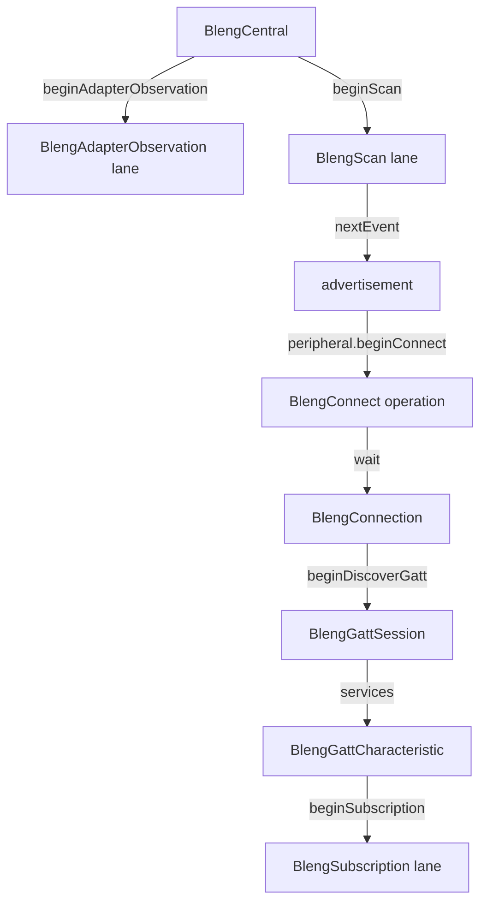

# `@blengine/react-native-bleng` — API

Typed BLE Central for React Native. One Rust engine owns every operation; this package is the
Nitro bridge to it, plus a small await layer.

> This is the English mirror of [`API.zh.md`](API.zh.md). Both files are pinned by
> `tools/tests/react_native/test_api_docs.py`: a capability missing from either copy fails the
> suite, so neither can rot silently.
>
> This page owns behaviour. For signatures and every union arm, generate the TypeDoc site with
> `pixi run just react-native::api-site` (see
> [`typedoc-site.md`](../../docs/research/react-native/typedoc-site.md)); it is derived from the specs
> and never hand-edited.

**TL;DR** — three shapes: **lane** (a stream), **operation** (one bounded wait), **retained end**.
`begin*()` submits; `wait`/`nextEvent` settles; a `failure` is data; a lane has one pending pull.

## Contents

- [Quick start](#quick-start)
- [Beyond the quick start](#beyond-the-quick-start)
- [Five rules worth reading first](#five-rules-worth-reading-first)
- [The model: three shapes, one contract](#the-model-three-shapes-one-contract)
- [Capabilities at a glance](#capabilities-at-a-glance)
- [Session and app wiring](#session-and-app-wiring)
- [Adapter state](#adapter-state)
- [Scan](#scan)
- [Connect](#connect)
- [Device inventory and adopt](#device-inventory-and-adopt)
- [Companion association](#companion-association)
- [Companion presence](#companion-presence)
- [GATT](#gatt)
- [MTU](#mtu)
- [Connection priority](#connection-priority)
- [Bonding](#bonding)
- [GATT cache refresh](#gatt-cache-refresh)
- [Notifications](#notifications)
- [Await layer (optional, derived)](#await-layer-optional-derived)
- [Sharing one lane](#sharing-one-lane)
- [Failures](#failures)
- [Bounds and lifecycle](#bounds-and-lifecycle)
- [Platform notes](#platform-notes)
- [Coming from other React Native BLE libraries](#coming-from-other-react-native-ble-libraries)
- [Not in this API](#not-in-this-api)

## Quick start

Five steps, no hidden state. Each line maps to a section below.

```ts
import {
  createBlengCentral,
  requireAccepted,
  requireOutcome,
  run,
} from '@blengine/react-native-bleng'

const HEART_RATE = '180d' // 16-bit, 32-bit and full 128-bit UUIDs are all accepted

// 1. Construct. Cheap: no radio access, no permission prompt.
const central = createBlengCentral()

// 2. Snapshot the adapter: state + authorizations, even when the radio is off.
//    initialize() reports failure as data; requireOutcome turns it into a throw.
const adapter = requireOutcome(await central.initialize()).snapshot

// 3. Scan. `beginScan` yields a *lane* (named controls + a stream), so `requireAccepted`
//    unwraps it. Your pull timeout never stops the native scan, so stop explicitly once done.
const scan = requireAccepted(central.beginScan({ serviceUuids: [HEART_RATE] }))
const { advertisement } = await scan.nextEvent(10_000)
await run(scan.beginStop(), 10_000)

// 4. Connect. `beginConnect` is an *operation* (one capability with wait/cancel), so `run`
//    waits once with your budget and throws on failure. `connection` is the capability you keep.
const { connection } = await run(advertisement.peripheral.beginConnect(), 10_000)

// 5. Use it. Discovery is an operation too; it returns a fresh topology every call.
const { session } = await run(connection.beginDiscoverGatt(), 10_000)
const characteristic = session.services()[0].characteristics()[0]
const { value } = await run(characteristic.beginRead(), 5_000)

// Cleanup is explicit and independent of closing the central.
await run(connection.beginDisconnect(), 5_000)
await central.close()
```

`run` is the one-liner: exactly `pendingOperation(submission, ms).result`. When you may need to
cancel mid-flight, call `pendingOperation` instead and keep its `cancel()` (or pass an
`AbortSignal`) — see [Await layer](#await-layer-optional-derived).

If any of those steps cannot be done, it fails **with a typed `failure`**, never by silently
doing something else. That is the whole point of the shape below.

## Beyond the quick start

Those five steps are the happy path for one peer. A real app also needs the flows below; each has
its own section.

| flow | what the quick start does not show | read |
|---|---|---|
| Adapter readiness and permissions | `initialize()` resolves even with the radio off or access denied. Check `snapshot.state` and both authorizations; a later scan/connect can fail with the `adapter_unavailable` or `permission` code. | [Adapter state](#adapter-state) |
| Adapter changes and power | The radio can change after initialize. `beginAdapterObservation()` streams the platform's report; `beginAdapterControl(enabled)` asks for a power change (Android; Apple refuses `not_supported`). | [Adapter state](#adapter-state) |
| Connection end and reconnect | A link can end unrequested. `connection.awaitEnd(ms)` is retained and re-readable; `isConnected()` is this lane's observation; `beginAutoConnect()` asks for a standing link (Android; Apple `not_supported`). | [Connect](#connect) |
| Writing and descriptors | The quick start only reads. Use `beginWrite()` (with/without response) and a descriptor's own `beginRead()` / `beginWrite()`. | [GATT](#gatt) |
| Notifications | Most peers push values. `beginSubscription(mode)` is a lane; pull with `nextEvent(ms)` and stop it with `beginDisable()`. | [Notifications](#notifications) |
| Failure handling | Failures are data. Branch on `failure.code` (and closed `domain`), or use `isBlengFailure`, `BlengOperationError` and `failureReason`; never parse `message`. | [Failures](#failures) |
| Cancellation and your deadline | `pendingOperation(...).cancel()` and an optional `AbortSignalLike` bind to the same native cancel, accepted only where the platform can withdraw it; `bleng.timeout` is your bound, not a link-state claim. | [Which `cancel()` is real](#which-cancel-is-real), [Bounds and lifecycle](#bounds-and-lifecycle) |
| Sharing one lane | A lane allows one pending pull. Several consumers use `shareLane` instead of racing two pulls. | [Sharing one lane](#sharing-one-lane) |
| Multiple links and operations | One owner can hold several connections; every capability is an opaque handle, not a device id. | [The model](#the-model-three-shapes-one-contract) |
| App wiring | `getBlengCentral()` / `closeBlengCentral()` / `useBlengCentral()`; mount/unmount never starts or closes BLE, and Fast Refresh keeps the owner. | [Session and app wiring](#session-and-app-wiring) |
| Close semantics | `close()` reports `closed` independently of a cleanup `failure`; a nonterminal busy keeps the owner; a terminal cleanup failure is not resource-zero. | [Bounds and lifecycle](#bounds-and-lifecycle) |
| MTU and priority | Android can query/request MTU and set connection priority; Apple exposes neither. | [MTU](#mtu), [Connection priority](#connection-priority) |
| Bond and cache refresh | Android `beginBond(pin)` / `beginRemoveBond()` and `beginGattCacheRefresh()`; Apple refuses both. | [Bonding](#bonding), [GATT cache refresh](#gatt-cache-refresh) |
| Inventories and adoption | `beginDeviceQuery(kind, serviceUuids)` is a read-only inventory (Apple supports only `connected`); `adoptPeripheral(key)` re-addresses an iOS-restored link. | [Device inventory and adopt](#device-inventory-and-adopt) |
| Companion association and presence | Android-only: `beginCompanionAssociation(...)` and `beginCompanionPresence()`; Apple refuses both. | [Companion association](#companion-association), [Companion presence](#companion-presence) |
| Background and restoration | iOS needs the `bluetooth-central` background mode and a restore identifier; Android has its own foreground/background constraints. | [Platform notes](#platform-notes) |
| Host-declared permissions | The host app declares Bluetooth (and companion) permissions; this package declares no companion permission. | [Platform notes](#platform-notes) |

## Five rules worth reading first

| # | rule | what it means in practice |
|---|---|---|
| 1 | **`begin*()` does not do the work — it submits it** | The call returns either one capability or a `failure`. A refusal is synchronous; the outcome arrives through that capability's own `wait(ms)`. |
| 2 | **Every wait has *your* deadline** | `timeoutMs` is an argument, not a setting. `bleng.timeout` says your bound expired — never that the link is down, the device is gone or the operation failed. |
| 3 | **A receipt is not delivery; a cancel is not rollback** | "Accepted" means the platform took the request. A cancel records a request — the peer may still finish the write, read or pairing. Only operations the platform can withdraw accept one; the rest answer `bleng.operation_not_cancellable`. |
| 4 | **One pending pull per lane** | A second concurrent `nextEvent` is a contract violation, not a queue. Several consumers share one lane through `shareLane`. |
| 5 | **Unsupported is a typed refusal** | When a platform has no equivalent, the result is `bleng.dispatch_rejected.not_supported`. It is never emulated or silently ignored. |

## The model: three shapes, one contract



Three shapes, and only three:

| shape | examples | lifetime | how you wait |
|---|---|---|---|
| **lane** | `BlengScan`, `BlengSubscription`, `BlengAdapterObservation`, `BlengCompanionPresence` | long-lived, streams events | `nextEvent(ms)`, one pending pull at a time |
| **operation** | `BlengRead`, `BlengWrite`, `BlengConnect`, `BlengMtu`, … | one bounded request/response | `wait(ms)`, once |
| **retained end** | `BlengConnection` | long-lived link, terminal stays readable | `awaitEnd(ms)`, re-readable |

Every `begin*()` returns **either** one capability under a named key, **or** a failure:

```ts
const submission = characteristic.beginRead()
if ('failure' in submission) {
  // refused before anything was submitted; nothing is pending
} else {
  const result = await submission.read.wait(5_000)
  // result is { value: ArrayBuffer } | { failure }
}
```

That union is the contract: absence of failure is success, a deadline is **your** bound (not a
statement about the link), and a cancel receipt records a request, not rollback.

## Capabilities at a glance

Each capability is a native handle. `controls` are the methods you call on it; `produced by` is the
call that returns it. Every one-shot capability exposes `wait`/`cancel` so the shape stays uniform,
but only an operation the platform can still withdraw accepts a cancel — see
[Which `cancel()` is real](#which-cancel-is-real).

**Session, adapter and inventory**

- `BlengCentral` — `createBlengCentral()` — `initialize`, `close`, `beginScan`,
  `beginAdapterControl`, `beginAdapterObservation`, `beginCompanionAssociation`,
  `beginCompanionPresence`, `beginDeviceQuery`, `adoptPeripheral`
- `BlengAdapterObservation` — `central.beginAdapterObservation()` — `nextEvent`
- `BlengCompanionPresence` — `central.beginCompanionPresence()` — `nextEvent`
- `BlengAdapterControl` — `central.beginAdapterControl(enabled)` — `wait`, `cancel`
- `BlengCompanionAssociation` — `central.beginCompanionAssociation(...)` — `wait`, `cancel`
- `BlengDeviceQuery` — `central.beginDeviceQuery(kind, serviceUuids)` — `wait`, `cancel`

**Scanning and connecting**

- `BlengScan` — `central.beginScan()` — `waitUntilStarted`, `nextEvent`, `beginStop`,
  `cancelStart`, `isScanning`
- `BlengScanStop` — `scan.beginStop()` — `wait`, `cancel`
- `BlengPeripheral` — a scan advertisement — `key`, `localName`, `beginConnect`, `beginAutoConnect`
- `BlengConnect` — `peripheral.beginConnect()` — `wait`, `cancel`
- `BlengConnection` — `connect.wait()` — `awaitEnd`, `isConnected`, `localName`,
  `beginDiscoverGatt`, `beginDisconnect`, `beginReadRssi`, `beginQueryMtu`, `beginRequestMtu`,
  `beginSetConnectionPriority`, `beginBond`, `beginRemoveBond`, `beginGattCacheRefresh`
- `BlengDisconnect` — `connection.beginDisconnect()` — `wait`, `cancel`

**GATT**

- `BlengGattDiscovery` — `connection.beginDiscoverGatt()` — `wait`, `cancel`
- `BlengGattSession` — `discovery.wait()` — `services`
- `BlengGattService` — `session.services()` — `uuid`, `kind`, `characteristics`
- `BlengGattCharacteristic` — `service.characteristics()` — `uuid`, `properties`, `descriptors`,
  `beginRead`, `beginWrite`, `beginSubscription`
- `BlengGattDescriptor` — `characteristic.descriptors()` — `uuid`, `beginRead`, `beginWrite`
- `BlengRead` — `characteristic.beginRead()` — `wait`, `cancel`
- `BlengWrite` — `characteristic.beginWrite()` — `wait`, `cancel`
- `BlengDescriptorRead` — `descriptor.beginRead()` — `wait`, `cancel`
- `BlengDescriptorWrite` — `descriptor.beginWrite(value)` — `wait`, `cancel`
- `BlengRssi` — `connection.beginReadRssi()` — `wait`, `cancel`

**Link tuning**

- `BlengMtu` — `connection.beginQueryMtu()` / `connection.beginRequestMtu(mtu)` — `wait`, `cancel`
- `BlengPriority` — `connection.beginSetConnectionPriority(priority)` — `wait`, `cancel`
- `BlengBond` — `connection.beginBond()` / `connection.beginRemoveBond()` — `wait`, `cancel`,
  `nextState`
- `BlengGattCacheRefresh` — `connection.beginGattCacheRefresh()` — `wait`, `cancel`

**Streams**

- `BlengSubscription` — `characteristic.beginSubscription()` — `waitUntilEnabled`, `nextEvent`,
  `beginDisable`, `detach`
- `BlengSubscriptionDisable` — `notifications.beginDisable()` — `wait`, `cancel`

The full list of exported types — including every union member — is the generated
[`abi-freeze-inventory.md`](../../docs/research/bleng/abi-freeze-inventory.md#2-js--nitro-面); this
page documents behaviour, not the type inventory.

## Session and app wiring

**Construct and look up**

- `createBlengCentral()` → `BlengCentral` — always constructs a **new** central; construction does not
  initialize BLE.
- `getBlengCentral()` → the one central for this JS runtime — the normal app entry point.
- `closeBlengCentral()` — closes that runtime central explicitly.

**Lifecycle**

- `central.initialize()` → `Promise<BlengInitializeResult>` — `{ snapshot }` or `{ failure }`;
  `snapshot` is `{ state, scanAuthorization, connectionAuthorization, name? }`. Resolves (does not
  reject) even when the radio is off or access is denied. Unwrap with `requireOutcome(result).snapshot`.
- `central.close()` → `Promise<BlengCloseResult>` — `{ closed, failure? }`; closure is independent of
  cleanup success.

**Submissions**

- `central.beginScan(options)` → `BlengScanSubmission` — `{ serviceUuids, namePrefix?, exactName?,
  companyId?, minRssi?, manufacturerData?, allowDuplicates }`.
- `central.beginAdapterControl(enabled)` → `BlengAdapterControlSubmission` — `{ control }` or failure;
  receipt only, observe the adapter lane for state.
- `central.beginCompanionAssociation(serviceUuids, displayName?, deviceProfile?,
  notifyOnDeviceNearby?)` → `BlengCompanionAssociationSubmission` — `{ association }` or failure;
  platform chooser, never cancellable.
- `central.beginDeviceQuery(kind, serviceUuids)` → `BlengDeviceQuerySubmission` — `{ query }` or
  failure; read-only inventory.
- `central.beginCompanionPresence()` → `BlengCompanionPresenceSubmission` — `{ companionPresence }` or
  failure; presence of opted-in associations.
- `central.adoptPeripheral(key)` → `BlengPeripheralAdoptSubmission` — `{ peripheral }` or failure;
  re-address an inventory record.

`state` is `'unknown' | 'unavailable' | 'poweredOff' | 'poweredOn'`; authorization is
`'notRequired' | 'notDetermined' | 'denied' | 'restricted' | 'authorized'`.

`initialize()` is bounded by the library (currently 30 s of owner assembly, including backend
attach and the initialize operation). A bound hit is a `{ failure }` with `domain: 'lifecycle'` and
`code: 'bleng.timeout'`; native work may still be running, so `close()` is the only meaningful next
step. `close()` waits for native cleanup without an upper bound. Do not wrap either call in
`Promise.race` to fake a timeout — that does not cancel the native work.

All UUID inputs accept 4, 8, 32 or 36 hexadecimal characters (with or without hyphens) and are
canonicalized to lowercase hyphenated 128-bit form. Every UUID returned by the API (advertisements,
services, characteristics, descriptors) is already in that canonical form, so string comparison is
safe once you compare the API's own output.

### React and Fast Refresh

```tsx
import { BlengProvider, useBlengCentral } from '@blengine/react-native-bleng'

<BlengProvider>
  <Screen />
</BlengProvider>

function Screen() {
  const central = useBlengCentral()
  // ...
}
```

- `BlengProvider` resolves the runtime central unless you pass an explicit `central`.
- The slot lives on `globalThis`, so **React Fast Refresh keeps the same central and live
  capabilities**. Re-evaluating a module does not create a second engine.
- A full reload or process restart is a new JS runtime. RN invalidates the old native engine;
  owners and capabilities are gone by design, so the app reconnects. Nothing resurrects them.
- Mounting/unmounting `BlengProvider` never starts or closes BLE. Closing is explicit:
  `closeBlengCentral()`.

### Driving a lane from React

Lanes are pull-based: `nextEvent(ms)` returns one event, so a screen drives the loop from an effect.
Keep exactly one pull in flight, stop on `ended`, and treat `bleng.timeout` as "idle", not as an end.

```tsx
import { useEffect, useState } from 'react'
import {
  isBlengFailure, requireAccepted, useBlengCentral,
  type BlengScan, type BlengScanAdvertisement,
} from '@blengine/react-native-bleng'

function ScanScreen() {
  const central = useBlengCentral()
  const [found, setFound] = useState<BlengScanAdvertisement[]>([])

  useEffect(() => {
    let active = true
    let scan: BlengScan | undefined

    const loop = async () => {
      const submission = central.beginScan({ serviceUuids: ['180d'] })
      if (isBlengFailure(submission)) return // refused before submission; handle the failure
      const accepted = requireAccepted(submission)
      scan = accepted
      // `waitUntilStarted` answers with a receipt: a failure is carried, not thrown.
      if (isBlengFailure(await accepted.waitUntilStarted(5_000))) return

      while (active) {
        const next = await accepted.nextEvent(5_000)
        if (!active) break
        if (isBlengFailure(next)) {
          if (next.failure.code === 'bleng.timeout') continue // idle; not an end
          break
        }
        if ('advertisement' in next) {
          setFound(previous => [...previous.slice(-63), next.advertisement])
          continue
        }
        break // { ended }: normal terminal
      }
    }

    void loop()
    return () => {
      active = false
      // Unmount stops scanning if we still own it. A pending nextEvent settles at its own timeout.
      const stopping = scan?.beginStop()
      if (stopping && !isBlengFailure(stopping)) void stopping.stop.wait(5_000)
    }
  }, [central])

  return found.length === 0 ? null : /* render found */
}
```

- Do not start a second pull before the previous `nextEvent` settles; a concurrent pull resolves
  `delivery.pull_busy`.
- `{ ended }` is a normal terminal, not a failure: leave the loop and update the UI.
- Unmount is not `close()`: other screens and connections keep running. Close the central only when
  the whole runtime is done.
- If two components need the same stream, share one pull loop with `shareLane` instead of starting
  two.

## Adapter state

```ts
const lane = requireAccepted(central.beginAdapterObservation())
const next = await lane.nextEvent(30_000) // { snapshot } | { ended } | { failure }
```

- This is the **only** surface that reports a radio change after `initialize()`. `snapshot` is what the
  platform reported (`state` plus both authorizations), never an App inference.
- A timeout is **your** bound (`bleng.timeout`); it neither ends observation nor says anything about
  the radio.
- `ended.reason` is `'ownerClosed'` (the engine retired — the end of *observation*) or `'detached'`
  (this endpoint stopped observing; other observers are unaffected).
- It is a coexisting lane: several observers on one central each receive every snapshot offered after
  they registered. Storage is bounded (64) and overflow fails closed instead of dropping state.
- Observing **never** triggers recovery and **never** changes the radio: when the radio really goes
  away, the operations are what fail, not this stream.

`central.beginAdapterControl(isEnabled)` returns `{ control }` and never a snapshot:
`control.wait(ms)` consumes the platform receipt (a `BlengAdapterControl`, part of a
`BlengAdapterControlSubmission` = `BlengAdapterControlAccepted` | `BlengFailure`). A receipt only
means the platform accepted the request; the actual radio state still arrives through the adapter
lane. Android may refuse on targetSdk 33+ (user confirmation required), and Apple always refuses
with `bleng.dispatch_rejected.not_supported` — neither is reported as success.

## Scan

```ts
const scan = requireAccepted(central.beginScan({ serviceUuids: [], allowDuplicates: false }))
const started = await scan.waitUntilStarted(5_000) // { failure? }; absence of failure is the start
const next = await scan.nextEvent(5_000)          // one pending pull at a time
```

**Options.** `serviceUuids` (any-match), `namePrefix` / `exactName` (local-name filters), `companyId`
(manufacturer id presence), `minRssi` (advertisement RSSI at or above the threshold; an absent RSSI
does not match), `manufacturerData` (a `BlengManufacturerDataFilter`: `{ companyId, data, mask? }`,
where the payload must start with `data`, or match it byte-for-byte under `mask`) and `android`.
`allowDuplicates` is a reporting hint, not a filter. All of these are applied by the engine's fixed
predicate on both platforms; they are not a promise about native scan filter offload.

**Android-only tuning.** `android` is `BlengAndroidScanOptions`: `scanMode`
(`BlengAndroidScanMode`), `phy` (`BlengAndroidScanPhy`, requires API 26), `reportDelayMs` (0–5000)
and `legacy` (requires API 27). They change how Android scans, never what matches. Apple has no
equivalent, so a scan that sets `android` is refused with
`bleng.dispatch_rejected.not_supported` instead of scanning with different behaviour.

**Events.**

- `nextEvent` resolves to `{ advertisement }`, `{ ended }` or `{ failure }`. A timeout does **not**
  stop native scanning; it is your bound.
- `ended.reason` is `'requested'` (a stop), `'systemSuspended'`, `'failed'`, `'ownerClosed'` or
  `'overflowed'`; `failure` is present only when the platform reported one. `'overflowed'` ends only
  this observation lane: the native scan and every operation keep running.
- `advertisement` carries `peripheral` (opaque, owner-bound), `localName?`, `advertisedServices`,
  `manufacturerData[]`, `serviceData[]`, `rssi?`, `connectable?`. No device identities cross in.

**Identity.** `peripheral.key()` is an opaque, owner-scoped key that is stable across advertisements
of the same peer. Use it as a map key to deduplicate a scan list; it is **not** a platform device id
and cannot address native state. The same key in another owner means nothing.

**State and control.**

- `scan.isScanning()` is this lane's own knowledge: `true` only between a confirmed start and a
  terminal it observed. Before the platform confirms the start it is `false`, and so is an ended or
  overflowed lane; `false` never claims the native scan is stopped.
- **Scanning runs until it ends.** `scan.beginStop()` → `{ stop }` → `stop.wait(ms)` (or
  `run(scan.beginStop(), ms)`); once processed, the lane reports `ended.reason='requested'`. A
  `nextEvent` timeout is only *your* bound and never stops the native scan, so stop explicitly when
  you have what you need. `cancelStart()` can really withdraw a start that has not settled; a stop
  is the teardown authority, so `stop.cancel()` answers `bleng.operation_not_cancellable`
  ([which cancels are real](#which-cancel-is-real)).
- **One pending pull.** A second concurrent `nextEvent` resolves `{ failure }` with
  `domain: 'delivery'`, `code: 'delivery.pull_busy'`; it does **not** throw, and it leaves the
  pending pull and the native scan untouched. Several consumers should use `shareLane` (see below)
  instead of racing two pulls.
- Observation delivery is a bounded FIFO (64 events, oldest retained); overflow ends this lane as
  `ended.reason='overflowed'` instead of dropping an advertisement silently. Pull continuously: a
  consumer that stops pulling is what fills it.

## Connect

```ts
const connect = requireAccepted(advertisement.peripheral.beginConnect())
const { connection } = await connect.wait(5_000)     // or pendingOperation(...)
const next = await connection.awaitEnd(10_000)       // retained: readable more than once
```

**Link end.** `awaitEnd` resolves to `{ ended: { reason, failure? } }` or `{ failure }`. `reason` is
`'requested'` (this capability submitted the disconnect), `'unrequested'` (peer/stack/adapter reset),
or `'ownerClosed'` (observation ended because the engine retired — not a claim that the link is down).

**Observations, not probes.**

- `connection.isConnected()` is `true` only while this connection's own lane sees the link up. A
  connect still awaiting platform confirmation reports `false`, as does an ended lane; it is not a
  fresh probe of the peer.
- `connection.localName()` is the peer's self-reported advertisement name carried by the peripheral
  that submitted the connect. It is the name observed in the advertisement, not a fresh platform
  read and not a claim about the live link; it is `undefined` when the peer advertised no name and
  for a capability adopted from an inventory key.

**Auto-connect and disconnect.**

- `advertisement.peripheral.beginAutoConnect()` asks for an auto-connect link (re-establish whenever
  the peer becomes available). Android expresses this natively; Apple refuses it with
  `bleng.dispatch_rejected.not_supported` instead of silently connecting once.
- `connection.beginDisconnect()` → `{ disconnect }` → `disconnect.wait(ms)`. A disconnect is the
  teardown authority, so `disconnect.cancel()` answers `bleng.operation_not_cancellable`
  ([which cancels are real](#which-cancel-is-real)).

## Device inventory and adopt

`central.beginDeviceQuery(kind, serviceUuids)` reads a **read-only inventory**, where `kind` is a
`BlengDeviceQueryKind` (`'connected' | 'bonded' | 'companion'`). `query.wait(ms)` resolves to a
`BlengDeviceQueryResult` (`BlengDeviceQueryOutcome` with `BlengDeviceInfo[]`, or
`BlengFailure`).

```ts
const query = requireAccepted(central.beginDeviceQuery('connected', [HEART_RATE]))
const { devices } = await query.wait(5_000)   // BlengDeviceInfo[]
const { peripheral } = requireAccepted(central.adoptPeripheral(devices[0].key))
```

- Each `BlengDeviceInfo` is `{ key, localName?, connected, bonded }`; `key` is opaque and comparable
  with `peripheral.key()`.
- An inventory record is data, not a capability. To operate on one, adopt the key explicitly with
  `central.adoptPeripheral(key)` → a `BlengPeripheral` (nothing is connected until you call
  `beginConnect()`). This is how an iOS state-restored connection is re-addressed after a relaunch.
- A backend that did not allocate the key refuses the later `connect` with a typed failure
  (`BlengDeviceQuery` is reached through a `BlengDeviceQuerySubmission` =
  `BlengDeviceQueryAccepted` | `BlengFailure`).
- `connected`/`bonded` are the platform's report. Android supports all three kinds; Apple supports
  `connected` (requires at least one service UUID and returns the system-connected peripherals
  advertising those services) and refuses `bonded` and `companion` with
  `bleng.dispatch_rejected.not_supported`.

`companion` is Android's companion-device association list (`CompanionDeviceManager`, API 26+). It
is a system association, not a link: an associated device may be absent, so those records report
`connected: false` and `bonded: false`, and `localName` is the association's display name when the
platform has one. The query needs no runtime permission and does not bind or wake the device.

## Companion association

```ts
const submission = central.beginCompanionAssociation(
  [HEART_RATE],
  'My Watch',                                  // displayName, optional
  'android.app.role.COMPANION_DEVICE_WATCH',   // deviceProfile, optional
  true,                                        // notifyOnDeviceNearby, optional
)
const { association } = requireAccepted(submission)
await association.wait(60_000)                 // never cancellable after submission
```

`central.beginCompanionAssociation(...)` requests one association and returns a
`BlengCompanionAssociationSubmission` (`BlengCompanionAssociationAccepted` | `BlengFailure`).

- **Android only, API 33+.** Android shows its own chooser; `wait(ms)` settles when the platform
  reports the association, and fails when the user declines or the platform refuses. Older releases
  deliver the outcome only to an Activity, so they are refused rather than half-supported.
- **Not cancellable.** The chooser is platform UI, not engine work; there is nothing to cancel.
  `association.cancel()` exists for shape uniformity and resolves with a receipt carrying
  `bleng.operation_not_cancellable`.
- **`deviceProfile` is yours.** It is the host's own platform profile (for example
  `android.app.role.COMPANION_DEVICE_WATCH`); declaring the matching
  `REQUEST_COMPANION_PROFILE_*` permission is the host App's responsibility. This package declares
  no companion permission and no default profile.
- **A receipt is not a device.** Read it back with `beginDeviceQuery('companion', [])` and
  `adoptPeripheral(key)` before connecting.
- **`notifyOnDeviceNearby: true`** opts the association in to presence delivery. It requires the
  host to declare `REQUEST_OBSERVE_COMPANION_DEVICE_PRESENCE`; without the declaration the command
  fails before showing the chooser instead of leaving a presence lane that can never fire. Presence
  is armed on the platform at association time — opening the lane later does not arm an association
  that was never opted in, so a lane for such an association stays silent by design. The library
  ships the platform-bound `CompanionDeviceService`, but asks for no permission and enables no
  default profile.
- Apple refuses with `bleng.dispatch_rejected.not_supported`.

## Companion presence

```ts
const lane = requireAccepted(central.beginCompanionPresence())
const next = await lane.nextEvent(30_000) // { present, key, localName? } | { ended } | { failure }
```

- Android reports a transition each time an **opted-in** associated peer appears or disappears.
  Presence is an association fact, not a link: `present` never means connected. `key` is the same
  owner-scoped inventory key as `BlengDeviceInfo.key`, so `adoptPeripheral(key)` is still how you
  obtain a connectable capability.
- It is edge-triggered: a lane reports transitions after it was installed, never a replayed current
  state. Open it after `beginCompanionAssociation(..., notifyOnDeviceNearby: true)` resolves.
- One pending pull, bounded storage (64), and the same retained terminal as the adapter lane:
  `ended.reason` is `'ownerClosed'` or `'detached'`. A timeout is your bound and never ends
  observation.
- Apple refuses with a `not_supported` failure (`BlengFailure.code`), because CoreBluetooth has no
  association model. A lane with no opted-in association stays silent by design.
- Types: `BlengCompanionPresenceSubmission` = `BlengCompanionPresenceAccepted` | `BlengFailure`;
  each `nextEvent` arm is `BlengCompanionPresenceNext` = `BlengCompanionPresenceEvent` |
  `BlengCompanionPresenceEndedEvent` | `BlengFailure`, and `ended` is the shared
  `BlengEnd` (`BlengEndReason` plus optional `BlengFailureInfo`).

## GATT

```ts
const discovery = requireAccepted(connection.beginDiscoverGatt())
const { session } = await discovery.wait(10_000)     // one discovery per call, new identity each time
for (const service of session.services()) {
  for (const characteristic of service.characteristics()) {
    characteristic.uuid(); characteristic.properties(); characteristic.descriptors()
  }
}
```

- `properties()` is `{ readable, writableWithResponse, writableWithoutResponse, notifiable,
  indicatable }` — ask exactly what the peer reported; the engine refuses what the peer cannot serve.
- `service.kind()` is `'primary' | 'secondary' | 'unknown'`. `unknown` means the platform did not
  say, which is not `secondary`.
- `descriptors()` returns capability objects, not plain data: each `{ uuid(), beginRead(),
  beginWrite(value) }` keeps its native handle so descriptor I/O stays a bounded operation.

| call | result |
|---|---|
| `characteristic.beginRead()` | `{ value: ArrayBuffer }` (`undefined` is distinct from an empty value) |
| `characteristic.beginWrite(value, 'withResponse' \| 'withoutResponse')` | empty receipt; a receipt is **not** a read-back |
| `connection.beginReadRssi()` | `{ rssi: number }` (0 and negative are real readings) |
| `discovery.wait`, `read.cancel()`, … | each operation has its own wait and cancel |

### Write semantics

```ts
const { write } = requireAccepted(characteristic.beginWrite(value, 'withResponse'))
await write.wait(5_000) // empty receipt
```

- The second argument is `'withResponse' | 'withoutResponse'`; the engine refuses a write the peer's
  properties do not support instead of silently downgrading.
- `withResponse` waits for the peer/stack acknowledgement; `withoutResponse` only reports that the
  stack accepted the payload. Neither is a read-back, and neither promises the peer applied it.
- The API **does not chunk**. A payload longer than the negotiated write limit must be split by your
  App (see [MTU](#mtu)); the engine does not silently fragment.
- Descriptors always write **with** response and take only the value
  (`descriptor.beginWrite(value)`).

### Descriptors

```ts
for (const descriptor of characteristic.descriptors()) {
  const { value } = await run(descriptor.beginRead(), 5_000)   // { value: ArrayBuffer }
}

await run(
  descriptor.beginWrite(new Uint8Array([0x01, 0x00]).buffer), // ArrayBuffer
  5_000,
)                                            // empty receipt, not a read-back
```

- A descriptor can only be reached through the `BlengGattCharacteristic` that discovered it; the
  characteristic owns the native handle.
- `beginWrite(value)` is **always** with-response. Descriptors have no write type on the wire, so
  the call takes only the value and never accepts a write-type argument.
- The same bounded-operation contract applies: an accepted submission is not a radio delivery, the
  receipt is not a read-back, and a cancel records a request rather than rollback.
- Both CoreBluetooth and the Android Framework BLE APIs support generic descriptor read/write, so
  neither platform refuses these operations; a platform error arrives typed like any other GATT
  failure.

## MTU

```ts
const { info } = await run(connection.beginQueryMtu(), 5_000)
// { mtu?, maximumWriteWithResponse?, maximumWriteWithoutResponse? }

const negotiated = await run(connection.beginRequestMtu(247), 5_000)
```

- `beginQueryMtu()` asks for the current link limits; `beginRequestMtu(mtu)` also asks the peer to
  negotiate. Both accept `23…517`.
- An accepted submission is not a negotiated MTU, and the receipt is the platform's own report — it
  may differ from the value you requested.
- `info.mtu` is absent when the platform does not expose the negotiated value, and a payload limit is
  absent when the platform cannot report it. Absent means unknown, never `0`.
- Android reports the negotiated MTU and payload limits, and negotiates on request.
- Apple (CoreBluetooth) negotiates on its own: a query returns only the maximum write lengths
  (`info.mtu` is absent), and `beginRequestMtu` is refused with
  `bleng.dispatch_rejected.not_supported` instead of being silently ignored.

## Connection priority

```ts
await run(connection.beginSetConnectionPriority('high'), 5_000)   // empty receipt
```

- `priority` is `'balanced' | 'high' | 'lowPower'`.
- The receipt means the platform **accepted the request**. No platform reports the effective link
  scheduling back, so this is not a measurement of the current mode.
- Android applies it with `requestConnectionPriority`.
- Apple (CoreBluetooth) exposes no equivalent control, so the request is refused with
  `bleng.dispatch_rejected.not_supported`.

## Bonding

```ts
const submission = connection.beginBond()
// Numeric PIN pairing (Android only): `connection.beginBond('123456')`. Omitting `pin` leaves the
// system pairing UI in charge.
const bond = requireAccepted(submission)

// Progress is observation only; the terminal receipt stays on `wait`.
const step = await bond.nextState(60_000)   // { state: 'bonding', ended: false }

const { state } = await bond.wait(60_000)   // 'bonded' on success

// Refusals and failures are typed like every other operation:
await run(connection.beginBond(), 60_000)
```

- `state` is `'none' | 'bonding' | 'bonded'`. Success means the platform reported `bonded`; it is
  not a promise that the link is encrypted or that a later reconnect skips the pairing prompt.
- `bonding` is progress, not a terminal: the operation keeps waiting until it reports `bonded` or
  fails. A failure arrives as a `BlengFailure` (for example, the peer rejected pairing).
- `nextState(ms)` pulls the platform's reported progress without consuming the terminal receipt.
  Each record carries `state` and `ended`; `ended` is true only on the terminal state, or on the
  retained end when there is no further state. Stop pulling after `ended`. The lane is bounded (8
  states) and fails closed: overflow, owner retirement or a lost link ends it with a typed failure.
  A timeout is your deadline, not a cancellation.
- Android initiates pairing with `createBond()` and follows the platform's bond-state broadcast. If
  the peer is already bonded, the request returns `bonded` immediately instead of pretending to
  pair again.
- `beginBond(pin?)`: `pin` is only Android's **numeric PIN pairing** input (1–16 ASCII digits)
  and is never logged. Omit it to leave the platform's pairing UI in charge. Passkey /
  numeric-comparison confirmation stays with the system UI: a library must not auto-confirm a peer
  the user has not seen, and Android's privileged confirmation API is unavailable to ordinary Apps.
  The PIN is dropped as soon as the platform consumes it.
- `beginRemoveBond()` is the reverse direction: success is the platform-reported `none` state, and
  an already-unpaired peer returns `none` immediately.
- Apple (CoreBluetooth) has no public API to initiate bonding, so the request is refused with
  `bleng.dispatch_rejected.not_supported` instead of silently succeeding. OS-managed pairing during
  a protected access is not a programmatic equivalent.
- A cancel records a request, not rollback: the peer may still finish pairing.

## GATT cache refresh

```ts
const submission = connection.beginGattCacheRefresh()
const refresh = requireAccepted(submission)   // BlengGattCacheRefreshSubmission
await refresh.wait(5_000)
```

`beginGattCacheRefresh()` asks the platform to invalidate its cached GATT topology. On success the
engine also drops this connection's previously discovered topology: earlier GATT sessions and
subscriptions are stale and fail, so rediscover before addressing attributes again. A `BlengGattCacheRefresh`
is reached through a `BlengGattCacheRefreshSubmission` (`BlengGattCacheRefreshAccepted` or `BlengFailure`).

- Android calls the platform cache control; if the platform does not expose or permit it, the
  request fails with `not_supported` rather than pretending a refresh.
- Apple (CoreBluetooth) manages its own attribute cache and exposes no refresh control, so the
  request is refused with `bleng.dispatch_rejected.not_supported`.
- A refresh is accepted only on a quiescent connection: a pending discovery or I/O is rejected as
  `invalid_state` instead of clearing state under an in-flight operation.

## Notifications

```ts
const notifications = requireAccepted(
  characteristic.beginSubscription('requireNotification'),
)
const { mode } = requireOutcome(await notifications.waitUntilEnabled(5_000)) // 'notification' | 'indication' | undefined

const next = await notifications.nextEvent(5_000)        // { value } | { ended } | { failure }
const disable = requireAccepted(notifications.beginDisable())
await disable.wait(5_000)                                // also the stream's terminal
```

- The request `mode` is `platformDefault` | `requireNotification` | `requireIndication`; the result's
  `mode` is `notification` | `indication`, and is absent when the platform did not report what it
  selected.
- `ended.reason` is `'requested'` (this or another disable), `'connectionClosed'`, `'ownerClosed'` or
  `'overflowed'`. `'overflowed'` ends only this observation lane; the native subscription keeps
  running until an explicit disable.
- `nextEvent` must be pulled to keep the stream readable; a slow consumer ends only its own lane
  with `overflowed` instead of losing a value silently.
- `detach()` ends observation only. The native subscription stays until an explicit disable.
- An accepted enable is not an established subscription, and a disable receipt is not proof the
  peer stopped sending.

## Await layer (optional, derived)

`pendingOperation()` wraps the union for the operations that have exactly one bounded wait. It
adds **no** new semantics: it settles through the operation's own `wait`, and cancel still only
happens when you call it.

```ts
import { pendingOperation, BlengOperationError } from '@blengine/react-native-bleng'

const pending = pendingOperation(characteristic.beginRead(), 5_000) // throws here if refused
try {
  const { value } = await pending.result
} catch (error) {
  if (error instanceof BlengOperationError && error.code === 'bleng.cancelled') {
    // `code` is the only field safe for control flow; `message` is display only.
  }
}
// Dropping `result` never cancels.
const receipt = await pending.cancel()
```

| helper | use |
|---|---|
| `pendingOperation(submission, timeoutMs, signal?)` | one operation + its cancel control; an optional `AbortSignalLike` binds to `cancel()` |
| `run(submission, timeoutMs, signal?)` | the one-liner: `pendingOperation(...).result`; returns the outcome or throws, no cancel handle |
| `requireAccepted(submission)` | unwrap a **lane**-yielding submission (`beginScan`, `beginSubscription`) without a union check |
| `requireOutcome(result)` | return the result's outcome arm (e.g. `{ snapshot }`) or throw `BlengOperationError` |
| `isBlengFailure(value)` | narrow on the closed `failure.domain` discriminant, not mere key presence |
| `BlengOperationError` | thrown failure carrying the native `BlengFailureInfo` |

The convenience layer is **two axes**, not three competing helpers: *where you are* (a submission vs
a settled result) and *what you want* (just unwrap, or run the bounded wait + cancel).

| | sync unwrap | async settle |
|---|---|---|
| submission (`begin*`) | `requireAccepted` → capability | `pendingOperation` → `{ result, cancel }` |
| settled result (`wait` / `initialize`) | `requireOutcome` → outcome arm | — (already settled) |

- `pendingOperation` is the operation path: unwrap the submission, start the bounded wait
  immediately, keep the cancel handle, and accept an optional `AbortSignalLike`.
- `run` is the one-liner alias of `pendingOperation(...).result`: it returns the outcome or throws
  `BlengOperationError`, and deliberately keeps no cancel handle.
- `requireAccepted` is the explicit unwrap. It is **required** for the two lanes (`beginScan`,
  `beginSubscription`), which name their own controls and have no plain `wait`/`cancel`. For an
  operation it is also valid — you then call the capability's own `wait()`/`cancel()` — but
  `pendingOperation` is the bundled convenience that starts the bounded wait immediately.
- `requireOutcome` is for an already-settled two-arm result union (`initialize()`, or any operation's
  `wait` value); use `isBlengFailure` directly when you want to branch rather than throw.

`{ result, cancel }` is the return shape. `result` settles to that operation's **outcome or receipt**
(e.g. `{ connection }`, `{ value }`, or `{}` for a write receipt), or rejects with
`BlengOperationError`. It is deliberately not a bare payload: cancel must stay a first-class control,
and a receipt is legitimately an empty object ("no failure means success").

Pass an optional third `signal` (any `AbortSignalLike`, e.g. `new AbortController().signal`) to bind
idiomatic cancellation:

```ts
const controller = new AbortController()
const { connection } = await pendingOperation(
  advertisement.peripheral.beginConnect(), 10_000, controller.signal,
).result
// controller.abort() submits this operation's cancel(); it is a *request*, not rollback, so
// `result` still settles from the native outcome (cancellation usually rejects with a BlengOperationError).
// If this operation cannot be cancelled at all, aborting is a no-op (the refusal is not surfaced).
```

Deliberately **not** covered: `beginScan()` / `beginSubscription()` — they return a lane
whose controls are named per lane, so they use `requireAccepted` instead.

`scan.beginStop()` *is* accepted (it exposes a plain `wait`), but a stop can be re-waited: when a
wait reports the input-level `invalid_timeout` the handle is still usable, which one promise cannot
keep. Use the explicit `wait` when you retry a stop.

### Which `cancel()` is real

Every one-shot capability carries `cancel()`, but only an operation the platform can still withdraw
accepts it. For the accepted ones the engine dispatches the native cancel; the original callback may
still arrive, because a cancel is a request, not rollback. A refused cancel does **not** throw: it
resolves with a receipt whose `failure.code` is `bleng.operation_not_cancellable`.

| `cancel()` accepted | refused with `bleng.operation_not_cancellable` |
|---|---|
| GATT read / write, descriptor read / write, RSSI, MTU query / request, connection priority, bond / remove bond, GATT cache refresh, connect, subscription enable / disable, scan start | `initialize()`, `scan.beginStop()`, `connection.beginDisconnect()`, `beginAdapterControl()`, `beginDeviceQuery()`, `beginCompanionAssociation()` |

Refusal is not a defect: a teardown (stop, disconnect), a platform chooser and a power request are
each the authority over their own end, so a caller cannot supersede them. `BlengOperationError`
therefore never reports this code — there is nothing to `catch`.

## Sharing one lane

A lane allows one pending pull. When several components need the same stream, share it instead of
racing two pulls:

```ts
import { shareLane } from '@blengine/react-native-bleng'

const shared = shareLane(scan, { timeoutMs: 5_000 })
const unsubscribe = shared.subscribe((next) => {
  // the same advertisements, fanned out in order
})
```

`shareLane` keeps one pull loop, keeps draining even when no listener is attached, does not deliver
`bleng.timeout` as an event, and delivers/replays a terminal (`ended` or `failure`) to late
subscribers. `close()` stops pulling; it does not cancel native work. `unsubscribe()` only removes a
listener. The native lane stays single-puller by design, so there is still exactly one backpressure
budget.

## Failures

One projection for every view: `{ failure: { domain, code, message, platform? } }`.

- `domain` — `input | submission | operation | observation | delivery | lifecycle`.
- `code` — **the only field safe for control flow** (e.g. `bleng.cancelled`, `bleng.timeout`).
- `message` — raw native display text; wording may change.
- `reason` — stable English sentence for logs/UI, derived from `code`; never control flow.
- `platform` — diagnostic details `{ platform, code?, name?, message?, status?, attCode? }`.

`reason` is available as `BlengOperationError.reason` and as the standalone
`failureReason(failure)` helper (exported from the package). It falls back to `message` for an
unknown code, so a newly added `code` stays displayable without a package release.

New `code` values may be added; renaming or removing one is a breaking change. The full current
space is in [`abi-freeze-inventory.md`](../../docs/research/bleng/abi-freeze-inventory.md).

`platform.status` carries the platform's numeric status when it reports one (Android GATT status,
Apple `CBError` code); `platform.attCode` is the numeric ATT code when the failure came from an ATT
response. Keep using `code` for control flow; the numeric fields are for diagnostics and
platform-specific handling.

### Codes you will actually branch on

Full codes are dotted and stable; the list below is the common subset (the complete set is in
[`abi-freeze-inventory.md`](../../docs/research/bleng/abi-freeze-inventory.md)).

| code | domain | meaning | typical response |
|---|---|---|---|
| `bleng.timeout` | operation / lifecycle | your deadline expired (owner assembly reports `lifecycle`) | not a link failure; pull again or widen the budget |
| `bleng.cancelled` | operation | the request was cancelled | usually terminal for that operation |
| `bleng.operation.adapter_unavailable` | operation | radio off or unavailable | observe the adapter lane; retry when it returns |
| `bleng.operation.permission` | operation | permission missing or denied | ask the host UI/permissions, then retry |
| `bleng.dispatch_rejected.not_supported` | submission | the platform has no equivalent | do not retry; change strategy |
| `bleng.dispatch_rejected.invalid_state` | submission | not valid in the current state | fix the sequence (e.g. start before stop) |
| `bleng.dispatch_rejected.invalid_request` / `invalid_timeout` | submission / input | caller bug | fix the argument |
| `invalid_scan_options` | input | a scan filter cannot be represented, or breaks the canonical filter rule | fix the filter — the message names the field; nothing was submitted |
| `bleng.operation_not_cancellable` | operation | this operation cannot be withdrawn by a caller | let it settle; retrying the cancel changes nothing |
| `bleng.operation_result_consumed` | operation | the single wait was already consumed | submit a new operation |
| `supervisor.busy` | lifecycle | another lifecycle call is in flight (`initialize`, `close`, a recovery step) | nothing was dispatched; retry after it finishes |
| `delivery.pull_busy` | delivery | a second concurrent pull | one pull at a time, or `shareLane` |

### Telling success from failure

Most results are a union of a success arm and `{ failure }`, and the two arms carry no shared
discriminant, so TypeScript will not let you read `.failure` before you narrow. Use the shipped
guard, which works for every view:

```ts
const enabled = await notifications.waitUntilEnabled(5_000)
const refusal = isBlengFailure(enabled) ? new BlengOperationError(enabled.failure) : undefined
```

`'failure' in value` narrows identically; `value.failure` on the union does not compile, on purpose.
`BlengReceipt` (scan stop, disconnect, cancel receipts) is the exception: there `failure` is
optional on one interface, so `if (result.failure)` is enough. A refused `cancel()` is exactly one of
those receipts, which is why it never arrives as a thrown error.

## Bounds and lifecycle

- Every wait takes an explicit `timeoutMs`; there is no global deadline object and no implicit
  retry.
- At most **one** pending pull per stream. A second pull is a contract violation, not a queue. Use
  `shareLane` when several consumers need one stream.
- Both waits and cancels are independent receipts. Cancelling does not roll back BLE state.
- A delivery overflow ends only that observation lane (`overflowed`); it does not stop native
  scanning, tear down a subscription or retire the owner.
- `central.close()` retires observation; it does not prove the backend released its resources, and it
  is not a substitute for `disconnect`/`beginDisable`. `BlengProvider` unmount is deliberately not
  `close()`; navigation and Fast Refresh must not tear down live BLE work.
- Process death is not resource-zero. Nothing here promises recovery across a cold start.

### Concurrency and ordering

- One `BlengCentral` can hold several connections; each is an independent capability with its own
  operations.
- Native I/O is serialized **FIFO per connection**: submissions are queued and executed in order,
  but each operation still has its own `wait`/`cancel` and its own receipt.
- Lanes are independent: one pending pull per lane; `shareLane` is the multi-consumer adapter.
- Cancelling one operation never cancels another; closing the central is not a substitute for
  per-operation cancel/disconnect.

## Platform notes

- iOS: the App needs `NSBluetoothAlwaysUsageDescription`; a background subscription needs
  `UIBackgroundModes: bluetooth-central`.
- Android: `BLUETOOTH_SCAN` / `BLUETOOTH_CONNECT` (API 31+) or location permission on older
  releases; a background subscription needs a `connectedDevice` foreground service.
- Construction and `initialize()` are cheap and safe to call on mount; they do not prompt or scan.

### Permissions and first run

- This package owns no permission UI. The host declares and requests the platform permissions listed
  above; the usage string, chooser copy and "open settings" flow are yours.
- `initialize()` reports what the platform currently allows in `snapshot.scanAuthorization` and
  `snapshot.connectionAuthorization`; it grants nothing.
- A denial is data: scan/connect fail with the `permission` code, and `beginAdapterObservation()`
  reports authorization changes, so the App can send the user to settings and retry.

## Coming from other React Native BLE libraries

The strongest difference is not the call names; it is the model. Keep these three mappings in mind:

| elsewhere | here |
|---|---|
| `device.id` / `peripheral.id` string | an opaque owner-scoped capability (`BlengPeripheral`); adopt an inventory key explicitly |
| `await connect()` means done | `begin*()` returns a receipt/lane; `wait(ms)` settles once, `cancel()` is only a request |
| event emitter / notification callback | one lane object with a single pending `nextEvent(ms)`, shared through `shareLane` |

### Same task, four APIs

Scan → connect → discover → read, written the way each library expects.

**react-native-ble-plx** — callback scan, promise commands, rejections:

```ts
import { BleManager } from 'react-native-ble-plx'

const manager = new BleManager()
manager.startDeviceScan([HEART_RATE], null, async (error, device) => {
  if (error || !device) return
  manager.stopDeviceScan()
  const connected = await manager.connectToDevice(device.id)
  await connected.discoverAllServicesAndCharacteristics()
  const characteristic = await connected.readCharacteristicForService(SERVICE, CHAR)
  console.log(characteristic.value) // base64
  await connected.cancelConnection()
})
```

**react-native-ble-manager** — event scan, promise commands, string rejections:

```ts
import { BleManager } from 'react-native-ble-manager'

await BleManager.start({ showAlert: false })
const subscription = BleManager.addListener('BleManagerDiscoverPeripheral', async device => {
  await BleManager.stopScan()
  await BleManager.connect(device.id)
  await BleManager.retrieveServices(device.id)
  const data = await BleManager.read(device.id, SERVICE, CHAR)
  console.log(data) // number[]
  await BleManager.disconnect(device.id)
  subscription.remove()
})
await BleManager.scan({ serviceUUIDs: [HEART_RATE], seconds: 5 })
```

**react-native-ble-nitro** — callback scan, device-id keyed:

```ts
import { BleNitro } from 'react-native-ble-nitro'

const ble = BleNitro.instance()
ble.startScan({ serviceUUIDs: [HEART_RATE] }, async device => {
  ble.stopScan()
  await ble.connect(device.id, (_id, interrupted) => {
    // link ended; `interrupted` is true when it was not requested
  })
  const data = await ble.readCharacteristic(device.id, SERVICE, CHAR)
  console.log(data) // ArrayBuffer
  await ble.disconnect(device.id)
}, error => {
  // scan error
})
```

**this package** — pull lane, explicit `wait(ms)`, typed `failure` data:

```ts
import {
  getBlengCentral, requireAccepted, requireOutcome, run,
} from '@blengine/react-native-bleng'

const central = getBlengCentral()
const { snapshot } = requireOutcome(await central.initialize()) // radio + authorizations

const scan = requireAccepted(central.beginScan({ serviceUuids: [HEART_RATE] }))
const { advertisement } = await scan.nextEvent(10_000)
await run(scan.beginStop(), 5_000)

const { connection } = await run(advertisement.peripheral.beginConnect(), 10_000)
const { session } = await run(connection.beginDiscoverGatt(), 10_000)
const characteristic = session.services()[0].characteristics()[0]
const { value } = await run(characteristic.beginRead(), 5_000)

await run(connection.beginDisconnect(), 5_000)
```

### What to compare

| aspect | ble-plx | ble-manager | ble-nitro | this package |
|---|---|---|---|---|
| scan results | callback | events | callback | pull lane (`nextEvent`) |
| command result | Promise, rejected on error | Promise, rejected on error | Promise, rejected on error | `{ outcome }` or `{ failure }` data |
| error shape | `BleError` | string | thrown error | `{ domain, code, message, platform? }` |
| wait budget | implicit | implicit | implicit | explicit `wait(ms)` |
| cancel | `cancelConnection` | `disconnect` | `disconnect` | per-operation `cancel()` and `AbortSignalLike`, only where the platform can withdraw |
| identity | `deviceId` string | `peripheralId` string | `deviceId` string | opaque owner-scoped handle |
| adapter/link state | events / polling | events | callbacks | edge-triggered lanes |

### Is this React Native-friendly? And how "real-time" is the state?

Yes. The details, plus the tradeoffs to keep in mind:

- **Promises and lanes, no native callbacks in JS.** Everything composes with `await`, `useEffect`
  and `try`/`catch`; failures are also available as `{ failure }` when you prefer branching.
- **System state is streamed where it changes**, not polled: `beginAdapterObservation()` (radio +
  authorizations), `connection.awaitEnd()` (link), `scan.nextEvent()` (advertisements) and
  `beginSubscription().nextEvent()` (values). Each is edge-triggered, bounded and owner-scoped.
- **`BlengProvider` + `useBlengCentral()`** give one runtime central; its slot is `globalThis`, so
  Fast Refresh keeps the same engine. Unmounting does not close it, and navigation does not tear
  down live BLE work.
- **"Real-time" is bounded by your pull loop**, not a push callback: keep a loop (or use
  `shareLane`) and the lane's 64-event buffer drains; a consumer that stops pulling is what
  overflows. One pending pull per lane is the backpressure contract.
- **Opaque handles, not device ids.** You do not persist a `device.id`; after a cold start use
  `beginDeviceQuery()` + `adoptPeripheral()` (iOS restore) to re-address a peer.
- **No automatic reconnect/retry.** That policy belongs to your App, or to the engine's own
  recovery, never to a hidden helper.

### Where this design trades off

**Where it is stronger than the manager-style libraries**

- **Programmatic failures.** A closed `domain` plus a stable `code` replace rejection introspection
  (`BleError`, strings).
- **Honest cancellation.** `cancel()` is per operation and documented as a request, not rollback,
  and an operation that cannot be withdrawn says so (`bleng.operation_not_cancellable`) instead of
  pretending; there is no "did the cancel beat the promise?" ambiguity.
- **No silent hangs.** Every wait takes an explicit `timeoutMs`; a deadline is never mistaken for a
  link-state claim.
- **Visible backpressure.** One pending pull, a bounded 64-event buffer, and a typed `overflowed` end
  instead of dropped events.
- **Identity safety.** Opaque, owner-scoped handles make "a stale id points at the wrong or
  rediscovered peer" far harder than string device ids.
- **Platform honesty.** A missing platform feature is a typed `not_supported`, never an emulation.

**What it costs you**

- **More concepts up front.** Three shapes plus submit/settle and handles take longer to learn than
  `await connect(id)`.
- **Longer happy path.** `begin* + wait` is more verbose (one line with `run`, two if you keep a
  cancel handle).
- **Pull-based streams.** You must drive a loop and respect one pending pull; developers used to
  callbacks feel this.
- **Ecosystem.** ble-plx / ble-manager are mature and familiar; this package is new.
- **No persisted device ids.** "Remember this peer across launches" needs an inventory query plus
  `adoptPeripheral`, by design.

### Why there is no promise-only API

A **one-liner** here means a single expression like `await connect(id)` that submits, waits and
throws, hiding the cancel handle. Many libraries offer exactly that. We deliberately do not add a
parallel promise-only surface, because it would:

- **hide cancellation** — a bare promise cannot also be `{ result, cancel }`; dropping it is not a
  cancel, and hiding the handle makes that easier to forget;
- **re-introduce "resolve means done"** — a receipt is not delivery, a deadline is not a failure,
  and a cancel is not rollback; a promise-only API erases those distinctions;
- **lose lane terminals** — `nextEvent` has both `ended` (normal) and `failure` (error), which a
  promise cannot represent without lying;
- **drift** — every capability would need two maintained shapes.

The honest one-liner exists as `run(...)`, a thin alias of `pendingOperation(...).result`:

```ts
const { connection } = await run(peripheral.beginConnect(), 10_000)
```

It returns the outcome or throws `BlengOperationError`, and **deliberately keeps no cancel handle**:
if you may need to cancel, use `pendingOperation` and keep its `cancel()`. There is still no
per-capability mirror (`connect()`, `read()`, ...); that is the surface we refuse to duplicate.

Common translations:

- **Scan**: `startDeviceScan(serviceUUIDs, options, cb)` → `beginScan({ serviceUuids, ... })`, then
  `scan.nextEvent(ms)`; each advertisement carries `peripheral`, `localName`, services and
  manufacturer data.
- **Connect**: `connectToDevice(id)` → `peripheral.beginConnect()` then `connect.wait(ms)`; a failed
  connect is a typed `BlengFailure`, never a `null` device.
- **Read/write**: `readCharacteristicForDevice(...)` → `connection.beginDiscoverGatt()` →
  `characteristic.beginRead()` / `beginWrite(value)`; descriptors use the same shape.
- **Notify**: `startNotification(...)` → `characteristic.beginSubscription()`, then
  `notifications.nextEvent(ms)`; disable is its own bounded receipt.
- **Disconnect**: `cancelDeviceConnection(id)` → `connection.beginDisconnect()`; the link's end is
  also observed through `connection.awaitEnd(ms)`.
- **Platform gaps**: MTU request, connection priority, bond/unbond, adapter power, GATT cache
  refresh and companion association are Android-only; Apple returns
  `bleng.dispatch_rejected.not_supported` instead of pretending.

If all you have is another library's ID, use `beginDeviceQuery(kind, serviceUuids)` to find the
owner-scoped `key`, then `adoptPeripheral(key)`. That explicit adoption is what makes an inventory
record connectable without turning raw platform IDs into implicit handles.

## Not in this API

No *local* cancellation: an `AbortSignalLike` only submits the operation's explicit `cancel()`,
which only the operations the platform can withdraw accept. There is no promise-only convenience for
the two lane-yielding submissions, no automatic
reconnect, no retry/backoff, no caching of advertisements, no platform device ids, and no "wait for
the radio to come back" retry. `peripheral.key()` is an opaque map key, not a device id.

Also not exposed: automatic state restoration/reattach. A host that restored the platform link can
re-address the peer with `adoptPeripheral(key)`; the package does not silently emulate the restore.
MTU, connection priority and bonding are platform-split on purpose: Android negotiates, applies or
pairs, Apple reports or refuses, and every refusal is typed.
Those are policy: they belong to your App, or — for reconnect/retry — to the engine's own recovery,
never to a JS helper.
