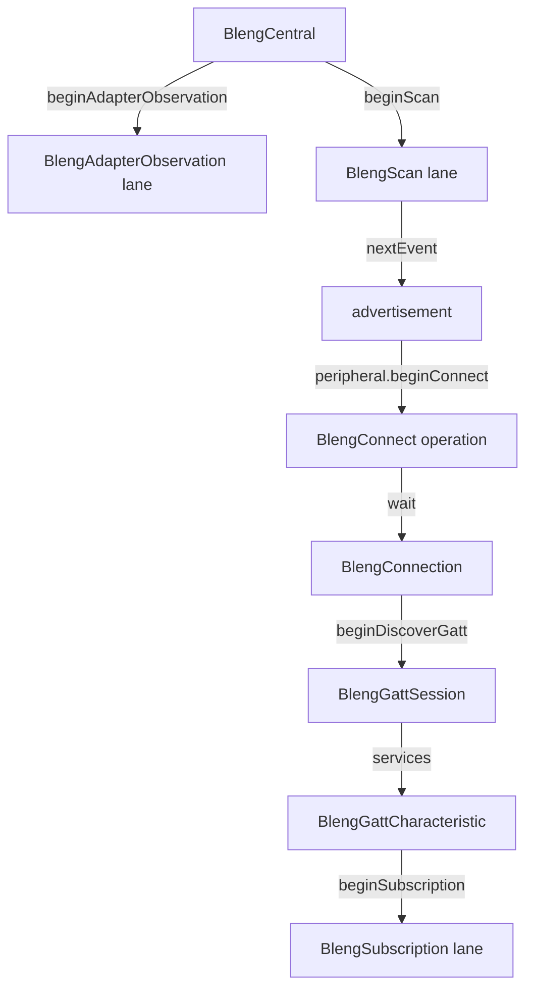

# `@blehub/react-native-bleng` — API

React Native 的有类型 BLE Central。所有操作都由一个 Rust 引擎拥有；这个包是它的 Nitro 桥，
外加一层很小的 await 便捷接口。

> 这是 [`API.md`](API.md) 的中文镜像。两个文件都被
> `tools/tests/react_native/test_api_docs.py` 钉住：任何一个能力只要在其中一份里缺失，测试就会红，
> 所以两份不会静默走样。
>
> 这一页负责**行为**。签名和每个联合分支看生成的 TypeDoc 站点：
> `pixi run just react-native::api-site`（见
> [`typedoc-site.md`](../../docs/research/react-native/typedoc-site.md)）；它由 specs 生成，从不手写。

**TL;DR** —— 三种形状：**lane**（流）、**operation**（一次有界等待）、**retained end**（可重读终态）。
`begin*()` 只提交；`wait`/`nextEvent` 结算；`failure` 是数据；一条 lane 同时只有一个挂起 pull。

## 目录

- [快速开始](#快速开始)
- [快速开始没有覆盖的流程](#快速开始没有覆盖的流程)
- [先记住五条规则](#先记住五条规则)
- [模型：三种形状，一份契约](#模型三种形状一份契约)
- [能力一览](#能力一览)
- [会话与 React 接线](#会话与-react-接线)
- [adapter 状态](#adapter-状态)
- [扫描](#扫描)
- [连接](#连接)
- [设备清单与 adopt](#设备清单与-adopt)
- [companion 关联](#companion-关联)
- [companion 在场](#companion-在场)
- [GATT](#gatt)
- [MTU](#mtu)
- [连接优先级](#连接优先级)
- [绑定](#绑定)
- [GATT 缓存刷新](#gatt-缓存刷新)
- [订阅](#订阅)
- [await 层](#await-层)
- [共享一条 lane](#共享一条-lane)
- [失败](#失败)
- [边界与生命周期](#边界与生命周期)
- [平台注意事项](#平台注意事项)
- [从其他 React Native BLE 库迁移过来](#从其他-react-native-ble-库迁移过来)
- [这个 API 里没有的东西](#这个-api-里没有的东西)

## 快速开始

五步，没有隐藏状态。每一步都对应下面的一节。

```ts
import {
  createBlengCentral,
  requireAccepted,
  requireOutcome,
  run,
} from '@blehub/react-native-bleng'

const HEART_RATE = '180d' // 16-bit、32-bit 和完整 128-bit UUID 都接受

// 1. 构造。很轻：不碰收音机、不弹权限。
const central = createBlengCentral()

// 2. 拿适配器快照：状态 + 两个授权，蓝牙关着也会返回。
//    initialize() 把失败当数据返回；requireOutcome 把它变成 throw。
const adapter = requireOutcome(await central.initialize()).snapshot

// 3. 扫描。`beginScan` 产出的是一条 *lane*（按 lane 命名的控制 + 流），所以用
//    `requireAccepted` 拆包。你的 pull 超时不会停止原生扫描，拿到结果后要显式 stop。
const scan = requireAccepted(central.beginScan({ serviceUuids: [HEART_RATE] }))
const { advertisement } = await scan.nextEvent(10_000)
await run(scan.beginStop(), 10_000)

// 4. 连接。`beginConnect` 是一个 *operation*（单个能力，带 wait/cancel），所以用 `run`：
//    按你给的预算等待一次，失败就抛。`connection` 是你留下的能力。
const { connection } = await run(advertisement.peripheral.beginConnect(), 10_000)

// 5. 使用。发现也是 operation；每次调用都返回一份新的拓扑。
const { session } = await run(connection.beginDiscoverGatt(), 10_000)
const characteristic = session.services()[0].characteristics()[0]
const { value } = await run(characteristic.beginRead(), 5_000)

// 清理是显式的，并且与关闭 central 是两件事。
await run(connection.beginDisconnect(), 5_000)
await central.close()
```

`run` 就是那个 one-liner：它等于 `pendingOperation(submission, ms).result`。如果你可能需要中途
取消，就改用 `pendingOperation` 并保留它的 `cancel()`（或传入 `AbortSignal`）——见
[await 层](#await-层)。

上面任何一步做不了，结果都是**类型化的 `failure`**，绝不会悄悄换成别的行为。这就是下面这套形状的意义。

## 快速开始没有覆盖的流程

上面五步只是单个对端的 happy path。真实 App 还需要下面这些流程，每一条都有自己的小节。

| 流程 | 快速开始没展示的部分 | 详见 |
|---|---|---|
| 适配器就绪与权限 | 蓝牙关着或权限被拒时 `initialize()` 仍会 resolve。检查 `snapshot.state` 与两个授权；之后的 scan/connect 可能以 `adapter_unavailable` 或 `permission` code 失败。 | [adapter 状态](#adapter-状态) |
| 适配器变化与开关 | 初始化后收音机仍可能变化。`beginAdapterObservation()` 观察平台报告；`beginAdapterControl(enabled)` 请求开关（Android；Apple 以 `not_supported` 拒绝）。 | [adapter 状态](#adapter-状态) |
| 连接结束与重连 | 链路可能非请求地结束。`connection.awaitEnd(ms)` 可保留、可重读；`isConnected()` 是这条 lane 的观察；`beginAutoConnect()` 请求常驻连接（Android；Apple `not_supported`）。 | [连接](#连接) |
| 写入与 descriptor | 快速开始只读。写入用 `beginWrite()`（有/无响应），descriptor 用自己的 `beginRead()` / `beginWrite()`。 | [GATT](#gatt) |
| 订阅通知 | 多数对端会推送值。`beginSubscription(mode)` 是一条 lane；用 `nextEvent(ms)` 拉取，用 `beginDisable()` 停止。 | [订阅](#订阅) |
| 失败处理 | 失败是数据。按 `failure.code`（配合闭合 `domain`）分支，或用 `isBlengFailure`、`BlengOperationError`、`failureReason`；不要解析 `message`。 | [失败](#失败) |
| 取消与你的期限 | `pendingOperation(...).cancel()` 与可选的 `AbortSignalLike` 绑定到同一次原生 cancel，且只在平台能撤回时被接受；`bleng.timeout` 是你的边界，不是链路状态。 | [哪些 cancel 会生效](#哪些-cancel-会生效)、[边界与生命周期](#边界与生命周期) |
| 共享一条 lane | 一条 lane 只允许一个挂起 pull。多个消费者用 `shareLane`，不要抢两次 pull。 | [共享一条 lane](#共享一条-lane) |
| 多链路与多操作 | 一个 owner 可以同时持有多个连接；每个能力都是 opaque 句柄，不是 device id。 | [模型](#模型三种形状一份契约) |
| App 接线 | `getBlengCentral()` / `closeBlengCentral()` / `useBlengCentral()`；挂载/卸载不会 start/close BLE，Fast Refresh 会保留 owner。 | [会话与 React 接线](#会话与-react-接线) |
| 关闭语义 | `close()` 的 `closed` 与清理 `failure` 是两件事；非终结 busy 会保留 owner；终结的清理失败不等于资源归零。 | [边界与生命周期](#边界与生命周期) |
| MTU 与优先级 | Android 可查询/请求 MTU、设置连接优先级；Apple 两者都没有。 | [MTU](#mtu)、[连接优先级](#连接优先级) |
| 绑定与缓存刷新 | Android `beginBond(pin)` / `beginRemoveBond()` 与 `beginGattCacheRefresh()`；Apple 两者都拒绝。 | [绑定](#绑定)、[GATT 缓存刷新](#gatt-缓存刷新) |
| 清单与 adopt | `beginDeviceQuery(kind, serviceUuids)` 是只读清单（Apple 只支持 `connected`）；`adoptPeripheral(key)` 重新寻址 iOS 恢复的链路。 | [设备清单与 adopt](#设备清单与-adopt) |
| companion 关联与在场 | 仅 Android：`beginCompanionAssociation(...)` 与 `beginCompanionPresence()`；Apple 两者都拒绝。 | [companion 关联](#companion-关联)、[companion 在场](#companion-在场) |
| 后台与恢复 | iOS 需要 `bluetooth-central` 后台模式与 restore identifier；Android 有自己的前台/后台约束。 | [平台注意事项](#平台注意事项) |
| 宿主声明的权限 | 宿主 App 声明蓝牙（以及 companion）权限；本包不声明 companion 权限。 | [平台注意事项](#平台注意事项) |

## 先记住五条规则

| # | 规则 | 实际意味着什么 |
|---|---|---|
| 1 | **`begin*()` 不执行，只提交** | 调用返回的要么是一个能力，要么是一个 `failure`。拒绝是同步的；结果通过那个能力自己的 `wait(ms)` 到达。 |
| 2 | **每次等待都是*你*定的期限** | `timeoutMs` 是参数，不是配置。`bleng.timeout` 只说明你的期限到了 —— 不说明链路断了、设备走了或操作失败了。 |
| 3 | **回执不是送达；取消不是回滚** | “已接受”只代表平台收下了请求。取消记录的是一次请求 —— 对端仍可能完成这次写、读或配对。只有平台还能撤回的 operation 才会接受取消，其余以 `bleng.operation_not_cancellable` 回答。 |
| 4 | **一条 lane 同时只有一个挂起的 pull** | 并发第二次 `nextEvent` 是违反契约，不是排队。多个消费者用 `shareLane` 共享一条 lane。 |
| 5 | **不支持就是类型化拒绝** | 平台没有等价能力时，结果是 `bleng.dispatch_rejected.not_supported`。绝不模拟，也绝不静默忽略。 |

## 模型：三种形状，一份契约



（图里的词就是 API 的名字。）只有三种形状：

| 形状 | 例子 | 生命周期 | 怎么等 |
|---|---|---|---|
| **lane** | `BlengScan`、`BlengSubscription`、`BlengAdapterObservation`、`BlengCompanionPresence` | 长期存在，持续流出事件 | `nextEvent(ms)`，同一时刻只能有一个挂起的 pull |
| **operation** | `BlengRead`、`BlengWrite`、`BlengConnect`、`BlengMtu` … | 一次有界的请求/响应 | `wait(ms)`，只用一次 |
| **retained end** | `BlengConnection` | 长期存在的链路，终态保持可读 | `awaitEnd(ms)`，可读多次 |

每个 `begin*()` 返回的**要么**是一个具名 key 下的能力，**要么**是一个 failure：

```ts
const submission = characteristic.beginRead()
if ('failure' in submission) {
  // 在提交任何东西之前就被拒了；没有任何东西处于 pending
} else {
  const result = await submission.read.wait(5_000)
  // result 是 { value: ArrayBuffer } | { failure }
}
```

这个联合就是契约：没有 failure 就是成功；期限是**你**定的边界（不是对链路状态的断言）；
取消回执记录的是一次请求，不是回滚。

## 能力一览

每个能力都是一个原生句柄。`控制` 是你能在它上面调的方法；`由谁产生` 是返回它的调用。每个一次性能力
都带 `wait`/`cancel` 以保持形状统一，但只有平台还能撤回的操作才会接受 cancel —— 见
[哪些 cancel 会生效](#哪些-cancel-会生效)。

**会话、适配器与清单**

- `BlengCentral` — `createBlengCentral()` — `initialize`、`close`、`beginScan`、
  `beginAdapterControl`、`beginAdapterObservation`、`beginCompanionAssociation`、
  `beginCompanionPresence`、`beginDeviceQuery`、`adoptPeripheral`
- `BlengAdapterObservation` — `central.beginAdapterObservation()` — `nextEvent`
- `BlengCompanionPresence` — `central.beginCompanionPresence()` — `nextEvent`
- `BlengAdapterControl` — `central.beginAdapterControl(enabled)` — `wait`、`cancel`
- `BlengCompanionAssociation` — `central.beginCompanionAssociation(...)` — `wait`、`cancel`
- `BlengDeviceQuery` — `central.beginDeviceQuery(kind, serviceUuids)` — `wait`、`cancel`

**扫描与连接**

- `BlengScan` — `central.beginScan()` — `waitUntilStarted`、`nextEvent`、`beginStop`、
  `cancelStart`、`isScanning`
- `BlengScanStop` — `scan.beginStop()` — `wait`、`cancel`
- `BlengPeripheral` — 一条扫描广告 — `key`、`localName`、`beginConnect`、`beginAutoConnect`
- `BlengConnect` — `peripheral.beginConnect()` — `wait`、`cancel`
- `BlengConnection` — `connect.wait()` — `awaitEnd`、`isConnected`、`localName`、
  `beginDiscoverGatt`、`beginDisconnect`、`beginReadRssi`、`beginQueryMtu`、`beginRequestMtu`、
  `beginSetConnectionPriority`、`beginBond`、`beginRemoveBond`、`beginGattCacheRefresh`
- `BlengDisconnect` — `connection.beginDisconnect()` — `wait`、`cancel`

**GATT**

- `BlengGattDiscovery` — `connection.beginDiscoverGatt()` — `wait`、`cancel`
- `BlengGattSession` — `discovery.wait()` — `services`
- `BlengGattService` — `session.services()` — `uuid`、`kind`、`characteristics`
- `BlengGattCharacteristic` — `service.characteristics()` — `uuid`、`properties`、`descriptors`、
  `beginRead`、`beginWrite`、`beginSubscription`
- `BlengGattDescriptor` — `characteristic.descriptors()` — `uuid`、`beginRead`、`beginWrite`
- `BlengRead` — `characteristic.beginRead()` — `wait`、`cancel`
- `BlengWrite` — `characteristic.beginWrite()` — `wait`、`cancel`
- `BlengDescriptorRead` — `descriptor.beginRead()` — `wait`、`cancel`
- `BlengDescriptorWrite` — `descriptor.beginWrite(value)` — `wait`、`cancel`
- `BlengRssi` — `connection.beginReadRssi()` — `wait`、`cancel`

**链路调优**

- `BlengMtu` — `connection.beginQueryMtu()` / `connection.beginRequestMtu(mtu)` — `wait`、`cancel`
- `BlengPriority` — `connection.beginSetConnectionPriority(priority)` — `wait`、`cancel`
- `BlengBond` — `connection.beginBond()` / `connection.beginRemoveBond()` — `wait`、`cancel`、
  `nextState`
- `BlengGattCacheRefresh` — `connection.beginGattCacheRefresh()` — `wait`、`cancel`

**流**

- `BlengSubscription` — `characteristic.beginSubscription()` — `waitUntilEnabled`、`nextEvent`、
  `beginDisable`、`detach`
- `BlengSubscriptionDisable` — `notifications.beginDisable()` — `wait`、`cancel`

包含每个联合成员在内的完整导出类型清单，由生成的
[`abi-freeze-inventory.md`](../../docs/research/bleng/abi-freeze-inventory.md#2-js--nitro-面) 给出；
这一页写的是行为，不是类型清单。

## 会话与 React 接线

**构造与查找**

- `createBlengCentral()` → `BlengCentral` —— 每次都**新建** central；构造不会初始化 BLE。
- `getBlengCentral()` → 这个 JS runtime 唯一的 central —— 普通 App 的入口。
- `closeBlengCentral()` —— 显式关闭这个 runtime 的 central。

**生命周期**

- `central.initialize()` → `Promise<BlengInitializeResult>` —— `{ snapshot }` 或 `{ failure }`；
  `snapshot` 是 `{ state, scanAuthorization, connectionAuthorization, name? }`。蓝牙关着或权限被拒时也是
  resolve（不 reject）。想拿 snapshot 或抛错就用 `requireOutcome(result).snapshot`。
- `central.close()` → `Promise<BlengCloseResult>` —— `{ closed, failure? }`；关闭与清理是否成功是两件事。

**提交**

- `central.beginScan(options)` → `BlengScanSubmission` —— `{ serviceUuids, namePrefix?, exactName?,
  companyId?, minRssi?, manufacturerData?, allowDuplicates }`。
- `central.beginAdapterControl(enabled)` → `BlengAdapterControlSubmission` —— `{ control }` 或失败；只是回执，
  状态看 adapter lane。
- `central.beginCompanionAssociation(serviceUuids, displayName?, deviceProfile?,
  notifyOnDeviceNearby?)` → `BlengCompanionAssociationSubmission` —— `{ association }` 或失败；平台选择器，
  提交后不可取消。
- `central.beginDeviceQuery(kind, serviceUuids)` → `BlengDeviceQuerySubmission` —— `{ query }` 或失败；只读清单。
- `central.beginCompanionPresence()` → `BlengCompanionPresenceSubmission` —— `{ companionPresence }` 或失败；
  已 opt-in 关联的在场变化。
- `central.adoptPeripheral(key)` → `BlengPeripheralAdoptSubmission` —— `{ peripheral }` 或失败；把清单记录变成能力。

`state` 是 `'unknown' | 'unavailable' | 'poweredOff' | 'poweredOn'`；授权状态是
`'notRequired' | 'notDetermined' | 'denied' | 'restricted' | 'authorized'`。

`initialize()` 有库内上界（当前为 30 秒的 owner 装配，含 backend attach 与初始化操作）。命中上界会返回
`{ failure }`，`domain: 'lifecycle'`、`code: 'bleng.timeout'`；此时原生工作可能还在跑，唯一有意义的下一步是
`close()`。`close()` 等原生清理完成，**没有**上界。不要用 `Promise.race` 伪造超时——它不会取消原生工作。

所有 UUID 输入都接受 4、8、32 或 36 个十六进制字符（可带或不带连字符），并规范化成小写、带连字符的
128-bit 形式。API 返回的每个 UUID（广告、service、characteristic、descriptor）已经就是这个形式，
所以拿 API 自己的输出做字符串比较是安全的。

### React 与 Fast Refresh

```tsx
import { BlengProvider, useBlengCentral } from '@blehub/react-native-bleng'

<BlengProvider>
  <Screen />
</BlengProvider>

function Screen() {
  const central = useBlengCentral()
  // ...
}
```

- `BlengProvider` 默认使用运行时 central，除非你显式传 `central`。
- 槽位在 `globalThis` 上，所以 **React Fast Refresh 会保留同一个 central 和活着的 capability**；
  重算模块不会创建第二个引擎。
- 完整 reload / 进程重启是新的 JS runtime：RN 会 retire 旧的原生引擎，central 和 capability
  按设计消失，App 必须重连。没有任何东西会“复活”它们。
- 挂载/卸载 `BlengProvider` 从不启动或关闭 BLE。关闭是显式的：`closeBlengCentral()`。

### 在 React 里驱动一条 lane

lane 是 pull 型的：`nextEvent(ms)` 只返回一个事件，所以屏幕在 effect 里驱动循环。规则：始终只有
一个 pull 在飞、遇到 `ended` 就停、把 `bleng.timeout` 当成“暂时没事件”而不是结束。

```tsx
import { useEffect, useState } from 'react'
import {
  isBlengFailure, requireAccepted, useBlengCentral,
  type BlengScan, type BlengScanAdvertisement,
} from '@blehub/react-native-bleng'

function ScanScreen() {
  const central = useBlengCentral()
  const [found, setFound] = useState<BlengScanAdvertisement[]>([])

  useEffect(() => {
    let active = true
    let scan: BlengScan | undefined

    const loop = async () => {
      const submission = central.beginScan({ serviceUuids: ['180d'] })
      if (isBlengFailure(submission)) return // 提交前就被拒；处理这个失败
      const accepted = requireAccepted(submission)
      scan = accepted
      // `waitUntilStarted` 用一个 receipt 回答：失败是被携带的，不会被抛出。
      if (isBlengFailure(await accepted.waitUntilStarted(5_000))) return

      while (active) {
        const next = await accepted.nextEvent(5_000)
        if (!active) break
        if (isBlengFailure(next)) {
          if (next.failure.code === 'bleng.timeout') continue // 暂时没事件，不是结束
          break
        }
        if ('advertisement' in next) {
          setFound(previous => [...previous.slice(-63), next.advertisement])
          continue
        }
        break // { ended }：正常终态
      }
    }

    void loop()
    return () => {
      active = false
      // 卸载时如果扫描还归我们管就停掉；挂起的 nextEvent 会在自己的超时处结算。
      const stopping = scan?.beginStop()
      if (stopping && !isBlengFailure(stopping)) void stopping.stop.wait(5_000)
    }
  }, [central])

  return found.length === 0 ? null : /* 渲染 found */
}
```

- 在上一个 `nextEvent` 结算前不要发起第二个 pull；并发 pull 会 resolve 成 `delivery.pull_busy`。
- `{ ended }` 是正常终态，不是失败：退出循环并更新 UI。
- 卸载不是 `close()`：其它屏幕和连接继续运行。只有整个 runtime 结束时才关闭 central。
- 两个组件需要同一条流时，用一个 pull 循环 + `shareLane`，不要起两个。

## adapter 状态

```ts
const lane = requireAccepted(central.beginAdapterObservation())
const next = await lane.nextEvent(30_000) // { snapshot } | { ended } | { failure }
```

- 这是**唯一**能报出 `initialize()` 之后收音机变化的面。`snapshot` 就是平台报的状态
  （`state` + 两个授权），不是 App 的推测。
- 超时是**你**的边界（`bleng.timeout`），不结束观察、也不代表收音机有什么变化。
- `ended.reason` 是 `'ownerClosed'`（引擎退休，只表示观察结束）或 `'detached'`（本端点不再观察，
  其他观察者不受影响）。
- 它是 coexisting lane：同一 central 上可以有多个观察者，每个都收到注册之后的每一条快照；
  缓冲有界（64 条），溢出 fail closed 而不是静默丢状态。
- 观察**不**触发恢复、**不**改变收音机：收音机真的被关掉时，失败的是那些操作，而不是这条流。

`central.beginAdapterControl(isEnabled)` 返回 `{ control }`，从不返回快照：
`control.wait(ms)` 消费平台回执（`BlengAdapterControl`，属于
`BlengAdapterControlSubmission` = `BlengAdapterControlAccepted` | `BlengFailure`）。回执只代表
平台接受了请求；真正的收音机状态仍然走 adapter lane。Android 在 targetSdk 33+ 可能拒绝
（需要用户确认），Apple 一律以 `bleng.dispatch_rejected.not_supported` 拒绝 —— 两者都不会被
报成成功。

## 扫描

```ts
const scan = requireAccepted(central.beginScan({ serviceUuids: [], allowDuplicates: false }))
const started = await scan.waitUntilStarted(5_000) // { failure? }；没有 failure 就是已开始
const next = await scan.nextEvent(5_000)          // 同一时刻只能有一个挂起的 pull
```

**选项。** `serviceUuids`（任一匹配）、`namePrefix` / `exactName`（本地名过滤）、`companyId`
（manufacturer id 存在）、`minRssi`（广告 RSSI 不低于阈值；缺失 RSSI 不算匹配）、
`manufacturerData`（`BlengManufacturerDataFilter`：`{ companyId, data, mask? }`，payload 必须以
`data` 开头，或按 `mask` 逐字节相等）、`android`。`allowDuplicates` 是上报提示，不是过滤条件。
这些都由引擎固定的谓词在两个平台上统一应用，不代表原生扫描过滤卸载。

**Android-only 调参。** `android` 是 `BlengAndroidScanOptions`：`scanMode`（`BlengAndroidScanMode`）、
`phy`（`BlengAndroidScanPhy`，需要 API 26）、`reportDelayMs`（0–5000）、`legacy`（需要 API 27）。
它们只改变 Android 如何扫描，不改变匹配条件。Apple 没有等价能力，设置了 `android` 的 scan 会被
`bleng.dispatch_rejected.not_supported` 拒绝，而不是换一种行为静默扫描。

**事件。**

- `nextEvent` 会 resolve 成 `{ advertisement }`、`{ ended }` 或 `{ failure }`。超时**不会**停止
  原生扫描；那是你定的边界。
- `ended.reason` 是 `'requested'`（一次 stop）、`'systemSuspended'`、`'failed'`、`'ownerClosed'` 或
  `'overflowed'`；只有平台报了错时才有 `failure`。`'overflowed'` 只结束这一条观察 lane：
  原生扫描和其他操作继续运行。
- `advertisement` 带 `peripheral`（不透明、绑定到 owner）、`localName?`、`advertisedServices`、
  `manufacturerData[]`、`serviceData[]`、`rssi?`、`connectable?`。设备身份不会跨进来。

**身份。** `peripheral.key()` 是 owner 内稳定、跨同一对端广告不变的 opaque key。把它当 Map key
做扫描列表去重；它**不是**平台 device id，也不能寻址原生状态。同一个 key 在另一个 owner 里没有意义。

**状态与控制。**

- `scan.isScanning()` 只是这条 lane 自己的认知：只有在“已确认的开始”和“它观察到的终态”之间才是
  `true`。平台还没确认开始时是 `false`，已结束或已溢出的 lane 也是 `false`；`false` 从不声称
  原生扫描已停止。
- **扫描会一直跑，直到它结束。** `scan.beginStop()` → `{ stop }` → `stop.wait(ms)`（或
  `run(scan.beginStop(), ms)`）；处理完后 lane 会报 `ended.reason='requested'`。
  `nextEvent` 的超时只是**你**的边界，从不停止原生扫描，所以拿到需要的东西后要显式 stop。
  `cancelStart()` 能真的撤回一个还没结算的 start；stop 是拆机权威，所以 `stop.cancel()` 会回答
  `bleng.operation_not_cancellable`（[哪些 cancel 会生效](#哪些-cancel-会生效)）。
- **同一时间只能有一个挂起 pull。** 第二次并发 `nextEvent` 会 resolve 成 `{ failure }`，
  `domain: 'delivery'`、`code: 'delivery.pull_busy'`；它**不会** throw，也不会影响已挂起的 pull
  和原生扫描。多个消费者应改用 `shareLane`（见下文），而不是抢着发两次 pull。
- 观察事件的投递是一条有界 FIFO（64 条，保留最旧的）；溢出时以 `ended.reason='overflowed'`
  结束这条 lane，而不是静默丢掉一条广告。所以要持续 pull：让它被填满的正是“停止 pull 的消费者”。

## 连接

```ts
const connect = requireAccepted(advertisement.peripheral.beginConnect())
const { connection } = await connect.wait(5_000)     // 或者 run(...)
const next = await connection.awaitEnd(10_000)       // 可保留：能读不止一次
```

**链路结束。** `awaitEnd` 会 resolve 成 `{ ended: { reason, failure? } }` 或 `{ failure }`。`reason` 是
`'requested'`（这个能力提交了断开）、`'unrequested'`（对端/协议栈/adapter 复位），或 `'ownerClosed'`
（观察结束是因为引擎被退休 —— 这不等于"链路已断"）。

**是观察，不是探测。**

- `connection.isConnected()` 只有这条连接自己的 lane 看到链路在时才是 `true`。还在等平台确认的
  connect 返回 `false`，已结束的 lane 也返回 `false`；它不是对端的新鲜探测。
- `connection.localName()` 是提交这次 connect 的 peripheral 携带的对端自报广告名。它是当时广告里的
  名字，不是新的平台读取，也不代表链路当前状态；对端没广告名字时为 `undefined`，从清单 key
  `adoptPeripheral` 得到的能力也为 `undefined`。

**自动连接与断开。**

- `advertisement.peripheral.beginAutoConnect()` 请求自动连接链路（对端一旦可用就重新建立）。
  Android 原生支持；Apple 会以 `bleng.dispatch_rejected.not_supported` 拒绝，而不是静默退化为
  单次连接。
- `connection.beginDisconnect()` → `{ disconnect }` → `disconnect.wait(ms)`。断开是拆机权威，
  所以 `disconnect.cancel()` 会回答 `bleng.operation_not_cancellable`
  （[哪些 cancel 会生效](#哪些-cancel-会生效)）。

## 设备清单与 adopt

`central.beginDeviceQuery(kind, serviceUuids)` 读取一份**只读清单**，`kind` 是
`BlengDeviceQueryKind`（`'connected' | 'bonded' | 'companion'`）。`query.wait(ms)` 解析为
`BlengDeviceQueryResult`（带 `BlengDeviceInfo[]` 的 `BlengDeviceQueryOutcome`，或
`BlengFailure`）。

```ts
const query = requireAccepted(central.beginDeviceQuery('connected', [HEART_RATE]))
const { devices } = await query.wait(5_000)   // BlengDeviceInfo[]
const { peripheral } = requireAccepted(central.adoptPeripheral(devices[0].key))
```

- 每个 `BlengDeviceInfo` 是 `{ key, localName?, connected, bonded }`；`key` 是 opaque 的，可与
  `peripheral.key()` 比较。
- 清单记录只是数据，不是能力。要对它操作，需要显式 `central.adoptPeripheral(key)` →
  `BlengPeripheral`（在 `beginConnect()` 之前不会建立连接）。这正是 iOS 冷启动状态恢复后重新接上
  原连接的路径。
- 后端没有分配过的 key 会在后续 `connect` 以类型化失败拒绝（`BlengDeviceQuery` 通过
  `BlengDeviceQuerySubmission` = `BlengDeviceQueryAccepted` | `BlengFailure` 获得）。
- `connected`/`bonded` 是平台自己的报告。Android 三种都支持；Apple 只支持 `connected`（至少需要
  一个 service UUID，返回连接到系统且广播这些 service 的外设），`bonded` 和 `companion` 以
  `bleng.dispatch_rejected.not_supported` 拒绝。

`companion` 是 Android 的 companion-device 关联清单（`CompanionDeviceManager`，API 26+）。它是系统
关联，不是链路：关联设备可能不在场，所以这些记录的 `connected`/`bonded` 都是 `false`，`localName`
是平台给出的关联显示名（如果有）。该查询不需要运行时权限，也不会绑定或唤醒设备。

## companion 关联

```ts
const submission = central.beginCompanionAssociation(
  [HEART_RATE],
  'My Watch',                                  // displayName，可选
  'android.app.role.COMPANION_DEVICE_WATCH',   // deviceProfile，可选
  true,                                        // notifyOnDeviceNearby，可选
)
const { association } = requireAccepted(submission)
await association.wait(60_000)                 // 提交后不可取消
```

`central.beginCompanionAssociation(...)` 请求一次关联，返回
`BlengCompanionAssociationSubmission`（`BlengCompanionAssociationAccepted` | `BlengFailure`）。

- **仅 Android，且需要 API 33+。** Android 会弹出它自己的选择器；`wait(ms)` 在平台回报关联时成功，
  用户拒绝或平台拒绝时失败。更早的版本只把结果回给 Activity，所以直接拒绝，而不是半支持。
- **不可取消。** 选择器是平台 UI，不是引擎工作，没有东西可取消。`association.cancel()` 只为形状
  统一而存在，会 resolve 成携带 `bleng.operation_not_cancellable` 的 receipt。
- **`deviceProfile` 是宿主的。** 它是宿主自己的平台 profile（例如
  `android.app.role.COMPANION_DEVICE_WATCH`）；声明匹配的 `REQUEST_COMPANION_PROFILE_*` 权限由宿主
  App 负责。本包不声明任何 companion 权限，也没有默认 profile。
- **回执不是设备。** 要用 `beginDeviceQuery('companion', [])` 读回清单，并在连接前
  `adoptPeripheral(key)`。
- **`notifyOnDeviceNearby: true`** 让这次关联 opt-in 到场（presence）投递。它要求宿主声明
  `REQUEST_OBSERVE_COMPANION_DEVICE_PRESENCE`；没有声明时，命令会在弹出选择器之前就失败，而不是留下
  一条永远不会触发的 presence lane。presence 在关联时就在平台上被 arm；之后再打开 lane 不会为从未
  opt-in 的关联补上订阅，所以这类关联的 lane 按设计保持静默。库会随包提供平台绑定的
  `CompanionDeviceService`，但不申请权限、也不启用任何默认 profile。
- Apple 以 `bleng.dispatch_rejected.not_supported` 拒绝。

## companion 在场

```ts
const lane = requireAccepted(central.beginCompanionPresence())
const next = await lane.nextEvent(30_000) // { present, key, localName? } | { ended } | { failure }
```

- 每当一个**已 opt-in** 的关联设备出现或消失，Android 就上报一次变化。presence 是关联事实，不是
  链路：`present` 从不表示已连接。`key` 与 `BlengDeviceInfo.key` 是同一个 owner 作用域的清单 key，
  所以 `adoptPeripheral(key)` 仍然是拿到可连接 capability 的唯一方式。
- 它是边沿触发的：lane 只上报安装之后的变化，从不重放当前状态。请在
  `beginCompanionAssociation(..., notifyOnDeviceNearby: true)` 结算之后再打开它。
- 同一时刻只有一个挂起 pull，缓冲有界（64 条），终态与 adapter lane 一样保留：`ended.reason` 是
  `'ownerClosed'` 或 `'detached'`。超时是你的边界，不结束观察。
- Apple 以 `not_supported` 失败（`BlengFailure.code`）拒绝，因为 CoreBluetooth 没有关联模型。
  没有 opt-in 关联时，这条 lane 按设计保持静默。
- 类型：`BlengCompanionPresenceSubmission` = `BlengCompanionPresenceAccepted` | `BlengFailure`；
  每次 `nextEvent` 的一支是 `BlengCompanionPresenceNext` = `BlengCompanionPresenceEvent` |
  `BlengCompanionPresenceEndedEvent` | `BlengFailure`，其中 `ended` 是共享的 `BlengEnd`
  （`BlengEndReason` + 可选 `BlengFailureInfo`）。

## GATT

```ts
const discovery = requireAccepted(connection.beginDiscoverGatt())
const { session } = await discovery.wait(10_000)     // 每次调用一次发现，每次都是新身份
for (const service of session.services()) {
  for (const characteristic of service.characteristics()) {
    characteristic.uuid(); characteristic.properties(); characteristic.descriptors()
  }
}
```

- `properties()` 是 `{ readable, writableWithResponse, writableWithoutResponse, notifiable, indicatable }`
  —— 就按对端报的来；对端服务不了的，引擎会拒绝。
- `service.kind()` 是 `'primary' | 'secondary' | 'unknown'`。`unknown` 表示平台没说，不等于
  `secondary`。
- `descriptors()` 返回的是能力对象，不是纯数据：每个 `{ uuid(), beginRead(), beginWrite(value) }`
  都保留自己的原生句柄，使 descriptor I/O 仍是有界 operation。

| 调用 | 结果 |
|---|---|
| `characteristic.beginRead()` | `{ value: ArrayBuffer }`（`undefined` 与空值不是一回事） |
| `characteristic.beginWrite(value, 'withResponse' \| 'withoutResponse')` | 空回执；回执**不是**回读 |
| `connection.beginReadRssi()` | `{ rssi: number }`（0 和负数都是真实读数） |
| `discovery.wait`、`read.cancel()` … | 每个 operation 都有自己的 wait 和 cancel |

### 写入语义

```ts
const { write } = requireAccepted(characteristic.beginWrite(value, 'withResponse'))
await write.wait(5_000) // 空回执
```

- 第二个参数是 `'withResponse' | 'withoutResponse'`；对端 properties 不支持时引擎会拒绝，而不是静默降级。
- `withResponse` 等对端/协议栈确认；`withoutResponse` 只表示协议栈收下了 payload。两者都不是回读，
  也都不保证对端已经应用该值。
- API **不做分片**。超过协商写入上限的 payload 要由你的 App 自己拆（见 [MTU](#mtu)）；引擎不会静默分片。
- descriptor 永远 **with response**，且只接受值（`descriptor.beginWrite(value)`）。

### Descriptor

```ts
for (const descriptor of characteristic.descriptors()) {
  const { value } = await run(descriptor.beginRead(), 5_000)   // { value: ArrayBuffer }
}

await run(
  descriptor.beginWrite(new Uint8Array([0x01, 0x00]).buffer), // ArrayBuffer
  5_000,
)                                            // 空回执，不是回读
```

- descriptor 只能通过发现它的那个 `BlengGattCharacteristic` 访问；原生句柄由 characteristic 持有。
- `beginWrite(value)` **永远是** with-response。descriptor 在链路上没有写类型，所以这个调用只接收值，
  从不接受 write-type 参数。
- 同样遵守有界 operation 契约：被接受的提交不等于已通过射频送达，回执不是回读，cancel 记录的是
  请求而非回滚。
- CoreBluetooth 与 Android Framework BLE 都支持通用 descriptor 读写，所以两个平台都不会拒绝这些
  operation；平台错误会像其他 GATT 失败一样类型化返回。

## MTU

```ts
const { info } = await run(connection.beginQueryMtu(), 5_000)
// { mtu?, maximumWriteWithResponse?, maximumWriteWithoutResponse? }

const negotiated = await run(connection.beginRequestMtu(247), 5_000)
```

- `beginQueryMtu()` 只问当前链路限制；`beginRequestMtu(mtu)` 还会请求对端协商。两者都接受 `23…517`。
- “被接受的提交”不是“已协商的 MTU”，回执是平台自己报的值 —— 可能和你请求的不同。
- 平台不暴露协商值时 `info.mtu` 缺席；平台报不出时对应 payload 上限也缺席。缺席是“未知”，永远不是
  `0`。
- Android 会报协商后的 MTU 和 payload 上限，并支持请求协商。
- Apple（CoreBluetooth）自己协商：查询只返回最大写长度（`info.mtu` 缺席），`beginRequestMtu` 以
  `bleng.dispatch_rejected.not_supported` 拒绝，而不是静默忽略。

## 连接优先级

```ts
await run(connection.beginSetConnectionPriority('high'), 5_000)   // 空回执
```

- `priority` 是 `'balanced' | 'high' | 'lowPower'`。
- 回执表示平台**接受了请求**。没有任何平台会把实际生效的链路调度报回来，所以这不是当前模式的测量。
- Android 用 `requestConnectionPriority` 应用请求。
- Apple（CoreBluetooth）没有等价控制，请求以 `bleng.dispatch_rejected.not_supported` 拒绝。

## 绑定

```ts
const submission = connection.beginBond()
// 数字 PIN 配对（仅 Android）：`connection.beginBond('123456')`；不传 `pin` 就交给系统配对 UI。
const bond = requireAccepted(submission)

// 进度只是观察；终态回执仍然在 `wait` 上。
const step = await bond.nextState(60_000)   // { state: 'bonding', ended: false }

const { state } = await bond.wait(60_000)   // 成功时是 'bonded'

// 拒绝与失败像其他 operation 一样类型化：
await run(connection.beginBond(), 60_000)
```

- `state` 是 `'none' | 'bonding' | 'bonded'`。成功意味着平台报告了 `bonded`；这不承诺链路已加密，
  也不承诺下次重连会跳过配对提示。
- `bonding` 是进度而非终态：operation 会继续等待直到报 `bonded` 或失败。失败以 `BlengFailure`
  到达（例如对端拒绝了配对）。
- `nextState(ms)` 拉取平台报告的进度，不消费终态回执。每条记录带 `state` 与 `ended`；`ended` 只在
  终态或“没有更多状态”的保留结束时为 `true`。`ended` 后停止拉取。这条 lane 有界（8 个状态）且
  fail-closed：溢出、owner 退休或链路断开都会以类型化失败结束；超时是你的 deadline，不是取消。
- Android 用 `createBond()` 发起配对，并跟随平台的 bond-state 广播。如果对端已经绑定，请求会立即
  返回 `bonded`，而不是假装再配对一次。
- `beginBond(pin?)`：`pin` 只是 Android 的 **数字 PIN 配对**输入（1–16 个 ASCII 数字），永不
  记录。不传就交给系统配对 UI。Passkey / 数字比较确认仍然由系统 UI 负责：库不能自动确认用户没见过
  的对端，且 Android 的 privileged 确认 API 对普通 App 不可用。PIN 在平台消费后立即丢弃。
- `beginRemoveBond()` 是反方向：成功是平台报告的 `none`，已解绑的对端会立即返回 `none`。
- Apple（CoreBluetooth）没有公开的发起绑定 API，所以请求以
  `bleng.dispatch_rejected.not_supported` 拒绝，而不是静默成功。受保护访问过程中由系统托管的配对
  不是编程等价物。
- cancel 记录的是请求，不是回滚：对端仍可能完成配对。

## GATT 缓存刷新

```ts
const submission = connection.beginGattCacheRefresh()
const refresh = requireAccepted(submission)   // BlengGattCacheRefreshSubmission
await refresh.wait(5_000)
```

`beginGattCacheRefresh()` 请求平台失效其 GATT 缓存。成功后引擎也会丢弃这条连接已发现的拓扑：旧的
GATT session 与订阅都变成 stale 并失败，所以再次寻址属性前必须重新 discover。`BlengGattCacheRefresh` 通过
`BlengGattCacheRefreshSubmission`（`BlengGattCacheRefreshAccepted` 或 `BlengFailure`）获得。

- Android 调用平台缓存控制；如果平台不暴露或不允许，请求以 `not_supported` 失败，而不是假装刷新。
- Apple（CoreBluetooth）自己管理属性缓存且没有刷新控制，所以请求以
  `bleng.dispatch_rejected.not_supported` 拒绝。
- 只有在连接静默时才接受刷新：有 pending discovery 或 I/O 时以 `invalid_state` 拒绝，而不是在
  操作进行中清状态。

## 订阅

```ts
const notifications = requireAccepted(
  characteristic.beginSubscription('requireNotification'),
)
const { mode } = requireOutcome(await notifications.waitUntilEnabled(5_000)) // 'notification' | 'indication' | undefined

const next = await notifications.nextEvent(5_000)        // { value } | { ended } | { failure }
const disable = requireAccepted(notifications.beginDisable())
await disable.wait(5_000)                                // 同时也是这条流的终结点
```

- 提交时的 `mode` 是 `platformDefault` | `requireNotification` | `requireIndication`；结果里的 `mode`
  是 `notification` | `indication`，平台没报它选了哪个时就缺席。
- `ended.reason` 是 `'requested'`（这次或另一次 disable）、`'connectionClosed'`、`'ownerClosed'` 或
  `'overflowed'`。`'overflowed'` 只结束这一条观察 lane；原生订阅会一直运行到显式 disable。
- `nextEvent` 必须被 pull，这条流才保持可读；慢消费者只会以自己的 `overflowed` 结束，而不是静默丢值。
- `detach()` 只结束观察。原生订阅会一直留着，直到一次显式 disable。
- 一次"被接受的 enable"不是"已建立的订阅"，一次 disable 回执也不是"对端已停止发送"的证明。

## await 层

`pendingOperation()` 把恰好只有一次有界等待的那些 operation 包起来。它**不新增任何语义**：
它通过该 operation 自己的 `wait` 结算，而取消仍然只在你真的调用时才发生。

```ts
import { pendingOperation, BlengOperationError } from '@blehub/react-native-bleng'

const pending = pendingOperation(characteristic.beginRead(), 5_000) // 被拒就在这里同步抛出
try {
  const { value } = await pending.result
} catch (error) {
  if (error instanceof BlengOperationError && error.code === 'bleng.cancelled') {
    // `code` 是唯一可以拿来做控制流的字段；`message` 只用于展示。
  }
}
// 丢弃 `result` 不会取消。
const receipt = await pending.cancel()
```

| helper | 用途 |
|---|---|
| `pendingOperation(submission, timeoutMs, signal?)` | 一个 operation 加上它的 cancel 控制；可选的 `AbortSignalLike` 绑定到 `cancel()` |
| `run(submission, timeoutMs, signal?)` | one-liner：`pendingOperation(...).result`；返回 outcome 或抛出，无 cancel 句柄 |
| `requireAccepted(submission)` | 拆开产出 **lane** 的提交（`beginScan`、`beginSubscription`），省掉联合判断 |
| `requireOutcome(result)` | 返回结果的 outcome 臂（如 `{ snapshot }`），失败时抛 `BlengOperationError` |
| `isBlengFailure(value)` | 按闭合的 `failure.domain` 判别，而不是只看键是否存在 |
| `BlengOperationError` | 抛出式 failure，原样携带原生 `BlengFailureInfo` |

便捷层是**两个维度**，不是三个互相竞争的 helper：*你在哪种输入上*（提交 vs 已结算结果），以及*你想要什么*（只拆包，还是跑有界等待 + cancel）。

| | 同步拆包 | 异步结算 |
|---|---|---|
| 提交（`begin*`） | `requireAccepted` → 能力 | `pendingOperation` → `{ result, cancel }` |
| 已结算结果（`wait` / `initialize`） | `requireOutcome` → outcome 臂 | —（已结算） |

- `pendingOperation` 是 operation 路径：拆提交、立即启动有界等待、保留 cancel 句柄，并接受可选 `AbortSignalLike`。
- `run` 是 `pendingOperation(...).result` 的 one-liner 别名：返回 outcome 或抛 `BlengOperationError`，
  且刻意不保留 cancel 句柄。
- `requireAccepted` 是显式拆包。它对那两条自己命名控制的 lane（`beginScan`、`beginSubscription`）是**必须**的，
  因为它们没有统一的 `wait`/`cancel`；对 operation 也合法——你随后自己调能力的 `wait()`/`cancel()`——但
  `pendingOperation` 是打包好的便捷形式，会立即启动有界等待。
- `requireOutcome` 用于已结算的两臂结果联合（`initialize()`，或任何 operation 的 `wait` 值）；只想分支而不抛错时
  直接用 `isBlengFailure`。

返回形状是 `{ result, cancel }`。`result` 结算成该 operation 的
**outcome 或 receipt**（如 `{ connection }`、`{ value }`，写回执则是 `{}`），失败则 reject
`BlengOperationError`。它**刻意**不是“裸 payload”：cancel 必须是头等控制，而且回执本来就可以是空对象
（“没有 failure 就是成功”）。

可选的第三个参数 `signal`（任意 `AbortSignalLike`，如 `new AbortController().signal`）绑定惯用取消：

```ts
const controller = new AbortController()
const { connection } = await pendingOperation(
  advertisement.peripheral.beginConnect(), 10_000, controller.signal,
).result
// controller.abort() 会提交这个 operation 的 cancel()；它是*请求*而非回滚，
// 所以 `result` 仍按原生结果结算（取消通常以 BlengOperationError reject）。
// 如果这个 operation 本身不可取消，abort 就是空操作（拒绝不会浮出）。
```

刻意**不覆盖**：`beginScan()` / `beginSubscription()` —— 它们返回的是一条 lane，而 lane 的
控制是按 lane 命名的，所以它们用 `requireAccepted`。

`scan.beginStop()` **是**被接受的（它暴露了普通的 `wait`），但一次 stop 可以被重新等待：
当 `wait` 报出输入层错误 `invalid_timeout` 时，这个句柄仍然可用，而单个 promise 记不住这件事。
如果你要重试 stop，请保留显式的 `wait` 写法。

### 哪些 cancel 会生效

每个一次性能力都带 `cancel()`，但只有平台还能撤回的 operation 才会接受它。对接受的那些，引擎会
发起原生取消；原来的回调仍然可能到达，因为取消是请求，不是回滚。被拒绝的 cancel **不会** throw：
它 resolve 成一个 receipt，其中 `failure.code` 是 `bleng.operation_not_cancellable`。

| `cancel()` 会被接受 | 以 `bleng.operation_not_cancellable` 拒绝 |
|---|---|
| GATT 读 / 写、descriptor 读 / 写、RSSI、MTU 查询 / 请求、连接优先级、bond / 解绑、GATT 缓存刷新、connect、订阅 enable / disable、scan start | `initialize()`、`scan.beginStop()`、`connection.beginDisconnect()`、`beginAdapterControl()`、`beginDeviceQuery()`、`beginCompanionAssociation()` |

拒绝不是缺陷：拆机（stop、disconnect）以及平台选择器 / 电源请求是自己结束方式的权威，所以调用方
无法越权。因此 `BlengOperationError` 永远不会报这个 code —— 没有什么需要 `catch`。

## 共享一条 lane

一条 lane 只允许一个挂起的 pull。多个组件需要同一条流时，共享它，而不是抢着调用两次 `nextEvent`：

```ts
import { shareLane } from '@blehub/react-native-bleng'

const shared = shareLane(scan, { timeoutMs: 5_000 })
const unsubscribe = shared.subscribe((next) => {
  // 同一批广告，按顺序 fan-out
})
```

`shareLane` 只保留一个 pull 循环，即使没有 listener 也继续 drain，不把 `bleng.timeout` 当成事件，
并把终态（`ended` 或 `failure`）投递给后订阅者/重放。`close()` 只是停止 pull，不取消原生工作；
`unsubscribe()` 只摘掉一个 listener。原生 lane 仍然按设计只允许一个 puller，所以背压预算仍然只有一份。

## 失败

所有视图共用一种投影：`{ failure: { domain, code, message, platform? } }`。

- `domain` —— `input | submission | operation | observation | delivery | lifecycle`。
- `code` —— **唯一可以拿来做控制流的字段**（例如 `bleng.cancelled`、`bleng.timeout`）。
- `message` —— 原生展示文本；措辞会变。
- `reason` —— 由 `code` 派生的稳定英文句子，用于日志/UI；不能做控制流。
- `platform` —— 诊断细节 `{ platform, code?, name?, message?, status?, attCode? }`。

`reason` 可通过 `BlengOperationError.reason` 或独立的 `failureReason(failure)` 获取（均已导出）。
遇到未知 `code` 时回退到 `message`，新增 `code` 不需要重新发版即可展示。

`code` 可以新增；改名或删除是破坏性变更。当前的完整空间在
[`abi-freeze-inventory.md`](../../docs/research/bleng/abi-freeze-inventory.md)。

`platform.status` 是平台报的数值状态（Android GATT status、Apple `CBError` code）；
`platform.attCode` 是失败来自 ATT 响应时的数值 ATT code。控制流继续只看 `code`；数值字段用于诊断
和平台特判。

### 你真正会用来分支的 code

完整 code 是点分且稳定的；下面是常见子集（全集在
[`abi-freeze-inventory.md`](../../docs/research/bleng/abi-freeze-inventory.md)）。

| code | domain | 含义 | 通常怎么响应 |
|---|---|---|---|
| `bleng.timeout` | operation / lifecycle | 你的期限到了（owner 装配超时是 `lifecycle`） | 不是链路失败；再 pull 或放宽预算 |
| `bleng.cancelled` | operation | 请求被取消 | 通常对该 operation 是终态 |
| `bleng.operation.adapter_unavailable` | operation | 收音机关着/不可用 | 观察 adapter lane，恢复后重试 |
| `bleng.operation.permission` | operation | 权限缺失/被拒 | 走宿主 UI/权限，再重试 |
| `bleng.dispatch_rejected.not_supported` | submission | 平台没有等价能力 | 不要重试；换策略 |
| `bleng.dispatch_rejected.invalid_state` | submission | 当前状态不允许 | 修正调用顺序（如先 start 再 stop） |
| `bleng.dispatch_rejected.invalid_request` / `invalid_timeout` | submission / input | 调用方 bug | 修参数 |
| `invalid_scan_options` | input | 某个 scan 过滤值无法表示，或违反规范过滤规则 | 修正过滤条件 —— message 会指出字段；本次没有提交任何东西 |
| `bleng.operation_not_cancellable` | operation | 这个 operation 不能被调用方撤回 | 让它自己结算；重试 cancel 没有意义 |
| `bleng.operation_result_consumed` | operation | 唯一一次 wait 已被消费 | 提交新 operation |
| `supervisor.busy` | lifecycle | 另一个 lifecycle 调用仍在进行（`initialize`、`close`、恢复步骤） | 什么都没派发；等它结束后重试 |
| `delivery.pull_busy` | delivery | 第二次并发 pull | 一次只 pull 一个，或用 `shareLane` |

### 怎么区分成功与失败

大多数结果是"成功臂 | `{ failure }`"这样的联合，而两臂没有共同的判别字段，所以 TypeScript 不会
允许你在没 narrowing 之前读 `.failure`。用包自带的守卫，它对每个视图都成立：

```ts
const enabled = await notifications.waitUntilEnabled(5_000)
const refusal = isBlengFailure(enabled) ? new BlengOperationError(enabled.failure) : undefined
```

`'failure' in value` 的 narrow 效果完全一样；在联合上直接写 `value.failure` 编译不过，这是故意的。
`BlengReceipt`（scan stop、disconnect、cancel 回执）是例外：那里 `failure` 是某个 interface
上的可选字段，所以 `if (result.failure)` 就够了。被拒绝的 `cancel()` 正是这种回执，所以它
从不会以 throw 的形式到达。

## 边界与生命周期

- 每次等待都要显式给 `timeoutMs`；没有全局 deadline 对象，也没有隐式重试。
- 每条流同一时刻最多**一个**挂起的 pull。第二个 pull 是违反契约，不是排队。多个消费者需要同一条流时
  用 `shareLane`。
- wait 和 cancel 都是各自独立的回执。取消不回滚 BLE 状态，而且只有平台还能撤回的操作才接受它
  （[哪些 cancel 会生效](#哪些-cancel-会生效)）。
- 投递溢出只结束那一条观察 lane（`overflowed`）；它不会停止原生扫描、拆掉订阅或 retire owner。
- `central.close()` 结束观察；它不证明 backend 已释放资源，也不能代替 `disconnect`/`beginDisable`。
  `BlengProvider` 卸载**不会**调用 `close()`；导航和 Fast Refresh 不能拆掉活着的 BLE 工作。
- 进程死亡不等于资源归零。这里没有任何东西承诺跨冷启动恢复。

### 并发与顺序

- 一个 `BlengCentral` 可以同时持有多个连接；每个都是独立能力，有自己的 operation。
- 原生 I/O 是**按连接 FIFO** 串行的：提交按顺序排队执行，但每个 operation 仍有自己的 `wait`/`cancel`
  和回执。
- lane 彼此独立：每条 lane 单挂起 pull；`shareLane` 是多消费者适配层。
- 取消一个 operation 不会取消另一个；关闭 central 也不能代替按 operation 的 cancel/disconnect。

## 平台注意事项

- iOS：App 需要 `NSBluetoothAlwaysUsageDescription`；后台订阅需要
  `UIBackgroundModes: bluetooth-central`。
- Android：API 31+ 需要 `BLUETOOTH_SCAN` / `BLUETOOTH_CONNECT`，更老的版本要位置权限；后台订阅
  需要一个 `connectedDevice` 前台服务。
- 构造和 `initialize()` 很轻，放在 mount 里调是安全的；它们不会弹窗、也不会扫描。

### 权限与首次运行

- 本包不拥有权限 UI。宿主声明/请求上面列出的平台权限；usage string、选择器文案和“去设置”流程都是你的。
- `initialize()` 在 `snapshot.scanAuthorization` / `snapshot.connectionAuthorization` 里报告平台
  当前允许什么；它不会授予任何权限。
- 被拒是数据：scan/connect 会以 `permission` code 失败，而 `beginAdapterObservation()` 会报告授权
  变化，App 可以引导用户去设置后重试。

## 从其他 React Native BLE 库迁移过来

最大的差别不是调用名，而是模型。记住三个映射：

| 别处 | 这里 |
|---|---|
| `device.id` / `peripheral.id` 字符串 | 一个 opaque、owner 作用域的 capability（`BlengPeripheral`）；要显式 `adoptPeripheral` 清单 key |
| `await connect()` 就算完成 | `begin*()` 返回回执/lane；`wait(ms)` 只结算一次，`cancel()` 只是请求 |
| 事件发射器 / notification 回调 | 一条 lane 对象，同一时刻只允许一个挂起 `nextEvent(ms)`，用 `shareLane` 共享 |

### 同一件事，四种 API

扫描 → 连接 → 发现 → 读取，按每个库自己的写法：

**react-native-ble-plx** —— 回调扫描、Promise 命令、失败 reject：

```ts
import { BleManager } from 'react-native-ble-plx'

const manager = new BleManager()
manager.startDeviceScan([HEART_RATE], null, async (error, device) => {
  if (error || !device) return
  manager.stopDeviceScan()
  const connected = await manager.connectToDevice(device.id)
  await connected.discoverAllServicesAndCharacteristics()
  const characteristic = await connected.readCharacteristicForService(SERVICE, CHAR)
  console.log(characteristic.value) // base64
  await connected.cancelConnection()
})
```

**react-native-ble-manager** —— 事件扫描、Promise 命令、字符串失败：

```ts
import { BleManager } from 'react-native-ble-manager'

await BleManager.start({ showAlert: false })
const subscription = BleManager.addListener('BleManagerDiscoverPeripheral', async device => {
  await BleManager.stopScan()
  await BleManager.connect(device.id)
  await BleManager.retrieveServices(device.id)
  const data = await BleManager.read(device.id, SERVICE, CHAR)
  console.log(data) // number[]
  await BleManager.disconnect(device.id)
  subscription.remove()
})
await BleManager.scan({ serviceUUIDs: [HEART_RATE], seconds: 5 })
```

**react-native-ble-nitro** —— 回调扫描、device-id 键控：

```ts
import { BleNitro } from 'react-native-ble-nitro'

const ble = BleNitro.instance()
ble.startScan({ serviceUUIDs: [HEART_RATE] }, async device => {
  ble.stopScan()
  await ble.connect(device.id, (_id, interrupted) => {
    // 链路结束；`interrupted` 为 true 表示不是本端请求的
  })
  const data = await ble.readCharacteristic(device.id, SERVICE, CHAR)
  console.log(data) // ArrayBuffer
  await ble.disconnect(device.id)
}, error => {
  // 扫描失败
})
```

**本包** —— pull lane、显式 `wait(ms)`、类型化 `failure` 数据：

```ts
import {
  getBlengCentral, requireAccepted, requireOutcome, run,
} from '@blehub/react-native-bleng'

const central = getBlengCentral()
const { snapshot } = requireOutcome(await central.initialize()) // 收音机 + 授权

const scan = requireAccepted(central.beginScan({ serviceUuids: [HEART_RATE] }))
const { advertisement } = await scan.nextEvent(10_000)
await run(scan.beginStop(), 5_000)

const { connection } = await run(advertisement.peripheral.beginConnect(), 10_000)
const { session } = await run(connection.beginDiscoverGatt(), 10_000)
const characteristic = session.services()[0].characteristics()[0]
const { value } = await run(characteristic.beginRead(), 5_000)

await run(connection.beginDisconnect(), 5_000)
```

### 对比什么

| 维度 | ble-plx | ble-manager | ble-nitro | 本包 |
|---|---|---|---|---|
| 扫描结果 | 回调 | 事件 | 回调 | pull lane（`nextEvent`） |
| 命令结果 | Promise，失败 reject | Promise，失败 reject | Promise，失败 reject | `{ outcome }` 或 `{ failure }` 数据 |
| 错误形状 | `BleError` | 字符串 | 抛出的错误 | `{ domain, code, message, platform? }` |
| 等待预算 | 隐式 | 隐式 | 隐式 | 显式 `wait(ms)` |
| 取消 | `cancelConnection` | `disconnect` | `disconnect` | 每个 operation 的 `cancel()` 与 `AbortSignalLike`，且只在平台能撤回时有效 |
| 身份 | `deviceId` 字符串 | `peripheralId` 字符串 | `deviceId` 字符串 | owner 作用域的 opaque 句柄 |
| adapter/链路状态 | 事件/轮询 | 事件 | 回调 | 边沿触发的 lane |

### 对 React Native 友好吗？状态够“实时”吗？

友好。下面是几个要点，以及需要记住的取舍：

- **只有 Promise 和 lane，JS 里没有原生回调。** 全部可以用 `await`、`useEffect`、`try/catch`
  组合；想分支时失败也以 `{ failure }` 形式给出。
- **系统状态在变化处被流式送出**，不是轮询：`beginAdapterObservation()`（收音机 + 授权）、
  `connection.awaitEnd()`（链路）、`scan.nextEvent()`（广告）、`beginSubscription().nextEvent()`
  （值）。每条都是边沿触发、有界、owner 作用域。
- **`BlengProvider` + `useBlengCentral()`** 提供唯一的 runtime central；槽位在 `globalThis`，
  所以 Fast Refresh 会保留同一个引擎。卸载不会关闭它，导航也不会拆掉活着的 BLE 工作。
- **“实时”由你的 pull 循环界定**，不是 push 回调：保持循环（或使用 `shareLane`）让 lane 的 64 条
  缓冲被消费；停止 pull 的消费者正是导致溢出的原因。每条 lane 单挂起 pull 就是背压契约。
- **opaque 句柄，不是 device id。** 不要持久化 `device.id`；冷启动后用 `beginDeviceQuery()` +
  `adoptPeripheral()`（iOS 恢复）重新寻址对端。
- **没有自动重连/重试。** 那是你 App 的策略，或引擎自身恢复的职责，绝不是隐藏的 helper。

### 这套设计的取舍

**比 manager 型库强的地方**

- **失败可编程**：闭合 `domain` + 稳定 `code`，不用去解析 reject（`BleError`、字符串）。
- **取消诚实**：`cancel()` 按 operation 生效，文档明确是“请求而非回滚”，而且不能被撤回的
  operation 会直接说 `bleng.operation_not_cancellable`，不装；没有“取消到底有没有赢过 promise”的模糊。
- **不会静默挂死**：每次 wait 都必须显式 `timeoutMs`；期限从不被当成链路状态。
- **背压可见**：单挂起 pull、64 条有界缓冲、溢出以类型化 `overflowed` 结束，而不是悄悄丢事件。
- **身份安全**：opaque、owner 作用域的句柄，比字符串 device id 更难出现“旧 id 指向错误/重发现的设备”。
- **平台诚实**：平台没有的能力是类型化 `not_supported`，绝不模拟。

**代价**

- **前置概念更多**：三种形状 + 提交/结算 + 句柄，比 `await connect(id)` 学得慢。
- **happy path 更长**：`begin* + wait` 更啰嗦（用 `run` 是一行，要保住 cancel 句柄就两行）。
- **pull 型流**：你要自己驱动循环、遵守单 pull；习惯回调的人会不适应。
- **生态**：ble-plx / ble-manager 成熟且熟悉；本包是新的。
- **不持久化 device id**：“跨启动记住这台设备”需要 inventory 查询 + `adoptPeripheral`，这是设计使然。

### 为什么没有 promise-only API

这里的 **one-liner** 指 `await connect(id)` 这种“一个表达式完成提交+等待+抛错、并隐藏 cancel 句柄”的
写法。很多库提供它。我们刻意不做一套平行的 promise-only 面，因为那会：

- **藏掉取消** —— 裸 promise 没法同时是 `{ result, cancel }`；丢弃它不等于取消，隐藏句柄只会让人更容易忘；
- **把“resolve 就是完成”重新引回来** —— 回执不是送达、超时不是失败、取消不是回滚；promise-only
  会把这三者抹平；
- **丢掉 lane 终态** —— `nextEvent` 同时有 `ended`（正常）与 `failure`（异常），promise 只能二选一，
  必然说谎；
- **双表面漂移** —— 每个能力都要维护两种形状。

诚实的 one-liner 已经存在，即 `run(...)` —— `pendingOperation(...).result` 的薄别名：

```ts
const { connection } = await run(peripheral.beginConnect(), 10_000)
```

它返回 outcome 或抛 `BlengOperationError`，且**刻意不保留 cancel 句柄**：可能需要取消就用
`pendingOperation` 并留住 `cancel()`。仍然没有按能力命名的镜像（`connect()`、`read()`…）——那正是我们
拒绝复制的表面。

常见翻译：

- **扫描**：`startDeviceScan(serviceUUIDs, options, cb)` → `beginScan({ serviceUuids, ... })`，然后
  `scan.nextEvent(ms)`；每条广告带 `peripheral`、`localName`、service 和 manufacturer data。
- **连接**：`connectToDevice(id)` → `peripheral.beginConnect()` 再 `connect.wait(ms)`；连接失败是
  类型化的 `BlengFailure`，不是 `null` 设备。
- **读写**：`readCharacteristicForDevice(...)` → `connection.beginDiscoverGatt()` →
  `characteristic.beginRead()` / `beginWrite(value)`；descriptor 同形。
- **通知**：`startNotification(...)` → `characteristic.beginSubscription()`，然后
  `notifications.nextEvent(ms)`；关闭是它自己的有界回执。
- **断开**：`cancelDeviceConnection(id)` → `connection.beginDisconnect()`；链路结束也可以从
  `connection.awaitEnd(ms)` 观察。
- **平台差异**：MTU 请求、连接优先级、绑定/解绑、适配器电源、GATT 缓存刷新与 companion 关联都是
  Android-only；Apple 返回 `bleng.dispatch_rejected.not_supported`，不会假装成功。

如果你手里只有别的库的 ID，用 `beginDeviceQuery(kind, serviceUuids)` 找到 owner 作用域的 `key`，
再 `adoptPeripheral(key)`。这个显式 adopt 才是把清单记录变成可连接能力的方式，而不是把平台 ID
悄悄变成隐式句柄。

## 这个 API 里没有的东西

没有*本地*取消：`AbortSignalLike` 只是提交该 operation 的显式 `cancel()`，而只有平台还能撤回的
operation 才会接受它。没有针对那两个“产出 lane
的提交”的纯 promise 便捷写法，没有自动重连，没有重试/退避，没有广告缓存，没有平台 device id，
也没有“等收音机恢复”的自动重试。`peripheral.key()` 是 opaque map key，不是 device id。

目前也**没有**暴露：自动的状态恢复/重挂。宿主若已恢复平台链路，可以用 `adoptPeripheral(key)` 重新寻址
对端；本包不会静默模拟恢复。MTU、连接优先级与绑定是刻意按平台拆分的：Android 会协商、应用或配对，
Apple 只读或拒绝，而每次拒绝都是类型化的。这些都是策略：它们属于你的 App，或者 —— 重连/重试 —— 属于引擎自己的恢复，永远不属于
JS helper。
